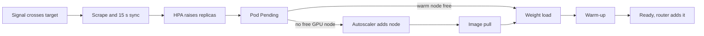

# 20.20 Autoscaling GPU inference

## What the interviewer is testing

Traffic doubles at 09:00 and your dashboards go red for eight minutes. The autoscaler did exactly what you configured, and that is the problem. This chapter serves the system design round, where you must say how capacity follows load, and the 30-minute incident round, where a bad scaling decision is a common cause. The job posting asks you to "tune Kubernetes autoscaling to improve GPU efficiency". It also lists alert design and SLOs for high-throughput APIs.

Nebius has not published its autoscaling signals, thresholds or scale-down rules. What is public is thin. Token Factory dedicated endpoints let a customer choose the GPU type, GPUs per replica, and minimum and maximum replicas. The customer dashboard shows active replicas and scaling. Everything else in this chapter is a reasonable design built from books, upstream documentation and a simulator I ran. I label it that way, and you should too when you answer.

A realistic question in the interviewer's voice: "Your vLLM fleet is on Kubernetes. GPU utilisation is 45 percent and users complain about slow first tokens. Which signal do you scale on, how fast does it react, and what happens when you scale back down?"

## The core ideas

### 1. Why CPU and GPU utilisation fail for LLM engines

Picture a fleet of three replicas on a quiet afternoon. Each has a handful of streams open. The GPU still reads as busy, because the engine keeps launching kernels every few milliseconds. Now picture the same fleet at five times the traffic, with a queue growing outside the engines. The GPU reads as busy again. Utilisation cannot tell you which of the two situations you are in.

The mechanism is continuous batching. The engine keeps one batch of running sequences and adds or removes sequences every step. A small batch already keeps the GPU active. Once the batch is full, more load goes to the waiting queue, and utilisation cannot rise any further. The signal saturates exactly when you most need it to grow. LLMs in Production, Chapter 6, makes a related point. It says an individual GPU's utilisation tends to sit near 0 percent or 100 percent, which makes the autoscaler oscillate, and it advises averaging across GPUs or over time.

CPU is worse. Production Kubernetes, Chapter 13, warns against scaling on a metric that does not change in proportion to load, and it gives CPU spikes at startup as an example. An LLM engine's CPU does the tokenisation and the HTTP work. It does not track how many sequences the GPU holds. LLMs in Production adds that the CPU and memory must be large enough, or the service throttles before the GPU metric ever moves.

Research papers make the same case. The AIBrix paper says request-rate scaling cannot capture GPU-bound resource patterns such as KV-cache pressure, and it names limits of the GPU metrics exporter. The TokenScale paper calls GPU utilisation and request counts lagging indicators. Both are research claims. Neither is Nebius practice.

My simulator adds one more effect, and it is a model, not a measurement. I let the utilisation signal reach 100 percent once a quarter of a replica's slots are in use. That is an assumption. With a 0.7 target, the policy then keeps scaling until replicas are mostly idle. On a steady load that three replicas can serve with no queue at all, the utilisation policy grew the fleet to nine and held it there. It used 11.7 GPU-hours against 3.0 for a fixed fleet, with the same latency.

The failure has two faces, and you should name both. Utilisation can over-provision, because it reads "busy" at light load. It can also under-react, because it cannot read how far past capacity you are. The chapter on [autoscaling inference](../part-15-inference/15-autoscaling-inference-hpa-keda-and-scale-to-zero.md) covers the same ground with the DCGM metric in detail.

**Decision: do not scale an LLM engine on CPU or GPU utilisation. Use them as a health view, and scale on a signal that counts work.**

### 2. Signals that work, and the difference between leading and lagging

An alert says time to first token tripled. The queue is long. Was it long ten minutes ago, when you could have acted? A good scaling signal rises before users feel pain. A poor one rises together with the pain.

vLLM exports the raw material on `/metrics`. The metrics design page lists `vllm:num_requests_running`, `vllm:num_requests_waiting`, `vllm:kv_cache_usage_perc` and the histogram `vllm:request_queue_time_seconds`. The page itself says "a common use case for our metrics is to support automated scaling of vLLM instances". It also says the saturation point, where more requests add latency and not throughput, is what you need to detect. It does not name a recommended set. That choice is yours.

| Signal | Metric | Leads or lags | Notes |
|---|---|---|---|
| Waiting queue | `vllm:num_requests_waiting` | Lags | Zero until slots are full. Good for sizing a backlog, poor for early warning. |
| Concurrent requests | `vllm:num_requests_running` | Leads | Rises with load before any queue forms. KServe's example scales on it. |
| In-flight | running plus waiting | Leads, then sizes | My choice. Proportional to demand on both sides of saturation. |
| KV-cache usage | `vllm:kv_cache_usage_perc` | Leads for long contexts | Fraction from 0 to 1. Catches long prompts that few requests can hold. |
| Queue time | `vllm:request_queue_time_seconds` | Lags | An outcome, close to the SLO. Better as a guardrail than a controller. |
| Tokens in flight | Not exported directly | Leads | Unverified: I found no single vLLM metric for it. TokenScale's token velocity is the research version. |

The simulator shows why the distinction matters. On a ramp from 1.2 to 7.2 requests per second, a policy on waiting-queue depth alone violated a 5-second queue-time SLO for 57 percent of requests. A policy on in-flight requests violated it for 8 percent. Queue depth only moves after slots are full, and then the cold start delays the answer. Do not take away "queue beats utilisation". Take away that the signal must lead saturation and stay proportional to demand.

Count KV-cache usage as a second trigger, not the first. A fleet can sit at moderate concurrency while long prompts fill the cache. The KServe docs give a worked setup, which scales on `vllm:num_requests_running` with a target of 2 per pod. With 6 concurrent requests the system scales to 3 replicas. The KServe docs also name waiting requests and KV-cache usage as scaling inputs.

**Decision: scale on in-flight requests per replica, add KV-cache usage as a second trigger, and alert on queue time and TTFT as the outcome.**

### 3. The HPA formula, with a worked example

Your autoscaler reads a number every 15 seconds and decides how many replicas to want. You should be able to do that arithmetic on a whiteboard. The Kubernetes docs give the rule. The desired count is the current count times the ratio of the current metric value to the target.

```text
desiredReplicas = ceil( currentReplicas × currentMetricValue / desiredMetricValue )
```

The ratio is skipped when it is close to 1.0. The docs call this a tolerance and say it defaults to 0.1. Four ready replicas hold 22 in-flight requests each. The target is 11. The ratio is 2.0, so the desired count is 8. If the average were 11.9, the ratio of 1.08 sits inside the tolerance and nothing happens.

Now the part interviewers like. Fifteen seconds later, the four new replicas are still loading weights. The old four still hold 22 requests each, so 88 are in flight. A naive controller divides 88 by 4 again and asks for 8 more. The docs describe how HPA avoids this. For a scale-up, not-yet-ready pods are assumed to use 0 percent of the target. The average becomes 88 divided by 8, which is 11. The ratio is 1.0 and the controller does nothing more. That rule stops a runaway while replicas are starting.

The docs add two more rules. With several metrics, HPA computes a count for each and takes the largest. If one metric cannot be fetched and the others suggest a scale-down, scaling is skipped. Scale-up still works. A KEDA ScaledObject sits on top of this. KEDA creates and owns an HPA and feeds it the trigger values. The ScaledObject's own cooldown applies only to scaling to zero, and the HPA drives every step from 1 to N.

Where the metric comes from is a real decision. Production Kubernetes, Chapter 13, shows the Prometheus Adapter route. LLMs in Production, Chapter 6, recommends KEDA instead and says the adapter was not designed for production workloads. KEDA's Prometheus trigger takes a `query` and a `threshold`. Its `metricType` defaults to `AverageValue`, so the threshold is per replica. The manifests in the lab use both options.

**Decision: pick a per-replica target near 70 percent of what a replica can hold, and do the ratio by hand before you trust the autoscaler.**

### 4. Stabilization windows and flapping

At 14:00 a burst ends. At 14:03 a second one starts. If the autoscaler removed six replicas in the gap, it must now pay six cold starts. That oscillation is flapping. LLMs in Production defines it as booting a service only to terminate it before it served anything.

The defaults come from the Kubernetes docs. Scaling up has no stabilization window, and it may add 100 percent of the replicas or 4 pods every 15 seconds, whichever is larger. Scaling down has a 300-second window and a single policy that can remove 100 percent of the replicas per 15 seconds. The window works as a rolling maximum. The controller records each recommendation and, before scaling down, takes the highest one from the last window. A short dip in load therefore changes nothing.

Those defaults are wrong for an engine that needs minutes to start. LLMs in Production says the 300-second scale-down default is probably too short and that the window should be at least as long as a deployment takes, plus a margin. It also says terminating a pod takes seconds while booting one takes minutes, which makes scale-down a nearly irreversible decision. So make it slow. A policy of one pod per three minutes, with a 900-second window, is a reasonable starting point. That is my choice, and you must tune it on your own traffic.

The simulator shows the effect on a sawtooth trace with a short burst every six minutes. With a 300-second window and in-flight scaling, the controller reversed direction once and started 13 replicas. With no window it reversed 19 times and started 130. Each start is a cold start, which is paid GPU time that serves nothing.

Two controls matter at the other end. `selectPolicy: Min` on scale-down picks the slowest allowed policy. A `scaleUp` window of 0 stays fine, as long as the metric already includes the not-ready pods rule from the last section. Do not raise the scale-up window to calm the graph. That delays the thing you need.

**Decision: scale up fast, scale down slowly, and set the scale-down window longer than your cold start.**

### 5. Scale-up latency, broken down

A new replica is not capacity until it answers. The time between "the metric crossed the line" and "a stream is served" is the number that decides whether autoscaling works for you. Break it into parts, because each part has a different cure.

| Stage | What happens | Assumed value in my simulator | Cure |
|---|---|---|---|
| Decision | Metric scrape, polling and the 15 s sync | A few seconds to 30 | Shorter polling, cached metrics |
| Node provision | Cluster autoscaler adds a GPU node | 240 s | Warm node pool, placeholder pods |
| Image pull | A large serving image reaches the node | 90 s | Pre-pulled image, smaller image |
| Weight load | Weights move from storage to GPU memory | 120 s | Local volume cache, fast storage |
| Warm-up | First requests, graph capture, caches | 30 s | Warm-up request in the startup probe |
| Registration | Readiness passes and the router adds it | Seconds | Readiness that reflects real load |

The values in the third column are my assumptions, chosen to be round and plausible. They are not measurements. Published ranges point the same way. Distributed AI Systems, Chapter 9, says loading a model and warming up the GPU can take 30 to 60 seconds. The AIBrix paper reports a 2 to 3 minute delay for new pods because of large images and slow model distribution. Cluster Autoscaler documentation says it expects a requested node to appear within 15 minutes before it gives up. Your real numbers need a measurement on your hardware. [Chapter 20.18](./18-how-llm-serving-fails.md) covers slow weight load and the herd that forms when many replicas restart together.

The path below shows where a spare node skips work.



Add the stages for my assumed values and you get 480 seconds for a replica on a fresh node, and 150 seconds when a spare node is already waiting. The simulator computes both. Now you can say how much a given burst needs. If demand grows by 0.4 requests per second each minute, and one replica serves 0.8 requests per second, an eight-minute cold start needs 4 replicas of headroom. A 150-second cold start needs 2. The chapter on [capacity estimation](./12-estimation-toolkit-for-inference-capacity.md) shows where the per-replica rate comes from.

There are four ways to hide the delay. Hold spare capacity as running replicas, which is the safest and the most expensive. Hold spare nodes with no replica, which removes node provision and image pull and leaves the weight load. Run placeholder pods with low priority. Production Kubernetes, Chapter 13, describes the pattern. Pods that request a whole node and do nothing are evicted the moment a real pod needs the space, and the evicted placeholder then forces the cluster autoscaler to add a replacement node. Finally, lower the target in the HPA so that scaling begins earlier. Production Kubernetes warns that setting it too low for rare spikes leaves you permanently over-provisioned.

Model delivery has its own choice. LLMs in Production, Chapter 6, calls baking weights into the image an antipattern, because the image still has to be downloaded. Its hybrid option downloads once and keeps a mounted volume, so later instances skip the download. AI Systems Performance Engineering, Chapter 16, lists autoscaling with warm spares as a way to hide model load times at a slight cost increase.

**Decision: measure each stage on your own cluster, then buy back the largest one first.**

### 6. Minimum replicas, X+1, and cost against latency

Your minimum replica count is a price you pay every hour for a latency promise. Set it too low and a burst arrives before the autoscaler can answer. Set it too high and GPUs sit idle. LLMs in Production says the minimum should sit slightly above the baseline, because steady traffic is rarely steady.

The Nebius chat-app case study, which is vendor material, names X+1 redundancy. For inference, that means enough replicas to carry the baseline when one is lost, plus one. With a baseline of 1.2 requests per second and 0.8 per replica, you need 2 replicas, so the floor is 3. That is what my simulator uses. Nebius has not published its own floors or spare policy.

I ran the burst trace, which jumps from 1.2 to 6 requests per second for 15 minutes, against several floors and a spare-node pool. All runs use the in-flight policy and the same assumed cold start.

| Setup | GPU-hours in an hour | Requests over the 5 s queue SLO |
|---|---|---|
| Floor of 3 | 7.2 | 51.5 percent |
| Floor of 3 and 2 spare nodes | 8.9 | 46.6 percent |
| Floor of 3 and 6 spare nodes | 12.3 | 35.6 percent |
| Floor of 6 | 8.9 | 38.0 percent |
| Floor of 9 | 10.8 | 0 percent |

A floor of 9 costs 3.6 GPU-hours more than a floor of 3 and removes the whole burst. Spare nodes cost more than standing replicas and help less, because they still leave 150 seconds of weight load and warm-up. The hour and the trace are invented, so the shape is the lesson. A five-times burst with an eight-minute cold start cannot be reacted to, only absorbed.

This is also where the SLO decides. The chapter on [SLIs and SLOs](./19-slis-slos-and-alerts-for-token-apis.md) turns a 99.9 percent target into minutes of error budget. A burst that burns a month's budget in 15 minutes justifies the floor of 9. A burst that happens once a week may not.

**Decision: set the floor from the SLO and the cold start, price it in GPU-hours, and say the number out loud.**

### 7. Scale-down safety and connection draining

At 15:10 the autoscaler removes a replica that is halfway through 40 streaming answers. Forty users see a cut stream. This is the failure that quiet dashboards hide, because the request counter shows an error, and nothing shows a cause.

Start with who dies. When a ReplicaSet scales down, the Kubernetes docs say pending pods go first. Then a lower `controller.kubernetes.io/pod-deletion-cost` goes first, then pods on nodes with more replicas, then newer pods. If all of that ties, the choice is random. Nothing in that order looks at how many streams a pod holds. The annotation is beta since v1.22. The docs suggest updating it once before a scale-down, in proportion to utilisation, when the application controls the scale-down itself.

Next, the termination sequence. The docs say a pod gets 30 seconds by default. The kubelet runs a `preStop` hook, sends SIGTERM, and sends SIGKILL when the grace period ends. If the hook needs more time, you must raise `terminationGracePeriodSeconds`. A native `sleep` action exists for hooks. The pause gives load balancers time to stop sending new requests. My manifest uses 15 seconds, which is an arbitrary number to tune.

Then the engine must finish what it has. The vLLM Kubernetes docs, from the main branch, say the listener stops accepting connections when shutdown starts, and a `--shutdown-timeout` flag drains in-flight requests. Check that flag against `vllm serve --help` for your version, because I read development documentation and did not run it. Set the grace period above your longest expected stream plus the timeout. A 120-second answer needs a grace period of more than 120 seconds.

In the simulator, draining made a difference. On the sawtooth trace with the waiting-queue policy and no drain, 168 streams were cut. With a drain they were zero. With the in-flight policy and no drain, 16 were cut. A PodDisruptionBudget also helps, with `maxUnavailable: 1`, because node drains and cluster autoscaler evictions respect it.

The cluster autoscaler adds its own rules. Per its FAQ, it considers a node for removal when its pods' CPU and memory requests sum to less than 50 percent of allocatable, and a node must stay unneeded for 10 minutes by default. Scale-down is also held for 10 minutes after a scale-up. It respects PodDisruptionBudgets and evicts through the eviction API for up to 2 minutes. The docs define utilisation by CPU and memory requests. How GPU nodes are judged is something I did not verify, so check it before you rely on the 50 percent rule.

**Decision: make a pod unable to die mid-stream by setting a grace period, a preStop pause, an engine drain and a disruption budget together.**

### 8. Cluster autoscaler and GPU node pools

The pod autoscaler asks for replicas. Something must supply the nodes. The cluster autoscaler watches for pods that cannot be scheduled and adds a node when a node group could fit them. Production Kubernetes, Chapter 13, points out the consequence. By the time it acts, the cluster is already full, so your replicas wait for the node to appear.

Nebius documents the same mechanism for its managed Kubernetes. A node group can have autoscaling with a minimum and a maximum node count. The CLI flags are `--autoscaling-min-node-count` and `--autoscaling-max-node-count`. The page says the autoscaler adds nodes when pods cannot be scheduled and removes underused ones. It gives no default values, limits or timings for scale-up or scale-down. It does not say whether a minimum of zero is allowed.

Three more points from that page matter for GPU work. It advises a CPU node group of at least two nodes, or an autoscaling one, so that CoreDNS and the networking add-on can run there and the GPU group can scale down. It lists a known issue. With the NVIDIA GPU Operator and Network Operator installed, autoscaling on a GPU group can create more nodes than needed. The page attributes it to an upstream autoscaler bug and suggests a new node group on the GPU-adapted boot image. I have read the page and have not reproduced the issue.

Upstream, a few settings carry over to any cloud. The expander chooses which node group to grow, with options that include `random`, `most-pods`, `least-waste`, `price` and `priority`. The `priority` expander lets you rank node groups, for example to prefer one GPU type. The setting `--max-node-provision-time` defaults to 15 minutes. If a node does not register by then, the autoscaler stops counting it. That is a long wait, and it explains why you keep warm capacity.

Capacity itself is a limit. Production Kubernetes advises knowing where a cluster stops scaling before components become the bottleneck. For GPUs the limit is often stock, not software. Nebius has not published how it handles quota or spare hardware for Token Factory. A reasonable design is to keep a floor of warm nodes in each region, and to alert when requested GPUs cannot be delivered.

**Decision: give GPU pools their own node group with a maximum that matches your quota, keep system pods on CPU nodes, and keep a warm floor.**

### 9. Multi-model fleets and placement

You run 40 models. A few are hot, most are quiet. Hands-On LLM Serving and Optimization, Chapter 3, describes the two obvious designs. The cost-optimised one shares serving instances and loads models on demand. Its challenges are cold start, with seconds or tens of seconds of delay when a model is not loaded, and hot-model scaling, because each instance keeps its own cache. The latency-optimised one gives each model a dedicated, always-on pool, with no cold-start delay and independent scaling. The book says that design excels for hot models and is simpler to run.

Token Factory dedicated endpoints look like the second design, because each customer endpoint has its own GPU type and replica bounds. That is my reading of the public description, not a statement about the internal fleet. For serverless models, Nebius has not published how it shares GPUs.

Several rules follow. Autoscale each model on its own signal and its own floor, because a shared metric hides the model that is struggling. Give hot models a standing floor and let quiet ones scale down to a small number. Use the router to send requests to replicas that already hold the model. AI Systems Performance Engineering, Chapter 16, adds that you can shift GPUs between a large-model pool and a small-model pool with container orchestration.

Disaggregated serving adds a second axis. AI Systems Performance Engineering, Chapter 17, says to scale decode workers when many users generate long outputs, and that scaling one role does not interfere with the other. It shows a Dynamo planner example with separate scale-up and scale-down thresholds for prefill and decode. TokenScale proposes a combined signal of prefill, network and decode rates, and reports better SLO attainment on its own tests. Those numbers are the authors' claims. The chapter on routing and retries chapter, 20.21, and the Part 15 chapter on [prefill and decode disaggregation](../part-15-inference/10-prefill-and-decode-disaggregation.md) go further.

Scale-in also hurts cache-aware routing. A removed replica takes its prefix cache with it, and the hit rate drops until the cache warms again. Part 15 calls this a miss storm. Scale in slowly and by few replicas.

**Decision: scale each model on its own signal, pool hot models with a floor, and scale cached replicas out of service gently.**

### 10. What other platforms do, kept separate from Nebius

Interviewers sometimes ask whether you know the open-source options. Every item here is a source's claim. KServe runs LLM scaling through KEDA in its standard mode, with a Prometheus trigger on `vllm:num_requests_running`. AIBrix keeps a sliding window inside its autoscaler. Its release notes claim 11.5 percent lower latency and 33 percent fewer oscillations than native HPA. Distributed AI Systems, Chapter 9, describes the llm-d variant autoscaler, which estimates each instance's token capacity and scales before latency degrades. None of these is documented as Nebius practice.

**Decision: know the idea behind each tool, and say which signals you would copy without claiming Nebius uses them.**

## How to answer out loud

**Question 1. "How would you autoscale a vLLM fleet?"** Start with the failure of the obvious answer. CPU and GPU utilisation saturate under continuous batching, so they cannot tell busy from overloaded. Then say your signal: in-flight requests per replica, with KV-cache usage as a second trigger, and queue time and TTFT as outcome alerts. Give the formula and one worked number. Name the floor, the scale-down window and the drain. Expect the follow-up "why not queue depth", and answer that it lags because it is zero until slots are full.

**Question 2. "GPU utilisation is 45 percent and users see slow first tokens."** Say that utilisation is not evidence of headroom. Check waiting requests, running requests and KV-cache usage on the replicas. If requests are waiting, add replicas now and mitigate with rate limits. Then change the autoscaling signal, so the next event is caught earlier.

**Question 3. "A scale-up takes eight minutes. How do you handle a spike?"** Break the eight minutes into stages and say which you can shorten. Name the four options: standing replicas, spare nodes, placeholder pods and an earlier trigger. State the trade-off with a number. Give the arithmetic for headroom from the ramp rate and cold start. Say that a spike faster than the cold start must be absorbed, with floors, rate limits and shedding, and not reacted to.

**Question 4. "The autoscaler flaps. What do you change?"** Look at the recommendations over time. Lengthen the scale-down window beyond the cold start, slow the scale-down policy to one pod per few minutes, and check that the metric is smooth, for example averaged over a window. Confirm that not-ready pods are counted the right way. Expect "what does a flap cost", and say each one pays a cold start.

**Question 5. "How do you scale down without hurting users?"** Say that Kubernetes does not choose the idle pod. Then list the four layers: a grace period longer than your longest stream, a preStop pause, an engine drain, and a disruption budget. Mention the deletion-cost annotation as an option and say that you would verify it on your cluster. Close by saying how you would detect the problem, with a count of streams cut at termination.

## Worked scenarios

### Scenario A. The HPA arithmetic during a burst

Four replicas are ready, each with 22 in-flight requests. The target is 11 per replica, the sync period is 15 seconds, and the max is 16.

At the first sync the ratio is 22 divided by 11, which is 2.0. The desired count is ceil of 4 times 2, which is 8. The default scale-up policies allow 100 percent or 4 pods per 15 seconds, so going from 4 to 8 is allowed. At the second sync the four new replicas are not ready. The 88 requests are spread over 8 pods for the calculation, the average is 11, and the ratio is 1.0. Nothing changes. After the replicas load weights and join, the 88 requests spread over 8 pods. If traffic then falls and the recommendation drops to 5, the 900-second window keeps the count at 8 until the highest recommendation inside the window is lower. The answer: 8 replicas, no runaway, and a slow descent.

### Scenario B. The ramp that no reaction can catch

Demand grows 0.4 requests per second every minute. A replica serves 0.8 requests per second. Cold start with a fresh node is 480 seconds.

Demand grows by 0.4 times 8, which is 3.2 requests per second during one cold start. Divide by 0.8 and you need 4 replicas of headroom. With spare nodes, the cold start is 150 seconds. Demand grows 1.0 requests per second in that time, so you need 2 replicas. The function `lead_time_headroom` does this sum. The answer: hold 4 standing replicas, or hold spare nodes and 2 standing replicas. Then say which costs less per hour on your GPU price.

### Scenario C. The sawtooth and the cut streams

Short bursts arrive every six minutes. After each burst the autoscaler removes replicas, and a few minutes later it adds them again. Users report streams that stop halfway.

Two problems overlap. The first is flapping, which wastes cold starts. The second is that scale-down does not drain. The simulator reproduces both. With no window the in-flight policy starts 130 replicas in an hour and reverses direction 19 times. With a 300-second window it starts 13 and reverses once. With the waiting-queue policy and no drain, 168 streams are cut. The answer: lengthen the window beyond the cold start, slow the scale-down, and add the drain stack from section 7.

### Scenario D. The finance question

Your manager asks why the floor is 9 when the baseline needs 2. Use the table in section 6. A floor of 3 costs 7.2 GPU-hours in the test hour and misses the queue SLO for half the requests. A floor of 9 costs 10.8 and misses it for none. The extra 3.6 GPU-hours buy the whole burst. Convert that to money at your GPU price and compare it with the error budget. The trace is invented, so repeat the run with your own traffic.

## Hands-on lab

Everything here runs on a laptop with Python and `kubeconform`. I ran steps 1 to 5. Step 6 needs a Kubernetes cluster and was not run. I did not run anything that needs a GPU, vLLM or a cluster.

1. From the repo root, run the tests.

```bash
python3 -m pytest -q code/part20/test_c20_autoscale_sim.py
```

Expected result: 13 passed.

2. Compare the policies on a burst. The table has one row per policy.

```bash
python3 code/part20/c20_autoscale_sim.py --trace burst
```

Expected shape, which I ran: the static fleet violates the 5 second queue SLO for 91 percent of requests. The queue and in-flight policies violate it for about 51 percent. The utilisation policy violates it for 0 percent and uses 12.6 GPU-hours against about 7 for the others.

3. Run a steady load. The point is that the utilisation policy grows a fleet that does not need to grow.

```bash
python3 code/part20/c20_autoscale_sim.py --trace steady
```

Expected result: the utilisation row shows 11.71 GPU-hours and 9 final replicas. The other rows show 3.0 and 3.

4. Test flapping and draining.

```bash
python3 code/part20/c20_autoscale_sim.py --trace sawtooth --down-window 0
python3 code/part20/c20_autoscale_sim.py --trace sawtooth --no-drain
```

Expected result: the first command shows 19 or 20 direction flips for each autoscaling policy. The second shows 168 dropped streams for the queue policy.

5. Validate the manifests. The first command checks the core types, and the second checks the KEDA object against its upstream CRD.

```bash
kubeconform -summary -strict -ignore-missing-schemas -skip ScaledObject code/part20/c20_*.yaml
python3 -I tools/check_crd_yaml.py keda.sh_scaledobjects.yaml -- code/part20/c20_keda_vllm_scaledobject.yaml
```

Expected result: 6 resources found, 5 valid, 1 skipped. Then "checked 1 resources, 0 problems". I fetched the CRD file from the `kedacore/keda` repository at its main branch.

6. Not run. On a cluster with KEDA installed, apply the ScaledObject, then watch the HPA that KEDA creates.

```bash
kubectl -n llm get scaledobject,hpa
kubectl -n llm describe hpa keda-hpa-vllm-llama
```

Expected shape, not run: the HPA shows the two external metrics and its current and target values.

### The files

The simulator replays a traffic trace second by second. The scaling controller follows the Kubernetes docs. Every default is an assumption, and the file says so.

```python
# code/part20/c20_autoscale_sim.py
"""Autoscaler simulator for an LLM-engine fleet. A TOY MODEL, not vLLM and not Kubernetes.

It replays a traffic trace second by second. Replicas take a cold-start delay before they serve.
The scaling controller copies the HPA rules from the Kubernetes docs: the ratio formula, the 0.1
tolerance, a 15 second sync period, a scale-down stabilization window, and the rule that
not-yet-ready pods count as 0 percent of target when scaling up.
Every number in DEFAULTS is an assumption for teaching, not a measurement of any real system.
Standard library only.
"""
import argparse
import json
import math
import random
from collections import deque
from dataclasses import dataclass, field

DEFAULTS = {
    "slots": 16,               # concurrent sequences one replica serves
    "service_s": 20,           # seconds one streamed request holds a slot
    "util_saturation": 0.25,   # fraction of slots in use at which the GPU already looks 100 percent busy
    "node_provision_s": 240,   # assumed: new GPU node joins the cluster
    "image_pull_s": 90,        # assumed: pull a large serving image onto a fresh node
    "weight_load_s": 120,      # assumed: read weights from storage into GPU memory
    "warmup_s": 30,            # assumed: first requests, graph capture, caches
    "sync_s": 15,              # HPA default sync period
    "grace_s": 120,            # terminationGracePeriodSeconds for a draining replica
}


def hpa_desired(current, metric, target, tolerance=0.1):
    """The documented HPA ratio rule. Returns current when the ratio is inside the tolerance."""
    ratio = metric / target
    if abs(ratio - 1.0) <= tolerance:
        return current
    return math.ceil(current * ratio)


def cold_start_s(p, has_node):
    """Seconds from the scale decision until a replica serves. A spare node skips two steps."""
    base = p["weight_load_s"] + p["warmup_s"]
    return base if has_node else base + p["node_provision_s"] + p["image_pull_s"]


def lead_time_headroom(ramp_rps_per_min, cold_s, per_replica_rps):
    """Replicas of spare capacity that cover demand growth during one cold start."""
    growth = ramp_rps_per_min * (cold_s / 60.0)
    return math.ceil(growth / per_replica_rps)


def make_trace(kind="burst", seconds=3600, seed=7):
    """Arrivals per second as floats. Deterministic for a given seed."""
    rnd = random.Random(seed)
    out = []
    for t in range(seconds):
        if kind == "steady":
            rate = 1.2
        elif kind == "burst":      # base 1.2 rps, a 5x burst from minute 10 to minute 25
            rate = 6.0 if 600 <= t < 1500 else 1.2
        elif kind == "ramp":       # climbs from 1.2 to 7.2 rps over 30 minutes, then falls
            rate = 1.2 + min(t, 1800) / 1800 * 6.0 if t < 2400 else 1.2
        elif kind == "sawtooth":   # short bursts every 6 minutes, the flapping test
            rate = 4.0 if (t % 360) < 90 else 1.2
        else:
            raise ValueError(kind)
        out.append(max(0.0, rate * (0.9 + 0.2 * rnd.random())))
    return out


@dataclass
class Replica:
    ready_at: int
    running: list = field(default_factory=list)   # remaining seconds per request
    draining: bool = False
    drain_started: int = -1


class Fleet:
    def __init__(self, p, replicas, spare_nodes=0, drain=True):
        self.p, self.drain, self.spare_target = p, drain, spare_nodes
        self.spare = spare_nodes
        self.refills = []                       # times when a spare node is back
        self.reps = [Replica(ready_at=0) for _ in range(replicas)]
        self.queue = deque()
        self.waits, self.dropped = [], 0
        self.replica_s = 0.0
        self.spare_s = 0.0
        self.starting_events = 0

    def ready(self, t):
        return [r for r in self.reps if r.ready_at <= t and not r.draining]

    def starting(self, t):
        return [r for r in self.reps if r.ready_at > t]

    def scale_to(self, t, desired):
        live = [r for r in self.reps if not r.draining]
        while len(live) < desired:
            use_spare = self.spare > 0
            if use_spare:
                self.spare -= 1
                self.refills.append(t + self.p["node_provision_s"] + self.p["image_pull_s"])
            rep = Replica(ready_at=t + cold_start_s(self.p, use_spare))
            self.reps.append(rep)
            live.append(rep)
            self.starting_events += 1
        if len(live) > desired:
            # remove the replicas that still start first, then the least busy
            order = sorted(live, key=lambda r: (r.ready_at <= t, len(r.running)))
            for r in order[: len(live) - desired]:
                self._stop(t, r)

    def _stop(self, t, r):
        if r.ready_at > t or not r.running:
            self.reps.remove(r)
        elif self.drain:
            r.draining, r.drain_started = True, t
        else:
            self.dropped += len(r.running)
            self.reps.remove(r)

    def step(self, t, arrivals):
        for _ in range(int(arrivals)):
            self.queue.append(t)
        frac = arrivals - int(arrivals)
        if frac and random.Random(t).random() < frac:
            self.queue.append(t)
        for rd in [x for x in self.refills if x <= t]:
            self.refills.remove(rd)
            self.spare = min(self.spare_target, self.spare + 1)
        slots = self.p["slots"]
        ready = self.ready(t)
        while self.queue and ready:   # least-loaded routing, like a load-aware router
            r = min(ready, key=lambda x: len(x.running))
            if len(r.running) >= slots:
                break
            self.waits.append(t - self.queue.popleft())
            r.running.append(self.p["service_s"])
        for r in list(self.reps):
            r.running = [x - 1 for x in r.running if x - 1 > 0]
            if r.draining and (not r.running or t - r.drain_started >= self.p["grace_s"]):
                self.dropped += len(r.running)
                self.reps.remove(r)
        self.replica_s += len(self.reps)
        self.spare_s += self.spare

    def snapshot(self, t):
        rd, st = self.ready(t), self.starting(t)
        sat = self.p["slots"] * self.p["util_saturation"]
        return {
            "waiting": len(self.queue),
            "running": sum(len(r.running) for r in rd),
            "ready": len(rd),
            "starting": len(st),
            "util": [min(1.0, len(r.running) / sat) for r in rd],
        }


def metric_util(snap):
    return sum(snap["util"]) / max(1, snap["ready"])


def metric_queue(snap):
    return snap["waiting"]


def metric_inflight(snap):
    return snap["running"] + snap["waiting"]


POLICIES = {
    # name: (metric function, target per replica, scale on a per-pod average)
    "util": (metric_util, 0.7),
    "queue": (metric_queue, 2.0),
    "inflight": (metric_inflight, None),   # target set from slots below, 70 percent of slots
}


class Hpa:
    """HPA-style controller. Ratio rule, tolerance, scale-up policy, scale-down policy and window."""

    def __init__(self, policy, p, min_r=3, max_r=16, down_window_s=300, down_pct_per_period=100,
                 up_pods=4, up_pct=100):
        self.name, self.p = policy, p
        self.fn, tgt = POLICIES[policy]
        self.target = tgt if tgt is not None else 0.7 * p["slots"]
        self.min_r, self.max_r = min_r, max_r
        self.down_window_s, self.down_pct = down_window_s, down_pct_per_period
        self.up_pods, self.up_pct = up_pods, up_pct
        self.recs = deque()           # (time, recommendation) for the stabilization window
        self.last_dir = 0
        self.flips = 0
        self.history = []

    def avg_metric(self, snap, scaling_up):
        """Per-pod average. Not-ready pods count as 0 percent of target when scaling up."""
        raw = self.fn(snap)
        if self.name == "util":
            ready_avg = raw
            n = snap["ready"] + snap["starting"] if scaling_up else snap["ready"]
            return ready_avg * snap["ready"] / max(1, n)
        n = snap["ready"] + snap["starting"] if scaling_up else max(1, snap["ready"])
        return raw / max(1, n)

    def decide(self, t, snap, current):
        up = self.avg_metric(snap, True)
        rec = hpa_desired(current, up, self.target)
        if rec <= current:
            rec = hpa_desired(current, self.avg_metric(snap, False), self.target)
        rec = max(self.min_r, min(self.max_r, rec))
        self.recs.append((t, rec))
        while self.recs and self.recs[0][0] < t - self.down_window_s:
            self.recs.popleft()
        if rec > current:
            step = max(self.up_pods, math.ceil(current * self.up_pct / 100))
            new = min(rec, current + step)
        elif rec < current:
            stable = max(r for _, r in self.recs)     # highest recommendation in the window
            new = min(current, stable)
            per = max(1, math.ceil(current * self.down_pct / 100))
            new = max(new, current - per)
        else:
            new = current
        new = max(self.min_r, min(self.max_r, new))
        d = (new > current) - (new < current)
        if d and self.last_dir and d != self.last_dir:
            self.flips += 1
        if d:
            self.last_dir = d
        self.history.append((t, current, new))
        return new


def percentile(xs, q):
    if not xs:
        return 0.0
    s = sorted(xs)
    return float(s[min(len(s) - 1, math.ceil(q * len(s)) - 1)])


def run(trace, policy=None, static_replicas=None, p=None, spare_nodes=0, min_r=3, max_r=16,
        down_window_s=300, down_pct=100, drain=True, slo_wait_s=5):
    p = dict(DEFAULTS, **(p or {}))
    start = static_replicas if policy is None else min_r
    fleet = Fleet(p, start, spare_nodes, drain)
    hpa = None if policy is None else Hpa(policy, p, min_r, max_r, down_window_s, down_pct)
    peak_q = 0
    for t, a in enumerate(trace):
        if hpa and t % p["sync_s"] == 0 and t > 0:
            snap = fleet.snapshot(t)
            cur = len([r for r in fleet.reps if not r.draining])
            fleet.scale_to(t, hpa.decide(t, snap, cur))
        fleet.step(t, a)
        peak_q = max(peak_q, len(fleet.queue))
    waits = fleet.waits + [len(trace) - 1 - w for w in fleet.queue]
    total = max(1, len(waits))
    return {
        "policy": policy or "static",
        "spare_nodes": spare_nodes,
        "served": len(fleet.waits),
        "wait_p50_s": percentile(waits, 0.50),
        "wait_p99_s": percentile(waits, 0.99),
        "wait_max_s": max(waits) if waits else 0,
        "slo_violation_pct": round(100.0 * sum(1 for w in waits if w > slo_wait_s) / total, 1),
        "peak_queue": peak_q,
        "gpu_hours": round((fleet.replica_s + fleet.spare_s) / 3600.0, 2),
        "final_replicas": len([r for r in fleet.reps if not r.draining]),
        "replica_starts": fleet.starting_events,
        "direction_flips": hpa.flips if hpa else 0,
        "dropped_streams": fleet.dropped,
    }


def compare(kind="burst", **kw):
    trace = make_trace(kind)
    rows = [run(trace, None, static_replicas=3, **kw)]
    for pol in ("util", "queue", "inflight"):
        rows.append(run(trace, pol, **kw))
    return rows


def format_table(rows):
    cols = ["policy", "spare_nodes", "wait_p50_s", "wait_p99_s", "slo_violation_pct",
            "peak_queue", "gpu_hours", "final_replicas", "replica_starts", "direction_flips", "dropped_streams"]
    out = ["  ".join(f"{c:>17}" for c in cols)]
    for r in rows:
        out.append("  ".join(f"{str(r[c]):>17}" for c in cols))
    return "\n".join(out)


def main(argv=None):
    ap = argparse.ArgumentParser(description=__doc__.splitlines()[0])
    ap.add_argument("--trace", default="burst", choices=["steady", "burst", "ramp", "sawtooth"])
    ap.add_argument("--spare-nodes", type=int, default=0)
    ap.add_argument("--min-replicas", type=int, default=3)
    ap.add_argument("--down-window", type=int, default=300)
    ap.add_argument("--no-drain", action="store_true")
    ap.add_argument("--json", action="store_true")
    a = ap.parse_args(argv)
    rows = compare(a.trace, spare_nodes=a.spare_nodes, min_r=a.min_replicas, down_window_s=a.down_window,
                   drain=not a.no_drain)
    print(json.dumps(rows, indent=2) if a.json else format_table(rows))
    return 0


if __name__ == "__main__":
    raise SystemExit(main())
```

The HPA manifest scales on in-flight requests. The metric name must come from your adapter rule.

```yaml
# code/part20/c20_hpa_vllm_inflight.yaml
# HPA on in-flight requests per pod. The metric name below is an example. It must be produced by a
# metrics adapter rule (for example prometheus-adapter) that sums vllm:num_requests_running and
# vllm:num_requests_waiting per pod. The adapter rule is not shown here and was not run.
apiVersion: autoscaling/v2
kind: HorizontalPodAutoscaler
metadata:
  name: vllm-llama
  namespace: llm
spec:
  scaleTargetRef:
    apiVersion: apps/v1
    kind: Deployment
    name: vllm-llama
  minReplicas: 3
  maxReplicas: 16
  metrics:
    - type: Pods
      pods:
        metric:
          name: vllm_requests_inflight
        target:
          type: AverageValue
          averageValue: "11"
  behavior:
    scaleUp:
      stabilizationWindowSeconds: 0
      selectPolicy: Max
      policies:
        - type: Percent
          value: 100
          periodSeconds: 60
        - type: Pods
          value: 4
          periodSeconds: 60
    scaleDown:
      stabilizationWindowSeconds: 900
      selectPolicy: Min
      policies:
        - type: Pods
          value: 1
          periodSeconds: 180
```

The KEDA object scales on in-flight requests and on KV-cache usage, and it keeps a fallback if Prometheus fails. Do not run it and the HPA above against the same Deployment.

```yaml
# code/part20/c20_keda_vllm_scaledobject.yaml
# KEDA ScaledObject with two Prometheus triggers. KEDA creates and owns the HPA, and the HPA takes
# the largest replica count that any trigger asks for. Label selectors are examples.
apiVersion: keda.sh/v1alpha1
kind: ScaledObject
metadata:
  name: vllm-llama
  namespace: llm
spec:
  scaleTargetRef:
    name: vllm-llama
  pollingInterval: 15
  minReplicaCount: 3
  maxReplicaCount: 16
  fallback:
    failureThreshold: 3
    replicas: 6
    behavior: currentReplicas
  advanced:
    horizontalPodAutoscalerConfig:
      behavior:
        scaleUp:
          stabilizationWindowSeconds: 0
          policies:
            - type: Percent
              value: 100
              periodSeconds: 60
        scaleDown:
          stabilizationWindowSeconds: 900
          selectPolicy: Min
          policies:
            - type: Pods
              value: 1
              periodSeconds: 180
  triggers:
    - type: prometheus
      name: inflight
      metricType: AverageValue
      metadata:
        serverAddress: http://prometheus.monitoring.svc:9090
        query: sum(vllm:num_requests_running{namespace="llm",pod=~"vllm-llama-.*"}) + sum(vllm:num_requests_waiting{namespace="llm",pod=~"vllm-llama-.*"})
        threshold: "11"
        ignoreNullValues: "false"
    - type: prometheus
      name: kv_cache
      metricType: Value
      metadata:
        serverAddress: http://prometheus.monitoring.svc:9090
        query: avg(vllm:kv_cache_usage_perc{namespace="llm",pod=~"vllm-llama-.*"})
        threshold: "0.8"
        ignoreNullValues: "false"
```

The placeholder pods keep one GPU node warm.

```yaml
# code/part20/c20_gpu_overprovision.yaml
# Placeholder pods that hold one whole 8-GPU node. A real pod preempts them at once. The evicted
# placeholder goes Pending and makes the cluster autoscaler add a node to refill the spare.
# Pattern from Production Kubernetes, Chapter 13, and the Cluster Autoscaler FAQ.
apiVersion: scheduling.k8s.io/v1
kind: PriorityClass
metadata:
  name: gpu-overprovisioning
value: -10
globalDefault: false
description: "Placeholder pods. Lower than the default of 0, so any real pod evicts them."
---
apiVersion: apps/v1
kind: Deployment
metadata:
  name: gpu-overprovisioning
  namespace: llm
spec:
  replicas: 1
  selector:
    matchLabels:
      app: gpu-overprovisioning
  template:
    metadata:
      labels:
        app: gpu-overprovisioning
    spec:
      priorityClassName: gpu-overprovisioning
      terminationGracePeriodSeconds: 0
      containers:
        - name: pause
          image: registry.k8s.io/pause:3.10
          resources:
            requests:
              nvidia.com/gpu: 8
            limits:
              nvidia.com/gpu: 8
```

The drain settings give a stream time to finish before a pod stops.

```yaml
# code/part20/c20_vllm_drain.yaml
# Settings that make scale-down safe for streaming responses. The image tag is a placeholder.
# Check the shutdown flag of your vLLM version with: vllm serve --help
apiVersion: apps/v1
kind: Deployment
metadata:
  name: vllm-llama
  namespace: llm
spec:
  replicas: 3
  selector:
    matchLabels:
      app: vllm-llama
  template:
    metadata:
      labels:
        app: vllm-llama
    spec:
      terminationGracePeriodSeconds: 180
      containers:
        - name: vllm
          image: vllm/vllm-openai:REPLACE_WITH_PINNED_TAG
          ports:
            - containerPort: 8000
          resources:
            limits:
              nvidia.com/gpu: 1
          lifecycle:
            preStop:
              sleep:
                seconds: 15
          startupProbe:
            httpGet:
              path: /health
              port: 8000
            periodSeconds: 10
            failureThreshold: 60
          readinessProbe:
            httpGet:
              path: /health
              port: 8000
            periodSeconds: 5
            failureThreshold: 2
          livenessProbe:
            httpGet:
              path: /health
              port: 8000
            periodSeconds: 30
            failureThreshold: 6
---
apiVersion: policy/v1
kind: PodDisruptionBudget
metadata:
  name: vllm-llama
  namespace: llm
spec:
  maxUnavailable: 1
  selector:
    matchLabels:
      app: vllm-llama
```

## Drill questions

1. Why does GPU utilisation fail as an autoscaling signal for an LLM engine?

<details><summary>Answer</summary>

Continuous batching keeps the GPU busy even with a small batch. Once the batch is full, extra load waits in the queue and utilisation cannot rise. So the signal reads the same at light load and at overload. It tells you the GPU is active, not how much work is waiting.

</details>

2. State the HPA formula and the default tolerance.

<details><summary>Answer</summary>

Desired replicas is the ceiling of current replicas times current metric value divided by the target value. The controller skips scaling when the ratio is within the tolerance of 1.0. The default tolerance is 0.1.

</details>

3. Four replicas hold 30 in-flight requests each. The target is 12. What does HPA ask for, and what happens at the next sync while the new pods start?

<details><summary>Answer</summary>

The ratio is 2.5, so the desired count is ceil of 10, which is 10. Six pods start. At the next sync, not-ready pods count as 0 percent of target for a scale-up. The 120 requests are averaged over 10 pods, which gives 12, a ratio of 1.0, and no further scaling.

</details>

4. What are the default stabilization windows and policies for scale-up and scale-down, and why are they wrong for an LLM engine?

<details><summary>Answer</summary>

Scale-up has no window and may add 100 percent or 4 pods every 15 seconds. Scale-down has a 300-second window and one policy that can remove 100 percent every 15 seconds. A replica takes minutes to start, so a short window lets the fleet shrink and then pay cold starts again. Lengthen the window past the cold start and slow the scale-down policy.

</details>

5. List the stages of a scale-up from decision to serving, and the cure for the biggest one.

<details><summary>Answer</summary>

Decision lag, node provision, image pull, weight load, warm-up and registration. In my simulator's assumptions node provision is the largest at 240 seconds, and a warm node removes it and the image pull. Your own biggest stage needs a measurement. Weight load is cured with a local cache, and warm-up with a warm-up request.

</details>

6. How do you compute how many standing replicas hide a cold start?

<details><summary>Answer</summary>

Multiply the demand growth per minute by the cold start in minutes. Divide by what one replica serves. Round up. For growth of 0.4 requests per second per minute, an 8-minute cold start and 0.8 per replica, the answer is 4.

</details>

7. What is X+1 and how do you apply it to the minimum?

<details><summary>Answer</summary>

X replicas carry the baseline load, and one more covers a failure. With a baseline of 1.2 requests per second and 0.8 per replica, X is 2 and the floor is 3. The Nebius case study names X+1 as vendor material. Nebius has not published its own floors.

</details>

8. Which pod does a ReplicaSet remove when scaling down, and why does that matter for streams?

<details><summary>Answer</summary>

Pending pods go first, then lower pod-deletion-cost, then pods on nodes with more replicas, then newer pods, and otherwise random. None of that looks at open streams. So you need a grace period, a preStop pause, an engine drain and a disruption budget.

</details>

9. How do you know your scale-down is cutting streams?

<details><summary>Answer</summary>

Count client-side errors and finish reasons for streams that end during pod termination. Compare the termination time of pods with the end time of streams. A rise in cut streams at each scale-down event, with no engine fault, points to a missing drain.

</details>

10. Why do spare nodes help less than standing replicas?

<details><summary>Answer</summary>

A spare node removes node provision and image pull, but the replica still has to load weights and warm up. In my simulation that left 150 seconds against 480. A standing replica serves at once. A node costs about the same as a replica but delivers capacity later.

</details>

## Common mistakes and weak answers

Naming a utilisation target is the first mistake. "70 percent GPU utilisation" tells the interviewer you have not seen a continuous-batching engine. Say what you scale on and why that signal leads.

Saying "I would use KEDA" is the second. It names a tool and skips the decision. Give the signal, the target and the cold start, then say KEDA is one way to feed the HPA.

Ignoring scale-down is the third. Say that scale-down is slow, drained and safe, and give the window.

Quoting Nebius internals is the fourth. Say that Nebius has not published its signals, then give your design.

Treating the simulator as truth is the fifth. It is a model with assumed numbers. Say that you would measure your own cold start and traffic.

## Connections to the rest of the handbook

- [20.12 Estimation toolkit](./12-estimation-toolkit-for-inference-capacity.md) gives the per-replica rate and the headroom rule.
- [20.13 Multi-tenant inference API design](./13-design-a-multi-tenant-llm-inference-api.md) puts the autoscaler in the whole design.
- [20.18 How LLM serving fails](./18-how-llm-serving-fails.md) covers queue growth, cold start and the restart herd.
- [20.19 SLIs, SLOs and alerts](./19-slis-slos-and-alerts-for-token-apis.md) gives the budgets that set your floor.
- [20.26 Production incident role-play](./26-the-stress-interview-production-incident-role-play.md) uses scaling failures as incident cases.
- Later in this volume, 20.21 covers routing and retries, and 20.23 covers Kubernetes failure drills.
- [Handbook 15.15 Autoscaling inference](../part-15-inference/15-autoscaling-inference-hpa-keda-and-scale-to-zero.md) and [5.23 Autoscaling in Kubernetes](../part-05-kubernetes/23-autoscaling-hpa-vpa-keda-and-the-cluster-autoscaler.md) give the long reference treatment.

## Sources and review notes

Sources and dates fetched, all on 2026-11-09:

- Kubernetes HPA documentation, from the `kubernetes/website` repository at its main branch: algorithm, tolerance, not-ready pods, behavior defaults, stabilization window. The tolerance field is feature-gated, and I did not verify the release where it became default.
- Kubernetes ReplicaSet and Pod lifecycle documentation, same repository: scale-down order, pod deletion cost, grace period, preStop.
- KEDA documentation, `kedacore/keda-docs`, version 2.22 directory, and the ScaledObject CRD from `kedacore/keda` at main: `pollingInterval`, `cooldownPeriod`, `fallback`, HPA behavior, Prometheus trigger.
- vLLM documentation at main: `docs/design/metrics.md` and the metrics page, which show the metric names, and `docs/deployment/k8s.md`, which mentions draining with a shutdown timeout. The page carried a footer date of October 30, 2026, and no version number.
- KServe documentation, "Autoscale InferenceService with LLM metrics", from the `kserve/website` repository.
- Cluster Autoscaler FAQ from `kubernetes/autoscaler` at master: scale-down conditions, flags, overprovisioning, expanders.
- Nebius documentation, "Autoscaling" under Kubernetes node groups, docs.nebius.com.
- AIBrix: arXiv 2504.03648, section 3.2.4. TokenScale: arXiv 2512.03416. Cited as research, not Nebius practice.
- Production Kubernetes, Chapter 13 "Autoscaling". LLMs in Production, Chapter 6 "Large language model services", sections on autoscaling and model loading. Hands-On LLM Serving and Optimization, Chapter 3 "Model Serving System Design". AI Systems Performance Engineering, Chapters 16 and 17. Distributed AI Systems, Chapter 9 "Production LLM Serving Stack".
- Nebius chat-app case study and the dedicated endpoint description, as recorded in `planning/VOLUME_20_NEBIUS_SRE_PLAN.md` section 1, tagged vendor and official respectively.

Explicitly labelled inferences:

- Every number in the simulator's defaults, including the 240, 90, 120 and 30 second stages, the 16 slots, the 20 second request and the rule that utilisation saturates at a quarter of the slots. They are assumptions for teaching.
- All simulator results, which depend on the invented traces. They show mechanisms. They are not predictions for any real fleet.
- The floor of 3 from X+1, the 900-second window and the one-pod-per-three-minutes policy.
- That Token Factory dedicated endpoints resemble the per-model pool design.
- The statement that a warm floor and a quota alert are a reasonable design for Nebius. Nebius has not published its approach.

Not verified:

- No cluster, GPU or vLLM server was available. I did not apply any manifest, and none of the vLLM metrics were observed live.
- The adapter rule that produces `vllm_requests_inflight` is not provided or tested. The image tag in the drain manifest is a placeholder.
- The `--shutdown-timeout` flag is read from main-branch documentation and needs checking against your vLLM version.
- How the cluster autoscaler computes utilisation for GPU nodes.
- The pause image tag `registry.k8s.io/pause:3.10` was not pulled.
- No vLLM metric for tokens in flight was found. That is a gap in my search, not proof.
- Docker was not running, so nothing was run in a container.
