# 20.21 Request routing, retries and overload control

## What the interviewer is testing

Two of eight replicas start failing at 14:00. Ten minutes later all eight are failing, and the failure rate seen by users is far higher than the share of broken replicas. Nobody wrote a bug that day. The failure spread because the healthy replicas were doing extra work for the broken ones, and the clients were doing extra work for everyone. This chapter teaches you to see that spread before it happens and to design it out. It serves the system design round and the 30-minute incident round. The job posting says the engineer will "harden request routing and retry logic so transient failures don't reach users". It also asks for knowledge of how distributed back-ends fail and for alert design for high-throughput APIs.

The public Nebius case study says the team changed its retry logic to stop amplification in partial outages. It also lists backpressure that stops decode queues overrunning, and cache-aware routing that lifted the cache hit rate from about 5 percent to 50 or 60 percent. All three are vendor claims. Nebius has not published its router, its retry settings or its thresholds, so the interviewer is testing your reasoning. The best answers name the mechanism first, then the setting, and then say which part is public.

A realistic question in the interviewer's voice: "A quarter of your replicas are failing and clients retry three times. Walk me through what happens to the healthy ones, and what you would have built so it does not happen."

## The core ideas

### 1. Decide what is safe to retry before you decide how


*Figure 20.21.1. The first output token is the commit point. Before it, a retry is safe for the customer. After it, the stream must end with an explicit error.*

An error arrives and the client must choose between retrying and giving up. Picture the client as a courier with a parcel. If the parcel was never handed over, a second trip is harmless. If the parcel was already opened and read, a second trip repeats a conversation the recipient has already had. The wrong choice either shows users a failure that a retry would have hidden, or repeats work that should not be repeated. For an LLM API the dividing line is whether the first token has left the building.

RFC 9110 says a client should not automatically retry a non-idempotent request unless it knows the request is safe to repeat or can tell that the original was never applied. A completion request changes nothing on the server except usage counters, so a retry that happens before any output is delivered is safe for the customer. Two costs remain. The retry repeats the prefill on another GPU, and the text may differ because sampling is random. Neither matters if no text was delivered, because the customer has only seen the request wait a little longer. The courier comparison still holds. A second trip to the same door costs time and fuel, and nobody has yet read the parcel. Once the parcel is open, the second trip is a different thing entirely.

After the first token the situation changes. The client has shown text to a person or fed it to a program. A replay from the start would produce different text, and splicing two generations together is wrong. The gRPC retry guide describes the same rule: once response headers arrive, the call is committed and no further retries occur. For a stream, treat the first output event as the commit point.

**Retry freely before the first token, never after it.** After it, end the stream with an explicit error and let the application decide. One continuation design is to resend the prompt plus the text already received and ask the model to carry on. I have not verified that any API supports this cleanly, it pays a second prefill, and token boundaries may not line up. Treat it as an application feature, not a gateway default.

| Situation | Retry? | Where | Why |
|---|---|---|---|
| Connection refused or reset before any response | Yes | Next replica | The request never arrived |
| 503 before first token | Yes, with Retry-After if present | Next replica | The replica is overloaded or draining |
| Timeout before first token | Yes, once, and cancel the first copy | Next replica | The first copy may still be burning GPU time |
| 429 | Not on another replica | Client waits | The tenant is over its limit, not the replica |
| 400, 401, 403, 404, 413, 422 | No | Nowhere | The same request gets the same answer |
| Any failure after first token | No | Surface the broken stream | Replay gives different text |
| Call with side effects and no idempotency key | No | Nowhere | The AWS builders article says such calls are unsafe to retry |

Use the table as a checklist for every endpoint. When you walk a new endpoint through it, start with the question about side effects, because it is the one people skip. A search endpoint that only reads is safe to retry in most designs. A payment or a message send is not, unless the client supplies an idempotency key that the server honours, so the server can recognise a repeat and skip the second write. Answer that question first for each row you add, and the rest of the table becomes a matter of looking up the status code. Each row answers the same two questions: did the work start, and would a different replica change the answer? The table is encoded in `c21_retry_policy.py`, listed in full in idea 13. Decide, for every endpoint, which row it belongs to before you touch any retry setting.

### 2. Timeouts must nest: client above gateway above engine

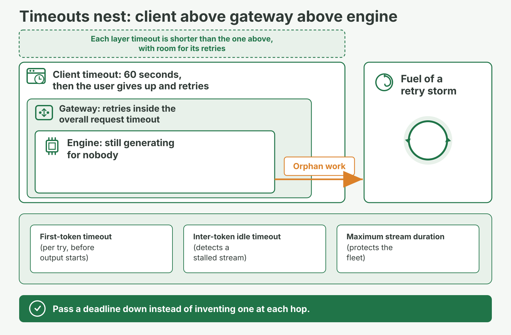

*Figure 20.21.2. Each layer's timeout must be shorter than the one above it, because a mismatch leaves orphan work that fuels a retry storm.*

A user waits 60 seconds, gives up and retries. Meanwhile the gateway is still retrying the first attempt, and the engine is still generating for nobody. Mismatched timeouts create orphan work, and orphan work is the fuel of a retry storm. Each layer is paying for a reply that the layer above has already abandoned.

The rule is that each layer's timeout must be shorter than the one above it, with room for the retries it performs. The Google SRE chapter on cascading failures recommends passing a deadline down instead of inventing one at each hop. Its example is a server with a 30 second deadline that spends 7 seconds before calling a backend, which then passes 23 seconds down. It suggests subtracting a few hundred milliseconds for network time. Passing the remaining time, rather than a fresh number, keeps every hop honest about how much time is really left. A practical test is to write the deadline on the request as it enters the gateway, then read it again at each hop. If the number at the engine is larger than the number the gateway started with, a hop has invented time, and that is a bug even when every single timeout looks correct on its own.

Envoy adds three facts that matter here. All retries sit inside the overall request timeout. The per-try timeout must be lower than the route timeout or it is ignored, and it only applies before any part of the response is sent downstream. And the route timeout defaults to 15 seconds, covers the whole response, and therefore cuts long streams. The Envoy API reference says an idle timeout is the better fit for streaming. Istio's route timeout is disabled by default, and its backoff setting also reduces how many retries fit.

A streaming API needs three separate limits. The first-token timeout is the per-try timeout and applies before output starts. The inter-token idle timeout detects a stalled stream. The maximum stream duration protects the fleet from endless generations. Each limit answers a different failure, and merging them into one number is how a healthy long answer gets cut. Imagine a single 60 second timeout on a stream that is healthy and simply long. It is cut at the sixtieth second even though every token arrived on time. Now imagine a stream that stalls after its first sentence and sends nothing for ten seconds. Only the idle timeout notices it quickly. Separate limits let the healthy stream run and the stalled one fail fast, and that separation is the whole point of the three-limit design.

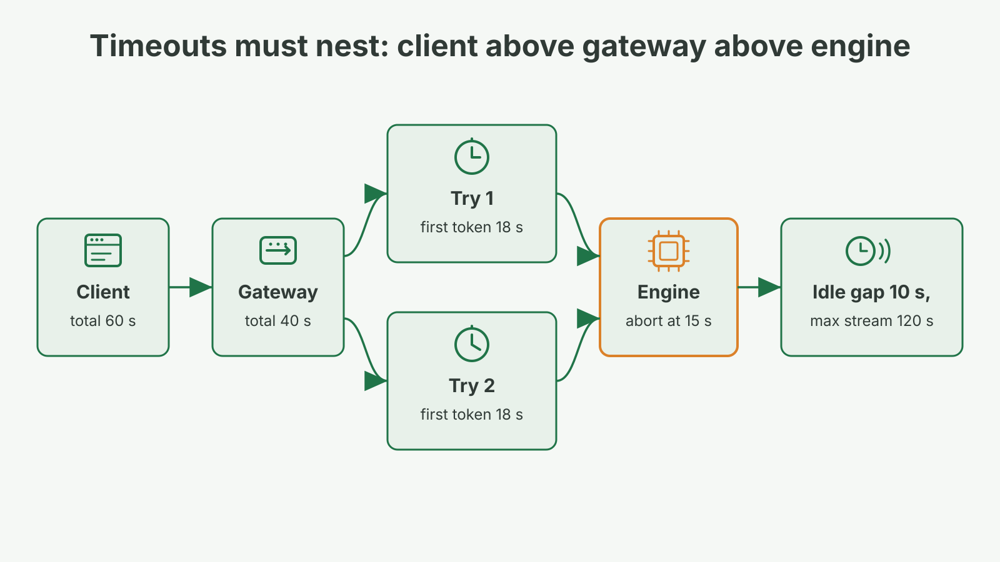

*Figure 20.21.3. Timeouts must nest: client above gateway above engine, as a diagram.*

The function `check_timeouts` tests a chain against these rules. I ran it on two chains. A client of 60 s, gateway total of 40 s, two tries of 18 s with up to 1 s backoff and an engine abort of 15 s returned no problems. A client of 30 s, gateway total of 40 s, three tries of 18 s and an engine of 20 s returned three problems, including that three tries need up to 54 s inside a 40 s total.

Decide: write the four numbers on one line and check that each is smaller than the one before it.

### 3. Why per-request retries amplify an outage

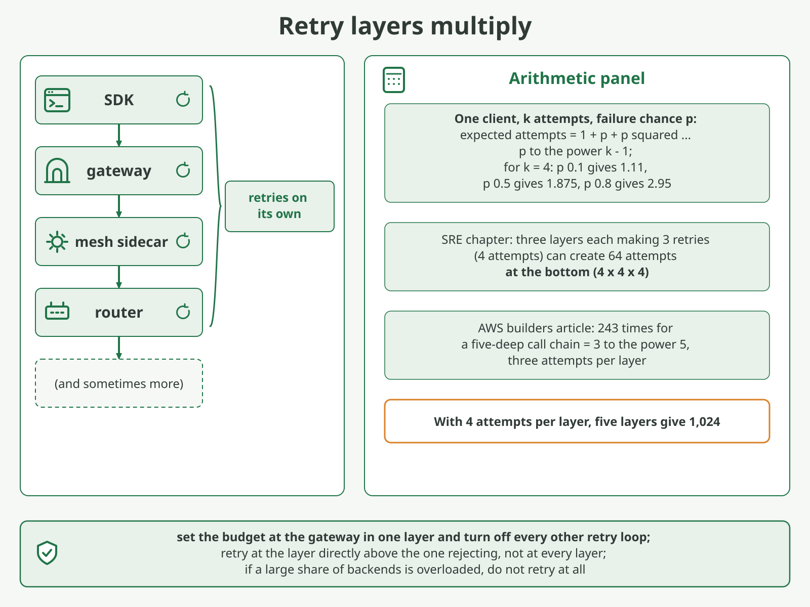

*Figure 20.21.4. Every layer that retries multiplies the load on the layer below.*


*Figure 20.21.5. Retries feed back into the load on the healthy replicas, so one partial failure can grow into a full outage that outlasts the original fault.*

Half your replicas die. Every client that saw an error asks again, so the survivors receive the original traffic plus the retries. That extra load slows them, slow replicas time out, and timeouts trigger more retries. The loop feeds itself, and it can keep going after the original fault is gone.

The arithmetic starts with one client. If each attempt fails with probability p and the client allows k attempts, the expected number of attempts is 1 + p + p squared, continuing to p to the power k minus 1. I computed it for k = 4. At p = 0.1 it is 1.11, at p = 0.5 it is 1.875 and at p = 0.8 it is 2.95. As load rises, p rises, so the multiplier rises with it. The multiplier is the part that grows in the wrong direction at the wrong time.

Layers multiply. The SRE chapter says three layers that each make 3 retries, which is 4 attempts, can create 64 attempts at the bottom. The AWS builders article gives 243 times for a five-deep call chain, which equals 3 to the power 5, so it counts three attempts per layer. With 4 attempts per layer, five layers give 1,024. In an inference platform the layers are the SDK, the gateway, a mesh sidecar, the router and sometimes a queue worker. Retry in one layer only.

The simulation in idea 13 makes the effect visible. Eight replicas each have 4 slots and a 0.5 second service time, so the fleet can serve 64 requests per second. Users send 52 per second. From second 30 to 70, two of the eight replicas fail fast. Clients pick a replica at random, so a retry may land on another bad one. Read the output as a story: what the healthy replicas do when the bad ones start rejecting work. At the start of the outage the bad replicas answer in milliseconds with an error, and the client immediately sends a second copy. Those copies land on random replicas, so a share of them goes to the healthy ones and a share goes back to the bad ones. The healthy replicas now receive the original traffic plus the retries, which is more than the fleet was sized to serve. Their queues grow, and the rest of the story follows from that single change in load.

```text
== short queue (rejects fast), 52 user req/s, outage 30-70 s
policy                   amp.during  ok.during  ok.after  peak att/s  wasted
no_retry                        1.0      0.748     0.992          74       0
naive_4_immediate               1.8      0.914       1.0         144       0
exp_4_no_jitter               1.923      0.922       1.0         145       0
full_jitter_4                 1.892      0.917       1.0         147       0
full_jitter_4_budget10        1.104       0.81       1.0          74       0
== deep queue (waits pass the timeout), 52 user req/s, outage 30-70 s
policy                   amp.during  ok.during  ok.after  peak att/s  wasted
no_retry                        1.0       0.75     0.973          74      72
naive_4_immediate             3.442      0.223     0.026         326    4923
exp_4_no_jitter               3.381      0.243     0.019         301    4934
full_jitter_4                 3.445      0.222     0.017         326    4964
full_jitter_4_budget10        1.109       0.75     0.993          74     237
```

I ran this, and it is the real output. Read the first block honestly. When replicas reject fast, retries help: success rises from 0.75 to 0.91 and the cost is 1.8 times the load. The budgeted policy gives up some of that success to keep load at 1.1 times. That trade is the honest price of protecting the fleet, and it is worth saying out loud in the room. Some customers would rather have a retry that succeeds slowly than a fast failure, and others would rather fail fast and retry themselves. The budget makes that choice for the whole fleet, which is why the choice should be written down and agreed rather than left to the default.

The second block shows the disaster. The queue is deep enough that waiting takes longer than the 2 second attempt timeout. Attempts time out while the replica still completes them later, which the last column counts as wasted work. Retries pile on, the queues never drain, and after the outage ends only 2 percent of requests succeed. The system stays broken with no fault left. Jitter changes almost nothing here, and the budget restores 99 percent. This is a toy, not a model of vLLM, but the mechanism is the one the case study describes.

Decide: keep queues short enough that a request cannot wait longer than its timeout, and add a budget as the second line of defence.

### 4. Retry budgets cap the damage

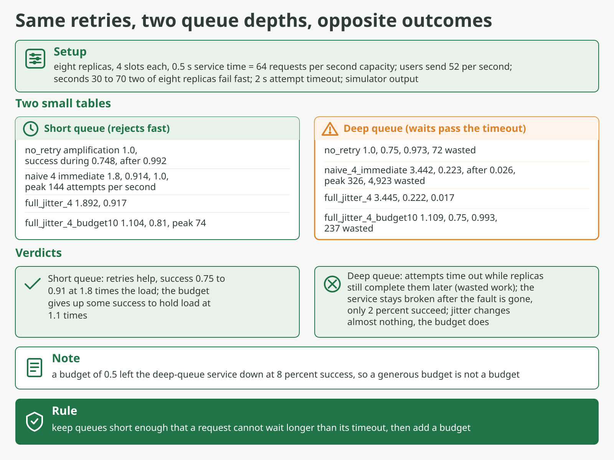

*Figure 20.21.6. A budget protects the fleet in the deep-queue case where jitter does nothing.*

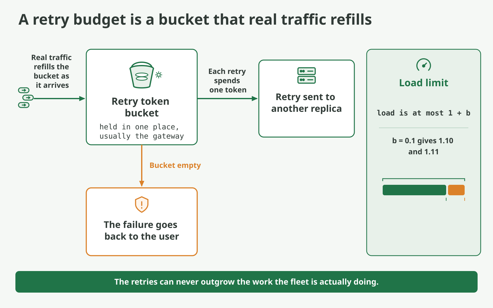

*Figure 20.21.7. A retry budget held in one place caps retries as a share of real traffic, so a storm cannot drain it faster than successful work refills it.*

A per-request limit says how many times one request may retry. It says nothing about the whole fleet. If every request retries three times, the load can quadruple. A budget limits retries as a fraction of all traffic, so the fleet has a fixed amount of extra work it is willing to do, however many requests are failing at once.

The SRE overload chapter uses two limits together. Each request gets up to three attempts, and each client keeps a retry-to-request ratio and stops retrying once the ratio reaches 10 percent. The SRE cascading-failure chapter gives another form, a cap such as 60 retries per minute per process. The gRPC guide describes retry throttling with a token count. It starts at a maximum, such as 10, each failure removes 1, each success adds a ratio such as 0.1, and retries pause when the count falls below half the maximum. Envoy recommends retry budgets and also offers a circuit breaker on concurrent retries.

Think of the budget as a bucket of retry tokens that refills as real traffic arrives. Each retry spends a token, and when the bucket is empty the failure goes back to the user. The bucket is a small piece of state, and it lives in one place, usually the gateway. Keeping it in one place is what makes the cap real. If every pod or every client keeps its own bucket, the fleet-wide cap disappears, and the sum of many small budgets can be far larger than the one you meant to set. The bucket cannot be drained by a storm, because the storm only refills it as fast as successful traffic does. That is the property you want: the retries can never outgrow the work the fleet is actually doing. When someone asks how to size the bucket, the honest answer is that the ratio is the knob and the cap is the safety. A large ratio lets retries grow to a big share of traffic, and a small ratio keeps them close to zero. Tune it against the outage you actually fear, not against a number from a blog post.

With a budget of ratio b, load can never exceed 1 plus b times the original. In the simulation, b = 0.1 gave 1.10 and 1.11. The price is shown in the first block above, where success during the outage fell from 0.92 to 0.81. That price is correct. The size matters too. In the deep-queue case I also ran a budget of 0.5, and the service stayed down after the outage, with 8 percent success, so a generous budget is not a budget. A budget protects the survivors when the fleet cannot serve everyone, and it tells you the real fix is to remove the bad replicas.

The SRE overload chapter adds a rule that matters for inference. If a large share of backends is overloaded, do not retry at all and let the error bubble up. Retry at the layer directly above the one rejecting, not at every layer. The adaptive throttling it describes tracks requests and accepts over two minutes. A client keeps sending until requests exceed a multiple K of accepts, preferably 2, and then rejects some locally. The probability formula is an image on that page, so I have not reproduced it.

Decide: set the budget at the gateway, in one layer, and turn off every other retry loop.

### 5. Exponential backoff with jitter, and the maths

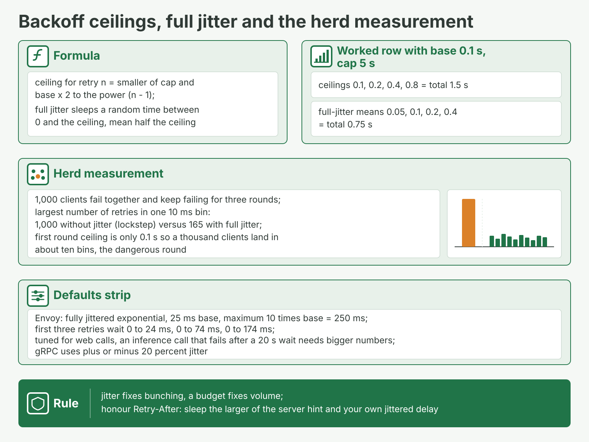

*Figure 20.21.8. Jitter spreads the stampede, and the first round is the dangerous one.*

A replica restarts and a thousand connected clients all fail at the same instant. If each waits 100 ms and retries, the server sees a thousand requests at once, then another thousand 200 ms later. Backoff spaces the retries. Jitter spreads the clients so they do not move together. Without jitter, backoff only moves the stampede to a later time, and the stampede still arrives as one wave.

The exponential schedule doubles the ceiling each time: ceiling for retry n is the smaller of the cap and base times 2 to the power n minus 1. Full jitter then sleeps a random time between 0 and the ceiling. Its mean is half the ceiling, so the total wait is also halved. With base 0.1 s and cap 5 s, the four ceilings are 0.1, 0.2, 0.4 and 0.8 seconds, total 1.5. The full-jitter means are 0.05, 0.1, 0.2 and 0.4, total 0.75.

I measured the herd. One thousand clients fail together and keep failing for three rounds. Without jitter the largest number of retries in one 10 ms bin was 1,000, all clients in lockstep. With full jitter it was 165. The first round has a ceiling of only 0.1 s, so a thousand clients land in about ten bins. That is a small window for a large crowd, which is exactly why the first round is the dangerous one. The later rounds have wider ceilings and spread out more, but a wave that arrives in the first round is the one that can knock a fragile server over before it has a chance to recover. The bins vary by chance, and the peak is already well below the herd. The picture to hold in your head is a crowd leaving a stadium: without jitter everyone pushes the same gate at once, and with jitter they spread across the exits. When you explain the herd to an interviewer, describe what the server's graph would look like in each case. Without jitter there are sharp spikes at regular times, and with jitter the same load becomes a low, wide hill. The total number of retries is the same in both pictures. Only the shape changes, and the shape is what decides whether the server survives the first wave.

Envoy's default is fully jittered exponential backoff with a 25 ms base and a maximum of 10 times the base, which is 250 ms. Its first three retries wait 0 to 24 ms, 0 to 74 ms and 0 to 174 ms. Those defaults are tuned for web calls. An inference call that fails after a 20 second wait needs bigger numbers. The gRPC guide uses a different style, a plus or minus 20 percent jitter around the computed delay, so know that "jitter" has several meanings.

An important limit appears in the second simulation block. Jitter did not rescue the deep-queue case, because the retry load there was continuous, not synchronised. Jitter fixes bunching. A budget fixes volume. You need to name both.

When the server sends Retry-After, honour it. Envoy's rate-limited back-off can read that header and falls back to its exponential schedule when the header is missing or unparseable. A sensible client sleeps the larger of the server hint and its own jittered delay. The server knows its own queue better than the client does, so its hint should win when it is larger. A client that ignores Retry-After and retries on its own schedule is the one that keeps the overloaded server busy. Honouring the hint costs the client a little patience, and it returns the capacity the server needs to recover.

Decide: use full jitter on every retry and a cap that fits your time-to-first-token, not the web defaults.

### 6. Hedged requests and what they cost on GPUs

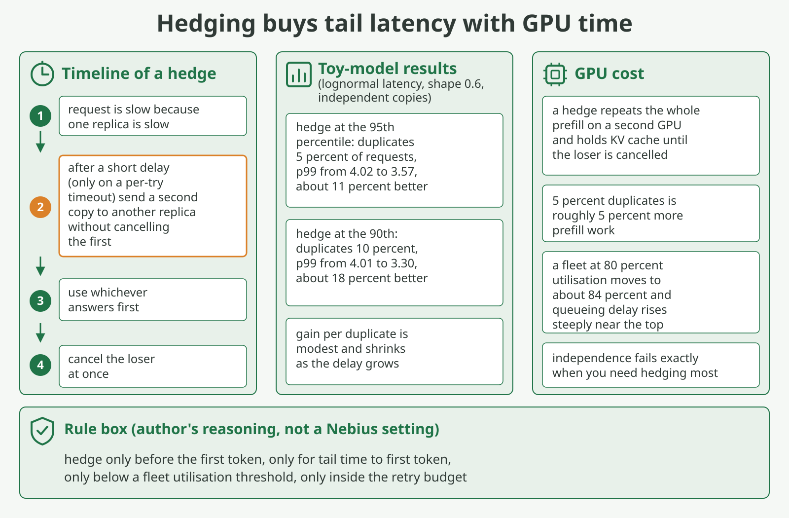

*Figure 20.21.9. Refuse hedging when the fleet is saturated.*

A request is slow because one replica is slow. A hedge sends a second copy to another replica after a short delay and uses whichever answers first. It trims the tail and spends extra work to do it. The bet is that the slow copy and the fast copy rarely fail for the same reason, so the second copy is a cheap insurance policy on the slowest few percent of requests.

Envoy supports this. Hedging happens only on a per-try timeout. Envoy sends a retry without cancelling the first request, waits for either, and returns the first acceptable response. Envoy retries on an overloaded signal as well, so its own docs warn you to use budgets or the concurrent-retry circuit breaker.

I measured the trade on a toy latency model. Latencies are lognormal with a shape of 0.6, and the copies are independent. Hedging at the 95th percentile duplicated 5 percent of requests and cut p99 from 4.02 to 3.57, which is about 11 percent. Hedging at the 90th duplicated 10 percent and cut p99 from 4.01 to 3.30, about 18 percent. The gain per duplicate is modest and shrinks as the delay grows. Look at the duplicated share each time, because every duplicate is work you paid for.

A GPU makes the cost heavier than a web call. A hedge repeats the whole prefill on a second GPU and occupies KV cache there until the loser is cancelled. A 5 percent duplicate rate is roughly 5 percent more prefill work. On a fleet at 80 percent utilisation that moves it to about 84 percent, and queueing delay rises steeply near the top. The independence assumption also fails exactly when you need hedging most. If slowness comes from fleet-wide overload, the duplicates make it worse.

So my rule of thumb, which is reasoning and not a Nebius setting, is to hedge only before the first token, only for tail time to first token, only below a fleet utilisation threshold, and only inside the retry budget. Cancel the loser at once. A loser that keeps running is the most expensive kind of waste, because it holds a slot and cache for an answer nobody reads. Walk the timing in your head. The hedge fires, one copy wins, and the other copy is still generating tokens that will be thrown away. Every second that copy runs is a second taken from a request that might be waiting in the queue behind it. The cancel signal is therefore part of the hedge, not an optional extra.

Decide: say that hedging buys tail latency with GPU time, and refuse it when the fleet is saturated.

### 7. Circuit breakers, outlier ejection and the panic threshold

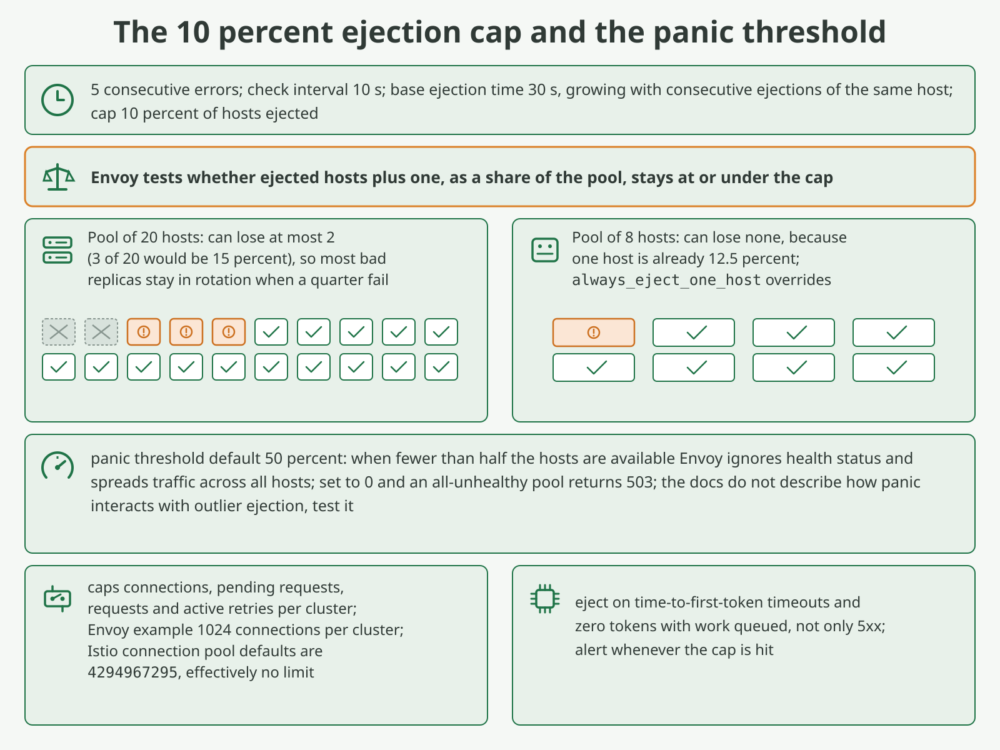

*Figure 20.21.10. With a 10 percent cap a pool of 8 can eject no host unless always_eject_one_host is set.*

A replica returns errors for the fifth time in a row. Every request routed to it is a wasted try and a wasted retry. Outlier detection removes it from the pool for a while, and a circuit breaker caps how much load can be in flight. Together they stop the router from feeding a sick replica the traffic that would only make it sicker.

Envoy's outlier detection has several triggers, including consecutive 5xx, consecutive gateway failures, and a success-rate comparison across hosts. The API reference gives the defaults that matter: 5 consecutive errors, a check interval of 10 seconds, a base ejection time of 30 seconds, and a cap of 10 percent of hosts ejected. The ejection time grows with the number of times a host was ejected in a row, up to a maximum of 300 seconds. A host that keeps failing is kept out for longer each time, which is the behaviour you want. Think of it as a repeat offender list. The first ejection is short because the host may have had a bad minute, and later ejections are longer because the pattern is clearly not a fluke. The router does not need to know why the host is failing. It only needs to notice that the host keeps failing and stop sending it traffic for a while.

The 10 percent cap is a trap. In the simulation a quarter of the replicas failed. Envoy tests whether ejected hosts plus one, as a share of the pool, stays at or under the cap. With a 10 percent cap, a pool of 20 hosts can lose at most 2, so most bad replicas stay in rotation. A pool of 8 can lose none, because one host is already 12.5 percent. The setting `always_eject_one_host` overrides that. Istio documents the same defaults for `maxEjectionPercent`. Raise the cap, but keep one, because ejecting everything leaves nothing to serve.

Envoy also has a panic threshold. Its default is 50 percent. When fewer than half the hosts are available, Envoy ignores health status and spreads traffic across all hosts. Setting it to 0 means that when everything is unhealthy it returns a 503. The documentation does not describe how the panic threshold interacts with outlier ejection, so test it before relying on it. Think of panic mode as a choice between sending traffic to hosts that may be broken and refusing traffic outright, and make that choice on purpose. In an incident the wrong default can turn a partial failure into a total one. A pool where most hosts are sick and the panic mode spreads traffic everywhere may serve some customers well and others badly, while a pool that returns 503 at once makes the outage visible and honest. Either can be the right answer for your product, but it should be a decision you took, not one the proxy took for you.

Envoy circuit breakers cap connections, pending requests, requests and active retries per cluster. The docs call the defaults modest and give 1024 connections per cluster as an example. Istio's connection pool defaults for pending requests, requests and retries are all 4294967295, which is effectively no limit. Check what your mesh actually enforces, because a default you did not set may be the one that governs your fleet. A practical habit is to dump the effective configuration from a running proxy and read the limits from there, rather than trusting the values you meant to write. The gap between intent and effective setting is where many overload incidents begin.

A circuit breaker for an LLM replica should watch more than status codes. A hung replica returns nothing, so 20.18 recommends a token-rate check. Eject on time-to-first-token timeouts and on zero tokens with work queued. Which signals Nebius uses is not published.

Decide: eject on timeouts as well as 5xx, cap ejections at a share you can afford, and alert whenever the cap is hit.

### 8. Load shedding, priority, 429 versus 503 and Retry-After

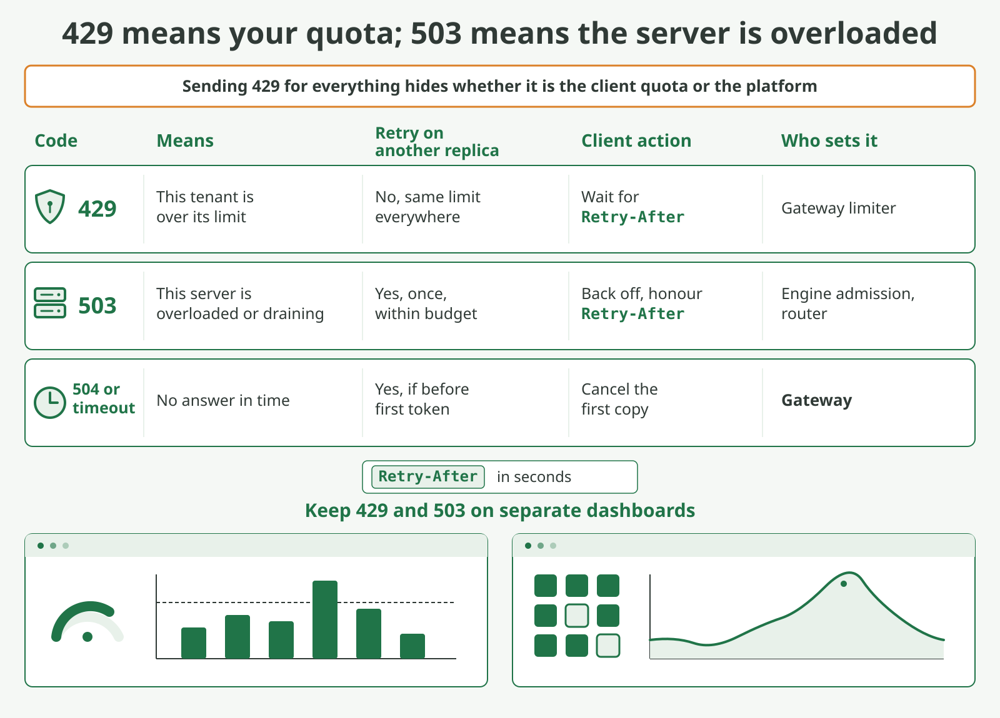

*Figure 20.21.11. HTTP 429 means the tenant is over its own limit and 503 means the server is overloaded, so the two need different retry and client actions.*

Demand exceeds capacity and something must give. Shedding chooses what gives, deliberately, before queues grow so long that every request times out. The SRE cascading-failure chapter defines load shedding as dropping some traffic as the server nears overload, for example returning 503 above a number of in-flight requests. Graceful degradation goes further by doing less work per request, such as a shorter answer or a smaller model for the bulk traffic.

The overload chapter ranks traffic by criticality with four names, CRITICAL_PLUS, CRITICAL, SHEDDABLE_PLUS and SHEDDABLE. The idea transfers. Paid interactive chat outranks batch, and free tier outranks nothing. Which tiers Nebius has is not public, so name your own. The ranking is a decision the business has to agree to, because the engineer cannot decide alone which customer's traffic is less important.

Two codes carry two different meanings. RFC 6585 defines 429 as the user sending too many requests in a given time. RFC 9110 defines 503 as the server being temporarily unable to handle the request because of overload or maintenance. Both may carry a Retry-After header holding either a number of seconds or an HTTP date. The codes look similar on a dashboard, and they point to opposite actions.

The Nebius Token Factory documentation is explicit. Exceeding the limit gives HTTP 429, with a Retry-After header in seconds. Limits are in requests and tokens per minute, with headers such as `x-ratelimit-remaining-tokens`. Over-limit requests may still succeed when capacity is spare, marked by `x-ratelimit-over-limit: yes`. The page does not specify a backoff strategy. The dedicated-endpoint page says self-service endpoints have no formal SLA unless covered by contract, and that capacity can be temporarily unavailable.

| Code | Means | Retry on another replica | Client action | Who sets it |
|---|---|---|---|---|
| 429 | This tenant is over its limit | No, same limit everywhere | Wait for Retry-After | Gateway limiter |
| 503 | This server is overloaded or draining | Yes, once, within budget | Back off, honour Retry-After | Engine admission, router |
| 504 or timeout | No answer in time | Yes, if before first token | Cancel the first copy | Gateway |

A common mistake is to send 429 for everything. Then clients cannot tell their own quota from a platform problem, and dashboards mix them. The engine can shed too. In 20.18 the vLLM setting `max_num_queued_reqs` rejects new requests with 503 once the limit is reached. Distributed AI Systems, chapter 9, recommends a bounded queue that rejects at once rather than letting requests time out after a long wait. A fast refusal is kinder to the customer than a slow timeout, because the customer can go elsewhere sooner. Walk a request through both paths. In the slow path it enters a queue, waits through the whole timeout, and fails with nothing learned. In the fast path it is refused at the door with a clear status and a Retry-After hint, and the client can back off or try a different region at once. The second path costs the same capacity but gives the customer a usable answer.

Decide: shed at the edge by tenant tier with 429, shed inside by queue depth with 503, and keep the two on separate dashboards.

### 9. Backpressure on streaming responses

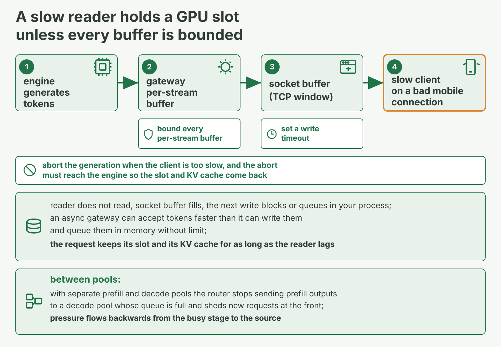

*Figure 20.21.12. A bounded buffer turns an invisible leak into a visible short abort.*

A slow reader holds a stream open. The engine keeps generating, tokens pile up in buffers, and the request keeps its slot and its KV cache for as long as the reader lags. Streaming turns a slow client into a resource leak. The reader on a bad mobile connection may be the only thing holding a GPU slot, and nothing on the GPU side knows.

Windowed flow control is the old answer. Computer Networking Problems and Solutions, chapter 2, explains that a window lets a sender have several packets outstanding, and the receiver slows the sender by not acknowledging. TCP does this for you, and that is the first backpressure. A reader that does not read fills the socket buffer, and the next write blocks or queues in your process. The idea is simple: the receiver controls how fast the sender may go.

The gap is in your own code. An async gateway can accept tokens from the engine faster than it can write them, and queue them in memory without limit. My reasoning, not a sourced claim, is to bound every per-stream buffer, set a write timeout, and abort the generation when the client is too slow. Then the slot and the KV cache come back. 20.13 sets the same rule. A bounded buffer turns an invisible leak into a visible, short abort.

Backpressure also matters between pools. The case study says backpressure was added to stop decode queues overrunning when prefill and decode are separate. A reasonable design, which is my reasoning, has the router stop sending prefill outputs to a decode pool whose queue is full, and shed new requests at the front instead of piling up cached state that nobody can use. The pressure flows backwards, from the busy stage to the stage that feeds it. Picture a pipeline of three stages with a bucket between each pair. When the last bucket is full, the stage before it must slow down or drop, and that slowdown travels back up the pipeline until the front door sees it. A design with no buckets at all does not avoid the pressure. It hides the pressure until memory runs out, which is a much worse way to learn about it.

Decide: every buffer between the engine and the socket needs a bound and a timeout, and the abort must reach the engine.

### 10. Cache-aware routing versus load-aware routing

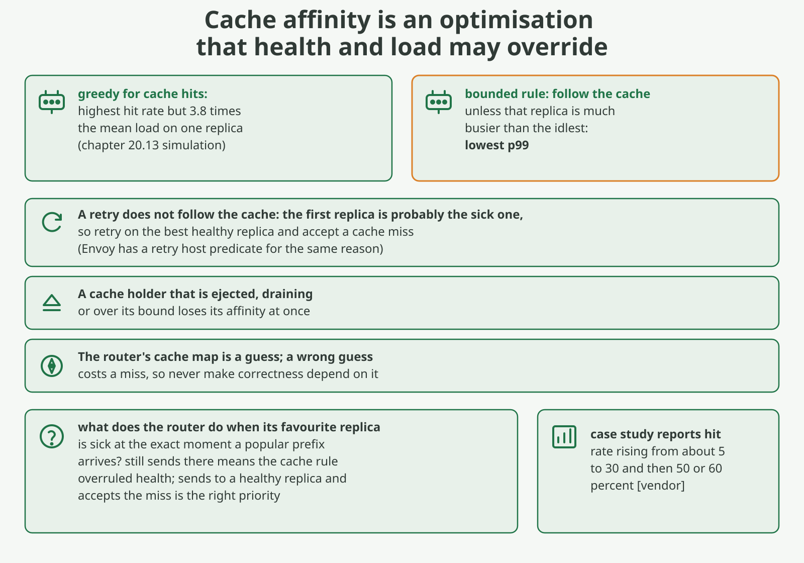

*Figure 20.21.13. Health and retries always override cache affinity.*

Routing to the replica that already holds a request's prompt prefix skips the prefill and cuts time to first token. Routing to the least loaded replica keeps queues even. They pull in opposite directions, and reliability decides the winner under stress. A cache-aware router is greedy for hits, and a load-aware router is greedy for balance, and each one is right until the other is needed.

Hands-On LLM Serving, chapter 3, notes that requests sharing a prefix can be routed to replicas whose KV cache is already filled. Distributed AI Systems, chapter 9, describes llm-d's prefix-cache aware routing and load-aware balancing as separate signals. The case study reports a hit rate rising from about 5 to 30 and then 50 or 60 percent [vendor]. Chapter 20.13 has a simulation. Following the cache alone gave the highest hit rate and put 3.8 times the mean load on one replica. A bounded rule, which follows the cache unless that replica is much busier than the idlest, had the lowest p99. I do not repeat that here.

What this chapter adds is the failure case. First, a retry should not follow the cache. The first replica is probably the sick one, so a retry goes to the best healthy replica and accepts a cache miss. Envoy has a retry host predicate for the same reason, which reattempts host selection. Second, a cache holder that is ejected, draining or over its bound loses its affinity at once. Third, the router's cache map is a guess. A wrong guess costs a miss, so never make correctness depend on it. Each of these is a place where a clever router would keep following the cache into trouble. A useful way to test your design is to ask what the router does when its favourite replica is sick at the exact moment a popular prefix arrives. If the answer is that it still sends the traffic there, the cache rule has overruled health, and the rule needs to change. If the answer is that it sends the traffic to a healthy replica and accepts the miss, the design has the right priorities.

Decide: cache affinity is an optimisation that load, health and retries may always override.

### 11. Connection draining and graceful termination


*Figure 20.21.14. Endpoint removal and SIGTERM run in parallel, so streams can be cut before every client stops sending to the pod. The grace period must cover the longest stream.*

A rolling update removes a pod that is serving forty long streams. If the pod simply exits, forty users see a broken stream, and no retry policy can repair it, because the first token had already been sent. The retry rules from section 1 cannot save these streams, so the fix has to come from the shutdown itself. It helps to say the timeline out loud in the interview. The pod receives the signal, the router learns about it on its own schedule, and the engine decides what to do with the work already running. Each of those three clocks can disagree with the others, and the grace period is the one number that has to cover all of them.

Kubernetes does several things at the same moment. The Kubernetes docs say the kubelet runs any preStop hook, then sends SIGTERM, with a default grace period of 30 seconds, and then SIGKILL. At the same time the control plane removes the pod from the endpoints. Production Kubernetes, chapter 6, calls this a distributed race. The workload may stop before every kube-proxy has removed it, and in-flight requests fail. The authors use SIGTERM handlers and a `sleep` preStop hook to mitigate it. Chapter 14 adds that preStop hooks run only for planned events, not when a node fails, and that the hook's time counts against the grace period.

Envoy shows what draining looks like at the proxy. It adds `Connection: close` to HTTP/1 responses and sends a GOAWAY on HTTP/2, so clients move to other connections. The docs say upgraded connections such as WebSocket cannot be told to go away. It spreads proactive drains over the last third of the drain time, so clients do not all reconnect together. The lesson is that a good drain tells clients to leave gently and gives them time to do it. A drain that closes every connection at once turns a planned rollout into a burst of reconnects, and those reconnects arrive at the replicas that are still up. Spreading the signal over time is the same jitter idea from section 5, applied to connections instead of retries.

The LLM twist is stream length. The default 30 second grace period is shorter than a long generation. The grace period must cover the preStop sleep, the longest stream you allow and a margin. With a 5 second sleep and a 120 second maximum stream, an example of mine, set at least 135 seconds. The sequence I would build is as follows.

1. Fail readiness and tell the router that the replica is draining, so it takes no new requests.
2. Sleep a few seconds in preStop for endpoint updates to spread.
3. On SIGTERM, stop accepting, let running streams finish and exit before the grace period ends.
4. Alert on any stream cut by SIGKILL.

In vLLM v0.32.0 source, the engine core catches SIGTERM. With the default `--shutdown-timeout 0` it aborts every running request at once, so those streams end with finish reason `abort`. Set the flag above 0 to let running requests finish while new ones are rejected. The parent process waits at most that long before it kills the engine. The simulation's worst case, work continuing for a client that has left, does not match vLLM v0.32.0. There a disconnect cancels the generator, which calls abort on the request. Also, the endpoint of a terminating pod always shows `ready: false` in the EndpointSlice, so load balancers that read it stop using the pod, but not instantly everywhere. Some clients will still send to the old address for a short while, and the drain has to cover them. Think of a terminating pod as a shop that has put up a closing sign but still has a few customers at the till. The sign tells new customers to go elsewhere, and the shop keeps serving the people already inside until they finish. A drain that only changes the sign and locks the door at once strands those inside, and a drain that never changes the sign keeps attracting new people to a closing shop.

Decide: size the grace period from the longest allowed stream, and test a rolling update while streams are running.

### 12. Failover across regions with data-residency limits

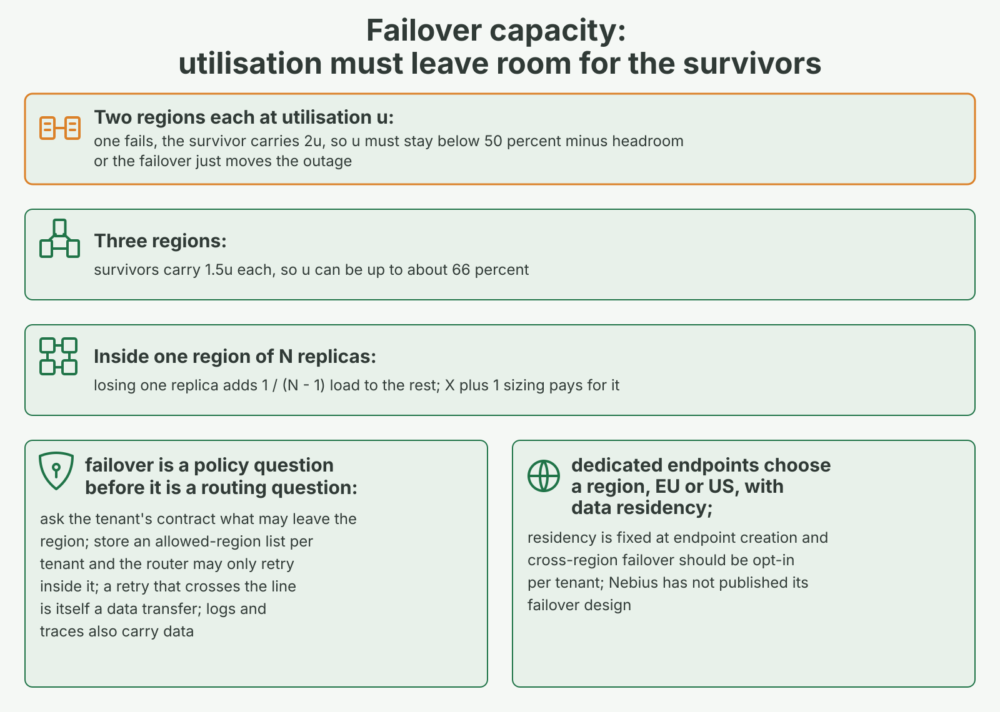

*Figure 20.21.15. Ask which tenants allow cross-region failover and how much spare capacity that implies.*

A whole region loses capacity. The tempting answer is to send its traffic elsewhere. For a tenant whose prompts must stay in the EU, the elsewhere may be illegal. A fallback that breaks the promise is worse than an outage, because the outage is visible and the data transfer may not be. Failover is a policy question before it is a routing question. Start the answer by asking the tenant's contract what may leave the region, and only then ask the router what it can reach. A design that begins with the router will find a route, and the route may be one the contract forbids. Putting the policy first keeps the routing work inside the lines that the business has agreed.

Nebius says dedicated endpoints choose a region, EU or US, with data residency. Chapter 20.13 argues that residency is fixed at endpoint creation and that cross-region failover should be opt-in per tenant. Nebius has not published its failover design. A reasonable design stores an allowed-region list per tenant, and the router may only retry inside it. A retry that crosses the line is itself a data transfer. Logs and traces that contain prompts follow the same rule.

Capacity is the second limit. If two regions each run at utilisation u and one fails, the survivor must carry 2u. So u must stay below 50 percent, minus headroom, or the failover simply moves the outage. With three regions the survivors carry 1.5u, so u can be up to about 66 percent. Inside one region of N replicas, losing one replica adds 1 over N minus 1 load to the rest, and X plus 1 sizing is what pays for it. The Nebius dedicated-endpoint page adds that capacity released by a stop or incident is not held for you and restarts may be slow when demand is high. So do not plan on getting it back quickly.

Decide: ask which tenants allow cross-region failover and how much spare capacity that implies, before you promise it.

### 13. The code, in full

Four files carry the numbers in this chapter. The simulation is `c21_outage_sim.py`. It replays Poisson arrivals against a small fleet and counts the attempts each policy sends. Read the header comment first, because it lists the simplifications, and the results only mean what those simplifications allow.

```python
"""Discrete-event simulation of a partial outage behind a blind load balancer.

Eight replicas each have a few slots and a short queue. For a window of time
a quarter of the replicas fail fast. Clients retry by a chosen policy. The
point is the shape of the result, not a prediction for any real fleet.

Simplifications, all deliberate:
- the balancer picks a replica uniformly at random and does not eject any;
- service time is fixed, so there is no long-prompt tail;
- a replica finishes work for an attempt that already timed out, which is the
  worst case for engines that do not abort on client disconnect.
Standard library only. The random generator is seeded, so runs repeat.
"""
import heapq
import random
from dataclasses import dataclass, field


@dataclass(frozen=True)
class Policy:
    name: str
    max_attempts: int = 1
    backoff: str = "none"        # none | exp | full
    budget_ratio: float = 0.0    # 0 means no retry budget
    budget_cap: float = 10.0


@dataclass
class Config:
    duration: float = 120.0
    outage: tuple = (30.0, 70.0)
    rate: float = 40.0           # user requests per second
    replicas: int = 8
    failed: int = 2              # replicas that fail fast during the outage
    slots: int = 4
    queue: int = 8
    service_s: float = 0.5
    attempt_timeout_s: float = 2.0
    fail_fast_s: float = 0.02
    reject_s: float = 0.005
    base_backoff_s: float = 0.2
    cap_backoff_s: float = 3.0
    seed: int = 7


def backoff_delay(kind, retry_no, base, cap, rng):
    """Delay before retry number retry_no (1 for the first retry)."""
    if kind == "none":
        return 0.0
    ceiling = min(cap, base * 2 ** (retry_no - 1))
    if kind == "exp":
        return ceiling
    if kind == "full":
        return rng.uniform(0.0, ceiling)
    raise ValueError(f"unknown backoff kind: {kind}")


@dataclass
class _Replica:
    busy: int = 0
    waiting: list = field(default_factory=list)


def simulate(policy, cfg=None):
    cfg = cfg or Config()
    rng = random.Random(cfg.seed)
    reps = [_Replica() for _ in range(cfg.replicas)]
    events, seq = [], 0

    def push(t, kind, data):
        nonlocal seq
        seq += 1
        heapq.heappush(events, (t, seq, kind, data))

    reqs = {}       # req id -> dict(start, attempts, done)
    attempts = {}   # attempt id -> dict(req, resolved, replica)
    tokens = policy.budget_cap
    next_aid = 0
    per_sec = [0] * (int(cfg.duration) + 1)
    wasted, peak_queue = 0, 0

    t = 0.0
    rid = 0
    while True:                       # Poisson arrivals for all user requests
        t += rng.expovariate(cfg.rate)
        if t >= cfg.duration:
            break
        push(t, "arrive", rid)
        reqs[rid] = {"start": t, "attempts": 0, "done": False, "ok": False, "lat": None}
        rid += 1

    def in_outage(now):
        return cfg.outage[0] <= now < cfg.outage[1]

    def launch(now, r):
        nonlocal next_aid, peak_queue
        reqs[r]["attempts"] += 1
        aid = next_aid
        next_aid += 1
        idx = rng.randrange(cfg.replicas)
        attempts[aid] = {"req": r, "resolved": False, "replica": idx}
        per_sec[min(int(now), len(per_sec) - 1)] += 1
        push(now + cfg.attempt_timeout_s, "timeout", aid)
        rep = reps[idx]
        if in_outage(now) and idx < cfg.failed:
            push(now + cfg.fail_fast_s, "error", aid)
        elif rep.busy < cfg.slots:
            rep.busy += 1
            push(now + cfg.service_s, "done", aid)
        elif len(rep.waiting) < cfg.queue:
            rep.waiting.append(aid)
            peak_queue = max(peak_queue, len(rep.waiting))
        else:
            push(now + cfg.reject_s, "error", aid)

    def fail_attempt(now, aid):
        nonlocal tokens
        a = attempts[aid]
        if a["resolved"]:
            return
        a["resolved"] = True
        r = a["req"]
        q = reqs[r]
        if q["done"]:
            return
        if q["attempts"] >= policy.max_attempts:
            q["done"] = True
            return
        if policy.budget_ratio > 0:
            if tokens < 1.0:
                q["done"] = True        # budget empty: surface the failure
                return
            tokens -= 1.0
        d = backoff_delay(policy.backoff, q["attempts"], cfg.base_backoff_s,
                          cfg.cap_backoff_s, rng)
        push(now + d, "retry", r)

    while events:
        now, _, kind, data = heapq.heappop(events)
        if kind == "arrive":
            if policy.budget_ratio > 0:
                tokens = min(policy.budget_cap, tokens + policy.budget_ratio)
            launch(now, data)
        elif kind == "retry":
            if not reqs[data]["done"]:
                launch(now, data)
        elif kind in ("error", "timeout"):
            fail_attempt(now, data)
        elif kind == "done":
            a = attempts[data]
            rep = reps[a["replica"]]
            rep.busy -= 1
            while rep.waiting and rep.busy < cfg.slots:
                nxt = rep.waiting.pop(0)
                rep.busy += 1
                push(now + cfg.service_s, "done", nxt)
            if a["resolved"]:
                wasted += 1             # finished after the client gave up
            else:
                a["resolved"] = True
                q = reqs[a["req"]]
                if not q["done"]:
                    q["done"], q["ok"], q["lat"] = True, True, now - q["start"]

    def phase(lo, hi):
        ids = [r for r, q in reqs.items() if lo <= q["start"] < hi]
        n = len(ids)
        ok = sum(1 for r in ids if reqs[r]["ok"])
        att = sum(reqs[r]["attempts"] for r in ids)
        return {"requests": n, "success_rate": round(ok / n, 3) if n else None,
                "amplification": round(att / n, 3) if n else None}

    o0, o1 = cfg.outage
    return {"policy": policy.name,
            "before": phase(0, o0), "during": phase(o0, o1), "after": phase(o1, cfg.duration),
            "peak_attempts_per_s": max(per_sec),
            "wasted_completions": wasted, "peak_queue": peak_queue}


POLICIES = (
    Policy("no_retry", 1),
    Policy("naive_4_immediate", 4, "none"),
    Policy("exp_4_no_jitter", 4, "exp"),
    Policy("full_jitter_4", 4, "full"),
    Policy("full_jitter_4_budget10", 4, "full", budget_ratio=0.10),
)


SCENARIOS = {
    "short queue (rejects fast)": Config(rate=52, queue=8),
    "deep queue (waits pass the timeout)": Config(rate=52, queue=24),
}


def table(cfg):
    lines = [f"{'policy':<24}{'amp.during':>11}{'ok.during':>11}{'ok.after':>10}"
             f"{'peak att/s':>12}{'wasted':>8}"]
    for p in POLICIES:
        r = simulate(p, cfg)
        lines.append(f"{p.name:<24}{r['during']['amplification']:>11}"
                     f"{r['during']['success_rate']:>11}{r['after']['success_rate']:>10}"
                     f"{r['peak_attempts_per_s']:>12}{r['wasted_completions']:>8}")
    return "\n".join(lines)


if __name__ == "__main__":
    for name, cfg in SCENARIOS.items():
        print(f"== {name}, {cfg.rate:.0f} user req/s, outage {cfg.outage[0]:.0f}-{cfg.outage[1]:.0f} s")
        print(table(cfg))
```

The arithmetic for attempts, layers, jitter and hedging is `c21_backoff_math.py`. Each function is a formula from the earlier sections, and the main block prints the numbers the chapter quotes.

```python
"""Arithmetic behind retries: attempts, layers, budgets, jitter and hedging.

Every function is plain math or a seeded simulation, so the numbers in the
chapter can be reproduced. Standard library only.
"""
import random


def expected_attempts(p, k):
    """Expected attempts per request when each attempt fails with probability p
    and the client makes at most k attempts: 1 + p + p^2 + ... + p^(k-1)."""
    if not 0 <= p <= 1 or k < 1:
        raise ValueError("need 0 <= p <= 1 and k >= 1")
    return sum(p ** i for i in range(k))


def layered_attempts(attempts_per_layer, layers):
    """Worst-case attempts at the bottom layer when every layer retries."""
    return attempts_per_layer ** layers


def budget_amplification_cap(budget_ratio):
    """With a budget of b retries per original request, load is at most 1 + b."""
    return 1.0 + budget_ratio


def backoff_ceiling(retry_no, base, cap):
    """Upper bound of the sleep before retry number retry_no (1 is the first)."""
    return min(cap, base * 2 ** (retry_no - 1))


def full_jitter_mean(retry_no, base, cap):
    """Full jitter sleeps a uniform amount in [0, ceiling], so the mean is half."""
    return backoff_ceiling(retry_no, base, cap) / 2.0


def herd_peak(n_clients, jitter, base=0.1, cap=5.0, rounds=3, bin_s=0.01, seed=1):
    """N clients all fail at t=0 and keep failing. Return the largest number of
    retries that land in one bin of bin_s seconds, over all rounds.
    jitter is 'none' or 'full'."""
    rng = random.Random(seed)
    counts = {}
    for _ in range(n_clients):
        t = 0.0
        for r in range(1, rounds + 1):
            ceiling = backoff_ceiling(r, base, cap)
            t += ceiling if jitter == "none" else rng.uniform(0.0, ceiling)
            key = int(t / bin_s)
            counts[key] = counts.get(key, 0) + 1
    return max(counts.values())


def hedge_effect(delay_quantile, n=200_000, mu=0.0, sigma=0.6, seed=3):
    """Latencies are lognormal and independent between attempts. A second copy
    is sent when the first has not answered by the delay, which is the given
    quantile of the latency distribution. Returns p99 before and after, and
    the share of requests that were duplicated.
    Independence is an assumption. Under overload the copies are not
    independent, and the duplicates make the slowness worse."""
    rng = random.Random(seed)
    base, hedged, sent = [], [], 0
    lat = sorted(rng.lognormvariate(mu, sigma) for _ in range(20_000))
    delay = lat[int(delay_quantile * len(lat)) - 1]
    for _ in range(n):
        first = rng.lognormvariate(mu, sigma)
        base.append(first)
        if first > delay:
            sent += 1
            hedged.append(min(first, delay + rng.lognormvariate(mu, sigma)))
        else:
            hedged.append(first)
    base.sort()
    hedged.sort()
    q99 = int(0.99 * n) - 1
    return {"delay": round(delay, 3), "p99_before": round(base[q99], 3),
            "p99_after": round(hedged[q99], 3), "duplicated_share": round(sent / n, 4)}


if __name__ == "__main__":
    for p in (0.1, 0.5, 0.8):
        print(f"p={p}: expected attempts with k=4 is {expected_attempts(p, 4):.3f}")
    print("layers: 4 attempts per layer, 3 layers ->", layered_attempts(4, 3))
    print("layers: 3 attempts per layer, 5 layers ->", layered_attempts(3, 5))
    print("layers: 4 attempts per layer, 5 layers ->", layered_attempts(4, 5))
    for r in (1, 2, 3, 4):
        print(f"retry {r}: ceiling {backoff_ceiling(r, 0.1, 5):.1f} s, "
              f"full-jitter mean {full_jitter_mean(r, 0.1, 5):.2f} s")
    for j in ("none", "full"):
        print(f"1000 clients failing together, {j} jitter: peak "
              f"{herd_peak(1000, j)} retries in one 10 ms bin")
    for q in (0.9, 0.95):
        print(f"hedge at p{int(q * 100)}:", hedge_effect(q))
```

The retryability rules, the Retry-After parser and the timeout check are `c21_retry_policy.py`. The decision function is the table from section 1 written as code, so read the two side by side.

```python
"""Retry decisions for a streaming completions API, plus a timeout nesting check.

The rules are one reasonable design, not a Nebius design. They follow HTTP
semantics (RFC 9110 sections 9.2.2, 10.2.3, 15.6.4) and the guidance in the
Google SRE book chapters on overload and cascading failures.
Standard library only.
"""
from dataclasses import dataclass
from email.utils import parsedate_to_datetime
from datetime import datetime, timezone
from typing import Optional

NEVER_RETRY_STATUS = {400, 401, 403, 404, 413, 422}


@dataclass(frozen=True)
class Attempt:
    status: Optional[int] = None        # HTTP status, None if no response came
    error: Optional[str] = None         # "connect_failure" or "timeout" or None
    first_token_sent: bool = False      # did the client already receive output?
    side_effects: bool = False          # does the call change server state?
    idempotency_key: bool = False       # did the client send a key?
    retry_after: Optional[str] = None   # raw Retry-After header value
    attempts_made: int = 1
    max_attempts: int = 2
    budget_ok: bool = True              # retry budget has a token


@dataclass(frozen=True)
class Decision:
    action: str                         # retry_other_replica | retry_later | fail
    reason: str
    delay_s: float = 0.0


def parse_retry_after(value, now=None):
    """Return seconds to wait, or None. Accepts delay-seconds or an HTTP-date."""
    if value is None:
        return None
    value = value.strip()
    if value.isdigit():
        return float(value)
    try:
        when = parsedate_to_datetime(value)
    except (TypeError, ValueError):
        return None
    if when.tzinfo is None:
        when = when.replace(tzinfo=timezone.utc)
    now = now or datetime.now(timezone.utc)
    return max(0.0, (when - now).total_seconds())


def decide(a: Attempt, now=None) -> Decision:
    if a.first_token_sent:
        return Decision("fail", "output already started: surface the broken stream, never replay")
    if a.side_effects and not a.idempotency_key and a.error != "connect_failure":
        return Decision("fail", "call has side effects and no idempotency key")
    if a.attempts_made >= a.max_attempts:
        return Decision("fail", "attempt limit reached")
    if a.status in NEVER_RETRY_STATUS:
        return Decision("fail", "client error: a retry returns the same answer")
    if a.status == 429:
        wait = parse_retry_after(a.retry_after, now)
        if wait is None:
            return Decision("fail", "429 without Retry-After: let the client back off")
        return Decision("retry_later", "tenant over limit: another replica does not help", wait)
    if not a.budget_ok:
        return Decision("fail", "retry budget is empty")
    if a.error == "connect_failure":
        return Decision("retry_other_replica", "request never reached a server")
    if a.status == 503:
        return Decision("retry_other_replica", "overloaded or draining replica",
                        parse_retry_after(a.retry_after, now) or 0.0)
    if a.error == "timeout" or a.status == 504:
        return Decision("retry_other_replica", "no first token in time; cancel the first copy")
    if a.status == 500 and a.attempts_made == 1:
        return Decision("retry_other_replica", "one retry for a request-level engine error")
    return Decision("fail", "not a retryable failure")


def remaining_deadline(deadline_s, elapsed_s, margin_s=0.2):
    """Deadline to hand to the next hop: what is left, minus a small margin."""
    return max(0.0, deadline_s - elapsed_s - margin_s)


def check_timeouts(client_s, gateway_total_s, gateway_per_try_s, gateway_attempts,
                   engine_s, max_backoff_s=0.0, margin_s=0.2):
    """Return a list of problems with a client > gateway > engine timeout chain."""
    problems = []
    if engine_s >= gateway_per_try_s:
        problems.append("engine timeout must be shorter than the gateway per-try timeout")
    worst = (gateway_per_try_s * gateway_attempts
             + max_backoff_s * max(0, gateway_attempts - 1))
    if worst > gateway_total_s:
        problems.append(f"{gateway_attempts} tries need up to {worst:g}s "
                        f"but the gateway total is {gateway_total_s:g}s")
    if gateway_total_s + margin_s > client_s:
        problems.append("client gives up before the gateway can answer")
    return problems
```

The gateway fragment is `c21_istio_resilience.yaml`. It uses Istio fields I read in the reference, and it is checked against the Istio schemas, as the lab explains. Istio has no retry budget field here, so the `maxRetries` setting only caps concurrent retries. The numbers are starting points of mine.

```yaml
# Example retry, timeout and ejection settings for a vLLM-style inference Service.
# Numbers are illustrative starting points from chapter 20.21, not Nebius settings.
# Istio has no retry budget field. maxRetries below caps concurrent retries only.
apiVersion: networking.istio.io/v1
kind: VirtualService
metadata:
  name: llm-chat
  namespace: inference
spec:
  hosts:
    - llm-chat.inference.svc.cluster.local
  http:
    - route:
        - destination:
            host: llm-chat.inference.svc.cluster.local
      # Whole-request limit, retries included. Streams must fit inside it.
      timeout: 300s
      retries:
        attempts: 1             # one retry, so at most 2 tries
        perTryTimeout: 20s      # time to first byte, before any output is sent
        retryOn: connect-failure,refused-stream,reset-before-request,503
        backoff: 100ms          # minimum wait, the base of exponential backoff
---
apiVersion: networking.istio.io/v1
kind: DestinationRule
metadata:
  name: llm-chat
  namespace: inference
spec:
  host: llm-chat.inference.svc.cluster.local
  trafficPolicy:
    loadBalancer:
      simple: LEAST_REQUEST
    connectionPool:
      http:
        http1MaxPendingRequests: 64
        http2MaxRequests: 512
        maxRetries: 3
    outlierDetection:
      consecutive5xxErrors: 5
      interval: 10s
      baseEjectionTime: 30s
      maxEjectionPercent: 25
```

## How to answer out loud

**Question 1. "Clients retry on failure. What could go wrong?"** Say that retries multiply load exactly when the system is weakest. State the arithmetic: at a failure rate of 0.5 and four attempts the load is 1.875 times, and layers multiply it. Name the defences in order: retry only before the first token, one layer, a budget near 10 percent, jittered backoff, ejection of bad replicas. Expect "why not just add capacity", and answer that capacity arrives in minutes while the retry loop doubles in seconds.

**Question 2. "Design the retry policy for a streaming completions API."** Start with the commit point, the first token. Before it, retry on connection errors, 503 and first-token timeouts. After it, never replay. Give the timeout chain with numbers that nest, say that 429 means wait and not hop, and say that Retry-After is honoured. Mention the gateway as the single retry layer. Follow-ups: idempotency keys for calls with side effects, and what you do about a stream cut mid-way.

**Question 3. "What is the difference between 429 and 503?"** A 429 says this tenant exceeded its limit, so another replica gives the same answer. A 503 says this server cannot take it now, so another replica may. Both can send Retry-After. Quote the Nebius documentation for 429 and the limit headers, and say the rest of its behaviour is not published.

**Question 4. "Would you hedge requests?"** Say yes only before the first token, only for tail time to first token, only with spare capacity, and inside the budget. Give the toy result: duplicating 5 percent cut p99 by about 11 percent. Explain the GPU cost, which is a repeated prefill and KV cache held until cancel. Refuse it under saturation.

**Question 5. "A rolling update drops user streams. Why, and how do you fix it?"** Describe the race between SIGTERM and endpoint removal. Give the sequence: drain at the router, preStop sleep, stop accepting, finish streams, exit. Size the grace period from the longest stream. Say that you would test it with live streams, and that you have not verified vLLM's SIGTERM behaviour.

## Worked scenarios

### Scenario A. Two of eight replicas fail and the whole service goes down

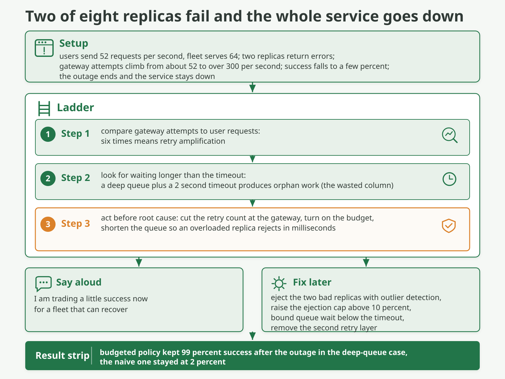

*Figure 20.21.16. Mitigate by cutting retries and shortening queues before looking for root cause.*

Users send 52 requests per second and the fleet can serve 64. Two replicas start returning errors. Gateway attempts per second climb from about 52 to over 300, and success falls to a few percent. The outage ends, and the service stays down.

Walk the incident in order. Step one is to compare gateway attempts to user requests. The attempts are six times the requests, which names retry amplification. Step two is to look for waiting that exceeds the timeout. A deep queue plus a 2 second timeout produces the orphan work in the last column of the simulation. Step three is to act before root cause. Cut the retry count at the gateway, turn on the budget and shorten the queue, so an overloaded replica rejects in milliseconds and not after seconds. Mitigation comes first because the users are still failing while you investigate. In the room, say that you are trading a little success now for a fleet that can recover, and that you will revisit the trade once the outage is over. That sentence shows the interviewer you can act under pressure and still keep the reasoning visible.

The simulation backs this order. The budgeted policy kept 99 percent success after the outage in the deep-queue case, and the naive one stayed at 2 percent. The fix later is to eject the two bad replicas with outlier detection, raise the ejection cap above 10 percent, bound queue wait below the timeout and remove the second retry layer.

### Scenario B. A timeout audit

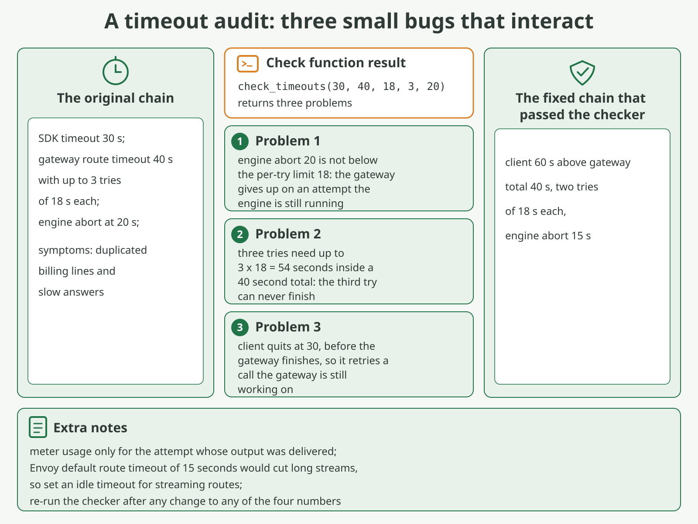

*Figure 20.21.17. Each setting looks fine alone and only fails when the whole chain is read together.*

An SDK has a 30 second timeout. The gateway has a 40 second route timeout and retries up to three times with 18 second tries. The engine aborts at 20 seconds. Users report duplicated billing lines and slow answers.

Run `check_timeouts(30, 40, 18, 3, 20)`. It returns three problems. The engine abort of 20 is not below the per-try limit of 18, so the gateway gives up on an attempt the engine is still running. Three tries need up to 54 seconds inside a 40 second total, so the third try can never finish. The client quits at 30, before the gateway finishes, so it retries a call the gateway is still working on. Each of these creates duplicate GPU work.

The fix is to make the chain 60, 40, two tries of 18 and an engine abort of 15, which passed the checker. Meter usage only for the attempt whose output was delivered. Also check the proxy default: Envoy's route timeout of 15 seconds would have cut long streams in the first place, so set an idle timeout for streaming routes. The checker is useful because the three bugs here are each small, and they only become expensive when they interact. Each setting looks reasonable on its own page. The trouble appears only when the settings are read together, which is why a single script that reads the whole chain is worth more than a careful review of each file. Run the checker again after every change to any of the four numbers, since a change to one can break the order of the others.

### Scenario C. Streams die on every deploy

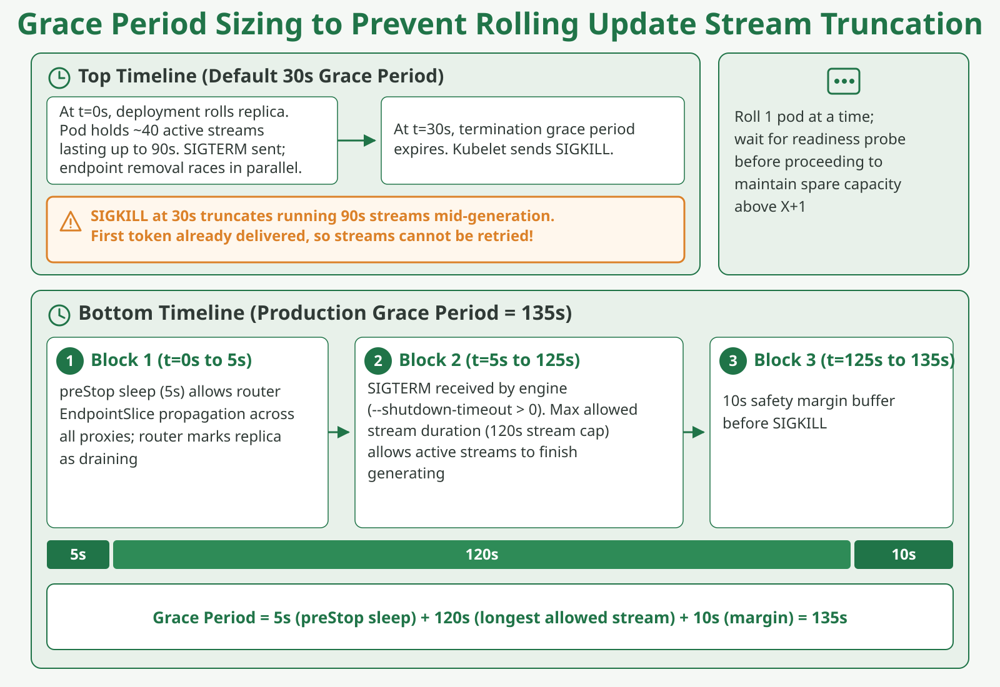

*Figure 20.0.0. Sizing the termination grace period to 135 seconds covers endpoint propagation and the maximum stream duration, preventing SIGKILL from truncating active generations.*

A deployment rolls eight replicas, one at a time. Each pod holds about forty streams, some lasting 90 seconds. Customers see truncated answers during every release, and the logs show SIGKILL.

The default grace period is 30 seconds. Any stream longer than that is cut. The pod is also still receiving requests for a moment after SIGTERM because endpoint removal runs in parallel. Set the grace period to cover the preStop sleep, the longest permitted stream and a margin. With a 5 second sleep, a 120 second stream cap and a 10 second margin, the answer is 135 seconds. Mark the replica draining at the router before SIGTERM. Roll one replica at a time and wait for readiness, so spare capacity stays above X plus 1.

A cut stream cannot be retried, because the first token went out. The customer may have read half a sentence and started acting on it, so a silent replay would be worse than an honest error. The gateway should end the stream with a clear error the client can show, and the team should count the cut as a symptom to fix at the source. When you describe this in the interview, name the counter you would watch, the cut streams per release, and the threshold above which you would stop the rollout. A concrete counter turns a vague worry into an action the on-call engineer can take. That is why the answer is to avoid the cut and not to add retries. Say this sentence in the room, because it shows you know where the retry rules stop.

## Hands-on lab

I ran steps 1 to 5. Steps 6 and 7 need a cluster or a mesh and were not run. The first five steps run on a laptop, and they only need the Python files and the schema tool. Read the expected results as what I saw on that machine, and check your own output against them.

1. From the repo root, run the simulation.

```bash
python3 code/part20/c21_outage_sim.py
```

Expected result: the two blocks shown in idea 3. In the deep-queue block, the first three retry policies end with success below 3 percent after the outage, and the budgeted policy ends above 99 percent. I ran it.

2. Run the arithmetic.

```bash
python3 code/part20/c21_backoff_math.py
```

Expected result: expected attempts of 1.111, 1.875 and 2.952, layered attempts of 64, 243 and 1024, a herd peak of 1000 without jitter and 165 with it, and the two hedging lines.

3. Change the budget. In the deep-queue case call `simulate(Policy("x", 4, "full", budget_ratio=0.5), cfg)` from a Python shell. I ran it. Amplification was 1.50 during the outage, and success after the outage was only 0.08, against 0.99 for a budget of 0.1. A budget that is too generous does not protect you.

4. Run the tests.

```bash
python3 -m pytest code/part20/test_c21_outage_sim.py code/part20/test_c21_retry_policy.py code/part20/test_c21_backoff_math.py -q
```

Expected result: 22 passed. I ran it.

5. Validate the Istio fragment against the Istio schemas with kubeconform.

```bash
kubeconform -summary -schema-location default \
  -schema-location 'https://raw.githubusercontent.com/datreeio/CRDs-catalog/main/{{.Group}}/{{.ResourceKind}}_{{.ResourceAPIVersion}}.json' \
  code/part20/c21_istio_resilience.yaml
```

Expected result: "2 resources found in 1 file - Valid: 2". I ran this on 2026-11-09. It checks field names and types against the Istio CRD schemas from the datreeio catalog. It does not check how a real mesh behaves.

6. On a cluster with Istio, apply the fragment and send load at a test service that returns 503 on some pods. Expected shape of the result: ejected hosts appear in the proxy statistics. Not run.

7. On a GPU host, start a vLLM server and send SIGTERM during a long stream, then record whether the stream completes. Not run.

## Drill questions

<details><summary>1. When is it safe to retry a streaming completion, and when not?</summary>
It is safe before the first output token, because nothing was delivered and a new replica can start fresh. After the first token it is not safe, because the replay gives different text. End the stream with an error and let the application decide.
</details>

<details><summary>2. State the expected number of attempts per request for failure probability p and k attempts, and the value at p = 0.5, k = 4.</summary>
The sum of p to the power i for i from 0 to k minus 1. At 0.5 and four attempts it is 1 + 0.5 + 0.25 + 0.125, which is 1.875.
</details>

<details><summary>3. Three layers each make 4 attempts. How many attempts reach the database?</summary>
Four to the power 3, which is 64. The Google SRE chapter gives the same example. This is why you retry in one layer only.
</details>

<details><summary>4. What does a retry budget guarantee?</summary>
It caps total load at 1 plus the budget ratio times the original traffic. With 10 percent the cap is 1.1 times. It cannot guarantee success, and in my simulation it lowered success during the outage while saving the service afterward.
</details>

<details><summary>5. Why did jitter not save the deep-queue simulation?</summary>
Jitter fixes retries that move together. There the load was continuous and the queue waits passed the timeout. The fix was a budget and shorter queues.
</details>

<details><summary>6. Give the full-jitter formula and the mean of the first four sleeps with base 0.1 s.</summary>
Sleep a random time between 0 and the smaller of the cap and base times 2 to the power retry number minus 1. The means are 0.05, 0.1, 0.2 and 0.4 seconds, a total of 0.75. The ceilings total 1.5.
</details>

<details><summary>7. What is the difference between 429 and 503, and how should a client react?</summary>
A 429 says the tenant exceeded its limit, so wait for Retry-After and do not hop replicas. A 503 says this server is overloaded or draining, so retry on another replica within the budget. Both may carry Retry-After.
</details>

<details><summary>8. What does Envoy do by default when outlier detection finds bad hosts, and what trap does it have?</summary>
It ejects a host after 5 consecutive errors, for a base time of 30 seconds that grows with repeats. The cap of 10 percent of hosts means a failure larger than that stays partly in rotation.
</details>

<details><summary>9. What is the Envoy panic threshold?</summary>
When fewer than the threshold share of hosts are available, Envoy ignores health and spreads traffic across all hosts. The default is 50 percent, and 0 disables it so an all-unhealthy pool returns 503.
</details>

<details><summary>10. Why does a rolling update cut streams, and what sets the grace period?</summary>
Termination and endpoint removal run in parallel, and the default grace period of 30 seconds is shorter than long streams. Set it to the preStop sleep plus the longest allowed stream plus a margin, and drain at the router first.
</details>

## Common mistakes and weak answers

Saying "retry three times with backoff" and stopping is the first mistake. The interviewer wants amplification, a budget and the first-token rule. Say what you retry, where, and how much. A bare number of retries tells them nothing about the fleet under load.

Retrying in the SDK, the gateway and the mesh at once is the second. Layers multiply, as the 64 and 243 examples showed. Name one layer and turn off the others.

Retrying 429 on another replica is the third. It cannot work, since the limit is per tenant, and it makes the customer's quota problem look like a platform outage. Say that the client waits for Retry-After.

Replaying a stream after the first token is the fourth. The text will differ, and the customer may already have acted on the first part. Say you surface the error.

Treating timeouts as unrelated numbers is the fifth. They must nest, and orphan work must be cancelled. A chain of numbers that does not nest is the most common cause of duplicated work that nobody can explain.

Claiming jitter solves retry storms is the sixth. It spreads bunching only, as the deep-queue block showed. Name the budget as well.

Claiming Nebius internals is the seventh. Say what the case study and the documentation say, and say that the rest is your design.

## Connections to the rest of the handbook

- 15.9 Multinode inference, parallelism, decoding and routing (`c15-09`) and 15.16 Production serving stack and reliability (`c15-16`) cover routing and circuit breakers on the serving side.
- 17.7 Failure modes and detection (`c17-07`) covers the generic failure patterns.
- 20.13 Design: multi-tenant LLM API (`c20-13`) holds the token-bucket and router simulations, which this chapter reuses by link.
- 20.18 How LLM serving fails (`c20-18`) names retry amplification and the probe mistakes, and this chapter is its deep version.
- 20.19 SLIs, SLOs and alerts (`c20-19`) covers how to alert on the retry ratio and error budget.
- Later in this volume: 20.20 autoscaling and 20.26 incident role-play.

## Sources and review notes

Sources and dates fetched (2026-11-09):

- Google SRE book, "Handling Overload" and "Addressing Cascading Failures", sre.google/sre-book. Used for attempt limits, the 10 percent ratio, criticality names, retry layers, deadline propagation and load shedding. The 243 figure is not on the SRE page, it is on the AWS page.
- AWS Builders' Library, "Timeouts, retries, and backoff with jitter", read at its current address on builder.aws.com after a redirect. Used for timeout percentile choice, 243 times amplification, local token bucket and idempotency. I read a summary of the page, so check the wording of the 243 example.
- Envoy documentation, latest: HTTP routing (retry semantics and hedging), router filter (retry-on values, backoff), circuit breaking, outlier detection, panic threshold, draining, and the route and outlier-detection API references. Fetched 2026-11-09 from the `latest` docs and the `main` proto and source file, version not tagged.
- gRPC guide "Retry", grpc.io: commit on response headers, transparent retries and retry throttling.
- Istio reference: VirtualService HTTPRetry and DestinationRule OutlierDetection and connection pool. Defaults read from the DestinationRule reference on 2026-11-09: interval 10s, baseEjectionTime 30s, maxEjectionPercent 10, consecutive5xxErrors 5, consecutiveGatewayErrors disabled.
- RFC 9110 sections 9.2.2, 10.2.3 and 15.6.4, and RFC 6585 section 4, read as text.
- Kubernetes documentation, "Pod Lifecycle", termination of pods.
- Nebius Token Factory documentation, Rate Limits and Scaling, and Dedicated Endpoints capacity pages, fetched via docs.tokenfactory.nebius.com.
- Distributed AI Systems, chapter 9 "Production LLM Serving Stack". Production Kubernetes, chapter 6 "Service Routing" and chapter 14 "Application Considerations". Hands-On LLM Serving and Optimization, chapters 3 and 4. LLMs in Production, chapter 6, for rate limiter types. Computer Networking Problems and Solutions, chapter 2, for windowed flow control.
- Nebius chat-app case study, as summarised in `planning/VOLUME_20_NEBIUS_SRE_PLAN.md` section 1, tagged vendor.

Explicitly labelled inferences:

- The retryability table and the decision to retry 500 once. This is my design.
- Every simulation parameter, the toy lognormal latency model, and the hedging rules.
- The statement that a slow reader holds a slot and KV cache, and the advice to bound per-stream buffers.
- The draining sequence, the 135 second grace period and the capacity arithmetic for regions.
- The advice to eject on first-token timeouts and zero token rate.

Not verified:

- No Envoy or Istio proxy was run. The Docker daemon was not running and Envoy was not installed. The YAML is schema-checked only.
- The simulation does not abort work for a client that has gone, although vLLM does.
- I did not find a Nebius statement on retry settings, region failover or draining.
- Whether Istio supports a retry budget in the version you run.

### Verification log (fact-check pass, 2026-11-09)

Resolved 7 flagged claims: 5 confirmed, 2 corrected or extended.

- CONFIRMED: Envoy `max_ejection_percent` defaults to 10, `interval` 10 s, `base_ejection_time` 30 s, `consecutive_5xx` 5, `max_ejection_time` 300 s (API proto, main).
- CORRECTED: the cap is not "about a tenth". `outlier_detection_impl.cc` ejects only if (active ejections + 1) / hosts is at most the cap. A pool under 10 hosts ejects nothing at the 10 percent default unless `always_eject_one_host` is set. I did not run Envoy.
- CONFIRMED: Istio DestinationRule outlier defaults (interval 10s, baseEjectionTime 30s, maxEjectionPercent 10, consecutive5xxErrors 5).
- CONFIRMED (vLLM v0.32.0 source): SIGTERM and shutdown timeout behaviour, and abort on client disconnect (`async_llm.py` cancels and calls `abort`).
- CONFIRMED: Kubernetes terminating endpoints always have `ready: false` (Pod Lifecycle page, main).
- STILL UNVERIFIED: the AWS 243x example wording (summary only), Istio retry budget support, and any Nebius statement.
- Retry fixture: `c21_istio_resilience.yaml` uses `maxEjectionPercent: 25`, which is above the default as the chapter advises.
