# 20.22 Operating vLLM, Triton, Ray and TensorRT-LLM

## What the interviewer is testing

Picture a new model arriving on a Monday. The team says "just run it on vLLM" and hands you a command line with eleven flags. Your job is to say which flags matter, which ones will hurt you under load, and what you will watch after the first deploy.

Think of each engine flag as a trade rather than a plain setting. A flag buys one thing and costs another, and an interviewer will ask you to defend that trade. That is why this chapter serves the system design round and the project deep dive. It also feeds the incident round, because a flag that someone set for a reason nobody wrote down is a common source of trouble when things break.

Read the job posting again and you will find this phrase in the nice-to-have list: "GPU-heavy workloads with vLLM, Triton, Ray, or another accelerator stack". A nice-to-have is a skill that strengthens your case without being a hard requirement, so treat it as a hint about the team's daily work.

Chapter 20.18 already covers how serving fails. This chapter moves the question from how things break to how you run the engines, so that failures are rarer and shorter when they do happen.

A realistic question in the interviewer's voice: "We serve open models on vLLM today. A teammate wants to move the biggest customer to TensorRT-LLM behind Triton. What do you ask, and what changes for the people on call?"

Notice that the question has two halves. The first half is a technical move. The second half is what changes for the people on call. A good answer covers both, and it does not stop at the performance number.

Versions used here: vLLM v0.32.0 source and docs, Triton server release v2.74.0, TensorRT-LLM v1.2.1, Ray 2.60.0, and SGLang v0.5.23. All were the latest releases at fetch time, 2026-11-09. Nebius has not published which engines or versions Token Factory runs, so nothing here describes Nebius internals.

Every number in the rest of the chapter belongs to one of these versions. When you check a flag on your own cluster, check the version first, because flags and defaults move between releases.

## The core ideas

### 1. Four tools, three layers: engine, server, orchestrator

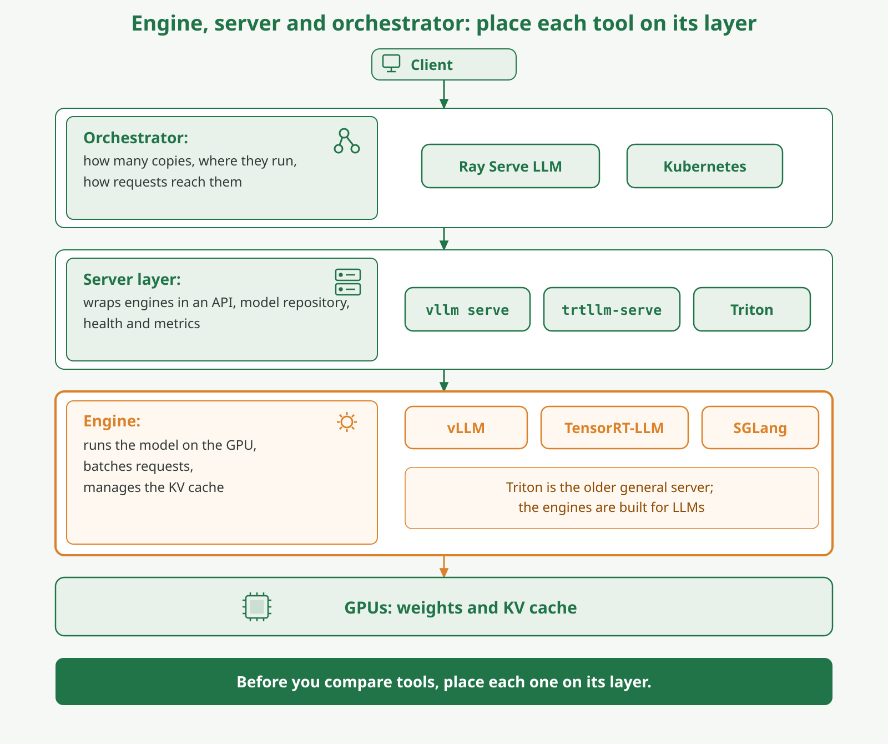

*Figure 20.22.1. Serving tools sit on three layers, with orchestrators such as Ray Serve LLM above servers such as Triton, which wrap engines such as vLLM.*

A colleague says the team wants to move the chat service to Triton, and asks whether that makes it faster. Before you compare anything, place each tool on its layer. An engine runs the model on the GPU. It batches requests, manages the KV cache (the memory that holds attention keys and values for each token, so they do not have to be computed again) and launches kernels, which are the small programs that run the math on the GPU.

A server wraps engines or models in an API, a model repository, and health and metrics endpoints. An orchestrator decides how many copies run, where they run, and how requests reach them.

Sort the four tools now. vLLM, TensorRT-LLM and SGLang are engines. The book Hands-On LLM Serving and Optimization, chapter 8, calls them a new class of LLM serving frameworks, built because older general servers assumed short inputs and fixed tensor shapes. A tensor shape is the list of its dimensions, and the older servers were built around requests that fit a fixed shape.

Triton is the older general inference server. The same chapter lists it among the frameworks built before the LLM era, and the book says TensorRT-LLM integrates tightly with Triton and Dynamo. Ray Serve LLM is an orchestrator. Its documentation says it builds on Ray Serve and runs vLLM or SGLang as the engine.

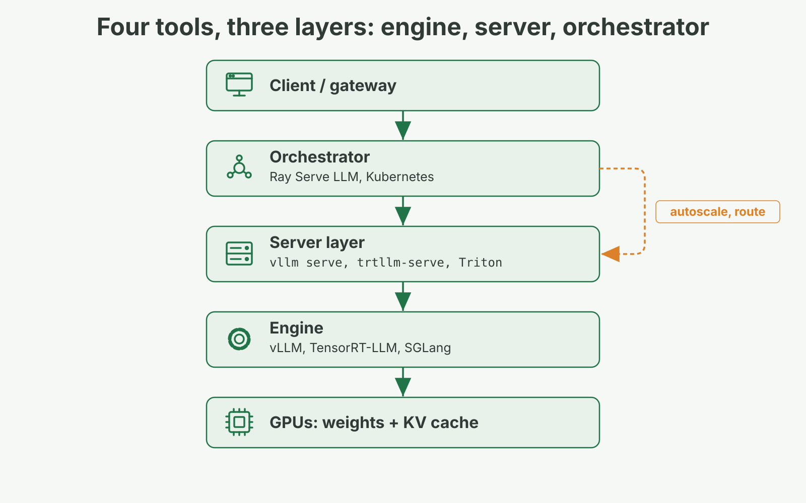

*Figure 20.22.2. Four tools, three layers: engine, server, orchestrator, as a diagram.*

The layers matter because the tool you operate changes with them, and so does the person who gets paged. With Ray Serve LLM you operate Ray and an engine, so the on-call engineer reads a Ray view and an engine log. With Triton you operate a model repository and a backend, so the first place to look is the configuration of each model. With `vllm serve` you operate one process tree, which means one log stream and one set of flags.

When an interviewer says "we use vLLM", ask which layer they mean. The answer tells you which runbook applies.

**Decide first which layer a problem lives in, because the fix, the logs and the owner are different at each one.**

### 2. What each engine is for

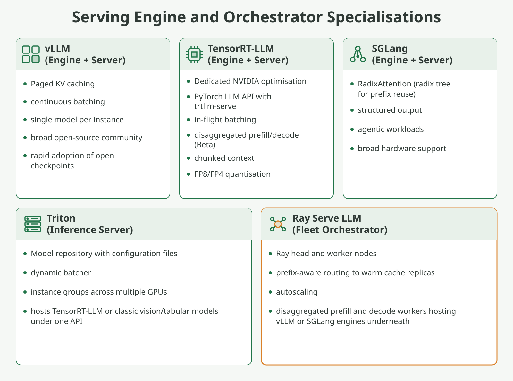

*Figure 20.22.3. Figure 20.22.3. Each tool solves a different operational problem, from kernel-level NVIDIA tuning in TensorRT-LLM to fleet-level prefix routing in Ray Serve.*

Picture a team that runs many open models on one fleet and has to choose a default engine. The book describes vLLM as the most broadly used open framework. Its strengths are paged KV caching with continuous batching, an easy path for open and self-fine-tuned models, and a large community. It serves one model per instance.

In plain terms, paged KV caching splits the cache into small blocks that are handed out as needed, rather than one large reserved slab. Continuous batching lets new requests join the running batch between steps, instead of waiting for the whole batch to finish. One model per instance means you run one process for each model you want to serve.

A team that has standardised on NVIDIA hardware asks what the fastest path is. TensorRT-LLM is NVIDIA's library for NVIDIA GPUs. Its v1.2.1 overview says it is architected on PyTorch, with a Python LLM API and a `trtllm-serve` command that starts an OpenAI-compatible server. An OpenAI-compatible server accepts the same request shape as the OpenAI API, so client code written for that API can point at it.

It lists in-flight batching, paged KV cache with block reuse, chunked prefill, speculative decoding, FP8 and FP4 quantisation, and disaggregated serving, which it marks Beta. Prefill is the step that reads the whole prompt, and decode is the step that writes one new token at a time. Disaggregated serving runs those two steps on different workers. The book says TensorRT-LLM suits teams that have standardised on NVIDIA hardware and want the best efficiency.

Here is a conflict you should be ready to explain. The book describes TensorRT-LLM as building tuned TensorRT engines from a checkpoint. A checkpoint is the saved set of trained weights. The v1.2.1 docs describe a PyTorch-based architecture instead.

The book LLMs in Production, chapter 6, makes the older point clearly: a compiled engine is hardware specific, so you compile on the hardware you will run. Whether your deployment still has a separate build step depends on the version and mode. Check before you promise a rollout plan.

SGLang is a peer to vLLM, which means it sits at the same layer and is a choice rather than a layer above or below. The book lists RadixAttention for prefix reuse, structured output, speculative decoding and four parallelism modes. Prefix reuse means a new request that starts with text the engine has already seen can skip recomputing that text. The book says SGLang targets a broader range of hardware than TensorRT-LLM.

Its README describes it as optimised for agentic workloads and large-scale serving.

Triton is a server, not an engine, and the difference matters when someone asks where the batching happens. You give Triton a model repository. That is a directory of models, and each model sits in its own folder with a configuration file.

For classic models, Triton batches with its dynamic batcher and runs several copies of a model through instance groups, which set how many copies run and on which devices. For LLMs the book says it can host TensorRT-LLM. Its value is one serving surface, one metrics format and one health API across many model types, so a platform team that runs image models and text models can operate them the same way.

Ray Serve LLM is the orchestrator in this comparison. It gives you an OpenAI-compatible API, multi-model apps, autoscaling, prefix-aware routing and prefill-decode disaggregation, with vLLM or SGLang underneath. Prefix-aware routing sends a request to the replica that already holds the matching prompt prefix in its cache.

The book Generative AI on Kubernetes, chapter 1, adds that Ray brings its own orchestration layer with head and worker nodes, which does not come from Kubernetes. That point matters on call. A Ray cluster has its own head node and workers, so a Kubernetes view alone does not show you everything.

**Pick the tool by the problem it was built for: engines for tokens per second, servers for many model types, orchestrators for fleets.**

### 3. The knobs that decide memory


*Figure 20.22.4. Size the cache first, then set the sequence cap and length limit to fit the real average request.*


*Figure 20.22.5. The KV cache is the memory left after the weights and overhead. Dividing it by the cost of one token gives the number of tokens the card can hold.*

An alert fires a few minutes after the rollout starts. The new pod crash-loops with an out-of-memory error at start, which means the process ran out of GPU memory before it could serve any request. You need to know which flags move GPU memory, and four of them do most of the work.

`gpu_memory_utilization` is the fraction of GPU memory this instance may use. Put simply, it is the share of the card that vLLM is allowed to claim. In the v0.32.0 config class the default is 0.92 and the range is above 0 up to 1. The docstring says it is a per-instance limit that ignores other processes, so two instances on one GPU need fractions that add up to less than one.

Raising it gives more KV cache, because the cache is what memory is left after the weights. It also removes headroom for activation spikes, which is the runtime out-of-memory form described in chapter 20.18. Activations are the temporary tensors the model creates while it works on a batch, and a spike in them can need more memory than was left over.

`max_model_len` is the longest sequence the engine accepts, prompt plus output. A sequence here means one request's prompt and its generated answer taken together. The start-up log's "Maximum concurrency" line is computed from it, so the number you see there depends on this flag.

Setting it lower than the model's native maximum is the cheapest way to make the capacity numbers honest. The risk is rejecting a customer's long request, so set it from your traffic, not from the model card.

`max_num_seqs` caps how many requests run in one step. A step is one pass of the scheduler, in which the engine decides which requests get work on the GPU. The class default is 128, but its docstring says real values are set when the engine config is created, so read the start-up log for the value in force.

A high cap with a small cache means admitting work you cannot hold. Preemption is what happens next: the engine removes a running request from memory to make room, and later recomputes its work. The vLLM optimisation guide lists lowering the cap as one of the fixes for preemption.

`kv_cache_memory_bytes`, passed as `--kv-cache-memory`, sets the cache size directly and ignores the utilisation fraction. The guide says it skips memory profiling and so shortens start-up. Profiling here means the engine runs a test pass to measure how much memory the model and its work need before it sets the cache.

A low value caps concurrency, and a high one fails at allocation. The value is valid only for the same GPU and the same free memory, so a value copied from one machine is not safe on another.

Here is the arithmetic for one H100 with 80 GB and Llama 3.1 8B. Work through it once with a pencil, because the same steps let you check any model on any card. The model config gives 32 layers, 8 key-value heads and a head size of 128, in bfloat16. Bfloat16 is a compact number format, and the weights below are counted at the format's size per parameter. Chapter 20.12 explains the formula and the 80 GB figure.

| Step | Calculation | Result |
|---|---|---|
| KV bytes per token | 2 x 32 x 8 x 128 x 2 | 131,072 bytes |
| Usable memory | 80 x 0.90 | 72 GB |
| After weights and overhead | 72 - 16 - 5 | 51 GB |
| Tokens that fit | 51e9 / 131,072 | about 389,100 |
| Full-length requests at 16,384 tokens | 389,100 / 16,384 | about 23.7 |
| Average length when 128 requests run | 389,100 / 128 | about 3,040 tokens |

The rows build on each other. The KV bytes per token row gives the cost of one token. The usable memory row gives the budget. Subtract the weights and the overhead, then divide what is left by the per-token cost, and you have the number of tokens that fit. The last two rows divide that total by a request length and by a request count, which turns a raw token total into something you can say to a product manager.

Start with the weights, because they are the biggest fixed cost. Eight billion parameters at 2 bytes each is the amount the table subtracts first. The 5 GB overhead is a planning assumption, not a measurement, and it stands in for the memory the engine uses beyond the weights and the cache. Replace it with the figure in your start-up log.

Read the two rows about tokens together, because they answer different questions. The tokens-that-fit row says how many tokens fit in total. The average-length row says how long each request can be if 128 of them run at once, which is the cap you set.

Put those together and you get the point where the cache fills. With the cap at 128, the cache fills once the average request passes about 3,040 tokens. Past that point vLLM preempts and recomputes, and latency climbs. The reviewer in the code section flags exactly this gap as information.

**Size the cache first, then set the sequence cap and the length limit so that your real average request fits.**

### 4. The knobs that decide latency: token budget and chunked prefill

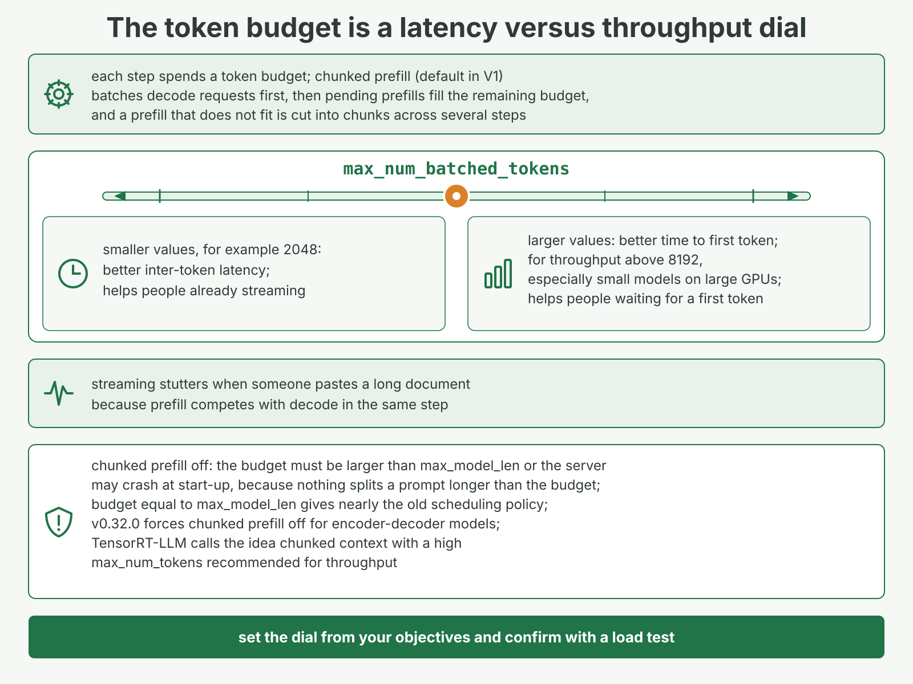

*Figure 20.22.6. Turn the budget down to protect streaming users and up to help users waiting for a first token.*

Users complain that streaming stutters whenever someone pastes a long document. The cause is prefill work competing with decode work for the same step. Prefill is the step that reads the whole pasted prompt. Decode is the step that writes the next token for every user already streaming.

When a long prefill lands in the same step, the streams that are already running wait for it, and the stutter is what they feel.

The scheduler spends a token budget each step, set by `max_num_batched_tokens`. Think of the budget as a fixed amount of work the GPU may take on in one step. With chunked prefill, which is on by default in V1, the guide says decode requests are batched first. Pending prefills then fill the remaining budget, and a prefill that does not fit is cut into chunks.

Chunking means the long prompt is split across several steps, so each step keeps room for the decode tokens. That protects inter-token latency, which is the time between one streamed token and the next.

The budget is a dial, and it has two ends. Turning it down helps the people already streaming, and turning it up helps the people waiting for a first token. The guide says smaller values, for example 2048, give better inter-token latency. Larger values give better time to first token. For throughput it recommends more than 8192, especially for small models on large GPUs. If the budget equals `max_model_len` you get nearly the old scheduling policy, though decodes still go first.

There is one trap. If you turn chunked prefill off, the budget must be larger than `max_model_len`, or the server may crash at start-up. Turning chunked prefill off is a common move when someone wants simpler behaviour, so check the budget whenever you change it. The v0.32.0 scheduler also forces chunked prefill off for encoder-decoder models. TensorRT-LLM has the same idea under the name chunked context. Its docs recommend a high `max_num_tokens` for throughput, but not so high that time to first token and per-token latency miss the objective.

A short way to remember the trap: with chunked prefill off, a prompt longer than the budget cannot be scheduled in one step, because nothing splits it. The start-up check catches that case, which is why the server may fail before it serves a single request.

**Treat the token budget as a latency-versus-throughput dial that you set from your objectives and then confirm with a load test.**

### 5. Parallelism: tensor, pipeline, data and expert

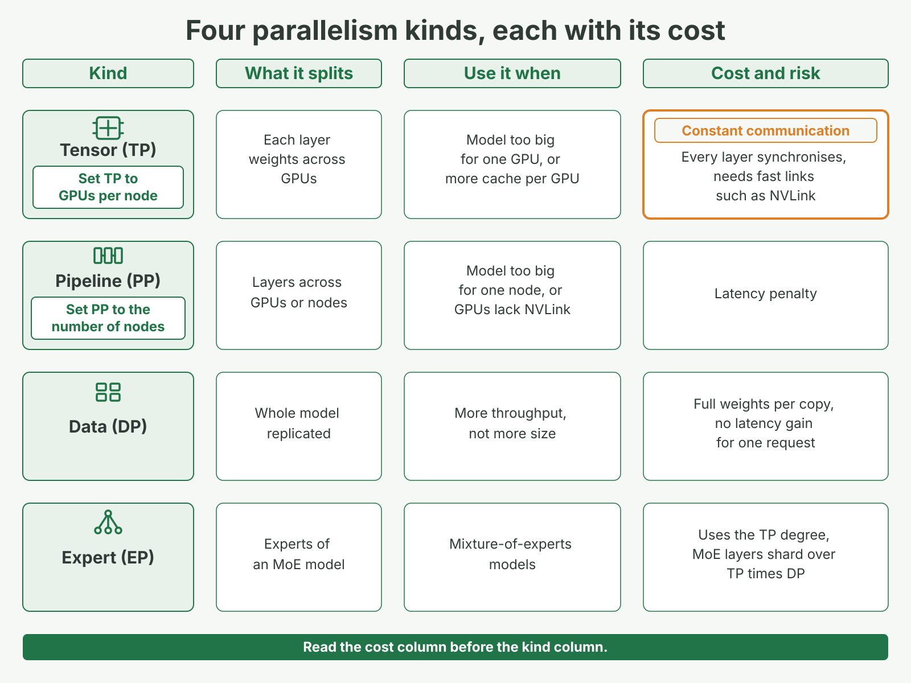

*Figure 20.22.7. Tensor, pipeline, data and expert parallelism each split work differently, and each trades memory, throughput or latency against communication cost.*

Picture a model that is too large for one card. Its weights fill the GPU, and nothing is left for the KV cache, so the engine cannot hold a useful batch. Or the model fits on one GPU but leaves so little room for cache that throughput is poor. You must split it. Each split has a different cost, and the cost is mostly communication, which means the GPUs must pass data to each other on every step.

| Kind | What it splits | Use it when | Cost and risk |
|---|---|---|---|
| Tensor (TP) | Each layer's weights across GPUs | Model too big for one GPU, or you need more cache per GPU | Every layer synchronises. Needs fast links such as NVLink. Guide: set TP to GPUs per node |
| Pipeline (PP) | Layers across GPUs or nodes | Model too big for one node, or GPUs lack NVLink | Latency penalty. Guide: set PP to the number of nodes |
| Data (DP) | Whole model replicated | You need more throughput, not more size | Costs full weights per copy. No latency gain for one request |
| Expert (EP) | Experts of an MoE model | Mixture-of-experts models | Uses the TP degree. MoE layers shard over TP times DP |

Read the Cost column before you read the Kind column. Each row is a trade, and the words "Cost and risk" are the part an interviewer will press on. Tensor parallel buys room for a big model at the price of constant communication. Data parallel buys throughput at the price of memory, because every copy holds the full weights.

These rows come from the vLLM parallelism guide and the optimisation guide. The cost column for data parallel is my reasoning. One more fact helps with multi-node. Multi-node means the model runs across more than one server, and Ray and Python multiprocessing are two ways to start the worker processes on those servers.

By default the guide says Ray runs multi-node inference and Python multiprocessing runs single-node. You can use multiprocessing across nodes with `--nnodes`, `--node-rank`, `--master-addr` and `--headless` on workers. Multiprocessing mode on a host with fewer GPUs than tensor times pipeline raises an error, and Ray must be selected explicitly.

The same three ideas appear in TensorRT-LLM, which documents them in its parallel-strategy docs. I did not read its trade-off text closely, so treat the table above as a description of vLLM's behaviour, not a promise about TensorRT-LLM.

Two operational risks come with the splits, and each deserves a sentence. The first is blast radius, meaning how much one failure takes down. A tensor-parallel group is one failure domain: lose one GPU and the whole replica stops, so replicas are bigger and rarer.

The second risk is the network. Cross-node tensor parallel moves per-layer traffic onto the network, which is why the guide wants InfiniBand and mentions GPUDirect RDMA. GPUDirect RDMA lets a network card move data straight to GPU memory without going through the CPU.

**Use the smallest parallelism that fits the model and leaves cache, then add replicas with data parallelism or more pods.**

### 6. Quantisation, prefix caching and speculative decoding

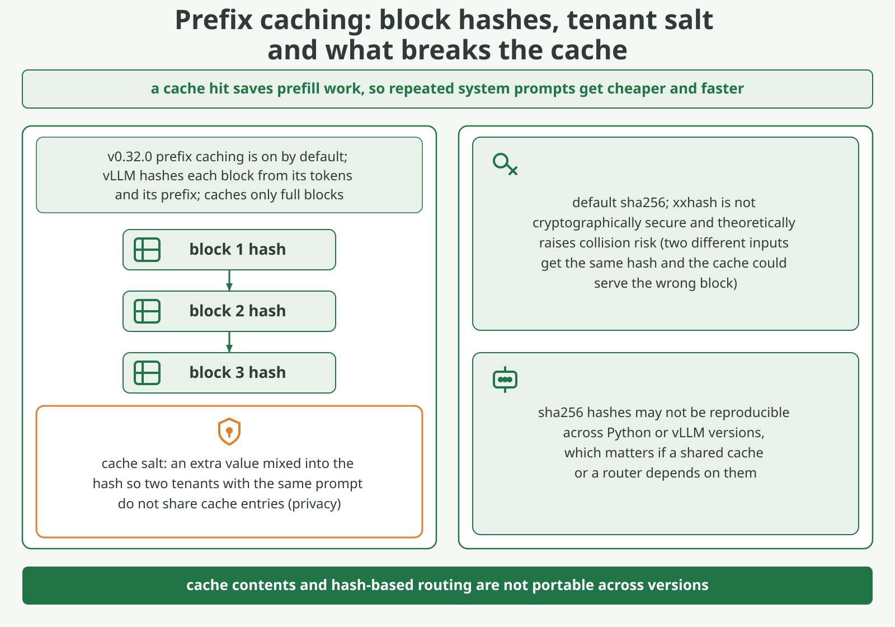

*Figure 20.22.8. The cache hash choice matters for privacy and for any router that depends on it.*

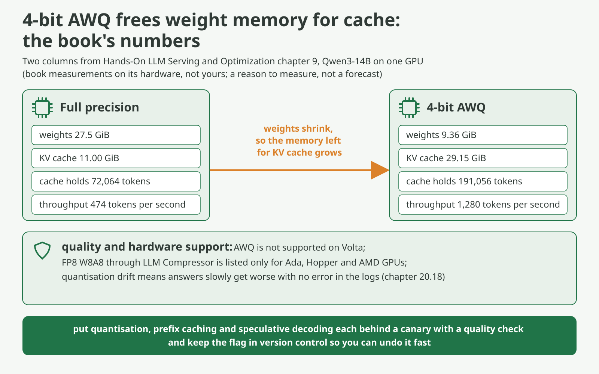

*Figure 20.22.9. Smaller weights leave more memory for KV cache, but quality and hardware support need checking.*

A teammate wants to switch on three features before Friday's release, because each one promises more tokens per second. Each of these three can raise throughput. Each can also change your answers or your latency tail, which is the slowest slice of requests. Treat them as changes with a canary, meaning a small slice of traffic gets the change first.

Quantisation stores each number with fewer bits, which makes the weights smaller and sometimes the KV cache smaller too. The book Hands-On LLM Serving and Optimization, chapter 9, ran Qwen3-14B and its 4-bit AWQ form on one GPU. Weights fell from 27.5 GiB to 9.36 GiB, and the KV cache grew from 11.00 GiB to 29.15 GiB.

The cache then held 191,056 tokens instead of 72,064, and throughput rose from 474 to 1,280 tokens per second in that test. Those are the book's measurements on its hardware, not yours, so use them as a reason to measure, not as a forecast.

The risk is quality and hardware support. The vLLM compatibility table says AWQ is not supported on Volta. It also lists FP8 W8A8 through LLM Compressor for Ada, Hopper and AMD GPUs only. Chapter 20.18 covers quality drift from quantisation as a failure mode, which means the answers slowly get worse without any error in the logs.

Prefix caching reuses KV blocks for requests that share a prefix. In v0.32.0 it is on by default. The design page says vLLM hashes each block from its tokens and its prefix, caches only full blocks, and can add cache salts to isolate tenants. A cache salt is an extra value mixed into the hash, so two tenants with the same prompt do not share cache entries.

The default hash is `sha256`. The page warns that `xxhash` is not cryptographically secure and theoretically raises collision risk. A collision means two different inputs produce the same hash, so the cache could serve the wrong block. The page also says `sha256` hashes may not be reproducible across Python or vLLM versions, which matters if a shared cache or router depends on them.

For a team, the practical meaning is simple. A cache hit saves prefill work, so repeated system prompts get cheaper and faster. The same cache also creates a privacy question, which is why the cache salt exists, and a reproducibility question, which is why the hash choice matters for any router that depends on it.

Speculative decoding drafts several tokens and verifies them in one pass. A small guess is cheap to make, and checking a batch of guesses is cheaper than producing each token one at a time. The vLLM guide says it reduces inter-token latency for medium to low QPS, memory-bound workloads. QPS means queries per second, the request rate the service handles.

Model-based methods give the best reduction. N-gram and suffix methods give modest speedups without adding workload at peak. Draft-model methods need a separate draft model, and the gain is largest at low load. Enable it only after measuring at peak load.

**Roll out each of these three behind a canary with a quality check, and keep the flag in version control so you can undo it fast.**

### 7. Start-up: what takes the time

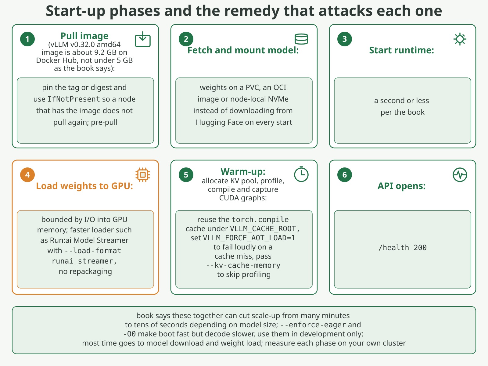

*Figure 20.22.10. Each remedy attacks a different phase, so measure the phases first.*

A pod is `Running` but not ready for ten minutes, and the autoscaler's new replica never helps. You need to know what the engine does between `exec` and the first token. Read the start-up as a sequence of phases, because each phase can be slow for a different reason.

The book Generative AI on Kubernetes, chapter 4, splits start-up into six steps. The image is pulled. The model is fetched and mounted. The runtime starts, which the book says takes a second or less. The weights are loaded into GPU memory. The engine warms up by allocating the KV pool, profiling and capturing CUDA graphs. A CUDA graph is a recorded list of GPU work that the engine can replay quickly, which saves launch overhead on each step. Then the API opens.

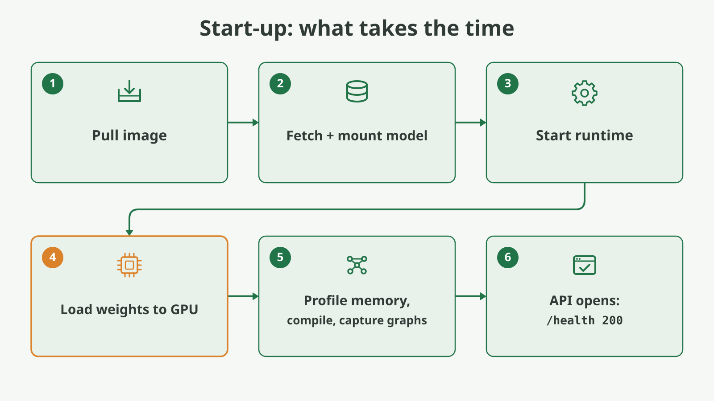

*Figure 20.22.11. Start-up: what takes the time, as a diagram.*

The arrows show order only. The boxes are not drawn to scale, so measure how long each phase takes on your own cluster before you decide where to spend effort.

The book says most time goes to the model download and the weight load, and that the weight load is bounded by I/O into GPU memory. I/O here means reading bytes from storage and writing them to the GPU. The book says the vLLM image is under 5 GB. I checked the Docker Hub tag for v0.32.0 and found about 9.2 GB for the amd64 image, so the book's figure is out of date. Image pull is therefore a real cost on a fresh node, and you should plan for it.

The remedies come from the book and the vLLM guide, and each one attacks a different phase. Pin the image tag or digest and use `IfNotPresent`, so a node that already has the image does not pull it again. Put weights on a PVC, an OCI image, or node-local NVMe instead of downloading from Hugging Face on every start.

Use a faster loader such as Run:ai Model Streamer with `--load-format runai_streamer`, which needs no repackaging. Reuse the `torch.compile` cache under `VLLM_CACHE_ROOT`, and set `VLLM_FORCE_AOT_LOAD=1` to fail loudly on a cache miss. Pass `--kv-cache-memory` to skip profiling. The book says these together can cut scale-up from many minutes to tens of seconds, depending on model size.

There are two quick-start switches, and both trade speed for risk. `--enforce-eager` skips compilation and graph capture, so boot is fast and decode is slower. `-O0` does something similar, with the lowest performance. Use them in development, not as a production fix for a slow start, because a fast boot that runs slowly in production is a new problem, not a fix.

**Measure each start-up phase once, write the numbers in the runbook, and size probes and autoscaling from them.**

### 8. Health endpoints: what they prove and what they do not

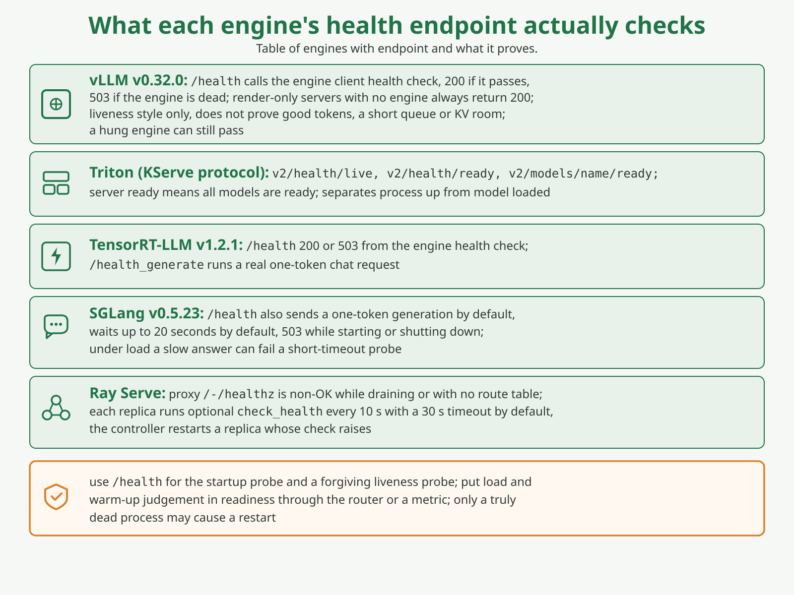

*Figure 20.22.12. Decide what each probe may kill before wiring it to Kubernetes.*


*Figure 20.22.13. A health endpoint proves only the slice of the engine it checks. Use the forgiving checks for restarts and keep load judgement in readiness.*

A load balancer says the pod is healthy while users get timeouts. Both facts can be true. The question is what the endpoint actually checks, because a check that passes is not the same as a service that answers well.

In the v0.32.0 source, the `/health` handler calls the engine client's health check. It returns 200 if that passes and 503 if the engine is dead. Render-only servers with no engine always return 200. The vLLM Kubernetes guide uses `/health` for both liveness and readiness.

The handler is a liveness-style check of the engine process. It does not prove the model produces good tokens, that the queue is short, or that the KV cache has room.

Chapter 20.18 explains why that matters, including why a hung engine can still pass `/health`, which I confirmed in the source. Here is the operating rule. Use `/health` for the startup probe and a forgiving liveness probe. Put load and warm-up judgement in readiness through the router or a metric, not in a short-timeout liveness check that kills busy pods.

Triton exposes more. Its HTTP API follows the KServe protocol: `v2/health/live`, `v2/health/ready` and `v2/models/<name>/ready`. The protocol text says server ready means all models are ready, and that it can implement a Kubernetes readiness probe. So Triton separates "the process is up" from "the model is loaded", which vLLM's single endpoint does not.

I read this in the open inference protocol document. I did not verify every Triton flag around it.

The other engines differ from vLLM, so do not assume they match. In TensorRT-LLM v1.2.1, `trtllm-serve` has `/health`, which returns 200 or 503 from the engine's own health check, and `/health_generate`, which runs a real one-token chat request. A one-token request asks the model for a single output token, which is a deeper check than asking whether the process is alive.

SGLang v0.5.23 is stricter. Its `/health` also sends a one-token generation by default, waits up to 20 seconds by default, and returns 503 while starting or shutting down. That is a deep check, but under load a slow answer can make a short-timeout probe fail.

Ray Serve has two levels. The proxy answers `/-/healthz`, which is non-OK while it drains or has no route table. Each replica runs an optional `check_health` method, every 10 seconds with a 30 second timeout by default, and the controller restarts a replica whose check raises.

**Decide what each probe may kill, and make sure only a truly dead process can cause a restart.**

### 9. Upgrades and version skew

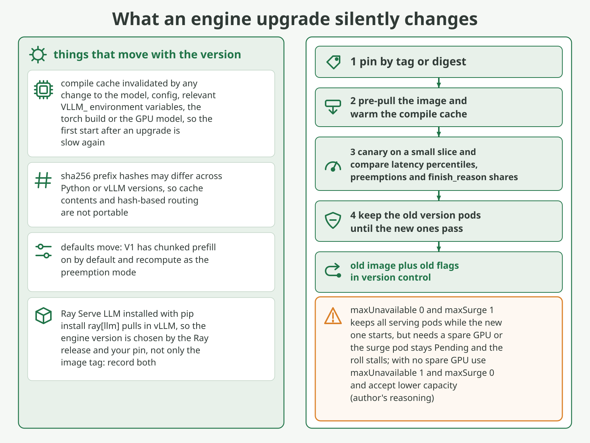

*Figure 20.22.14. Never upgrade without a canary, a way back and a budget for a slow first start.*

A new vLLM release fixes a bug you hit. You deploy it, and p99 time to first token moves. Version changes are risky because many things depend on the version at once, and the first symptom you see may come from a part you did not change.

The vLLM guide lists what invalidates the compile cache: any change to the model, config, relevant `VLLM_*` environment variables, the torch build, or the GPU model. So the first start after an upgrade is slow again. The prefix-caching page says `sha256` hashes may differ across Python or vLLM versions, so cache contents and any hash-based routing are not portable across versions.

Defaults also move. The optimisation guide describes V1 defaults, such as chunked prefill on by default and recompute as the preemption mode, that older releases did not have.

Ray adds a second axis. Ray Serve LLM is installed with `pip install "ray[llm]"`, which pulls in vLLM. The Ray docs say most `engine_kwargs` that work with `vllm serve` also work there. Engine kwargs are the engine's own options, passed through the orchestrator.

So the vLLM version you run is chosen by the Ray release and your pin, not by a vLLM image tag alone. Record both, so that a later investigation can see which engine version was really running.

Chapter 20.18 section 12 covers router and engine version skew, which is the case where the router and the engine are on different versions and disagree about the request format. The operating rule is a rollout plan with four parts. Pin by tag or digest. Pre-pull the image and warm the compile cache. Canary on a small slice and compare latency percentiles, preemptions and `finish_reason` shares. Keep the old version pods until the new ones pass.

One cluster detail. My manifest sets `maxUnavailable: 0` and `maxSurge: 1`, which keeps all serving pods while the new one starts. That needs a spare GPU, or the surge pod stays Pending and the rollout stalls. With no spare GPU, use `maxUnavailable: 1` and `maxSurge: 0`, and accept lower capacity during the roll. That choice is my reasoning, not from a document.

Think of the surge setting as a question about spare room. A surge pod is an extra pod that starts before an old one stops. If the cluster has no free GPU for it, the extra pod waits in Pending, and the roll stops until someone frees a card or changes the setting.

**Never upgrade an engine without a canary and a way back, and budget for a slow first start.**

### 10. Reading each engine's metrics

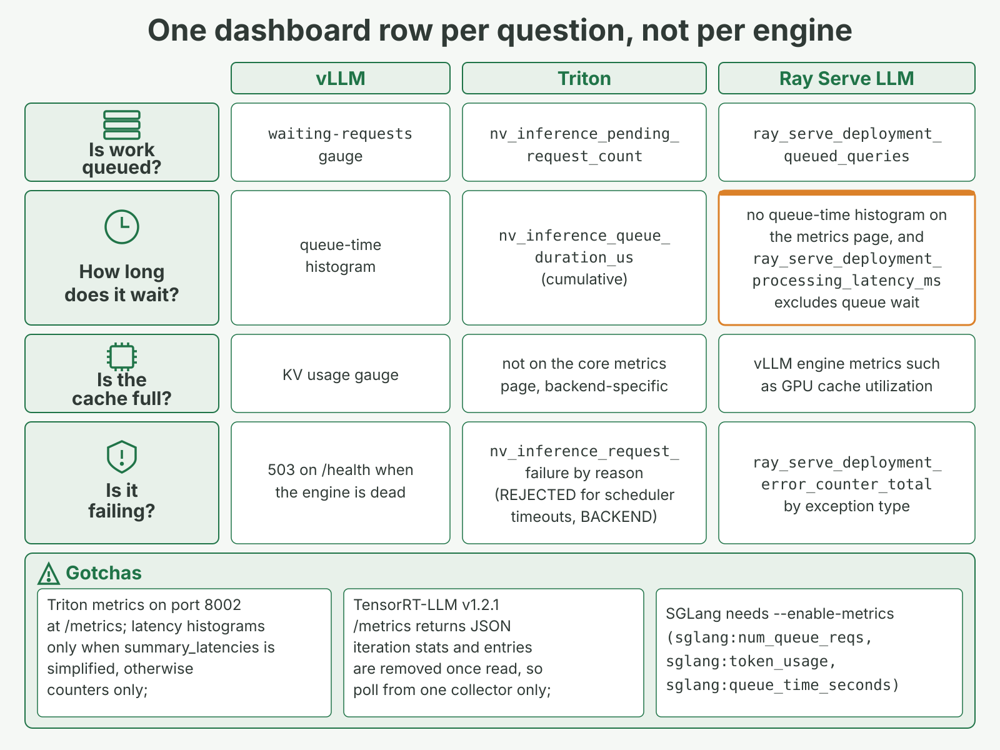

*Figure 20.22.15. The on-call person should read the same four answers whichever engine sits behind the endpoint.*

During an incident you have ten seconds to read the engine, and the page is already open in front of you. Know which numbers answer "is the queue growing, is the cache full, is the engine alive". Those three questions cover most of the first minute.

For vLLM, chapter 20.18 section 1 has the names: waiting requests, running requests, KV cache usage, preemptions, time to first token and inter-token latency. Do not repeat them here. Add one operating habit. Set `disable_log_stats=False` if you want cumulative preemption counts in the log, as the optimisation guide says.

A cumulative count only goes up, so a single reading tells you little. Watch how it moves over time.

Triton publishes Prometheus metrics on port 8002 by default, at `/metrics`. Prometheus is the common metrics format that many dashboards read. Useful ones from its metrics page are `nv_inference_pending_request_count`, which is the queue size per model, and `nv_inference_queue_duration_us`, the cumulative wait in the scheduler queue. The failure counter `nv_inference_request_failure` carries reasons such as REJECTED for scheduler timeouts and BACKEND for failures inside the model.

The latency histograms appear only when `summary_latencies` is set to `simplified`. The default publishes counters only, so a dashboard that expects latency percentiles will be empty until you change that setting.

Ray Serve LLM provides service-level metrics, engine metrics such as time to first token and time per output token, and a Grafana dashboard. For TensorRT-LLM v1.2.1, `/metrics` returns runtime iteration statistics as JSON. The docs say entries are removed once read, so poll it from one collector only. If two collectors poll it, each one sees only part of the data.

For the PyTorch backend it needs `enable_iter_perf_stats: true` and is marked beta in the docs. SGLang publishes Prometheus metrics with `--enable-metrics`, including `sglang:num_queue_reqs`, `sglang:token_usage`, `sglang:queue_time_seconds` and `sglang:time_to_first_token_seconds`.

| Question | vLLM | Triton | Ray Serve LLM |
|---|---|---|---|
| Is work queued? | Waiting-requests gauge | `nv_inference_pending_request_count` | `ray_serve_deployment_queued_queries` |
| How long does it wait? | Queue-time histogram | `nv_inference_queue_duration_us` | No queue-time histogram on the metrics page, and `ray_serve_deployment_processing_latency_ms` excludes queue wait |
| Is the cache full? | KV usage gauge | Not on the core metrics page, backend-specific | vLLM engine metrics such as GPU cache utilization |
| Is it failing? | 503 on `/health` when the engine is dead | `nv_inference_request_failure` by reason | `ray_serve_deployment_error_counter_total` by exception type |

Use the table as a lookup, not as a script. Find the question you are asking, read across to the engine you run, and then open the page for that engine's metric name. Each row is one question an on-call engineer asks during an incident, and the columns are vLLM, Triton and Ray Serve LLM.

**Build one dashboard row per question, not per engine, so that the on-call person reads the same four answers whichever engine is behind the endpoint.**

### 11. The one-page comparison

Here is the question you will be asked in a chat thread: which engine, and what do the numbers tell you about it. The table below is the page you can paste back, one row per question.

| Dimension | vLLM | TensorRT-LLM | Triton | Ray Serve LLM | SGLang |
|---|---|---|---|---|---|
| Layer | Engine and server | Engine and server | Server | Orchestrator | Engine and server |
| Hardware | Many, per docs | NVIDIA only | Many backends | Follows its engine | Broad per the book |
| Strength | Open models, community, fast to adopt | Peak efficiency on NVIDIA | One surface for many model types | Scaling, routing, multi-model | Prefix reuse, agent workloads |
| Operating cost | Flags to tune, version churn | Version and hardware coupling | Repository and backend config | Two systems to run | Smaller ecosystem than vLLM per the book |
| Health | `/health` 200 or 503 | `/health` 200 or 503, and `/health_generate` runs a one-token request | live, ready, model ready | Proxy `/-/healthz`, and a replica `check_health` method | `/health` and `/health_generate`, both a one-token generation by default |
| Metrics | `/metrics` vLLM names | `/metrics` iteration stats, Prometheus at `/prometheus/metrics` only with perf metrics on | `/metrics` on 8002 | Ray metrics export, with `ray_serve_` and engine metrics | `/metrics` with `--enable-metrics`, `sglang:` names |

Every cell above was read from the cited version. Honest note: the cells that say "not on the page" mean I did not find the item in the docs I read, so check the item against your version before you rely on it.

**Memorise the layer and the one strength of each tool, and say plainly which cells you have not verified.**

## How to answer out loud

The panel has a few minutes left, and the interviewer leans back and asks a choice question. Answer it the way you would in a design review, with the rule first and the evidence second.

**Question 1. "When would you pick vLLM over TensorRT-LLM or Triton?"** Begin with the layer, because that is where the question is hiding. Triton is a server and can host either engine, so the real choice is vLLM versus TensorRT-LLM. Pick vLLM when you serve many open models, change them often, want a large community, or run on mixed hardware. Pick TensorRT-LLM when you are all-NVIDIA, run a few stable models at high volume, and the efficiency gain repays tighter version and hardware coupling. Pick Triton when you also serve non-LLM models and want one health, metrics and repository surface.

Close with your decision rule. Benchmark both on your traffic with the same objective, and count the operating cost, not only tokens per second. Expect the follow-up "what did you measure", so name time to first token, inter-token latency and goodput, which is the useful throughput that still meets the latency target.

**Question 2. "The pod OOMs at start. Walk me through it."** Start by asking whether it died at start or after traffic, because the two cases have different causes. At start, add up weights, activation peak and graph memory against the utilisation fraction. Lower `max_model_len` or the fraction, or free the GPU if another process holds memory. After traffic, lower the token budget and cap prompt length at the gateway. State the numbers from section 3 and say that the 5 GB overhead is an assumption.

**Question 3. "Which flags would you review in this command line?"** Say you would run a reviewer first, so the interviewer hears a method before a list. Then name the ones that bite: tensor times pipeline against GPUs, chunked prefill off with a small budget, an explicit KV size overriding the fraction, eager mode in production, and a sequence cap far above what the cache holds. Mention that each check ties to a documented behaviour, and that the tool also prints which document it used.

**Question 4. "How do you size liveness and readiness probes for a slow-starting engine?"** Measure start-up first, then add a startup probe with a threshold large enough for the slowest start. The vLLM Kubernetes guide says a low failure threshold gets the container killed with a log line "KeyboardInterrupt: terminated". Keep liveness forgiving and put load decisions in readiness. Mention that `/health` proves the engine is alive, not that it is fast.

**Question 5. "How do you upgrade the engine safely?"** Pin by digest, pre-pull, warm caches, canary, compare p99 and preemptions, then roll with surge if you have a spare GPU. Name the cache invalidation and the hash non-portability across versions. Say the rollback is the old image plus the old flags in version control, so the way back is written down before you need it.

## Worked scenarios

Three short cases follow. Each one starts from a symptom you could see on call, and each one walks to a fix you could defend in the room.

### Scenario A. The command line that passes review and still preempts

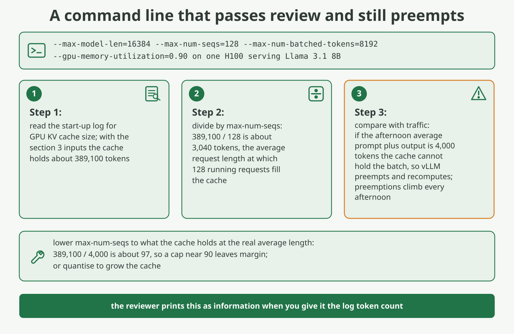

*Figure 20.22.16. Divide the cache by the real average request length to choose the sequence cap.*

Picture this. A team hands you a command that works, and the reviewer passes it without complaint. Yet the dashboards show preemptions climbing every afternoon. Your task is to explain why a clean review does not mean a healthy afternoon. The command is `--max-model-len=16384 --max-num-seqs=128 --max-num-batched-tokens=8192 --gpu-memory-utilization=0.90` on one H100 serving Llama 3.1 8B.

Step 1. Read the start-up log for "GPU KV cache size". With the section 3 inputs, the cache holds about 389,100 tokens.

Step 2. Divide by `max-num-seqs`. The average request can be only about 3,040 tokens before 128 running requests fill the cache.

Step 3. Compare with traffic. If the afternoon average prompt plus output is 4,000 tokens, the cache cannot hold the batch, so vLLM preempts and recomputes.

Answer. Lower `max-num-seqs` to what the cache holds at the real average length. Here 389,100 divided by 4,000 is about 97, so a cap near 90 leaves some margin for the requests that run longer than average. Or quantise to grow the cache. The reviewer prints this as information when you give it the log's token count, as the lab shows.

### Scenario B. Slow rollout, pods killed during start

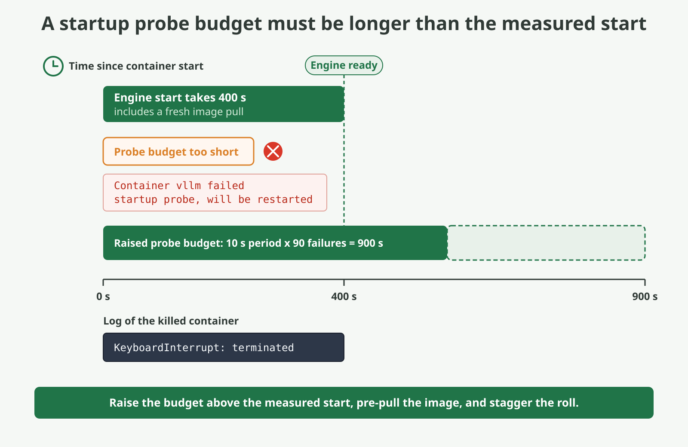

*Figure 20.22.17. A startup probe that gives up before the engine is ready makes the kubelet restart a healthy engine. The budget must exceed the measured start time.*

A rollout of eight replicas shows pods restarting, and `kubectl get events` says "Container vllm failed startup probe, will be restarted". The log of the dying container ends with "KeyboardInterrupt: terminated". The on-call engineer sees a healthy image and wonders whether the engine itself is broken.

Step 1. This matches the troubleshooting section of the vLLM Kubernetes guide. The failure threshold is too low for the time to start.

Step 2. Time a start without probes, as the guide suggests. Suppose it takes 400 seconds including a fresh image pull.

Step 3. The manifest uses a 10 second period and a threshold of 90, which gives a 900 second budget. That figure is my choice, about twice the measured start.

Answer. Raise the startup probe budget above the measured start, pre-pull the image so it drops, and stagger the roll so the weight loads do not all hit storage at once. Chapter 20.18 section 7 covers the thundering herd, which is the name for many clients or pods hitting one resource at the same moment.

### Scenario C. Picking an engine for a new customer

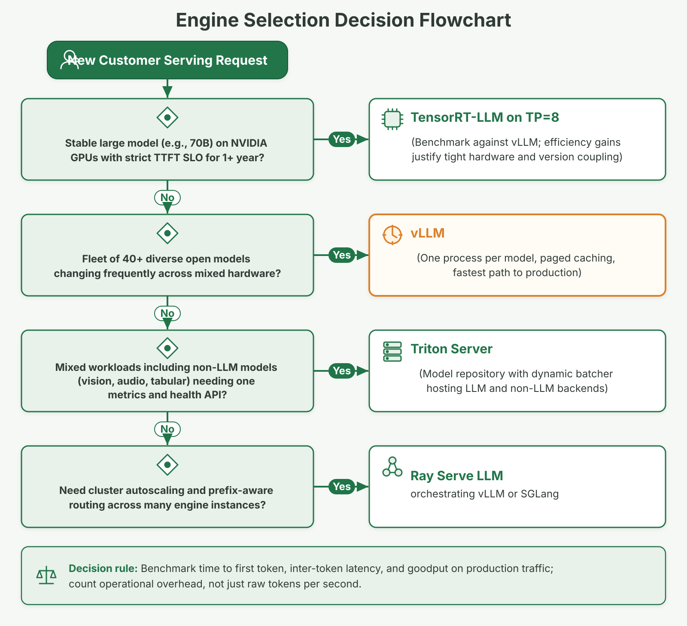

*Figure 20.22.18. Figure 20.22.17. Decision tree for matching customer requirements to the right serving stack based on model variety, hardware stability, and multi-model scope.*

Two requests land on your desk in the same week. A customer needs a 70B model with a strict time to first token, on eight H100s, for a year. Another team serves forty small open models.

Step 1. For the 70B model, tensor parallel across the eight GPUs on one node is the documented default shape.

Step 2. A year of one stable model is the case where TensorRT-LLM's tighter tuning may repay its coupling to GPU and version. That is a hypothesis, so benchmark both under the same load.

Step 3. For the forty small models, vLLM's flexibility and one process per model fit better. Triton helps only if some models are not LLMs.

Answer. Say "benchmark both for the big one, vLLM by default for the many", and state what would change your mind: a measured gap on the SLO, a hardware change, or an engine version you cannot pin. An SLO is the service level objective, the target the team has promised to hit.

## The code

### Engine config reviewer

Think of the reviewer as a checklist that reads a command the way a careful colleague would. It turns a `vllm serve` command line into findings. Each finding names the rule, a severity and the document or source file that states the behaviour. Rules I could not tie to a document are marked as inference in the message. The file is standard library only, so it runs on a bare laptop.

```python
#!/usr/bin/env python3
"""Review a `vllm serve` argument set for contradictions and risky combinations.

Standard library only. Every rule names the vLLM v0.32.0 document or source file
that states the behaviour. Rules marked "inference" are reasoning, not documentation.

Usage:
  python3 c22_vllm_config_review.py --gpus-per-node 8 --gpu-arch hopper -- \
      vllm serve meta-llama/Llama-3.3-70B-Instruct --tensor-parallel-size 4
"""
import argparse
import sys
from dataclasses import dataclass

# Flags that take no value. Everything else takes one value, except the two lists below.
BOOL_FLAGS = {
    "enforce-eager", "enable-expert-parallel", "headless", "numa-bind",
    "enable-chunked-prefill", "no-enable-chunked-prefill",
    "enable-prefix-caching", "no-enable-prefix-caching",
}
LIST_FLAGS = {"numa-bind-nodes", "numa-bind-cpus"}
INT_FLAGS = {
    "tensor-parallel-size", "pipeline-parallel-size", "data-parallel-size",
    "max-model-len", "max-num-seqs", "max-num-batched-tokens", "nnodes",
    "kv-cache-memory",
}


@dataclass
class Finding:
    rule: str
    severity: str  # error | warn | info
    message: str
    source: str


def parse_args(argv):
    """Turn a command line into a dict keyed by flag name without dashes, underscores as dashes."""
    out, i = {}, 0
    while i < len(argv):
        tok = argv[i]
        if tok.startswith("-O") and tok[2:].isdigit():
            out["optimization-level"] = int(tok[2:])
            i += 1
            continue
        if not tok.startswith("--"):
            i += 1  # "vllm", "serve", the model name
            continue
        name, eq, value = tok[2:].partition("=")
        name = name.replace("_", "-")
        if name in BOOL_FLAGS:
            out[name] = True
            i += 1
        elif name in LIST_FLAGS:
            vals, i = ([value] if eq else []), i + 1
            while i < len(argv) and not argv[i].startswith("-"):
                vals.append(argv[i])
                i += 1
            out[name] = vals
        else:
            if not eq:
                i += 1
                value = argv[i] if i < len(argv) else ""
            out[name] = int(value) if name in INT_FLAGS and value.lstrip("-").isdigit() else value
            i += 1
    return out


def _num(args, key, default=None):
    v = args.get(key, default)
    return v if isinstance(v, (int, float)) else default


def _float(args, key):
    try:
        return float(args[key])
    except (KeyError, ValueError):
        return None


def review(args, gpus_per_node=None, gpu_arch=None, kv_cache_tokens=None):
    """Return a list of Findings. Context arguments come from the node, not from vLLM flags."""
    f = []
    tp = _num(args, "tensor-parallel-size", 1)
    pp = _num(args, "pipeline-parallel-size", 1)
    dp = _num(args, "data-parallel-size", 1)
    nnodes = _num(args, "nnodes", 1)
    mml = _num(args, "max-model-len")
    mnbt = _num(args, "max-num-batched-tokens")
    mns = _num(args, "max-num-seqs")
    backend = args.get("distributed-executor-backend")

    # 1. Chunked prefill off requires a token budget above max_model_len.
    if args.get("no-enable-chunked-prefill"):
        if mnbt is not None and mml is not None and mnbt < mml:
            f.append(Finding("chunked-prefill-budget", "error",
                f"chunked prefill is off and max-num-batched-tokens={mnbt} is below max-model-len={mml}. "
                "vLLM may crash at start-up.",
                "docs/configuration/optimization.md, Chunked Prefill warning"))
        elif mnbt is None or mml is None:
            f.append(Finding("chunked-prefill-budget", "warn",
                "chunked prefill is off but max-num-batched-tokens or max-model-len is not set here. "
                "The budget must exceed max-model-len. Read both values from the start-up log.",
                "docs/configuration/optimization.md, Chunked Prefill warning"))

    # 2. kv-cache-memory overrides the utilisation fraction.
    util = _float(args, "gpu-memory-utilization")
    if util is not None and not (0 < util <= 1):
        f.append(Finding("gpu-util-range", "error",
            f"gpu-memory-utilization={util} is outside (0, 1].",
            "vllm/config/cache.py, Field(gt=0, le=1)"))
    if "kv-cache-memory" in args and util is not None:
        f.append(Finding("kv-cache-memory-ignores-util", "warn",
            "kv-cache-memory is set together with gpu-memory-utilization. "
            "The explicit KV size wins and the fraction is ignored.",
            "vllm/config/cache.py, kv_cache_memory_bytes docstring"))
    if "kv-cache-memory" in args:
        f.append(Finding("kv-cache-memory-sizing", "info",
            "kv-cache-memory skips memory profiling, which shortens start-up. "
            "A low value caps concurrency and a high value can fail at allocation.",
            "docs/configuration/optimization.md, Faster Startup"))

    # 3. Parallel layout against the hardware.
    if gpus_per_node is not None:
        total = gpus_per_node * nnodes
        if tp * pp > total and backend != "ray":
            f.append(Finding("world-size-exceeds-gpus", "error",
                f"tensor x pipeline = {tp * pp} but only {total} GPUs are available. "
                "Without enough GPUs on the host and without nnodes, multi-process mode raises an error. "
                "Ray must be chosen explicitly for multi-node.",
                "vllm/config/parallel.py, distributed_executor_backend docstring"))
        if tp > gpus_per_node:
            f.append(Finding("tp-crosses-nodes", "warn",
                f"tensor-parallel-size={tp} is larger than the {gpus_per_node} GPUs per node. "
                "The guidance is tensor parallel equal to GPUs per node and pipeline parallel equal to nodes. "
                "Tensor parallelism across nodes needs fast inter-node links.",
                "docs/serving/parallelism_scaling.md, Multi-node deployment"))
        if "numa-bind-nodes" in args and len(args["numa-bind-nodes"]) != gpus_per_node:
            f.append(Finding("numa-nodes-count", "error",
                f"numa-bind-nodes has {len(args['numa-bind-nodes'])} entries for {gpus_per_node} visible GPUs. "
                "It takes one NUMA node per visible GPU.",
                "docs/configuration/optimization.md, NUMA Binding"))
    if nnodes > 1 and backend != "ray" and "master-addr" not in args:
        f.append(Finding("mp-multinode-needs-master", "error",
            "nnodes > 1 with multiprocessing needs master-addr, and node-rank on each node.",
            "docs/serving/parallelism_scaling.md, Running vLLM with MultiProcessing"))
    if ("numa-bind-nodes" in args or "numa-bind-cpus" in args) and not args.get("numa-bind"):
        f.append(Finding("numa-flags-without-switch", "warn",
            "numa-bind-nodes or numa-bind-cpus given without numa-bind. "
            "Inference: the docs show the lists only alongside numa-bind.",
            "docs/configuration/optimization.md, NUMA Binding (inference)"))
    if args.get("enable-expert-parallel") and tp * dp == 1:
        f.append(Finding("ep-without-sharding", "warn",
            "enable-expert-parallel uses the tensor-parallel degree and MoE layers shard over tensor x data. "
            "Both are 1 here, so there is nothing to spread experts across.",
            "docs/configuration/optimization.md, Expert Parallelism and Data Parallelism"))

    # 4. Quantisation against hardware.
    quant = str(args.get("quantization", "")).lower()
    if quant == "awq" and gpu_arch == "volta":
        f.append(Finding("awq-on-volta", "error",
            "AWQ is not supported on Volta in the compatibility table.",
            "docs/features/quantization/README.md, Supported Hardware"))
    if quant == "fp8" and gpu_arch in {"volta", "turing", "ampere"}:
        f.append(Finding("fp8-w8a8-hardware", "warn",
            "The table marks llm-compressor FP8 W8A8 as supported on Ada, Hopper and AMD GPUs only. "
            "Other FP8 paths such as Marlin may behave differently. Check the start-up log.",
            "docs/features/quantization/README.md, Supported Hardware"))

    # 5. Capacity: worst-case concurrency from the start-up log.
    if kv_cache_tokens and mml and mns:
        worst = kv_cache_tokens / mml
        if mns > worst:
            f.append(Finding("seqs-exceed-worst-case-kv", "info",
                f"max-num-seqs={mns} is above {worst:.2f}, the number of full-length requests the KV cache holds "
                f"({kv_cache_tokens} tokens / {mml}). Safe for short requests, but a burst of long ones preempts.",
                "docs/serving/parallelism_scaling.md, Maximum concurrency log line; docs/configuration/optimization.md, Preemption"))

    # 6. Start-up and speed trade-offs.
    if args.get("enforce-eager"):
        f.append(Finding("enforce-eager", "warn",
            "enforce-eager skips compilation and CUDA graph capture. Start-up is fast and steady-state decode is slower.",
            "docs/configuration/optimization.md, Faster Startup"))
    if args.get("optimization-level") == 0:
        f.append(Finding("opt-level-0", "warn",
            "-O0 gives the fastest start-up and the lowest performance. Production default is -O2.",
            "docs/configuration/optimization.md, Optimization Levels"))
    if mnbt is not None and mnbt <= 2048:
        f.append(Finding("small-token-budget", "info",
            f"max-num-batched-tokens={mnbt}. Smaller values favour inter-token latency, larger values favour "
            "time to first token. The guide recommends more than 8192 for throughput.",
            "docs/configuration/optimization.md, Performance Tuning with Chunked Prefill"))

    # 7. Prefix caching.
    if args.get("no-enable-prefix-caching"):
        f.append(Finding("prefix-caching-off", "info",
            "Prefix caching is on by default in v0.32.0. Turning it off removes reuse of shared prompt prefixes.",
            "vllm/config/cache.py, enable_prefix_caching default; docs/design/prefix_caching.md"))
    if args.get("prefix-caching-hash-algo") in {"xxhash", "xxhash_cbor"}:
        f.append(Finding("weak-prefix-hash", "warn",
            "xxhash is not cryptographically secure and raises the theoretical risk of hash collisions. "
            "The default is sha256.",
            "docs/design/prefix_caching.md, Note 2"))

    # 8. Speculative decoding.
    if "speculative-config" in args or "speculative-model" in args:
        f.append(Finding("speculative-decoding-load", "info",
            "Speculative decoding targets medium to low QPS, memory-bound workloads. "
            "Measure at peak load before enabling it for everyone.",
            "docs/features/speculative_decoding/README.md"))

    if mml is None:
        f.append(Finding("max-model-len-unset", "info",
            "max-model-len is not set, so it comes from the model configuration. "
            "The concurrency estimate in the log is computed from it.",
            "docs/serving/parallelism_scaling.md, Maximum concurrency log line"))
    return f


def render(findings):
    order = {"error": 0, "warn": 1, "info": 2}
    lines = [f"[{x.severity.upper()}] {x.rule}: {x.message}\n        source: {x.source}"
             for x in sorted(findings, key=lambda x: order[x.severity])]
    return "\n".join(lines) if lines else "no findings"


def main(argv=None):
    argv = sys.argv[1:] if argv is None else argv
    ap = argparse.ArgumentParser(description=__doc__, formatter_class=argparse.RawDescriptionHelpFormatter)
    ap.add_argument("--gpus-per-node", type=int)
    ap.add_argument("--gpu-arch", choices=["volta", "turing", "ampere", "ada", "hopper", "blackwell"])
    ap.add_argument("--kv-cache-tokens", type=int, help="'GPU KV cache size' tokens from the start-up log")
    ap.add_argument("vllm_args", nargs=argparse.REMAINDER)
    ns = ap.parse_args(argv)
    rest = [a for a in ns.vllm_args if a != "--"]
    findings = review(parse_args(rest), ns.gpus_per_node, ns.gpu_arch, ns.kv_cache_tokens)
    print(render(findings))
    return 1 if any(x.severity == "error" for x in findings) else 0


if __name__ == "__main__":
    sys.exit(main())
```

Read the tests before you trust the code. Each test names one rule and feeds it one input that should pass and one that should fail, so you can see the edge of the rule.

```python
import os
import sys

sys.path.insert(0, os.path.dirname(__file__))
from c22_vllm_config_review import main, parse_args, review  # noqa: E402


def rules(cmd, **ctx):
    return {f.rule: f.severity for f in review(parse_args(cmd.split()), **ctx)}


def test_parse_forms():
    a = parse_args("vllm serve m --tensor-parallel-size=4 --max_model_len 8192 --enforce-eager -O0".split())
    assert a["tensor-parallel-size"] == 4 and a["max-model-len"] == 8192
    assert a["enforce-eager"] is True and a["optimization-level"] == 0


def test_parse_list_flag_stops_at_next_flag():
    a = parse_args("--numa-bind --numa-bind-nodes 0 0 1 1 --max-num-seqs 64".split())
    assert a["numa-bind-nodes"] == ["0", "0", "1", "1"] and a["max-num-seqs"] == 64


def test_chunked_prefill_off_budget_below_model_len_is_error():
    r = rules("--no-enable-chunked-prefill --max-num-batched-tokens 2048 --max-model-len 32768")
    assert r["chunked-prefill-budget"] == "error"


def test_chunked_prefill_off_budget_ok():
    r = rules("--no-enable-chunked-prefill --max-num-batched-tokens 32768 --max-model-len 32768")
    assert "chunked-prefill-budget" not in r


def test_util_out_of_range():
    assert rules("--gpu-memory-utilization 1.2")["gpu-util-range"] == "error"
    assert "gpu-util-range" not in rules("--gpu-memory-utilization 0.9")


def test_kv_cache_memory_overrides_util():
    r = rules("--kv-cache-memory 1000 --gpu-memory-utilization 0.9")
    assert r["kv-cache-memory-ignores-util"] == "warn"


def test_world_size_exceeds_gpus():
    r = rules("--tensor-parallel-size 8 --pipeline-parallel-size 2", gpus_per_node=8)
    assert r["world-size-exceeds-gpus"] == "error"


def test_tp_pp_beyond_host_without_nnodes():
    r = rules("--tensor-parallel-size 4 --pipeline-parallel-size 2", gpus_per_node=4)
    assert r["world-size-exceeds-gpus"] == "error"


def test_ray_backend_skips_host_gpu_count():
    r = rules("--tensor-parallel-size 4 --pipeline-parallel-size 2 --distributed-executor-backend ray",
              gpus_per_node=4)
    assert "world-size-exceeds-gpus" not in r


def test_multinode_mp_needs_master_addr():
    r = rules("--tensor-parallel-size 8 --pipeline-parallel-size 2 --nnodes 2", gpus_per_node=8)
    assert r["mp-multinode-needs-master"] == "error"
    ok = rules("--tensor-parallel-size 8 --pipeline-parallel-size 2 --nnodes 2 --master-addr 10.0.0.1",
               gpus_per_node=8)
    assert "mp-multinode-needs-master" not in ok and "world-size-exceeds-gpus" not in ok


def test_tp_across_nodes_warns():
    r = rules("--tensor-parallel-size 16 --nnodes 2 --master-addr x", gpus_per_node=8)
    assert r["tp-crosses-nodes"] == "warn"


def test_numa_nodes_count():
    r = rules("--numa-bind --numa-bind-nodes 0 0 1", gpus_per_node=4)
    assert r["numa-nodes-count"] == "error"
    assert "numa-nodes-count" not in rules("--numa-bind --numa-bind-nodes 0 0 1 1", gpus_per_node=4)


def test_expert_parallel_without_sharding():
    assert rules("--enable-expert-parallel")["ep-without-sharding"] == "warn"
    assert "ep-without-sharding" not in rules("--enable-expert-parallel --tensor-parallel-size 8")


def test_awq_on_volta():
    assert rules("--quantization awq", gpu_arch="volta")["awq-on-volta"] == "error"
    assert "awq-on-volta" not in rules("--quantization awq", gpu_arch="hopper")


def test_fp8_on_ampere_warns():
    assert rules("--quantization fp8", gpu_arch="ampere")["fp8-w8a8-hardware"] == "warn"
    assert "fp8-w8a8-hardware" not in rules("--quantization fp8", gpu_arch="hopper")


def test_seqs_exceed_worst_case_kv():
    r = rules("--max-num-seqs 128 --max-model-len 40960", kv_cache_tokens=72064)
    assert r["seqs-exceed-worst-case-kv"] == "info"
    assert "seqs-exceed-worst-case-kv" not in rules("--max-num-seqs 1 --max-model-len 40960",
                                                    kv_cache_tokens=72064)


def test_eager_and_o0_warn():
    r = rules("--enforce-eager -O0")
    assert r["enforce-eager"] == "warn" and r["opt-level-0"] == "warn"


def test_prefix_hash_and_disable():
    r = rules("--no-enable-prefix-caching --prefix-caching-hash-algo xxhash")
    assert r["prefix-caching-off"] == "info" and r["weak-prefix-hash"] == "warn"


def test_cli_exit_code(capsys):
    assert main(["--gpus-per-node", "8", "--", "vllm", "serve", "m", "--tensor-parallel-size", "16"]) == 1
    assert "world-size-exceeds-gpus" in capsys.readouterr().out
    assert main(["--", "vllm", "serve", "m", "--max-model-len", "8192"]) == 0
```

### Kubernetes Deployment for vLLM

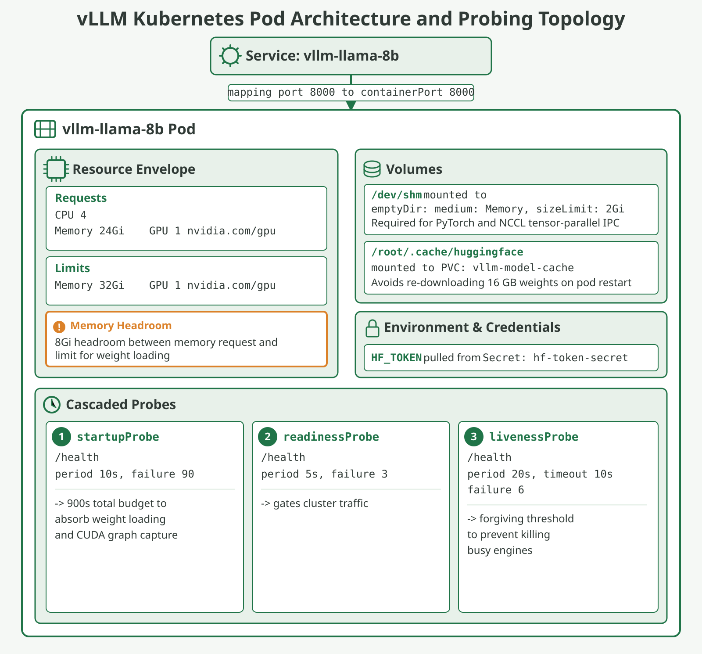

*Figure 20.22.19. Figure 20.22.18. Architecture of the production vLLM pod showing memory headroom, shared memory IPC volume, persistent weight cache, and probe hierarchy.*

Picture yourself as the reviewer for this file before it reaches the cluster. This manifest runs two replicas of one model with a pinned image, GPU and memory resources, a shared-memory volume, a model cache volume, and three probes. The comments in the file give the kubeconform command.

```yaml
# vLLM v0.32.0 on Kubernetes: one GPU, one model, probes sized for a slow start.
# Validate: kubeconform -strict -summary -kubernetes-version 1.31.0 c22_vllm_deployment.yaml
apiVersion: apps/v1
kind: Deployment
metadata:
  name: vllm-llama-8b
  labels:
    app.kubernetes.io/name: vllm
spec:
  replicas: 2
  strategy:
    type: RollingUpdate
    rollingUpdate:
      maxUnavailable: 0
      maxSurge: 1
  selector:
    matchLabels:
      app.kubernetes.io/name: vllm
  template:
    metadata:
      labels:
        app.kubernetes.io/name: vllm
    spec:
      terminationGracePeriodSeconds: 120
      containers:
        - name: vllm
          image: vllm/vllm-openai:v0.32.0
          imagePullPolicy: IfNotPresent
          args:
            - --model=meta-llama/Llama-3.1-8B-Instruct
            - --max-model-len=16384
            - --max-num-seqs=128
            - --max-num-batched-tokens=8192
            - --gpu-memory-utilization=0.90
          env:
            - name: HF_TOKEN
              valueFrom:
                secretKeyRef:
                  name: hf-token-secret
                  key: token
          ports:
            - name: http
              containerPort: 8000
          resources:
            requests:
              cpu: "4"
              memory: 24Gi
              nvidia.com/gpu: "1"
            limits:
              memory: 32Gi
              nvidia.com/gpu: "1"
          startupProbe:
            httpGet:
              path: /health
              port: http
            periodSeconds: 10
            failureThreshold: 90
          readinessProbe:
            httpGet:
              path: /health
              port: http
            periodSeconds: 5
            timeoutSeconds: 5
            failureThreshold: 3
          livenessProbe:
            httpGet:
              path: /health
              port: http
            periodSeconds: 20
            timeoutSeconds: 10
            failureThreshold: 6
          volumeMounts:
            - name: model-cache
              mountPath: /root/.cache/huggingface
            - name: shm
              mountPath: /dev/shm
      volumes:
        - name: model-cache
          persistentVolumeClaim:
            claimName: vllm-model-cache
        - name: shm
          emptyDir:
            medium: Memory
            sizeLimit: 2Gi
---
apiVersion: v1
kind: Service
metadata:
  name: vllm-llama-8b
  labels:
    app.kubernetes.io/name: vllm
spec:
  selector:
    app.kubernetes.io/name: vllm
  ports:
    - name: http
      port: 8000
      targetPort: http
```

Read the manifest from the top down. The image tag comes first because it sets the behaviour of everything below it, and the probes come next because they decide when a pod is killed or taken out of rotation.

Design choices, all mine except where noted. The startup probe has a 900 second budget, so liveness and readiness do not begin until the engine is up. The vLLM guide's own example mounts `/dev/shm` as memory-backed storage for tensor parallel inference, and uses `/health` for liveness and readiness.

Liveness here has a longer period, a longer timeout and six failures, so a busy engine is not killed. The memory limit is higher than the request to leave room for loading. The Secret and the PVC must exist before the pod can start. Kubeconform checks only the schema, not these references, so a missing Secret passes validation and fails at run time.

## Hands-on lab

You have a laptop with Docker and a short block of time. The steps below let you see the reviewer catch a bad command before a GPU host is free.

Steps 1 to 4 ran on this Mac. Step 5 needs a GPU host and was not run.

1. Run the reviewer's test file first. A passing run tells you the tool works before you trust its verdicts.

```bash
python3 -m pytest -q code/part20/test_c22_vllm_config_review.py
```

Expected result, observed: 19 passed.

2. Review the Scenario A command line. Supply the cache size from the section 3 arithmetic.

```bash
python3 code/part20/c22_vllm_config_review.py --gpus-per-node 1 --gpu-arch hopper --kv-cache-tokens 389100 -- vllm serve m --max-model-len=16384 --max-num-seqs=128 --max-num-batched-tokens=8192 --gpu-memory-utilization=0.90
```

Expected result, observed: one information finding, with the line "max-num-seqs=128 is above 23.75".

3. Review a command line with several known faults. Read every finding, not only the first one.

```bash
python3 code/part20/c22_vllm_config_review.py --gpus-per-node 8 --gpu-arch ampere -- vllm serve m --tensor-parallel-size 16 --no-enable-chunked-prefill --max-num-batched-tokens 4096 --max-model-len 32768 --quantization fp8 --prefix-caching-hash-algo xxhash
```

Expected result, observed: two errors, `chunked-prefill-budget` and `world-size-exceeds-gpus`, three warnings, and exit code 1.

4. Validate the manifest with kubeconform. Then break it on purpose, so you can see the message a real mistake would produce.

```bash
kubeconform -strict -summary -kubernetes-version 1.31.0 code/part20/c22_vllm_deployment.yaml
```

Expected result, observed: "Valid: 2, Invalid: 0". Changing `failureThreshold: 90` to a string made kubeconform report "got string, want null or integer". That message is the schema check doing its job.

5. On a GPU host with Docker and the NVIDIA runtime, start the pinned image and watch the start-up log. Not run.

```bash
docker run --rm --gpus all --ipc=host -p 8000:8000 vllm/vllm-openai:v0.32.0 --model meta-llama/Llama-3.1-8B-Instruct --max-model-len 16384
```

Expected shape of the output, from the docs and not observed: lines for weight loading time, "GPU KV cache size" and "Maximum concurrency", then "Application startup complete". Then `curl -i localhost:8000/health` returns 200. Feed the token count into step 2 and compare.

Your logged token count will probably differ from the table's, because the table used the 5 GB overhead as an assumption. Use your own number, and then rerun step 2 with it.

## Drill questions

<details><summary>1. Name the three layers and place vLLM, Triton, Ray Serve LLM and TensorRT-LLM on them.</summary>
Engine, server and orchestrator. vLLM, TensorRT-LLM and SGLang are engines, and each also ships a server command. Triton is a server that can host an engine as a backend. Ray Serve LLM is an orchestrator that runs vLLM or SGLang.
</details>

<details><summary>2. What does `gpu_memory_utilization` limit, and what is the v0.32.0 default?</summary>
It limits the fraction of GPU memory this one instance may use, and it ignores other processes. The default in the v0.32.0 config class is 0.92. Real defaults can be set when the engine config is created, so read the start-up log.
</details>

<details><summary>3. What happens if you disable chunked prefill and leave the token budget below the model length?</summary>
The optimisation guide says vLLM may crash at server start-up. With chunked prefill off, the budget must be larger than `max_model_len`.
</details>

<details><summary>4. State the guidance for tensor and pipeline parallel on two nodes with eight GPUs each.</summary>
Set tensor parallel to the GPUs per node, which is eight, and pipeline parallel to the number of nodes, which is two. The guide also says to use fast inter-node links such as InfiniBand.
</details>

<details><summary>5. Which flag skips memory profiling at start-up, and what is its risk?</summary>
Passing back the logged `--kv-cache-memory` value skips memory profiling. A low value caps concurrency and a high value can fail at allocation. It is valid only for the same GPU and free memory.
</details>

<details><summary>6. What does vLLM's `/health` return, and what does it not prove?</summary>
It returns 200 when the engine client's health check passes and 503 when the engine is dead. It does not prove good output, a short queue or free cache. Use it for startup and forgiving liveness.
</details>

<details><summary>7. How does Triton's readiness differ from vLLM's?</summary>
Triton has separate live, ready and per-model ready endpoints. Server ready means all models are ready for inference. So it separates a running process from a loaded model.
</details>

<details><summary>8. Your start-up takes 400 seconds. Give a startup probe budget and say how you chose it.</summary>
About twice the measured start, for example 10 second period and 90 failures for 900 seconds. The factor of two is my choice, not a rule. A low threshold gets the container killed, as the vLLM guide's troubleshooting section warns.
</details>

<details><summary>9. What invalidates the vLLM compile cache?</summary>
Any change to the model, the config, relevant `VLLM_*` variables, the torch build or the GPU model. The first start after an upgrade is therefore slow.
</details>

<details><summary>10. When would you pick vLLM over TensorRT-LLM?</summary>
When you serve many open models that change often, run mixed hardware, or value community and speed of adoption. Pick TensorRT-LLM for a few stable models on NVIDIA where measured efficiency repays the tighter coupling. Benchmark both on your traffic.
</details>

## Common mistakes and weak answers

Here are the mistakes that show up most often in weak answers on this topic. Each one is easy to avoid once you can name it.

- Saying "vLLM versus Triton" as if they were the same kind of thing. Say that Triton is a server layer that can host an engine, then compare engines.
- Quoting a default from memory. Say "the v0.32.0 class says 0.92, and I would read the start-up log for the value in force".
- Treating `/health` as proof of service quality. Say what it checks and what you would add on top.
- Turning on speculative decoding or a new quantisation for everyone at once. Say canary, quality check, and rollback, in that order.
- Setting `max_num_seqs` without reading the cache size. Show the division from section 3 out loud.
- Claiming a number for Nebius. Say "Nebius has not published this, and a reasonable design is...".

## Connections to the rest of the handbook

Suppose a colleague finishes this chapter and asks where the next topic lives. The links below point to the chapters that build on these engines, and to the chapters that cover the surrounding systems.

- 20.12 Estimation toolkit (`c20-12`) gives the KV-per-token formula used in section 3.
- 20.13 Design: multi-tenant LLM API (`c20-13`) places these engines behind a gateway.
- 20.18 How LLM serving fails (`c20-18`) covers the failure modes these knobs cause or prevent.
- 20.19 SLIs, SLOs and alerts (`c20-19`) turns the metrics in section 10 into alerts.
- 15.3 vLLM in depth (`c15-03`), 15.4 SGLang (`c15-04`), 15.5 TensorRT and TensorRT-LLM (`c15-05`) and 15.6 Triton (`c15-06`) go deeper on each tool.
- 15.16 Production serving stack and reliability (`c15-16`) covers probes in production.
- 11.6 Scheduling GPUs (`c11-06`) covers requests, limits and topology for the pods in the manifest.

## Sources and review notes

Sources and dates fetched (2026-11-09):

- vLLM v0.32.0, files `docs/configuration/optimization.md`, `docs/serving/parallelism_scaling.md`, `docs/deployment/k8s.md`, `docs/design/prefix_caching.md`, `docs/features/speculative_decoding/README.md`, `docs/features/quantization/README.md`, `vllm/config/scheduler.py`, `vllm/config/cache.py`, `vllm/config/parallel.py`, `vllm/entrypoints/serve/instrumentator/health.py`, all from the vllm-project/vllm repository.
- Docker Hub tag `vllm/vllm-openai:v0.32.0`: published 2026-10-18, amd64 image about 9.2 GB compressed.
- Triton server docs from the main branch: `docs/user_guide/metrics.md`, `model_configuration.md`, `model_repository.md`. Release v2.74.0 published 2026-11-02. Health endpoints from the KServe open inference protocol REST specification.
- TensorRT-LLM v1.2.1 docs: `overview.md`, `quick-start-guide.md`, `features/paged-attention-ifb-scheduler.md`, `features/parallel-strategy.md`.
- Ray 2.60.0 docs: `serve/llm/index.md`, `user-guides/observability.md`, `user-guides/vllm-compatibility.md`.
- SGLang README on main, release v0.5.23.
- Llama 3.1 8B `config.json` from the unsloth mirror on Hugging Face: 32 layers, 8 key-value heads, 32 attention heads, hidden size 4096, bfloat16.
- Hands-On LLM Serving and Optimization, chapter 8 "LLM Serving Frameworks" and chapter 9 "LLM Optimization in Practice".
- Generative AI on Kubernetes, chapter 1 "Deploying Models" and chapter 4 "Running in Production".
- LLMs in Production, chapter 6 "Large language model services", for hardware-specific compiled engines.
- AI Systems Performance Engineering, chapter 16: read for quantisation paths. No claim here depends on it beyond background.
- Kubernetes for Generative AI Solutions, chapter 10: read for GPU sharing. No claim in this chapter depends on it.

Explicitly labelled inferences:

- The 5 GB overhead, the 900 second startup budget and the factor of two over measured start.
- That a surge pod stays Pending without a spare GPU, and the rollout choice that follows.
- That TensorRT-LLM may repay its coupling for one stable model. This is a hypothesis to benchmark.
- Reviewer rule `numa-flags-without-switch` is inference. The `fp8-w8a8-hardware` rule reads one table row and other FP8 paths may differ.

Not verified:

- No vLLM, Triton, TensorRT-LLM, Ray or SGLang process was started. No GPU was available. Step 5 of the lab was not run.
- TensorRT-LLM's parallelism trade-offs were not read in detail.
- The book's claim that the vLLM image is under 5 GB conflicts with the Docker Hub tag listing, which gives 9,205,727,079 bytes for amd64 and 10,306,685,803 for arm64 (re-checked 2026-11-09, last updated 2026-10-18). The Docker Hub figure wins.
- The book's claim that TensorRT-LLM builds TensorRT engines conflicts with the v1.2.1 PyTorch-based overview. Check your version.
- The real value of `max_num_seqs` and `max_num_batched_tokens` in force. The class docstring says they are set when the engine config is created.
- Nebius has not published its engines, versions or flag settings.

### Verification log (fact-check pass, 2026-11-09)

Filled 11 of 12 "Not read" cells and resolved 3 other flagged claims.

- CONFIRMED (Docker Hub API): `vllm/vllm-openai:v0.32.0` amd64 compressed size 9,205,727,079 bytes (about 9.2 GB), arm64 10.3 GB. The book's "under 5 GB" is outdated.
- FILLED, TensorRT-LLM v1.2.1 (latest stable, 2026-04-20; v1.4.0rc3 is a release candidate): `tensorrt_llm/serve/openai_server.py` routes `/health`, `/health_generate`, `/metrics`, `/perf_metrics`. `/prometheus/metrics` is mounted only when `return_perf_metrics` is set. `trtllm-serve.rst` describes `/metrics` as iteration stats, read-and-remove, beta for the PyTorch backend.
- FILLED, Ray 2.60.0: `/-/healthz` and `/-/routes` in `proxy.py`, `check_health` defaults 10 s period and 30 s timeout in `constants.py`, metric names from `serve/monitoring.md`.
- FILLED, SGLang v0.5.23 (latest, 2026-11-02): `/health` and `/health_generate` in `http_server.py`, 20 s default timeout, metrics names in `observability/metrics_collector.py` and `production_metrics.mdx`.
- CONFIRMED: vLLM v0.32.0 k8s.md uses `/health` for both liveness and readiness probes.
- STILL UNVERIFIED: Triton KV-cache metrics, which live in a backend and not on the core metrics page. Ray Serve queue-time histogram, which I did not find. TensorRT-LLM parallelism trade-offs.
- Not changed: the claim that TensorRT-LLM may build engines in older versions. The v1.2.1 overview is PyTorch-based.
