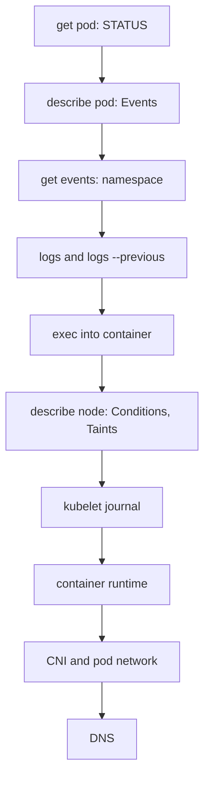

# 20.23 Kubernetes failure drills for GPU platforms

## What the interviewer is testing

An interviewer says "a pod has been Pending for ten minutes, the user is waiting, go". Kubernetes is the first required skill in the Nebius Senior SRE posting, and it is the platform under every inference endpoint. One candidate reported a 30-minute incident stage in an Amsterdam loop. Nebius has not published which platform that stage uses, so prepare for a Kubernetes flavour.

The official interview page lists troubleshooting, debugging, practical console tasks and "say your reasoning aloud". The posting adds Kubernetes autoscaling tuned for GPU efficiency, incident remediation with runbooks, and debugging from kernel to application. This chapter gives you a fixed order of commands and twelve drills you can rehearse. The incident method itself lives in [20.26](26-the-stress-interview-production-incident-role-play.md).

A realistic question: "The deploy finished an hour ago. One inference pod has restarted forty times. Another is Pending. A node drain is stuck. Which do you look at first, and why?"

## The core ideas

### 1. Debug in a fixed order, from the object outward

A pod misbehaves and you have a dozen places to look. If you pick at random, you lose time and the interviewer sees it. The order below goes from the cheapest question to the most expensive one. Each step answers "is the problem in this layer or the next one down".

Start with `kubectl get pod`. The STATUS column often names the failure, such as `Pending`, `CrashLoopBackOff` or `ImagePullBackOff`. Next run `kubectl describe pod`. Its Events table at the bottom is where the scheduler and the kubelet explain themselves. Kubernetes: Up and Running, chapter 5, says `Pending` means the pod was submitted but not yet scheduled, and the Kubernetes pod-debugging page sends you to `describe` for the scheduler's reason.

Then read `kubectl get events` for the namespace, sorted by time, because events from the ReplicaSet and the node never appear in the pod's own table. After that read the logs. The Kubernetes: Up and Running chapter 5 text says `kubectl logs` shows the running container and `--previous` shows the earlier instance, which is what you want when a container restarts at startup. Only then exec into the container.

If the pod looks fine, move down a layer. Look at the node with `kubectl describe node` for Conditions, Taints and Lease. Then the kubelet with `journalctl -xeu kubelet`, which the kubeadm upgrade page gives for checking a kubelet. Then the container runtime, with `crictl` as in [5.25](../part-05-kubernetes/25-troubleshooting-kubernetes-from-the-node-crictl-nsenter-tcpdump-and-ip.md). Then the network plugin, and last DNS.



The seams matter more than the order. A Pending pod belongs to the scheduler and never reaches the kubelet. A restart belongs to the kubelet. A Service with no backends belongs to the EndpointSlice controller. **Name which component owns the symptom before you run the next command.**

### 2. Know who owns each decision

Most Kubernetes failures are a disagreement between three loops. The scheduler places a pod using requests and node capacity. The kubelet starts it, probes it, restarts it and evicts it. Controllers watch objects and make more of them. Each loop reads different fields, so each fails in its own way.

| Symptom | Owner | First object to read |
|---|---|---|
| Pending, no node assigned | kube-scheduler | Pod events, node Allocatable and Taints |
| Waiting, ImagePullBackOff | kubelet and runtime | Pod events, registry |
| Restart count rising | kubelet | `Last State`, probe events, `logs --previous` |
| Pod missing from a Service | EndpointSlice controller | Pod Ready condition, selector |
| Replica count not following load | HPA controller | HPA conditions, metrics |
| Pods vanish when a node dies | node controller | Node conditions, taints |
| Deploy rejected or hangs | API server and webhooks | Event text, webhook configuration |

Production Kubernetes, chapter 6, says the Endpoints controller marks an address ready by reading the pod's Ready condition. The pod's Ready condition in turn depends on readiness probes. That single chain explains half of the "service has no endpoints" calls.

### 3. GPUs add three facts you must be able to say

A GPU is not built in. A vendor device plugin advertises it. The Kubernetes scheduling-GPUs page says an administrator installs drivers and the vendor plugin, and then the cluster exposes a resource such as `nvidia.com/gpu`. If the plugin is not running on a node, that node advertises zero and every GPU pod stays Pending.

GPUs go in `limits`. The same page says you can give a limit without a request, because the limit becomes the request. You can give both only if they are equal. You cannot give a request alone. There is no overcommit.

GPU nodes are usually tainted. Kubernetes for Generative AI Solutions, chapter 5, shows a node group tainted with key `nvidia.com/gpu`, value `true` and effect `NoSchedule`, so that non-GPU workloads stay off. Production Kubernetes, chapter 2, notes the cost: node pools need node selectors and taints, and every GPU workload needs a matching toleration. **Pending GPU pods are a capacity, plugin, taint or quota question, in that order of likelihood once the pod is valid.**

### 4. How to run a drill from this chapter

Each drill below has the same shape. The interviewer states the symptom. You ask questions, and a partner reads the matching row of the table. Then you name the root cause, the fix and the line about prevention. The numbers inside the tables are invented teaching data. The mechanisms and field names come from the books and the Kubernetes documentation.

Chapter 20.26 plays DNS ndots multiplication, an etcd fsync stall and a bad config push. These drills avoid those exact causes. Where a topic overlaps, you get a different cause.

The triage helper in the lab turns the text of `describe` and `get events` into ranked causes. It is a study aid. It reads text you paste and never talks to a cluster.

Before every drill, say the layer you suspect and the one command that would disprove it.

## How to answer out loud

### "A GPU pod is Pending. Walk me through it."

Say: "Pending means the scheduler has not placed it, so I read the scheduler's reason in the pod events." Then run `kubectl describe pod` and read the FailedScheduling line. State the three outcomes. Insufficient `nvidia.com/gpu` means no node has a free GPU in its Allocatable. Untolerated taint means the pod needs a toleration. A selector mismatch means labels. Follow up: if Allocatable is zero on a node that has GPUs, the device plugin is the suspect. If a ResourceQuota is hit, the pod never exists, because the API server returns 403 and the ReplicaSet records the failure.

### "A pod restarts every few minutes. OOM or probe?"

Say: "I read `Last State` from `describe`." OOMKilled with the memory limit is a kernel kill. A liveness failure shows `Unhealthy` and `Killing` events with no OOMKilled. Then name the fix for each. A limit, a leak or a batch size for memory. A startup probe or a longer failure window for slow loading.

### "A node is NotReady. What happens to its pods?"

Say: "No heartbeat on the Lease turns Ready to Unknown, the node gets unreachable taints, and by default the node controller waits five minutes before it evicts." Add the rate limits and the zone rule. Say that you first find out whether it is the machine, the kubelet or the network, and you protect capacity before you fix the cause.

### "How do you upgrade GPU nodes without an outage?"

Say: "One node at a time, with a PDB that allows one disruption, and a check that the device plugin is back and Allocatable is restored before the next node." The kubeadm page says a minor kubelet upgrade requires draining first, and drain needs `--ignore-daemonsets`. Name the two traps. A PDB set to zero allowed disruptions blocks drain forever. A missing plugin after the upgrade leaves the node advertising zero GPUs.

### "An admission webhook is down and nothing deploys."

Say: "I identify the webhook from the error text, then I decide whether it fails open or closed, and I narrow or relax it. I do not delete a security control without saying so." Cover scope, timeout and self-deadlock.

## Worked scenarios

The brief for this chapter asks for twelve drills, so this section is longer than the usual two to four scenarios. Each drill is a short reveal table, then the root cause, the fix, and the line to say about prevention.

### Drill 1: Pending pod that requests nvidia.com/gpu

**Interviewer opens.** "The model pod `llama-gpu` has been Pending for ten minutes. The cluster has H100 nodes. Go."

| Ask about | The interviewer says |
|---|---|
| Pod events | `0/6 nodes are available: 4 node(s) had untolerated taint(s), 2 Insufficient nvidia.com/gpu.` |
| Node Allocatable | The four tainted nodes show 8 GPUs allocatable each. The two untainted nodes show 0. |
| Node taints | `nvidia.com/gpu=true:NoSchedule` on the four GPU nodes. |
| Pod spec | `limits: nvidia.com/gpu: 1`. No tolerations. |
| Quota | Namespace has no ResourceQuota on GPUs. |
| GPUs in use | `kubectl describe node` shows 6 of 8 GPUs requested on one GPU node, 8 of 8 on the others. |

**Root cause.** The pod is valid but has no toleration for the GPU taint, so the four GPU nodes reject it. The two nodes it may use have no GPUs.

**Fix.** Add the toleration that matches the taint. The fixed object is in `code/part20/c23_manifests_fixed.yaml`. A taint reason message exists in the scheduler source as "node(s) had untolerated taint(s)", and older releases used "node(s) had taints that the pod didn't tolerate".

```yaml
tolerations:
  - key: nvidia.com/gpu
    operator: Exists
    effect: NoSchedule
```

**Other branches to name.** If Allocatable is zero on a GPU node, the plugin is missing, see drill 10. If the message says Insufficient on all nodes, the GPUs are all requested. Because a GPU is a whole unit and a container asks for whole units, a four-GPU pod can fail while eight GPUs are free in total, scattered one or two per node. That fragmentation point is my reasoning from whole-unit allocation. For a hard quota, the Kubernetes quota page says a quota on an extended resource uses the `requests.` prefix, for example `requests.nvidia.com/gpu: 4`, and a violation gives 403 Forbidden at creation, so no Pod exists to be Pending.

**Prevention line.** "Every GPU workload template carries the toleration, and a pre-merge check runs the manifest against a node-pool description."

### Drill 2: ImagePullBackOff on a huge model image

**Interviewer opens.** "A new replica of the 40 GB engine image sits in ImagePullBackOff on three of ten new nodes. Go."

| Ask about | The interviewer says |
|---|---|
| Pod events | `Pulling image "registry.example/llm-server:v3"`, then `Error: ErrImagePull`, then `Back-off pulling image`. |
| Which nodes | The three nodes in a newly added pool. The other seven pulled it fine yesterday. |
| Image name and tag | Correct. The tag exists. |
| Pull secret | The new pool's service account has no `imagePullSecrets`. The old pool has node-level registry credentials. |
| Registry reachability | From a new node, the registry host times out on port 443. Egress rules for the new subnet are missing. |
| Pull time on old nodes | About nine minutes for a cold node. |

**Root cause.** The new pool cannot reach or authenticate to the registry. The Kubernetes images page says `ImagePullBackOff` appears for reasons such as an invalid image name or a private registry without an `imagePullSecret`, and that the delay rises until a limit of 300 seconds.

**Fix.** Fix the egress rule or the secret, then delete the stuck pods so the next pull attempt happens now, not at the back-off ceiling. For the size problem, move the pull off the critical path. Bake the image into the node image or pre-pull it with a DaemonSet. The images page says pre-pulling works if you control node configuration and does not work reliably if a provider replaces nodes for you.

**Prevention line.** "Cold start is a capacity number. I measure image pull time per pool and I never scale into a pool that has not pulled the image."

### Drill 3: CrashLoopBackOff, OOM or probe kill

**Interviewer opens.** "The `llm-server` pods restart every four minutes. Restart count is 40. Go."

| Ask about | The interviewer says |
|---|---|
| `get pod` | `CrashLoopBackOff`, restarts 40. |
| `describe`, Last State | `Terminated`, Reason `Error`. No OOMKilled. |
| Events | `Unhealthy: Liveness probe failed` three times, then `Killing: ... failed liveness probe, will be restarted`. |
| Probe config | Liveness `initialDelaySeconds: 5`, `periodSeconds: 10`, `failureThreshold: 1`. No startup probe. |
| Logs, previous | `loading weights 62%` and then nothing. The container was killed mid-load. |
| Model load time | Weights take about 90 seconds to load from disk. |

**Root cause.** The liveness probe starts at 5 seconds and allows one failure, but the model needs about 90 seconds to load. The kubelet kills a container that was healthy but slow. The Kubernetes probes page says a startup probe with failureThreshold times periodSeconds long enough to cover the worst start time solves this, and that liveness takes over after the startup probe succeeds once.

**The other branch.** For an OOM kill the signs differ. The Kubernetes resource-management page shows `Last State: Terminated`, `Reason: OOMKilled` and `Exit Code: 137`, and says the kernel enforces memory limits with OOM kills. Then the fix is the memory limit, the leak, or the batch and context size, as in [20.18](18-how-llm-serving-fails.md).

**Fix.** Add a startup probe, as in `code/part20/c23_manifests_fixed.yaml`: failureThreshold 30 and period 10 gives 300 seconds. The probes page shows exactly that example. The restart delay itself starts at 10 seconds, doubles, and is capped at 300 seconds, and resets after ten clean minutes.

**Prevention line.** "Liveness answers 'is this process stuck', not 'is it ready'. Slow-starting servers get a startup probe sized to a measured load time."

### Drill 4: A node goes NotReady

**Interviewer opens.** "`kube-worker-1` went NotReady twelve minutes ago. Eight inference pods ran there. Go."

| Ask about | The interviewer says |
|---|---|
| `get nodes` | `kube-worker-1 NotReady`. The other nodes are Ready. |
| Node Conditions | `Ready Unknown`, reason `NodeStatusUnknown`, message `Kubelet stopped posting node status.` |
| Taints | `node.kubernetes.io/unreachable:NoExecute` and `...:NoSchedule`. |
| The machine | The cloud console shows the VM running. SSH hangs. |
| Console log | Kernel messages about the filesystem going read-only. |
| Pods | Still listed as Running on the dead node. After five minutes they turned Terminating and new pods started elsewhere. |

**Root cause.** The node stopped sending heartbeats. The Kubernetes nodes page says each node has a Lease, the node controller sets Ready to Unknown when a node is unreachable, and by default waits 5 minutes before it submits the first eviction. The sample describe in the Kubernetes cluster-debugging page matches this output.

**Fix.** Order matters. First confirm replacement capacity exists, because eight pods are rescheduling onto nine nodes. Then recover or replace the node. If it is only the kubelet, read `systemctl status kubelet` and `journalctl -xeu kubelet`. If the machine is damaged, drain what you can, delete the node object, and let the autoscaler add one.

**What limits the blast radius.** The nodes page says evictions are rate limited to `--node-eviction-rate`, default 0.1 per second, and that when at least 55 percent of nodes in a zone are unhealthy the rate drops, and on a cluster of 50 nodes or fewer evictions stop. A partitioned zone does not trigger a mass reschedule.

**Prevention line.** "I alert on Ready not true for longer than the eviction delay, and I keep N+1 GPU capacity so a node loss is a reschedule, not an outage."

### Drill 5: Eviction storm

**Interviewer opens.** "Batch pods keep getting `Evicted` across the GPU pool. Latency on the inference pods is climbing too. Go."

| Ask about | The interviewer says |
|---|---|
| `get pods` | Many pods with status `Evicted`. |
| Event text | `The node was low on resource: memory.` |
| Node Conditions | `MemoryPressure True` on four nodes. |
| Node taints | `node.kubernetes.io/memory-pressure` taint appears and disappears. |
| Pod specs | The batch pods request 2Gi and use 14Gi. No limits. |
| Inference pods | Requests equal limits. A few were also evicted. |

**Root cause.** The batch pods use far more memory than they request. The kubelet reclaims memory by evicting. The Kubernetes node-pressure page says the kubelet sets the pod phase to Failed, ignores PodDisruptionBudgets and the termination grace period for hard thresholds, and that a Deployment controller then makes replacements. The replacements land on other nodes and start the same growth, which is the storm.

**Eviction order.** The page ranks first the pods whose usage exceeds requests, ordered by priority and then by how far over they are. It says the kubelet does not use the QoS class to order eviction, though QoS predicts the order. Pods whose requests equal limits are evicted last. They are evicted only if a system daemon exceeds its reservation.

**The OOM difference.** If memory runs out before the kubelet can reclaim it, the kernel OOM killer picks the victim using `oom_score_adj`, which is -997 for Guaranteed pods. A killed container restarts under the restart policy. An evicted pod does not come back.

**Fix.** Stop the source. Cap or reschedule the batch workload, and set requests near true usage. Do not delete the node taints by hand, because they are the kubelet's signal. Default hard thresholds on Linux are memory.available below 100Mi, nodefs.available below 10 percent, imagefs.available below 15 percent, and inodes below 5 percent.

**Prevention line.** "Requests match real usage, batch and serving pools are separate, and the kubelet has reserved memory for itself."

### Drill 6: A PDB blocks a drain

**Interviewer opens.** "We are rolling GPU node upgrades. `kubectl drain` on `gpu-node-2` has hung for thirty minutes. Go."

| Ask about | The interviewer says |
|---|---|
| Drain output | Repeating lines that eviction of a pod `llm-server-...` is being retried. |
| `get pdb` | `llm-server`, MIN AVAILABLE 3, ALLOWED DISRUPTIONS 0. |
| Deployment | `llm-server` has 3 replicas, all Ready. |
| API response | The eviction API returns 429 Too Many Requests. |
| Other pods on node | All DaemonSet pods, already ignored by drain. |
| Who set the PDB | The platform team, copying the replica count. |

**Root cause.** `minAvailable` equals the replica count, so zero voluntary evictions are allowed. The Kubernetes PDB task page says that with `minAvailable` at the replica count, or `maxUnavailable` at 0, "the drain never completes". The eviction API page says a PDB violation returns 429 and kubectl retries until a timeout.

**Fix.** Do not delete the pod directly, because deletion bypasses PDBs and drops serving capacity at once. Change the PDB to `maxUnavailable: 1`, which allows one eviction while the others stay up. Add `unhealthyPodEvictionPolicy: AlwaysAllow`, which the drain page recommends so broken pods can be evicted. Check that the replacement pod becomes Ready before the next eviction, since a 3-replica service has little spare capacity.

**A related trap.** The eviction API page says it can also return 500 when more than one PDB references one Pod. It also says the API can answer only with 429 or 500 until you intervene when new pods never become Ready.

**Prevention line.** "A PDB for a serving Deployment says maxUnavailable 1, and a pre-upgrade check lists every PDB with zero allowed disruptions."

### Drill 7: CoreDNS slow for half the lookups

**Interviewer opens.** "Gateway requests sometimes stall for five seconds, and only on the first call. Pods are healthy. Go."

| Ask about | The interviewer says |
|---|---|
| Pattern | About half of lookups are fast and half take five seconds. |
| CoreDNS pods | Two replicas, both Running. One is on a node under heavy CPU pressure. |
| `nslookup kubernetes.default` from a debug pod | Alternates between instant and timing out. |
| Direct query | Asking replica A's pod IP is instant. Asking replica B's pod IP times out. |
| Replica B logs | No errors. Very slow to respond. |
| Change | None. |

**Root cause.** The Service name `kube-dns` spreads queries across its two backends. Networking and Kubernetes, chapter 4, shows the iptables rule for kube-dns with a chain at probability 0.5 to each of two CoreDNS pod IPs. One backend is slow, so about half of queries are slow. This differs from the 20.26 ndots drill, where each lookup multiplies into several queries.

**Fix.** Use the Kubernetes DNS debugging page order. Run `nslookup kubernetes.default` from a pod. Check `/etc/resolv.conf`. List the pods with label `k8s-app=kube-dns` in `kube-system`. Read their logs. Confirm the `kube-dns` Service and its EndpointSlice. Then address the unhealthy replica by moving it off the loaded node. Do not remove both replicas at once.

**Prevention line.** "CoreDNS replicas spread across nodes with a node-local cache in front. Production Kubernetes, chapter 6, describes NodeLocal DNSCache as a per-node DaemonSet that answers hits locally."

### Drill 8: A Service has no endpoints

**Interviewer opens.** "The gateway gets connection refused from the `llm-server` Service. All three pods are Running. Go."

| Ask about | The interviewer says |
|---|---|
| `get svc` | `llm-server ClusterIP 10.0.1.175 80/TCP`. |
| EndpointSlices | `kubectl get endpointslices -l kubernetes.io/service-name=llm-server` shows no addresses. |
| Service selector | `app: llm-serv`. |
| Pod labels | `app: llm-server`. |
| Pod Ready | `3/3`. |
| targetPort | Named port `http`, which exists. |

**Root cause.** The selector has a typo. The Kubernetes service-debugging page says a control loop evaluates each Service selector and writes the result into EndpointSlices, and that an empty slice means the selector selects nothing.

**Fix.** Correct the selector. The manifest pair in `code/part20` shows it.

**The more common variant.** If labels match but the slice lists no ready addresses, the cause is readiness. Production Kubernetes, chapter 6, says the Endpoints controller decides readiness from the pod Ready condition. Kubernetes: Up and Running, chapter 7, shows a server leaving the endpoints after three failing readiness checks. Check the readiness probe and its dependency. A probe that calls a downstream service takes every replica out at once when the downstream fails.

**Prevention line.** "Selectors and labels come from one template, and a deploy check fails if a Service has no EndpointSlice addresses."

### Drill 9: The HPA does not scale

**Interviewer opens.** "Load doubled. The HPA still shows three replicas. Go."

| Ask about | The interviewer says |
|---|---|
| `describe hpa` | Target shows `<unknown>/70%`. |
| Conditions | The HPA cannot compute a metric. |
| Metrics server | Running. `kubectl top pods` returns values. |
| Container requests | CPU limits set, CPU requests missing. |
| Workload type | GPU inference. CPU is about 40 percent busy while the GPU is saturated. |
| Pending pods | Not applicable, because no scale-out was attempted. |

**Root cause.** The HPA computes utilisation as a percentage of the container's CPU request. The Kubernetes HPA page says so. With no request, there is no denominator. Even with one, CPU is the wrong signal for a GPU server, because the work is on the GPU.

**Fix.** Set requests. Then move the signal. Production Kubernetes, chapter 13, says the Metrics Server provides CPU and memory only and that custom application metrics should be considered for other signals. For inference, queue depth or running requests per replica reflects pressure, as in [20.18](18-how-llm-serving-fails.md).

**Behaviour to know.** The HPA page says a 10 percent tolerance applies by default, and downscale uses a 300 second stabilization window. Scale-up has none. After scale-up, new GPU pods may still be Pending, which sends you back to drill 1 and to the cluster autoscaler. Kubernetes for Generative AI Solutions, chapter 6, shows Karpenter launching a node in response to a Pending pod with `Insufficient nvidia.com/gpu`.

**Prevention line.** "Every HPA has an alert on unknown targets, and inference scales on queue depth, not CPU."

### Drill 10: Device plugin missing after an upgrade

**Interviewer opens.** "We upgraded two GPU nodes last night. This morning new GPU pods are Pending on them. Old pods still run. Go."

| Ask about | The interviewer says |
|---|---|
| Pod events | `Insufficient nvidia.com/gpu` on the two upgraded nodes. |
| Node Allocatable | `nvidia.com/gpu: 0` on both. The other nodes show 8. |
| Device plugin DaemonSet | Desired 10, ready 8. |
| Missing pods | They are on the two upgraded nodes. |
| Node taints | The upgrade recreated the nodes with the GPU taint. |
| DaemonSet tolerations | None for that taint. |

**Root cause.** The device plugin pod does not run on the upgraded nodes, so the kubelet never learns about the GPUs. Kubernetes: Up and Running, chapter 11, says a DaemonSet places a copy on each node of a set. The plugin DaemonSet lacks the toleration for the taint the new nodes carry. The device-plugins page says the plugin registers over a Unix socket in `/var/lib/kubelet/device-plugins`, and that a new kubelet deletes the existing sockets, so the plugin must notice and register again.

**Fix.** Add the toleration to the DaemonSet and watch the pods come up. Check Allocatable before you uncordon. Then check that the plugin re-registers after any kubelet restart. The device-plugins page also says an unhealthy device lowers allocatable and keeps capacity the same, so compare the two numbers.

**The upgrade order to say.** The kubeadm page drains the node with `kubectl drain <node> --ignore-daemonsets`, upgrades and restarts the kubelet, then uncordons. Add a gate: do not uncordon until Allocatable shows the GPU count.

**Prevention line.** "The plugin DaemonSet tolerates every GPU taint, and my upgrade runbook has a step that checks Allocatable before uncordon."

### Drill 11: etcd is slow after a topology change

**Interviewer opens.** "kubectl commands take ten seconds. Deploys are slow. Running pods are fine. Go."

| Ask about | The interviewer says |
|---|---|
| API latency | Writes are slow, reads are slow. Rising over the last day. |
| etcd members | Three members. One was rebuilt yesterday in another region. |
| Round trip | About 60 ms to the new member. The old three were under 1 ms. |
| Leader | The leader changed twice in the last hour. |
| Disk | Fast local SSD on all members. Latency is fine. |
| Workloads | Serving pods have no dependency on the Kubernetes API. |

**Root cause.** A member sits far from the others. Production Kubernetes, chapter 2, says etcd defaults assume one datacenter, that you should test round trips and tune the heartbeat interval and election timeout if you span datacenters, and that it strongly discourages etcd across regions. The Kubernetes etcd page says resource starvation or slow heartbeats can leave no leader, and then the cluster cannot change state, so no new pods can be scheduled. This differs from the 20.26 etcd drill, where disk fsync was the cause.

**What still works.** The same chapter says that workloads without API dependencies should not suffer, but control of the cluster does. That is why serving continues while deploys hang. It is also why you should not roll the whole control plane.

**Fix.** Bring the member back close to the others, or remove it and add one in the same datacenter. Use the member-management commands, one change at a time, and take a snapshot first, as in [5.20](../part-05-kubernetes/20-upgrades-etcd-backup-and-restore-and-disaster-recovery.md). Do not defragment a live member as a reflex. The Kubernetes etcd page calls defragmentation expensive.

**Prevention line.** "etcd members stay in one low-latency domain with an odd count, and I alert on leader changes and request latency."

### Drill 12: An admission webhook outage blocks deploys

**Interviewer opens.** "Every deploy fails. Even the CoreDNS pods cannot restart. Go."

| Ask about | The interviewer says |
|---|---|
| Error text | `Internal error occurred: failed calling webhook "defaults.policy.example.com": ... connect: connection refused`. |
| Webhook service | Its Deployment is in `policy-system`, and its pods are down after a node drain. |
| Webhook config | `failurePolicy: Fail`, timeout 30 seconds, no namespace selector. |
| Scope | It matches Pod CREATE in every namespace. |
| Self reference | The webhook's own Deployment is in scope. |
| Why pods are down | The webhook cannot admit its own replacement pods. |

**Root cause.** A fail-closed webhook with wide scope depends on pods that it must itself admit. The apiserver's own error text is "failed calling webhook %q: %v", and the Kubernetes webhook good-practices page names the deadlock: a webhook that intercepts the resources needed to start its own pods blocks its own recovery. Production Kubernetes, chapter 8, says an unreachable webhook is treated as failing and `failurePolicy` chooses `Ignore` or `Fail`.

**Fix.** The webhook configuration object cannot be blocked by any webhook. The API server source skips webhook configuration objects when it picks API-based webhooks, in the function `isExcludedFromAPIHooks` in the generic webhook plugin, to prevent circular dependencies. So an operator can patch or delete the configuration. Set `failurePolicy: Ignore` and add a `namespaceSelector` that excludes `kube-system` and `policy-system`, as in the fixed manifest. Then restart the webhook pods. Say what you give up. For security-critical webhooks Production Kubernetes calls `Fail` the safest option. Fail open only where that is acceptable and add a controller that audits the result.

**Prevention line.** "Webhooks get a short timeout, a high-availability Deployment, an exclusion for kube-system and their own namespace, and a staged rollout starting with fail open in a test namespace."

## Hands-on lab

Steps 1 to 5 were run on a laptop, and steps 1 to 4 again in a disposable Linux container, with the same results on both. Step 6 is not run, because there is no cluster, and Docker alone cannot stand one up without privileged mode.

1. Run the tests.

```bash
cd code/part20
python3 -m pytest -q test_c23_triage.py
```

Observed: `13 passed`, on the Mac and in the Linux container.

2. Triage a Pending GPU pod. This is the fixture shown here, built from the Kubernetes for Generative AI Solutions event text.

```text
# code/part20/samples/c23_describe_pending_gpu.txt
Name:           my-llama-job-plgb5
Namespace:      default
Status:         Pending
Node:           <none>
Containers:
  llama:
    Image:      registry.example/llama:v1
    State:      Waiting
      Reason:   Pending
    Limits:
      nvidia.com/gpu:  1
Events:
  Type     Reason            Age    From               Message
  ----     ------            ----   ----               -------
  Warning  FailedScheduling  101s   default-scheduler  0/2 nodes are available: 2 Insufficient nvidia.com/gpu. preemption: 0/2 nodes are available: 2 No preemption victims found for incoming pod
```

```bash
python3 c23_triage.py samples/c23_describe_pending_gpu.txt
```

Observed: `1. gpu_unavailable [high]` with the evidence `2 node(s) report Insufficient nvidia.com/gpu (0/2 nodes are available)`.

3. Triage the OOM and node fixtures, which come from the Kubernetes docs.

```bash
python3 c23_triage.py samples/c23_describe_oomkilled.txt
python3 c23_triage.py samples/c23_describe_node_notready.txt
```

Observed: `container_oom_kill [high]`, restarts 5, and `node_not_ready [high]` with the unreachable taints in the evidence.

4. Triage a mixed events table.

```bash
python3 c23_triage.py samples/c23_describe_pending_gpu.txt --events samples/c23_get_events_mixed.txt
```

Observed: gpu_unavailable, node_pressure_eviction, admission_webhook_unreachable, then cpu_memory_capacity and node_not_ready at medium confidence.

One Linux fact behind step 3 I could test without a cluster. The kubelet reports exit code 137 for an OOM kill, because the container runtime kills the process with SIGKILL when it passes its cgroup memory limit. I started `docker run -m 64m --memory-swap 64m ubuntu:24.04` with a shell loop that grows a variable. The container exited with code 137, and `docker inspect` showed `ExitCode=137 OOMKilled=true`. This is Docker, not the kubelet, so it shows the Linux mechanism and not the pod status text. The same 137 also appears for a plain SIGKILL, which is why the `OOMKilled` reason is what tells them apart.

5. Validate the manifests.

```bash
~/go/bin/kubeconform -strict -summary c23_manifests_broken.yaml
~/go/bin/kubeconform -strict -summary c23_manifests_fixed.yaml
```

Observed for each: `7 resources found in 1 file - Valid: 7, Invalid: 0`. Both pass because the faults are semantic, which is the lesson of this chapter. Only a cluster rejects them.

6. Not run. On a real cluster, apply the broken file to a scratch namespace and watch each fault, then apply the fixed file.

```bash
kubectl apply -f c23_manifests_broken.yaml
kubectl describe pod llama-gpu -n serving
kubectl get endpointslices -n serving -l kubernetes.io/service-name=llm-server
kubectl get pdb -n serving
kubectl events -n serving --types=Warning
```

Expected shape of the output: a FailedScheduling event, an empty EndpointSlice, a PDB with ALLOWED DISRUPTIONS 0. I confirmed from `kubectl --help` on client v1.35.0 that `logs --previous`, `drain --ignore-daemonsets`, `events --types` and `get --field-selector` exist.

## Drill questions

<details><summary>1. Which component owns a pod that is Pending with no node?</summary>

The scheduler. The pod never reached a kubelet. Read the FailedScheduling event in the pod's events.

</details>

<details><summary>2. Why do GPU requests go in `limits`?</summary>

The Kubernetes GPU page says GPUs are specified in limits. A limit alone is used as the request. Both are allowed if equal. A request alone is not allowed.

</details>

<details><summary>3. How do you tell an OOM kill from a liveness kill?</summary>

Read Last State in describe. OOMKilled is a memory-limit kill. A liveness kill shows Unhealthy and Killing events and no OOMKilled.

</details>

<details><summary>4. What are the restart back-off numbers?</summary>

The delay starts at 10 seconds, doubles, and is capped at 300 seconds. It resets after ten minutes of running without problems.

</details>

<details><summary>5. What happens to pods on a node that stops sending heartbeats?</summary>

Ready becomes Unknown, unreachable taints appear, and by default the node controller waits five minutes before it starts evictions. Eviction is rate limited at 0.1 nodes per second by default.

</details>

<details><summary>6. Does node-pressure eviction respect a PDB?</summary>

No. The Kubernetes page says the kubelet does not respect the PDB or the termination grace period for hard thresholds. API-initiated eviction, as used by drain, does respect it.

</details>

<details><summary>7. A drain hangs and the PDB shows ALLOWED DISRUPTIONS 0. What do you change?</summary>

Set maxUnavailable to 1 in place of minAvailable equal to the replica count, and add unhealthyPodEvictionPolicy AlwaysAllow. Do not delete the pods directly, because deletion bypasses the budget.

</details>

<details><summary>8. A Service has pods but no endpoints. Name two causes.</summary>

The selector does not match the pod labels, or the pods are not Ready because the readiness probe fails. The EndpointSlice controller reads the pod Ready condition.

</details>

<details><summary>9. Why can an HPA show unknown for CPU?</summary>

Utilisation is a percentage of the container's CPU request. With no request there is nothing to divide by. The Metrics Server must also be running.

</details>

<details><summary>10. What do you check before uncordoning a GPU node after an upgrade?</summary>

That the device plugin pod is running and the node's Allocatable shows the GPU count. A new kubelet deletes the plugin sockets, so the plugin has to register again.

</details>

## Common mistakes and weak answers

| Weak answer | What loses points | Say instead |
|---|---|---|
| "I would restart the pod" | No diagnosis | "I read describe and the previous logs first" |
| "Delete the PDB" | Removes protection | "Change it to maxUnavailable 1, then drain" |
| "Delete the pod to finish the drain" | Bypasses the budget | "Eviction respects the PDB. Deletion does not" |
| "Increase the memory limit" | Guess | "Last State says OOMKilled, so I check usage against the limit" |
| "Raise the liveness timeout" | Treats a slow start as a hang | "Add a startup probe sized to load time" |
| "Delete the webhook" | Opens a hole silently | "I narrow it and fail open, and I say what that risks" |
| "Scale on CPU" for GPU servers | Wrong signal | "Scale on queue depth" |
| Running `kubectl delete node` first | Loses evidence | "Read conditions and kubelet logs first, protect capacity" |

## Connections to the rest of the handbook

- [5.9 The kubelet and the node](../part-05-kubernetes/09-the-kubelet-and-the-node-cri-cgroups-qos-classes-probes-and-eviction.md) explains probes, QoS and eviction in depth.
- [5.11 DNS and service discovery with CoreDNS](../part-05-kubernetes/11-dns-and-service-discovery-with-coredns.md), [5.10 Services and kube-proxy](../part-05-kubernetes/10-services-endpoints-and-kube-proxy-the-life-of-a-service.md) and [5.23 Autoscaling](../part-05-kubernetes/23-autoscaling-hpa-vpa-keda-and-the-cluster-autoscaler.md) support drills 7 to 9.
- [5.18 Scheduling in depth](../part-05-kubernetes/18-scheduling-in-depth-kube-scheduler-affinity-taints-priority-and-preemp.md) and [5.20 Upgrades, etcd backup and restore](../part-05-kubernetes/20-upgrades-etcd-backup-and-restore-and-disaster-recovery.md) support drills 1, 6 and 11.
- [5.21 Admission control and policy](../part-05-kubernetes/21-certificates-identity-admission-control-and-policy.md) supports drill 12.
- [11.2 Device plugin, container toolkit, CDI and runtime classes](../part-11-gpu-kubernetes/02-device-plugin-container-toolkit-cdi-and-runtime-classes.md) and [11.29 Multi-tenancy, quotas, fault tolerance and health on GPU clusters](../part-11-gpu-kubernetes/29-multi-tenancy-quotas-fault-tolerance-and-health-on-gpu-clusters.md) support drills 1 and 10.
- [20.3 Triage method for a sick Linux box](03-triage-method-for-a-sick-linux-box.md), [20.5 CPU, memory, disk and the scheduler](05-cpu-memory-disk-and-the-scheduler.md) and [20.6 Network debugging](06-network-debugging-from-socket-to-switch.md) cover the node layer below the kubelet.
- [20.18 How LLM serving fails](18-how-llm-serving-fails.md), [20.19 SLIs, SLOs and alerts](19-slis-slos-and-alerts-for-token-apis.md) and [20.26 The stress interview](26-the-stress-interview-production-incident-role-play.md) give the serving signals and the incident method.

## Sources and review notes

Fetched on 2026-11-09. Kubernetes pages were read from the `main` branch of the kubernetes/website repository, so wording is the current documentation and may differ from your cluster. The latest release tag seen was v1.37.2. My kubectl client is v1.35.0.

- Production Kubernetes: chapter 2 Deployment Models, chapter 6 Service Routing, chapter 8 Admission Control, chapter 13 Autoscaling, chapter 14 Application Considerations.
- Kubernetes: Up and Running, 3rd edition: chapter 5 Pods, chapter 7 Service Discovery, chapter 11 DaemonSets.
- Networking and Kubernetes: chapter 4 Kubernetes Networking Introduction.
- Kubernetes for Generative AI Solutions: chapter 5 and chapter 6 Scaling GenAI Applications on Kubernetes.
- Scalable Kubernetes Infrastructure for AI Platforms was read for chapters 2 and 4. It gave no failure facts used here.
- Kubernetes documentation: debug pods, debug services, debugging DNS resolution, debug cluster, node-pressure eviction, taints and tolerations, nodes, disruptions, configure a PDB, API-initiated eviction, safely drain a node, scheduling GPUs, device plugins, horizontal pod autoscale, resource quotas, images, probes, pod lifecycle, manage resources for containers, etcd operations, kubeadm upgrade, admission webhook good practices.
- Kubernetes source: scheduler tainttoleration and nodeaffinity plugin error strings, kubelet eviction message format and webhook error format, read from github.com/kubernetes/kubernetes master.

**Explicitly labelled inferences.** The twelve interviewer tables are invented teaching data. The GPU fragmentation point in drill 1, the spreading of CoreDNS replicas in drill 7, and the image pre-pull advice in drill 2 are my reasoning. Nebius has not published how its clusters, node pools, taints or upgrades work.

**Not verified.** No command was run against a cluster. The Linux container run covered only the Python triage scripts and a Docker OOM kill. No kubectl command, kubelet behaviour or device plugin ran. The fixtures for ImagePullBackOff, the Pending taint case and the mixed events table are built from field names and message strings in the documentation and source, not captured from a cluster. The kubeconform version is a development build. The probe-kill exit code is not stated in the docs, so no fixture claims one, and that claim stays unverified.

### Verification log

Lab runs: steps 1 to 5 on macOS with Python 3.12 and kubeconform from `~/go/bin`; steps 1 to 4 again in a disposable Linux container, `ubuntu:24.04` on kernel `6.18.37-0-virt` with Python 3.12.3 and the repository mounted read-only. kubeconform was not run on Linux. Fact-check pass on 2026-11-09 against the kubernetes/website `main` branch and kubernetes/kubernetes source, latest release tag v1.37.2. Eleven claims were checked. Ten are confirmed, none were corrected, one stays unverified.

| Claim | Result | Source |
|---|---|---|
| Default hard thresholds: memory.available 100Mi on Linux, nodefs.available 10 percent, imagefs.available 15 percent, inodes 5 percent | Confirmed | Node-pressure eviction page |
| Eviction pressure transition period defaults to 5m | Confirmed | Same page |
| Node pressure conditions map to NoSchedule taints, and pods get a default 300 second NoExecute toleration for not-ready and unreachable | Confirmed | Taints and tolerations page |
| Eviction rate 0.1 per second, 55 percent zone threshold, evictions stop at 50 nodes or fewer | Confirmed | Nodes page |
| An eviction blocked by a PDB returns 429, and 500 when several PDBs match | Confirmed | API-initiated eviction page |
| A webhook defaults to failurePolicy Fail, timeout 10 seconds, allowed range 1 to 30 seconds | Confirmed | Dynamic admission control page |
| A webhook cannot intercept its own configuration object | Confirmed, was my reasoning | `isExcludedFromAPIHooks` in `generic/webhook.go`, master and release-1.35 |
| Extended-resource quota uses the `requests.` prefix and violation returns 403 | Confirmed | Resource quotas page |
| Restart backoff 10 s doubling to 300 s, reset after 10 minutes | Confirmed | Pod lifecycle page |
| HPA tolerance 0.1 and 5 minute scale-down stabilization | Confirmed | HPA page |
| Exit code of a container killed by a failing liveness probe | Still unverified | Not in the docs |
