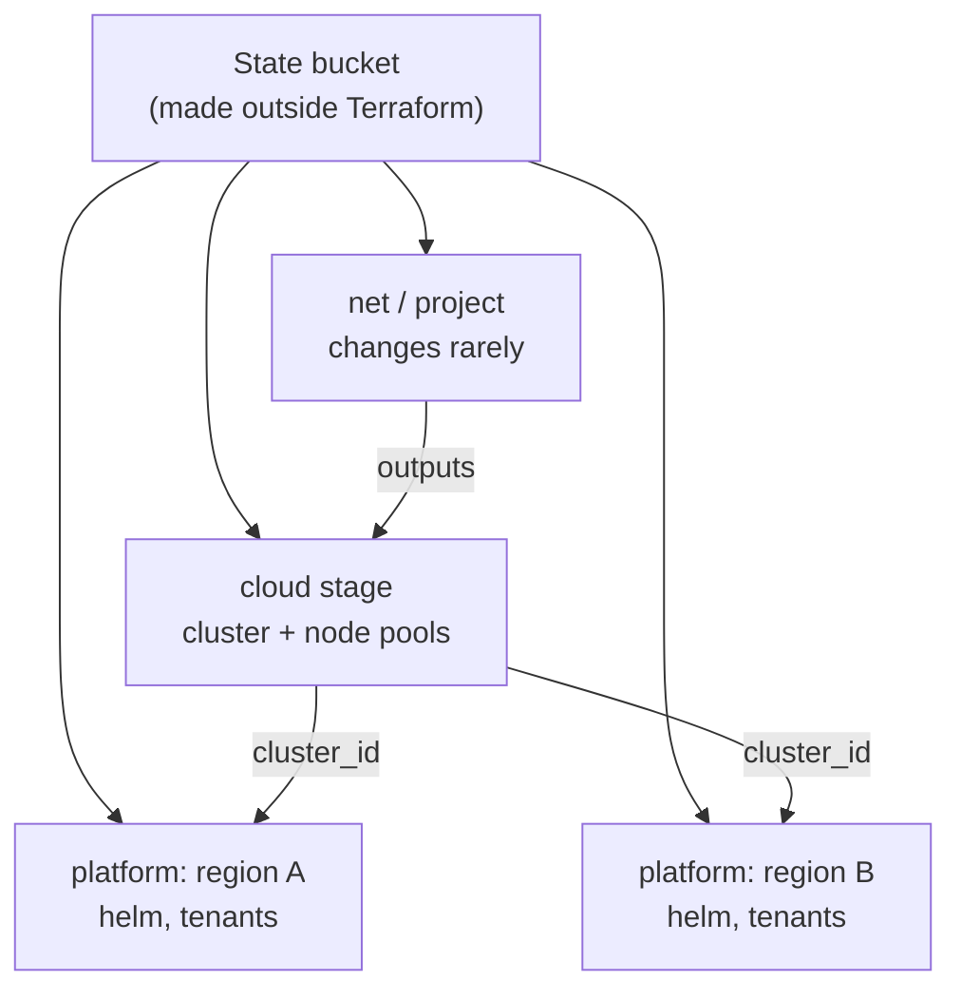

# 20.24 Terraform for resilient GPU clusters

## What the interviewer is testing

An interviewer shares a screen with a Terraform plan on it. The last line says "Plan: 0 to add, 0 to change, 1 to destroy" and the resource is a GPU node pool. They ask: "Do you apply this?" This chapter serves the system design round and the project deep dive. It also serves the stress round, because "Terraform destroyed something" is a classic incident.

The job posting lists "Terraform modules that build resilience into new clusters" and "Terraform/IaC" as required. Resilience here means three things. The cluster survives failures of its parts. The code survives mistakes by its own engineers. The state, which is Terraform's memory of what exists, survives accidents too.

Nebius has not published how its own SRE team lays out Terraform. What is public is the Terraform provider and the open-source nebius-solutions-library. This chapter uses both as real examples and labels everything else as reasoning.

A realistic question in the interviewer's voice: "Design the Terraform for a new Kubernetes cluster with GPU node pools. How do you stop one bad change from taking out production, and what do you do when it happens anyway?"

## The core ideas

### 1. A cluster module is an API, and its inputs decide what mistakes are possible

You are about to give your team a module that builds GPU clusters. Every input you expose is a way someone can hurt production. Every input you hide is a way someone is stuck. Terraform Up and Running, chapter 4, says it plainly: the input variables are the API of the module.

So design inputs to make the safe thing easy. The module in this chapter takes a cluster name, a project, a subnet, a pinned Kubernetes version, and a map of node pools. The map key is a short stable name such as `gpu`. Validation rules reject a floating version, a pool with both a fixed size and an autoscaling range, and an upgrade strategy that can never move. Those rules run at plan time, before any API call.

The module is small on purpose. The book's chapter 8 argues that large modules are slow, insecure, risky and hard to review, because a plan of several thousand lines means nobody reads the one red line. Chapter 4 adds that a module should prefer separate resources over inline blocks, so callers can extend it from outside.

Outputs are the second half of the API. Other stacks consume `cluster_id` and `node_group_ids`, so changing an output name is a breaking change. Treat it like changing a function signature.

Here is the module's main file. It was validated with Terraform 1.10.4 against the real Nebius provider schema, as described in the lab.

```hcl
# code/part20/c24_module/main.tf
locals {
  public_endpoint = length(var.public_endpoint_cidrs) > 0 ? {
    public_endpoint = { allowed_cidrs = var.public_endpoint_cidrs }
  } : null
}

resource "nebius_mk8s_v1_cluster" "this" {
  name      = var.name
  parent_id = var.parent_id

  control_plane = {
    subnet_id         = var.subnet_id
    version           = var.k8s_version
    etcd_cluster_size = var.etcd_cluster_size
    endpoints         = local.public_endpoint
  }

  # The cluster holds the control plane and every node group under it.
  # prevent_destroy turns an accidental replacement into a plan-time error.
  # Removing this resource block from the code still destroys it, so review that too.
  lifecycle {
    prevent_destroy = true
  }
}

resource "nebius_mk8s_v1_node_group" "pool" {
  for_each = var.node_pools

  parent_id = nebius_mk8s_v1_cluster.this.id
  name      = "${var.name}-${each.key}"
  version   = var.k8s_version

  fixed_node_count = each.value.fixed_node_count

  autoscaling = each.value.min_node_count == null ? null : {
    min_node_count = each.value.min_node_count
    max_node_count = each.value.max_node_count
  }

  template = {
    resources = {
      platform = each.value.platform
      preset   = each.value.preset
    }
    metadata = {
      labels = each.value.labels
    }
    taints = each.value.taints
  }

  strategy = {
    drain_timeout   = each.value.drain_timeout
    max_unavailable = { count = each.value.max_unavailable_count }
    max_surge       = { count = each.value.max_surge_count }
  }

  lifecycle {
    # The pool is rebuilt node by node by the strategy above. Terraform must
    # never destroy the group object as a side effect of a typo.
    prevent_destroy = true
  }
}
```

Three details matter. The pools use `for_each` over a map, so each pool has a stable address like `pool["gpu"]`. Both resources carry `prevent_destroy`. And the Nebius provider uses nested attributes, so you write `template = { ... }` with an equals sign. The provider documentation page for the node group shows block syntax with no equals sign. I validated the block style against provider 0.6.82 and it failed with "Unsupported block type". Trust `terraform validate` over a docs example.

Versioning is the third half. Chapter 4 of the book says that if staging and production point at the same module folder, a change lands in both on the next apply. The fix is two repositories. A modules repository holds blueprints. A live repository holds the houses built from them. You tag modules with versions like v2.1.0 and reference them as `source = "github.com/<org>/<repo>//path?ref=v2.1.0"`. Staging runs the new tag first. The double slash in that URL is required, as the book notes.

Decide: expose pools as data, keep the module small, and pin every module and provider version.

### 2. Remote state, locking and why the state is the crown jewel

Picture two engineers who both run apply on the same cluster within one minute. Without locking, both read the same state, both write back, and one write wins. Terraform Up and Running, chapter 3, lists exactly three problems with shared state: manual error, no locking, and secrets in plain text. A remote backend solves all three.

The state file is a JSON map from resource addresses in your code to real object IDs. The book calls the format a private API. Never edit it by hand. If you must change it, use `import` or the `terraform state` commands.

Locking works like this. Before any operation that could write state, Terraform takes a lock in the backend. If someone else holds it, you wait or fail. The flag `-lock-timeout` tells Terraform to retry for a period, for example `-lock-timeout=10m` in the book's example. The Terraform docs add that locking is automatic and silent, and that `force-unlock` exists for the case when automatic unlocking failed. The docs warn "Be very careful with this command", because unlocking while another run is live gives you two writers.

Which backend locks, and how, varies. The S3 backend page says locking is opt-in through `use_lockfile`, which defaults to false, and that DynamoDB locking is deprecated. The same page says it highly recommends bucket versioning, so state can be recovered after accidental deletion. It also calls support for S3-compatible stores best effort, tested only against Amazon S3.

That last point matters for Nebius. Its documentation page on storing Terraform state in an Object Storage bucket uses the `s3` backend with a Nebius endpoint, sets `use_lockfile = true`, and skips the AWS-specific checks. The page also notes that Terraform recommends bucket versioning, and that keeping many object versions adds cost. The solutions library says every state lives in a bucket created once by a bootstrap script outside Terraform, that generated credentials end up in state, and that the bucket must stay private. I did not run init against a Nebius bucket, so the S3 compatibility is the vendor's claim here, and HashiCorp says it tests the backend only against Amazon S3. The bootstrap-outside-Terraform pattern is the important idea. The book creates its S3 bucket with Terraform first and then migrates state in, with `prevent_destroy` on the bucket. Either way, the state store must exist before the first stack and must outlive every stack.

Locks protect the state file. They do not protect the code. Chapter 10 of the book shows two engineers, Anna and Bill, on different branches. Bill's plan would quietly undo Anna's change, and no lock stops that, because the conflict is in code. The rule that follows is the Golden Rule of Terraform: the main branch of the live repository is a one-to-one picture of what is deployed. Apply shared environments only from main.

Decide: use a versioned, private, locking remote backend created outside the stacks it serves, and apply only from main.

### 3. State splitting and blast radius

Imagine one state that holds the network, the cluster, three GPU pools, the buckets and the Helm releases. A typo in the Helm values makes plan slow, makes review impossible, and puts the cluster itself in the blast zone. Chapter 3 of the book compares this to a ship's bulkheads. Chapter 8 lists the cost of one big module: slow plans, wide permissions, big mistakes, unreviewable diffs.

The book gives two ways to isolate state and recommends one. Workspaces keep several states in the same backend with the same credentials. The book says that makes them unsuitable for separating staging from production, because nothing in the code or the shell shows which workspace you are in. File layout is the recommended way: a folder per environment, a folder per component inside it, and a different backend and credentials for each.

Component boundaries should follow rate of change and cost of failure. The network changes a few times a year. A node pool changes with capacity. Helm releases change daily. Keep slow, dangerous things in their own state, and let fast things live in a state where a mistake is cheap.

The nebius-solutions-library `k8s-inference` README is a real example. It has two Terraform stages. The `cloud` stage holds one state for clusters, pools, filesystems, static IPs, identities, registry, buckets and the managed database. The `platform` stage holds one state per cluster for Helm releases, manifests, tenants and API keys. The tfvars file has a `protect_data` setting at the top level. The README also describes one cluster per GPU region plus a CPU control cluster. That layout is the library's choice, not a Nebius standard.



Stacks talk through outputs. One stack publishes `cluster_id`, and the next reads it through a remote state data source or through variables fed by CI. The book's `terraform_remote_state` section describes the first. A reader of remote state needs read access to the other state, which may include secrets, so many teams prefer passing IDs as variables.

Production Kubernetes, chapter 2, adds the cluster-level view. Smaller clusters mean a smaller blast radius, and the book says to federate regionally and then globally. It also treats clusters as replaceable herd animals. That idea carries over directly. If a cluster is cheap to rebuild from code, a bad cluster is a rebuild, not an emergency.

Decide: one state per environment per component, and split on how often it changes and how much it hurts when it breaks.

### 4. Safe changes: read the plan, guard the stateful things, keep history

The plan is where you catch disasters, if you read it. Chapter 8 warns that a plan of thousands of lines hides the one line that deletes the database. So keep plans small, and add a machine check for the lines that matter. The lab builds one.

Start with what Terraform does when you rename things. By default a renamed resource is a destroy and a create. The `moved` block fixes that. The Terraform refactoring docs show `moved { from = ... to = ... }` for renaming a resource, adding `for_each`, and switching from `count` to `for_each`. They say to keep moved blocks, because removing one makes callers on older versions plan a delete. This module keeps one in `moved.tf`, because version 1 of the module had a single group named `gpu` and version 2 keys pools in a map.

```hcl
# code/part20/c24_module/moved.tf
# History of renames. Keep every block: removing one makes old callers plan a destroy.
# Version 1.x of this module had a single group called "gpu". Version 2.x keyed pools.
moved {
  from = nebius_mk8s_v1_node_group.gpu
  to   = nebius_mk8s_v1_node_group.pool["gpu"]
}
```

Chapter 5 of the book gives the same warning from the other side. Renaming an input like `cluster_name` can rename a security group or load balancer, and the old one is deleted before the new one exists. In a GPU cluster the equivalent is renaming a pool key. The pool is destroyed and rebuilt, and scarce GPU nodes may not be available again.

Next, `prevent_destroy`. The lifecycle docs say it makes Terraform reject any plan that would destroy the object. They also give three caveats that interviewers love. It does not help if you delete the resource block from the code. It can make some changes impossible. And it blocks `terraform destroy`. Here is the real output when I removed the `gpu` pool from the variables while this module still had `prevent_destroy`. The state was hand-written for the demo, so treat it as a demonstration of the mechanism, not a Nebius run.

```text
  # nebius_mk8s_v1_node_group.pool["gpu"] will be destroyed
  # (because key ["gpu"] is not in for_each map)
Plan: 0 to add, 0 to change, 1 to destroy.
Error: Instance cannot be destroyed
```

The plan still prints, but Terraform ends with an error, so an automated apply fails. That is the safety net. It is also why guards belong on both layers: the lifecycle block in the module and a policy check on the plan.

Then `create_before_destroy`. The docs say it creates the replacement before destroying the old object, and that both must be able to coexist. It also spreads to dependencies, which is a surprise. Chapter 5 of the book uses it for a zero-downtime Auto Scaling Group swap, then lists its limits. It resets size back to the minimum after each deployment, and gluing workarounds together is fragile. The book's advice is to prefer a native rolling mechanism if the resource has one. For Nebius node groups, the provider documents a `strategy` block with `max_surge`, `max_unavailable` and `drain_timeout`. That is the native mechanism, so use it instead of `create_before_destroy` on pools. A named object like a node group could also fail to coexist with a copy of itself, but I did not test that.

Then `import`. Chapter 5 says a valid-looking plan can still fail, because plan only knows what is in state. If someone created a resource by hand, apply collides with it. The fix is to import the object into state. The Terraform docs describe `import` blocks and a `-generate-config-out` flag that writes the resource block for you. After an import, run plan and expect no changes. A diff means your code does not match reality yet.

Last, apply a saved plan. Run `terraform plan -out=plan.bin` and then apply that exact file. The plan docs say the saved plan holds your full configuration and may hold sensitive values, so treat it as sensitive. This closes the gap between what the reviewer saw and what runs.

Decide: guard stateful resources in the module, check the plan by machine, keep moved blocks forever, and apply only the plan that was reviewed.

### 5. Node pool design for GPUs: capacity, zones, drivers and upgrades

You are asked to size the GPU pool in a new cluster. The Terraform part is easy. The hard part is that a GPU node is scarce, slow to get and expensive to lose. Resilience design starts from that fact.

First, quota. Nebius documents quotas per project and per region, with different limits possible per project. Only users in groups with the admin role can change them, and a quota can be lowered automatically if usage stays well below the limit for a long time. You get an email and usually two days of grace. The provider also has a `nebius_quotas_v1_quota_allowance` resource. I confirmed that it exists in the provider schema. I did not test managing quotas with it. A pool that plans fine can still fail to apply because quota or capacity is short. A valid plan is not a promise of GPUs.

Second, capacity type. The solutions library describes three kinds of pool: spot with a price cap, on demand, and reserved. For reserved pools it says capacity blocks are used first, and that reserved pools roll with zero surge, because a full reservation cannot surge. This is a real constraint on your upgrade strategy. If you cannot surge, then `max_unavailable` must be at least one. That matches the validation rule in the module, which rejects both being zero. The provider docs say the same: both cannot be 0.

Third, fixed size or autoscaling. The provider doc says `fixed_node_count` and `autoscaling` cannot be combined, and that a group with NVLink cannot change `fixed_node_count` at any time. The library says InfiniBand pools need 8-GPU presets and that the autoscaler never adds InfiniBand nodes. So training-style pools are fixed. Over Ethernet, the library says an endpoint pool can scale from zero on its own. My design rule, which is reasoning and not a Nebius rule, is to run GPU serving pools fixed at N plus one and let a separate scaling layer act on workloads above them.

Fourth, zones and regions. In my reading of the provider documentation and schema, I did not find a zone argument on the node group. The cluster takes a subnet. Nebius has not published its zone model in anything I read, so I will not claim one. What the library does publish is the multi-region pattern. Each region is its own block with a project, a subnet, a weights filesystem and its pools. A model asks for a GPU class and the cheapest free pool serves it. To add a region, you add a block and apply. The design principle is the same on any cloud: spread the failure domain across independent stacks, not within one state.

Fifth, the driver stack. Nodes need NVIDIA drivers and a device plugin. The node group `gpu_settings` has `drivers_preset`, and the provider docs say to leave it empty for GPU nodes without preinstalled drivers, including DRA-enabled groups. The `k8s-training` directory in the library prepares clusters with the GPU Operator and Network Operator. The point for Terraform design: the driver and operator layer belongs in the `platform` stage, not the pool resource, so a driver upgrade is a Helm change with a small blast radius. Which drivers a given preset ships with is something to check against the current docs.

Sixth, upgrades. A node image or version change is where pools die. The provider doc says most template changes roll out new nodes, while changes to taints and labels apply only to nodes created afterwards. So a taint change looks harmless in the plan and does nothing to existing nodes. It also says the defaults for `drain_timeout`, `max_surge` and `max_unavailable` are changing, and tells you to check `status.strategy` for the real values. Do not rely on defaults. Set the strategy explicitly, as the module does. Production Kubernetes, chapter 2, names three upgrade strategies: cluster replacement, node replacement and in-place upgrade. It orders them from highest cost and lowest risk to lowest cost and highest risk. It suggests using one strategy everywhere so production repeats what staging proved.

Also keep the cluster's control plane highly available. The provider docs say `etcd_cluster_size` defaults to 3, described as highly available. The module refuses any other value. Production Kubernetes, chapter 2, also warns against etcd spread across regions.

| Concern | What the sources say | Design response |
| --- | --- | --- |
| Quota | Per project and per region, admin-only change | Check quota in the pipeline before apply |
| Capacity type | Spot, on-demand, reserved with zero surge | Set `max_unavailable` at 1 or more |
| Size | Fixed or autoscaling, never both | GPU serving pools fixed at N plus 1 |
| Taints and labels | Apply to new nodes only | Plan shows a change that does not roll nodes |
| Defaults | Strategy defaults are changing | Always set the strategy |
| Drivers | Preinstalled or via operator | Operators in the platform stage |

Decide: write the upgrade strategy and capacity assumptions into the module inputs, so a reviewer can see them.

### 6. Drift, and why the plan is a health check

Drift is the gap between code and reality. Someone scales a pool from the console during an incident, and Terraform now disagrees. The book's chapter 10 gives a simple health check: run plan in a few random live folders. If the answer is always no changes, your code matches reality. A small diff now and then means someone edited by hand. A huge diff means the code is useless.

The Terraform plan docs describe `-refresh-only`, which updates state to match the outside world without proposing changes to resources. They also describe `-detailed-exitcode`: zero for no changes, one for error, two for changes present. Together they give you a scheduled drift job. The job runs plan with a detailed exit code, and exit code 2 opens a ticket with the diff. I ran the mechanism on a local file resource, not on Nebius. A refresh-only plan with no outside change exited 0. After I edited the file by hand, the same command exited 2 and printed a note that objects had changed outside Terraform. The plan changed nothing, and an ordinary plan also exited 2 and wanted to recreate the file. Running `apply -refresh-only` then only rewrote the state. Treat that as a demonstration of exit codes, not a drift job against a GPU cluster.

Decide, per drift item, whether the code or the world is right. Fix the code if the emergency change was right. Re-apply if it was wrong. Never leave it.

### 7. Secrets in a world where state is plain text

Chapter 6 of the book gives the first two rules of secrets as the same sentence twice: do not store secrets in plain text. It adds that any secret you pass to a resource ends up in plain text in the state file, and that remote backends reduce the risk by encrypting at rest and by controlling access.

The Nebius provider has its own answer. Its sensitive values page, which requires Terraform 1.11 or later, describes write-only arguments in a `sensitive` object, ephemeral variables declared with `ephemeral = true`, and ephemeral resources. Values passed this way are not written to state. The cost is that Terraform cannot detect changes in write-only arguments, so you bump `sensitive.version` to trigger an update. The page tells you to run plan first, because some changes can replace the resource.

The solutions library says generated credentials end up in the state and the bucket must stay private. That is the honest trade-off of the older pattern. For interview answers, put it in layers. First, keep secrets out of code. Second, keep them out of state where the provider allows. Third, treat the state bucket as the most sensitive store you have. Fourth, give CI a narrow identity, and never give humans standing write access to the production state.

Decide: prefer write-only or ephemeral secrets, and protect the state bucket as if it held every password.

### 8. Testing a module before it touches a cluster

Chapter 9 of the book says infrastructure code without tests is broken, and "How did you test this?" is the most important code review question. It splits tests into static analysis, plan tests, and real apply-and-destroy tests. It says to use several, because each catches different bugs. It also says to run real tests in an isolated sandbox account and to clean up regularly to control cost.

For GPU modules, a full apply test costs GPUs, so most tests should be cheap. Here are four layers, cheapest first.

The first layer is `terraform fmt -check` and `terraform validate`. Validate checks syntax and schema offline once the provider is installed. The second is `terraform test`, built in since Terraform 1.6. The docs say `command = plan` makes a test behave like a unit test and `apply` like an integration test. Provider mocking arrived in 1.7. The module's tests use a mock provider and `expect_failures` to prove the validation rules reject bad input.

```hcl
# code/part20/c24_module/tests/c24_pools.tftest.hcl
# Plan-only tests with a mocked provider: no credentials, nothing is created.
mock_provider "nebius" {}

variables {
  name        = "demo"
  parent_id   = "project-e00demo"
  subnet_id   = "vpcsubnet-e00demo"
  k8s_version = "1.31"
  node_pools = {
    gpu = {
      platform         = "gpu-h100-sxm"
      preset           = "8gpu-128vcpu-1600gb"
      fixed_node_count = 4
    }
  }
}

run "valid_fixed_pool" {
  command = plan

  assert {
    condition     = output.pool_summary["gpu"].mode == "fixed"
    error_message = "A pool with fixed_node_count must report mode fixed."
  }
}

run "rejects_fixed_and_autoscaling_together" {
  command = plan

  variables {
    node_pools = {
      gpu = {
        platform         = "gpu-h100-sxm"
        preset           = "8gpu-128vcpu-1600gb"
        fixed_node_count = 4
        min_node_count   = 1
        max_node_count   = 4
      }
    }
  }

  expect_failures = [var.node_pools]
}

run "rejects_stuck_upgrade_strategy" {
  command = plan

  variables {
    node_pools = {
      gpu = {
        platform              = "gpu-h100-sxm"
        preset                = "8gpu-128vcpu-1600gb"
        fixed_node_count      = 4
        max_unavailable_count = 0
        max_surge_count       = 0
      }
    }
  }

  expect_failures = [var.node_pools]
}

run "rejects_floating_version" {
  command = plan

  variables {
    k8s_version = "latest"
  }

  expect_failures = [var.k8s_version]
}
```

The third layer is policy on the plan. The book shows converting the plan to JSON with `terraform show -json` and handing it to Open Policy Agent. The lab uses a small Python script instead, so you can run it anywhere. The fourth layer is a real apply in a sandbox project with a tiny pool, run on a schedule and not on every commit.

Decide: put the cheap layers on every pull request, and the expensive one on a schedule.

### 9. CI/CD for infrastructure

Think about who may run apply. Chapter 10 of the book recommends a deployment server. It gives fully automated runs, a consistent environment, and better permissions management as reasons. The aim is that people hold no standing production credentials and the pipeline does. That is my reading of the book's permissions argument.

A sound pipeline has three stages. On a pull request: format, validate, test, then plan, and post the plan and the risk check result as a comment. On review: a human reads it. Destroys and replacements need a named approver. On merge to main: apply the saved plan from the PR, not a fresh one. If main moved in the meantime, plan again. The pipeline also runs the scheduled drift check from idea 6.

The risk gate is where your resilience design lives. A plan that creates is fine. A plan that updates a pool is a normal review. A plan that deletes or replaces a cluster or node group is blocked until a person writes the address into an allow list. The script in the lab implements exactly that.

Lock behaviour needs a policy too. CI jobs use `-lock-timeout` so they queue behind each other. They never use `-lock=false`, which the docs do not recommend. Force-unlock is a human action with a ticket.

Decide: humans propose, the pipeline applies, and destroys require a named human approval.

### 10. Disaster recovery of the state itself

Now the nightmare. The state file for the production cluster is gone, or it is corrupt. Nothing in the cloud has changed. The cluster is still running. Terraform just does not know it.

Prevention comes first. Versioning on the bucket is the key. The docs recommend it for recovery from accidental deletion and human error. With versioning you restore the previous object version. After restoring, plan should show only the changes made since that version. Read it carefully before apply. A restored state can be a few operations behind reality.

If the state is truly lost, you rebuild it. For each object you write the `import` block, or use `-generate-config-out` for a draft of the resource, and run plan until it shows no changes. The book says the manual import workflow works best when you can easily get the IDs from your cloud. It also says, in the Golden Rule discussion, that a plan which fails entirely or shows a gigantic diff means your code has no relation to reality. If you have that at the end, you have not finished.

Design for this before it happens. Keep state small and split, so a loss hits one component. Keep the bucket in a different project or account from the stacks. Test the restore on a schedule, in a scratch project. Document the lock procedure. Alert on the state bucket itself: deletes, policy changes and access from unexpected identities.

Decide: a backup you have never restored is a hope, so rehearse the state restore on a calendar.

## How to answer out loud

**Question 1. "Design the Terraform for a new GPU cluster."** Say the order. First, the layout: state bucket outside the stacks, then network, then cluster and pools, then platform software, each its own state. Second, the module API: pinned versions, pools as a map, validation that rejects unsafe values. Third, the safety layer: `prevent_destroy` on cluster and pools, a plan check for deletes. Fourth, the pipeline: plan on PR, human approval for destroys, apply from main. Expect the follow-up "why not workspaces", and answer with the book's reason: same credentials and no visibility.

**Question 2. "`terraform apply` deleted a production node pool. What now?"** Stop further applies first. Pause the pipeline and hold the lock. Then assess impact, not cause: which workloads lost nodes, what is pending, and which other pools or regions can take traffic. Restore service before you chase the cause. Then restore the pool by reverting the code and applying, but state the GPU capacity risk: new nodes may not be available quickly, so shift load meanwhile. Finally the cause and prevention. See Scenario B for the full path.

**Question 3. "How do you stop two people changing the same cluster?"** There are two layers. Locking in the backend serialises state writes, with `-lock-timeout` for waiting. Branch discipline serialises the code: shared environments are applied only from main, because locks cannot catch Anna and Bill. Mention that `force-unlock` is for dead locks only.

**Question 4. "How do you upgrade Kubernetes on a GPU pool without downtime?"** Say you set the strategy explicitly. Surge if capacity allows, or one unavailable at a time if not. Drain timeout long enough for in-flight requests to finish. Canary on a staging pool first, one strategy everywhere. Name the limit: reserved capacity cannot surge. Do not claim a Nebius default, since the docs say the defaults are changing.

**Question 5. "The state is lost. What do you do?"** Check bucket versions first, restore, and read the plan. If nothing is left, import each object and iterate until plan shows no changes. Then explain prevention: versioning, a separate project for the bucket, restore drills.

**Question 6. "How do you test a module?"** Walk up the pyramid: format and validate, `terraform test` with a mock provider, policy on the plan JSON, a scheduled apply in a sandbox. Say what each layer catches and what it misses. Plan tests cannot catch quota or capacity failures. Only real apply can.

## Worked scenarios

### Scenario A. A plan says one destroy

A pull request renames the pool key from `gpu` to `h100` in the live repository. The CI job posts the plan. You must decide if it merges.

Reason it through. Renaming a map key changes the resource address. Terraform sees `pool["gpu"]` as removed and `pool["h100"]` as new. That is a delete plus a create, unless a `moved` block links them. The risk script catches the delete.

Removing a key from the map produces the same plan as renaming it, so I produced a real plan JSON for that. It came from the real Nebius provider on this Mac with a dummy token, a hand-written state, and the guard removed so the plan could finish. Then I ran the checker.

```bash
python3 code/part20/c24_plan_risk.py code/part20/c24_fixtures/c24_plan_delete_nodegroup.json
```

Output, run on this Mac:

```text
CRITICAL nebius_mk8s_v1_node_group.pool["gpu"]: plan destroys stateful nebius_mk8s_v1_node_group (delete_because_each_key)
```

The exit code is 1, so the pipeline stops. The action reason in the JSON, `delete_because_each_key`, says the instance key is no longer in the `for_each` map, which tells the reviewer the cause at a glance. The fix is a `moved` block from `pool["gpu"]` to `pool["h100"]`, plus a re-plan that must show no delete. Or keep the key and put a human-readable name in the pool's name field.

Answer: do not merge. Add the moved block, and require the plan to show zero destroys.

### Scenario B. Apply deleted a production node pool

It is 14:05. A pipeline run finished green. At 14:07 the inference alert fires: capacity has dropped by a third and requests are queueing. You find the node pool is gone.

Step one is to contain. Pause the pipeline so no other run changes things. Check the lock state. Tell the incident channel what you know and what you do not. This is the same method as in chapter 20.18: protect users first.

Step two is impact. List which services ran on the pool. Check the other pools and regions for spare capacity. Shed load or fail over at the router, as chapters 20.13 and 20.18 describe. Do not touch Terraform yet.

Step three is restoring the pool. The state no longer holds the pool, so a re-apply of the previous commit creates a new one. Do not import the old ID, because the object is gone. Before you apply, run the plan and read it. Then check quota and capacity, since GPU nodes are scarce. Expect that nodes take time to appear, and that local disk data on the deleted nodes is lost.

One path needs caution. If the delete was only a state change, for example someone ran `terraform state rm`, then the real pool still exists. Check with the provider CLI before you apply anything, because applying would try to create a duplicate or fail on a name conflict.

Step four is the cause. The usual suspects: a renamed key without a moved block, a removed resource block, the wrong variable file for the wrong environment, a module version bump that changed addresses, or a plan nobody read. Step five is prevention, in this order: `prevent_destroy` on pools, the plan risk gate in CI, one state per cluster, a named approver for destroys, and apply from the saved plan.

Answer in the interview with that order, and say plainly that restore speed depends on GPU capacity, which Terraform cannot create out of thin air.

### Scenario C. The state bucket is deleted

Your state bucket was deleted by a cleanup script. Versioning was off. You have the code and a running cluster.

Reason it through. Versioning would have saved you, and the docs highly recommend it, so state that mistake first. Now you rebuild. Start with the smallest stack, the network. Write an `import` block per object with the real ID from the Nebius CLI or console. Run plan. A diff means your code and the real object differ, so fix the code, not the cloud. Move up to the cluster, then the pools. Do not apply anything that plans a replace or delete, and treat a gigantic diff as a stop sign. After you finish, enable versioning, move the bucket to a protected project, and add the restore drill.

Answer: import in dependency order and demand a clean plan at each step.

## Hands-on lab

The lab runs entirely on a laptop. It needs Terraform 1.9 or later and Python 3 with pytest. I ran every step below on this Mac with Terraform 1.10.4 and Nebius provider 0.6.82 downloaded from the public registry.

1. Validate the module. From `code/part20/c24_module`, run `terraform init -backend=false`, then `terraform validate` and `terraform fmt -check -recursive`. Expected result: "Success! The configuration is valid." and no formatting output. I ran this. The platform and preset strings in the tests and example, such as `gpu-h100-sxm`, are placeholders. Check real names against the Nebius docs, because plan-only tests do not call the API.
2. Run the module tests. Run `terraform test`. Expected: "Success! 4 passed, 0 failed." I ran this. A first run of mine failed. A validation rule used `||` with a null value and Terraform evaluated both sides, so I rewrote it as a conditional. That is a good story for the interview: validation expressions are not short-circuit in the way you expect.
3. Validate the live example. In `examples/live`, run `terraform init -backend=false` and `terraform validate`. I ran this. It has an empty `backend "s3" {}` so every environment supplies bucket details at init time. I did not run a real init against a backend.
4. Run the checker tests. From `code/part20`, run `python3 -m pytest -q test_c24_plan_risk.py`. Expected: 18 passed. I ran this.
5. Run the checker on each fixture and watch the exit codes. Two fixtures, `c24_plan_create_cluster.json` and `c24_plan_delete_nodegroup.json`, were produced by `terraform plan -out` and `terraform show -json` using the real provider. The others were hand-written from the documented format, based on the real ones, because updates and replacements make API calls that need real resources. I did not generate real plans for update or replace.
6. Try to break the module. Remove `gpu` from the pools in a scratch copy and run plan against a state that contains it. Expected: the destroy line and then "Instance cannot be destroyed". I ran this against a hand-written state.

7. Watch the drift exit codes. In a scratch folder, create a `local_file` resource with `content = "replicas=3\n"`, run apply, then run `terraform plan -refresh-only -detailed-exitcode`. Expected: exit code 0. Edit the file by hand and run it again. Expected: exit code 2 and the line "Objects have changed outside of Terraform". I ran this with Terraform 1.10.4 and the hashicorp/local provider.

Not run: a real apply on Nebius, a refresh-only plan against a Nebius cluster, a state restore from a versioned bucket, and a real Nebius backend.

## Drill questions

<details><summary>1. Why does a pool map key matter for resilience?</summary>

The key is part of the resource address, such as `pool["gpu"]`. Renaming it makes Terraform plan a delete and a create. For GPU pools that can mean losing scarce nodes. A moved block keeps the object.

</details>

<details><summary>2. What does prevent_destroy not protect you from?</summary>

The docs say it does not stop destruction if you delete the resource block from the code. It also blocks `terraform destroy` and can make some changes impossible. So pair it with a plan check.

</details>

<details><summary>3. Why are workspaces a poor way to separate staging from production?</summary>

The book gives two reasons. All workspaces share one backend and one set of credentials. And nothing in the code shows which workspace is active, so it is easy to run destroy in the wrong one. Use separate folders with separate backends.

</details>

<details><summary>4. What does a state lock protect, and what does it not?</summary>

It serialises writes to the state file so two runs cannot corrupt it. It does not protect against two branches with different code applying in turn. For that you apply shared environments only from main.

</details>

<details><summary>5. A teammate asks to use force-unlock because a run seems stuck. What do you say?</summary>

First check that no run is live, because unlocking under a live run gives two writers. The docs say to be very careful. Use the lock ID Terraform prints and write down why it was needed.

</details>

<details><summary>6. What does -detailed-exitcode return, and how do you use it for drift?</summary>

Zero for no changes, one for an error, two for changes present. Run plan on a schedule with that flag. Exit code two opens a ticket with the diff.

</details>

<details><summary>7. How do you roll a node pool upgrade without downtime on Nebius?</summary>

Set the node group strategy yourself: `max_surge`, `max_unavailable` and `drain_timeout`. The docs say both surge and unavailable cannot be zero, and the defaults are changing. Reserved capacity cannot surge, so allow one unavailable.

</details>

<details><summary>8. Why might a taint change in a plan not fix existing nodes?</summary>

The provider docs say changes to taints and metadata labels apply only to nodes created afterwards and do not trigger a rollout. Existing nodes keep the old taints until they are replaced.

</details>

<details><summary>9. Where do secrets go, and why is state a problem?</summary>

Secrets passed to resources are stored in state in plain text, as the book explains. Use write-only or ephemeral values where the provider supports them, keep the bucket private and encrypted, and give CI a narrow identity.

</details>

<details><summary>10. How do you test a Terraform module cheaply?</summary>

Run format and validate, then `terraform test` with `command = plan` and a mock provider, then policy checks on the plan JSON. Run a real apply in a sandbox only on a schedule. Plan tests cannot see quota or capacity failures.

</details>

## Common mistakes and weak answers

- Saying "I would just run plan first" with no mention of who reads it. Say that a machine checks for destroys and a named human approves them.
- Using one state for everything. Say that the blast radius equals the state.
- Treating `prevent_destroy` as complete protection. Name its three caveats.
- Forgetting that GPU capacity is scarce. A restore plan that assumes new nodes appear at once is wrong.
- Claiming Nebius specifics you cannot source, such as zones or default strategies. Say what is public and label the rest as your design.
- Restoring state without reading the plan afterwards. A restored state can be behind reality.
- Fixing drift by ignoring it. Decide whether the code or the world is right.
- Putting driver and operator releases in the same state as the cluster. Split them so an upgrade cannot touch the pool.

## Connections to the rest of the handbook

- [20.3 Triage method for a sick Linux box](03-triage-method-for-a-sick-linux-box.md) (c20-03): the same first-minute habit applies when Terraform surprises you.
- [20.12 Estimation toolkit](12-estimation-toolkit-for-inference-capacity.md) (c20-12): pool sizing and N plus 1 come from capacity estimates.
- [20.13 Design a multi-tenant LLM inference API](13-design-a-multi-tenant-llm-inference-api.md) (c20-13): the regions and control plane this Terraform builds.
- [20.18 How LLM serving fails](18-how-llm-serving-fails.md) (c20-18): the incident method for Scenario B, and why silent pool shrink matters.
- [20.19 SLIs and SLOs for token APIs](19-slis-slos-and-alerts-for-token-apis.md) (c20-19): the alerts that notice a missing pool.
- [20.26 Production incident role-play](26-the-stress-interview-production-incident-role-play.md) (c20-26): practise Scenario B under time pressure.

## Sources and review notes

Sources and dates fetched (2026-11-09):

- Terraform Up and Running, 3rd edition: chapter 3 "How to Manage Terraform State", chapter 4 "How to Create Reusable Infrastructure with Terraform Modules", chapter 5 "Terraform Tips and Tricks" (zero-downtime deployment, valid plans can fail, refactoring), chapter 6 "Managing Secrets with Terraform", chapter 8 "Production-Grade Terraform Code", chapter 9 "How to Test Terraform Code", chapter 10 "How to Use Terraform as a Team".
- Production Kubernetes, chapter 2 "Deployment Models": node pools, cluster size and blast radius, infrastructure tools, upgrade strategies.
- Scalable Kubernetes Infrastructure for AI Platforms: chapter 4 read for what runs on GPU nodes. It has almost nothing on Terraform, so no claim here depends on it.
- Nebius documentation page "How to store a Terraform state in an Object Storage bucket", https://docs.nebius.com/object-storage/store-terraform-state.md, found through https://docs.nebius.com/llms.txt on 2026-11-09. My first guessed URL returned 404 because the page lives under object-storage, not under interfaces.
- Terraform documentation on developer.hashicorp.com: plan JSON format (internals/json-format), lifecycle meta-arguments, refactoring with moved blocks, state locking, S3 backend, tests, import, and the plan command. The docs page is written for v1.17.x. I ran Terraform 1.10.4 locally, so features newer than that were not exercised.
- Nebius provider documentation on docs.nebius.com: landing page, installation, `mk8s_v1_node_group` and `mk8s_v1_cluster` references, sensitive values, and the quotas overview. The provider README on github.com/nebius/terraform-provider-nebius.
- The nebius-solutions-library repository README and the `k8s-inference` README on github.com/nebius/nebius-solutions-library.
- The provider schema itself, fetched with `terraform providers schema -json` for nebius/nebius 0.6.82.

Explicitly labelled inferences:

- The advice to run GPU serving pools fixed at N plus 1, and to split driver and operator releases into the platform stage.
- That a taint change plans without rolling nodes. This follows from the provider documentation and was not observed.
- That the pool key rename produces a delete, shown with the real plan on a hand-built state.
- The incident order in Scenario B.
- The rule that cloud-side restoration takes time because GPUs are scarce.

Not verified:

- The exact Nebius platform, preset and taint effect strings. Those in the example are placeholders.
- No real apply, no Nebius backend and no restore from versioned state.
- The documentation example for the node group uses block syntax. Provider 0.6.82 rejected it and required attribute syntax.
- Update and replace fixtures are hand-written from the documented format, not produced by Terraform.
- Nebius has not published its own Terraform layout or zone model. The node group docs say its strategy defaults are changing, so none is quoted here.

### Verification log

Fact-check pass on 2026-11-09. Nine claims were checked. Seven are confirmed, one was corrected and one stays unverified.

| Claim | Result | Source |
|---|---|---|
| `-refresh-only` updates state without proposing resource changes, and `-detailed-exitcode` returns 0, 1 or 2 | Confirmed, and run locally with Terraform 1.10.4 | Terraform plan command page, v1.17.x |
| The S3 backend locking is opt-in with `use_lockfile`, default false, DynamoDB locking is deprecated | Confirmed | Terraform S3 backend page |
| Bucket versioning is highly recommended, and S3-compatible stores are best effort | Confirmed | Same page |
| Nebius has no documented Terraform backend | Corrected: a Nebius page exists and uses the `s3` backend with `use_lockfile = true` | docs.nebius.com store-terraform-state page |
| The Nebius sensitive values page needs Terraform 1.11 or later | Confirmed | docs.nebius.com sensitive-values page |
| The node group has no zone argument | Confirmed on the node group reference page, which names zones only for DNS | docs.nebius.com mk8s_v1_node_group reference |
| Node group strategy defaults are changing | Confirmed: the page says drain_timeout defaulted to 0 on 2026-08-01 and moves to 10m from Q3 2026 | Same page |
| The provider version is 0.6.82 | Confirmed as the latest on the registry on 2026-11-09 | registry.terraform.io |
| Exact platform, preset and taint effect strings | Still unverified, placeholders | None |

The node group page adds one fact worth saying aloud. A node group update that recreates nodes hangs on a pod that a PodDisruptionBudget will not let drain, as long as drain_timeout is 0. That links this chapter to the drain drill in chapter 20.23.
