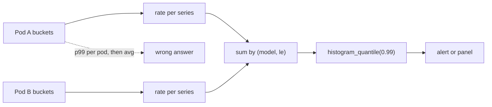
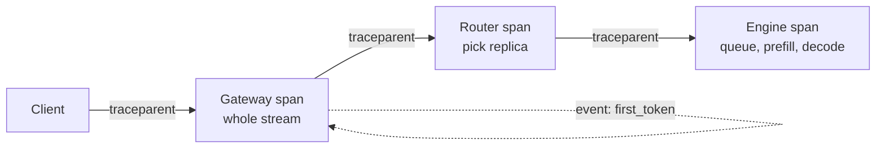

# 20.25 PromQL, Grafana and tracing: the traps interviewers test

## What the interviewer is testing

The interviewer shares a screen. A dashboard shows a flat, healthy p99 while the customer channel is full of complaints. They ask: "Here is the query behind this panel. What is wrong with it?" You have about two minutes to find the bug, say why, and write the fix.

The job posting asks for deep experience with Prometheus and Grafana. The plan for this volume records that wording from the posting. Nebius has not published how its own monitoring is built. So the interviewer cannot test your memory of internals. They test whether you know how the query language fails quietly.

This chapter serves two rounds. In the Linux and incident rounds you read dashboards under pressure. In the system design round you justify how you would alert and trace a streaming request. Chapter 20.19 owns SLO maths and burn-rate alerts. Chapter 20.15 owns pipeline architecture. This chapter owns the query, the alert rule, the dashboard and the trace.

A realistic question: "Your p99 TTFT panel uses `avg` across pods and the alert flaps every night. Walk me through what is wrong and how you would prove it."

## The core ideas

### 1. Counters, resets and what rate really computes

A counter only goes up, except when a process restarts and it falls back to zero. Dashboards that subtract two counter values break at that moment. The Prometheus docs say `rate` adjusts automatically for breaks in monotonicity, such as counter resets after target restarts.

The `rate` function gives the per-second average increase over the range you pass. The docs say it extrapolates to the ends of that range. `increase` is the same maths multiplied by the number of seconds in the window. That is why `increase` over ten minutes often returns 1.11 for a counter that went up by exactly one. The extrapolation is a feature, and an equality check against a whole number will never match.

The exercise test in this chapter shows both sides. A counter that climbs by ten a minute and restarts at zero gives minus ten when you subtract it from its value ten minutes earlier. The same counter through `increase` gives 88.9, which is the real work done once the reset is repaired.

**Never subtract counters yourself. Use `rate` or `increase`, and never compare the result with a whole number.**

### 2. rate versus irate, and the range-selector trap

You write `rate(gateway_requests_total[30s])` and the panel is empty. Nothing is broken in the service. The range is too short.

A range selector covers the interval from the evaluation time back by its length. The docs say it is left-open and right-closed, so a sample exactly at the left edge is excluded. With a scrape every 30 seconds, a 30-second range holds one sample. One sample cannot make a slope, so the result is empty.

Two samples is the bare minimum. Grafana's own variable `$__rate_interval` is designed to capture at least four scrape samples. Its formula takes the larger of the dashboard interval plus the scrape interval, and four times the scrape interval. The docs warn that a data source set to 15 seconds while the real scrape is 60 seconds makes the window too small, and rate can return no data. Treat four scrape intervals as your floor.

`irate` is different. The docs say it uses the last two data points and suits volatile, fast-moving counters on graphs. In an alert it is a trap, because one quiet pair of samples hides a burst that happened a minute ago. The exercise test feeds a counter that jumps by 100 and then stays flat. At the end `irate` says zero. `rate` over five minutes still reports the 0.33 per second that the burst left behind.

**Pick a range of at least four scrape intervals, use `rate` in alerts, and keep `irate` for graphs of fast counters.**

### 3. Aggregate after rate, never before

Two pods report a request counter. One restarts. You want the fleet rate. The tempting query sums the counters first and then asks for the rate of the sum.

Summing first throws away the reset. When pod A falls from 100 to 0 while pod B climbs by 100, the sum stays flat. The reset is invisible, so the work pod A did before the restart is lost. The docs say to take a `rate` first and then aggregate. In the exercise test the sum-first form reports 1.38 per second and the correct form reports 1.79.

Rules follow the same order. The Prometheus recording-rule guide says to aggregate numerator and denominator separately and then divide. It also says never to take the average of a ratio or an average of an average.

**Rate per series, sum by the labels you want to keep, then divide.**

### 4. Histograms: keep le, then take the quantile once

A latency histogram is a set of cumulative bucket counters, one per upper bound, with a label called `le`. The function `histogram_quantile` reads those buckets and interpolates inside the bucket that holds your quantile. It needs the `le` label to do that.

The docs say that when you aggregate classic histograms, `le` has to be in the `by` clause. Write `sum by (le)` or `sum by (model, le)`. If you write plain `sum`, the label is gone and the function returns nothing. If you write `sum by (pod)`, you get nothing too. The exercise test confirms both return an empty result.



The next trap is averaging percentiles. A percentile of a pod says nothing about how many requests that pod served. In the test, pod A serves 1,000 requests per step and has a p99 of 0.95 seconds. Pod B serves ten and has a p99 of 1.99 seconds. The average of the two is 1.47. The p99 of all the requests together is 0.99 seconds. The busy pod dominates the truth, and the average lets a nearly idle pod drag the number up by half.

There is also a limit that no query fixes. The docs say the highest bucket must have an upper bound of `+Inf`, and a histogram with no observations returns `NaN`. Chapter 20.19 covers choosing bucket boundaries at your SLO limit.

**Sum buckets by le across everything you want in the answer, take the quantile once, and never average quantiles.**

### 5. Gauges, saturation and dashboards that tell the truth

A panel shows average KV cache usage at 53 percent. It looks comfortable. One of three pods sits at 100 percent and is rejecting work. The average hides it, and the maximum shows it.

The Systems Performance book, Chapter 2, defines utilization as how busy a resource is and saturation as the degree to which it has queued work it cannot service. The USE method checks errors first, then saturation, because any level of saturation can be an issue. For an inference engine, KV cache usage is utilization. The waiting queue is saturation. The vLLM metrics design page lists both as gauges: `vllm:kv_cache_usage_perc` and `vllm:num_requests_waiting`. Mapping them to utilization and saturation is my reasoning, not a vLLM statement.

A gauge needs gauge functions. `rate` over a gauge that holds at 7 returns zero and says the queue is empty. Use the value itself, `avg_over_time`, `max_over_time`, or `deriv` when you want the trend.

Grafana's best-practice page names two methods. USE suits hardware resources. RED suits services, and the page says to alert on symptoms rather than causes. A good inference dashboard therefore has a RED row for the gateway and a USE row for the engine, with saturation next to every utilization panel. It also says to avoid dashboard sprawl and to use variables and templates for consistency.

**Every utilization panel needs a saturation panel beside it, and fleet panels should show the worst pod.**

### 6. Staleness, absent and silent alerts

An alert never fires because the metric stopped existing. This is the quietest failure in monitoring.

The docs say a series is marked stale when a scrape or rule evaluation no longer returns it, and that queries then return no value for it. Without a stale marker the lookback applies, five minutes by default. So a vanished series does not make a query return zero. It makes it return nothing. An alert on `errors > 0` cannot fire when the errors series is gone.

The function `absent` returns a one-element vector when its argument is empty. The docs say it is useful when no series exists for a metric name and label combination. The trap is scope. `absent(up{job="vllm"})` fires only when every vllm target is gone. In the test, one of two pods disappears and `absent` returns nothing. The fix for partial loss is to count: `count(up{job="vllm"}) < 2`. The test returns 1 for that.

Two layers belong together. `up == 0` catches a target that exists but cannot be scraped. A count catches series that vanished. `absent` catches a total blackout.

**Pair every "no data" risk with a count or an absent alert, and test it by deleting the series.**

### 7. Joins: on, ignoring and group_left

You want vLLM queue depth by node. The node name lives on `kube_pod_info`, not on the vLLM metric. You join them with `on (pod)`.

Prometheus matches one series to one series by default. If one side has several series per pod, for example one per engine, the join is many-to-one. The query then fails, and the real error from `promtool` is: "multiple matches for labels: many-to-one matching must be explicit (group_left/group_right)". The fix names the many side. With `group_left (node)` the result keeps every left series and copies the node label from the right.

The safe habit is to know which side is many. The side that has more series is the one `group_left` points at. When the right side has duplicate series for one pod, you get the same error from the other direction, and the fix is to fix the data, not the query.

**Name the many side, copy only the labels you need, and check that the one side really is one.**

### 8. Alert rules: for, flapping and keep_firing_for

An alert without a `for` clause becomes active on the first evaluation, as the docs say. One noisy sample pages a person. A `for` clause holds the alert in the pending state until it has been active for the whole duration.

The opposite problem is flapping at the other end. When a metric hovers around the threshold, the alert resolves and fires again, and every flip sends a notification. The `keep_firing_for` clause tells Prometheus to keep the alert firing for a stated time after the condition was last met. The docs say it prevents flapping and false resolutions caused by data gaps.

The rules test in this chapter feeds queue depth with two short spikes and a long plateau. The alert without `for` fires at the first spike at minute two. The fixed alert stays quiet through both spikes, fires during the plateau, and keeps firing for three minutes after the queue drains.

A burn-rate alert from chapter 20.19 can skip `for` because its two windows already filter noise. Everything else should have one.

**Use for to ignore blips and keep_firing_for to stop flapping, and say why when you leave either out.**

### 9. Alertmanager: grouping, inhibition and routing

The pager rings forty times in a minute because one pod failure trips twenty alerts. The fix is not in Prometheus. It is in Alertmanager.

Alertmanager's docs describe three tools. Grouping puts alerts of similar nature into one notification. Inhibition suppresses certain alerts when others are already firing. Silences mute alerts for a time. A routing tree in the config file sets the grouping, the timing and the receivers.

The configuration reference gives the defaults. `group_wait` is 30 seconds, how long to wait before the first notification for a new group. `group_interval` is 5 minutes, the wait before further notifications for the same group. `repeat_interval` is 4 hours. Group by `[cluster, model]` and a burst of different alert names for one model becomes one page.

Inhibition needs care. The docs recommend choosing source and target matchers so an alert never matches both sides, which makes rules easier to reason about. The config below says a missing-targets alert silences the symptom alerts for the same cluster, and a page silences tickets for the same model.

```yaml
# code/part20/c25_alertmanager.yml
# Alertmanager config for chapter 20.25. Check: amtool check-config c25_alertmanager.yml
# The webhook URLs are placeholders. Replace them with your real receivers.
route:
  receiver: ticket
  # One notification per model and cluster, however many alertnames fire for it.
  group_by: [cluster, model]
  group_wait: 30s
  group_interval: 5m
  repeat_interval: 12h
  routes:
    - matchers: ['severity="page"']
      receiver: pager
      repeat_interval: 4h
    - matchers: ['severity="ticket"']
      receiver: ticket
inhibit_rules:
  # Scrape failure on the whole job explains the symptom alerts. Source and target
  # alertnames are disjoint so no alert can inhibit itself.
  - source_matchers: ['alertname="VllmTargetsMissing"']
    target_matchers: ['alertname=~"ErrorRatioHigh|KVCacheSaturated|QueueDeep"']
    equal: [cluster]
  # A page for a model silences tickets for the same model.
  - source_matchers: ['severity="page"']
    target_matchers: ['severity="ticket"']
    equal: [cluster, model]
receivers:
  - name: pager
    webhook_configs:
      - url: http://pager-bridge.example.invalid/hook
  - name: ticket
    webhook_configs:
      - url: http://ticket-bridge.example.invalid/hook
```

`amtool check-config` passes this file. The routing test script checks three alerts land in the right receivers.

```bash
# code/part20/c25_route_check.sh
#!/usr/bin/env bash
# Routing checks for c25_alertmanager.yml. Needs amtool on PATH. Exits 1 on any mismatch.
set -u
cfg="$(dirname "$0")/c25_alertmanager.yml"
fail=0
expect() {  # expect <receiver> <label>...
  want=$1; shift
  got=$(amtool config routes test --config.file="$cfg" "$@" 2>/dev/null)
  if [ "$got" = "$want" ]; then echo "ok   $* -> $got"; else echo "FAIL $* -> $got (want $want)"; fail=1; fi
}
expect pager severity=page model=m1 cluster=c1
expect ticket severity=ticket model=m1
expect ticket alertname=Unlabelled
exit $fail
```

**Group by what a person acts on, inhibit symptoms when a cause is firing, and keep source and target matchers disjoint.**

### 10. Recording rules and naming

A dashboard query takes eight seconds because it runs a heavy `histogram_quantile` over a week of data on every refresh. You precompute it with a recording rule.

The Prometheus naming guide says rules should be of the general form `level:metric:operations`. The level is the aggregation level and the labels of the output. The metric name stays unchanged except for stripping `_total`. The operations list names what was applied, newest first. It also says always to specify a `without` clause with the labels you aggregate away.

So `model:gateway_errors:rate5m` is a sum by model of the rate over five minutes of `gateway_errors_total`. The name tells a reader what is inside without opening the rule. A name like `errors_ratio` tells nothing, and my linter flags it.

Here is the rule file of correct patterns. It keeps `le` in the bucket rule, divides sums for the ratio, records the worst pod for saturation, and gives every alert a `for`.

```yaml
# code/part20/c25_trap_rules.yaml
# Rules that avoid the traps in chapter 20.25. Metric names gateway_* and req_seconds_*
# are this chapter's own design. vllm:* names are from the vLLM metrics design doc.
# Assumes a 30 s scrape interval, so every range is at least 4 scrapes (2m).
groups:
  - name: c25_recording
    interval: 30s
    rules:
      # level:metric:operations. Rate first, then sum. Numerator and denominator
      # are summed separately and then divided.
      - record: model:gateway_requests:rate5m
        expr: sum by (model) (rate(gateway_requests_total[5m]))
      - record: model:gateway_errors:rate5m
        expr: sum by (model) (rate(gateway_errors_total[5m]))
      - record: model:gateway_errors:ratio_rate5m
        expr: model:gateway_errors:rate5m / model:gateway_requests:rate5m
      # Keep le when summing buckets, or histogram_quantile has nothing to read.
      - record: model_le:req_seconds_bucket:rate5m
        expr: sum by (model, le) (rate(req_seconds_bucket[5m]))
      - record: model:req_seconds:p99
        expr: histogram_quantile(0.99, model_le:req_seconds_bucket:rate5m)
      # Saturation: the worst pod, not the average.
      - record: model_name:vllm_kv_cache_usage_perc:max
        expr: max by (model_name) (vllm:kv_cache_usage_perc)
  - name: c25_alerts
    rules:
      - alert: QueueDeep
        expr: gateway_queue_depth > 500
        for: 5m
        keep_firing_for: 3m
        labels: {severity: ticket}
        annotations:
          summary: "{{ $labels.model }} queue deeper than 500 for 5m"
      - alert: ErrorRatioHigh
        expr: model:gateway_errors:ratio_rate5m > 0.05
        for: 5m
        labels: {severity: page}
        annotations:
          summary: "{{ $labels.model }} error ratio above 5%"
      - alert: VllmTargetsMissing
        expr: absent(up{job="vllm"})
        for: 5m
        labels: {severity: page}
        annotations:
          summary: "no vllm targets are being scraped"
      - alert: VllmPodDown
        expr: up{job="vllm"} == 0
        for: 2m
        labels: {severity: ticket}
        annotations:
          summary: "{{ $labels.pod }} is not scrapable"
      - alert: KVCacheSaturated
        expr: |
          model_name:vllm_kv_cache_usage_perc:max > 0.95
          and on (model_name)
          sum by (model_name) (vllm:num_requests_waiting) > 0
        for: 10m
        labels: {severity: page}
        annotations:
          summary: "{{ $labels.model_name }} KV cache full and requests are queueing"
```

`promtool check rules` reports 11 rules found. The test file covers the alerts and one recorded quantile.

**Name every rule level:metric:operations, and record the expensive expression once instead of running it in every panel.**

### 11. Offset, subqueries and what they do to time

Week-over-week comparison is a classic panel. The query needs `offset`, and the position matters.

The docs say `offset` must follow the selector immediately. Writing `rate(x[5m]) offset 1h` is a parse error, and `promtool` says so: "offset modifier must be preceded by an instant vector selector or range vector selector or a subquery". The correct form is `rate(x[5m] offset 1h)`. The docs also warn that a negative offset looks ahead of the evaluation time.

A subquery runs an instant query repeatedly over a range, and its resolution defaults to the global evaluation interval. It is useful for functions that need a range, such as the maximum of a rate over an hour. It is also the tool that makes the sum-first trap in idea 3 possible, so treat any `rate(sum(...)[5m:1m])` as suspect.

**Put offset on the selector, and use a subquery only when you can say what resolution it samples at.**

### 12. Cardinality: the cost behind every label

A new label named `request_id` ships on Friday. By Monday Prometheus is out of memory. Every distinct value makes a new series, and a histogram makes many series per value.

The Production Kubernetes book, Chapter 9, warns that overusing labels makes resource use untenable and points to the instrumentation guide. The arithmetic is the lesson. A histogram with 10 finite buckets has 13 series per label set, counting `+Inf`, `_sum` and `_count`. With 20 models and 1,000 tenants that is 260,000 series. Those counts are my assumed inputs, not a Nebius figure. A single request ID label multiplies that by the number of requests.

Keep user, request and prompt identifiers out of metric labels. They belong in logs and traces. Chapter 20.15 covers how a pipeline controls cardinality at scale, and chapter 20.19 covers the page-by-model, ticket-by-tenant split.

**Label metrics by things you can count on one hand, and put identifiers in traces.**

### 13. Tracing a streaming request

A user says the answer started late. The gateway shows a healthy p50 and the engine shows a healthy queue. You need to see one slow request end to end.

The OpenTelemetry docs define a span as a unit of work or operation. Context propagation, in their words, is the core concept that enables distributed tracing. The W3C Trace Context specification defines the `traceparent` header as version, trace ID, parent ID and trace flags, with fields of 2, 32, 16 and 2 hex characters. The least significant bit of the flags is the sampled bit. Each service reads the header, creates a child span, and passes a new header to the next hop.

A streaming request is awkward because the HTTP status is sent early and the work continues for seconds. A design that I think works, and that Nebius has not published, is below. Treat it as my reasoning, except where the table says what vLLM v0.32.0 does.



| Span | Kind | Lives until | Attributes and events |
|---|---|---|---|
| Gateway request | server | last token or abort | model, status, finish reason, token counts, event `first_token` |
| Router decision | internal | replica chosen | replica, retries, queue depth seen |
| Engine request | server | last token | queue wait, prefill and decode times as attributes. vLLM v0.32.0 sets these on one span. It does not emit a preemption event. |

Two rules make this work. The gateway span stays open until the stream ends, and its status is set to Error if the stream fails after a 200 was sent. The OTel docs say status takes one of three values, Unset, Error or Ok. Put the first-token moment on the span as an event, because a span event is a structured log message on a span.

vLLM documents tracing through the flags `--otlp-traces-endpoint` and `--collect-detailed-traces`. I read the v0.32.0 source, the version chapter 20.22 pins. The first flag sets the OTLP target. The second takes `model`, `worker` or `all`, needs the first flag, and the source warns it can be costly or blocking. With tracing on, the output processor emits one span named `llm_request` when a request finishes. It has kind SERVER and takes its parent from the incoming trace headers. Its attributes are time to first token, end-to-end time, time in queue, prefill, decode and inference time, token counts, request ID and some sampling parameters. So the engine hop gives you one span with timing attributes, not child spans for queue, prefill and decode. I read this and did not run a server.

**One span per hop, the gateway span covers the whole stream, and failure after the 200 must set span status.**

### 14. Sampling and joining traces to metrics

At high volume you cannot keep every trace. The OTel docs split sampling into two. Head sampling decides as early as possible. It is simple and efficient, but it cannot guarantee that a trace containing an error is kept. Tail sampling decides after it sees all or most of the spans and can keep slow or failed traces. The docs call it harder to implement and operate, because it needs stateful components handling large volumes. The Collector includes a Tail Sampling Processor.

The join between metrics and traces is the exemplar. The Prometheus feature-flag page says OpenMetrics lets scrape targets attach exemplars, and a common use is trace IDs. The flag is `--enable-feature=exemplar-storage`. The page says an exemplar with only a trace ID uses roughly 100 bytes in memory, in a fixed-size circular buffer. In Grafana, you add an exemplar link on the Prometheus data source settings. Choose an internal link to a tracing data source, or an external URL, and set the label name that holds the trace ID, often `trace_id` or `traceID`. Then switch on the Exemplars toggle in the query editor. Exemplars do not work with instant queries.

With an exemplar on a slow bucket you go from the panel to one trace. In that trace you find the trace ID, and in logs you search the same ID. Put `trace_id` on every log line from the gateway and the engine.

**Keep errors and slow traces with tail sampling, attach trace IDs to exemplars and logs, and never put them in labels.**

## How to answer out loud

### Question 1: "What is wrong with a p99 panel that averages across pods?"

Say what the average does first. Percentiles do not add and do not average, because each one hides how many requests stand behind it. State the example: two pods, one busy with p99 0.95 s and one idle with p99 1.99 s, the average is 1.47 s, and the true p99 is 0.99 s. Then give the fix: rate the buckets, `sum by (le)`, take `histogram_quantile` once. Expect the follow-up on bucket resolution, and answer that interpolation is only as good as your bucket boundaries.

### Question 2: "Explain rate versus irate and how you pick a window."

Open with the rule: rate for alerts, irate for fast graphs. Explain that irate uses the last two samples. Then give the window: at least four scrape intervals, so a 30-second scrape needs two minutes. Mention that Grafana's `$__rate_interval` does this when the data source scrape setting is right. Expect the follow-up about a wrong default scrape setting in Grafana returning no data.

### Question 3: "The alert never fired during the outage. Why?"

Say you check three things in order. Did the series disappear and leave the expression empty? Was there a `for` that was longer than the outage? Did Alertmanager inhibit it? Describe the stale marker and the five-minute lookback. Offer the three-layer fix: `up == 0`, a count of expected series, and `absent` for blackout. Expect to be asked how you would test it, and answer with `promtool test rules` and a deleted series.

### Question 4: "Pager noise is too high. What do you change?"

Start from the person: one page per thing they must act on. Group by cluster and model, inhibit symptoms under a cause alert, add `for` and `keep_firing_for`, and route tickets away from the pager. Quote the defaults, 30 s, 5 m and 4 h. Name the trade-off: longer `group_wait` delays the first page. Expect a follow-up on how you avoid hiding a real second incident behind an inhibition.

### Question 5: "How would you trace a streaming request?"

Draw gateway, router, engine. Say the header carries the context. Say the gateway span covers the whole stream and carries a first-token event. Say tail sampling keeps errors and slow traces. Say exemplars link a slow bucket to a trace. Label the design as yours, not Nebius's.

## Worked scenarios

### Scenario 1: The flat p99

A dashboard shows p99 TTFT at 0.4 seconds. Customers say it is slow. The panel query is the average of per-pod quantiles.

First rerun it as the fleet quantile. Sum the bucket rates by model and le, then apply the quantile once. Then check bucket coverage. If the SLO limit is 1 second and no bucket sits near it, interpolation is coarse. Finally check traffic skew. If one pod gets most requests, the average hides it.

Run the linter on the old query. It reports P003 for averaging a quantile. The answer is the `sum by (le)` form, which the exercise test shows gives 0.99 where the average gave 1.47.

### Scenario 2: The silent outage

One of four vLLM pods crashes at night. The error ratio alert stays quiet because requests moved to other pods. The `absent` alert is quiet too.

The first alert is right: no errors exist. The `absent` alert is quiet because three pods still report. Add `up == 0` for two minutes and a count below four. The test in this chapter deletes one of two pods and shows `absent` empty and the count returning 1.

Also make the router alert on lost capacity, since the loss shows up as saturation on the survivors. That is chapter 20.18 territory.

### Scenario 3: Forty pages for one cause

A node fails. Scrape targets go away, the error ratio rises, KV cache saturates on the survivors and a queue alert fires.

The Alertmanager config groups by cluster and model, so alerts for one model arrive as one notification. The inhibition rule silences symptom alerts while `VllmTargetsMissing` fires in the same cluster. The page rule silences tickets for the same model. The routing script confirms the pages go to the pager. I ran this against Alertmanager 0.35.0 in a throwaway container, as the lab says. The grouping and inhibition behaved as described.

## Hands-on lab

All steps run on a laptop with `promtool`, `amtool` and Python. No Docker is needed. I ran every step on macOS.

1. Check the rules. `promtool check rules code/part20/c25_trap_rules.yaml` should print `SUCCESS: 11 rules found`.
2. Run the exercise tests. `promtool test rules code/part20/c25_exercises_test.yaml` should print `SUCCESS`. Change one expected value and see the diff it prints.
3. Run the alert tests. `promtool test rules code/part20/c25_trap_rules_test.yaml` should print `SUCCESS`.
4. Check the Alertmanager config. `amtool check-config code/part20/c25_alertmanager.yml` should list 2 inhibit rules and 2 receivers. Run `code/part20/c25_route_check.sh` and expect three `ok` lines.
4b. Run the real Alertmanager. Start `prom/alertmanager` in Docker with the config, pointing both webhooks at a small receiver on the host. Post three alerts for one model and cluster, one for another model, and one `VllmTargetsMissing`. I ran this. Two ticket alerts for model m1 arrived as one notification listing both. A page alert for model m2 reached the pager, and the ticket alert for the same model was inhibited. In cluster c2, `QueueDeep` with severity page was inhibited while `VllmTargetsMissing` was firing. The API listed the inhibited alerts as suppressed. The timing values were not measured to the second.
5. Lint the good and bad rules. `python3 code/part20/c25_promql_lint.py code/part20/c25_trap_rules.yaml` reports 0 findings. The same command on `c25_bad_rules.yaml` reports 5 warnings and exits 0. Add `--strict` and it exits 1.
6. Run the pytest suite. `python3 -m pytest code/part20/test_c25_promql_lint.py` should report 38 passed.
7. Break an offset on purpose. Write `rate(gateway_requests_total[5m]) offset 1h` into a rule file and run `promtool check rules`. Expect the parse error quoted in idea 11. I ran this.
8. Break a join on purpose. Use two vLLM series for one pod and one `kube_pod_info` series, then query without `group_left`. I ran this and `promtool` printed the many-to-one error quoted in idea 7.

## The 15 exercises: what is wrong with this query

Each exercise gives the bad query, why it fails, and the fix. The status line says how it was checked. "Test" means `promtool test rules` passed with the bad and fixed query asserted. "Lint" means the linter flags the bad one.

| # | Bad query | What is wrong | Fix | Checked |
|---|---|---|---|---|
| 1 | `rate(gateway_requests_total[30s])` | Range holds one scrape at 30 s, so the result is empty | `[2m]` | Test, lint P001 |
| 2 | `irate(gateway_errors_total[5m]) > 1` | Uses the last two samples and misses the burst | `rate(...[5m])` | Test, lint P005 |
| 3 | `x - x offset 10m` | Goes negative after a restart | `increase(x[10m])` | Test |
| 4 | `rate(sum(x)[5m:1m])` | Sum hides one pod's reset, 1.38 versus 1.79 | `sum(rate(x[5m]))` | Test, lint P004 |
| 5 | `histogram_quantile(0.99, sum by (pod) (rate(b[5m])))` | `le` removed, empty result | `sum by (le)` | Test, lint P002 |
| 6 | `avg(histogram_quantile(0.99, sum by (pod, le) ...))` | Average of p99s is 1.47, true p99 is 0.99 | Merge buckets, one quantile | Test, lint P003 |
| 7 | `absent(up{job="vllm"})` | Silent when one of two pods is gone | `count(up{job="vllm"}) < 2` | Test |
| 8 | Alert `queue > 500`, no `for` | Pages on a single spike | `for: 5m`, `keep_firing_for: 3m` | Rules test, lint P008 |
| 9 | `waiting * on (pod) kube_pod_info` | Many-to-one error | add `group_left (node)` | Test, ran the error |
| 10 | `sum(rate(errors[5m])) > 1` with `$labels.model` | Aggregation drops the label the annotation uses | `sum by (model)` | Rules test, lint P010 |
| 11 | `increase(restarts[10m]) == 1` | Extrapolated value is 1.11 | `> 0` | Test |
| 12 | `rate(x[5m]) offset 1h` | Parse error | `rate(x[5m] offset 1h)` | Ran the error |
| 13 | `rate(vllm:num_requests_waiting[5m])` | Rate of a gauge, returns 0 for a steady queue of 7 | `avg_over_time(...)` | Test, lint P006 |
| 14 | `avg(vllm:kv_cache_usage_perc)` | Shows 0.53 while one pod is at 1 | `max(...)` | Test |
| 15 | `avg(errors_rate / requests_rate)` | Averages a ratio, 0.25 versus 0.002 | Sum both, then divide | Test, lint P007 |

The linter is regex-level. It cannot parse PromQL, so it misses nested cases and can misfire on names. The excerpt below shows the histogram rule, which is the one the interviewer most often has in mind.

```python
# excerpt from code/part20/c25_promql_lint.py (P002)
m = re.search(AGG + r"\s*(?:(by|without)\s*\(([^)]*)\)\s*)?\(", arg)
if m:
    mode, labels = m.group(1), m.group(2) or ""
    has_le = bool(re.search(r"\ble\b", labels))
    if not mode:
        add("P002", "error", "aggregation with no by() inside histogram_quantile drops the le label")
    elif mode == "by" and not has_le:
        add("P002", "error", "aggregation by() inside histogram_quantile does not keep le")
```

The test data behind the numbers is in the file below. It is longer than 120 lines, so only a group is shown here.

```yaml
# excerpt from code/part20/c25_exercises_test.yaml (E3)
  - name: E3 subtracting a counter breaks on a restart
    interval: 1m
    input_series:
      - series: 'queue_processed_total{pod="a"}'
        values: '0+10x10 0+10x10'
    promql_expr_test:
      - expr: queue_processed_total{pod="a"} - queue_processed_total{pod="a"} offset 10m
        eval_time: 15m
        exp_samples:
          - labels: '{pod="a"}'
            value: -10
      - expr: increase(queue_processed_total{pod="a"}[10m])
        eval_time: 15m
        exp_samples:
          - labels: '{pod="a"}'
            value: 88.88888888888889
```

## Drill questions

<details><summary>1. Why does rate over a range equal to one scrape interval return nothing?</summary>

The range holds a single sample, and a slope needs two. The range is left-open, so a sample exactly at its start is excluded. Use at least four scrape intervals.
</details>

<details><summary>2. What does irate use, and when is it a trap?</summary>

It uses the last two data points. It suits graphs of fast counters. In alerts it misses bursts and makes flapping.
</details>

<details><summary>3. Why do you take rate before sum?</summary>

Rate repairs counter resets per series. Summing first hides a reset in the total. In the test the sum-first form gave 1.38 and the correct form 1.79.
</details>

<details><summary>4. What must sum keep before histogram_quantile?</summary>

The `le` label. Write `sum by (le)` or add it to your other labels. Without it the result is empty.
</details>

<details><summary>5. Why is averaging p99 across pods wrong?</summary>

A percentile ignores how many requests stand behind it. Merge the buckets and take one quantile. The example gave 1.47 for the average and 0.99 for the true value.
</details>

<details><summary>6. When does absent fire, and what does it miss?</summary>

It fires when the whole selector returns nothing. It misses the loss of one of several series. Use a count of expected series for that.
</details>

<details><summary>7. What does for do, and what does keep_firing_for do?</summary>

`for` keeps the alert pending until the condition has held that long. `keep_firing_for` keeps it firing for a time after the condition stops. Together they stop one-sample pages and flapping.
</details>

<details><summary>8. What are the Alertmanager defaults for group_wait, group_interval and repeat_interval?</summary>

30 seconds, 5 minutes and 4 hours. They come from the Alertmanager configuration reference.
</details>

<details><summary>9. How do you name a recording rule?</summary>

`level:metric:operations`. The level is the aggregation labels, the metric loses `_total`, and the operations list the newest first.
</details>

<details><summary>10. What does a traceparent header carry, and what does the sampled flag mean?</summary>

Version, trace ID, parent ID and trace flags. The lowest bit says the caller may have recorded trace data.
</details>

## Common mistakes and weak answers

- Saying "I would average the p99s". Say you would merge buckets and take the quantile once.
- Using a window of one scrape interval. Say at least four, and name `$__rate_interval`.
- Alerting on `irate`. Say rate, and explain the missed burst.
- Writing `absent` and calling the outage covered. Say it only covers a total blackout.
- Showing average KV cache usage alone. Say you show the maximum and the waiting queue beside it.
- Putting a request ID in a metric label. Say it belongs in the trace and the log.
- Claiming Nebius uses a given monitoring stack. Say what is public and label the rest as your design.

## Connections to the rest of the handbook

- Chapter 20.19, [SLIs, SLOs and alerts for token APIs](19-slis-slos-and-alerts-for-token-apis.md), owns burn-rate maths and bucket alignment. This chapter assumes it.
- Chapter 20.15 owns the observability pipeline: collectors, storage and cost at volume. It is written separately, so this chapter does not cover pipeline architecture.
- Chapter 20.18, [How LLM serving fails](18-how-llm-serving-fails.md), explains the queue and KV cache saturation the panels should show.
- Chapter 20.26, [The stress interview](26-the-stress-interview-production-incident-role-play.md), is where you practise reading these dashboards under time pressure.
- Chapter 20.13, [Design: a multi-tenant LLM inference API](13-design-a-multi-tenant-llm-inference-api.md), is where gateway, router and engine spans belong.
- Part 17, [logging and tracing](../part-17-operations/03-logging-with-loki-and-tracing-with-opentelemetry.md), covers the tooling for logs and traces.

## Sources and review notes

Sources, all fetched 2026-11-09 unless stated:

- Prometheus docs, "Query functions", https://prometheus.io/docs/prometheus/latest/querying/functions/. Latest docs, no version number shown. rate, irate, increase, histogram_quantile, absent, resets.
- Prometheus docs, "Querying basics", https://prometheus.io/docs/prometheus/latest/querying/basics/. Staleness, offset, subqueries, range selectors.
- Prometheus docs, "Alerting rules", https://prometheus.io/docs/prometheus/latest/configuration/alerting_rules/. `for`, `keep_firing_for`.
- Prometheus Alertmanager docs, overview and configuration pages under https://prometheus.io/docs/alerting/latest/. Grouping, inhibition, silences, defaults.
- Prometheus docs, "Recording rules" practices, https://prometheus.io/docs/practices/rules/. Naming and aggregation guidance.
- Prometheus docs, feature flags, https://prometheus.io/docs/prometheus/latest/feature_flags/. Exemplar storage.
- Grafana docs, dashboard best practices and Prometheus template variables. USE and RED, `$__rate_interval`.
- OpenTelemetry docs, traces and sampling concepts, https://opentelemetry.io/docs/concepts/. Spans, context propagation, status, head and tail sampling.
- W3C Trace Context, https://www.w3.org/TR/trace-context/. traceparent format.
- vLLM docs, metrics design page, https://docs.vllm.ai/en/latest/design/metrics.html. Latest developer docs, no version shown. Metric names and the tracing flags. The vLLM OpenTelemetry example page returned 404.
- vLLM v0.32.0 source from github.com/vllm-project/vllm: `vllm/config/observability.py`, `vllm/engine/arg_utils.py`, `vllm/v1/engine/output_processor.py` and `docs/usage/metrics.md`, fetched 2026-11-09.
- Grafana documentation sources: Prometheus data source configuration and query editor, and template variables, from github.com/grafana/grafana `main`, fetched 2026-11-09.
- Alertmanager 0.35.0 docker image `prom/alertmanager:latest`, pulled 2026-11-09.
- Systems Performance, 2nd edition, Chapter 2 "Methodologies": utilization, saturation, the USE method.
- Production Kubernetes, Chapter 9 "Observability": Prometheus model, label cardinality, Alertmanager.
- LLMs in Production, Chapter 3: streaming and completion length affect latency. Used only as background for per-token metrics.
- AI Factory: I searched it for monitoring and metrics. It covers industrial AI and has nothing on PromQL, Grafana or tracing, so I did not use it for any claim.
- Plan for this volume, section 1, for the job posting wording.

Explicitly labelled inferences:

- The mapping of KV cache usage to utilization and queue depth to saturation.
- The span design for a streaming request, the span table and the choice to hold the gateway span open for the whole stream.
- The cardinality example with 20 models, 1,000 tenants and 13 series per histogram.
- The Alertmanager route layout and inhibition rules.
- The metric names `gateway_*` and `req_seconds_*` are this chapter's own.

Not verified:

- No Prometheus server was run, so real scraping was not exercised. Alertmanager grouping and inhibition were run on 2026-11-09, but group_wait and group_interval timing was not measured. My short-timer test showed notifications earlier than the configured values, and I did not work out why.
- No vLLM server was run, so the `llm_request` span is read from source, not observed.
- Which spans vLLM actually emits, and whether the vLLM docs page shown matches your installed version.
- The linter is regex-level and was tested only on the cases in its test file.

### Verification log

Fact-check pass on 2026-11-09. Eleven claims were checked. Ten are confirmed, one was corrected and none are left unverified except the group timing noted above.

| Claim | Result | Source |
|---|---|---|
| Alertmanager defaults: group_wait 30s, group_interval 5m, repeat_interval 4h | Confirmed | Alertmanager configuration reference, main |
| Grouping by cluster and model merges alerts into one notification | Confirmed by running Alertmanager 0.35.0 | Container run |
| Inhibition rules suppress the target alerts, including a page-severity target | Confirmed by running | Container run |
| Source and target matchers should not match the same alert | Confirmed | Alertmanager configuration reference |
| Lookback delta is 5 minutes | Confirmed | Prometheus querying basics |
| `keep_firing_for` exists | Confirmed | Prometheus alerting rules page |
| Exemplar flag is `--enable-feature=exemplar-storage`, about 100 bytes per exemplar | Confirmed | Prometheus feature flags page, main |
| `$__rate_interval` is the larger of interval plus scrape interval and four scrape intervals | Confirmed | Grafana template variables page |
| Grafana exemplar setting | Resolved: data source exemplar link plus the query toggle | Grafana docs, main |
| vLLM tracing flags exist at v0.32.0 | Confirmed | `observability.py`, `arg_utils.py` |
| The engine emits queue, prefill and decode spans, and a preemption event | Corrected: one `llm_request` span with timing attributes, no preemption event | `output_processor.py` v0.32.0 |
