# 20.26 The stress interview: production incident role-play

## What the interviewer is testing

An interviewer says "the alert just fired, you are on call" and starts a clock. You have about 30 minutes. One candidate reported this as the fourth stage of an Amsterdam SRE loop. Nebius has not published the format of this stage, so ask your recruiter whether it exists in your loop.

Picture the moment the clock starts. The room goes quiet, your pulse picks up, and the first sentence you say sets the tone for everything after it. This stage tests composure as much as knowledge, because a calm person who asks the right questions beats a nervous person who knows more facts.

The official interview page lists troubleshooting and debugging, practical Linux console tasks, and saying your reasoning aloud. The job posting adds incident remediation with runbooks and knowledge of how distributed back-ends fail. The Nebius chat-app case study names the failure shapes behind half of this chapter: tail TTFT, retry amplification, and capacity that shrank silently. Tail TTFT means the slow end of the time-to-first-token spread, where a small group of users waits far longer than the typical user. Retry amplification means clients and servers retrying each other until one request becomes many. Capacity that shrank silently means the pool got smaller while every dashboard still looked green.

The interviewer is not checking whether you find the root cause. They watch whether you take control, gather evidence in order, protect users first, and stay safe.

A realistic opening: "It is 14:05. The p99 time-to-first-token alert fired on the chat endpoint in eu-north. You are on call. Talk me through it."

## The core ideas

Picture a senior engineer standing at a whiteboard with the alert open on a laptop and a short silence to fill. The six ideas below are what that engineer does, in roughly the order they do it.

### 1. Take control in the first two minutes

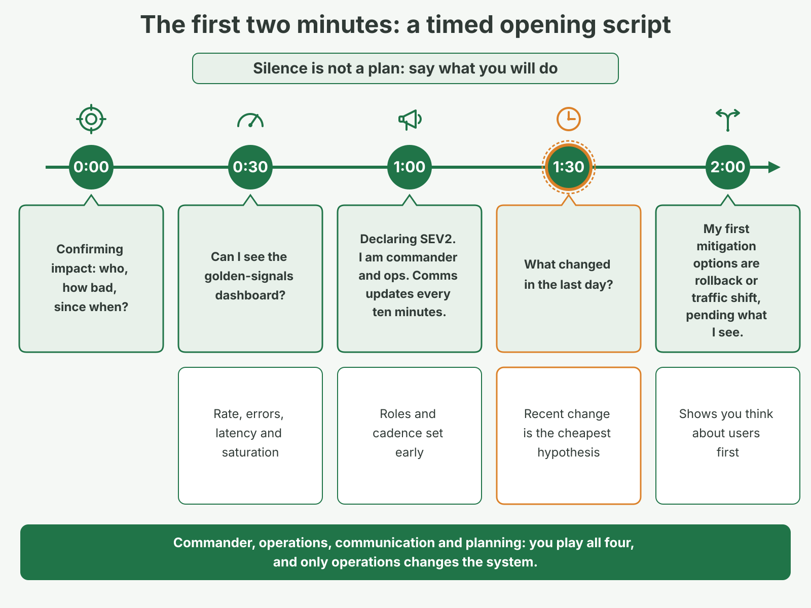

*Figure 20.26.1. The first two minutes of an incident follow a timed script: confirm impact, check the golden signals, declare the severity and roles, check recent changes, and name mitigation options.*

The interviewer finishes speaking and waits. That silence feels long, and it is tempting to fill it with a command. Typing first shows you are busy, and asking what the interviewer wants shows you are waiting to be told. Both lose the room, because the room needs someone who is running the incident. So fill the first two minutes with the fixed script in the table below.

The Google SRE book chapter Managing Incidents splits the work into incident command, operations, communication and planning, and only operations should change the system. You play all four, so say "I am commander and ops, and I will post updates as comms". The split matters because a person who is typing commands loses track of time and of the people waiting for news. Incident command keeps the overall picture. Operations changes the system. Communication tells people what is going on, and planning looks ahead. In a drill one candidate holds all four roles, and saying so out loud shows the interviewer that you know the roles are separate even when one person carries them.

The same chapter says to declare an incident if you need a second team, customers can see the outage, or the problem is unsolved after an hour. Say "SEV2 because customers see degraded latency, and I will raise it if errors start". Declaring early is a choice, not a confession of failure. A declared incident brings people and a shared channel, and it can be lowered again later. Notice that the example sentence gives the reason as well as the level. Nebius has not published its scheme, so SEV2 here is a label for this drill.

| Time | Say or ask | Why |
|---|---|---|
| 0:00 | "Confirming impact: who, how bad, since when?" | Systems Performance chapter 2 puts the problem statement first |
| 0:30 | "Can I see the golden-signals dashboard?" | You need rate, errors, latency and saturation |
| 1:00 | "Declaring SEV2. I am commander and ops. Comms updates every ten minutes." | Roles and cadence set early |
| 1:30 | "What changed in the last day?" | Recent change is the cheapest hypothesis |
| 2:00 | "My first mitigation options are rollback or traffic shift, pending what I see." | Shows you think about users first |

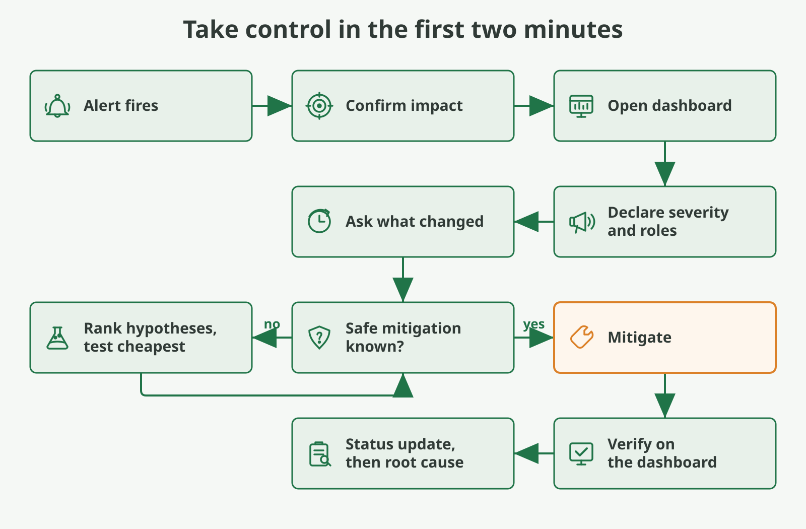

*Figure 20.26.2. Take control in the first two minutes, as a diagram.*

Before you touch a keyboard, say the impact, severity and roles. Read the table as a timeline, not a checklist. Each row is a sentence you can say at its minute.

### 2. Mitigate before you find the root cause

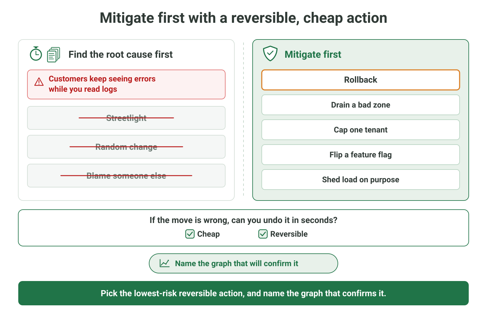

*Figure 20.26.3. Mitigate first by choosing a cheap, reversible action such as rollback, a zone drain or load shedding, and name the graph that confirms it.*

Picture a checkout page that is throwing errors for paying customers while you are still reading the logs. The customers do not care what the cause is yet. They care that the page works again.

The Google SRE book chapter Effective Troubleshooting says that in a major outage you keep the system working first, even by shedding load, diverting traffic or disabling features. Shedding load means refusing some requests on purpose so the rest can succeed. Diverting traffic means sending it somewhere healthy. Root cause comes after, and you preserve logs and evidence meanwhile. Copy the logs or leave the failing process alone before you change anything that would erase them.

Systems Performance, chapter 2, names three habits that waste time: the streetlight, random-change and blame-someone-else anti-methods. These habits feel like progress while you are doing them, and each one spends minutes that users are waiting. A streetlight habit checks what you already know how to read. A random change edits settings until something moves. Blame sends the issue to another team. In the drill you can name any of them out loud before you do it, and that alone makes you sound careful.

A good mitigation is reversible, cheap, and does not need the root cause to be right. Rollback, draining a bad zone, capping one tenant and flipping a feature flag fit. The test is simple. If the move turns out to be wrong, can you undo it in one step? Before you run it, name the graph that should change and the time you will check it, so the mitigation gets a verdict and not only a hope.

Pick the lowest-risk reversible action, and name the graph that will confirm it.

### 3. Narrate hypotheses in order of likelihood and cost to test

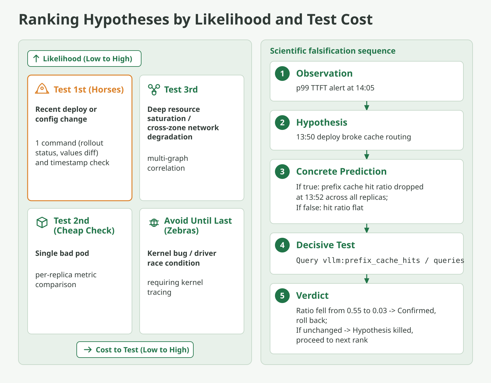

*Figure 20.26.4. Rank hypotheses by likelihood and cost to test, and formulate predictions that can decisively kill a theory before investigating zebras.*

Picture a latency graph that bends upward at one clear moment, while the team is already arguing about why. Everyone has a favourite theory, and the job is to put them in order before anyone spends an hour on one.

The SRE troubleshooting chapter says to test the most likely cause first and think of horses before zebras. Horses before zebras means the common explanation comes before the rare one, the same way a hoofbeat in a city street is probably a horse. Systems Performance chapter 2 gives the scientific method: question, hypothesis, prediction, test, analysis. The prediction makes you convincing. A prediction says in advance what the data should look like if you are right, so the claim can be checked. "If the deploy caused this, the metric turned at 13:50 on every replica. If one bad pod caused it, only that pod shows it." Those two sentences start from the same symptom and predict two different pictures, and the graph settles which one is true.

Rank by likelihood and cost to test. Ranking is two questions asked together. How likely is the cause, and how much does it cost to check? A recent change costs one command, a saturated resource costs a graph, and a kernel bug is the zebra. A recent change is likely and cheap, so it goes first. A saturated resource is also likely, and a graph settles it. A kernel bug is possible but expensive to prove, so it waits. For each hypothesis, say the result that would kill it, because a hypothesis you cannot kill is not yet useful.

### 4. Communicate status on a cadence

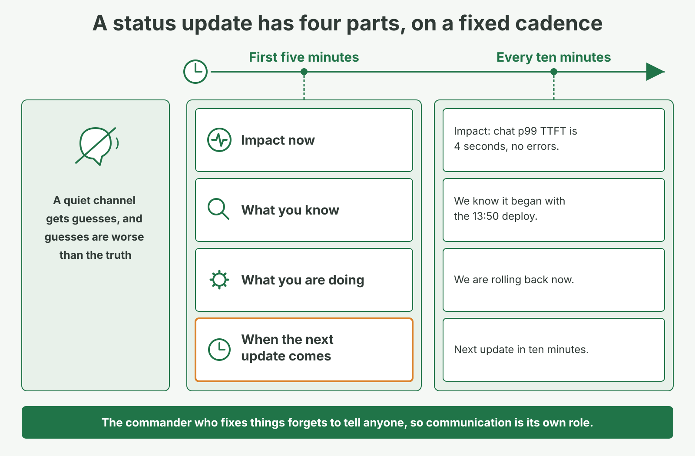

*Figure 20.26.5. Incident status updates run on a cadence and each has four parts: impact now, what is known, what is being done and when the next update comes.*

Picture a support channel that goes quiet for most of an hour while the engineers are busy. The support team starts answering customers with guesses, and the guesses are usually worse than the truth.

The SRE chapter makes communication its own role, because the commander who is fixing things forgets to tell anyone. In the drill, post an update in the first five minutes and then every ten. That cadence is the drill's choice, not a Nebius rule.

An update has four parts: impact now, what you know, what you are doing, and when the next update comes. "Impact: eu-north chat p99 TTFT is 4 seconds, no errors. We know it began with the 13:50 deploy. We are rolling back now. Next update at 14:25." Each part answers a question the reader is already asking. The first asks whether it is bad. The second asks what you know. The third asks what happens next, and the fourth asks when they will hear again. In the example, the deploy time is a fact you have checked, and the rollback is what you are doing right now. Never post a guess as a fact. If you suspect something, write the word suspected.

### 5. Know when to roll back, and avoid the destructive command

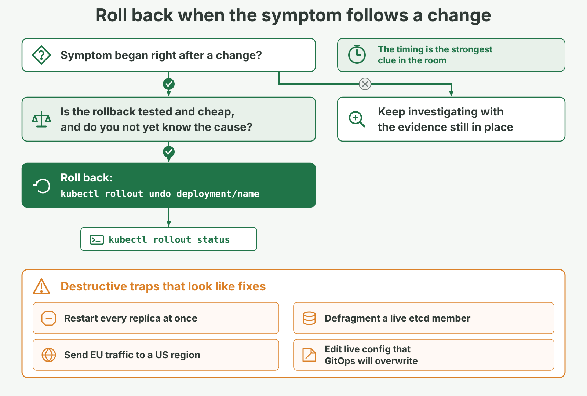

*Figure 20.26.6. Roll back when a symptom starts right after a change and the rollback is cheap and tested, and avoid destructive commands that look like fixes.*

Picture a change that landed at lunchtime, and a symptom that began within minutes of it. The timing is the strongest clue in the room, and it is also the easiest one to ignore when everyone wants a deeper explanation.

Roll back when the symptom began right after a change, the rollback is tested and cheap, and you do not yet know the cause. In Kubernetes the command is `kubectl rollout undo deployment/<name>`, and `kubectl rollout status` shows progress. Do not roll back a one-way data migration, or a change your data shows is innocent.

Every drill has a destructive trap, such as restarting every replica at once, defragmenting a live etcd member, sending EU traffic to a US region, or editing live config that GitOps will overwrite. Each trap looks like a fix from a distance. Restarting everything feels decisive, defragmenting feels like tidying, and moving traffic feels like shelter. Before you run anything risky, say what it does, how to undo it, and how far the damage can spread. If you cannot say how to undo it, ask for a second pair of eyes.

### 6. How the drill runner works

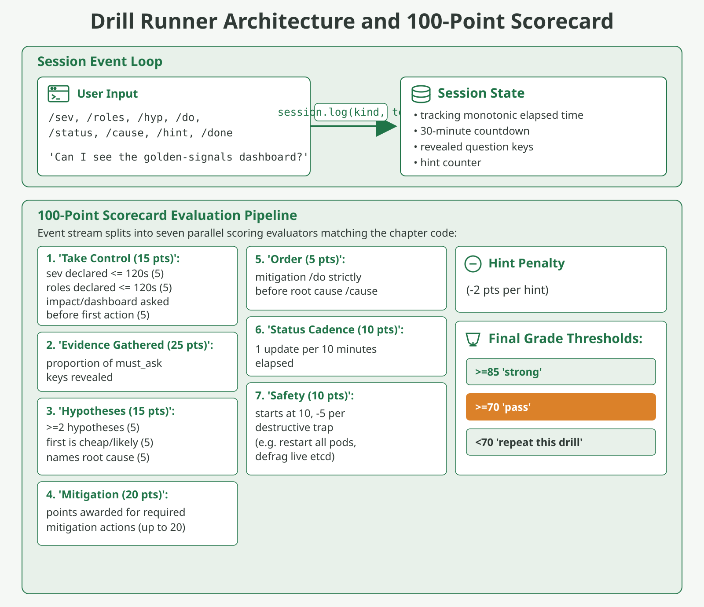

*Figure 20.26.7. The drill runner evaluates session timing and actions across seven rubric categories, rewarding prompt control, structured evidence gathering, and safe mitigation order.*

Picture yourself alone at a laptop with a 30-minute timer, typing questions to a program that stands in for the interviewer.

The runner in `code/part20` plays the interviewer. You type questions in plain words and it answers from a JSON file. It times you, records every action, and prints a scorecard. Each slash command is an action that the runner records. Plain sentences are questions that the interviewer answers from the incident file.

| Command | Meaning |
|---|---|
| `/sev N` | Declare a severity |
| `/roles text` | Name commander, ops and comms |
| `/hyp text` | State a hypothesis |
| `/do text` | Take a mitigation action |
| `/status text` | Post a status update |
| `/cause text` | State the root cause |
| `/hint` | Reveal one topic you have not asked about, costs 2 points |
| `/done` | End the drill and print the scorecard |

The scorecard has seven lines: taking control 15, evidence 25, hypotheses 15, mitigation 20, mitigating before naming the root cause 5, status cadence 10 and safety 10. The total is 100, with 85 and above strong and 70 and above a pass. These weights are this chapter's choice, not a Nebius rubric. Each line maps to a habit from the core ideas above. Taking control is the first idea, evidence is the questions you asked, hypotheses is the third idea, mitigation and the order check belong to the second idea, cadence is the fourth, and safety is the fifth.

```python
# code/part20/ch26_session.py
"""Interviewer for the stress-interview drill: answers question keys, records the session.

Commands start with a slash. Anything else is a question to the interviewer.
  /sev N        declare severity     /roles TEXT   name incident commander, ops, comms
  /hyp TEXT     state a hypothesis   /do TEXT      take a mitigation action
  /status TEXT  post a status update /cause TEXT   state the root cause
  /hint         reveal one unasked topic (costs 2 points)   /done  end the drill
"""
import re
import time

NO_ANSWER = "I do not have that signal. Ask for a specific metric, log line or command output."


def _has(low, kw):
    """Keyword match at a word start. Keywords of three letters or fewer must be whole words."""
    tail = r"(?!\w)" if len(kw) <= 3 else ""
    return re.search(r"(?<!\w)" + re.escape(kw) + tail, low) is not None


class Session:
    def __init__(self, incident, limit_minutes=30, clock=time.monotonic):
        self.inc = incident
        self.limit = limit_minutes * 60.0
        self.clock = clock
        self.start = clock()
        self.events = []          # (seconds, kind, text)
        self.revealed = []        # question keys, in the order first answered
        self.hints = 0
        self.finished = False

    def elapsed(self):
        return self.clock() - self.start

    def log(self, kind, text):
        self.events.append((self.elapsed(), kind, text))

    def first(self, kind):
        for t, k, _ in self.events:
            if k == kind:
                return t
        return None

    def match_question(self, text):
        low = text.lower()
        best, best_score = None, 0
        for q in self.inc["questions"]:
            score = sum(1 for kw in q["keywords"] if _has(low, kw))
            if q["key"] == low.strip():
                score += 100
            if score > best_score:
                best, best_score = q, score
        return best

    def handle(self, line):
        line = line.strip()
        if not line or self.finished:
            return ""
        if self.elapsed() > self.limit:
            self.finished = True
            return "Time is up. The scorecard follows."
        if not line.startswith("/"):
            return self.ask(line)
        cmd, _, rest = line[1:].partition(" ")
        if cmd == "hint":
            return self.hint()
        if cmd == "done":
            self.finished = True
            self.log("done", "")
            return "Session ended."
        if cmd in ("sev", "roles", "hyp", "do", "status", "cause"):
            self.log(cmd, rest.strip())
            return "Noted: " + cmd + "."
        return "Unknown command. Use /sev /roles /hyp /do /status /cause /hint /done."

    def ask(self, text):
        self.log("ask", text)
        q = self.match_question(text)
        if q is None:
            return NO_ANSWER
        if q["key"] not in self.revealed:
            self.revealed.append(q["key"])
        return q["answer"]

    def hint(self):
        for q in self.inc["questions"]:
            if q["key"] not in self.revealed:
                self.hints += 1
                self.log("hint", q["key"])
                return "Hint: there is a signal about '%s'." % q["key"]
        return "Hint: you have asked about everything."
```

The scoring module turns the event log into the seven lines. A risky phrase from the incident file costs 5 points, and the scorecard prints the reason, so you can see exactly what to practise.

```python
# code/part20/ch26_score.py
"""Scorecard for the stress-interview drill. Weights: 15 + 25 + 15 + 25 + 10 + 10 = 100."""
CADENCE_MINUTES = 10


def _hit(text, phrases):
    low = text.lower()
    return any(p in low for p in phrases)


def score_control(s):
    pts, notes = 0, []
    for kind, label in (("sev", "severity declared"), ("roles", "roles declared")):
        t = s.first(kind)
        if t is not None and t <= 120:
            pts += 5
        else:
            notes.append(label + " within 2 minutes: no")
    first_do = s.first("do")
    asked = [k for k in ("impact", "dashboard") if k in s.revealed]
    ok = len(asked) == 2
    if ok and first_do is not None:
        ok = all(_ask_time(s, k) < first_do for k in asked)
    pts += 5 if ok else 0
    if not ok:
        notes.append("asked for impact and the dashboard before acting: no")
    return pts, 15, notes

def _ask_time(s, key):
    for t, kind, text in s.events:
        if kind == "ask" and (s.match_question(text) or {}).get("key") == key:
            return t
    return float("inf")


def score_evidence(s):
    need = s.inc["must_ask"]
    got = [k for k in need if k in s.revealed]
    notes = ["never asked: " + k for k in need if k not in got]
    return round(25 * len(got) / len(need)), 25, notes


def score_hypotheses(s):
    hyps = [text for _, k, text in s.events if k == "hyp"]
    pts, notes = 0, []
    pts += 5 if len(hyps) >= 2 else 0
    if len(hyps) < 2:
        notes.append("stated fewer than two hypotheses")
    if hyps and _hit(hyps[0], s.inc["likely_first"]):
        pts += 5
    else:
        notes.append("first hypothesis was not the cheap, likely one (check what changed)")
    if any(_hit(h, s.inc["root_cause_keywords"]) for h in hyps):
        pts += 5
    else:
        notes.append("no hypothesis named the real cause")
    return pts, 15, notes


def score_mitigation(s):
    actions = [(t, text) for t, k, text in s.events if k == "do"]
    pts, notes = 0, []
    for m in s.inc["mitigations"]:
        if any(_hit(text, m["any"]) for _, text in actions):
            pts += m["points"]
        else:
            notes.append("missing: " + m["key"])
    return min(pts, 20), 20, notes


def score_order(s):
    first_do, cause = s.first("do"), s.first("cause")
    if first_do is None:
        return 0, 5, ["no mitigation action taken"]
    if cause is not None and cause < first_do:
        return 0, 5, ["named the root cause before mitigating"]
    return 5, 5, []


def score_comms(s):
    updates = len([1 for _, k, _ in s.events if k == "status"])
    end = min(s.elapsed(), s.limit)
    expected = max(1, int(end // (CADENCE_MINUTES * 60)))
    notes = [] if updates >= expected else ["%d status updates, expected %d" % (updates, expected)]
    return round(10 * min(1.0, updates / expected)), 10, notes


def score_safety(s):
    pts, notes = 10, []
    for d in s.inc["destructive"]:
        if any(_hit(text, d["any"]) for _, k, text in s.events if k in ("do", "ask")):
            pts -= 5
            notes.append("risky action: " + d["why"])
    return max(pts, 0), 10, notes


def scorecard(s):
    rows = [("Take control (first 2 min)", score_control(s)), ("Evidence gathered", score_evidence(s)),
            ("Hypotheses", score_hypotheses(s)), ("Mitigation", score_mitigation(s)),
            ("Mitigate before root cause", score_order(s)), ("Status cadence", score_comms(s)),
            ("Safety", score_safety(s))]
    total = sum(r[1][0] for r in rows) - 2 * s.hints
    return rows, max(total, 0)


def grade(total):
    return "strong" if total >= 85 else "pass" if total >= 70 else "repeat this drill"


def format_scorecard(s):
    rows, total = scorecard(s)
    out = ["Incident: " + s.inc["title"], "Elapsed: %d min %02d s" % divmod(int(s.elapsed()), 60)]
    for name, (got, top, notes) in rows:
        out.append("%-28s %2d / %2d" % (name, got, top))
        out += ["    - " + n for n in notes]
    if s.hints:
        out.append("Hints used: %d (minus %d)" % (s.hints, 2 * s.hints))
    out += ["Total: %d / 100 (%s)" % (total, grade(total)), "Root cause: " + s.inc["root_cause"],
            "Ideal mitigation: " + s.inc["ideal_mitigation"]]
    return "\n".join(out)

```

The loader checks that every incident has impact, dashboard and change questions, real must-ask keys, and mitigation points that add to 20. The wrapper is `code/part20/ch26_incident_drill.py` and the incidents are in `code/part20/ch26_incidents.json`.


## How to answer out loud

Picture the interviewer asking you a short question in the middle of a drill, with no time to build a perfect answer. You need a shape you can follow under pressure. Rehearse the order, not the wording.

**"Walk me through the first five minutes of an alert."** Confirm impact, open the dashboard, declare severity and roles, ask what changed, mitigate or rank hypotheses, then post a status update. Say the order first, because the interviewer is listening for it. Name the numbers you want: request rate, error rate, latency percentiles and saturation. Explain why each step is there. The impact tells you how urgent it is, the dashboard tells you whether the symptom is real, and the change question is the cheapest hypothesis. With no dashboard, use the problem statement questions from Systems Performance and check the load balancer and service logs.

**"Rollback or fix forward?"** A recent change with an unknown cause means rollback, because it is cheap and reversible. The exceptions are an irreversible data migration, a change that looks innocent, and a risky rollback. Verify on a graph. If it did not help, move to the next hypothesis.

**"You get no data."** Say what you would check and what you expect, ask for the nearest thing they can give, then state an assumption aloud and move on.

**"How do you communicate?"** One channel, one owner, the four-part update, suspected versus confirmed. In a big incident hand comms to a second person, and escalate early to whoever knows most about the change.

**"What is the most dangerous thing you could do?"** Say the drill's trap first, such as defragmenting a live etcd member. Then give the rule: what it does, how to undo it, the blast radius.
## Worked scenarios

Picture a Thursday practice session with a study partner and a stack of incident cards. Ten scripted incidents follow, five for the inference platform and five general ones. All numbers in the tables are invented for the drill, not measurements from Nebius or any real system. With a partner, give them the whole section. They read the opening and answer from the table when your question touches the topic in the first column. Alone, cover the table and set a 30-minute timer.

**Shared rubric.** Every incident uses the 100-point scorecard. Each lists the must-ask questions, the split of its 20 mitigation points, and the risky actions, 5 points each. The strong note under each incident is the one insight that separates a strong run.

### Incident 1: TTFT spike after a deploy

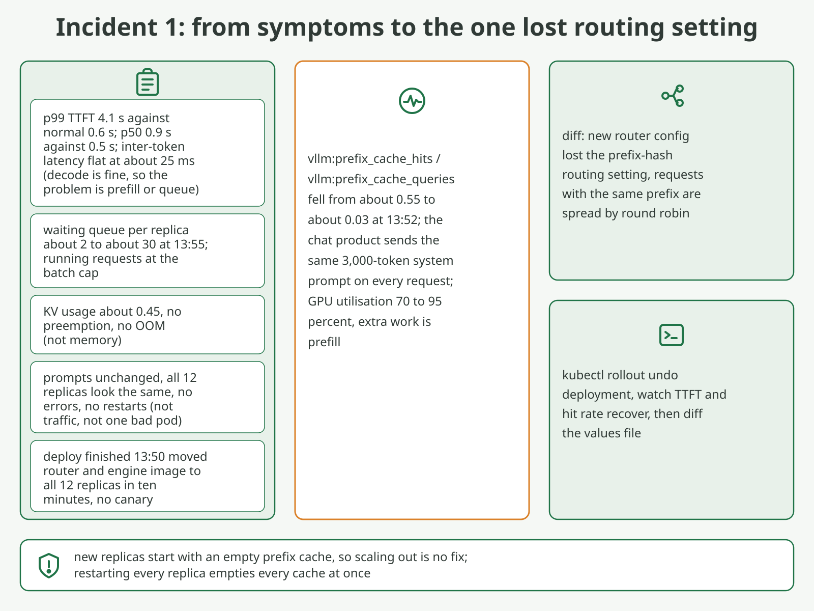

*Figure 20.26.8. Flat inter-token latency and a collapsed hit ratio point to routing, not traffic or memory.*

Picture the chat team pasting a slow-response graph into the incident channel. The model is running, but users wait a long time before the first word arrives, and the error panel shows nothing unusual.

**Interviewer opens.** "At 14:05 the p99 time-to-first-token alert fired for the chat endpoint in eu-north. Users say the model 'thinks' for several seconds before it starts to answer. You are on call. Go."

| Topic key | The interviewer says |
|---|---|
| `impact` | All tenants on the eu-north chat endpoint. No errors, only slow first tokens. p99 TTFT is 4.1 s against a normal 0.6 s. p50 is 0.9 s against 0.5 s. Support has six tickets. |
| `dashboard` | Request rate is flat. Error rate is 0.1%. TTFT is up and end-to-end latency is up. Inter-token latency is flat at about 25 ms. The waiting queue per replica rose from about 2 to about 30 at 13:55. |
| `change` | A deploy finished at 13:50. It moved the router and the engine image together to all 12 replicas in ten minutes. There was no canary stage. The values file was also rewritten. |
| `queue` | vllm:num_requests_waiting is about 30 per replica. Running requests sit at the batch cap. |
| `kv` | vllm:kv_cache_usage_perc is about 0.45. No preemption lines in the engine logs. No out-of-memory events. |
| `prefix` | vllm:prefix_cache_hits divided by vllm:prefix_cache_queries fell from about 0.55 to about 0.03 at 13:52. The chat product sends the same 3,000-token system prompt on every request. |
| `gpu` | GPU utilisation rose from about 70% to about 95%. The extra work is prefill. |
| `prompts` | The input and output length distributions are unchanged from yesterday. |
| `replicas` | All 12 replicas look the same. It is not one bad pod. |
| `errors` | No errors and no restarts. The logs show only normal request lines. |
| `diff` | The new router config lost the prefix-hash routing setting. Requests with the same prompt prefix are now spread across all replicas by round robin. |

**Technical anchor.** Hands-On LLM Serving and Optimization, chapter 4: TTFT grows with prefill work and queueing, and inter-token latency belongs to decode. Nebius published a chat-app case study where cache-aware routing raised the hit rate from about 5% to 50-60%. Read this anchor before the table. TTFT is time to first token, the wait before the first word appears. Prefill is the step that reads the whole prompt, and decode is the step that writes the answer one token at a time. A slow first token therefore points at prefill work or at a queue, while a slow later token points at decode. The table shows a slow first token with steady later tokens, which narrows the search before you have run a single command.

**Cause.** The deploy dropped prefix-aware routing. **Fix.** Roll back with `kubectl rollout undo deployment/<name>`, watch TTFT and the hit rate recover, then diff the values file. Notice what the cause is not. The prompts did not change, the replicas look alike, and the errors are absent, so the evidence points at the routing config and not at the traffic. The diff afterwards is how you find the setting that was lost, so the next deploy does not lose it again.

**Scoring.** Must ask: `impact`, `dashboard`, `change`, `queue`, `prefix`. Points: rollback 14, verify 6. Risky: restarting every replica empties every cache at once. Strong: new replicas start with an empty prefix cache, so scaling out is no fix. The drill counts a key as asked only when your question matches it, so ask in words that name the signal. Scaling out is tempting here because the queue is long, and the strong note explains why it would not help: new replicas begin with nothing cached.

### Incident 2: GPU pool shrinking silently

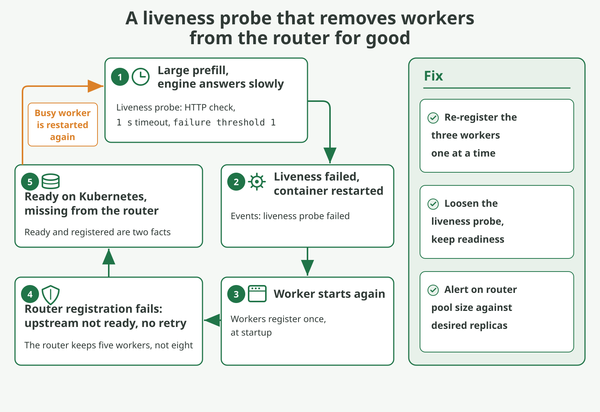

*Figure 20.26.9. Liveness loop: a tight probe restarts busy workers, and the restarted workers never rejoin the router even though Kubernetes reports them ready.*

Picture a customer writing in about slowness that has crept up for days, while the monitoring says every pod is healthy. No alert fired, so the only signal in the room is the person complaining.

**Interviewer opens.** "No alert fired. A customer on a dedicated endpoint says latency has crept up for three days and one request in fifty now times out. Your Kubernetes dashboard says everything is healthy. Go."

| Topic key | The interviewer says |
|---|---|
| `impact` | One dedicated endpoint, eight replicas of one model, one tenant. p99 latency rose from 2.0 s to 6.5 s over three days. About 2% of requests time out at peak. |
| `dashboard` | Kubernetes view: desired 8, ready 8, no alerts. The per-replica request view shows only five replicas receiving traffic. Three show zero. The five run at 95% of their batch cap. |
| `change` | No deploy for two weeks. A node pool maintenance event three days ago drained and replaced two GPU nodes. |
| `pods` | kubectl get pods shows all eight Running and Ready. Three pods show 38, 41 and 44 restarts since the maintenance event. The other five show 0. |
| `probe` | Events on the restarting pods say the liveness probe failed and the container will be restarted. The probe is an HTTP check with a 1 s timeout and a failure threshold of 1. During a large prefill the engine answers slowly. |
| `router` | The router admin view lists five registered workers. The three missing are the three restarting pods. Router logs say worker registration failed, upstream not ready, and no retry. Workers register once at startup. |
| `readiness` | Readiness passes on all eight pods after warm-up. Kubernetes counts them as ready even though the router does not know about three of them. |
| `gpu` | Five GPUs busy at about 90%. Three idle after the first minute following each restart. |
| `alerts` | Existing alerts watch pod readiness and the error rate. Nothing compares router pool size with desired replicas. |
| `capacity` | The endpoint is set to min 8 and max 8 replicas. There is no spare. |

**Technical anchor.** Production Kubernetes, chapter 14: a liveness failure restarts the container, and a readiness failure only removes the pod from the endpoints. The Nebius case study describes liveness restarts of healthy workers that did not rejoin the pool. The router here is invented. Two probes sound alike, so separate them in your head. Liveness asks whether the container should be restarted. Readiness asks whether the pod should receive traffic. A probe that is too strict can turn a busy worker into a restarted worker, and that restart is where this story starts.

**Cause.** A tight liveness probe restarts busy workers, and each never rejoins the router. **Fix.** Re-register the three workers one at a time, loosen the liveness probe, and alert on router pool size against desired replicas. Re-register one at a time, because restarting the whole pool would take down the five workers that still serve traffic. Loosening the liveness probe stops the loop.

**Scoring.** Must ask: `impact`, `dashboard`, `pods`, `probe`, `router`. Points: reregister 10, relax_probe 6, alert 4. Risky: restarting or deleting the whole pool removes the five serving workers. Strong: ready and registered are two facts. Loosen liveness, keep readiness. Keep the two facts apart when you speak. Ready means Kubernetes thinks the pod can take traffic. Registered means the router has the pod in its own list.

### Incident 3: KV-cache pressure and a 429 storm

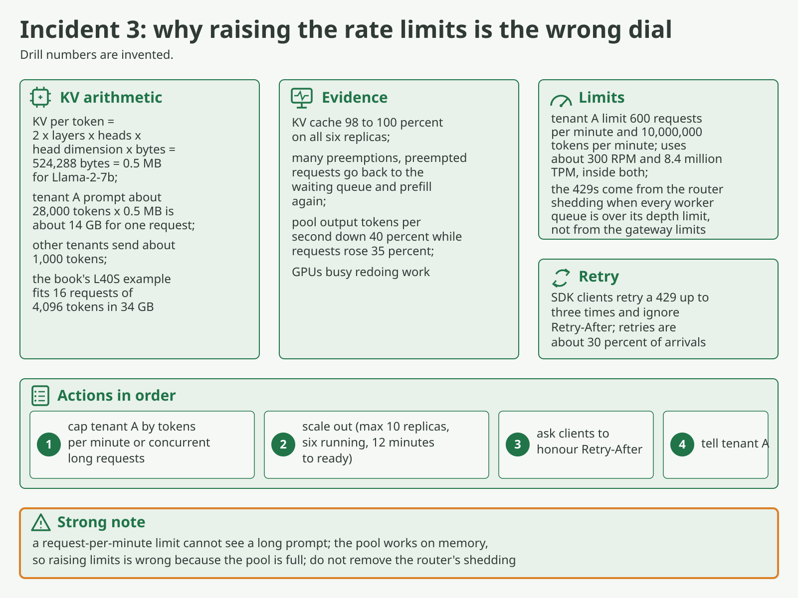

*Figure 20.26.10. Cap by tokens or concurrent long requests, because the pool is full of memory, not requests.*

Picture a product manager in the room asking for a quick fix: raise the rate limits so the errors stop. The request sounds reasonable, and your job is to find out whether it would help before anyone changes a number.

**Interviewer opens.** "The 429 rate on a dedicated endpoint is 22% and rising, and p99 latency has tripled. Traffic is 35% above the usual peak. Product asks whether to raise the rate limits. Go."

| Topic key | The interviewer says |
|---|---|
| `impact` | One dedicated endpoint, one model, three tenants. 22% of requests return 429. Tenants B and C are complaining. Tenant A is not. |
| `dashboard` | Request rate is up 35%. 429 is 22%. Waiting queue per replica is about 70. KV cache usage is 98 to 100% on all six replicas. Pool output tokens per second fell 40% while requests rose. |
| `change` | No deploy. Tenant A went live with a document-summarisation feature at 10:40. |
| `source429` | The gateway per-tenant limits are not hit and the remaining-quota headers look healthy. The 429s come from the router, which sheds load when every worker's queue is over its depth limit. |
| `kv` | KV usage is pinned at 98 to 100%. Engine logs show many preemptions. Preempted requests go back to the waiting queue and prefill again. |
| `prompts` | Tenant A sends prompts of about 28,000 tokens at about 5 requests per second. Other tenants send about 1,000 tokens. The model allows 32,000. |
| `throughput` | Output tokens per second are down 40%. GPU utilisation is high. The GPUs are redoing work after preemptions. |
| `retries` | SDK clients retry a 429 up to three times and ignore Retry-After. Retries are about 30% of arrivals. |
| `limits` | Tenant A limit is 600 requests per minute and 10,000,000 tokens per minute. They use about 300 RPM and 8.4 million TPM, so they are inside both. |
| `capacity` | Max replicas is 10 and six are running. A new replica takes about 12 minutes to become ready. |

**Technical anchor.** Hands-On LLM Serving and Optimization, chapter 5: KV cache per token is 2 x layers x heads x head dimension x bytes, which is 524,288 bytes or 0.5 MB for Llama-2-7b. Worked here, 28,000 tokens x 0.5 MB is about 14 GB for one request. The book's L40S example fits 16 requests of 4,096 tokens in 34 GB. A preempted request restarts its prefill, and a request over a Token Factory limit returns 429 with `Retry-After`. Before the arithmetic, the picture. A KV cache holds the attention keys and values for each token of a running request, so one long prompt takes a large slice of it. Preemption means the engine evicts a running request to free that memory, and the evicted request must prefill again when it comes back. That is the loop the table describes.

**Cause.** Tenant A's long prompts exhaust the KV cache, so the engine preempts and recomputes, and retries add load. **Fix.** Cap tenant A by tokens per minute or concurrent long requests, scale out knowing it takes 12 minutes, ask clients to honour Retry-After, and tell tenant A. "Recomputes" here means the same prefill work is paid again, which is why throughput falls even though the GPUs look busy. Scaling out helps, but it is slow, so the cap is the first move and the new replicas are the second.

**Scoring.** Must ask: `impact`, `dashboard`, `source429`, `kv`, `prompts`. Points: limit_tenant 9, scale 5, retry 3, tenant_comms 3. Risky: removing the router's shedding, or restarting. Strong: a request-per-minute limit cannot see a long prompt, and raising limits is wrong because the pool is full. A limit on requests counts a short question and a very long document as one request each. The pool does not count requests. It works on the memory that the prompts occupy, so a request limit is the wrong dial.

### Incident 4: Regional partial outage with retry amplification

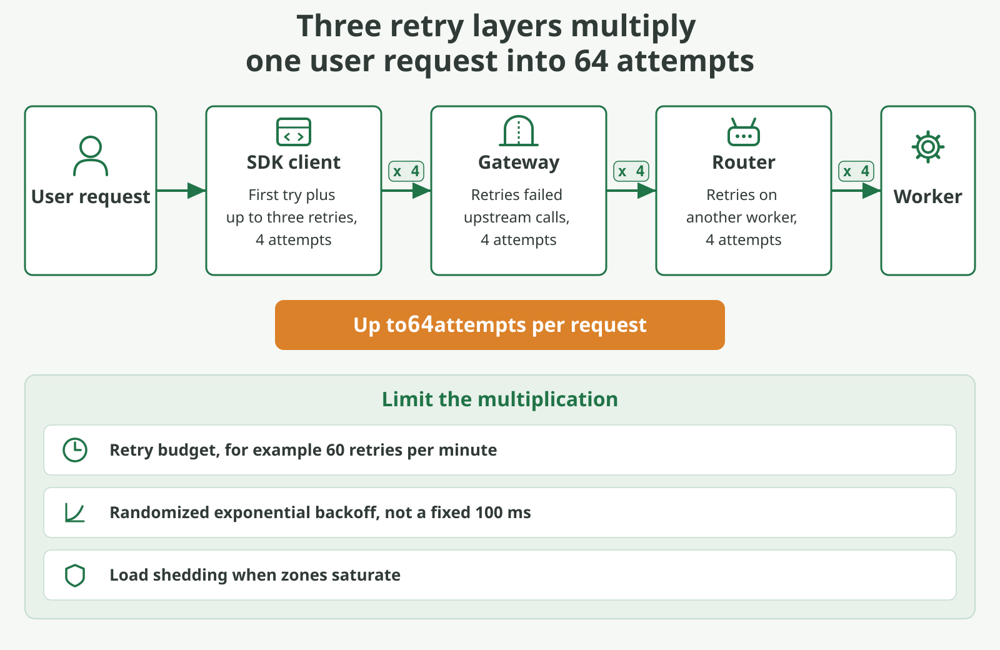

*Figure 20.26.11. Retry amplification: each layer makes its first try plus three retries, so the layers multiply to 64 attempts unless a retry budget caps them.*

Picture the gateway CPU graphs climbing to three times their normal level while the user traffic line stays flat. The system is doing far more work for the same people, and the cause is not more users.

**Interviewer opens.** "Error rate on the eu-west regional endpoint is 15% and climbing. User traffic is flat. Gateways are at three times their normal CPU. Upstream request rate is four times the user request rate. Go."

| Topic key | The interviewer says |
|---|---|
| `impact` | eu-west only, all tenants. 15% of requests fail with 503 or time out. eu-north is fine. These tenants are bound to EU data residency. |
| `dashboard` | Three zones, a, b and c. Zone b workers show errors and timeouts. Zones a and c are healthy but their queues are growing. User traffic is 1,000 requests per second. Gateway-to-router attempts are 4,000 per second. |
| `change` | No deploys. The cloud provider status page shows a degraded network in zone b that started ten minutes ago. |
| `retries` | The SDK retries up to three times. The gateway retries failed upstream calls up to three times. The router retries on another worker up to three times. There is no retry budget. Backoff is a fixed 100 ms with no jitter. |
| `zones` | Zone b holds 4 of 12 workers, all failing health checks intermittently on the network. Zones a and c hold 8 workers at 92% KV usage because they absorb the retries. |
| `capacity` | Zones a and c can carry the real user load at about 85% of capacity if the retries stop. They cannot carry user load plus four times the attempts. |
| `failover` | eu-north has 15% headroom. A teammate proposes sending the overflow to the US region, which is idle. The affected tenants are bound to EU residency. |
| `health` | Liveness probes on zone b workers flap. Kubernetes restarts some, and they come back and fail again. |
| `lb` | You can set the zone b weight to zero at the load balancer with one command. |
| `timeouts` | Client, gateway and router timeouts are all 60 seconds. |

**Technical anchor.** Google SRE book, Addressing Cascading Failures: three layers each making 3 retries is 4 attempts per layer, so 4 x 4 x 4 = 64 attempts. It suggests randomized exponential backoff, a retry budget with an example of 60 retries per minute, and load shedding. Nebius says Token Factory has EU and US regions with data residency. Each layer makes its first try plus up to three retries, so each layer multiplies the work by four. The layers multiply rather than add, because each layer's retries happen inside the attempts of the layer above it. A retry budget caps the extra work. A fixed backoff with no jitter, which means no random spread in timing, makes every retry arrive at the same moment.

**Cause.** Zone b's fault plus unbudgeted retries at three layers, up to 64 attempts per request. **Fix.** Cut or budget retries at the gateway and router, drain zone b, shed load if zones a and c still saturate, and keep traffic in the EU. The fix has an order. Stop the multiplication first, because it turns a sick zone into a sick region. Drain zone b next, so the bad workers stop receiving requests. Shedding is the last resort, and the residency rule applies to every step.

**Scoring.** Must ask: `impact`, `dashboard`, `change`, `retries`, `zones`. Points: stop_retries 8, drain_zone 8, shed 4. Risky: sending EU traffic to the US, or restarting or adding gateways. Strong: name the multiplication across layers, and name residency before anyone suggests a US failover. Residency is a limit on where the data may go, so it shapes the fix before any capacity arithmetic starts. Adding gateways is a risky move here because it adds more clients making the same retries.

### Incident 5: Model weights download stuck at cold start

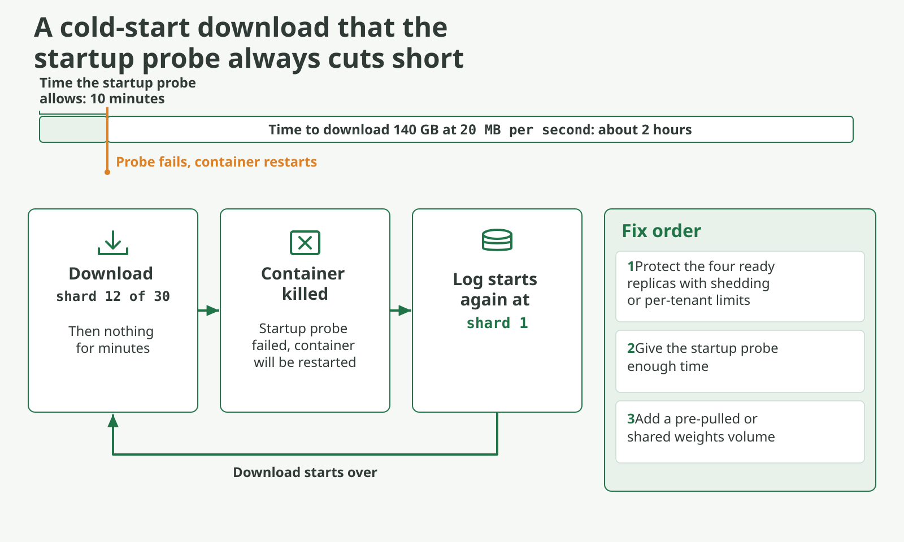

*Figure 20.26.12. Cold-start loop: a 140 GB download at 20 MB per second takes about two hours, far longer than the ten-minute startup probe, so each restart begins at shard 1.*

Picture the autoscaler adding pods on a busy morning. The new pods sit at zero ready for minutes at a time, and the pods that are already running get hotter with every minute.

**Interviewer opens.** "The autoscaler added four replicas of a 70B model 25 minutes ago because the existing four are saturated. None is Ready. The new pods show 0/1 and a rising restart count. Go."

| Topic key | The interviewer says |
|---|---|
| `impact` | One dedicated endpoint. Four ready replicas at 97% KV usage. p99 latency is up 2x and 5% of requests return 429. Traffic is a morning peak, 40% over yesterday. |
| `dashboard` | Desired 8, ready 4. Waiting queue about 40 per ready replica. New pods are Running 0/1 with two or three restarts each. |
| `change` | No deploy. The autoscaler fired on queue depth. The four new pods landed on two GPU nodes that joined the pool 30 minutes ago. |
| `logs` | Pod logs say downloading shard 12 of 30. Then nothing for minutes. Then the container is killed and the log starts again at shard 1. |
| `events` | Events say the startup probe failed and the container will be restarted. The startup probe allows 10 minutes in total. The last termination reason is not out of memory. |
| `speed` | Each pod pulls at about 20 MB per second. The model is about 140 GB in 30 shards. |
| `store` | The object store sends occasional throttle responses. The downloader backs off for a long time after each one. |
| `cache` | Weights are fetched from the object store at every container start into the container's own writable layer. There is no node-local cache and no shared volume. The new nodes have nothing warm. |
| `history` | Last week's scale-out used a node image with the weights pre-pulled and took about 6 minutes. The new nodes use the plain image. |

**Technical anchor.** LLMs in Production, chapters 3 and 6: a large model takes very long to download, and options include baking weights into the image or mounting a volume downloaded once. Production Kubernetes, chapter 14, shows a startup probe of 30 failures at 10 seconds, which is 300 seconds. A startup probe gives a slow container a grace period to finish starting before the other probes take over. Here the grace period is shorter than the download, so the container is restarted before it can ever finish.

**Cause.** 140,000 MB at 20 MB per second is 7,000 seconds, about two hours, and the ten-minute startup probe restarts the download from shard 1. Work through it in your head. Divide the size by the speed, then compare the answer with the time the probe allows. **Fix.** Give the startup probe enough time, protect the four ready replicas with shedding or per-tenant limits, and add a pre-pulled or shared weights volume. The four ready replicas are the users in pain right now, so protect them first, then fix the download.

**Scoring.** Must ask: `impact`, `dashboard`, `logs`, `events`, `cache`. Points: stop_loop 7, protect 7, warm_cache 6. Risky: deleting a pod restarts the download. Strong: do the arithmetic, and say why more replicas make it worse. More pods means more downloads competing for the same object store, which is already sending throttle responses. That is why adding replicas makes the wait longer, not shorter.
### Incident 6: Disk full on a GPU node

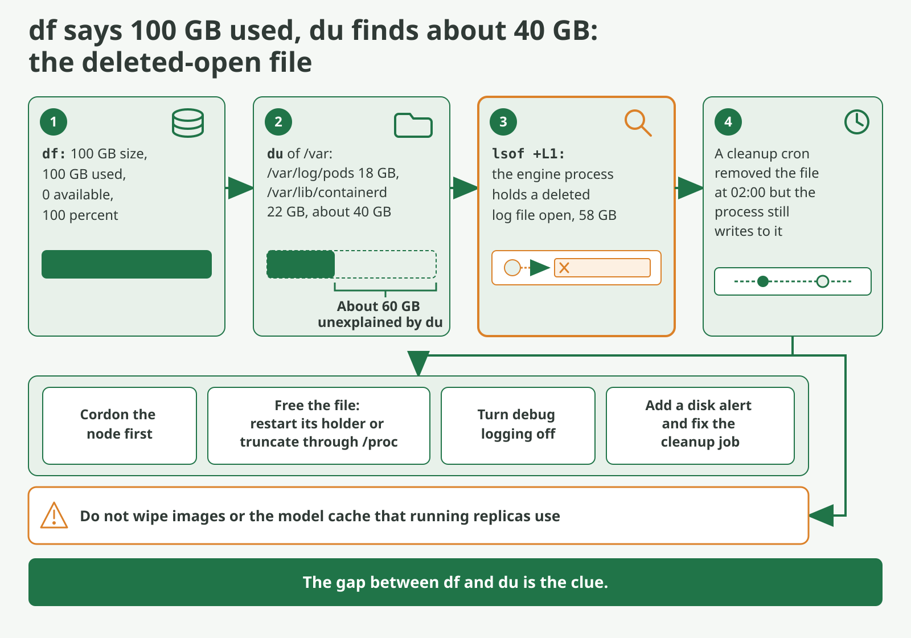

*Figure 20.26.13. df reports 100 GB used while du finds about 40 GB, and a deleted 58 GB log held open by the engine explains the gap.*

Picture an alert named DiskPressure on one node, evicted pods, and a restarted replica that crashes with a message about no space left on the device. The replica cannot start until the disk has room again.

**Interviewer opens.** "Alert: DiskPressure on GPU node gpu-17. Two pods were evicted. A vLLM replica on it restarted and now crashes at start with 'No space left on device'. Get the node healthy. Go."

| Topic key | The interviewer says |
|---|---|
| `impact` | One node of a 40-node pool. One of 8 replicas of a dedicated endpoint is down. The endpoint serves on 7 of 8 with latency up 15%. |
| `dashboard` | Node view: root filesystem 100% used. CPU and memory normal. Other nodes under 60% disk. |
| `change` | Last night an engineer set VLLM_LOGGING_LEVEL=DEBUG on that replica to chase a stall. The Deployment was patched at 22:00. |
| `df` | df -h: 100G size, 100G used, 0 available, 100%. df -i: 12% of inodes used. |
| `du` | du -xh --max-depth=2 /var shows /var/log/pods 18 GB and /var/lib/containerd 22 GB. That is about 40 GB, far less than the 100 GB that df reports as used. |
| `deleted` | lsof +L1 shows the engine process holding /var/log/vllm/engine.log (deleted), 58 GB. A cleanup cron removed the file at 02:00. The process still writes to it. |
| `node` | describe node shows the DiskPressure condition true. The kubelet evicted two low-priority batch pods. |
| `images` | /var/lib/containerd holds images and a 22 GB model cache that running replicas on the node use right now. |
| `others` | Other pods on the node serve traffic. You may cordon the node. |

**Technical anchor.** Systems Performance, chapter 8: an inode holds a file's metadata, so a disk can be full of space or of inodes. The kubelet watches nodefs.available and nodefs.inodesFree, reclaims space first, then evicts pods. The lab runs the deleted-but-open demonstration. An inode is the record that holds a file's size, owner and where its data sits. You can run out of those records while space is free, and you can run out of space while records are free. Here the space is the problem. The trap is a file that was deleted while a process still had it open. The name vanishes from the directory, but the space stays allocated until that process closes the file. Tools that add up file sizes cannot see the file any more, yet the disk still counts it.

**Cause.** Debug logging wrote 58 GB to a file that was deleted while the process held it open. **Fix.** Cordon the node, free the file by restarting its holder or truncating through /proc, turn debug logging off, add a disk alert, and fix the cleanup job. Cordon first, so no new pods land on the sick node. Then free the space in the least harmful way. Truncating through /proc keeps the process running, while restarting the holder also frees the space but interrupts the service. Turning off debug logging stops the same growth from coming back, and the cleanup job needs a fix because deleting an open log file is what created the gap.

**Scoring.** Must ask: `impact`, `dashboard`, `df`, `du`, `deleted`. Points: cordon 4, free_space 9, debug_off 4, follow_up 3. Risky: wiping images and the model cache. Strong: use the du and df gap as the clue, and check inodes too. The gap between df and du is the clue the drill is looking for. Checking inodes is the second half of the habit, because a full inode table looks like a full disk with a different number.

### Incident 7: Certificate expiry

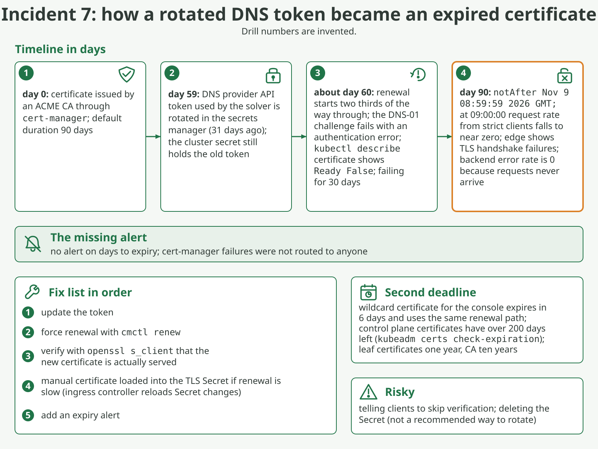

*Figure 20.26.14. The token changed in one place and the cluster kept the old copy, so name the second expiring certificate too.*

Picture the support queue filling at one fixed time in the morning, with the same message from client after client. The internal dashboards load normally, which is what makes the problem confusing at first.

**Interviewer opens.** "At 09:00 UTC the support queue fills with 'certificate has expired' from clients calling the public API. Your internal dashboards load fine. Go."

| Topic key | The interviewer says |
|---|---|
| `impact` | All external clients of api.example.test in every region fail. Internal traffic is fine. Clients that skip verification still work. |
| `dashboard` | Request rate from strict clients fell to near zero at 09:00:00. Backend error rate is 0 because requests never arrive. The edge shows TLS handshake failures. |
| `change` | No deploy. Nothing changed at 09:00 except the clock. |
| `cert` | openssl x509 -noout -enddate on the served certificate gives notAfter=Nov 9 08:59:59 2026 GMT. It was issued 90 days ago by an ACME CA through cert-manager. |
| `renew` | kubectl describe certificate shows Ready False. Renewal attempts have failed for 30 days. The order fails at the DNS-01 challenge with an authentication error from the DNS provider API. |
| `why` | The DNS provider API token used by the solver was rotated 31 days ago in the secrets manager. The cluster secret still holds the old token. |
| `alert` | No alert on days to expiry. cert-manager failures were not routed to anyone. |
| `others` | kubeadm certs check-expiration shows the control plane certificates with over 200 days left. A wildcard certificate for the console expires in 6 days and uses the same renewal path. |
| `workaround` | With a working token you can request a certificate manually and load it into the TLS Secret. The ingress controller reloads Secret changes. |

**Technical anchor.** The kubeadm certificate page gives one year for leaf certificates and ten years for the CA. The cert-manager documentation says the default duration is 90 days, renewal starts two thirds of the way through, `cmctl renew` forces a renewal, and deleting the Secret is not a recommended way to rotate. A leaf certificate is the one a server shows to clients. The CA is the authority that signs it. Renewal is the step that issues a fresh certificate before the old one runs out. Because renewal starts partway through the life of the certificate, a renewal that keeps failing can go unnoticed for a long time, and that is exactly what this cause describes.

**Cause.** A rotated DNS provider token was never updated in the cluster, so renewal failed for 30 days. **Fix.** Update the token, force renewal with cmctl renew, verify with openssl s_client, use a manual certificate if renewal is slow, fix the six-day certificate, and add an expiry alert. The token changed in one place, and the cluster kept the old copy. The fix is to update the copy, then prove that the new certificate is actually served. The verify step matters, because a renewed certificate that never reaches the ingress still leaves clients failing.

**Scoring.** Must ask: `impact`, `dashboard`, `cert`, `renew`, `why`. Points: fix_and_renew 10, manual_cert 4, verify 3, others 3. Risky: telling clients to skip verification, or deleting the Secret. Strong: check the second certificate that expires in six days. Telling clients to skip verification is a tempting shortcut, but it switches off the very check the clients need. A second certificate with its own near deadline tends to disappear once the first incident is closed, so name it while you are still on the call.

### Incident 8: DNS: intermittent resolution failures

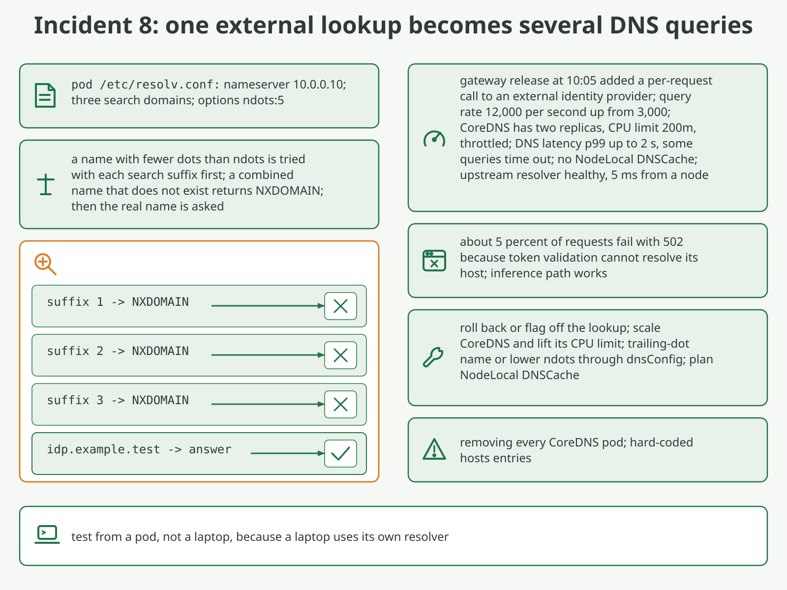

*Figure 20.26.15. The new external lookup multiplied DNS load, and the naming fix cuts queries for every later lookup.*

Picture gateway logs filling with name-resolution errors on about one request in twenty, while the inference path keeps working. The errors are small and steady, which makes them easy to dismiss until the failures spread.

**Interviewer opens.** "Gateway pods log 'Temporary failure in name resolution' on about one request in twenty. It began 20 minutes ago. Overall traffic is normal. Go."

| Topic key | The interviewer says |
|---|---|
| `impact` | The gateway in one cluster. About 5% of requests fail with 502 because the token validation call cannot resolve its host. The inference path itself works. |
| `dashboard` | Gateway errors 5%. CoreDNS has two replicas with CPU at the limit and throttled. Query rate is 12,000 per second, up from 3,000. DNS latency p99 is up to 2 s and some queries time out. |
| `change` | A gateway release at 10:05 added a per-request call to an external identity provider, idp.example.test. |
| `resolv` | The pod's /etc/resolv.conf has nameserver 10.0.0.10, three search domains and options ndots:5. |
| `queries` | With the CoreDNS log plugin briefly on: for each lookup of idp.example.test the pod first asks for the name with each search suffix. Those return NXDOMAIN. Then the real name is asked. |
| `coredns` | kubectl get pods -n kube-system -l k8s-app=kube-dns shows two Running. The CPU limit is 200m and the pods are throttled. |
| `cache` | There is no NodeLocal DNSCache. |
| `upstream` | The upstream resolver is healthy. Queried directly from a node it answers in 5 ms. |
| `test` | From a dnsutils pod, nslookup kubernetes.default works but sometimes takes 1.5 s. An external name alone sometimes times out. |

**Technical anchor.** Production Kubernetes, chapter 6: with ndots 5, a name with fewer dots is tried with each search suffix first, so external names cause several useless queries. It suggests a trailing dot, `dnsConfig` and NodeLocal DNSCache. The resolver counts the dots in a name. If the count is below ndots, it appends each search suffix and asks for each combined name before it tries the name as typed. Each extra question costs a query, and a combined name that does not exist returns NXDOMAIN. One external lookup can become several queries, and that multiplies the load on the DNS pods.

**Cause.** The new external lookup, with ndots 5, becomes several queries each, and throttled CoreDNS times out. **Fix.** Roll back or flag off the lookup, scale CoreDNS and lift its CPU limit, use a trailing-dot name or lower ndots through dnsConfig, and plan NodeLocal DNSCache. The fix works from the outside in. The rollback or flag stops the new load at its source. Scaling and lifting the CPU limit relieve the pods that are already throttled. The naming change cuts the number of queries for every lookup that comes after it.

**Scoring.** Must ask: `impact`, `dashboard`, `change`, `resolv`, `queries`. Points: rollback_or_flag 6, scale_coredns 6, fewer_queries 6, nodelocal 2. Risky: removing every CoreDNS pod, or hard-coded hosts entries. Strong: explain why one lookup becomes several, and test from a pod, not a laptop. A laptop uses its own resolver, so a laptop test can say the name resolves while the pod still fails. Test from inside the pod's network, so the answer comes from the same path the gateway uses.

### Incident 9: etcd latency

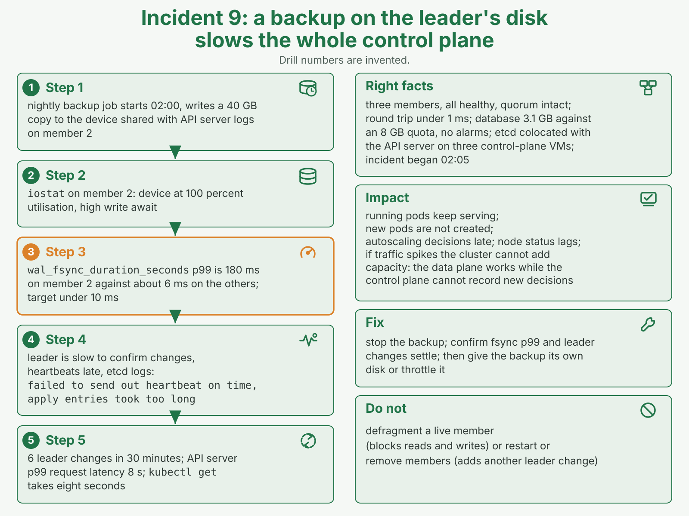

*Figure 20.26.16. Stop the source first and wait for fsync and leader changes to settle before anything else.*

Picture a simple command that used to answer at once now taking seconds to return, and a rollout that has stopped moving. Nothing is failing for the users yet, but the control plane is slowly losing its ability to change anything.

**Interviewer opens.** "kubectl get takes eight seconds. Rollouts and the autoscaler are stalling. The API server logs 'etcdserver: request timed out'. Inference traffic is still being served. Go."

| Topic key | The interviewer says |
|---|---|
| `impact` | The control plane is degraded. Running pods keep serving. New pods are not created, autoscaling decisions are late and node status updates lag. If traffic spikes, the cluster cannot add capacity. |
| `dashboard` | API server p99 request latency is 8 s. etcd had 6 leader changes in 30 minutes. wal_fsync_duration_seconds p99 is 180 ms on member 2 and about 6 ms on the others. Member 2 is the leader most of the time. |
| `change` | No deploys. A nightly backup job started at 02:00. The incident began at 02:05. |
| `logs` | etcd logs on member 2 say failed to send out heartbeat on time and apply entries took too long. Leader elections follow. |
| `disk` | iostat on member 2 shows the device at 100% utilisation with high write await. Member 2 shares that disk with API server logs, and the backup job writes a 40 GB copy to the same device. |
| `db` | Database size is 3.1 GB against an 8 GB quota. etcdctl alarm list shows no alarms. |
| `members` | Three members, all healthy, quorum intact. Only member 2 is slow. |
| `layout` | etcd runs colocated with the API server on three control-plane VMs. |
| `network` | Round trip between members is under 1 ms with no packet loss. |

**Technical anchor.** The etcd FAQ: p99 of `wal_fsync_duration_seconds` should be under 10 ms, and the heartbeat warning means a slow disk, CPU starvation or a slow network. The maintenance page says defragmenting a live member blocks reads and writes. etcd keeps a write-ahead log, a file where every change is written before it is confirmed. Each write is forced to disk with fsync, and that is the number you watch. When fsync is slow, the leader is slow to confirm changes, and the other members can start to treat it as failed. That is where the leader elections in the logs come from.

**Cause.** The nightly backup writes 40 GB to the leader's disk, so fsync is 180 ms against 10 ms. **Fix.** Stop the backup, confirm fsync p99 and leader changes settle, then give the backup its own disk or throttle it. Do not defragment or restart members. Stop the source first, then wait for the numbers to settle before you decide anything else. Restarting a member adds another leader change to the record, and defragmenting blocks the very reads and writes you need to keep the cluster moving.

**Scoring.** Must ask: `impact`, `dashboard`, `change`, `logs`, `disk`. Points: stop_job 10, verify 4, follow_up 6. Risky: defragmenting a live member, or restarting or removing members. Strong: running pods keep serving but nothing can change, so autoscaling stalls. A useful way to say it is that the data plane still works while the control plane cannot record new decisions.

### Incident 10: Bad config push

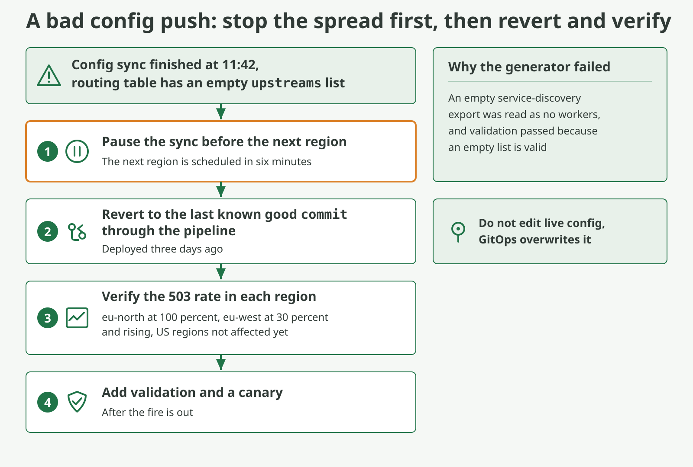

*Figure 20.26.17. Bad config push: pause the sync first so the change stops spreading, then revert through the pipeline and verify region by region.*

Picture a gateway returning errors everywhere at once, minutes after an automatic sync reported success. The sync is the change, and the team is asking whether anyone has noticed it is still spreading.

**Interviewer opens.** "It is 11:44. The 5xx rate at the API gateway is 100% in eu-north and climbing in eu-west. A config sync from the GitOps automation finished at 11:42. You are on call. Go."

| Topic key | The interviewer says |
|---|---|
| `impact` | All tenants in eu-north see 100% 503. eu-west is at 30% and rising. The US regions are not affected yet. |
| `dashboard` | The gateway returns 503 with no healthy upstream for every model. Workers are healthy and idle. The request rate reaching workers in eu-north dropped to zero. |
| `change` | Yes. A config sync at 11:42 changed the routing table. It rolled to eu-north, then eu-west at 11:44, and the US regions are scheduled for 11:50. There is no canary stage. A bot account merged it from a generator. |
| `diff` | The generated routing file has an empty upstreams list for every model. The generator read an empty service-discovery export and treated it as no workers. Validation passed because an empty list is valid. |
| `pipeline` | The sync can be paused with one click in the GitOps controller. The next region is scheduled in six minutes. |
| `lastgood` | The previous commit is known good and was deployed three days ago. |
| `access` | You have cluster access and the GitOps UI is up. |
| `workers` | Workers are healthy and ready with no restarts. |

**Technical anchor.** Google SRE book, Emergency Response: a reviewed change still broke things, so canary every change and keep out-of-band rollback tools. Its process-induced example is automation that treated an empty input as all machines. A canary sends a change to a small part of the system first, so one bad push cannot reach everything at once. An out-of-band tool is one that does not depend on the pipeline that just broke. In this incident the sync pipeline is also what spreads the change, so the pause control has to sit outside that spread.

**Cause.** A generator turned an empty export into a routing table with no upstreams, and no canary stopped it. **Fix.** Pause the sync before the next region, revert to the last known good commit through the pipeline, verify the 503 rate in each region, then add validation and a canary. Pause first because the sync is still moving. Revert second, using the known good commit, so the rollback goes through the pipeline and leaves a record. Verify region by region, because the regions are not all failing at the same speed. Validation and a canary come after the fire is out.

**Scoring.** Must ask: `impact`, `dashboard`, `change`, `diff`, `pipeline`. Points: pause 8, revert 9, verify 3. Risky: editing live config, which GitOps overwrites, or deleting the gateway. Strong: stop the spread first, revert second. Fixing forward is wrong under pressure. Fixing forward means writing a new change while people are watching, and a new change is exactly what caused this problem. The safer move is to return to the last good state and think once the spread has stopped.
## Hands-on lab

Picture a laptop with the code folder open, a terminal waiting for its first command, and a timer you can glance at when you need one. Every step below runs against files that are already in the repository, so you can repeat them without setting up a cluster.

All steps run in `code/part20` unless stated. Steps 1 to 4 and 8 were run on macOS, and steps 6, 7 and 8 again on Linux in disposable containers. Step 5 is interactive and was not run by hand.

1. List the incidents. Start by checking that the drill sees all ten scenarios.

```bash
cd code/part20
python3 ch26_incident_drill.py list
```

Expected and observed: ten lines, numbered 1 to 10, five marked `inference` and five marked `general`. If you see fewer lines, check the JSON file before you start a drill.

2. Replay a strong run against incident 1 with timestamps. The replay file carries timestamps, so the runner can measure the elapsed time for you.

```bash
python3 ch26_incident_drill.py replay ttft-after-deploy samples/ch26_ttft_replay.txt
```

Observed: `Total: 100 / 100 (strong)`, with every line at full marks and an elapsed time of 18 min 20 s.

3. Replay a weak run. What does a weak run look like? It names the cause at once, then restarts everything.

```bash
printf '5|/cause probably the cache\n20|/do restart all pods\n40|/done\n' > /tmp/weak.txt
python3 ch26_incident_drill.py replay ttft-after-deploy /tmp/weak.txt
```

Observed: `Total: 5 / 100 (repeat this drill)`. The scorecard lists every missed habit and prints the reason that restarting all replicas is risky.

4. Run the unit tests. These check the scorer and the runner. Run them from the same folder.

```bash
python3 -m pytest test_ch26_incident_drill.py -q
```

Observed: 32 passed on the Mac and in the Linux container. They include one test per incident that builds a model answer from the JSON and checks it scores at least 85.

5. Run a solo drill. Not run interactively here. Pick an incident, start a 30-minute clock, and type your questions.

```bash
python3 ch26_incident_drill.py run disk-full-node --minutes 30
```

Expected shape: the interviewer opening, a prompt showing elapsed time, answers to your questions, and a scorecard after `/done`.

6. Reproduce the deleted-but-open file from incident 6. On macOS, `lsof +L1` lists open files whose link count is below one. A link count of zero means the file has no name left in the directory tree, while a process still holds it open.

```bash
head -c 5000000 /dev/zero > big.log
tail -f big.log > /dev/null &
rm big.log
lsof +L1 | awk 'NR==1 || /big.log/'
```

Observed on the Mac: one row for `tail` with `NLINK` 0 and size 5000000 on `big.log`. Observed on Linux, from the same four lines in a bash shell:

```text
COMMAND  PID USER   FD   TYPE DEVICE SIZE/OFF NLINK    NODE NAME
tail    3414 root    3r   REG   0,56  5000000     0 3317614 /w/big.log (deleted)
```

On Linux the name column ends with `(deleted)`, and the `NLINK` of 0 is the other clue. Stop the background job afterwards with `kill %1`. One trap: `lsof +L1 /path` also printed directory rows with `NLINK` 2, so use plain `lsof +L1` and filter the output.

7. Linux version of step 6 for the disk-full story. A tmpfs of 50 MB is the stand-in for the full disk.

```bash
docker run --rm --tmpfs /small:size=50m ubuntu:24.04 bash -c '
  apt-get update -qq; apt-get install -y -qq lsof >/dev/null
  cd /small; head -c 20000000 /dev/zero > big.log
  tail -f big.log > /dev/null & TP=$!
  rm big.log
  df -h /small | tail -1; du -sh /small; lsof +L1 | grep big.log
  : > /proc/$TP/fd/3; df -h /small | tail -1'
```

Observed, trimmed. Before the `rm` the numbers agreed: `df` showed 20M used and `du` showed 20M. After the `rm` the gap opened.

```text
tmpfs   50M   20M   31M  39% /small      <- df still counts the deleted file
0       /small                           <- du cannot see it
tail  238 root  3r  REG  0,123 20000000  0  2 /small/big.log (deleted)
tmpfs   50M     0   50M   0% /small      <- after truncating through /proc/PID/fd/3
```

Truncating through the `/proc` descriptor freed the space at once, and `tail` printed `file truncated`. That works because the descriptor still points at the real file. I opened it from a root shell. A deleted file held by a writer would be truncated the same way, but check the process first.

Later in the same run I filled the disk for real. A 60 MB write into the 50 MB tmpfs failed with `head: error writing 'standard output': No space left on device`. Then `df` showed 100 percent and `du` showed 50M. `df -i` showed 757,587 inodes with 2 used, so space and inodes are separate limits. The `df` and `du` gap, the `(deleted)` row and the `/proc` truncation are now real Linux output. The kubelet eviction behaviour was not tested, since there is no cluster.

8. Check the certificate habit from incident 7 with a local self-signed certificate. A self-signed certificate is one you make yourself, so you can practise the commands without touching a real endpoint.

```bash
openssl req -x509 -newkey rsa:2048 -nodes -keyout k.pem -out c.pem -subj /CN=api.example.test -days 1
openssl x509 -in c.pem -noout -enddate
openssl x509 -in c.pem -noout -checkend 86400
```

Observed on the Mac and again on Linux with OpenSSL 3.0.13: a `notAfter` date one day ahead, then `Certificate will expire` with exit status 1, because the certificate expires inside the 86,400 seconds you asked about. With `-checkend 0` it printed `Certificate will not expire` and exit status 0.

On Linux I also served that certificate with `openssl s_server -accept 8443 -cert c.pem -key k.pem -www` and checked it from outside, the habit the ideal mitigation names.

```bash
echo | openssl s_client -connect 127.0.0.1:8443 -servername api.example.test -CAfile c.pem -verify_hostname api.example.test
```

Observed: `Verification: OK` and `New, TLSv1.3, Cipher is TLS_AES_256_GCM_SHA384`. Without `-CAfile` it said `verify error:num=18:self-signed certificate`. With the wrong name it said `Verification error: hostname mismatch`. The `cmctl renew` step was not run, because there is no cluster.

## Drill questions

Picture the interviewer sitting across from you with a pen, asking one question at a time. Answer each one aloud before you open it.

<details><summary>1. What do you say in the first two minutes of an incident drill?</summary>

Confirm the impact, ask for the dashboard, declare a severity with a reason, name your roles, ask what changed, then say your first mitigation options.

</details>

<details><summary>2. Why mitigate before you know the root cause?</summary>

The Google SRE troubleshooting chapter says in a major outage you keep the system working first, even by shedding load or disabling features. Users are hurt while you diagnose.

</details>

<details><summary>3. TTFT p99 jumped after a deploy and the prefix cache hit rate fell from 0.55 to 0.03. What do you do?</summary>

Roll back with `kubectl rollout undo deployment/<name>`, check `kubectl rollout status`, and watch TTFT and the hit rate recover. Diff the router config afterwards. Do not restart every replica.

</details>

<details><summary>4. Kubernetes shows 8 of 8 pods ready, yet three replicas get no traffic. What explains it?</summary>

The router keeps its own pool, and the three workers never rejoined after liveness restarts. Re-register them, loosen the liveness probe, and alert on router pool size against desired replicas.

</details>

<details><summary>5. How many bytes of KV cache does one token need for Llama-2-7b, and what does a 28,000-token prompt need?</summary>

2 x 32 layers x 32 heads x 128 head dimension x 2 bytes is 524,288 bytes, about 0.5 MB per token. A 28,000-token prompt needs about 14,000 MB, roughly 14 GB for that one request.

</details>

<details><summary>6. Three layers each retry three times. How many attempts reach the backend for one user request?</summary>

Each layer makes up to four attempts, so 4 x 4 x 4 is 64. Fix it with a retry budget, randomized exponential backoff, and retries in only one layer.

</details>

<details><summary>7. `du` says 40 GB is used and `df` says 100 GB. What is the likely cause and the fix?</summary>

A process holds a deleted file open. `lsof +L1` finds it. Stop the holder or truncate the file through its `/proc` descriptor, then turn off the noisy logging.

</details>

<details><summary>8. What does the etcd FAQ say about WAL fsync latency, and what is the classic wrong move on a slow etcd?</summary>

p99 of `wal_fsync_duration_seconds` should be under 10 ms. The wrong move is defragmenting a live member, which blocks reads and writes.

</details>

<details><summary>9. Why does a Kubernetes pod that resolves an external name create several DNS queries?</summary>

With `ndots:5`, a name with fewer than five dots is tried with each search suffix first, and those queries return NXDOMAIN. Use a trailing-dot name, set `dnsConfig`, or add NodeLocal DNSCache.

</details>

<details><summary>10. A config push breaks every region one after another. What is the order of your actions?</summary>

Pause the sync so it cannot reach the next region. Revert to the last known good commit through the pipeline. Verify the error rate in each region, then add validation and a canary. Do not edit live config.

</details>

## Common mistakes and weak answers

Picture the interviewer's notes at the end of the drill. The same few weak lines show up again and again, and each one has a one-sentence replacement you can rehearse before the real round.

| Weak answer | Say instead |
|---|---|
| Typing commands at once | "Confirming impact first, then the dashboard" |
| "I would look at the logs" | "I expect the logs to show X if hypothesis A is true" |
| Naming a root cause in minute three | Mitigate, and say "suspected" until verified |
| Scaling out first, or raising rate limits | Ask why capacity is short, and who returns the 429 |
| Silence while thinking | Narrate ranked hypotheses |
| A command with no undo | Say what it does, how to undo it, the blast radius |
| Refusing to roll back until sure | Roll back a recent change when it is tested and cheap |
| Blaming another team | Ask for data and name the evidence |

Read the left column as the habit to catch in yourself, and the right column as the sentence to say instead.

## Connections to the rest of the handbook

Picture the evening after the drill, when the scenario feels familiar and you want the material behind it. Each link below goes deeper on one part of the incidents, and you can read them in any order.

- [17.11 Incident response and game days](../part-17-operations/11-incident-response-and-game-days.md), [17.15 On-call runbooks](../part-17-operations/15-on-call-runbooks.md), [17.6 Alerting, SLOs and health checks for GPU clusters](../part-17-operations/06-alerting-slos-and-health-checks-for-gpu-clusters.md) and [17.7 Failure modes and detection](../part-17-operations/07-failure-modes-and-detection.md) cover severity, runbooks and the alerts that open these drills.
- [20.3 Triage method for a sick Linux box](03-triage-method-for-a-sick-linux-box.md), [20.5 CPU, memory, disk and the scheduler](05-cpu-memory-disk-and-the-scheduler.md), [20.6 Network debugging from socket to switch](06-network-debugging-from-socket-to-switch.md), [2.8 DNS in depth](../part-02-networking/08-dns-in-depth-resolution-records-resolvers-and-caching.md) and [2.10 HTTP, TLS and PKI basics](../part-02-networking/10-http-tls-and-pki-basics.md) support incidents 6 to 8.
- [20.12 Estimation toolkit](12-estimation-toolkit-for-inference-capacity.md), [20.18 How LLM serving fails](18-how-llm-serving-fails.md), [20.19 SLIs, SLOs and alerts for token APIs](19-slis-slos-and-alerts-for-token-apis.md), [15.15 Autoscaling inference](../part-15-inference/15-autoscaling-inference-hpa-keda-and-scale-to-zero.md) and [15.16 Production serving stack](../part-15-inference/16-production-serving-stack-and-reliability.md) cover incidents 1 to 5.
- [5.9 The kubelet and the node](../part-05-kubernetes/09-the-kubelet-and-the-node-cri-cgroups-qos-classes-probes-and-eviction.md), [5.11 DNS with CoreDNS](../part-05-kubernetes/11-dns-and-service-discovery-with-coredns.md), [5.20 Upgrades, etcd backup and restore](../part-05-kubernetes/20-upgrades-etcd-backup-and-restore-and-disaster-recovery.md) and [5.21 Certificates, identity, admission control and policy](../part-05-kubernetes/21-certificates-identity-admission-control-and-policy.md) cover probes, DNS, etcd and certificates.

## Sources and review notes

Fetched on 2026-11-09.

- Google SRE book (2016): Managing Incidents, Emergency Response, Effective Troubleshooting, Addressing Cascading Failures, at https://sre.google/sre-book/.
- Systems Performance, 2nd edition: chapters 2 and 8. Production Kubernetes: chapters 2, 6, 10 and 14. Hands-On LLM Serving and Optimization: chapters 4 and 5. LLMs in Production: chapters 3 and 6.
- vLLM metrics design and troubleshooting pages, stable documentation: https://docs.vllm.ai/en/stable/design/metrics.html and https://docs.vllm.ai/en/stable/usage/troubleshooting.html. Check metric names against your version.
- Kubernetes documentation: Deployments, kubeadm certificates, DNS debugging, node-pressure eviction. etcd 3.5 FAQ and maintenance pages. cert-manager Certificate documentation: https://cert-manager.io/docs/usage/certificate/.
- Nebius Token Factory documentation, rate limits and capacity pages under https://docs.tokenfactory.nebius.com/ai-models-inference/. Plan section 1 for the Amsterdam report and the chat-app case study, which is tagged vendor.

**Explicitly labelled inferences.** The ten scenarios, their numbers and root causes, the 100-point rubric, the ten-minute cadence and the severity example are this chapter's own design. Router registration and routing-table generation are my reasoning. Nebius has not published its incident process.

**Not verified.** The interactive `run` mode was not exercised by hand, but the tests drive the same session code with a fake clock. The `cmctl renew` step and kubelet eviction behaviour were not run, because there is no cluster.

### Verification log

Lab runs: steps 1 to 4 and 8 on macOS with Python 3.12; steps 6, 7 and 8 again on Linux, in disposable containers from `ubuntu:24.04` (Ubuntu 24.04.5 LTS, kernel `6.18.37-0-virt`, OpenSSL 3.0.13, lsof from apt). Step 7 used `docker run --tmpfs`, which needs no extra privileges, and the repository mounted read-only. Fact-check pass on 2026-11-09. Six claims were checked and all are confirmed: the `kubectl rollout undo` and `rollout status` commands on the Kubernetes Deployments page, the startup probe arithmetic on the probes page, the four incident roles and declare-early conditions in Managing Incidents, the 64 attempts and 60 retries per minute in Addressing Cascading Failures, the etcd fsync figure and defragmentation warning in the etcd documentation, and the eviction defaults used in chapter 20.23. The router registration and every incident number are invented and cannot be checked.
