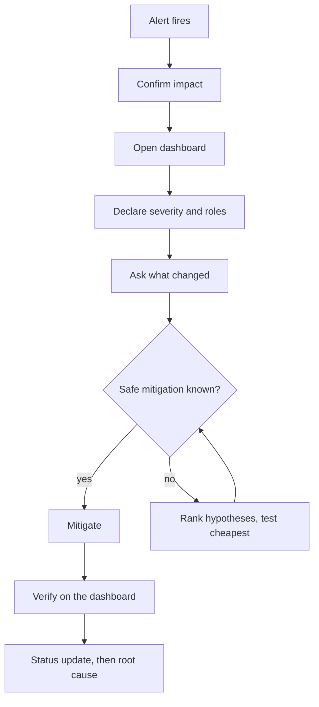

# 20.26 The stress interview: production incident role-play

## What the interviewer is testing

An interviewer says "the alert just fired, you are on call" and starts a clock. You have about 30 minutes. One candidate reported exactly this as the fourth stage of an Amsterdam SRE loop, after Linux troubleshooting, algorithms and system design. Nebius has not published the format of this stage, so ask your recruiter whether it exists in your loop.

The official interview page lists the skills that this round can touch: coding, troubleshooting and debugging, practical tasks in the Linux console, and saying your reasoning aloud. The job posting asks for incident detection, isolation and remediation with runbooks, debugging from kernel to application layer, and knowledge of how distributed back-ends fail. The Nebius chat-app case study also names the failure shapes behind half of this chapter: tail TTFT, retry amplification, and capacity that shrank silently.

The interviewer is not checking whether you find the root cause. One candidate cannot know your stack. They watch whether you take control, gather evidence in a sensible order, protect users first, and stay safe with your hands on the keyboard.

A realistic opening: "It is 14:05. The p99 time-to-first-token alert fired on the chat endpoint in eu-north. You are the on-call SRE. Talk me through what you do."

## The core ideas

### 1. Take control in the first two minutes

The interviewer finishes speaking and waits. Most candidates start typing commands or ask "what do you want me to do". Both lose the room. Silence feels long when a clock is running, so fill the first two minutes with a fixed script.

Say what is going on in this order. Confirm the impact: who is affected, how badly, since when. Ask for the dashboard. Declare a severity and say why. Name the roles you are playing. Then ask what changed.

Naming roles is not theatre. The Google SRE book chapter Managing Incidents splits the work into incident command, operations, communication and planning. Only the operations role should change the system. In an interview you play all four, so say "I am commander and ops, and I will post updates as comms". It shows you know the model.

The same chapter says to declare early. Its checklist says to treat the event as an incident if you need a second team, if customers can see the outage, or if the problem is unsolved after an hour. In the drills below, customers see the problem every time, so you declare at once. Severity numbers differ between companies. Say "SEV2 because customers see degraded latency, and I will raise it if errors start". Nebius has not published its scheme.

| Time | Say or ask | Why |
|---|---|---|
| 0:00 | "Confirming impact: who, how bad, since when?" | Systems Performance chapter 2 puts the problem statement first |
| 0:30 | "Can I see the golden-signals dashboard?" | You need rate, errors, latency and saturation |
| 1:00 | "Declaring SEV2. I am commander and ops. Comms updates every ten minutes." | Roles and cadence set early |
| 1:30 | "What changed in the last day?" | Recent change is the cheapest hypothesis |
| 2:00 | "My first mitigation options are rollback or traffic shift, pending what I see." | Shows you think about users first |



Before you touch a keyboard, say the impact, the severity and who does what.

### 2. Mitigate before you find the root cause

An engineer who knows the cause is tempting to follow. The Google SRE book chapter Effective Troubleshooting says the opposite for a major outage. Your first job is to keep the system working as well as it can, even if that means shedding load, diverting traffic or disabling features. Root cause comes after. The book compares it to a pilot who must keep the plane flying before diagnosing the fault. It also says to preserve logs and evidence while you do it.

Systems Performance, chapter 2, names three habits that waste time under pressure. The streetlight anti-method looks only where the tools are familiar. The random-change anti-method changes things until the problem goes away. The blame-someone-else anti-method hands the problem to another team without evidence. A calm incident response avoids all three.

A good mitigation has three traits. It is reversible. It is cheap to apply. It does not need the root cause to be right. Rollback, draining a bad zone, capping one tenant and flipping a feature flag fit. Redesigning a cache does not.

State the mitigation, the signal that will prove it worked, and the time you will look. Then look. A mitigation you do not verify is a guess.

Pick the lowest-risk reversible action that plausibly helps, and name the graph that will confirm it.

### 3. Narrate hypotheses in order of likelihood and cost to test

Once users are safe, or while a mitigation applies, you reason aloud. The SRE troubleshooting chapter says to test the most likely cause first and to weigh the risk of each test. It also warns that when you hear hoofbeats you should think of horses before zebras.

Use the scientific method from Systems Performance chapter 2: question, hypothesis, prediction, test, analysis. The prediction is what makes your speech convincing. "If the deploy caused this, the metric turned at 13:50 on every replica. If one bad pod caused it, only that pod shows it."

Order hypotheses by two numbers you estimate aloud: how likely it is and how cheap it is to test. A recent change is likely and costs one command. A saturated resource is likely and costs a graph. A failing dependency costs more. A kernel bug is the zebra. For resources, the USE method from the same chapter asks for utilisation, saturation and errors on each one.

Say your top three hypotheses, rank them, test the first, and say what result would kill it. Negative results are results. Say "that rules out the deploy, so I move to capacity".

### 4. Communicate status on a cadence

During a real incident, the commander who is also fixing things forgets to tell anyone. The SRE chapter makes communication its own role. In the drill, post a status update every ten minutes and one early update in the first five. The ten-minute figure is the drill's choice. It is not a Nebius rule.

A useful update has four parts: the impact now, what you know, what you are doing, and when the next update comes. Keep it to three sentences. "Impact: eu-north chat p99 TTFT is 4 seconds, no errors. We know it began with the 13:50 deploy. We are rolling back now. Next update in ten minutes at 14:25." Say it aloud even if the interviewer is the only reader.

Never post a guess as a fact. "Suspected" and "confirmed" are different words in an update.

Set a timer for the next update the moment you post one.

### 5. Know when to roll back, and avoid the destructive command

A change went out shortly before the symptoms. The SRE chapter Emergency Response describes change-induced emergencies. A reviewed configuration change still broke systems because it interacted with something unexpected. Its advice is to canary every change and to keep out-of-band tools and rollback commands that you have practised.

Roll back when the symptom began right after a change, the rollback is tested and cheap, and you do not yet know the cause. In Kubernetes the Deployment command is `kubectl rollout undo deployment/<name>`, and `kubectl rollout status` shows progress. Do not roll back blindly when the change included a one-way data migration or when your data shows the change is not the cause. Say which case you are in.

Every drill has a trap, and most traps are destructive commands. Examples in the drills: restarting every replica at once, deleting pods that are mid-download, defragmenting a live etcd member, sending EU traffic to a US region, telling clients to skip TLS verification, and editing live config that GitOps will overwrite. The SRE chapter adds a quieter one. Automation that treats an empty input as "all" can wipe a fleet.

Before you run anything risky, say what it does, how to undo it, and how far the damage can spread. If you cannot say how to undo it, say that you would ask for a second pair of eyes. That sentence scores well in this round.

If a command has no undo, stop and ask someone before you run it.

### 6. How the drill runner works

The runner in `code/part20` plays the interviewer. You type questions in plain words and it answers from a JSON file. You type commands that start with a slash to declare things. It times you, records every action, and prints a scorecard.

| Command | Meaning |
|---|---|
| `/sev N` | Declare a severity |
| `/roles text` | Name commander, ops and comms |
| `/hyp text` | State a hypothesis |
| `/do text` | Take a mitigation action |
| `/status text` | Post a status update |
| `/cause text` | State the root cause |
| `/hint` | Reveal one topic you have not asked about, costs 2 points |
| `/done` | End the drill and print the scorecard |

The scorecard has seven lines. Taking control is worth 15 points. Evidence gathered is 25. Hypotheses are 15. Mitigation is 20. Mitigating before naming the root cause is 5. Status cadence is 10. Safety is 10. The total is 100, with 85 and above called strong and 70 and above a pass. These weights are this chapter's teaching choice, not a Nebius rubric.

The session class matches your question against keyword lists. Words of three letters or fewer must match whole words, so "du" does not fire on "audio".

```python
# code/part20/ch26_session.py
"""Interviewer for the stress-interview drill: answers question keys, records the session.

Commands start with a slash. Anything else is a question to the interviewer.
  /sev N        declare severity     /roles TEXT   name incident commander, ops, comms
  /hyp TEXT     state a hypothesis   /do TEXT      take a mitigation action
  /status TEXT  post a status update /cause TEXT   state the root cause
  /hint         reveal one unasked topic (costs 2 points)   /done  end the drill
"""
import re
import time

NO_ANSWER = "I do not have that signal. Ask for a specific metric, log line or command output."


def _has(low, kw):
    """Keyword match at a word start. Keywords of three letters or fewer must be whole words."""
    tail = r"(?!\w)" if len(kw) <= 3 else ""
    return re.search(r"(?<!\w)" + re.escape(kw) + tail, low) is not None


class Session:
    def __init__(self, incident, limit_minutes=30, clock=time.monotonic):
        self.inc = incident
        self.limit = limit_minutes * 60.0
        self.clock = clock
        self.start = clock()
        self.events = []          # (seconds, kind, text)
        self.revealed = []        # question keys, in the order first answered
        self.hints = 0
        self.finished = False

    def elapsed(self):
        return self.clock() - self.start

    def log(self, kind, text):
        self.events.append((self.elapsed(), kind, text))

    def first(self, kind):
        for t, k, _ in self.events:
            if k == kind:
                return t
        return None

    def match_question(self, text):
        low = text.lower()
        best, best_score = None, 0
        for q in self.inc["questions"]:
            score = sum(1 for kw in q["keywords"] if _has(low, kw))
            if q["key"] == low.strip():
                score += 100
            if score > best_score:
                best, best_score = q, score
        return best

    def handle(self, line):
        line = line.strip()
        if not line or self.finished:
            return ""
        if self.elapsed() > self.limit:
            self.finished = True
            return "Time is up. The scorecard follows."
        if not line.startswith("/"):
            return self.ask(line)
        cmd, _, rest = line[1:].partition(" ")
        if cmd == "hint":
            return self.hint()
        if cmd == "done":
            self.finished = True
            self.log("done", "")
            return "Session ended."
        if cmd in ("sev", "roles", "hyp", "do", "status", "cause"):
            self.log(cmd, rest.strip())
            return "Noted: " + cmd + "."
        return "Unknown command. Use /sev /roles /hyp /do /status /cause /hint /done."

    def ask(self, text):
        self.log("ask", text)
        q = self.match_question(text)
        if q is None:
            return NO_ANSWER
        if q["key"] not in self.revealed:
            self.revealed.append(q["key"])
        return q["answer"]

    def hint(self):
        for q in self.inc["questions"]:
            if q["key"] not in self.revealed:
                self.hints += 1
                self.log("hint", q["key"])
                return "Hint: there is a signal about '%s'." % q["key"]
        return "Hint: you have asked about everything."
```

The scoring module turns the event log into the seven lines. It is short enough to read in full. Note how safety works. Any action or question that contains a risky phrase from the incident file costs 5 points, and the scorecard prints the reason.

```python
# code/part20/ch26_score.py
"""Scorecard for the stress-interview drill. Weights: 15 + 25 + 15 + 25 + 10 + 10 = 100."""
CADENCE_MINUTES = 10


def _hit(text, phrases):
    low = text.lower()
    return any(p in low for p in phrases)


def score_control(s):
    pts, notes = 0, []
    for kind, label in (("sev", "severity declared"), ("roles", "roles declared")):
        t = s.first(kind)
        if t is not None and t <= 120:
            pts += 5
        else:
            notes.append(label + " within 2 minutes: no")
    first_do = s.first("do")
    asked = [k for k in ("impact", "dashboard") if k in s.revealed]
    ok = len(asked) == 2
    if ok and first_do is not None:
        ok = all(_ask_time(s, k) < first_do for k in asked)
    pts += 5 if ok else 0
    if not ok:
        notes.append("asked for impact and the dashboard before acting: no")
    return pts, 15, notes

def _ask_time(s, key):
    for t, kind, text in s.events:
        if kind == "ask" and (s.match_question(text) or {}).get("key") == key:
            return t
    return float("inf")


def score_evidence(s):
    need = s.inc["must_ask"]
    got = [k for k in need if k in s.revealed]
    notes = ["never asked: " + k for k in need if k not in got]
    return round(25 * len(got) / len(need)), 25, notes


def score_hypotheses(s):
    hyps = [text for _, k, text in s.events if k == "hyp"]
    pts, notes = 0, []
    pts += 5 if len(hyps) >= 2 else 0
    if len(hyps) < 2:
        notes.append("stated fewer than two hypotheses")
    if hyps and _hit(hyps[0], s.inc["likely_first"]):
        pts += 5
    else:
        notes.append("first hypothesis was not the cheap, likely one (check what changed)")
    if any(_hit(h, s.inc["root_cause_keywords"]) for h in hyps):
        pts += 5
    else:
        notes.append("no hypothesis named the real cause")
    return pts, 15, notes


def score_mitigation(s):
    actions = [(t, text) for t, k, text in s.events if k == "do"]
    pts, notes = 0, []
    for m in s.inc["mitigations"]:
        if any(_hit(text, m["any"]) for _, text in actions):
            pts += m["points"]
        else:
            notes.append("missing: " + m["key"])
    return min(pts, 20), 20, notes


def score_order(s):
    first_do, cause = s.first("do"), s.first("cause")
    if first_do is None:
        return 0, 5, ["no mitigation action taken"]
    if cause is not None and cause < first_do:
        return 0, 5, ["named the root cause before mitigating"]
    return 5, 5, []


def score_comms(s):
    updates = len([1 for _, k, _ in s.events if k == "status"])
    end = min(s.elapsed(), s.limit)
    expected = max(1, int(end // (CADENCE_MINUTES * 60)))
    notes = [] if updates >= expected else ["%d status updates, expected %d" % (updates, expected)]
    return round(10 * min(1.0, updates / expected)), 10, notes


def score_safety(s):
    pts, notes = 10, []
    for d in s.inc["destructive"]:
        if any(_hit(text, d["any"]) for _, k, text in s.events if k in ("do", "ask")):
            pts -= 5
            notes.append("risky action: " + d["why"])
    return max(pts, 0), 10, notes


def scorecard(s):
    rows = [("Take control (first 2 min)", score_control(s)), ("Evidence gathered", score_evidence(s)),
            ("Hypotheses", score_hypotheses(s)), ("Mitigation", score_mitigation(s)),
            ("Mitigate before root cause", score_order(s)), ("Status cadence", score_comms(s)),
            ("Safety", score_safety(s))]
    total = sum(r[1][0] for r in rows) - 2 * s.hints
    return rows, max(total, 0)


def grade(total):
    return "strong" if total >= 85 else "pass" if total >= 70 else "repeat this drill"


def format_scorecard(s):
    rows, total = scorecard(s)
    out = ["Incident: " + s.inc["title"], "Elapsed: %d min %02d s" % divmod(int(s.elapsed()), 60)]
    for name, (got, top, notes) in rows:
        out.append("%-28s %2d / %2d" % (name, got, top))
        out += ["    - " + n for n in notes]
    if s.hints:
        out.append("Hints used: %d (minus %d)" % (s.hints, 2 * s.hints))
    out += ["Total: %d / 100 (%s)" % (total, grade(total)), "Root cause: " + s.inc["root_cause"],
            "Ideal mitigation: " + s.inc["ideal_mitigation"]]
    return "\n".join(out)

```

The loader checks every incident file. Each one needs impact, dashboard and change questions, a must-ask list that names real keys, and mitigation points that add to exactly 20. The command-line wrapper is `code/part20/ch26_incident_drill.py` and the ten incidents live in `code/part20/ch26_incidents.json`.

Run it, then read the scorecard like a coach would. Every missed line is a habit to rebuild.

## How to answer out loud

These are the five questions most likely to come up around this round. Rehearse the order, not the wording.

### "Walk me through the first five minutes of an alert."

Speak in this order. First confirm impact, then open the dashboard, then declare severity and roles. Then ask what changed. Then pick a reversible mitigation or rank hypotheses. Then state your first status update. Name the numbers you want to see: request rate, error rate, latency percentiles and saturation. The follow-up is usually "what if there is no dashboard". Answer: use the problem statement questions from Systems Performance, check the load balancer and the service logs, and say what you would build afterwards.

### "How do you decide between rolling back and fixing forward?"

Say that a recent change plus unknown cause means rollback, because it is cheap and reversible. Name the exceptions: an irreversible data migration, a change that already shows it is innocent, or a rollback that would itself be risky because other things depend on the new version. Say you verify with a graph after the rollback. The follow-up is "the rollback did not help". Answer: that is a result. The change was not the cause, so move to the next hypothesis, and note that you spent a few minutes to learn it.

### "The interviewer does not know the answer to your question, or gives you no data. What do you do?"

This happens in a stress round. Say what you would normally check, say what result you expect, and ask for the nearest thing they can give you. If the answer is still nothing, state an assumption aloud and move on. "I will assume the deploy log is accurate." Do not stall and do not guess silently.

### "How do you communicate during an incident?"

Describe one channel and one owner. Say the update cadence, the four parts of an update, and the habit of separating suspected from confirmed. Mention that in a big incident you would hand comms to a second person, as the Google SRE book separates those roles. The follow-up is "who do you escalate to". Name the Google SRE advice: pull in the person with the most context about what changed, and ask for help early.

### "What is the most dangerous thing you could do in this incident?"

Pick the drill's trap and say it first. Then say how you would avoid it. For a disk-full node, it is deleting image layers and the model cache. For etcd, it is defragmenting a live member. Then give the rule: say what it does, how to undo it, and the blast radius.

## Worked scenarios

These are ten scripted incidents, five for the inference platform and five general ones. All numbers inside the tables are invented for the drill. They are not measurements from Nebius or any real system. Where a metric name, command or default comes from documentation, the technical anchor says where.

To run a drill alone, open the table, cover the third column, and answer from your own head. To run it with a partner, give the partner the whole section and let them read the opening, answer from the table, and score you. Keep a timer for 30 minutes.

### Incident 1: TTFT spike after a deploy

**Interviewer opens.** "At 14:05 the p99 time-to-first-token alert fired for the chat endpoint in eu-north. Users say the model 'thinks' for several seconds before it starts to answer. You are on call. Go."

**What the interviewer reveals.** Ask about each topic in your own words. The runner matches keywords from the JSON file. A partner reading this table answers when your question touches the topic in the first column.

| Topic key | The interviewer says |
|---|---|
| `impact` | All tenants on the eu-north chat endpoint. No errors, only slow first tokens. p99 TTFT is 4.1 s against a normal 0.6 s. p50 is 0.9 s against 0.5 s. Support has six tickets. |
| `dashboard` | Request rate is flat. Error rate is 0.1%. TTFT is up and end-to-end latency is up. Inter-token latency is flat at about 25 ms. The waiting queue per replica rose from about 2 to about 30 at 13:55. |
| `change` | A deploy finished at 13:50. It moved the router and the engine image together to all 12 replicas in ten minutes. There was no canary stage. The values file was also rewritten. |
| `queue` | vllm:num_requests_waiting is about 30 per replica. Running requests sit at the batch cap. |
| `kv` | vllm:kv_cache_usage_perc is about 0.45. No preemption lines in the engine logs. No out-of-memory events. |
| `prefix` | vllm:prefix_cache_hits divided by vllm:prefix_cache_queries fell from about 0.55 to about 0.03 at 13:52. The chat product sends the same 3,000-token system prompt on every request. |
| `gpu` | GPU utilisation rose from about 70% to about 95%. The extra work is prefill. |
| `prompts` | The input and output length distributions are unchanged from yesterday. |
| `replicas` | All 12 replicas look the same. It is not one bad pod. |
| `errors` | No errors and no restarts. The logs show only normal request lines. |
| `diff` | The new router config lost the prefix-hash routing setting. Requests with the same prompt prefix are now spread across all replicas by round robin. |

**Technical anchor.** TTFT is the time for the prompt to be encoded, so it grows with prefill work and with queueing. Inter-token latency belongs to decode. That split is in Hands-On LLM Serving and Optimization, chapter 4, Model Serving Best Practices. The prefix cache counters are `vllm:prefix_cache_hits` and `vllm:prefix_cache_queries` in the vLLM metrics documentation. Nebius has published a chat-app case study where cache-aware routing raised the hit rate from about 5% to 50-60%. The rollback command is `kubectl rollout undo deployment/<name>` from the Kubernetes Deployments documentation.

**Likely root cause.** The deploy removed prefix-aware routing. The prefix cache hit rate collapsed, every request redoes the 3,000-token prefill, and the queue grows.

**Ideal mitigation.** Roll back the deploy now with kubectl rollout undo, then watch TTFT and the prefix cache hit rate recover. Diff the values file afterwards.

**Scoring rubric.** On top of the shared 100-point scorecard, this incident checks the following.

- Must ask: `impact`, `dashboard`, `change`, `queue`, `prefix`.
- Mitigation points: rollback 14, verify 6 of 20.
- Risky actions cost 5 points each: restarting every replica at once empties every KV and prefix cache at the same moment, so TTFT gets worse.
- Strong answers ask what changed before touching anything.
- Scaling out is not a fix. New replicas start with an empty prefix cache.

### Incident 2: GPU pool shrinking silently

**Interviewer opens.** "No alert fired. A customer on a dedicated endpoint says latency has crept up for three days and one request in fifty now times out. Your Kubernetes dashboard says everything is healthy. Go."

**What the interviewer reveals.** Ask about each topic in your own words. The runner matches keywords from the JSON file. A partner reading this table answers when your question touches the topic in the first column.

| Topic key | The interviewer says |
|---|---|
| `impact` | One dedicated endpoint, eight replicas of one model, one tenant. p99 latency rose from 2.0 s to 6.5 s over three days. About 2% of requests time out at peak. |
| `dashboard` | Kubernetes view: desired 8, ready 8, no alerts. The per-replica request view shows only five replicas receiving traffic. Three show zero. The five run at 95% of their batch cap. |
| `change` | No deploy for two weeks. A node pool maintenance event three days ago drained and replaced two GPU nodes. |
| `pods` | kubectl get pods shows all eight Running and Ready. Three pods show 38, 41 and 44 restarts since the maintenance event. The other five show 0. |
| `probe` | Events on the restarting pods say the liveness probe failed and the container will be restarted. The probe is an HTTP check with a 1 s timeout and a failure threshold of 1. During a large prefill the engine answers slowly. |
| `router` | The router admin view lists five registered workers. The three missing are the three restarting pods. Router logs say worker registration failed, upstream not ready, and no retry. Workers register once at startup. |
| `readiness` | Readiness passes on all eight pods after warm-up. Kubernetes counts them as ready even though the router does not know about three of them. |
| `gpu` | Five GPUs busy at about 90%. Three idle after the first minute following each restart. |
| `alerts` | Existing alerts watch pod readiness and the error rate. Nothing compares router pool size with desired replicas. |
| `capacity` | The endpoint is set to min 8 and max 8 replicas. There is no spare. |

**Technical anchor.** Production Kubernetes, chapter 14, says a liveness failure restarts the container and a readiness failure only removes the pod from the endpoints. The Nebius case study says aggressive liveness probes restarted healthy workers and that restarted workers sometimes did not rejoin the pool, so capacity shrank silently. How the router registers workers in this drill is invented. Nebius has not published its router design.

**Likely root cause.** An aggressive liveness probe restarts healthy workers during long prefills. After each restart the worker registers with the router once, fails, and never rejoins. Kubernetes says 8 of 8 while the router serves from 5.

**Ideal mitigation.** Get the three workers back into the router one at a time, loosen the liveness probe so it stops killing busy workers, and add an alert on router pool size against desired replicas.

**Scoring rubric.** On top of the shared 100-point scorecard, this incident checks the following.

- Must ask: `impact`, `dashboard`, `pods`, `probe`, `router`.
- Mitigation points: reregister 10, relax_probe 6, alert 4 of 20.
- Risky actions cost 5 points each: restarting or deleting the whole pool removes the five workers that are still serving.
- Strong answers notice that ready in Kubernetes and registered in the router are two different facts.
- Do not remove the probes. Loosen the liveness probe and keep readiness.

### Incident 3: KV-cache pressure and a 429 storm

**Interviewer opens.** "The 429 rate on a dedicated endpoint is 22% and rising, and p99 latency has tripled. Traffic is 35% above the usual peak. Product asks whether to raise the rate limits. Go."

**What the interviewer reveals.** Ask about each topic in your own words. The runner matches keywords from the JSON file. A partner reading this table answers when your question touches the topic in the first column.

| Topic key | The interviewer says |
|---|---|
| `impact` | One dedicated endpoint, one model, three tenants. 22% of requests return 429. Tenants B and C are complaining. Tenant A is not. |
| `dashboard` | Request rate is up 35%. 429 is 22%. Waiting queue per replica is about 70. KV cache usage is 98 to 100% on all six replicas. Pool output tokens per second fell 40% while requests rose. |
| `change` | No deploy. Tenant A went live with a document-summarisation feature at 10:40. |
| `source429` | The gateway per-tenant limits are not hit and the remaining-quota headers look healthy. The 429s come from the router, which sheds load when every worker's queue is over its depth limit. |
| `kv` | KV usage is pinned at 98 to 100%. Engine logs show many preemptions. Preempted requests go back to the waiting queue and prefill again. |
| `prompts` | Tenant A sends prompts of about 28,000 tokens at about 5 requests per second. Other tenants send about 1,000 tokens. The model allows 32,000. |
| `throughput` | Output tokens per second are down 40%. GPU utilisation is high. The GPUs are redoing work after preemptions. |
| `retries` | SDK clients retry a 429 up to three times and ignore Retry-After. Retries are about 30% of arrivals. |
| `limits` | Tenant A limit is 600 requests per minute and 10,000,000 tokens per minute. They use about 300 RPM and 8.4 million TPM, so they are inside both. |
| `capacity` | Max replicas is 10 and six are running. A new replica takes about 12 minutes to become ready. |

**Technical anchor.** The book gives KV cache per token as 2 x layers x heads x head dimension x bytes. For its Llama-2-7b example that is 2 x 32 x 32 x 128 x 2 = 524,288 bytes, or 0.5 MB per token. Hands-On LLM Serving and Optimization, chapter 5, Challenges When Serving LLMs. Worked here: 28,000 tokens x 0.5 MB is 14,000 MB, about 14 GB for one request. The book's L40S example fits 16 requests of 4,096 tokens in 34 GB, so one long request uses the space of about seven normal ones. The vLLM documentation says a preempted request goes back to the waiting queue and restarts its prefill. Token Factory limits are in requests and tokens per minute, and a request over the limit returns 429 with a `Retry-After` header.

**Likely root cause.** One tenant's 28,000-token prompts exhaust the KV cache. The engine preempts and recomputes, throughput collapses, the queues fill, and the router sheds load. Client retries add to the storm.

**Ideal mitigation.** Cap the long-prompt tenant by tokens per minute or concurrent long requests, start scaling out knowing it takes 12 minutes, ask clients to honour Retry-After, and tell tenant A what you did.

**Scoring rubric.** On top of the shared 100-point scorecard, this incident checks the following.

- Must ask: `impact`, `dashboard`, `source429`, `kv`, `prompts`.
- Mitigation points: limit_tenant 9, scale 5, retry 3, tenant_comms 3 of 20.
- Risky actions cost 5 points each: the router shedding is protecting the pool, and removing it turns 429s into timeouts and out-of-memory kills; a restart empties all in-flight work and makes the 429s worse.
- Strong answers separate who returns the 429 from why. A request-per-minute limit cannot see a long prompt. A token limit can.
- Saying 'raise the limits' is the wrong instinct. The pool is full.

### Incident 4: Regional partial outage with retry amplification

**Interviewer opens.** "Error rate on the eu-west regional endpoint is 15% and climbing. User traffic is flat. Gateways are at three times their normal CPU. Upstream request rate is four times the user request rate. Go."

**What the interviewer reveals.** Ask about each topic in your own words. The runner matches keywords from the JSON file. A partner reading this table answers when your question touches the topic in the first column.

| Topic key | The interviewer says |
|---|---|
| `impact` | eu-west only, all tenants. 15% of requests fail with 503 or time out. eu-north is fine. These tenants are bound to EU data residency. |
| `dashboard` | Three zones, a, b and c. Zone b workers show errors and timeouts. Zones a and c are healthy but their queues are growing. User traffic is 1,000 requests per second. Gateway-to-router attempts are 4,000 per second. |
| `change` | No deploys. The cloud provider status page shows a degraded network in zone b that started ten minutes ago. |
| `retries` | The SDK retries up to three times. The gateway retries failed upstream calls up to three times. The router retries on another worker up to three times. There is no retry budget. Backoff is a fixed 100 ms with no jitter. |
| `zones` | Zone b holds 4 of 12 workers, all failing health checks intermittently on the network. Zones a and c hold 8 workers at 92% KV usage because they absorb the retries. |
| `capacity` | Zones a and c can carry the real user load at about 85% of capacity if the retries stop. They cannot carry user load plus four times the attempts. |
| `failover` | eu-north has 15% headroom. A teammate proposes sending the overflow to the US region, which is idle. The affected tenants are bound to EU residency. |
| `health` | Liveness probes on zone b workers flap. Kubernetes restarts some, and they come back and fail again. |
| `lb` | You can set the zone b weight to zero at the load balancer with one command. |
| `timeouts` | Client, gateway and router timeouts are all 60 seconds. |

**Technical anchor.** The Google SRE book chapter Addressing Cascading Failures shows three layers each making 3 retries, which is 4 attempts per layer and 4 x 4 x 4 = 64 attempts on the database. It suggests randomized exponential backoff, a per-process retry budget with an example of 60 retries per minute, and load shedding. Nebius says Token Factory has EU and US regions with data residency, and its chat-app case study says retry logic was changed to stop amplification in partial outages. The zone layout and the retry counts here are invented.

**Likely root cause.** A degraded zone b network started the failures. Unbudgeted retries at three layers multiplied the load, up to 4 x 4 x 4 = 64 attempts per user request, so the healthy zones saturated and a partial outage became a regional one.

**Ideal mitigation.** Stop the amplification first by cutting or budgeting retries at the gateway and router. Drain zone b at the load balancer. Shed load early if zones a and c still saturate. Keep traffic inside the EU.

**Scoring rubric.** On top of the shared 100-point scorecard, this incident checks the following.

- Must ask: `impact`, `dashboard`, `change`, `retries`, `zones`.
- Mitigation points: stop_retries 8, drain_zone 8, shed 4 of 20.
- Risky actions cost 5 points each: moving EU-resident traffic to the US region breaks the data residency promise; restarting or adding gateways adds more retry load and drops in-flight work.
- Strong answers name the multiplication across layers and say which layer to cut first.
- Data residency is a hard constraint. Name it before anyone suggests a US failover.

### Incident 5: Model weights download stuck at cold start

**Interviewer opens.** "The autoscaler added four replicas of a 70B model 25 minutes ago because the existing four are saturated. None is Ready. The new pods show 0/1 and a rising restart count. Go."

**What the interviewer reveals.** Ask about each topic in your own words. The runner matches keywords from the JSON file. A partner reading this table answers when your question touches the topic in the first column.

| Topic key | The interviewer says |
|---|---|
| `impact` | One dedicated endpoint. Four ready replicas at 97% KV usage. p99 latency is up 2x and 5% of requests return 429. Traffic is a morning peak, 40% over yesterday. |
| `dashboard` | Desired 8, ready 4. Waiting queue about 40 per ready replica. New pods are Running 0/1 with two or three restarts each. |
| `change` | No deploy. The autoscaler fired on queue depth. The four new pods landed on two GPU nodes that joined the pool 30 minutes ago. |
| `logs` | Pod logs say downloading shard 12 of 30. Then nothing for minutes. Then the container is killed and the log starts again at shard 1. |
| `events` | Events say the startup probe failed and the container will be restarted. The startup probe allows 10 minutes in total. The last termination reason is not out of memory. |
| `speed` | Each pod pulls at about 20 MB per second. The model is about 140 GB in 30 shards. |
| `store` | The object store sends occasional throttle responses. The downloader backs off for a long time after each one. |
| `cache` | Weights are fetched from the object store at every container start into the container's own writable layer. There is no node-local cache and no shared volume. The new nodes have nothing warm. |
| `history` | Last week's scale-out used a node image with the weights pre-pulled and took about 6 minutes. The new nodes use the plain image. |

**Technical anchor.** LLMs in Production, chapter 3, says a large model can take a very long time to download and load, and that downloading at run time is a poor fit for LLMs. Chapter 6 lists the options: fusing a bucket, baking weights into the image, a mounted volume, and a hybrid that downloads once to a volume. The vLLM troubleshooting page says to download the model first and to prefer a local disk over a shared filesystem. Worked here: 140 GB is 140,000 MB, and at 20 MB per second that is 7,000 seconds, about two hours. Production Kubernetes, chapter 14, shows a startup probe with 30 failures at 10 seconds, which is 300 seconds. The Token Factory capacity page says an endpoint can sit in Starting or Partially ready until capacity is available.

**Likely root cause.** The new nodes have no local copy of the weights. A pod needs about 140,000 MB at 20 MB per second, which is 7,000 seconds or about two hours. The startup probe kills it at ten minutes and the download restarts from shard 1.

**Ideal mitigation.** Stop the restart loop by giving the startup probe enough time, protect the four ready replicas with load shedding or per-tenant limits, and fix the cold start with a pre-pulled or shared weights volume.

**Scoring rubric.** On top of the shared 100-point scorecard, this incident checks the following.

- Must ask: `impact`, `dashboard`, `logs`, `events`, `cache`.
- Mitigation points: stop_loop 7, protect 7, warm_cache 6 of 20.
- Risky actions cost 5 points each: deleting a pod restarts the download from shard 1, and more pods share the same slow object store path.
- Strong answers do the arithmetic: 140 GB at 20 MB per second is about two hours, far past a ten-minute probe.
- Adding more replicas makes it worse. Say why.

### Incident 6: Disk full on a GPU node

**Interviewer opens.** "Alert: DiskPressure on GPU node gpu-17. Two pods were evicted. A vLLM replica on it restarted and now crashes at start with 'No space left on device'. Get the node healthy. Go."

**What the interviewer reveals.** Ask about each topic in your own words. The runner matches keywords from the JSON file. A partner reading this table answers when your question touches the topic in the first column.

| Topic key | The interviewer says |
|---|---|
| `impact` | One node of a 40-node pool. One of 8 replicas of a dedicated endpoint is down. The endpoint serves on 7 of 8 with latency up 15%. |
| `dashboard` | Node view: root filesystem 100% used. CPU and memory normal. Other nodes under 60% disk. |
| `change` | Last night an engineer set VLLM_LOGGING_LEVEL=DEBUG on that replica to chase a stall. The Deployment was patched at 22:00. |
| `df` | df -h: 100G size, 100G used, 0 available, 100%. df -i: 12% of inodes used. |
| `du` | du -xh --max-depth=2 /var shows /var/log/pods 18 GB and /var/lib/containerd 22 GB. That is about 40 GB, far less than the 100 GB that df reports as used. |
| `deleted` | lsof +L1 shows the engine process holding /var/log/vllm/engine.log (deleted), 58 GB. A cleanup cron removed the file at 02:00. The process still writes to it. |
| `node` | describe node shows the DiskPressure condition true. The kubelet evicted two low-priority batch pods. |
| `images` | /var/lib/containerd holds images and a 22 GB model cache that running replicas on the node use right now. |
| `others` | Other pods on the node serve traffic. You may cordon the node. |

**Technical anchor.** Systems Performance, chapter 8, File Systems, describes the inode as the object that holds a file's metadata, so a disk can be full of space or full of inodes. The Kubernetes node-pressure eviction page says the kubelet watches nodefs.available and nodefs.inodesFree, reclaims space first, then evicts pods. The vLLM troubleshooting page names `VLLM_LOGGING_LEVEL=DEBUG` for more logging. I ran the deleted-but-open demonstration on macOS in the lab below.

**Likely root cause.** Debug logging wrote 58 GB to a file that a cleanup job then deleted. The process still holds it open, so the space is not freed. du cannot see the file. df can.

**Ideal mitigation.** Cordon the node, free the held file by restarting its holder or truncating through /proc, turn debug logging off, then add a disk alert and fix the cleanup job.

**Scoring rubric.** On top of the shared 100-point scorecard, this incident checks the following.

- Must ask: `impact`, `dashboard`, `df`, `du`, `deleted`.
- Mitigation points: cordon 4, free_space 9, debug_off 4, follow_up 3 of 20.
- Risky actions cost 5 points each: wiping images and the model cache slows recovery and does not free the file that is held open.
- Strong answers use the du versus df gap as the clue and say why it points to a deleted but open file.
- Check inodes too. Here they are fine, which rules out inode exhaustion.

### Incident 7: Certificate expiry

**Interviewer opens.** "At 09:00 UTC the support queue fills with 'certificate has expired' from clients calling the public API. Your internal dashboards load fine. Go."

**What the interviewer reveals.** Ask about each topic in your own words. The runner matches keywords from the JSON file. A partner reading this table answers when your question touches the topic in the first column.

| Topic key | The interviewer says |
|---|---|
| `impact` | All external clients of api.example.test in every region fail. Internal traffic is fine. Clients that skip verification still work. |
| `dashboard` | Request rate from strict clients fell to near zero at 09:00:00. Backend error rate is 0 because requests never arrive. The edge shows TLS handshake failures. |
| `change` | No deploy. Nothing changed at 09:00 except the clock. |
| `cert` | openssl x509 -noout -enddate on the served certificate gives notAfter=Nov 9 08:59:59 2026 GMT. It was issued 90 days ago by an ACME CA through cert-manager. |
| `renew` | kubectl describe certificate shows Ready False. Renewal attempts have failed for 30 days. The order fails at the DNS-01 challenge with an authentication error from the DNS provider API. |
| `why` | The DNS provider API token used by the solver was rotated 31 days ago in the secrets manager. The cluster secret still holds the old token. |
| `alert` | No alert on days to expiry. cert-manager failures were not routed to anyone. |
| `others` | kubeadm certs check-expiration shows the control plane certificates with over 200 days left. A wildcard certificate for the console expires in 6 days and uses the same renewal path. |
| `workaround` | With a working token you can request a certificate manually and load it into the TLS Secret. The ingress controller reloads Secret changes. |

**Technical anchor.** The kubeadm certificate page gives one year for leaf certificates, ten years for the CA, and `kubeadm certs check-expiration`. The cert-manager documentation says the default duration is 90 days, renewal starts two thirds of the way through, `cmctl renew` forces a renewal, and deleting the Secret is not a recommended way to rotate. Production Kubernetes, chapter 10, Identity, says certificates are kept short and therefore need constant renewal.

**Likely root cause.** The renewal has failed for 30 days because a rotated DNS provider token was never updated in the cluster. Nothing alerted on days to expiry.

**Ideal mitigation.** Update the DNS provider token, force a renewal with cmctl renew, verify from outside with openssl s_client, install an emergency manual certificate if renewal is slow, then fix the six-day certificate and add an expiry alert.

**Scoring rubric.** On top of the shared 100-point scorecard, this incident checks the following.

- Must ask: `impact`, `dashboard`, `cert`, `renew`, `why`.
- Mitigation points: fix_and_renew 10, manual_cert 4, verify 3, others 3 of 20.
- Risky actions cost 5 points each: telling clients to skip verification removes the protection the certificate gives and trains them to ignore it; deleting the Secret makes the ingress fall back to a default certificate and the cert-manager docs do not recommend it for rotation.
- Strong answers check the second certificate that expires in six days.
- Never tell customers to turn verification off.

### Incident 8: DNS: intermittent resolution failures

**Interviewer opens.** "Gateway pods log 'Temporary failure in name resolution' on about one request in twenty. It began 20 minutes ago. Overall traffic is normal. Go."

**What the interviewer reveals.** Ask about each topic in your own words. The runner matches keywords from the JSON file. A partner reading this table answers when your question touches the topic in the first column.

| Topic key | The interviewer says |
|---|---|
| `impact` | The gateway in one cluster. About 5% of requests fail with 502 because the token validation call cannot resolve its host. The inference path itself works. |
| `dashboard` | Gateway errors 5%. CoreDNS has two replicas with CPU at the limit and throttled. Query rate is 12,000 per second, up from 3,000. DNS latency p99 is up to 2 s and some queries time out. |
| `change` | A gateway release at 10:05 added a per-request call to an external identity provider, idp.example.test. |
| `resolv` | The pod's /etc/resolv.conf has nameserver 10.0.0.10, three search domains and options ndots:5. |
| `queries` | With the CoreDNS log plugin briefly on: for each lookup of idp.example.test the pod first asks for the name with each search suffix. Those return NXDOMAIN. Then the real name is asked. |
| `coredns` | kubectl get pods -n kube-system -l k8s-app=kube-dns shows two Running. The CPU limit is 200m and the pods are throttled. |
| `cache` | There is no NodeLocal DNSCache. |
| `upstream` | The upstream resolver is healthy. Queried directly from a node it answers in 5 ms. |
| `test` | From a dnsutils pod, nslookup kubernetes.default works but sometimes takes 1.5 s. An external name alone sometimes times out. |

**Technical anchor.** Production Kubernetes, chapter 6, Service Routing, explains that with ndots set to 5 a name with fewer dots is tried with each search suffix first, so external names cause several useless queries. It suggests a trailing dot, `dnsConfig`, and NodeLocal DNSCache. The Kubernetes DNS debugging page gives the dnsutils pod, `nslookup kubernetes.default`, and `kubectl get pods --namespace=kube-system -l k8s-app=kube-dns`.

**Likely root cause.** The new per-request lookup of an external name, with ndots 5, multiplies each lookup into several queries. Throttled CoreDNS replicas cannot keep up, so some queries time out.

**Ideal mitigation.** Reduce the load: roll back or flag off the new lookup, scale CoreDNS and lift its CPU limit, and use a fully qualified name with a trailing dot or a lower ndots through dnsConfig. Plan NodeLocal DNSCache afterwards.

**Scoring rubric.** On top of the shared 100-point scorecard, this incident checks the following.

- Must ask: `impact`, `dashboard`, `change`, `resolv`, `queries`.
- Mitigation points: rollback_or_flag 6, scale_coredns 6, fewer_queries 6, nodelocal 2 of 20.
- Risky actions cost 5 points each: removing every CoreDNS pod at once breaks DNS for the whole cluster, and hard-coded hosts entries go stale.
- Strong answers explain why one lookup becomes several queries.
- Test from a pod, not from your laptop. Pod DNS has its own resolver settings.

### Incident 9: etcd latency

**Interviewer opens.** "kubectl get takes eight seconds. Rollouts and the autoscaler are stalling. The API server logs 'etcdserver: request timed out'. Inference traffic is still being served. Go."

**What the interviewer reveals.** Ask about each topic in your own words. The runner matches keywords from the JSON file. A partner reading this table answers when your question touches the topic in the first column.

| Topic key | The interviewer says |
|---|---|
| `impact` | The control plane is degraded. Running pods keep serving. New pods are not created, autoscaling decisions are late and node status updates lag. If traffic spikes, the cluster cannot add capacity. |
| `dashboard` | API server p99 request latency is 8 s. etcd had 6 leader changes in 30 minutes. wal_fsync_duration_seconds p99 is 180 ms on member 2 and about 6 ms on the others. Member 2 is the leader most of the time. |
| `change` | No deploys. A nightly backup job started at 02:00. The incident began at 02:05. |
| `logs` | etcd logs on member 2 say failed to send out heartbeat on time and apply entries took too long. Leader elections follow. |
| `disk` | iostat on member 2 shows the device at 100% utilisation with high write await. Member 2 shares that disk with API server logs, and the backup job writes a 40 GB copy to the same device. |
| `db` | Database size is 3.1 GB against an 8 GB quota. etcdctl alarm list shows no alarms. |
| `members` | Three members, all healthy, quorum intact. Only member 2 is slow. |
| `layout` | etcd runs colocated with the API server on three control-plane VMs. |
| `network` | Round trip between members is under 1 ms with no packet loss. |

**Technical anchor.** The etcd FAQ says to watch `wal_fsync_duration_seconds` and that p99 should be under 10 ms. It also says the heartbeat warning means a slow disk, CPU starvation or a slow network, and that apply entries took too long means an average apply over 100 ms. The etcd maintenance page says defragmenting a live member blocks reads and writes. Production Kubernetes, chapter 2, Deployment Models, says workloads without a dependency on the Kubernetes API should not suffer when etcd is slow.

**Likely root cause.** The nightly backup writes 40 GB to the same disk as the etcd leader's write-ahead log. Fsync latency is 180 ms against the 10 ms the etcd FAQ asks for, so heartbeats are missed and leadership flaps.

**Ideal mitigation.** Stop the backup job competing for the leader's disk, confirm fsync p99 and leader changes settle, then move the backup to its own disk or throttle it. Do not defragment or restart members during the incident.

**Scoring rubric.** On top of the shared 100-point scorecard, this incident checks the following.

- Must ask: `impact`, `dashboard`, `change`, `logs`, `disk`.
- Mitigation points: stop_job 10, verify 4, follow_up 6 of 20.
- Risky actions cost 5 points each: defragmenting a live member blocks reads and writes, and restarting or removing members forces more elections.
- Strong answers say that running pods keep serving but nothing can change, and what that means for autoscaling.
- Defragmentation is the classic wrong move. It blocks the member.

### Incident 10: Bad config push

**Interviewer opens.** "It is 11:44. The 5xx rate at the API gateway is 100% in eu-north and climbing in eu-west. A config sync from the GitOps automation finished at 11:42. You are on call. Go."

**What the interviewer reveals.** Ask about each topic in your own words. The runner matches keywords from the JSON file. A partner reading this table answers when your question touches the topic in the first column.

| Topic key | The interviewer says |
|---|---|
| `impact` | All tenants in eu-north see 100% 503. eu-west is at 30% and rising. The US regions are not affected yet. |
| `dashboard` | The gateway returns 503 with no healthy upstream for every model. Workers are healthy and idle. The request rate reaching workers in eu-north dropped to zero. |
| `change` | Yes. A config sync at 11:42 changed the routing table. It rolled to eu-north, then eu-west at 11:44, and the US regions are scheduled for 11:50. There is no canary stage. A bot account merged it from a generator. |
| `diff` | The generated routing file has an empty upstreams list for every model. The generator read an empty service-discovery export and treated it as no workers. Validation passed because an empty list is valid. |
| `pipeline` | The sync can be paused with one click in the GitOps controller. The next region is scheduled in six minutes. |
| `lastgood` | The previous commit is known good and was deployed three days ago. |
| `access` | You have cluster access and the GitOps UI is up. |
| `workers` | Workers are healthy and ready with no restarts. |

**Technical anchor.** The Google SRE book chapter Emergency Response describes a change-induced emergency where a reviewed change still broke things, advises canarying every change, and keeping out-of-band tools for rollbacks. Its process-induced example is automation that treated an empty input as all machines. Here an empty export became an empty routing table.

**Likely root cause.** A generator turned an empty service-discovery export into a routing table with no upstreams. The pipeline had no canary, so the empty list reached every region in minutes.

**Ideal mitigation.** Pause the sync before the next region, revert to the last known good commit through the same pipeline, verify the 503 rate falls in each region, then add validation and a canary stage.

**Scoring rubric.** On top of the shared 100-point scorecard, this incident checks the following.

- Must ask: `impact`, `dashboard`, `change`, `diff`, `pipeline`.
- Mitigation points: pause 8, revert 9, verify 3 of 20.
- Risky actions cost 5 points each: editing live config fights the GitOps controller, which will overwrite it, and deleting the gateway removes the last working pieces.
- Stopping the spread comes before the revert. Strong answers say both in that order.
- Fix forward is wrong under pressure. Revert.

## Hands-on lab

All steps run in `code/part20` unless stated. I ran steps 1 to 4, 6 and 8 on macOS with Python 3.12. Step 5 is interactive and step 7 needs Linux. I did not run those, and the Docker daemon was not running on this Mac.

1. List the incidents.

```bash
cd code/part20
python3 ch26_incident_drill.py list
```

Expected and observed: ten lines, numbered 1 to 10, five marked `inference` and five marked `general`.

2. Replay a strong run against incident 1 with timestamps.

```bash
python3 ch26_incident_drill.py replay ttft-after-deploy samples/ch26_ttft_replay.txt
```

Observed: `Total: 100 / 100 (strong)`, with every line at full marks and an elapsed time of 18 min 20 s.

3. Replay a weak run: name the cause at once, then restart everything.

```bash
printf '5|/cause probably the cache\n20|/do restart all pods\n40|/done\n' > /tmp/weak.txt
python3 ch26_incident_drill.py replay ttft-after-deploy /tmp/weak.txt
```

Observed: `Total: 5 / 100 (repeat this drill)`. The scorecard lists every missed habit and prints the reason that restarting all replicas is risky.

4. Run the unit tests.

```bash
python3 -m pytest test_ch26_incident_drill.py -q
```

Observed: 32 passed. They include one test per incident that builds a model answer from the JSON and checks it scores at least 85.

5. Run a solo drill. Not run interactively here. Pick an incident, start a 30-minute clock, and type your questions.

```bash
python3 ch26_incident_drill.py run disk-full-node --minutes 30
```

Expected shape: the interviewer opening, a prompt showing elapsed time, answers to your questions, and a scorecard after `/done`.

6. Reproduce the deleted-but-open file from incident 6. On macOS, `lsof +L1` lists open files whose link count is below one.

```bash
head -c 5000000 /dev/zero > big.log
tail -f big.log > /dev/null &
rm big.log
lsof +L1 | awk 'NR==1 || /big.log/'
```

Observed: one row for `tail` with `NLINK` 0 and size 5000000 on `big.log`. On Linux the name column usually ends with `(deleted)`. Not run on Linux. Stop the background job afterwards with `kill %1`.

7. Linux version of step 6 for the disk-full story. Not run. In a container with `--cap-add SYS_ADMIN`, mount a small tmpfs, fill it, then compare `du` with `df`.

Expected shape: `df -h` shows the filesystem full, `du` shows less than `df` after the file is deleted while a process holds it open, and `df -i` shows inode use separately.

8. Check the certificate habit from incident 7 with a local self-signed certificate.

```bash
openssl req -x509 -newkey rsa:2048 -nodes -keyout k.pem -out c.pem -subj /CN=api.example.test -days 1
openssl x509 -in c.pem -noout -enddate
openssl x509 -in c.pem -noout -checkend 86400
```

Observed: a `notAfter` date one day ahead, then `Certificate will expire` with exit status 1, because the certificate expires inside the 86,400 seconds you asked about. With `-checkend 0` it printed `Certificate will not expire` and exit status 0.

## Drill questions

Answer each one aloud before you open it.

1. What do you say in the first two minutes of an incident drill?

<details><summary>Answer</summary>

Confirm the impact. Ask for the dashboard. Declare a severity with a reason. Name the roles you are playing. Ask what changed. Then say your first mitigation options.

</details>

2. Why mitigate before you know the root cause?

<details><summary>Answer</summary>

The Google SRE troubleshooting chapter says in a major outage you keep the system working first, even by shedding load or disabling features. Users are hurt while you diagnose. Evidence is preserved while you mitigate.

</details>

3. TTFT p99 jumped after a deploy and the prefix cache hit rate fell from 0.55 to 0.03. What do you do?

<details><summary>Answer</summary>

Roll back with `kubectl rollout undo deployment/<name>` and check `kubectl rollout status`. Then watch TTFT and the hit rate recover. Diff the router config afterwards. Do not restart every replica, which empties every cache at once.

</details>

4. Kubernetes shows 8 of 8 pods ready, yet three replicas get no traffic. What explains it?

<details><summary>Answer</summary>

Ready in Kubernetes comes from the readiness probe. The router keeps its own pool, and the three workers never rejoined after liveness restarts. Re-register them one at a time, loosen the liveness probe, and alert on router pool size against desired replicas.

</details>

5. How many bytes of KV cache does one token need in the book's Llama-2-7b example, and what does a 28,000-token prompt need?

<details><summary>Answer</summary>

2 x 32 layers x 32 heads x 128 head dimension x 2 bytes is 524,288 bytes, about 0.5 MB per token. A 28,000-token prompt needs about 14,000 MB, so roughly 14 GB for that one request.

</details>

6. Three layers each retry three times. How many attempts reach the backend for one user request?

<details><summary>Answer</summary>

Each layer makes up to four attempts, so 4 x 4 x 4 is 64. The Google SRE cascading-failures chapter uses this example. Fix it with a retry budget, randomized exponential backoff, and retries in only one layer.

</details>

7. `du` says 40 GB is used and `df` says 100 GB. What is the likely cause and the fix?

<details><summary>Answer</summary>

A process holds a deleted file open, so the space is not freed. `lsof +L1` finds it. Free the space by stopping the holder or truncating the file through its `/proc` descriptor. Then turn off the noisy logging and add a disk alert.

</details>

8. What does the etcd FAQ say about WAL fsync latency, and what is the classic wrong move on a slow etcd?

<details><summary>Answer</summary>

Watch `wal_fsync_duration_seconds`, and p99 should be under 10 ms. The wrong move is defragmenting a live member, which blocks reads and writes. Stop the competing disk load first.

</details>

9. Why does a Kubernetes pod that resolves an external name create several DNS queries?

<details><summary>Answer</summary>

With `ndots:5`, a name with fewer than five dots is tried with each search suffix before the real name. Those extra queries return NXDOMAIN. Use a fully qualified name with a trailing dot, set `dnsConfig`, or add NodeLocal DNSCache.

</details>

10. A config push breaks every region one after another. What is the order of your actions?

<details><summary>Answer</summary>

Pause the sync first so it cannot reach the next region. Revert to the last known good commit through the same pipeline. Verify the error rate falls in each region. Afterwards add validation and a canary stage. Do not edit the live config, because GitOps overwrites it.

</details>

## Common mistakes and weak answers

| Weak answer | What loses points | Say instead |
|---|---|---|
| Starting to type commands at once | No control, no impact check | "Confirming impact first, then the dashboard" |
| "I would look at the logs" | Streetlight habit, no hypothesis | "I expect the logs to show X if hypothesis A is true" |
| Naming a root cause in minute three | Guessing, and mitigation delayed | Mitigate, then say "suspected" until you verify |
| Scaling out as the first move | Hides the cause, and cold replicas are slow | Ask why capacity is short, check cold-start time |
| Raising rate limits to stop 429s | Removes protection | Find who returns the 429 and why |
| Silence while thinking | The interviewer cannot score you | Narrate the ranked hypotheses |
| No status update | Communication role missing | Post impact, known, doing, next update |
| Running a command you cannot undo | Safety failure | Say what it does, how to undo it, the blast radius |
| Refusing to roll back until sure | Users stay hurt | Roll back on a recent change when it is tested and cheap |
| Blaming another team | Anti-method from Systems Performance | Ask for data and name the evidence |

## Connections to the rest of the handbook

- [17.11 Incident response and game days](../part-17-operations/11-incident-response-and-game-days.md) covers severity levels, the commander role and game days. This chapter adds the interview format.
- [17.15 On-call runbooks](../part-17-operations/15-on-call-runbooks.md) is where the mitigations above live as written steps.
- [17.7 Failure modes and detection](../part-17-operations/07-failure-modes-and-detection.md) and [17.6 Alerting, SLOs and health checks for GPU clusters](../part-17-operations/06-alerting-slos-and-health-checks-for-gpu-clusters.md) explain the alerts that open these drills.
- [20.3 Triage method for a sick Linux box](03-triage-method-for-a-sick-linux-box.md) and [20.5 CPU, memory, disk and the scheduler](05-cpu-memory-disk-and-the-scheduler.md) give the commands for incident 6 and the USE method.
- [20.6 Network debugging from socket to switch](06-network-debugging-from-socket-to-switch.md), [2.8 DNS in depth](../part-02-networking/08-dns-in-depth-resolution-records-resolvers-and-caching.md) and [2.10 HTTP, TLS and PKI basics](../part-02-networking/10-http-tls-and-pki-basics.md) support incidents 7 and 8.
- [20.12 Estimation toolkit for inference capacity](12-estimation-toolkit-for-inference-capacity.md), [20.13 Design a multi-tenant LLM inference API](13-design-a-multi-tenant-llm-inference-api.md), [20.18 How LLM serving fails](18-how-llm-serving-fails.md) and [20.19 SLIs, SLOs and alerts for token APIs](19-slis-slos-and-alerts-for-token-apis.md) hold the inference background for incidents 1 to 5.
- [5.9 The kubelet and the node](../part-05-kubernetes/09-the-kubelet-and-the-node-cri-cgroups-qos-classes-probes-and-eviction.md), [5.11 DNS and service discovery with CoreDNS](../part-05-kubernetes/11-dns-and-service-discovery-with-coredns.md), [5.20 Upgrades, etcd backup and restore, and disaster recovery](../part-05-kubernetes/20-upgrades-etcd-backup-and-restore-and-disaster-recovery.md) and [5.21 Certificates, identity, admission control and policy](../part-05-kubernetes/21-certificates-identity-admission-control-and-policy.md) cover probes, DNS, etcd and certificates.
- [15.15 Autoscaling inference](../part-15-inference/15-autoscaling-inference-hpa-keda-and-scale-to-zero.md) and [15.16 Production serving stack and reliability](../part-15-inference/16-production-serving-stack-and-reliability.md) cover scale-out and cold starts.
- Chapters 20.21 (routing and retries), 20.23 (Kubernetes failure drills) and 20.27 (post-mortem and on-call) are planned in the volume plan and may not be written yet.

## Sources and review notes

Fetched on 2026-11-09 unless stated.

- Google SRE book, Managing Incidents: https://sre.google/sre-book/managing-incidents/
- Google SRE book, Emergency Response: https://sre.google/sre-book/emergency-response/
- Google SRE book, Effective Troubleshooting: https://sre.google/sre-book/effective-troubleshooting/
- Google SRE book, Postmortem Culture: https://sre.google/sre-book/postmortem-culture/
- Google SRE book, Addressing Cascading Failures: https://sre.google/sre-book/addressing-cascading-failures/
- Systems Performance, 2nd edition: chapter 2 Methodologies, chapter 8 File Systems.
- Production Kubernetes: chapter 2 Deployment Models, chapter 6 Service Routing, chapter 10 Identity, chapter 14 Application Considerations.
- Hands-On LLM Serving and Optimization: chapter 4 Model Serving Best Practices, chapter 5 Challenges When Serving LLMs.
- LLMs in Production: chapter 3 Large language model operations, chapter 6 Large language model services.
- vLLM metrics design page and troubleshooting page, stable documentation: https://docs.vllm.ai/en/stable/design/metrics.html and https://docs.vllm.ai/en/stable/usage/troubleshooting.html. The metrics page names `vllm:kv_cache_usage_perc`, `vllm:prefix_cache_hits`, `vllm:prefix_cache_queries` and says a preempted request restarts its prefill. Metric names change between vLLM versions, so check them against the version you run.
- Kubernetes documentation: Deployments (rollout commands), kubeadm certificate management, DNS debugging resolution, scheduling GPUs, node-pressure eviction.
- etcd 3.5 documentation: FAQ, maintenance, hardware, monitoring.
- cert-manager Certificate documentation: https://cert-manager.io/docs/usage/certificate/
- Nebius Token Factory documentation: rate limits and capacity pages under https://docs.tokenfactory.nebius.com/ai-models-inference/. Plan section 1 for the interview process, the Amsterdam report and the chat-app case study, which is tagged vendor.

**Explicitly labelled inferences.** The ten scenarios, their numbers and their root causes are invented teaching material. The 100-point rubric, the ten-minute status cadence and the severity example are this chapter's own design. How a router registers workers and how a gateway generates routing tables are my reasoning, not Nebius facts. Nebius has not published its incident process, severity scheme or router design.

**Not verified.** The interactive `run` mode was not exercised by hand. The tests drive the same session code with a fake clock. Linux-only commands such as `lsof +L1` output with `(deleted)`, `df -i` and `du` were not run because Docker was not available. The Kubernetes eviction defaults and the taint names on a pressured node were not confirmed from the page, so this chapter does not state them. The `kubectl rollout undo` text came from the standard Deployments page and the fetch of the rollback section was truncated, so check it against your cluster version.
