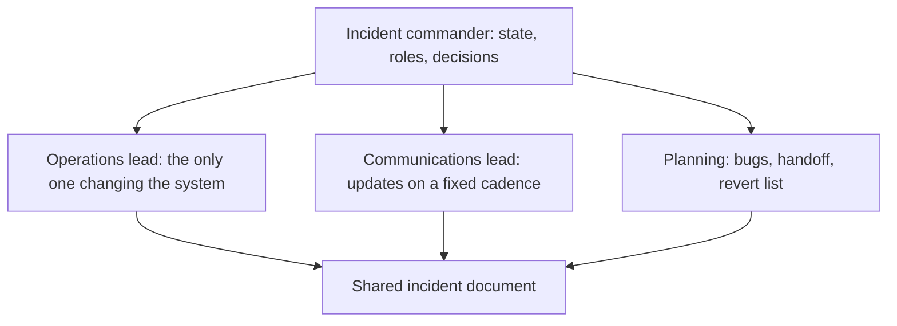
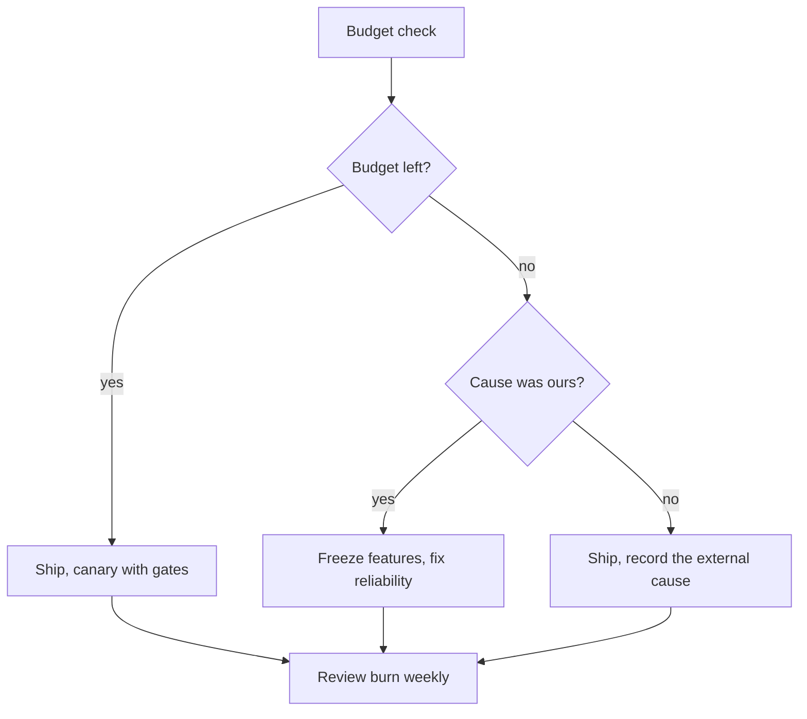

# 20.27 Post-mortems, on-call and incident leadership

## What the interviewer is testing

The interviewer says: "Tell me about an incident you led." You have about three minutes. They are listening for numbers, for decisions you made under pressure, and for what you changed afterwards. Many strong engineers fail here because they tell a story about the system and forget to tell a story about themselves.

This chapter serves two stages of the loop. It sharpens the production-incident stress round, covered in 20.26, and it prepares the behavioural questions that follow your project deep dive. The job posting asks you to "detect, isolate and remediate incidents quickly using automation and runbooks, then lead post-mortems to prevent recurrence". It also asks you to "work with software engineers to make reliability a built-in feature". Each phrase maps to a section below.

Nebius has not published its on-call setup, its severity levels or its post-mortem template. Everything here about how a team could work comes from the Google SRE book and workbook, and from the gem books. Treat the severity table and the post-mortem template as examples to adapt, and say so in the interview.

A realistic question in the interviewer's voice: "Tell me about the worst incident you have led. What was the impact, what did you decide, and what is different now because of it?"

## The core ideas

### 1. A behavioural answer about an incident is a short report with numbers

You are asked about a past outage. The common failure is a long, chronological story that ends with "and then we fixed it". The interviewer learns nothing about your judgement. They cannot tell whether the incident was small or large, or whether you led it or watched it.

Use a five-part shape, adapted from the STAR pattern for SRE work. Say the **impact in numbers**: who was affected, how badly, for how long. Say your **role**: commander, operator, or one of several. Say two or three **decisions** you made, each with the alternative you rejected and why. Say the **result** in time to mitigate and time to resolve. Finish with **what you changed**, with one measurable outcome.

| Part | What to say | A number to include |
|---|---|---|
| Impact | Who, how bad, since when | Share of requests, minutes, error budget used |
| Role | What you owned and what you delegated | Team size, roles filled |
| Decisions | Two or three choices, with the rejected option | Time each decision took |
| Result | How you mitigated, then resolved | Minutes to detect, mitigate, resolve |
| Change | The fix that stops it recurring | Alert window, gate, drill time |

Mitigation comes before root cause in the Google SRE book chapter Effective Troubleshooting. Its triage step says to keep the system running as well as possible, for example by shifting traffic or shedding load, and to preserve evidence. Root-causing comes after stopping the damage. Your story should follow that order, because the interviewer will notice if you went digging while users were still suffering.

Keep the story to about three minutes and stop. If the interviewer wants more, they will ask. Before the interview, write down three real incidents in this shape and say them aloud with a timer.

### 2. Incident roles: one person decides, one person changes things, one person talks

An incident grows from one engineer to five. Everyone starts typing in the same chat, two people restart the same service, and nobody tells the customer anything. Roles fix this by giving each kind of work one owner.

The Google SRE book chapter Managing Incidents defines four roles. The incident commander holds the high-level state, assigns the other roles and removes roadblocks. The operations lead is the only group that should modify the system. The communications lead is the public face and sends periodic updates. The planning role files bugs, arranges handoffs and tracks how the system differs from normal so it can be reverted. The commander holds any role they have not delegated.

The workbook chapter Incident Response adds that the person who declares the incident usually starts as commander. They can hand the role on and take operations instead. It also says that once three or more people work an incident, you should start a shared state document with working theories, eliminated causes and suspect graphs. Chat is for decisions. The document is for evidence.



The book gives three signs that you should declare an incident. A second team is needed, the outage is visible to customers, or the problem is unsolved after an hour of focused analysis. Declaring early is better than starting the process hours into a worsening problem.

Handover is where incidents lose time. The book says the outgoing commander fully briefs the successor and then says "You're now the incident commander, okay?". They stay on the call until the successor firmly acknowledges. Then they tell everyone else who is in charge. The workbook notes that one company rotated its commanders every four hours during a long incident to keep people rested.

In an interview, name the roles you filled. If you did everything yourself, say so, and say what you would delegate with more people. When you are asked about a team incident, say who held which role.

### 3. Severity definitions: tie them to customer impact and to a response

Severity answers two questions fast. How quickly must someone move, and who must be woken up? Without agreed levels, every incident gets argued about at the worst moment.

The table below is an example to adapt, not a standard. Nebius has not published its levels. The idea is to define each level by customer impact, then attach a response time and a communication cadence. The workbook chapter On-Call makes the same point with a table of response times: a revenue-impacting outage needs a response in 5 minutes, a stuck batch system 30 minutes, and a failing pre-launch backup only a ticket.

| Level | Customer impact, in plain words | Example for a token API | First response | Update cadence |
|---|---|---|---|---|
| SEV1 | Most users cannot use the service | Gateway returns errors for most chat requests | 5 minutes, page the commander | Every 15 minutes |
| SEV2 | A real share of users see a worse service | One replica group slow, 25 percent of requests affected | 15 minutes | Every 30 minutes |
| SEV3 | Few users affected or a workaround exists | One tenant on a rarely used model sees errors | Within working hours | Daily |
| Ticket | No user effect yet | Certificate expires in 20 days | Next planning round | None |

Pick the level from impact, not from how hard the bug looks. Say in the interview that you can raise the level later and that raising it early is cheap.

When an interviewer gives you an incident, declare a level within the first two minutes and say why. That is the habit 20.26 drills.

### 4. A blameless post-mortem has a fixed structure and measured impact

An incident ends and someone must write it up. If the writing hunts for the person who pushed the button, the next engineer hides their mistake. The Google SRE book chapter Postmortem Culture says blame discourages escalation and can lead to incidents being hidden. A blameless post-mortem identifies contributing causes without blaming any individual or team. It assumes people acted in good faith with the information they had.

The same chapter lists what triggers a post-mortem: user-visible downtime beyond a threshold, any data loss, an on-call intervention such as a rollback or traffic reroute, a long resolution time, and a monitoring failure. Define triggers before the incident, not after.

The workbook chapter Postmortem Culture gives an example structure. This chapter uses a shorter version that the linter in this chapter checks.

| Section | What it must contain |
|---|---|
| Metadata | One owner, status, incident date, severity |
| Summary | Impact and cause in two or three sentences |
| Impact | Numbers: share of traffic, minutes, errors, budget used |
| Detection | How you found out and how long it took |
| Timeline | Timestamped events, with detect, mitigate, resolve times |
| Root cause and trigger | The system flaw, and the event that set it off |
| What went well, what went poorly, where we got lucky | Three short lists, with luck named honestly |
| Action items | Table with action, type, owner, due date, measure |

The workbook says to quantify impact even when you must estimate, because unmeasured impact is hard to fix. It also says to publish while details are fresh, ideally within about a week of the incident closing. And it asks leaders to model blameless language, steering discussion back to system improvements when someone slips.

Below is a complete worked example. It is fictional. The company, the people, the dates and the numbers are invented to show the shape. It is the input to the linter that follows, and the timeline section inside it was produced by the timeline builder.

```markdown
# Post-mortem: slow first token on chat-large (FICTIONAL EXAMPLE)

- Owner: Dana Okoye
- Status: reviewed
- Incident date: 2026-03-14
- Severity: SEV2

## Summary

A config change that cut the KV-cache budget reached one of four replica groups. Requests routed there saw slow first tokens for 40 minutes. We removed the group from the gateway and rolled the config back.

## Impact

About 25 percent of chat-large requests had time to first token above 4 s for 40 minutes. No requests failed and no data was lost. The change used about 18 percent of the 30-day latency error budget.

## Detection

The TTFT p99 alert fired 19 minutes after the rollout began. The alert needed five bad minutes to fire and group B carried only a quarter of traffic, so the global p99 moved slowly.

## Timeline

| Time (UTC) | Event | Marker |
|---|---|---|
| 2026-03-14 09:12 | Rollout of config v42 to replica group B begins | started |
| 2026-03-14 09:31 | Pager fires: TTFT p99 above 4 s for 5 minutes | detected |
| 2026-03-14 09:35 | On-call declares SEV2, takes commander role |  |
| 2026-03-14 09:44 | Preemption counter rising only on group B pods |  |
| 2026-03-14 09:52 | Group B set to weight 0 at the gateway, p99 recovers | mitigated |
| 2026-03-14 10:40 | Config v41 restored on group B, traffic ramped back |  |
| 2026-03-14 11:05 | SLO burn back to normal, incident closed | resolved |

- Time to detect: 19 min
- Time to mitigate: 40 min
- Time to resolve: 113 min

## Root cause and trigger

The trigger was config v42, which lowered the cache budget on group B. The root cause was that our rollout tool promotes a group once pods are Ready, and Ready only checks that the process answers. It does not send a test generation under load.

## What went well

The on-call declared the incident within four minutes of the page. The preemption counter pointed at group B quickly. Weight 0 at the gateway was a one-line, reversible mitigation.

## What went poorly

The alert waited five minutes and measured the global p99, which hid a bad quarter of traffic. The canary stage had no latency gate.

## Where we got lucky

Group B was the smallest group and the change rolled out at off-peak traffic. At peak the same fault would have queued requests on all four groups.

## Action items

| Action | Type | Owner | Due | Measure | Tracking |
|---|---|---|---|---|---|
| Add a latency gate to the canary stage that blocks promotion if TTFT p99 exceeds 1.5 s for 3 minutes | prevent | Dana Okoye | 2026-04-11 | Replay of the 2026-03-14 change is blocked in staging | OPS-1201 |
| Add a per-group TTFT p99 alert with a 2 minute window | detect | Luis Ferreira | 2026-04-04 | Detection time for a synthetic fault in one group is under 5 min | OPS-1202 |
| Write the gateway weight-0 step into the runbook for the TTFT alert | mitigate | Mei Tanaka | 2026-03-28 | Runbook drill completed by a new on-call in under 10 min | OPS-1203 |
```

Notice what the example does. It separates the trigger, a config change, from the root cause, a rollout tool that trusts a weak readiness check. It names luck: the affected group was small and traffic was low. It gives three actions, one of each type, each with an owner, a date and a check that someone can run.

When you write a post-mortem, write the impact and the action table first, because those are the two parts that decide whether anything changes.

### 5. Action items are where most post-mortems fail

Three weeks after the review, nobody can say what happened to the action items. The usual reasons are vague wording, shared ownership and no way to tell when an item is done. The workbook says to prefer changing automation and processes over asking people to behave differently, since human vigilance is unreliable. It says each item needs a single owner, a priority and a tracking reference, and a verifiable end state. Words like "improve" are hard to measure.

Classify every action by what it does. A **prevent** action stops the same failure from happening again, for example a canary gate. A **detect** action finds the failure sooner, for example a per-group alert. A **mitigate** action makes the response faster or safer, for example a runbook step. The workbook says to include preventive fixes, not just mitigations. If all your items are detect and mitigate, you have described how to live with the failure.

| Weak action | Why it fails | Strong version |
|---|---|---|
| Improve monitoring | No end state, no owner | Add a per-group TTFT p99 alert with a 2 minute window, owned by one person, due on a date |
| Be more careful with config pushes | Relies on vigilance | Block promotion in the rollout tool when TTFT p99 exceeds the gate |
| Investigate cache sizing | Ends when someone gets bored | Replay the failing change in staging and show it is blocked |
| Team to add runbook | No single owner | One named owner, a drill time as the measure |

The workbook's example error budget policy adds a rule you can borrow. If a single incident consumes more than 20 percent of the error budget over four weeks, the team must hold a post-mortem with at least one P0 action item that addresses the root cause. The fictional example above used 18 percent, just under that line, and still produced a prevent item.

The linter below enforces these rules: one named owner, an ISO due date, no vague opening verb, a measure that contains a number or the word zero, a known type, and at least one prevent item. It is crude on purpose. A linter cannot judge whether an action is wise, only whether it is checkable.

```python
#!/usr/bin/env python3
"""Lint a markdown post-mortem against the structure and action-item rules.

Rules (each finding has a code):
  S1 a required section is missing
  M1 owner, status or incident date line is missing
  I1 the Impact section has no number
  A1 no action items table, or it lacks required columns
  A2 an action has no single named owner
  A3 an action has no ISO due date
  A4 an action starts with a vague verb
  A5 an action has no measurable end state
  A6 an action has an unknown type
  A7 there is no item of type prevent
  B1 blame language found
Usage: python3 c27_postmortem_lint.py postmortem.md   (exit 1 on any error)
"""
import re
import sys

REQUIRED_SECTIONS = [
    "summary",
    "impact",
    "detection",
    "timeline",
    "root cause and trigger",
    "what went well",
    "what went poorly",
    "where we got lucky",
    "action items",
]
ACTION_COLUMNS = ["action", "type", "owner", "due", "measure"]
ACTION_TYPES = {"prevent", "detect", "mitigate"}
VAGUE_STARTS = (
    "improve", "investigate", "look into", "consider", "review", "be more",
    "make better", "monitor better", "ensure", "try to", "think about",
)
NOT_AN_OWNER = {"", "tbd", "team", "everyone", "sre", "sre team", "all", "none", "?"}
BLAME_PHRASES = (
    "human error", "careless", "carelessness", "negligen", "was at fault",
    "fault of", "should have known", "forgot to", "failed to notice",
    "incompetent", "sloppy",
)
DATE = re.compile(r"^\d{4}-\d{2}-\d{2}$")
HEADING = re.compile(r"^#{2,3}\s+(.*?)\s*$")


class Finding:
    def __init__(self, level, code, message):
        self.level = level
        self.code = code
        self.message = message

    def __str__(self):
        return f"{self.level} {self.code} {self.message}"


def split_sections(text):
    """Return {lower-case heading: body text}. Level 2 and 3 headings count."""
    sections, current, body = {}, None, []
    for line in text.splitlines():
        m = HEADING.match(line)
        if m:
            if current is not None:
                sections[current] = "\n".join(body)
            current, body = m.group(1).strip().lower(), []
        elif current is not None:
            body.append(line)
    if current is not None:
        sections[current] = "\n".join(body)
    return sections


def parse_table(body):
    """Return (header list, list of row dicts) for the first table in body."""
    rows = [l.strip() for l in body.splitlines() if l.strip().startswith("|")]
    if len(rows) < 2:
        return [], []
    cells = lambda l: [c.strip() for c in l.strip().strip("|").split("|")]
    header = [h.lower() for h in cells(rows[0])]
    out = []
    for line in rows[1:]:
        values = cells(line)
        if all(set(v) <= set("-: ") for v in values):
            continue
        out.append(dict(zip(header, values)))
    return header, out


def check_actions(body):
    findings = []
    header, rows = parse_table(body)
    missing = [c for c in ACTION_COLUMNS if c not in header]
    if not rows or missing:
        why = f"missing columns {missing}" if rows else "no table rows"
        return [Finding("error", "A1", f"action items table: {why}")]
    kinds = set()
    for n, row in enumerate(rows, start=1):
        label = f"action {n}"
        action = row["action"].lower()
        owner = row["owner"].strip().lower()
        if owner in NOT_AN_OWNER or " and " in owner or "," in owner or "/" in owner:
            findings.append(Finding("error", "A2", f"{label}: owner must be one named person"))
        if not DATE.match(row["due"]):
            findings.append(Finding("error", "A3", f"{label}: due must be YYYY-MM-DD"))
        if action.startswith(VAGUE_STARTS):
            findings.append(Finding("error", "A4", f"{label}: vague verb at the start"))
        measure = row["measure"]
        if not re.search(r"\d", measure) and "zero" not in measure.lower():
            findings.append(Finding("error", "A5", f"{label}: measure needs a number or zero"))
        kind = row["type"].strip().lower()
        if kind not in ACTION_TYPES:
            findings.append(Finding("error", "A6", f"{label}: type must be one of {sorted(ACTION_TYPES)}"))
        kinds.add(kind)
    if "prevent" not in kinds:
        findings.append(Finding("error", "A7", "no action of type prevent"))
    return findings


def lint(text):
    findings = []
    sections = split_sections(text)
    for name in REQUIRED_SECTIONS:
        if name not in sections:
            findings.append(Finding("error", "S1", f"missing section: {name}"))
    for field in ("owner", "status", "incident date"):
        if not re.search(rf"^\s*[-*]?\s*\**{field}\**\s*:\s*\S", text, re.I | re.M):
            findings.append(Finding("error", "M1", f"missing metadata line: {field}"))
    if "impact" in sections and not re.search(r"\d", sections["impact"]):
        findings.append(Finding("error", "I1", "impact has no number"))
    if "action items" in sections:
        findings.extend(check_actions(sections["action items"]))
    lowered = text.lower()
    for phrase in BLAME_PHRASES:
        if phrase in lowered:
            findings.append(Finding("error", "B1", f"blame language: {phrase!r}"))
    return findings


def main(argv):
    if len(argv) != 2:
        print(__doc__)
        return 2
    with open(argv[1], encoding="utf-8") as handle:
        findings = lint(handle.read())
    for f in findings:
        print(f)
    print(f"{len(findings)} finding(s)")
    return 1 if findings else 0


if __name__ == "__main__":
    sys.exit(main(sys.argv))
```

Before you close a post-mortem, run every action through the question: could a stranger tell, in one minute, whether this is done?

### 6. Toil is the work that tells you what to automate

An on-call engineer restarts the same pod for the fifth time this week. Each restart takes four minutes, and it never gets better. That is toil.

The Google SRE book chapter Eliminating Toil defines toil as operational work that is manual, repetitive, automatable, tactical, without enduring value, and scaling linearly with the service. Overhead such as meetings is not toil. Grungy work that leaves lasting improvement is not toil either. The chapter sets a goal of keeping toil below half of each SRE's time, because toil expands to fill all available time if left alone. It names burnout, slower feature delivery and talent leaving as harms.

To prioritise, measure. For each recurring task, count how often it happens and how long it takes, and add the cost of mistakes. Then compare with the cost to automate. The workbook gives a break-even example. A fix that takes 120 working hours pays for itself after about 30 pages if each page costs about 4 hours to handle.

Here is the arithmetic for a made-up task. A restart is needed 15 times a month at 20 minutes each. That is 300 minutes, or 5 hours a month. Automation that takes 40 hours pays back in 8 months. Compare that with a weekly certificate rotation of 90 minutes that has caused one outage. The rotation costs about 6 hours a month, but each failure is expensive, so it moves up the list.

**Rank toil by hours per month and by the cost of getting it wrong, then automate the top of the list first.** In the interview, say how you would measure toil, not just that you want less of it.

### 7. A runbook is for the engineer who is half asleep

The page arrives at 03:10. The engineer is tired, does not know this service well, and has the runbook in one tab. If the runbook is an essay, they will skip to a command and run it without reading the warning.

The Production Kubernetes chapter Observability says to add useful descriptions to alert annotations and to link runbooks so the engineer has context. The workbook chapter On-Call says to keep playbooks current, with an entry for every alert, and to automate deterministic steps. The handbook chapter 17.15 gives a six-section template. This chapter adds the writing rules for tired readers.

| Rule | Example |
|---|---|
| Open with the user impact, then the first safe action | "Users see slow replies. First step: set the group weight to 0." |
| One action per numbered step | "Run this command. You should see this." |
| Say what the result should look like | "Expected: weight 0 in the output" |
| State the undo before the risky step | "To undo, set the weight back to 25." |
| Give a stop point and a name to call | "If errors continue after step 4, page the platform on-call." |
| No background theory in the steps | Put theory under a link at the bottom |
| Date and owner on the first line | "Reviewed 2026-03-28 by Mei Tanaka" |

Test a runbook by giving it to an engineer who has not used it. The workbook describes a Wheel of Misfortune exercise, where new engineers act out a past incident from its post-mortem. The example action item above uses the same idea: a new on-call finishes the runbook drill in under 10 minutes.

If a runbook step is deterministic, ask whether a script should do it instead. The workbook says to automate deterministic playbook steps.

### 8. On-call health is measured, not felt

Some teams say their on-call is fine while two people quietly look for other jobs. Pager load and sleep are measurable, and you should treat them like any other service level.

The Google SRE book chapter Being On-Call gives figures. On-call should take no more than 25 percent of an SRE's time, with at least 50 percent for engineering. The maximum is two incidents per 12-hour shift, because handling one incident, including root cause and follow-up, averages about 6 hours. A single-site team needs 8 engineers for a rotation, or 6 per site with two sites. The workbook says that one problem counts as one incident however many alerts it fires, and that a 21-day trailing average is useful for spotting trends.

To keep load down, the same chapter says to align paging alerts with symptoms that threaten SLOs, make every paging alert actionable, group related alerts so one incident does not generate many pages, and tune toward one alert per incident. The workbook warns that a 24-hour rotation with no break is unsustainable, and that out-of-hours work should be compensated. It also stresses psychological safety: escalating must never make a person look incompetent.

| Measure | What to track | Warning sign |
|---|---|---|
| Incidents per shift | Count problems, not alerts | More than 2 on average |
| Alerts per incident | Pages divided by incidents | Far above 1 |
| Night pages | Pages between local midnight and 06:00 | Rising over 21 days |
| Actionable rate | Pages that needed a human action | Lower than most pages |
| Toil share | Hours on repetitive work | Above 50 percent |

Nebius has not published its rotation size. If asked, answer with the figures above and say they are Google's, not Nebius's. Then say what you would do first on a new team: measure pages per shift for four weeks before changing anything.

### 9. Error budgets turn a reliability argument into arithmetic

A product engineer wants to ship a risky feature on Friday. You want to delay it. The argument becomes a contest of seniority and charm. The Google SRE book chapter Embracing Risk describes the way out. Product and SRE jointly set an error budget derived from the SLO. It is the amount of unreliability allowed in the period. While budget remains, releases ship. When it is gone, risk-taking slows. The book says this gives both sides a shared, objective metric so decisions do not depend on negotiating skill.

The same chapter warns that a budget policy only works if SRE has the authority to stop launches when the SLO is broken. The workbook's example policy is concrete. If the service exceeds its budget over the preceding four weeks, changes and releases stop except for P0 issues and security fixes, until the service is back within its SLO. The team must work on reliability if a code bug or process error caused the overrun. It may continue feature work if a company-wide network problem caused it. Disputes go to a named senior person, in the example the CTO.

Here is the arithmetic for a negotiation. A 99.9 percent SLO over 30 days allows 0.1 percent of 43,200 minutes, which is 43.2 minutes. A fictional 40-minute incident uses 92.6 percent of that. Say the number first. Then offer the product engineer a choice: spend the remaining 3.2 minutes of risk on the Friday release, or hold it until the budget recovers.



To work with product engineers, bring the budget, not opinions. Offer cheap reliability: canary gates, feature flags and rollbacks. Ask what latency or error figure their users notice, and set the SLO from that. The book adds that if the budget is exhausted so often that launches stall, the team can loosen the SLO.

**Say the budget in minutes, offer the engineer a choice, and let the policy make the decision.**

## How to answer out loud

Use the same shape for every answer: impact, role, decisions, result, change. The eight prompts below are practice. Each outline is an order to speak in. Use your own real incident for the details.

1. **"Tell me about an incident you led."** Impact: "About a quarter of requests were slow for forty minutes." Role: commander and operator, or commander only. Decisions: mitigate with traffic weight first, delay root cause, communicate every 15 minutes. Result: minutes to mitigate and resolve. Change: one gate, one alert, with a number. Expect "what would you do differently?" and answer with something concrete.
2. **"Tell me about a time you made a mistake in production."** Own it in the first sentence. Give the impact, how you noticed, how you reverted. Then say what the system lacked that let one person cause it, and what you added. Never blame a colleague. Expect "was anyone blamed?"
3. **"Tell me about a post-mortem you wrote or led."** Name the structure: summary, impact, timeline, cause and trigger, lessons, actions. Give one action with owner, date and measure. Say how you ran the review so people spoke freely. Expect "what happened to the action items?" and have a closure rate ready.
4. **"How do you decide an incident's severity?"** Customer impact first, then SLO risk, then the response time each level carries. Say levels can be raised, and that you declare early. Mention the three signs from Managing Incidents. Expect a scenario to classify.
5. **"Tell me about a time you reduced toil or on-call load."** State the baseline: pages per shift or hours a month. Say how you measured it, what you automated, and the new number. Include one thing you chose not to automate and why. Expect "how did you know it was worth it?" and give the break-even arithmetic.
6. **"Tell me about a time you pushed back on a release for reliability."** Use the budget. Give the SLO, the minutes consumed, the options you offered. Say you looked for a way to ship safely, such as a flag or a smaller canary. Expect "what if the VP overrides you?" and say you would record the risk and escalate through the agreed policy.
7. **"Tell me about a time an incident was handed over, or you took over one."** Describe the briefing and the explicit "You're now the incident commander" line. Say what you wrote in the state document. Say what you checked on taking over: current mitigation, open hypotheses, who holds each role. Expect "what if the handover is unclear?"
8. **"Tell me about a time you worked with developers to make a service more reliable."** Pick a concrete change: a readiness check that tests generation, a retry budget, a load-shedding path. Show how you made it their problem too, with data. State the measurable result and how the developers owned it afterwards. Expect "what did they resist?"

Rehearse each answer aloud and time it. Three minutes is enough.

## Worked scenarios

### Scenario 1: repair a weak post-mortem

A teammate hands you the bad fixture. The Summary says "Human error during a config push broke the endpoint". The action table says "Improve monitoring" owned by everyone, and "Be more careful with config pushes".

Run the linter. It reports fifteen findings, from missing sections to blame language. Take them in order of value. First, rewrite the summary without a person in it: "A config change reduced the cache budget and the rollout tool promoted it." Second, add the impact numbers. Third, replace each action using the table in core idea 5.

The actions become: add a canary latency gate (prevent), add a per-group alert with a 2 minute window (detect), add a gateway weight step to the runbook (mitigate). Each has one owner, a date, and a measure such as "replay of the failing change is blocked in staging". The good fixture is the result, and the linter reports zero findings on it.

### Scenario 2: timeline and time-to-resolve from messy notes

You were commander. At the end of the incident you have seven lines of notes. The builder parses them, sorts them and computes three figures from the start tag. The fixture notes give detect at 19 minutes, mitigate at 40, resolve at 113.

Read what the numbers say. Detect at 19 minutes is slow for a tail-latency fault: the alert needed five bad minutes and looked at the global p99. Mitigate at 40 minutes shows 21 minutes between page and mitigation, which was acceptable for a first response of this kind. Resolve at 113 minutes is long because the rollback was verified slowly. Each number points to a different action: alert design, runbook, rollout speed.

The builder measures from the moment impact started, not from the page. If you measure from the page, your detection delay disappears and your numbers look better than the users' experience. Use this definition in interviews and say it aloud.

```python
#!/usr/bin/env python3
"""Turn timestamped incident notes into a timeline table and compute
time-to-detect, time-to-mitigate and time-to-resolve.

Note format, one per line:
    2026-03-14 09:12 UTC - Replica set 2 rolled out [started]
    2026-03-14 09:31 UTC - Pager fires on TTFT p99 [detected]
Optional tags: started, detected, mitigated, resolved. Lines starting with
# and blank lines are ignored. All times are measured from the "started" tag.

Usage: python3 c27_timeline_builder.py notes.txt
"""
import re
import sys
from datetime import datetime, timezone

TAGS = ("started", "detected", "mitigated", "resolved")
LINE = re.compile(
    r"^(\d{4}-\d{2}-\d{2})[T ](\d{2}:\d{2})(?::\d{2})?\s*(?:Z|UTC)?\s*[-|]\s*"
    r"(.+?)(?:\s*\[(\w+)\])?\s*$"
)


class NoteError(ValueError):
    pass


def parse_notes(text):
    """Return a list of (datetime, text, tag-or-None) sorted by time."""
    events = []
    for number, raw in enumerate(text.splitlines(), start=1):
        line = raw.strip()
        if not line or line.startswith("#"):
            continue
        m = LINE.match(line)
        if not m:
            raise NoteError(f"line {number}: cannot parse {line!r}")
        day, clock, what, tag = m.groups()
        if tag is not None:
            tag = tag.lower()
            if tag not in TAGS:
                raise NoteError(f"line {number}: unknown tag [{tag}]")
        when = datetime.strptime(f"{day} {clock}", "%Y-%m-%d %H:%M")
        events.append((when.replace(tzinfo=timezone.utc), what.strip(), tag))
    events.sort(key=lambda e: e[0])
    return events


def tag_times(events):
    """Map each tag to its first time. A repeated tag is an error."""
    found = {}
    for when, _what, tag in events:
        if tag is None:
            continue
        if tag in found:
            raise NoteError(f"tag [{tag}] used twice")
        found[tag] = when
    return found


def compute_metrics(events):
    """Return minutes for time_to_detect, time_to_mitigate, time_to_resolve.

    A metric is None when its tag is missing. Order must be
    started <= detected <= mitigated <= resolved.
    """
    found = tag_times(events)
    if "started" not in found:
        raise NoteError("no [started] tag: cannot measure from impact start")
    order = [t for t in TAGS if t in found]
    for a, b in zip(order, order[1:]):
        if found[b] < found[a]:
            raise NoteError(f"[{b}] happens before [{a}]")
    start = found["started"]

    def minutes(tag):
        return None if tag not in found else (found[tag] - start).total_seconds() / 60

    return {
        "time_to_detect": minutes("detected"),
        "time_to_mitigate": minutes("mitigated"),
        "time_to_resolve": minutes("resolved"),
    }


def format_minutes(value):
    if value is None:
        return "not recorded"
    return f"{value:g} min"


def build_timeline(text):
    """Return the markdown timeline section for the given notes."""
    events = parse_notes(text)
    metrics = compute_metrics(events)
    lines = ["## Timeline", "", "| Time (UTC) | Event | Marker |", "|---|---|---|"]
    for when, what, tag in events:
        lines.append(f"| {when:%Y-%m-%d %H:%M} | {what} | {tag or ''} |")
    lines += [
        "",
        f"- Time to detect: {format_minutes(metrics['time_to_detect'])}",
        f"- Time to mitigate: {format_minutes(metrics['time_to_mitigate'])}",
        f"- Time to resolve: {format_minutes(metrics['time_to_resolve'])}",
        "",
    ]
    return "\n".join(lines)


def main(argv):
    if len(argv) != 2:
        print(__doc__)
        return 2
    try:
        with open(argv[1], encoding="utf-8") as handle:
            print(build_timeline(handle.read()))
    except (OSError, NoteError) as exc:
        print(f"error: {exc}", file=sys.stderr)
        return 1
    return 0


if __name__ == "__main__":
    sys.exit(main(sys.argv))
```

The notes file that produced the timeline in the example:

```text
# Fictional incident notes: slow chat endpoint after a config change
2026-03-14 09:12 UTC - Rollout of config v42 to replica group B begins [started]
2026-03-14 09:31 UTC - Pager fires: TTFT p99 above 4 s for 5 minutes [detected]
2026-03-14 09:35 UTC - On-call declares SEV2, takes commander role
2026-03-14 09:44 UTC - Preemption counter rising only on group B pods
2026-03-14 09:52 UTC - Group B set to weight 0 at the gateway, p99 recovers [mitigated]
2026-03-14 10:40 UTC - Config v41 restored on group B, traffic ramped back
2026-03-14 11:05 UTC - SLO burn back to normal, incident closed [resolved]
```

### Scenario 3: negotiate a Friday release with a budget in hand

A product engineer wants to ship a new model version on Friday at 16:00. The SLO is 99.9 percent monthly availability. Earlier this month a 40-minute partial outage affected all traffic. The budget is 43.2 minutes, so 3.2 minutes remain.

Say it plainly: "We have 3.2 minutes of budget left this month. A bad canary on this release could cost more than that in five minutes." Do not say no. Offer three options. Ship Monday with a 5 percent canary and a latency gate. Ship Friday behind a flag with a one-line rollback. Or ship Friday with a smaller scope. Ask which option the product engineer prefers.

If the engineer insists on a full Friday rollout, follow the policy. The workbook's policy freezes changes except P0 and security fixes when the budget is exceeded, but the budget here is not yet exceeded. So record the risk, set a rollback owner, and agree on the trigger for rolling back. Then report at the Monday review what it cost.

## Hands-on lab

Run these in `code/part20` on a Mac or Linux box. No Docker is needed. I ran steps 1 to 4 on a Mac with Python 3.12 and pytest 8.3.5.

1. Run the tests: `python3 -m pytest -q test_c27_postmortem_lint.py test_c27_timeline_builder.py`. Expected: 24 passed.
2. Lint the good fixture: `python3 c27_postmortem_lint.py c27_pm_good.md`. Expected output: `0 finding(s)` and exit code 0.
3. Lint the bad fixture: `python3 c27_postmortem_lint.py c27_pm_bad.md`. Expected: fifteen findings, including S1, M1, I1, A2 to A5 and B1, and exit code 1.
4. Build the timeline: `python3 c27_timeline_builder.py c27_notes.txt`. Expected: a seven-row table and the three times 19, 40 and 113 minutes.
5. Break it on purpose. Change one due date in the good fixture to "next sprint" and run the linter. Expected: one A3 finding.
6. Take a real incident from your own history. Write its notes in the fixture format, build the timeline, and write the post-mortem from the section list. Lint it. Then say the three-minute answer aloud.

## Drill questions

<details><summary>1. What are the four incident roles in the Google SRE book, and which one may change the system?</summary>
Incident command, operations, communication and planning. Only operations should modify the system. The commander holds any role not delegated.
</details>

<details><summary>2. State three conditions for declaring an incident.</summary>
A second team is needed, the outage is customer-visible, or the problem is unsolved after an hour of focused analysis.
</details>

<details><summary>3. What is the handover line, and what must the outgoing commander do after saying it?</summary>
"You're now the incident commander, okay?" They stay on the call until the successor firmly acknowledges, then tell everyone else who is in charge.
</details>

<details><summary>4. Name three things that should trigger a post-mortem.</summary>
User-visible downtime beyond a threshold, any data loss, an on-call intervention such as a rollback, a long resolution time, or a monitoring failure. Any three.
</details>

<details><summary>5. What are the three action types in this chapter and why must one be prevent?</summary>
Prevent, detect and mitigate. Without a prevent item you have only described how to live with the failure.
</details>

<details><summary>6. Rewrite "Improve monitoring" as a good action.</summary>
"Add a per-group TTFT p99 alert with a 2 minute window", one named owner, a due date, and a measure such as detection of a synthetic fault under 5 minutes.
</details>

<details><summary>7. What is toil, and what is the Google goal for it?</summary>
Manual, repetitive, automatable, tactical work with no enduring value that scales with the service. The goal is to keep it below half of each SRE's time.
</details>

<details><summary>8. A fix costs 120 hours and each page costs 4 hours. When does it pay off?</summary>
After about 30 pages, since 120 divided by 4 is 30. This is the workbook's example.
</details>

<details><summary>9. What on-call limits does the Google SRE book give?</summary>
No more than 25 percent of time on-call, at least 50 percent on engineering, at most two incidents per 12-hour shift, and 8 engineers for a single-site rotation.
</details>

<details><summary>10. A 99.9 percent monthly SLO has how many minutes of budget in 30 days?</summary>
0.1 percent of 43,200 minutes, which is 43.2 minutes.
</details>


## Common mistakes and weak answers

- **Telling the story of the system, not of you.** Say your role, your decisions and your numbers. Name what you rejected.
- **Describing root-cause hunting while users suffered.** Say mitigate first, then dig. The Effective Troubleshooting triage step puts stopping the damage first.
- **No numbers.** "It was a big outage" loses. "A quarter of requests, 40 minutes, 18 percent of the monthly budget" wins.
- **Blaming a person or a team.** Say what the system allowed. Blame teaches colleagues to hide errors.
- **Actions that cannot be checked.** "We will be more careful" is not an action. Give an owner, a date and a measure.
- **Claiming Nebius facts.** Say what you would build, and mark Google's figures as Google's.
- **Rehearsed glory only.** Include something that went poorly and something lucky. It signals honesty.
- **Treating on-call as a badge.** Pager load is a metric. Say how you measure it and cut it.

## Connections to the rest of the handbook

- [17.11 Incident response and game days](../part-17-operations/11-incident-response-and-game-days.md) holds the severity tables and game days. This chapter adds the interview answers and the post-mortem checks.
- [17.15 On-call runbooks](../part-17-operations/15-on-call-runbooks.md) has the six-section runbook template, the handover template and the freshness check.
- [17.6 Alerting, SLOs and health checks for GPU clusters](../part-17-operations/06-alerting-slos-and-health-checks-for-gpu-clusters.md) and [17.13 Reliability engineering for AI infrastructure](../part-17-operations/13-reliability-engineering-for-ai-infrastructure.md) cover the SLO side of error budgets.
- [20.19 SLIs, SLOs and alerts for token APIs](19-slis-slos-and-alerts-for-token-apis.md) gives the burn-rate alerts that feed the budget in core idea 9.
- [20.18 How LLM serving fails](18-how-llm-serving-fails.md) is the source of failure types for your incident stories.
- [20.26 The stress interview: production incident role-play](26-the-stress-interview-production-incident-role-play.md) drills the live incident. This chapter covers the talk about it afterwards.
- Chapters 20.28 and 20.29 cover the project deep dive and the final plan.

## Sources and review notes

Fetched on 2026-11-09.

- Google SRE book, Being On-Call: https://sre.google/sre-book/being-on-call/ (25 percent on-call, two incidents per 12-hour shift, team size, overload advice).
- Google SRE book, Managing Incidents: https://sre.google/sre-book/managing-incidents/ (roles, handoff line, declaration conditions).
- Google SRE book, Postmortem Culture: https://sre.google/sre-book/postmortem-culture/ (triggers, blameless definition, review practices).
- Google SRE book, Effective Troubleshooting: https://sre.google/sre-book/effective-troubleshooting/ (triage before root cause, pitfalls).
- Google SRE book, Eliminating Toil: https://sre.google/sre-book/eliminating-toil/ (definition, 50 percent goal).
- Google SRE book, Emergency Response: https://sre.google/sre-book/emergency-response/ (read for context; the advice to resolve first, then write a post-mortem and follow through).
- Google SRE book, Embracing Risk: https://sre.google/sre-book/embracing-risk/ (error budget and its use between product and SRE).
- Google SRE workbook, Incident Response: https://sre.google/workbook/incident-response/ (roles, state document, rotation of commanders).
- Google SRE workbook, On-Call: https://sre.google/workbook/on-call/ (response-time table, 21-day trend, break-even example, sleep and safety).
- Google SRE workbook, Postmortem Culture: https://sre.google/workbook/postmortem-culture/ (example structure, action-item guidance, Wheel of Misfortune).
- Google SRE workbook, Error Budget Policy: https://sre.google/workbook/error-budget-policy/ (freeze rule, 20 percent single-incident threshold, escalation).
- Production Kubernetes, chapter 9 Observability: alert annotations with runbook links, avoiding excess alerts, the alert that proves alerting is alive.
- Systems Performance, 2nd edition, chapter 2 Methodologies: the problem statement questions and the blame-someone-else anti-method, used for the first minutes of an incident.
- AI Factory, chapter 8 Software Engineering: read for the maintenance point that software quality decays unless maintained. It is a general book on industrial AI and has no incident or on-call chapter, so this chapter leans on the Google sources.
- Job posting wording, quoted from the task brief.

Explicitly labelled inferences:

- The severity table, response times and update cadences are examples, adapted from the style of the workbook table. They are not Nebius's.
- The post-mortem template and linter rules are this chapter's design, built from the workbook guidance.
- The worked post-mortem, its people, dates and numbers are fictional.
- The toil arithmetic and the Friday release scenario are invented examples.

Not verified:

- No Docker was needed and none was used. The code was run on macOS with Python 3.12.
- The Google figures are from 2016 and 2018 books. They may differ from current Google practice.
- Nebius's own on-call, severity and post-mortem practice is not public, so none of it is stated here.
