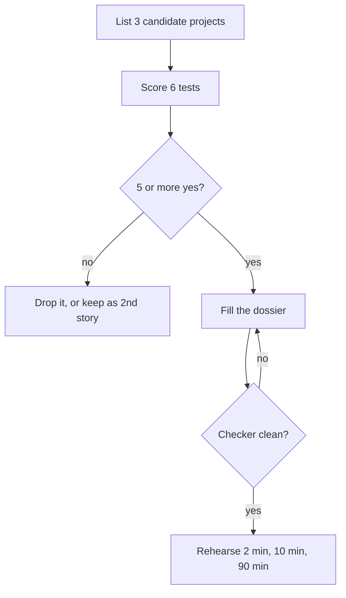

# 20.28 The project deep dive and the final round

## What the interviewer is testing

The last interviewer says, "Pick one project you are proud of and take me through it." You have rehearsed Linux, code and system design. Nothing in those rounds trained you for this one. It tests whether the work on your CV is really yours, and whether you can defend a decision under questions.

Nebius describes the final stage on its SRE interview page as one hour with a team leader. The conversation covers the team, its projects and its services. The page says extra technical questions may come, and that you are told about them in advance. That is the official part.

A secondary source says some candidates face a 90-minute technical deep dive on one significant project. It also says the hiring manager asks about past projects, the reasons behind key decisions and teamwork. Treat both as unverified. Ask your recruiter which one you are getting and what to prepare.

Prepare for the harder shape. If the hour turns out to be a friendly talk, you lose nothing.

A realistic question in the interviewer's voice: "You said you moved the alerting to a new design. What did you consider and reject, what broke afterwards, and what would you do differently?"

This chapter gives you a fill-in framework, not a script. Every figure that belongs to you appears as a marker such as [YOUR NUMBER]. You must bring real numbers from your own work.

## The core ideas

### 1. The round has two shapes and one skill

The skill under every shape is the same. You explain a real system, you give reasons for choices, and you admit what went wrong without flinching.

| Shape | What the source says | Evidence | What to prepare |
|---|---|---|---|
| Final hour with a team leader | Team, projects, services, possibly extra technical questions told in advance | Official Nebius SRE interview page | A two-minute project story, questions for the team leader, the first-90-days answer |
| Project deep dive of up to 90 minutes | A technical defence of one significant project | One secondary source, unverified | The full dossier, five levels of "why", and a whiteboard sketch |
| Hiring-manager conversation | Past projects, reasons for key decisions, teamwork | Same secondary source, unverified | Decision stories with alternatives, and one teamwork story |

The interviewer is often your future manager. They are asking whether they would trust you with a pager and a production fleet.

**Prepare one project deeply rather than five projects thinly.** A deep dive punishes breadth, because the second "why" on any claim exposes whether you were there.

### 2. Picking the one project

The wrong way to pick is to choose the project with the most impressive name. The right way is to choose the one where you can survive five levels of questions. Each level asks about the thing you just said.

Score your candidates on six tests. You need an honest yes on at least five. First, you made or shaped the key decisions, not just carried them out. Second, it ran in production or under real load, so something could actually break. Third, you can state at least five numbers about it. Fourth, something went wrong and you know the root cause. Fifth, it touches what this job does, such as Kubernetes, observability, automation or reliability. Sixth, you can name a decision you would now make differently.

Your own background gives you candidates, and the markers below are only labels. [YOUR GKE PLATFORM PROJECT] has scale, Terraform and an upgrade story. [YOUR ALERT-ROUTER PROJECT] has a decision about where an AI component sits in an alert path and what happens when it is wrong. [YOUR TRADING-BOT RELIABILITY INCIDENT] has real consequences, which makes a failure story vivid. A lab from this handbook is the weakest choice, because nothing in it ran under real users. Use a lab as a second story that shows how you learn, and say plainly that it is a lab.

For a Token Factory role, the best project is the one closest to reliability, performance and observability. A service that real people depended on fits better than a toolchain.



**Choose the project where you know the numbers and the mistakes, not the one that sounds biggest.**

### 3. The one-page dossier

Writing the project down is how you find out what you do not know. The dossier has nine parts. Context, role and team, constraints, numbers, architecture, decisions, failures, what you would change, and metrics of success. Each part answers a question an interviewer will ask, and the order is the order a good story is told.

The two parts that win or lose the round are decisions and failures. A decision entry names what you chose, at least two alternatives you considered, why you chose it, and the cost you accepted. That last field matters. Anyone can list benefits. Defending a trade-off means naming what the choice cost.

Production Kubernetes, chapter 1, shows the shape. It weighs a service mesh by listing what it removes from application teams and what it adds, then says the platform need not solve every application concern. It treats the decision as case by case, driven by your own priorities. Copy that shape. State the gain, state the cost, and say what requirement tipped the balance.

The failures part needs more than a list. For each failure write what broke, how you detected it and how fast, the root cause, what changed afterwards and what you got wrong. The last field is the one most people skip. It is also the one that builds trust.

The template is below. It is the file `code/part20/c28_dossier_template.md`. Every `[YOUR ...]` marker is a blank to fill with your own fact.

```markdown
# Project dossier: [YOUR PROJECT NAME]

<!-- Fill every [YOUR ...] marker. Delete none of the section headings.
     Write real numbers with units. Write "unknown" when you do not know,
     and say how you would find out. Never invent a figure. -->

## Context

- Why the project existed: [YOUR REASON, one sentence a non-engineer would follow]
- Who used it and how many of them: [YOUR NUMBER] users or services
- What happened before it existed: [YOUR BEFORE STATE]
- When it ran and for how long: [YOUR DATES]

## My role and the team

- My part, in one sentence: [YOUR ROLE]
- Team size and who else mattered: [YOUR NUMBER] people, plus [YOUR OTHER TEAMS]
- A disagreement or handover and how it ended: [YOUR EXAMPLE]

## Constraints

- Time: [YOUR DEADLINE]
- Budget or hardware limit: [YOUR LIMIT WITH UNIT]
- Risk limit, such as downtime allowed: [YOUR NUMBER]
- Things I could not change: [YOUR FIXED THING]

## Numbers

<!-- At least three lines with digits: scale, load, size, cost, uptime. -->

- Scale (requests, nodes, services, data): [YOUR NUMBER]
- Normal and peak load: [YOUR NUMBER] and [YOUR NUMBER]
- Availability or error rate before the project: [YOUR NUMBER]
- Cost per month: [YOUR NUMBER]

## Architecture

- One-paragraph picture, in the order a request or a deploy travels: [YOUR FLOW]
- The three components that mattered most and why: [YOUR COMPONENTS]
- What I would draw on a whiteboard first: [YOUR FIRST BOX]

## Decisions

### Decision: [YOUR FIRST DECISION]

- Chosen: [YOUR CHOICE]
- Alternatives considered:
  - [YOUR ALTERNATIVE ONE]
  - [YOUR ALTERNATIVE TWO]
- Why: [YOUR REASON, with a number if you have one]
- Cost accepted: [YOUR COST]
- Would I decide the same today: [YES OR NO, AND WHY]

### Decision: [YOUR SECOND DECISION]

- Chosen: [YOUR CHOICE]
- Alternatives considered:
  - [YOUR ALTERNATIVE ONE]
  - [YOUR ALTERNATIVE TWO]
- Why: [YOUR REASON]
- Cost accepted: [YOUR COST]
- Would I decide the same today: [YES OR NO, AND WHY]

### Decision: [YOUR THIRD DECISION]

- Chosen: [YOUR CHOICE]
- Alternatives considered:
  - [YOUR ALTERNATIVE ONE]
  - [YOUR ALTERNATIVE TWO]
- Why: [YOUR REASON]
- Cost accepted: [YOUR COST]
- Would I decide the same today: [YES OR NO, AND WHY]

## Failures

### Failure: [YOUR FIRST FAILURE]

- What broke: [YOUR SYMPTOM]
- How it was detected: [YOUR SIGNAL], after [YOUR NUMBER] minutes
- Root cause: [YOUR CAUSE]
- What changed afterwards: [YOUR FIX AND YOUR GUARD AGAINST A REPEAT]
- What I got wrong: [YOUR HONEST MISTAKE]

### Failure: [YOUR SECOND FAILURE]

- What broke: [YOUR SYMPTOM]
- How it was detected: [YOUR SIGNAL], after [YOUR NUMBER] minutes
- Root cause: [YOUR CAUSE]
- What changed afterwards: [YOUR FIX]
- What I got wrong: [YOUR HONEST MISTAKE]

## What I would change

- The first thing, and the evidence that says so: [YOUR CHANGE]
- What I would measure before starting: [YOUR METRIC]
- What I would leave alone: [YOUR KEEPER]

## Metrics of success

<!-- Before and after, same unit, same measuring method. -->

- Metric one: [YOUR NUMBER] before, [YOUR NUMBER] after, measured by [YOUR METHOD]
- Metric two: [YOUR NUMBER] before, [YOUR NUMBER] after, measured by [YOUR METHOD]
- What did not improve: [YOUR HONEST GAP]
```

The checker in the lab reads your filled copy and shows where it would not survive questioning. It checks structure, not truth.

**Write the dossier before you rehearse, because a gap on paper is a stumble out loud.**

### 4. What the interviewer asks at each part, and the shape of a good answer

The best preparation is knowing the probe that follows each section. Below, each part has the question that tends to come, and the answer shape. These are my reasoning about how technical interviewers probe, not a record of Nebius questions.

On context, the probe is "Why did this need doing at all?" A good answer states the pain in one sentence a non-engineer would follow, then the number that showed it was real. Systems Performance, chapter 2, lists the opening questions of any investigation. Why do you think there is a problem, did it ever work well, what changed recently, who is affected, and what is the environment. Those questions make a short, disciplined opening for your own context.

On numbers, the probe is "How big was this?" A good answer gives scale, normal load, peak load and cost, with units, and says where each figure came from. If you do not know one, say so and say how you would find out. "I did not measure that, and here is how I would" beats a guess every time.

On architecture, the probe is "Draw it." A good answer follows one request or one deploy from start to end, then names the three components that mattered and why. Start with the boxes the user touches. Add the parts that fail last.

On decisions, the probe is the ladder: "Why that? What else did you consider? What would make you switch? What did it cost?" A good answer has a short chosen option, two or more alternatives with one reason each for rejecting them, and the cost you accepted. The chapter on how LLM serving fails (`c20-18`) uses the same habit. It states symptom, confirmation, mitigation and fix.

On failures, the probe is "What broke, and what did you do first?" A good answer shows protect-then-diagnose. You reduce user harm first and dig for the cause second. The stress round in `c20-26` practises exactly that order, so the story you tell here should match the habit you show there.

On what you would change, the probe is "Knowing what you know now?" A good answer names one change, the evidence for it and what you would measure before starting. It also names what you would leave alone, which shows judgment.

On teamwork, the probe is "Tell me about a disagreement." A good answer describes the other person's position fairly, the evidence that settled it and how the relationship ended up. Do not make yourself the only wise person in the story.

**For every claim in your dossier, know the next question and have one number or one fact ready for it.**

### 5. Talking about trade-offs and mistakes honestly

An interviewer who has run production systems has made expensive mistakes. They are listening for whether you have too. A project with no flaws sounds like a project you only watched.

The trade-off sentence has four parts. Given this constraint, I chose A over B, accepting this cost, and I would revisit if this condition changed. For example, "Given a two-week deadline, I chose [YOUR CHOICE] over [YOUR ALTERNATIVE], accepting [YOUR COST], and I would revisit when load passes [YOUR NUMBER]." The sentence is short, it shows you saw alternatives, and it shows you know when the decision expires.

The mistake story has five parts. What you did, what it caused with a number, how you found out, what you changed, and what you now do differently. Keep blame out of it. Systems Performance, chapter 2, names a blame-someone-else anti-method. You pick a component you do not own, say the problem is there and hand it off. An interviewer who hears "it was the network team's problem" will hear that anti-method.

Two other traps matter. One is false certainty. If you do not know why something worked, say "I do not know why it worked, my best explanation is this, and here is how I would test it." The book's scientific method, a question then a hypothesis then a prediction then a test, gives you the vocabulary. The second is the streetlight habit. Systems Performance describes it as picking whichever tool is familiar and hoping something obvious shows up. If your failure story is "I tried a few things and it fixed itself", admit it is weak and say what method you would use now.

Say "we" for what the team did and "I" for what you did. Interviewers listen for that boundary.

**State the cost of every decision and the cause of every failure, and own your share of both.**

### 6. Why Nebius, why SRE, why inference

These three questions are easy to answer badly. A weak answer is generic praise. A strong answer links a fact about the company or the role to something true about you. You supply the true part.

For why Nebius, use public facts only. Token Factory offers serverless and dedicated endpoints behind an OpenAI-compatible API, with a control plane kept separate from a region-specific data plane. Dedicated endpoints let a customer choose GPU type, replicas and region. A Nebius case study, tagged vendor in the plan, describes lessons such as stopping retry amplification and fixing aggressive liveness probes that restarted healthy workers. Pick one and say why it interests you. For example: "The case study about probes restarting healthy workers is a failure I recognise from [YOUR EXPERIENCE]." Do not claim to know how Nebius runs its internals. Nebius has not published them.

For why SRE, the honest shape is a story about what you like. You like owning the number that says whether users are happy, and you like turning a repeated page into automation. The job posting asks for incident detection, isolation and remediation with automation and runbooks, and for post-mortems. Link one of those to a thing you have done: [YOUR AUTOMATION EXAMPLE].

For why inference, say what is different. Inference traffic is bursty, latency has two parts, time to first token and the gap between tokens, and the scarce resource is GPU memory held by the KV cache. The posting names autoscaling tuned for GPU efficiency and request routing with retry logic. Say what draws you, and be truthful about the gap. If you have not run a GPU fleet, say so and say how you have been closing it, for instance through this handbook's labs. Naming the gap yourself is stronger than hoping nobody notices.

**Tie each answer to one public fact and one true fact about you, and never invent either.**

### 7. Questions to ask the team leader

An hour with a team leader is also your chance to interview them. Good questions show you think about operations, not perks. Ask five or six real ones. Do not ask anything the posting or website answers.

| Topic | A question to ask | What you learn |
|---|---|---|
| On-call | How is the rota built, how often would I be paged, and what share of pages need a human? | Load and alert quality |
| SLOs | Which SLOs does the team own for Token Factory, and who decides when they are missed? | Whether reliability has authority |
| Incident review | What happened in your last significant incident, and what changed afterwards? | Blameless culture in practice |
| GPU fleet | How does the team find and replace failing GPUs or nodes, and how much is automated? | Maturity of self-healing |
| Roadmap | What is the biggest reliability risk on the roadmap for the next two quarters? | Where you would spend your time |
| Team split | How is work split between Token Factory and the cloud platform, and who owns what at the boundary? | Ownership and handoffs |

I picked those from the job posting, which asks for SLOs, post-mortems, automation and GPU-efficient autoscaling. The answers are for you to judge. A leader who cannot say how many pages a week the team gets, or who answers with a defensive tone about incidents, is telling you something.

Keep one in reserve. Ask what would make someone fail in this role in the first six months.

**Bring six questions on paper and ask the ones the conversation has not already answered.**

### 8. Salary, notice and logistics, kept general

These topics can feel awkward. Keep them short and factual. Generally, the recruiter handles pay and the team leader hour is not the place to negotiate. If the team leader raises it, defer politely to the recruiter.

On salary, do your own market research before the call, from public salary data for the role, country and level. Give a range rather than one number when asked, and say it depends on the full package. Do not quote a figure you have not researched. Do not invent a competing offer. This is general advice and not specific to Nebius, which has not published pay bands that I could find.

On notice, state your contractual notice period exactly, from your own contract: [YOUR NOTICE PERIOD]. If you could shorten it, say what that depends on. Do not promise a start date you cannot keep.

On logistics, the posting lists remote Europe and several city locations. Confirm with the recruiter where you can work from, what work-authorisation or contract type applies in your country and whether travel is expected. Also confirm the posting is still open, since the plan notes it was about four months old.

**Be factual and brief on money and dates, and let the recruiter carry the negotiation.**

### 9. The first-90-days answer

"What would you do in your first 90 days?" tests judgment. The wrong answer is a list of grand changes. The right answer shows that you learn first and change second.

A good shape has three stages. In the first month, you listen and map. You shadow on-call, read recent post-mortems, learn the SLOs and the alerts that page, and draw the request path for a token API from edge to GPU. You fix nothing big yet.

In the second month, you ship small safe improvements. For instance, you fix a noisy alert, tighten one runbook or add a missing dashboard panel. Each has a number, such as pages per week before and after. This builds trust and teaches you the review process.

In the third month, you own one reliability improvement with a measurable target. Pick from what the posting lists, such as telemetry pipelines, GPU-efficient autoscaling, Terraform modules for resilient clusters or retry logic. Say you would choose it with the team, based on the biggest source of toil or risk. Name the metric and the review date.

Say what you would not do, such as rewriting alerting in week two or changing production outside the team's process.

**Answer with learn, then small wins, then one owned improvement with a number.**

## How to answer out loud

Rehearse these five. Time each one with a phone. The numbers in brackets are yours to fill.

### "Walk me through the project in two minutes"

Speak in this order. One sentence on why it existed. One on your role and the team size. The shape of the system in three components. The two biggest decisions. The result with one before-and-after number. Finish with "the part I would like to go deeper on is" and name the most interesting decision. Expect a follow-up on whichever part you mention last, so end on your strongest. State [YOUR NUMBER] for scale and [YOUR NUMBER] for the result.

### "Why did you choose X over Y?"

Give the constraint first. Then name the choice, two alternatives with one reason each for rejecting them, and the cost you accepted. End with the condition that would change your mind. Expect "what would that condition look like in numbers" and "did you test the alternative." If you did not test it, say so and say why not.

### "Tell me about something that went wrong"

Pick the failure with the clearest root cause. Say what broke and the user effect with a number. Say how you detected it and how long that took. State what you did first, which should protect users, then the cause, then the permanent fix. Finish with what you got wrong. Expect "why was detection slow" and "what stops a repeat."

### "What would you do differently?"

Name one change and the evidence for it. Say what you would measure before starting. Add one thing you would keep. Avoid "nothing" and avoid ten regrets.

### "Why Nebius, why SRE, why inference?"

Answer in three short parts, each tied to one public fact and one true fact about you. Keep the whole answer under 90 seconds. Expect a follow-up like "what do you know about our product" or "what worries you about this role." Say the gap honestly and say how you are closing it.

## Worked scenarios

### Scenario 1: choosing among three projects

You have three candidates. They are [YOUR GKE PLATFORM PROJECT], [YOUR ALERT-ROUTER PROJECT] and [YOUR TRADING-BOT RELIABILITY INCIDENT]. Score each from the six tests in section 2 as yes or no. The table shows the method with sample marks. The marks are an illustration of the method only, not a judgment about your projects.

| Test | Platform | Alert router | Trading bot |
|---|---|---|---|
| I shaped key decisions | yes | yes | yes |
| Ran under real load | yes | yes | yes |
| I can state 5 numbers | no | yes | yes |
| Real failure with root cause | yes | no | yes |
| Fits the job | yes | yes | no |
| Decision I would change | yes | yes | yes |
| Total | 5 | 5 | 5 |

Three ties mean the scores do not decide. Break the tie by the cheapest gap to close. If a project failed the numbers test, spend an evening collecting figures from dashboards and commit history. If the data is gone, drop that project.

### Scenario 2: rewriting a weak decision

An interviewer asks why you picked a tool. A weak answer, as an illustration only: "We chose it because it was the standard, and it made things a lot faster." It has no alternative, no cost and no number.

Rewrite it using the four-part trade-off sentence. "Given a [YOUR DEADLINE] deadline and a team of [YOUR NUMBER], I chose [YOUR TOOL] over [YOUR ALTERNATIVE ONE] and [YOUR ALTERNATIVE TWO]. It cut [YOUR METRIC] from [YOUR NUMBER] to [YOUR NUMBER]. We accepted [YOUR COST]. I would revisit if [YOUR CONDITION]."

Now run the checker. In the lab you will see that it flags the weak version. A claim like "much faster" with no digit is reported as unquantified. A decision with one alternative is reported as needing two. These are the same flags a sharp interviewer raises in their head.

### Scenario 3: a five-level ladder on one decision

Interviewers dig on a single point. Prepare this ladder for your best decision.

Level one: "Why did you pick [YOUR CHOICE]?" You give the constraint and the option. Level two: "What else did you consider?" You name two alternatives. Level three: "How did you know it would work?" You describe a test, a benchmark or a pilot with [YOUR NUMBER]. Level four: "What went wrong with it?" You tell the failure story. Level five: "Would you pick it again?" You say yes or no and name the condition.

If you cannot answer level three, that is the gap to close. Many real decisions rest on judgment, not a test. The honest answer is "I did not test it, I decided on [YOUR REASON], and the risk was [YOUR RISK]." That is acceptable. A made-up benchmark is not.

### Scenario 4: the logistics questions

The team leader asks, "What are your expectations, and when could you start?" Answer in two sentences. "I would like to discuss the package with the recruiter once we agree on the level. My contract has a [YOUR NOTICE PERIOD] notice period, and I will confirm whether it can be shortened." This is honest, short and does not trap you. If pressed for a number, give a researched range and say it depends on the full package.

## Hands-on lab

This lab runs on a laptop with Python 3 and pytest. I ran steps 1 to 4 on a Mac with Python 3.12.7 and pytest 8.3.5. Steps 5 and 6 are practice you do yourself.

1. Copy the template. Run `cp code/part20/c28_dossier_template.md dossier.md`. Expected result: a new file with `[YOUR ...]` markers in it.

2. Run the checker on the blank copy. Run `python3 -I code/part20/c28_dossier_check.py dossier.md`. Expected result, which I ran: many `placeholder` lines, several `empty_section` and `entry_incomplete` lines, and a summary that ends with counts such as `placeholder: 58`. The exit code is 1.

3. Half-fill one decision. Replace the first decision with a chosen option, one alternative and the reason "it made alerting much faster to ship". Run the checker again. Expected result, which I ran: a `decision_no_alternatives` line, an `entry_incomplete` line for the missing cost accepted, and an `unquantified` line quoting "much faster".

4. Run the tests. Run `python3 -m pytest code/part20/test_c28_dossier_check.py -q`. Expected result, which I ran: 11 passed.

5. Fill your real dossier until the checker prints `summary: clean`. Use `--json` if you want to count findings. Expected result: exit code 0. A clean checker means the structure is complete. It does not mean the answers are good, so go on to step 6.

6. Rehearse out loud with a timer: two minutes for the walk-through, ten minutes for decisions and failures, then a friend reads you the ladder from scenario 3. Expected result: you can answer every level with a number or an honest "I did not measure that."

The checker itself is below. It is the file `code/part20/c28_dossier_check.py`. It reads the dossier, strips HTML comments while keeping line numbers, splits it into sections and blocks, and applies the rules. The unfilled-marker pattern, the claim-word pattern and the minimum counts sit at the top so you can adjust them.

```python
#!/usr/bin/env python3
"""Check a project dossier written from c28_dossier_template.md.

Reports missing sections, unfilled placeholders, claims without a number,
decisions without two alternatives and incomplete failure write-ups.
Standard library only.

Usage: c28_dossier_check.py DOSSIER.md [--json]   (exit 1 if any finding)
"""
import json
import re
import sys

SECTIONS = {
    "context": "Context",
    "role": "My role and the team",
    "constraints": "Constraints",
    "numbers": "Numbers",
    "architecture": "Architecture",
    "decisions": "Decisions",
    "failures": "Failures",
    "changes": "What I would change",
    "metrics": "Metrics of success",
}
ALIASES = {
    "context": ("context",),
    "role": ("my role", "role", "team"),
    "constraints": ("constraints",),
    "numbers": ("numbers", "scale"),
    "architecture": ("architecture",),
    "decisions": ("decisions",),
    "failures": ("failures", "what broke"),
    "changes": ("what i would change", "what i would do differently"),
    "metrics": ("metrics of success", "metrics", "results"),
}
MIN_NUMERIC_LINES = {"numbers": 3, "metrics": 2, "failures": 1}
MIN_BLOCKS = {"decisions": 3, "failures": 1}
BLOCK_LABELS = {
    "decisions": ("chosen", "alternatives", "why", "cost accepted"),
    "failures": ("what broke", "how it was detected", "root cause",
                 "what changed afterwards"),
}
PLACEHOLDER = re.compile(
    r"\[YOUR[^\]]*\]|\[YES OR NO[^\]]*\]|\bTODO\b|\bTBD\b|\[\.\.\.\]|<fill[^>]*>")
CLAIM = re.compile(
    r"\b(faster|slower|improv\w*|reduc\w*|increas\w*|decreas\w*|fewer|saved"
    r"|significant\w*|massive\w*|huge|dramatic\w*|a lot|lots of|greatly"
    r"|much (?:more|less|better|faster))\b", re.I)
HEADING = re.compile(r"^(#{2,3})\s+(.*?)\s*$")
LABEL = re.compile(r"^\s*[-*]\s+([A-Za-z][A-Za-z ]*?):\s*(.*)$")
SUBBULLET = re.compile(r"^\s{2,}[-*]\s+(.*)$")


def strip_comments(text):
    """Remove HTML comments but keep line numbers stable."""
    return re.sub(r"<!--.*?-->", lambda m: "\n" * m.group(0).count("\n"),
                  text, flags=re.S)


def clean(s):
    return PLACEHOLDER.sub("", s).strip(" -*:.,")


def filled(line):
    """Text of a line after its 'label:' part, with placeholders removed."""
    body = line.split(":", 1)[1] if ":" in line else line
    return clean(body)


def parse(text):
    """Return {key: {'line': n, 'lines': [(n, text)], 'blocks': [...]}}."""
    out, cur, block = {}, None, None
    for n, raw in enumerate(strip_comments(text).splitlines(), 1):
        m = HEADING.match(raw)
        if m and len(m.group(1)) == 2:
            title = re.sub(r"^\d+[.)]?\s*", "", m.group(2)).lower()
            cur = next((k for k, names in ALIASES.items()
                        if any(title.startswith(a) for a in names)), None)
            block = None
            if cur and cur not in out:
                out[cur] = {"line": n, "lines": [], "blocks": []}
            elif cur:
                cur = None
            continue
        if cur is None:
            continue
        if m and len(m.group(1)) == 3:
            block = {"line": n, "title": m.group(2), "lines": []}
            out[cur]["blocks"].append(block)
            continue
        out[cur]["lines"].append((n, raw))
        if block is not None:
            block["lines"].append((n, raw))
    return out


def block_fields(block):
    """Map label -> list of item strings (inline text plus sub-bullets)."""
    fields, label = {}, None
    for _, raw in block["lines"]:
        m = LABEL.match(raw)
        sub = SUBBULLET.match(raw)
        if m and not sub:
            label = m.group(1).strip().lower()
            inline = [x for x in m.group(2).split(";") if x.strip()]
            fields[label] = inline
        elif sub and label:
            fields[label].append(sub.group(1))
    return fields


def find_field(fields, prefix):
    for k, v in fields.items():
        if k.startswith(prefix):
            return v
    return None


def check(text):
    findings = []

    def add(kind, line, msg):
        findings.append({"kind": kind, "line": line, "message": msg})

    secs = parse(text)
    for key, name in SECTIONS.items():
        if key not in secs:
            add("missing_section", 0, f"section '{name}' is missing")
            continue
        sec = secs[key]
        body = [(n, t) for n, t in sec["lines"] if filled(t)]
        if not body:
            add("empty_section", sec["line"],
                f"section '{name}' has no filled content")
        need = MIN_NUMERIC_LINES.get(key, 0)
        have = sum(1 for _, t in body if re.search(r"\d", filled(t)))
        if body and have < need:
            add("too_few_numbers", sec["line"],
                f"section '{name}' needs {need} lines with a number, has {have}")
        need = MIN_BLOCKS.get(key, 0)
        if need and len(sec["blocks"]) < need:
            add("too_few_blocks", sec["line"],
                f"section '{name}' needs {need} entries, has {len(sec['blocks'])}")

    for key in ("decisions", "failures"):
        for block in secs.get(key, {}).get("blocks", []):
            fields = block_fields(block)
            title = clean(block["title"].split(":", 1)[-1]) or "(untitled)"
            for label in BLOCK_LABELS[key]:
                items = find_field(fields, label)
                if items is None or not any(clean(i) for i in items):
                    kind = ("decision_no_alternatives"
                            if label == "alternatives" else "entry_incomplete")
                    add(kind, block["line"],
                        f"{key[:-1]} '{title}': '{label}' is missing or unfilled")
                elif label == "alternatives":
                    real = [i for i in items if clean(i)]
                    if len(real) < 2:
                        add("decision_no_alternatives", block["line"],
                            f"decision '{title}': needs two alternatives, "
                            f"has {len(real)}")

    in_code = False
    for n, raw in enumerate(strip_comments(text).splitlines(), 1):
        if raw.lstrip().startswith("```"):
            in_code = not in_code
        if in_code or HEADING.match(raw) or raw.startswith("# "):
            continue
        plain = PLACEHOLDER.sub("", raw)
        if not clean(plain.split(":", 1)[-1]):
            continue
        if CLAIM.search(plain) and not re.search(r"\d", plain):
            add("unquantified", n,
                f"claim without a number: {raw.strip()[:70]}")
    for n, raw in enumerate(strip_comments(text).splitlines(), 1):
        if PLACEHOLDER.search(raw):
            add("placeholder", n, f"unfilled: {PLACEHOLDER.search(raw).group(0)}")
    findings.sort(key=lambda f: (f["line"], f["kind"]))
    return findings


def summarize(findings):
    counts = {}
    for f in findings:
        counts[f["kind"]] = counts.get(f["kind"], 0) + 1
    return counts


def main(argv):
    args = [a for a in argv[1:] if not a.startswith("--")]
    if len(args) != 1:
        print(__doc__)
        return 2
    with open(args[0], encoding="utf-8") as fh:
        findings = check(fh.read())
    if "--json" in argv:
        print(json.dumps({"findings": findings,
                          "counts": summarize(findings)}, indent=2))
    else:
        for f in findings:
            if f["kind"] == "placeholder" and len(findings) > 40:
                continue
            print(f"line {f['line']:>3}  {f['kind']:<26} {f['message']}")
        print("summary:", summarize(findings) or "clean")
    return 1 if findings else 0


if __name__ == "__main__":
    sys.exit(main(sys.argv))
```

The tests are in `code/part20/test_c28_dossier_check.py`. They cover clean and blank dossiers, missing sections, alternatives, unquantified claims, too few numbers, incomplete failures, comments and exit codes.

## Drill questions

1. Name the two shapes the final round may take, and which one has an official source.

<details><summary>Answer</summary>

The official Nebius page describes a one-hour talk with a team leader about the team, projects and services, with extra technical questions notified in advance. A 90-minute deep dive on one project comes from a secondary source and is unverified. You prepare for the harder one and ask the recruiter which applies.

</details>

2. What are the six tests for picking a project?

<details><summary>Answer</summary>

You shaped the key decisions. It ran under real load. You can state at least five numbers. Something failed and you know the root cause. It fits what the job does. You know a decision you would change.

</details>

3. What fields must a decision entry have, and which one do people skip?

<details><summary>Answer</summary>

Chosen option, at least two alternatives, why, and cost accepted. People skip the cost accepted, and that is the field that shows you understand trade-offs.

</details>

4. State the four-part trade-off sentence.

<details><summary>Answer</summary>

Given this constraint, I chose A over B, accepting this cost, and I would revisit if this condition changed.

</details>

5. What five parts does an honest mistake story have?

<details><summary>Answer</summary>

What you did, what it caused with a number, how you found out, what you changed, and what you do differently now.

</details>

6. Which anti-method from Systems Performance does "it was the network team's problem" echo?

<details><summary>Answer</summary>

The blame-someone-else anti-method. You choose a component you do not own, say the problem is there and redirect it. The book says to investigate instead.

</details>

7. How do you answer "why Nebius" without claiming inside knowledge?

<details><summary>Answer</summary>

You pick one public fact, such as the control plane being separate from the regional data plane, or the published lessons about retries and probes. You link it to a true fact about your experience. You never say how Nebius runs its internals, because it has not published them.

</details>

8. Give four of the questions you would ask the team leader and what each teaches you.

<details><summary>Answer</summary>

On-call load and alert quality, which tells you how painful the rota is. SLO ownership, which tells you whether reliability has authority. The last incident and what changed, which shows blameless culture. How failing GPUs are found and replaced, which shows how much is automated. The Token Factory and cloud split is also valid.

</details>

9. What shape does the first-90-days answer take?

<details><summary>Answer</summary>

Learn and map in month one. Ship small safe improvements with a number in month two. Own one reliability improvement with a target in month three. Say what you would not do, such as rewriting alerting in the second week.

</details>

10. The checker reports a decision with one alternative. What do you do?

<details><summary>Answer</summary>

Find the second real alternative you considered, even a do-nothing option, and write why you rejected it. If you truly considered only one, say so in the interview, and name what you would compare against today.

</details>

## Common mistakes and weak answers

| Weak answer | What it loses | Say instead |
|---|---|---|
| "We did a lot of things." | Your own part is invisible | "I did X. The team did Y." |
| "It was much faster." | No number | "It cut p99 from [YOUR NUMBER] to [YOUR NUMBER]." |
| "There was no real alternative." | Looks like you did not think | Name the two you rejected and why |
| "Nothing really went wrong." | Looks like you only watched | Tell the failure with root cause |
| "It was the other team's problem." | Blame anti-method | State your share first |
| A made-up benchmark | Fatal if probed | "I did not test it, I judged it on [YOUR REASON]." |
| Claiming to know how Nebius works | Looks like bluffing | "I only know what is published" |
| Salary figure with no research | Weak position | A researched range, deferred to the recruiter |

Two more habits cost points. Talking for five minutes without a pause stops the interviewer steering, so pause after each part. Treating the hour as a social chat also hurts, because the team leader is still collecting evidence.

## Connections to the rest of the handbook

- 19.10 Customer workshops and the consulting method (`c19-10`) covers discovery and assessment as a method for talking to customers. Reuse its habit of asking about constraints before proposing anything.
- 19.14 Interview question bank by topic (`c19-14`) and 19.15 Interview cheat sheet (`c19-15`) hold the technical questions. This chapter does not repeat them.
- 20.18 How LLM serving fails (`c20-18`) gives the failure vocabulary your failure story can borrow.
- 20.26 The stress interview (`c20-26`) trains the protect-then-diagnose order that your incident story must match.
- 20.27 Post-mortems and on-call (`c20-27`) covers writing blameless reviews and answering "tell me about an incident you led" in depth.
- 20.19 SLIs, SLOs and alerts for token APIs (`c20-19`) prepares you for the SLO question to the team leader.
- 20.30 Nebius AI factory to Token Factory architecture (`c20-30`) supplies the public product facts used in the why-Nebius answer.
- 20.29 The 8-week plan and cheat sheet (`c20-29`) schedules this chapter's rehearsals.

## Sources and review notes

Sources:

- Nebius SRE interview page, nebius.com/careers/interviews/sre, as recorded in `planning/VOLUME_20_NEBIUS_SRE_PLAN.md` section 1 (research dated 2026-10): final stage of one hour with a team leader about team, projects and services, with extra technical questions notified in advance. I re-fetched it on 2026-11-09, see the verification log.
- A secondary candidate-report source, supplied with the chapter brief: a 90-minute deep dive on one project, and a hiring manager asking about past projects, reasons for decisions and teamwork. Unverified.
- Job posting content and Token Factory facts as summarised in the plan, section 1, including the vendor-tagged chat-app case study. The plan does not record a URL for the case study.
- Systems Performance, 2nd edition, chapter 2 "Methodologies": the problem statement questions, the scientific method, the streetlight and blame-someone-else anti-methods. Chapter 16 "Case Study" was read as an example of narrating an investigation from problem statement to resolution.
- Production Kubernetes, chapter 1 "A Path to Production": the service mesh pros and cons and the point that a platform should not solve every application concern.
- AI Factory, chapter 5 "Data-Driven Decision-Making": read, but it is a general management text and no specific claim depends on it.
- Planning files `JD_MAPPING.md`, `INTERVIEW_TOPICS.md`, `LANGUAGE_RULE.md`. Chapters 19.10, 19.14 and 19.15 were skimmed by heading only and are linked, not copied.

Explicitly labelled inferences:

- The answer shapes in section 4, the six-test project scoring, the four-part trade-off sentence, the five-part mistake story and the first-90-days structure are my reasoning about good practice. They are not Nebius requirements.
- The questions to ask the team leader and what each reveals come from the job posting and my reasoning.
- Salary and notice advice is general and not specific to Nebius.
- Scenario 1 scores are sample marks.

Not verified:

- No source confirms that Nebius runs a project deep dive. Only the one-hour team-leader format is official.
- I did not check whether the posting is still open or which countries are hired in.
- The checker reads structure only. It was tested with the unit tests and the lab runs described above on a Mac, and was not tried on any real candidate dossier.

### Verification log

Fact-check pass on 2026-11-09. I re-fetched https://nebius.com/careers/interviews/sre. Five claims were checked. Three are confirmed, one was corrected and one stays unverified.

| Claim | Result |
|---|---|
| The final stage is a meeting with a team leader about the team, its projects and its services | Confirmed. The page heading is "Final meetings". |
| The final interview lasts one hour | Confirmed. The page says "a final hour-long interview". |
| Extra technical tasks or questions may be requested, with advance notice | Confirmed. The page says you will be notified in advance. |
| A 90-minute figure belongs to the final round | Corrected. The page gives 60 to 90 minutes for each of the three technical interviews, not for the final. The 90-minute project deep dive remains one secondary source. |
| A project deep dive or hiring-manager past-projects round exists at Nebius | Still unverified. The page does not mention either. |

The page also says the three technical interviews come from different teams and need not fit in one day. It lists "your experience in the design and architecture of different services/systems" as one assessed area, which supports preparing a project story either way.
