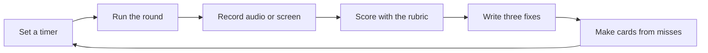

# 20.29 The 8-week plan, the final week and the one-page cheat sheet

## What the interviewer is testing

This chapter does not serve one round. It serves all of them, because it turns the other chapters into dated work. Nebius describes the loop as a CV review, a recruiter call, three technical interviews of 60 to 90 minutes each, and a final hour with a team leader [official: nebius.com/careers/interviews/sre]. The technical interviews cover "practical tasks in the Linux console", "coding, troubleshooting, debugging" and system design. The official page also says to explain your reasoning aloud, ask for hints, review your code and suggest alternatives.

The plan in this chapter is my reasoning, not a Nebius recommendation. Nebius has not published a scoring rubric, round order or pass mark. [gap] So the plan trains the skills the page names, and it trains them in the form they will be asked: aloud, timed, without notes.

One candidate reported four stages: an hour of Linux troubleshooting, an hour of algorithms, an hour of system design and a 30-minute production incident [report]. Other reports described a different loop, so prepare for the hardest version and expect some rounds to be easy.

A realistic question in the interviewer's voice, from the final round: "We have an hour. Tell me how you prepared for this interview, and what you found hardest." The honest answer is a plan, with dates, that you actually followed. Chapter 20.1 (`c20-01`) explains the loop itself, and this chapter schedules the study.

## The core ideas

### 1. The 8-week plan, with hours as a parameter

An alert fires at 02:00 and you do not read a book. You run the commands you know. The 8-week plan exists to make the commands automatic. It follows the stage order of the loop as the reports describe it: Linux console first, then coding, then design, then the stress round, then the final round.

Hours per week is a parameter. The generator at the end of this chapter takes it. The split inside each week is a rule I chose: about 40% reading and lab work, 30% drills and coding practice, 30% speaking aloud and mock rounds. Nothing in the official page sets this split. If you have 6 hours a week, keep the ratio and cut breadth, not the speaking.

| Week | Stage | Chapters | Checkpoint: do this without notes |
|---|---|---|---|
| 1 | Linux console | [20.1](./01-the-nebius-loop-and-how-to-use-this-volume.md) and [20.2](./02-the-role-in-one-page-the-job-posting-line-by-line.md) first, then [20.3](./03-triage-method-for-a-sick-linux-box.md), [20.4](./04-files-descriptors-syscalls-and-permissions.md) | Run the 60-second checklist in order. Find a leaked descriptor from `/proc/PID/fd` and `/proc/PID/limits`. Name the errno for a chmod that does nothing. |
| 2 | Linux console | [20.5](./05-cpu-memory-disk-and-the-scheduler.md), [20.6](./06-network-debugging-from-socket-to-switch.md), [20.7](./07-the-console-round-text-tools-systemd-and-everyday-operations.md) | Triage a slow box and a failing connect aloud, ten minutes each. Produce top talkers and p95 from a log with a pipeline. |
| 3 | Coding | [20.8](./08-the-coding-round-what-to-expect-and-how-to-perform.md), [20.9](./09-algorithm-patterns-for-sre-flavoured-problems.md), [20.10](./10-complexity-latency-numbers-and-measuring-your-own-code.md), [20.11](./11-coding-practice-set-40-problems-with-tested-solutions.md) | Solve one medium problem in 30 minutes in a plain editor, test it by hand, state time and space. |
| 4 | System design | [20.12](./12-estimation-toolkit-for-inference-capacity.md), [20.13](./13-design-a-multi-tenant-llm-inference-api.md), [20.14](./14-design-dedicated-endpoints-and-safe-model-rollout.md) | Estimate GPUs for a load on a blank page. Speak the 45-minute plan from the cheat sheet. |
| 5 | Design and SLOs | [20.15](./15-design-an-observability-pipeline-for-very-high-volume.md), [20.16](./16-design-gpu-fleet-health-and-capacity.md), [20.19](./19-slis-slos-and-alerts-for-token-apis.md), [20.25](./25-promql-grafana-and-tracing-traps.md) | State SLIs, the burn-rate table and three PromQL traps. Explain how fleet automation is stopped from draining the fleet. |
| 6 | Inference SRE | [20.18](./18-how-llm-serving-fails.md), [20.20](./20-autoscaling-gpu-inference.md), [20.21](./21-request-routing-retries-and-overload-control.md), [20.22](./22-operating-vllm-triton-ray-and-tensorrt-llm.md) | Give a cause and first check for each failure signature. Design a retry policy for a streaming API. |
| 7 | Stress interview | [20.23](./23-kubernetes-failure-drills-for-gpu-platforms.md), [20.24](./24-terraform-for-resilient-gpu-clusters.md), [20.26](./26-the-stress-interview-production-incident-role-play.md) | Play two 30-minute incident drills, one inference and one general, and score yourself. |
| 8 | Final round | [20.27](./27-post-mortems-on-call-and-incident-leadership.md), [20.28](./28-the-project-deep-dive-and-the-final-round.md), and a light pass of 20.30 to 20.33 | Tell the project story in two minutes and defend one decision. No new topics. |

Each week ends with its checkpoint. If you fail one, do not move on. Spend the next week's first session on the gap, and cut the least likely topic from the week after.

Two habits run through all eight weeks. Do 20 minutes of flashcards every day, covered in section 3. Do one timed coding problem every second day from week 3 on, because coding skill fades when it is not used. **Order the study by loop stage, check each week by doing the thing aloud, and treat a failed checkpoint as the real schedule.**

### 2. Compressed versions: 3 weeks and 10 days

You may have three weeks, not eight. The research plan, section 4, gives a priority order for a short runway: Linux console and system design first, because both appear in every report, then inference failures and the incident round, then coding and Terraform. I follow that, but keep coding alive in 20-minute daily slices because it is hard to rebuild late.

| Week of 3 | Stage | Chapters | Checkpoint |
|---|---|---|---|
| 1 | Linux console and coding | 20.3, 20.4, 20.5, 20.6, 20.8, 20.9 | Triage a box aloud. Solve one rate limiter or top-k problem. |
| 2 | Design and inference SRE | 20.12, 20.13, 20.18, 20.19, 20.21 | Estimate GPUs. State SLIs and burn rates. Name the retry rules. |
| 3 | Stress and final round | 20.26, 20.28, 20.29 | Two incident drills and the project story. Nothing new in the last two days. |

With ten days the schedule is five blocks of two days. Days 1 and 2 cover 20.3, 20.4 and 20.5. Days 3 and 4 cover coding, 20.8 and 20.9. Days 5 and 6 cover 20.12, 20.13 and 20.19. Days 7 and 8 cover 20.18, 20.21 and 20.26. Days 9 and 10 are the final week in miniature: the project story, the cheat sheet once, the logistics check and an early night. With fewer than ten days, drop the earliest blocks. With fewer than two days, do only the day-before routine in section 5.

The cost of compression is depth. You will skip the labs and many Terraform, PromQL and Kubernetes drills. Say so honestly if you are asked about them, and say how you would check the answer.

**With less time, cut breadth in the order Terraform, Kubernetes drills, then coding volume, and never cut speaking aloud.**

### 3. The spaced-repetition drill list

Each chapter from 20.3 on ends with drill questions. The extractor in this chapter pulled them from the real files: 292 questions from 29 chapters, 10 each except 12 in 20.19, before 20.1, 20.2 and this chapter added theirs. That count includes 20.30 to 20.33. A question id is the chapter and the number, so `20.19-Q4` is chapter 20.19, question 4.

The review schedule is a Leitner scheme I chose, not a method any source requires. Every card starts in box 1. Answer it aloud without notes. A right answer moves it up a box, a wrong answer sends it back to box 1. The gaps are 1, 3, 7, 14 and 28 days for boxes 1 to 5. A card in box 5 that you still get right is done. Read the answer only after you have spoken yours, then check the exact facts.

Do not start with 292 cards. Start with the priority set below, about 110 questions, and add a chapter's full set the week you study it. The table gives the stage, then the chapter and question numbers. It does not copy the answers.

| Stage | Priority questions | Why these |
|---|---|---|
| Linux console | 20.3: Q1 to Q4, Q7, Q8. 20.4: Q1, Q2, Q5 to Q10. 20.5: Q1 to Q8, Q10. 20.6: Q1 to Q10. 20.7: Q1 to Q4 | Method, limits, errnos, throttling, queues |
| Coding | 20.8: Q1 to Q4, Q10. 20.9: Q1 to Q5. 20.10: Q1, Q6 to Q8. 20.11: all | Behaviour graded, patterns, tail arithmetic |
| System design | 20.12: all. 20.13: Q1 to Q8. 20.14: Q1 to Q5. 20.15: Q1 to Q5. 20.16: Q1, Q6, Q8, Q10 | Estimates and the designs asked about |
| Inference SRE | 20.18: Q1 to Q4, Q6 to Q10. 20.19: Q2 to Q9, Q11. 20.20: Q1 to Q8. 20.21: Q1 to Q4, Q6, Q7, Q10 | Failure signatures, SLOs, scaling, retries |
| Kubernetes, IaC, PromQL | 20.23: Q1 to Q7, Q10. 20.24: Q1 to Q4. 20.25: Q1 to Q8 | Stress-round vocabulary |
| Stress and final | 20.26: Q1 to Q4, Q6, Q10. 20.27: Q1 to Q6. 20.28: Q1 to Q5, Q7 | Incident script, post-mortem, project story |

To build your own deck, run the extractor from the code section with `--answers`. Import the CSV into any flashcard tool, or keep the `box` and `due` columns and update them yourself. **Drill the questions by speaking, move a card up only when the answer is complete and correct, and add chapters as you study them.**

### 4. The mock-interview protocol

The most common failure in a loop like this is not missing knowledge. It is being unable to say what you know under a clock, with a person watching. So the mock protocol trains the output, not the input. Run one mock for each round type from week 3, then one every week in the last three.



| Round | Length | Alone | With a partner |
|---|---|---|---|
| Linux console | 60 min | Take a broken-box scenario from 20.4 to 20.6 and a fixture from 20.7. Narrate every command before you type it. | The partner reads the reveal table and answers only what you ask. They do not volunteer data. |
| Coding | 60 min | Pick two problems from 20.11 you have not seen. Use a plain editor and no run button for 20 minutes. | The partner plays the interviewer and changes one parameter at minute 40. |
| System design | 60 min | Pick a prompt from 20.13 to 20.16. Draw on paper and follow the 45-minute plan. | The partner interrupts twice with "what if that fails" and keeps the clock. |
| Stress incident | 30 min | Use an incident from 20.26 and cover the third column of its table. | The partner gives the whole section, reads the opening and answers from the table. They score you. |

The lengths come from the candidate reports and from Nebius's 60 to 90 minute range. The final round is an hour with a team leader [official]. Practise it as a conversation with a partner using 20.28, and alone as a two-minute project story, recorded.

Score every round with five criteria, 0 to 2 each, so the maximum is 10. This rubric is my own design. It copies the behaviours the official page asks for.

| Criterion | 0 | 1 | 2 |
|---|---|---|---|
| Reasoning aloud | Silent for long stretches | Narrates some steps | Says what and why before each step |
| Method | Random commands or ideas | Has an order but loses it | Clear order, each step tied to a hypothesis |
| Correctness | Wrong mechanism | Right area, wrong detail | Right mechanism, exact numbers |
| Checking | Never verifies | Verifies at the end | Tests, cross-checks or reads the effect of a fix |
| Communication | Ignores the interviewer | Answers questions | Asks for hints, offers alternatives, states trade-offs |

Record four things for each mock. The date and round. The score on each criterion. The two moments where you lost time, with the cause. The facts you got wrong, each turned into a flashcard. In a stress round also record the minute you first stated a mitigation, because the chapter on incidents says to mitigate before you know the root cause. A score of 8 or more on two mocks in a row is a reasonable bar before you stop mocking that round. That bar is my choice.

If you have no partner, record yourself. Listen once for filler and silence, and once for facts. Listening is unpleasant, and it is the closest substitute for a real interviewer. **Run each round on the clock, score it on the rubric, and turn every miss into a card.**

### 5. The final week, the day before and the morning of

By the final week the knowledge is in or it is not. The week is for rehearsal and logistics. Ask the recruiter which rounds apply and in what order, and whether a project deep dive or take-home exists, because Nebius has not published that. [gap] The posting was about four months old when the research was done, so confirm it is still open. These two points come from the plan.

Use the official setup advice as a checklist: install Zoom before the call, have a stable internet connection, use headphones, test the microphone and check your background. For the recruiter call, have your resume and the job posting at hand. These come from the official page.

| Days out | Do | Do not |
|---|---|---|
| 7 to 4 | Two full mocks on your weakest rounds. Rehearse the project story. Re-run flashcards in boxes 1 and 2. Write your questions for the team leader from 20.28. | Start a new topic or a new language. |
| 3 to 2 | One light mock. Read the cheat sheet twice, then close it and write it from memory. Test Zoom, audio and your editor setup. | Read a long book chapter. |
| 1 | Cards in box 1 only, 30 minutes. Pack the desk: water, paper, pen, charger. Confirm the time zone and the link. Stop by early evening. | Mock a full round. Search for new interview stories online. |
| Morning | Wake with margin. Eat. Read the cheat sheet once. Open a terminal and an editor you know. Join five minutes early. | Learn anything. Check candidate forums. |

Sleep matters more than one more chapter. That is advice, not a measured result. The reason for a no-new-topics rule is practical: new material displaces what you can already recall, and you cannot fix a gap in a day. Say aloud at the start of each round that you will think aloud. It sets the interviewer's expectation and matches what Nebius asks for.

If a round goes badly, do not carry it into the next one. The official page says interviews may be spread over several days, so you may get a break between them. Use it to eat and walk, not to study the topic that went wrong. **Treat the last week as rehearsal and logistics, and let the day before be a lighter day than the day after.**

### 6. The one-page cheat sheet

Print this section. Every row names the chapter it came from, and each fact was sourced in that chapter. Anything those chapters labelled unverified is left out. Numbers from worked examples are marked as inputs, not as measurements of any Nebius system.

**Linux triage commands**

| Fact | Ch |
|---|---|
| First 60 seconds in order: `uptime`, `dmesg -T \| tail`, `vmstat -SM 1`, `mpstat -P ALL 1`, `pidstat 1`, `iostat -sxz 1`, `free -m`, `sar -n DEV 1`, `sar -n TCP,ETCP 1`, `top` | 20.3 |
| Method: problem statement first (what, since when, what changed, who), then USE for the host, RED for the service | 20.3 |
| Load on Linux includes tasks in uninterruptible sleep, so high load with idle CPU can be disk | 20.5 |
| First `vmstat` row is a summary since boot for some columns. Read later rows | 20.3 |
| Disk `%util` at 100 does not prove saturation. Check `await` and queue | 20.3 |
| Open files: `/proc/PID/fd` against `/proc/PID/limits`. Deleted but open: `lsof +L1` | 20.4 |
| Strace is costly. Read `/proc` and logs first, then trace one process with a filter | 20.4 |
| `df` full and `du` small: deleted-but-open file, mount over a directory, or inodes | 20.4 |
| Throttling: `cpu.stat` fields `nr_throttled`, `throttled_usec`, sampled twice. Limit 1 CPU with five busy threads: 20 ms used, 80 ms throttled per 100 ms | 20.5 |
| OOM log: `CONSTRAINT_MEMCG` means a cgroup limit. `Out of memory:` without `Memory cgroup` is the node | 20.5 |

**Signals, exit codes and errnos**

| Fact | Ch |
|---|---|
| Exit 143: died of TERM with no handler. Exit 137: killed by KILL, often OOM or an escalating supervisor. Rule is 128 plus the signal | 20.7 |
| Kubelet sends SIGTERM, then waits a 30 second period by default, then KILL | 20.7 |
| PID 1 in a container only receives signals it has a handler for | 20.7 |
| `curl` returns exit 0 on a 404 unless `-f`, which returns 22 | 20.7 |
| `EMFILE` per-process limit. `ENFILE` system limit `fs.file-max` | 20.4 |
| `EACCES` check path walk, ACL mask, noexec, policy. `EPERM` immutable flag or capability. `EROFS` read-only mount | 20.4 |
| Safe bash: `set -euo pipefail`, quote, `mktemp -d`, `trap ... EXIT`. `set -e` is off inside conditions | 20.7 |

**TCP and DNS quick facts**

| Fact | Ch |
|---|---|
| Refused is an immediate answer, normally nothing listening. Timeout means a packet or its reply was dropped or a queue was full. Default 6 SYN retries is about 127 seconds | 20.6 |
| Two queues: SYN backlog (`tcp_max_syn_backlog`) and accept queue (listen backlog, `net.core.somaxconn`, default 4096 since Linux 5.4, 128 before) | 20.6 |
| Many `CLOSE-WAIT`: our application did not close. Many `TIME-WAIT` alone is not a fault | 20.6 |
| TIME_WAIT limit: 65,536 ports / 60 s is about 1,092 new connections per second to one address and port | 20.6 |
| `ndots:5` with three search domains: `api.example.com` costs 4 candidates, 8 queries with A and AAAA | 20.6 |
| Large responses hang, small work: MTU black hole. Overlay taking 50 bytes leaves 1,450 | 20.6 |
| Stream dies at a fixed time: an idle timer. Default keepalive starts at 7,200 s, too late. Use heartbeats | 20.6 |
| New connections fail, old work: compare conntrack count to `nf_conntrack_max` | 20.6 |

**PromQL and SLO formulas**

| Fact | Ch |
|---|---|
| Burn rate = error ratio / (1 - SLO). Hours to empty = period hours / burn rate | 20.19 |
| 99.9% over 30 days is 43,200 min, so 43.2 min of full outage. 1% errors is burn 10, empty in 72 h | 20.19 |
| Workbook alerts for 99.9%: page at 14.4 (1 h and 5 min), page at 6 (6 h and 30 min), ticket at 1 (3 d and 6 h) | 20.19 |
| End-to-end latency = TTFT + ITL x (N - 1). Example 0.4 + 0.04 x 499 = 20.36 s | 20.19 |
| Page on gateway SLO burn. Engine metrics explain a burn, they do not page | 20.19 |
| `rate` range needs at least four scrape intervals. Take `rate` before `sum`. Keep `le` in `histogram_quantile`. Never average p99s | 20.25 |
| `irate` misses bursts in alerts. `absent` is silent when one of two pods is gone. `for` and `keep_firing_for` stop one-sample pages and flapping | 20.25 |
| Alertmanager defaults: `group_wait` 30 s, `group_interval` 5 min, `repeat_interval` 4 h | 20.25 |
| Fan-out: 1% slow per call over 100 calls gives 1 - 0.99^100, about 63%, if independent | 20.10 |

**Inference capacity formulas**

| Fact | Ch |
|---|---|
| KV bytes per token = 2 x layers x KV heads x head dim x bytes per element | 20.12 |
| Qwen3-8B BF16: 147,456 B per token, 0.36864 GB for a 2,500-token request. 80 GB H100 at 0.90 usable, 16.4 GB weights, 5 GB overhead: 137 requests fit | 20.12 |
| Weights in GB at half precision = billions of parameters x 2 | 20.12 |
| Batch-one decode ceiling = memory bandwidth / weight bytes. H100 SXM 3.35 TB/s, 16.4 GB: about 204 tokens/s | 20.12 |
| GPUs = ceil(demand / (ceiling x 0.9)), then add a spare. Example 40 / (5.68 x 0.9) = 7.83, so 8, plus 1 | 20.12 |
| Cost per million tokens = price x GPUs / (tokens/s x 3600 x utilisation) x 1e6. Example $4.50, $0.44 at full use, $1.47 at 30% | 20.12 |
| Little's law: concurrency = arrival rate x time in system | 20.12 |
| HPA: desired = ceil(current x current metric / target), tolerance 0.1. Scale-down window 300 s | 20.20 |
| Standing replicas for a cold start = growth per minute x cold start minutes / per-replica capacity | 20.20 |
| Grace period from the longest stream: 4,096 tokens at 40 tokens/s is about 102 s, so 120 s | 20.16 |
| Expected attempts = sum of p^i, i from 0 to k-1. p 0.5, 4 attempts: 1.875. Full jitter: sleep uniform from 0 to min(cap, base x 2^(n-1)) | 20.21 |

**Failure signature table**

| Alert | Likely causes in order | First check | Ch |
|---|---|---|---|
| TTFT p99 high | Queue growth, cache hit collapse, head-of-line blocking, KV exhaustion | `vllm:request_queue_time_seconds` p99 against `vllm:num_requests_waiting` | 20.18 |
| Inter-token latency high | KV exhaustion, head-of-line blocking, low speculative acceptance | `vllm:num_preemptions_total` rate and prompt-token tail | 20.18 |
| Waiting queue growing | Capacity, noisy tenant, retry amplification | `vllm:num_requests_running` at limit, per-tenant tokens | 20.18 |
| 503s rising | Admission limit, pool shrink, overload | `vllm:admission_rejections_total`, ready replicas | 20.18 |
| Tokens per second zero | Hang, Xid fault, crash loop | `dmesg` Xid lines and NCCL log | 20.18 |
| Pods restarting | Liveness kill, startup OOM, runtime OOM | Pod last state and restart reason | 20.18 |
| Ready below desired | Shrink, herd, slow load | Router backend list, load time | 20.18 |
| Output complaints, infra green | Finish_reason drift, quantisation, version skew | `vllm:request_success_total` by finished reason | 20.18 |

Three more facts for this table. A hang still returns 200 on `/health` in vLLM v0.32.0, so use the token rate (20.18). Xid 79 is the GPU falling off the bus, but 20.16 and 20.18 word the catalog action differently, so read the live NVIDIA catalog before quoting an action. 429 means this tenant is over its limit and another replica gives the same answer, while 503 means this server is overloaded or draining and one retry elsewhere is fine (20.21).

**Kubernetes debug order**

| Symptom | Owner | First object to read | Ch |
|---|---|---|---|
| Pending, no node | scheduler | Pod events, node Allocatable and taints | 20.23 |
| ImagePullBackOff | kubelet and runtime | Pod events, registry | 20.23 |
| Restarts rising | kubelet | `Last State`, probe events, `logs --previous` | 20.23 |
| Missing from a Service | EndpointSlice controller | Pod Ready condition, selector | 20.23 |
| Replicas not following load | HPA | HPA conditions, metrics | 20.23 |
| Pods vanish when a node dies | node controller | Node conditions, taints | 20.23 |
| Deploy rejected or hangs | API server and webhooks | Event text, webhook config | 20.23 |

Also: restart back-off starts at 10 s, doubles, caps at 300 s. A node with no heartbeat gets evicted after five minutes by default. GPU requests go in `limits`. A PDB with zero allowed disruptions blocks a drain forever (20.23).

**Incident script**

| Step | Say or do | Ch |
|---|---|---|
| 1 | Confirm impact. Ask for the dashboard: rate, errors, latency percentiles, saturation | 20.26 |
| 2 | Declare a severity with a reason. Name the roles you are playing | 20.26 |
| 3 | Ask what changed | 20.26 |
| 4 | Pick a reversible mitigation first, or rank hypotheses. Recent change and unknown cause means roll back | 20.26 |
| 5 | State your first update. Separate suspected from confirmed | 20.26 |
| 6 | Before any risky command say what it does, how to undo it and the blast radius | 20.26 |
| 7 | Four roles: command, operations, communication, planning. Only operations changes the system | 20.27 |
| 8 | No data from the interviewer: state an assumption aloud and move on | 20.26 |

**System design speaking plan (45 minutes)**

| Minutes | Topic | Ch |
|---|---|---|
| 0 to 5 | Requirements, assumptions, estimate | 20.13 |
| 5 to 10 | API contract, control and data plane | 20.13 |
| 10 to 19 | Gateway, token limits, metering | 20.13 |
| 19 to 26 | Router, cache and load aware | 20.13 |
| 26 to 31 | Pools, placement, warm pools | 20.13 |
| 31 to 36 | Autoscaling, regions | 20.13 |
| 36 to 42 | Isolation, streaming, failures | 20.13 |
| 42 to 45 | Observability and rollout | 20.13 |

**Keep the sheet as a prompt for speaking, not as a script to read.**

### 7. After the interview

Within an hour of ending a round, write notes. Record what you were asked, what you said, where you hesitated and what you would say now. Do it before sleep, because details fade fast. Turn each gap into a flashcard and update your mock record. This habit also prepares you for the next round.

The official page states what happens next. After each interview your recruiter connects with you within a week. After the last interview Nebius says it will be in touch. If extra technical tasks are needed, you are notified in advance. If an offer comes, you can talk through details with your recruiter and team lead. The page does not promise feedback to unsuccessful candidates. It says your recruiter will discuss the interview afterwards.

A short thank-you note to the recruiter, and to the team leader after the final round, is courtesy and not a requirement. No source says Nebius expects one. Keep it to three lines: thanks, one specific thing you enjoyed discussing, and that you remain interested. Do not reopen a question you answered badly. Send it the same day.

For follow-up, use the official timing. If a week passes after an interview and the recruiter has not been in touch, send one polite message asking about next steps. The one-week figure is from the official page and the single message is my advice. One candidate reported rescheduling and poor communication in a London loop [report]. That is an anecdote, but it is a reason to keep your own calendar of who promised what.

If the answer is no, ask once for any feedback they are able to share, and then keep your notes. They are a record of your weak spots and are useful for the next interview anywhere. **Write notes the same day, follow the recruiter's stated timeline, and send at most one nudge.**

## How to answer out loud

These are the questions that ask about you and your preparation, not a technical topic. Rehearse the order, not the words.

**Question 1. "How did you prepare for this interview?"** Say the plan in three beats. First, you mapped the stages to study blocks, Linux, coding, design and incidents. Second, you practised aloud against a clock and scored yourself. Third, you built a drill deck and reviewed it daily. Give one concrete example from your own mock record, such as the minute of your first stated mitigation in the incident drill, and how it moved. Expect the follow-up "what was weakest", and answer with a real gap and how you closed it.

**Question 2. "What do you do when you do not know the answer?"** Say you state what you do know, name the nearest mechanism, and say how you would check it. Official guidance matches this: ask for hints, say your reasoning aloud, offer alternatives. Add that you never guess a flag or a default and present it as certain. Expect "give an example", and use a command option you would look up in the manual.

**Question 3. "What questions do you have for us?"** Ask about on-call load, how the team measures reliability, the biggest recent incident class, and how the platform's control and data planes are split. Chapter 20.28 has the list and what each teaches. Say that you ask because you want to learn the real constraints, which Nebius has not published.

**Question 4. "Where did your time go in the last hour of this task?"** This can come at the end of a coding or console round. Say how long you spent clarifying, solving and testing, and what you would do with another ten minutes. It shows you track your own method.

## Worked scenarios

### Scenario 1. A runway of six weeks

Today is 2026-11-09 and the interview is on 2026-12-21. That is 42 days. The generator picks the 3-week plan, because 42 is below 56, and it starts 21 days out. You get 21 spare days before the plan starts. The spare days go to the Linux chapters and to the first coding problems, so the plan can start on 2026-11-30 with a base.

You may prefer to use all 42 days. Then take the checkpoint test for each stage on day 1. A stage you pass goes to maintenance only, and a stage you fail takes the extra days. The generator does not make that cut, because it depends on what you already know.

### Scenario 2. Eight days left

Eight days means the tail of the 10-day plan. Blocks for days 3 to 10 remain. You lose the Linux block, so take 30 minutes a day on 20.3 and 20.4 questions as flashcards. Days 3 and 4 cover coding, days 5 and 6 design, days 7 and 8 incidents and failure signatures, and the last two days cover the project and logistics.

State the trade-off to the interviewer if it comes up. You focused on the stages the reports say appear in every loop, so your Terraform and PromQL depth is lower than your Linux depth, and you can say how you would close it in a month.

## Hands-on lab

All three steps ran on a Mac with Python 3.12 and pytest 8.3.5.

1. Run the tests for both scripts.

```bash
python3 -m pytest code/part20/test_c29_schedule.py code/part20/test_c29_flashcards.py -q
```

Expected result: 24 passed. The run printed a pytest-asyncio deprecation warning from the local installation, which is unrelated.

2. Generate your schedule. Replace the date and hours.

```bash
python3 code/part20/c29_schedule.py 2026-12-21 --hours 10 --today 2026-11-09
```

Expected result: a "3-week" plan, 21 spare days, three dated blocks and an Interview day line. Run it again with `--today 2026-10-01` and read "8-week" in the first line.

3. Extract the flashcards from the chapters.

```bash
python3 code/part20/c29_flashcards.py docs/part-20-nebius-sre-interview cards.csv
```

Expected result: `322 cards from 32 chapters -> cards.csv`, which is 292 plus 10 each from 20.1, 20.2 and this chapter. The count was real when the script ran on 2026-11-09 and grows if a chapter gains drills. Add `--answers` to include answers in the file.

4. Run one mock round alone, following section 4, and fill in a row of the rubric. This step is yours to do. It was not run here.

## The code

The schedule generator uses only the standard library. It picks the plan from the days left and clips the plan to the days you have. Hours per block equal weekly hours times the days in the block over seven, scaled by a load factor that tapers the last block. The code block below equals the file.

```python
# code/part20/c29_schedule.py
"""Dated study schedule for the Nebius SRE loop.

Usage: python3 c29_schedule.py 2026-12-15 --hours 10 [--today 2026-11-09]

Pick the plan from the days left: 56 or more gives the 8-week plan,
21 to 55 gives the 3-week plan, 10 to 20 gives the 10-day plan, and
2 to 9 gives the tail of the 10-day plan. Fewer than 2 days is an error.
The plan always ends the day before the interview.
"""
import argparse
import datetime as dt
from dataclasses import dataclass


@dataclass(frozen=True)
class Template:
    name: str
    days: int
    blocks: tuple  # (days, label, stage, chapters, checkpoint, load)


EIGHT_WEEK = Template("8-week", 56, (
    (7, "Week 1", "Linux console", "20.1, 20.3, 20.4",
     "Run the 60-second checklist and read /proc/PID/fd and limits without notes.", 1.0),
    (7, "Week 2", "Linux console", "20.5, 20.6, 20.7",
     "Triage load, memory, disk and a refused or slow connect out loud in 10 minutes each.", 1.0),
    (7, "Week 3", "Coding", "20.8, 20.9, 20.10, 20.11",
     "Solve one medium problem in 30 minutes, tested by hand, complexity stated.", 1.0),
    (7, "Week 4", "System design", "20.12, 20.13, 20.14",
     "Do the GPU-count estimate on a blank page and speak a 45-minute design plan.", 1.0),
    (7, "Week 5", "System design", "20.15, 20.16, 20.19, 20.25",
     "State SLIs, the burn-rate table and three PromQL traps from memory.", 1.0),
    (7, "Week 6", "Inference SRE", "20.18, 20.20, 20.21, 20.22",
     "Name a cause and first check for each failure signature; design a retry policy.", 1.0),
    (7, "Week 7", "Stress interview", "20.23, 20.24, 20.26",
     "Play two 30-minute incident drills, one inference and one general.", 1.0),
    (7, "Week 8", "Final round", "20.27, 20.28, 20.30-20.33, 20.29",
     "Tell the project story in 2 minutes and defend one decision; no new topics.", 0.6),
))

THREE_WEEK = Template("3-week", 21, (
    (7, "Week 1", "Linux console and coding", "20.3, 20.4, 20.5, 20.6, 20.8, 20.9",
     "Triage a box aloud; solve one rate limiter or top-k problem.", 1.0),
    (7, "Week 2", "System design and inference SRE", "20.12, 20.13, 20.18, 20.19, 20.21",
     "Estimate GPUs, state SLIs and burn rates, name the retry rules.", 1.0),
    (7, "Week 3", "Stress interview and final round", "20.26, 20.28, 20.29",
     "Two incident drills and the project story; no new topics in the last 2 days.", 0.7),
))

TEN_DAY = Template("10-day", 10, (
    (2, "Days 1-2", "Linux console", "20.3, 20.4, 20.5",
     "Run the 60-second checklist; explain EMFILE, load average and OOM kill.", 1.0),
    (2, "Days 3-4", "Coding", "20.8, 20.9",
     "One problem aloud with a test; say the seven steps.", 1.0),
    (2, "Days 5-6", "System design", "20.12, 20.13, 20.19",
     "Estimate GPUs and speak the design plan; give the burn-rate table.", 1.0),
    (2, "Days 7-8", "Stress interview", "20.18, 20.21, 20.26",
     "Two incident drills; failure signatures and retry rules.", 1.0),
    (2, "Days 9-10", "Final week", "20.28, 20.29",
     "Project story, cheat sheet once, logistics check, early sleep.", 0.5),
))


def choose_template(days_left):
    if days_left < 2:
        raise ValueError("fewer than 2 days left: use the day-before routine only")
    if days_left >= 56:
        return EIGHT_WEEK
    if days_left >= 21:
        return THREE_WEEK
    return TEN_DAY


@dataclass(frozen=True)
class Block:
    start: dt.date
    end: dt.date
    label: str
    stage: str
    chapters: str
    hours: float
    checkpoint: str


def _round_half(x):
    return round(x * 2) / 2


def build_schedule(interview, weekly_hours, today):
    """Return (template_name, spare_days, blocks, interview_day_note).

    The plan covers the last N days before the interview, N set by the
    template. spare_days is how many days you have before the plan starts.
    """
    if not isinstance(interview, dt.date) or not isinstance(today, dt.date):
        raise TypeError("interview and today must be datetime.date")
    if weekly_hours <= 0:
        raise ValueError("weekly_hours must be positive")
    days_left = (interview - today).days
    if days_left < 0:
        raise ValueError("interview date is in the past")
    tpl = choose_template(days_left)
    window = min(days_left, tpl.days)
    plan_start = interview - dt.timedelta(days=window)
    spare = days_left - window
    blocks = []
    cursor = interview - dt.timedelta(days=tpl.days)
    for days, label, stage, chapters, checkpoint, load in tpl.blocks:
        b_start = cursor
        b_end = cursor + dt.timedelta(days=days - 1)
        cursor = b_end + dt.timedelta(days=1)
        if b_end < plan_start:
            continue
        b_start = max(b_start, plan_start)
        n = (b_end - b_start).days + 1
        hours = _round_half(weekly_hours * n / 7 * load)
        blocks.append(Block(b_start, b_end, label, stage, chapters, hours, checkpoint))
    return tpl.name, spare, blocks


def render(interview, weekly_hours, today):
    name, spare, blocks = build_schedule(interview, weekly_hours, today)
    out = [f"Plan: {name}, {weekly_hours} h per week, interview {interview}"]
    if spare:
        out.append(f"You have {spare} spare days before the plan starts: "
                   "use them to set up the lab and re-read your weakest chapters.")
    for b in blocks:
        out.append(f"{b.start} to {b.end} | {b.label} | {b.stage} | "
                   f"chapters {b.chapters} | {b.hours} h")
        out.append(f"    checkpoint: {b.checkpoint}")
    out.append(f"{interview} | Interview day | morning routine only, no new study")
    return "\n".join(out)


def main(argv=None):
    p = argparse.ArgumentParser(description=__doc__.splitlines()[0])
    p.add_argument("interview", help="interview date, YYYY-MM-DD")
    p.add_argument("--hours", type=float, default=10.0, help="study hours per week")
    p.add_argument("--today", default=None, help="override today, YYYY-MM-DD")
    a = p.parse_args(argv)
    today = dt.date.fromisoformat(a.today) if a.today else dt.date.today()
    print(render(dt.date.fromisoformat(a.interview), a.hours, today))


if __name__ == "__main__":
    main()
```

The extractor reads three markdown shapes found in the chapters. It stops at the next heading, so questions in other sections are not taken. The block equals the file.

```python
# code/part20/c29_flashcards.py
"""Extract the drill questions of the Volume 20 chapters into a CSV.

Usage: python3 c29_flashcards.py DOCS_DIR OUT.csv [--answers] [--start 2026-11-09]

Three markdown shapes exist in the chapters, all inside "## Drill questions":
  A. <details><summary>3. Question?</summary> then the answer
  B. <details> and <summary>3. Question?</summary> on separate lines
  C. a numbered line "3. Question?" then <details><summary>Answer</summary>
Answers are left out unless --answers is given. Each card also gets a
Leitner box (1) and a first due date, so the CSV can seed a review tool.
"""
import argparse
import csv
import datetime as dt
import pathlib
import re

ID_RE = re.compile(r'^id:\s*"?c20-(\d+)"?\s*$', re.M)
SUMMARY_RE = re.compile(r"<summary>(.*?)</summary>")
NUM_RE = re.compile(r"^\s*(\d+)\.\s+(.+?)\s*$")
FIELDS = ["card_id", "chapter", "number", "question", "box", "due"]


def chapter_id(text):
    m = ID_RE.search(text)
    return f"20.{int(m.group(1))}" if m else None


def drill_section(text):
    lines = text.splitlines()
    start = None
    for i, line in enumerate(lines):
        if line.strip() == "## Drill questions":
            start = i + 1
            break
    if start is None:
        return []
    out = []
    for line in lines[start:]:
        if line.startswith("## "):
            break
        out.append(line)
    return out


def parse_drills(text):
    """Return a list of (number, question, answer) from one chapter."""
    cards = []
    pending = None          # numbered line seen outside a details block
    in_details = False
    summary = None
    answer = []
    for line in drill_section(text):
        s = line.strip()
        if s.startswith("<details>"):
            in_details, answer = True, []
            summary = None
            rest = s[len("<details>"):]
            m = SUMMARY_RE.search(rest)
            if m:
                summary = m.group(1).strip()
            continue
        if in_details and summary is None:
            m = SUMMARY_RE.search(s)
            if m:
                summary = m.group(1).strip()
                continue
        if s.startswith("</details>"):
            if summary is not None:
                nm = NUM_RE.match(summary)
                if nm:
                    cards.append((int(nm.group(1)), nm.group(2), "\n".join(answer).strip()))
                elif summary.lower() == "answer" and pending:
                    cards.append((pending[0], pending[1], "\n".join(answer).strip()))
            in_details, summary, pending = False, None, None
            continue
        if in_details:
            answer.append(line)
            continue
        m = NUM_RE.match(line)
        if m:
            pending = (int(m.group(1)), m.group(2))
    return cards


def collect(docs_dir, with_answers=False, start=None):
    start = start or dt.date.today()
    rows = []
    for path in sorted(pathlib.Path(docs_dir).glob("[0-9][0-9]-*.md")):
        text = path.read_text(encoding="utf-8")
        cid = chapter_id(text)
        if not cid:
            continue
        for number, question, answer in parse_drills(text):
            row = {"card_id": f"{cid}-Q{number}", "chapter": cid, "number": number,
                   "question": question, "box": 1, "due": start.isoformat()}
            if with_answers:
                row["answer"] = " ".join(answer.split())
            rows.append(row)
    return rows


def write_csv(rows, out_path, with_answers=False):
    fields = FIELDS + (["answer"] if with_answers else [])
    with open(out_path, "w", newline="", encoding="utf-8") as fh:
        w = csv.DictWriter(fh, fieldnames=fields)
        w.writeheader()
        w.writerows(rows)


def main(argv=None):
    p = argparse.ArgumentParser(description=__doc__.splitlines()[0])
    p.add_argument("docs_dir")
    p.add_argument("out")
    p.add_argument("--answers", action="store_true")
    p.add_argument("--start", default=None)
    a = p.parse_args(argv)
    start = dt.date.fromisoformat(a.start) if a.start else None
    rows = collect(a.docs_dir, a.answers, start)
    write_csv(rows, a.out, a.answers)
    chapters = len({r["chapter"] for r in rows})
    print(f"{len(rows)} cards from {chapters} chapters -> {a.out}")


if __name__ == "__main__":
    main()
```

The tests use fixture markdown for each shape, a missing drill section and unnumbered files. The schedule tests cover exactly eight weeks, more than eight weeks, fewer than eight, the 3-week boundary at 21 days, a tail of fewer than ten days, hours that scale, a tapered final week and bad inputs.

## Drill questions

<details><summary>1. What are the four stages a candidate reported, and how reliable is that report?</summary>
An hour of Linux troubleshooting, an hour of algorithms, an hour of system design and a 30-minute production incident. It is one anecdote, so prepare for the hardest version and expect uneven rounds.
</details>

<details><summary>2. Why does the 8-week plan follow loop stages and not chapter order?</summary>
Because the interview is a sequence of rounds, each with its own format. Study blocks that match a round let you rehearse that round's output, and the reports say Linux and design appear in every loop.
</details>

<details><summary>3. What do you do when you fail a weekly checkpoint?</summary>
Do not move on. Use the next week's first session on the gap and cut the least likely topic from the week after. The checkpoint is the real schedule.
</details>

<details><summary>4. What do you cut first when you only have three weeks or ten days?</summary>
Terraform, then Kubernetes drills, then coding volume. You never cut speaking aloud, and you keep short daily coding slices.
</details>

<details><summary>5. Describe the Leitner scheme used here.</summary>
Cards start in box 1. A correct answer moves a card up and a wrong one sends it back. The gaps are 1, 3, 7, 14 and 28 days. It is a scheme I chose, not one a source requires.
</details>

<details><summary>6. How many drill questions did the extractor find, and what is a card id?</summary>
292 from 29 chapters before 20.1, 20.2 and this chapter were added, 10 each except 12 in 20.19. A card id is the chapter and the question number, such as `20.19-Q4`.
</details>

<details><summary>7. Name the five rubric criteria for a mock round.</summary>
Reasoning aloud, method, correctness, checking and communication. Each is scored 0, 1 or 2, so the maximum is 10. The rubric is my design and copies the behaviours Nebius asks for.
</details>

<details><summary>8. What should you not do in the last 24 hours, and why?</summary>
Do not learn new topics or run a full mock. New material displaces what you can already recall, and you cannot fix a gap in a day. Do box 1 cards, pack, confirm the time and sleep.
</details>

<details><summary>9. What does the official page say about timing after an interview?</summary>
Your recruiter connects within a week after each interview. After the last interview Nebius says it will be in touch. Extra tasks are notified in advance. It does not promise feedback to unsuccessful candidates.
</details>

<details><summary>10. Write from memory the three burn-rate pages and tickets for a 99.9% SLO.</summary>
Page at burn 14.4 over 1 hour and 5 minutes. Page at burn 6 over 6 hours and 30 minutes. Ticket at burn 1 over 3 days and 6 hours. Both windows must be above the threshold. Source: chapter 20.19.
</details>

## Common mistakes and weak answers

- Studying by reading only. The rounds are spoken. Replace one reading hour with a spoken drill every week.
- Never mocking the stress round. A 30-minute incident needs a clock. Run one in week 7 at the latest, and two in the last three weeks.
- Skipping checkpoints because the week is over. Say the checkpoint is the schedule, and repeat the gap.
- Cramming new material the night before. Say your last day was cards, packing and sleep.
- Carrying the cheat sheet as a script. In the round, speak from the mental model and let the numbers back it up.
- Quoting a candidate report as a rule. Say "one candidate reported", and say what you did to prepare for the harder version.
- Claiming Nebius internals. Say "Nebius has not published this, a reasonable design is" and then reason.
- Treating the thank-you note as required. Keep it to three lines and do not reopen a weak answer.

## Connections to the rest of the handbook

- 20.1 The Nebius loop and how to use this volume (`c20-01`) describes the process and links to this plan. 20.2 The role in one page (`c20-02`) maps the job posting to chapters.
- Linux console stage: 20.3 to 20.7. Coding stage: 20.8 to 20.11. System design stage: 20.12 to 20.16. Inference SRE: 20.18 to 20.22. Kubernetes, IaC and PromQL: 20.23 to 20.25. Stress and final: 20.26 to 20.28. Public architecture notes: 20.30 to 20.33.
- Every cheat-sheet row names its source chapter. If a row looks thin, open that chapter and read the section with the same name.

## Sources and review notes

Sources and dates:

- Nebius SRE interview page, nebius.com/careers/interviews/sre, fetched 2026-11-09 for the timing, Zoom, internet, headphones, microphone, background and behaviour advice, and the recruiter follow-up statements.
- `planning/VOLUME_20_NEBIUS_SRE_PLAN.md`, section 1, for the process, the candidate reports and the evidence tags, and section 4 for the priority order.
- Chapters 20.3 to 20.28 and 20.30 to 20.33 of this volume, read for their front matter, interviewer-testing and answer-out-loud sections. Each cheat-sheet row was taken from the chapter it names, where it carries its own source. This chapter does not re-verify them against upstream documentation.
- The extractor was run on the real chapter files on 2026-11-09 and reported 292 cards from 29 chapters, and 322 from 32 once 20.1, 20.2 and this chapter were in place.

Explicitly labelled inferences:

- The weekly split of reading, drills and speaking, the week order, the Leitner gaps, the rubric and its score bar, the day-before routine and the thank-you advice are my own choices. No Nebius source sets them.
- The 3-week and 10-day plans follow the priority order in the research plan but are my own compression.

Not verified:

- No Nebius round was observed. The plan is untested against a real loop.
- The `--today` examples and the scheduling arithmetic were run. The mock round and the flashcard review were not.
- The Xid 79 catalog action is worded differently in 20.16 and 20.18. The cheat sheet therefore omits the action. Check the live NVIDIA Xid catalog.
- Chapters 20.1 and 20.2 were written by other authors in parallel. They are linked but were not reviewed for the cheat sheet.
