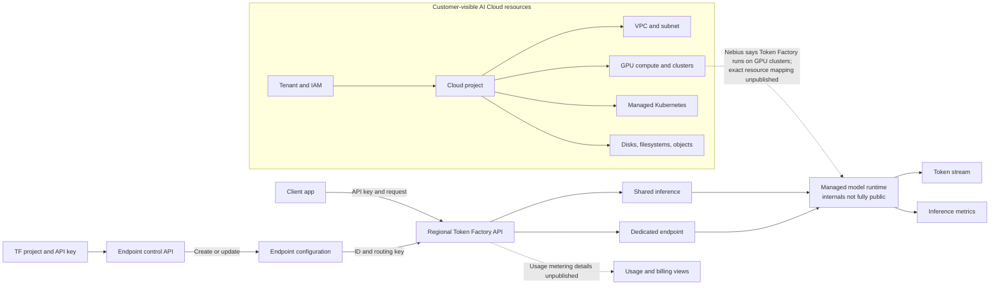

# 20.30 From AI factory to Token Factory: a public architecture map

The interviewer asks you to trace GPU capacity to a reliable token API. You know serving basics, but must reason inward from the cloud boundary. Drawing a gateway, router, Kubernetes cluster, and workers as Nebius's architecture would overstate what is public.

This chapter maps customer-visible AI Cloud and Token Factory layers. It separates product documentation, workload examples, and your own design. Trace what customers configure, what the API exposes, where metrics appear, what capacity means, and who owns recovery.

With an interview about a month away, learn the request path, capacity caveats, and evidence boundary. Those let you answer confidently when internals are unpublished.

This chapter opens a four-part architecture series. Chapter 20.31 follows the AI Cloud substrate; 20.32 traces Token Factory's model and request lifecycle; 20.33 builds customer architecture and recovery patterns. Together the series exceeds 20,000 words without turning one chapter into a reference wall.

## What the interviewer is testing

This chapter serves the system-design and incident rounds. Nebius's process describes load, availability, compute, and storage trade-offs; the job posting adds routing, GPU autoscaling, observability, SLOs, and cross-layer debugging.

Likely prompt: “Walk me from GPU capacity to a Token Factory response. What is managed, how is it billed, and what happens when capacity disappears?” The interviewer wants evidence-aware reasoning, not a fictional internal diagram.

## The core ideas

### 1. Draw the product boundaries before the boxes

Imagine a platform team choosing between operating its own GPU service and sending requests to a managed model API. The hardware may be similar; the customer's operating boundary is not.

Nebius AI Cloud is the broader cloud service. Its public catalogue describes compute, storage, virtual networking, identity, Kubernetes, monitoring, logs, and other managed services. A customer can use these resources to build and operate an AI factory. Nebius Token Factory is a managed model-inference service with its own organization and project surface, model catalog, endpoint lifecycle, API keys, inference API, metrics, and billing documentation.

There are two different products called serverless in this landscape. **Serverless AI** in AI Cloud runs customer-supplied containers as Devlabs, jobs, or endpoints. **Token Factory Public Serverless** exposes Nebius-hosted model APIs. One lets you deploy your own application; the other gives you a model API. This distinction changes who manages the runtime, what you can configure, where requests run, and how you pay.

With customer-managed Kubernetes, you choose node groups, deploy engines, configure the gateway, and own cluster operations. With a Token Factory Dedicated Endpoint, you choose a supported template, region, GPU configuration, and replica range; Nebius manages the service infrastructure. You do not get the provider's Kubernetes control surface.

Separate official product facts from vendor case-study results and your own design inference. *Scalable Kubernetes Infrastructure for AI Platforms*, Chapter 4, gives a generic serving-layer vocabulary; it is not evidence of Token Factory's internal topology.

The diagram marks a published high-level GPU substrate but not the topology behind each endpoint.

**Start every architecture answer by saying which side of the managed-service boundary you are describing.**

### 2. Start with the AI Cloud building blocks, not a Token Factory guess

A data scientist asks for an endpoint. The AI Cloud catalogue exposes the customer-managed building blocks for identity, networking, capacity, images, artifacts, and telemetry.

An AI solutions architect first chooses the operating boundary. The table is the short version; each service has its own limits, region availability, pricing, and support terms.

| Service choice | What Nebius manages | What your team owns | A fit when |
|---|---|---|---|
| Compute VMs and GPU clusters | Physical capacity, VM provisioning, and the GPU-cluster fabric | OS, drivers where not preinstalled, runtime, serving, monitoring, and repair policy | You need host control or a custom stack |
| Managed Kubernetes | Kubernetes control plane and cluster operations | Workloads, node-group shape, policies, operators, and application reliability | You need container orchestration and custom serving |
| Managed Soperator | Managed Slurm clusters built with Kubernetes and Nebius's Soperator | Training jobs, images, environment, data, and job-level recovery | You need Slurm workflows for distributed training |
| [AI Cloud Serverless AI](https://docs.nebius.com/serverless/overview) | Container resource provisioning and endpoint/job lifecycle; usage-based per-second billing | Your container, model server, request contract, and application | You want to run a custom container without managing a cluster |
| Token Factory Public Serverless | Model catalog and shared model-serving service | API client, prompts, application policy, and tolerant regional routing | You are evaluating models or can accept global/shared behavior |
| Token Factory Dedicated Endpoint | Managed endpoint deployment and replicas | Model/template choice, region, GPU/replica settings, keys, SLOs, and recovery around the endpoint | You need a stable model endpoint with explicit hardware and region settings |

The project and IAM hierarchy is covered below. Compute offers GPU VMs and InfiniBand-connected GPU clusters. Its [topology guide](https://docs.nebius.com/compute/clusters/gpu/topology/index) describes scalable-unit, POD, and fabric layers. Topology-aware placement improved NCCL all-reduce by up to 20 percent in some tested sizes; treat this as workload-specific evidence, not a guarantee.

Nebius's product blog says Token Factory runs on dedicated NVIDIA GPU clusters in data centers the company owns and operates across Europe and the US. This is a high-level statement about the substrate, not a rack diagram or evidence that every endpoint uses the same cluster design.

Storage roles differ: Network SSD for durable VM disks, local SSD for ephemeral scratch, shared filesystems for common data or weights, Object Storage for datasets and artifacts, and Container Registry for images. The [storage guide](https://docs.nebius.com/compute/storage/types) says NRD has no redundancy and local SSD disappears when its VM stops. Pick from recovery needs, not bandwidth alone.

Virtual Networks currently supports IPv4, with project defaults for networks, subnets, pools, routes, and DNS; security groups filter resource traffic. Plan address ranges and egress before attaching workloads, because changing active network resources can be disruptive. Nebius exposes console, CLI, SDK, and Terraform interfaces, so keep repeatable foundations in IaC. Cloud Observability includes preview services; verify their stage and limits before production use.

The catalogue describes what customers can build. It does not reveal the compute, network, storage, or orchestration graph behind every Token Factory endpoint.

**Use the cloud catalogue to explain the build-your-own platform path, not to invent Token Factory internals.**

### 3. Follow the identity, project, and billing boundaries

Endpoint access starts with identity, not GPU selection. Both products use projects, but their credentials and permissions are separate.

Nebius AI Cloud documents a tenant-to-project hierarchy in its [IAM guide](https://docs.nebius.com/iam/overview). Projects contain cloud resources such as VMs, Kubernetes clusters, networks, and storage. Groups define user or service-account permissions. Quotas constrain resource use. Tenant-level configuration includes billing and identity settings, while project-level resources inherit access controls from their scope.

Token Factory documents a separate organization-to-project hierarchy. Its [project guide](https://docs.tokenfactory.nebius.com/team-access/org-projects) lists API keys, dedicated endpoints, fine-tuning jobs, files, and datasets as project resources. Project permissions govern access to those resources. This is the customer-facing boundary for organizing model and inference work.

Its role model also separates finance from engineering. An Organization Admin manages all projects; an Organization Billing Manager sees usage and changes billing settings but cannot access project resources. A Project Admin manages project access. A Project Member can manage project resources and its own API keys, including Dedicated Endpoints. This lets an architect grant finance cost visibility without handing over inference keys or endpoint control.

An inference API key authorizes a request to Token Factory. A Nebius AI Cloud service-account credential authorizes management of cloud resources through the Nebius interfaces. They solve related but different access problems. Do not assume that a Token Factory API key is an IAM token, or that a cloud service account automatically authorizes inference.

Billing also crosses product boundaries. [Token Factory billing](https://docs.tokenfactory.nebius.com/other-capabilities/billing-new) describes its own billing account, balance, payment methods, transactions, and usage views. Nebius AI Cloud separately documents [cloud budgets](https://docs.nebius.com/signup-billing/budgets) and resource charges. If a company uses both products, an engineer should reconcile the relevant billing surfaces rather than assume a single GPU-utilization chart represents the full invoice.

The Token Factory billing guide documents balance top-ups, card thresholds, usage reports, and company bank-transfer invoices. A failed card charge can suspend the account, so payment configuration is part of production readiness.

Nebius AI Cloud budgets track pay-as-you-go spending and send alerts when thresholds are crossed. They do not stop or cap usage, and the documentation says usage data updates every few hours. Treat a budget as a notification, not a circuit breaker. If you need an actual usage limit, investigate quotas and the product's enforcement controls.

AI Cloud uses [pay-as-you-go by default](https://docs.nebius.com/signup-billing/billing-models/overview) and offers commitment discounts for eligible company accounts; the models can be combined. [GPU capacity block groups](https://docs.nebius.com/overview/limits/capacity-block-groups) reserve a platform, region, and InfiniBand fabric for VMs or Kubernetes node groups. They are capacity and commercial constructs, not the same as project quotas or Token Factory `max_replicas`.

**Identify the product, project, credential, and usage surface before diagnosing an access or billing complaint.**

### 4. Trace one request through the documented API

A customer has created a dedicated endpoint and asks which identifier belongs in an inference call. The control plane returns one identifier for managing the resource and another value used to route inference. Knowing that difference makes the public architecture much less mysterious.

The [dedicated-endpoint API guide](https://docs.tokenfactory.nebius.com/ai-models-inference/dedicated-endpoints/deploy-api) describes a three-step flow. First, list available model templates. Second, create a dedicated endpoint from a valid template. Third, send inference requests to the data plane. The template response is the source of truth for supported combinations of model, flavor, GPU type, GPU count, and region.

When the endpoint is created, the response includes an `endpoint_id` and a `routing_key`. The `endpoint_id` is used for endpoint management through the control plane. The `routing_key` is passed as the model identifier in OpenAI-compatible inference requests. Requests go to a region-appropriate data-plane URL under `/v1`.

Dedicated endpoint management uses the common control-plane base URL `https://api.tokenfactory.nebius.com`. The data plane uses the endpoint's region. The current control/data-plane guide maps `eu-north1` to the common hostname, while `eu-west1` and `us-central1` have region-specific hostnames. Use the URL from the current docs and created endpoint, not a hostname copied from an old example. Public Serverless is a different case: its location is Global and can change.

The control API manages the deployment; the regional API serves requests. Provisioning takes time, and early requests may return `404`. Check readiness before retrying.

The [FAQ](https://docs.tokenfactory.nebius.com/ai-models-inference/dedicated-endpoints/faq) maps `401` to missing/invalid auth, `403` to permissions, `404` to readiness/host/routing-key, `409` to capacity/configuration, and `422` to invalid template fields. Classify these before blaming the model server.

The API docs expose the customer boundary, not the gateway topology, credential propagation, control-state synchronization, or worker-selection algorithm. The routing key selects the endpoint; it does not document how a replica is chosen. State this boundary rather than presenting a design guess as fact.

| Public interface | Customer-visible purpose | What is not specified publicly |
|---|---|---|
| Token Factory API key | Authenticates the client to Token Factory | Internal token validation and propagation path |
| Control-plane API | Lists templates and manages endpoints | Internal storage, reconciliation, and control-service topology |
| `endpoint_id` | Identifies the endpoint for lifecycle operations | Internal resource identifiers behind the endpoint |
| `routing_key` | Selects the dedicated endpoint in inference requests | How the key maps to workers and replicas internally |
| Regional `/v1` endpoint | Receives OpenAI-compatible inference calls | The complete gateway, proxy, and load-balancing topology |

**Explain the request path from the API key to the regional data plane, then stop where the docs stop.**

### 5. Compare shared and dedicated inference as capacity products

A team starts with a few experiments, then receives a production commitment with a latency target. The first service may be economical and simple. The second may need a predictable baseline and a known region. The product choice changes both the capacity model and the bill.

The [endpoint overview](https://docs.tokenfactory.nebius.com/ai-models-inference/dedicated-endpoints/overview) describes two Token Factory inference products. Public Serverless uses shared multi-tenant capacity, dynamic rate limits, and per-token prices. Its Region is `Global`: processing location can change without notice, so a region-specific base URL can stop working. Nebius says this option is for testing and non-critical workloads where region variability is acceptable, not production that requires stable residency or capacity.

Dedicated Endpoints are different: they bind a model deployment to a chosen region and let the customer set GPU type, GPUs per replica, and minimum/maximum replicas. The [legal quick guide](https://docs.tokenfactory.nebius.com/legal/legal-quick-guide) says this region choice is a DPA commitment and the service does not use multi-region routing or automatic overflow/failover. Pricing is per GPU-hour at per-minute granularity. In the current model, an EU-resident production endpoint cannot silently spill into the US during an EU capacity shortage.

“Shared” does not mean every model is always available. The [November 9, 2026 notice](https://docs.tokenfactory.nebius.com/november-2026-deprecation-notice) lists model IDs removed from Public Serverless on that date and says Dedicated Endpoints are unaffected. Do not infer that all serverless inference was removed. Check the live catalog before recommending a model.

A dedicated endpoint is not “pay only for generated tokens.” Its cost is tied to GPU capacity and active time. More GPUs per replica can improve per-replica performance or make a larger model fit, but raise baseline cost. More replicas raise traffic capacity and can help availability while active, but they also increase the amount of capacity being billed. Minimum replicas set the baseline; maximum replicas bound a possible scale-out, not a promise that GPUs will be available.

This differs from the customer-side AI Cloud options. A team operating its own GPU VMs or Kubernetes node groups makes its own decisions about reserved capacity, on-demand resources, preemptible instances, cluster scale, and idle time. Do not copy the VM reservation rules onto Token Factory Dedicated Endpoints. Token Factory's dedicated-endpoint capacity page describes a separate self-service on-demand model and says to contact sales for capacity guarantees.

**Choose shared inference for variable workloads only after checking model availability and limits; choose dedicated capacity when its controls justify the baseline cost.**

### 6. Read endpoint deployment and readiness as a state machine

A customer sees an endpoint marked “created” and immediately sends production traffic. The first requests fail, so the team assumes the API is broken. The deployment state and the ability to serve requests are separate facts.

Token Factory's [lifecycle guide](https://docs.tokenfactory.nebius.com/ai-models-inference/dedicated-endpoints/lifecycle-and-status) separates operation state from traffic readiness. Starting, running, and updating describe lifecycle; ready, partially ready, and not ready describe serving capability. A running endpoint may still be degraded, and an update can temporarily reduce capacity. Send traffic based on readiness, not the lifecycle label or a successful control response.

Dedicated deployment configuration includes model template, flavor, region, GPU type, GPU count per replica, and replica scaling bounds. Custom model weights are documented as a beta capability with access and configuration subject to support. Do not assume every model accepts arbitrary fine-tuned weights or that an update preserves the same warm cache and capacity.

The [endpoint operations guide](https://docs.tokenfactory.nebius.com/ai-models-inference/dedicated-endpoints/operating) says `gpu_count` is per replica, so maximum footprint is `gpu_count × max_replicas`. `region` cannot be patched; migration requires a new endpoint and traffic/data cutover. Disabling stops and frees capacity. The OpenAPI schema exposes optional `reservation_policy`; confirm eligible IDs and contract terms rather than assuming a VM reservation applies.

A customer rollout should define readiness, traffic cutover, and rollback criteria. Canarying and draining are customer design choices unless a current product page documents them.

| Lifecycle | Readiness | Operational reading |
|---|---|---|
| Starting | Not ready | Provisioning; do not assume requests will succeed |
| Starting | Partially ready | Some capacity may serve while scale-up continues |
| Updating | Ready | Traffic may continue, but watch for temporary capacity loss |
| Running | Partially ready | Degraded capacity; check active replicas and latency |
| Running | Not ready | Unexpected outage or severe deployment problem |
| Stopped | Not ready | Endpoint is intentionally unavailable |

The lifecycle documentation advises contacting support if a warning or partial-readiness condition remains unresolved for more than three hours. That is a support escalation threshold, not an acceptable recovery-time objective for your application.

**Send traffic based on readiness, and judge an update by serving capacity rather than by a successful control-plane response.**

### 7. Separate the serving concepts from the serving implementation

An AI solution architect decides whether to serve a catalog model, adapt one, or run a customer-owned runtime. Token Factory documents text, embedding, and vision model families, an OpenAI-compatible API, and a separate post-training surface. The [Data Lab](https://docs.tokenfactory.nebius.com/data-lab/overview) can collect chat logs, build reusable datasets, and hold batch and fine-tuning outputs. That creates a potential loop from inference to evaluation and post-training, but what data exists depends on retention settings.

The [legal quick guide](https://docs.tokenfactory.nebius.com/legal/legal-quick-guide) is essential architecture input. It says prompts and outputs may be retained for speculative decoding unless Zero Data Retention is enabled; they are not used to train models. ZDR is organization-scoped, prevents retention and speculative decoding, and may reduce inference speed. Data Lab collects chat logs unless ZDR is on. Fine-tuning has a separate data path: the guide says fine-tuning artifacts are stored in the EU even when US jobs are processed in the US. Draw inference data, training data, and operational telemetry as distinct flows, then validate each against the DPA and current Data Lab processing guide.

Token Factory's [post-training overview](https://docs.tokenfactory.nebius.com/post-training/overview) describes supervised fine-tuning on full weights or LoRA adapters, plus custom speculator training. The [custom-weight endpoint guide](https://docs.tokenfactory.nebius.com/ai-models-inference/dedicated-endpoints/custom-weights) still marks deployment of custom weights as beta and available on request. Treat this as an evolving integration, not a general assumption that any checkpoint can be uploaded and served immediately.

At inference time, the [model overview](https://docs.tokenfactory.nebius.com/ai-models-inference/overview) lists continuous batching, paged attention, KV cache, context caching, flash attention, quantization, and speculative decoding. Base and fast flavors trade latency, throughput, and price; the fast flavor uses smaller batches and additional compute or speculative decoding according to the product description. These are documented capabilities, not a disclosure of the engine, scheduling policy, or exact optimization mix used by every template.

The generic serving mechanism belongs in linked chapter 20.13 and Part 15: prefill processes prompt context; decode produces output tokens; batching, GPU memory, and cache determine useful throughput. A Nebius conversational-workload blog reports a proof of concept with specialized prefill/decode pools and backpressure. It is evidence of one design exercise, not a universal Token Factory topology.

**Learn the serving physics, but name a particular engine or topology only when a source does.**

### 8. Understand cache-aware routing from the published examples

An agent sends a chain of requests that reuse a long context. If requests land on different replicas, each one may repeat prefill instead of reusing work. This is where model-runtime behavior becomes an API routing and unit-cost concern.

Token Factory's [Cached Tokens guide](https://docs.tokenfactory.nebius.com/cached-tokens) adds important product specifics. Prefix caching is automatic and best-effort. Stable prompt prefixes are most useful; the caller need not set a cache key. Chat responses report the count as `prompt_tokens_details.cached_tokens`; streaming clients need `stream_options.include_usage` to receive usage in the final chunk. Public Serverless bills cached input at a model-specific token price. Dedicated Endpoints use GPU-time billing, so cache hits can improve throughput and latency without changing the bill directly.

Cache scope is a security and architecture decision. The docs say Public Serverless cache is shared within a model, regardless of organization, project, or API key. Dedicated Endpoint cache is isolated per customer. The cache stores derived computation rather than prompt text and is not exposed as readable content. Nebius says caching works with ZDR, but it is not an access-control boundary; do not put secrets in a prefix expecting isolation. `prompt_cache_key` can influence routing toward a cache holder; it is not a credential. Cache hits are best-effort and can disappear through eviction, model or service updates, or replica changes.

Nebius's [routing experiment](https://nebius.com/blog/posts/routing-is-the-difference-between-scaling-and-stalling) used 300 concurrent agent trajectories and compared one and three vLLM replicas. Its cache-aware router preferred a replica with a better KV match, falling back when overloaded. In that workload, average step time nearly halved and p95 fell from over a minute to under twenty seconds. The article did not test a standalone least-request baseline and calls memory-aware routing an open issue. Do not turn this single experiment into a promise about every endpoint.

For an interview, pair the cache hit signal with queue depth and latency. A cache-only router can send too much work to one replica. A reasonable customer-side design balances prefix locality against load and fails away from unhealthy workers. That is your design proposal, not a documented Token Factory routing contract.

**Treat cache locality as a performance signal, not permission to send every request to the same replica.**

### 9. Read the telemetry and the bill as separate views

A dashboard says GPU utilization is low while the customer says the endpoint is slow. Another dashboard shows high token throughput but says nothing about whether the endpoint is meeting a service target. You need workload-level signals and you need to know which dashboard answers which question.

Token Factory [Inference Observability](https://docs.tokenfactory.nebius.com/ai-models-inference/observability) currently says these metrics are accessible only for Dedicated Endpoints. It exposes requests and tokens per minute, prompt/output-size distributions, p50/p90/p99 latency, streaming TTFT, output speed, active replicas and GPUs, average and busiest GPU utilization, status-code errors, and KV-cache hit rate. Metrics can be filtered by endpoint, project, API key, region, error, prompt length, and latency range; some capacity metrics depend on pricing model. For Public Serverless, do not assume this dedicated-endpoint metrics dashboard exists.

The Token Factory metrics page says metrics are collected in the inference region and eventually stored in `eu-north`. Its Prometheus integration uses a static API key scoped to a project, and recommends a scrape interval of at least 15 seconds. That detail matters in a residency and credentials review. Do not infer from a region-locked endpoint that metrics, traces, audit events, or billing records have identical data locations.

Nebius AI Cloud's separate Observability service combines metrics, logs, traces, dashboards, and alerts for supported cloud resources. Its service catalogue currently marks Observability as preview. It can monitor your own VMs and Kubernetes workloads; it is not the same product surface as Token Factory inference observability. Verify regional availability, retention, quota, and lifecycle status before making it a production dependency.

For a customer-operated service, measure user-facing behavior at the gateway and use engine metrics to explain the cause. The neighboring chapters 20.13 and 20.19 cover gateway design, token-API SLIs, SLO arithmetic, and burn-rate alerts in depth. In this chapter, the point is narrower: Token Factory exposes an operational view, but its docs warn you not to treat that view as a billing ledger.

For billing, Public Serverless is metered by input, cached-input, and output tokens where cached-input pricing is offered. Dedicated Endpoints are billed by GPU time with per-minute granularity; cached tokens can improve performance but do not reduce the GPU-hour bill. Check current model and region prices rather than memorizing a blog figure.

A reliable interview answer separates billable usage, operational utilization, and a budget alert. High GPU utilization is not itself a bill. AI Cloud budgets only notify; they neither stop nor cap usage and can lag recorded spend. Use the relevant product's usage report for reconciliation, not a utilization chart.

**Use inference metrics to operate the endpoint and the billing surface to reconcile charges.**

### 10. Treat high availability as a capacity and ownership question

A configured minimum may look like a recovery guarantee until an endpoint is interrupted and its GPUs return to the shared pool.

The [capacity and availability documentation](https://docs.tokenfactory.nebius.com/ai-models-inference/dedicated-endpoints/capacity-and-scaling) says self-service deployments use on-demand capacity from a shared pool. Minimum replicas remain allocated while the endpoint is active, but this is not a long-term reservation. If the endpoint stops, including because of an incident or scheduled or emergency maintenance, its capacity is released. When it starts again, it requests capacity from the pool anew. The docs warn that it may remain starting or partially ready, or that capacity may be unavailable during high demand.

Billing has a separate state rule. The [Dedicated Endpoint billing policy](https://docs.tokenfactory.nebius.com/ai-models-inference/dedicated-endpoints/billing-policy) says zero running replicas means inaccessible and not billed, while one or more running replicas make the endpoint active and billable. Its table separately lists provisioning, `not_ready`, and `partially_ready` as not billed, and `ready` as billed. Because the prose trigger and readiness table can be read differently for a partially-ready endpoint that has a running replica, confirm that case with support or the contract rather than infer an invoice from status alone.

Maximum replicas cap burst scale but do not guarantee capacity after scale-down. Self-service endpoints have no formal SLA unless covered by contract. A Nebius chat-app case study mentions X+1 and a 99.9 percent SLA; do not generalize that customer or contract statement to every endpoint. Ask Sales about reserved capacity if restart guarantees matter.

AI Cloud [capacity block groups](https://docs.nebius.com/overview/limits/capacity-block-groups) reserve GPUs for qualifying VMs or Kubernetes node groups and connect to a chosen platform, region, and fabric. The current Token Factory [Create Dedicated Endpoint OpenAPI schema](https://docs.tokenfactory.nebius.com/api-reference/dedicated-endpoints/create-dedicated-endpoint) also exposes an optional `reservation_policy` object with policy and reservation-ID fields. Its customer-facing capacity guide still directs capacity-guarantee requests to Sales and does not fully explain that field's eligibility or guarantee. An architect should verify its meaning and accepted IDs for the account; do not assume a raw VM reservation and endpoint reservation are interchangeable.

Alert on readiness and active capacity. Set baseline replicas from measured demand and settle contractual capacity before promising recovery. Design retries and degraded behavior explicitly; customer logic does not create a provider guarantee.

Managed Kubernetes has a separate, documented repair path. Its control plane defaults to three etcd stores. The [cluster autoscaler](https://docs.nebius.com/kubernetes/node-groups/autoscaling) adds nodes for unschedulable Pods and removes underused ones. [GPU health checks](https://docs.nebius.com/kubernetes/maintenance/health-checks) can cordon a faulty node, drain workloads, replace the VM, and uncordon it; a drain can take up to an hour. This does not describe Token Factory's hidden workers. A CPU node group can keep Cilium and CoreDNS running while GPU nodes scale down.

**A configured replica count is not an availability contract; name the capacity promise and its failure boundary.**

### 11. Build a recovery plan without inventing automatic failover

Nebius documents two different regional behaviors. Public Serverless is marked `Global`; its processing location can change without notice, and a region-specific base URL can stop working. Dedicated Endpoints are different: the [legal guide](https://docs.tokenfactory.nebius.com/legal/legal-quick-guide) makes the chosen region a contractual processing boundary and explicitly says Token Factory does not provide multi-region routing, load balancing, or automatic overflow/failover. The endpoint's region cannot be changed after creation.

For application-level failover, provision and test a second endpoint, confirm the data may move there, and check model version, weights, keys, capacity, and rollback. Otherwise define a degraded mode and escalation path.

Public endpoint limits are dynamic and may return `Retry-After`; Dedicated Endpoints have no standard rate limits and throughput depends on deployed capacity. Some 429s still indicate capacity or limit errors. Read the response and metrics, use bounded retries with jitter, and do not replay a partial stream unless it can resume. Chapters 20.21 and 20.26 cover the generic retry and incident method.

A small evidence matrix makes the boundary explicit:

| Failure | Public signal or documented behavior | Safe first response | Do not assume |
|---|---|---|---|
| Request rejected with 429 | Rate-limit or capacity class; public limit headers may be available | Read headers and endpoint metrics; reduce or smooth demand | That every 429 has the same cause or retry delay |
| Endpoint is still provisioning | Lifecycle and readiness state; early requests may fail | Wait on readiness and avoid a retry storm | That a created endpoint is already routable |
| Partial readiness | Some capacity may serve below expectation | Check active replicas and user-facing latency | That `Running` means full capacity |
| Endpoint stopped by incident or maintenance | Self-service GPUs are released to the shared pool | Inspect state, contact support if needed, invoke the customer recovery plan | That prior GPUs return automatically |
| Region unavailable | Dedicated Endpoint stays in its chosen region; Public Serverless is Global | Follow the customer's residency-approved application policy | That the provider will overflow a Dedicated Endpoint elsewhere |
| Billing alert crossed | Budget and usage surfaces report spend | Find the project/service/resource and apply an approved control | That a budget alert stops further charges |

**Fail over only to a tested destination that is allowed to receive the data and has usable capacity.**

### 12. Keep a reference design ready for the interview

The interviewer asks, “What would you propose for a company launching an AI product on Nebius?” Begin with discovery, not a diagram. A solutions architect should ask whether the workload is training or serving, model size and modality, request and token rates, context lengths, streaming requirements, TTFT/TPOT targets, peak-to-average ratio, retention requirements, regions, recovery target, and monthly budget.

Then choose the right operating boundary. For a standard model and variable experimentation traffic, Public Serverless is quickest if global processing location and dynamic limits are acceptable. For a production model with stable-region and hardware needs, propose a Dedicated Endpoint and explicitly design around its region, GPU count, replica range, billing states, and lack of provider failover. For a custom container, compare AI Cloud Serverless AI with Managed Kubernetes. For distributed training, consider Soperator or GPU VMs with an InfiniBand cluster. State what the customer operates in each option.

Build the foundation around the chosen path: tenant and project separation, group roles, quotas, service-account or API-key handling, VPC address and security design, model/data storage, artifact registry, and cost allocation. Map model development from datasets or Data Lab through fine-tuning/checkpoints and into an endpoint, while confirming ZDR and regional data rules. Put the customer gateway in front only when you need product-specific auth, quotas, routing, or policy; do not present it as a Nebius component.

Finally, show operations: user-facing SLOs, endpoint readiness, cache and token metrics, cloud resource health, budget and usage reports, rollback, capacity limits, and a residency-approved recovery plan. **Name one owner for each layer and one signal that tells that owner to act.**

**Design the customer-owned edge around the published service contract, not around an imagined provider topology.**

## How to answer out loud

Use this 90-second opening when the interviewer asks how Token Factory works:

> “I’d separate Nebius AI Cloud from Token Factory. AI Cloud exposes customer resources such as GPU compute, networks, storage, Kubernetes, IAM, quotas, and observability. Token Factory is a managed inference service with its own organization and projects. For a dedicated endpoint, the public API lets a customer select a supported template and region, configure GPU shape and replica bounds, and then call an OpenAI-compatible regional data plane using the returned routing key. The public docs expose lifecycle, readiness, metrics, and pricing boundaries. They don’t reveal the internal gateway or router implementation. I would monitor readiness and user-facing latency, respect the capacity limits, and design customer-side recovery without assuming automatic cross-region failover.”

Then rehearse four likely follow-ups:

- **“How does a request find its deployment?”** The control API returns an endpoint ID and routing key. The client sends the key to the regional `/v1` API. The internal gateway and router are not documented.
- **“Why can more replicas hurt?”** Related requests can lose cache locality across workers. The published vLLM experiment shows a case where cache-aware routing improved results, but load still bounds locality.
- **“What does high availability mean here?”** Minimum replicas apply while active, not after stop or interruption. Ask about reserved capacity, then propose only a tested, residency-approved fallback.
- **“How is the service billed?”** Public serverless is per token; dedicated endpoints are per GPU-hour with per-minute granularity. Do not use utilization dashboards to reconcile charges.

With a month to prepare, spend week one mapping product boundaries and the request path. In week two, rehearse billing, caching, and capacity trade-offs. In week three, practise recovery scenarios with 20.18, 20.19, and 20.26. In the final week, recheck the live docs and give the architecture answer aloud.

## Worked scenarios

### Scenario 1: A request fails just after endpoint creation

A developer lists a template, creates a dedicated endpoint, receives an endpoint ID and routing key, and sends a chat request immediately. The call returns `404`. The endpoint object exists, and the developer's first instinct is to increase client retries.

Creation may take several minutes. Check lifecycle and readiness before retrying; early `404` is documented while the endpoint is not routable. If it is ready, verify the bearer key, routing key, and regional base URL. Do not diagnose an internal router fault from an early request.

### Scenario 2: Three replicas do worse than one

An agent workload reuses context across sequential requests. The team scales vLLM from one replica to three, but p95 gets worse. Nebius's experiment found that default ClusterIP routing scattered related requests; its cache-aware router preferred a matching KV cache and fell back when overloaded. The reported improvement is for that test, not a product guarantee, and no least-request-only baseline was measured.

Measure prompt length, per-replica queue, cache hits, active replicas, TTFT, and tail latency. Propose a bounded cache-aware policy as your design, not as Nebius's published router.

### Scenario 3: Recovery after capacity is released

A dedicated endpoint is interrupted during maintenance. The customer sees it starting and partially ready, while the previous minimum replica count is not yet back. Product asks whether to send traffic to another region.

The endpoint releases self-service GPUs when stopped and requests capacity again at restart. Do not promise the same GPUs or a recovery time. Before failover, verify residency, model/config parity, and warm capacity in the alternate region. If no tested alternative exists, use the approved degraded mode, shed or bound work, communicate impact, and ask Sales about contractual capacity after service returns.

## Hands-on lab

This lab is designed to be safe without a Nebius account or paid GPU deployment. It tests whether you can distinguish product facts from your own architecture proposal.

1. Open the Token Factory dedicated-endpoint API guide and write down the sequence: list templates, create endpoint, receive endpoint ID and routing key, call the regional `/v1` API. **Expected:** identify which value manages the endpoint and which selects it for inference.
2. Draw the AI Cloud resource plane separately from Token Factory. Label tenant, project, identity, compute, storage, endpoint control, data plane, metrics, and billing. **Expected:** do not imply that customer-managed Kubernetes is the Token Factory implementation.
3. Build a three-column evidence sheet: documented, case-study-only, and unpublished. **Expected:** lifecycle and readiness are documented; cache-routing measurements are case-study evidence; the production router implementation is unpublished.
4. Add a recovery row for a stopped endpoint. Include released capacity, restart behavior, measurements, and questions for support or sales. **Expected:** the plan does not promise that the old GPUs return.
5. Rehearse the opening answer in 90 seconds. Ask a partner to interrupt with “How does the internal router work?” **Expected:** distinguish evidence from inference without losing the thread.

I checked the official web documentation and linked Nebius posts on 2026-11-09. I did not create a Token Factory endpoint, call a billable API, or verify account-specific capacity. Treat live product behavior, prices, model templates, and capacity as items to recheck before an interview.

## Drill questions

1. What is the difference between Nebius AI Cloud and Token Factory?

Answer

Nebius AI Cloud is the broader customer-facing cloud resource platform. Token Factory is a managed inference service with its own organization, projects, endpoints, APIs, metrics, and billing surface. Do not assume Token Factory exposes its internal cloud resources.

2. What are the endpoint ID and routing key for?

Answer

The endpoint ID is used to manage the deployment through the control plane. The routing key is used as the model identifier in inference requests to the regional data plane.

3. Why are lifecycle and readiness separate?

Answer

Lifecycle says what operation the deployment is undergoing. Readiness says whether it can serve traffic now. A running endpoint can still be partially ready or not ready.

4. What does a maximum replica count guarantee?

Answer

It sets a scale-out ceiling, not a guarantee that GPU capacity will be available. Additional replicas depend on capacity in the region.

5. What does a minimum replica count guarantee after an endpoint stops?

Answer

For self-service dedicated endpoints, minimum capacity applies while the endpoint is active. When it stops or is interrupted, the GPUs are released, and restart requests capacity again.

6. What is the evidence for cache-aware routing at Nebius?

Answer

Nebius has published specific conversational and vLLM workload experiments. Those describe cache-aware routing and report measured gains for those workloads; they do not document a universal router contract for all Token Factory endpoints.

7. Why is Token Factory observability not a billing ledger?

Answer

The observability documentation says its metrics support operational debugging and performance analysis, not billing reconciliation. Use the product's usage and billing surfaces for charges.

8. What happens to self-service GPU capacity after a stop or incident?

Answer

The endpoint releases capacity to the shared pool. On restart it requests capacity again, so it may take time to become ready or may not reacquire the same capacity.

9. Does the public documentation promise automatic cross-region failover?

Answer

The sources checked here describe region selection and regional endpoints but do not document automatic cross-region failover. Treat failover as a customer-side design unless a current product document or contract says otherwise.

10. How do you answer a question about an unpublished internal gateway?

Answer

State what the public API exposes, say that the internal implementation is not published, then offer your design as a proposal rather than a fact about Nebius.

## Common mistakes and weak answers

- Do not call a customer-visible AI Cloud resource map the internal Token Factory topology.
- Do not conflate Token Factory API keys with AI Cloud IAM service-account credentials.
- Do not describe a cache-routing case study as a universal endpoint feature or guarantee.
- Do not treat a configured maximum as reserved GPU capacity, or a running endpoint as fully ready.
- Do not infer billing from GPU utilization or treat cloud budgets as spending caps.
- Do not promise cross-region failover, an SLA, or restoration of previous GPU capacity without a current source or contract.

## Connections to the rest of the handbook

- [20.31 Nebius AI Cloud foundation](./31-nebius-ai-cloud-foundation-gpu-fabric-and-platform-choices.md) — facilities, GPU/fabric, storage, network, and service selection.
- [20.32 Token Factory lifecycle and serving](./32-token-factory-model-lifecycle-serving-and-economics.md) — deployment API, caching, billing, data controls, and observability.
- [20.33 Production AI Factory patterns](./33-ai-factory-solution-architecture-ha-and-recovery.md) — solution-architect designs, economics, SLOs, and failure recovery.
- [20.12 Estimation toolkit for inference capacity](./12-estimation-toolkit-for-inference-capacity.md) — convert traffic and model shape into GPU and cost estimates.
- [20.13 Design: a multi-tenant LLM inference API](./13-design-a-multi-tenant-llm-inference-api.md) — design the gateway, router, quotas, and failure policy rather than reverse-engineering Nebius internals.
- 20.14–20.16 — dedicated endpoint rollout, observability pipelines, and GPU fleet capacity.
- [20.18 How LLM serving fails](./18-how-llm-serving-fails.md) — diagnose queue, cache, runtime, and recovery failures.
- [20.19 SLIs, SLOs and alerts for token APIs](./19-slis-slos-and-alerts-for-token-apis.md) — define user-facing signals and paging policy.
- 20.20–20.21 — GPU inference autoscaling, routing, and retries.
- Handbook Parts 15–18 — inference engines, MLOps, operations, reliability, observability, and security.

## Sources and review notes

Official product documentation indexes checked 2026-11-09: [Nebius AI Cloud](https://docs.nebius.com/llms.txt) and [Token Factory](https://docs.tokenfactory.nebius.com/llms.txt). These indexes were used to map the relevant product, compute, storage, network, Kubernetes, IAM, billing, security, inference, and post-training documentation. The chapter does not claim to describe every unrelated service page. Model templates, prices, and service status change; recheck current docs before quoting them.

- **Cloud foundation:** [services](https://docs.nebius.com/overview/services), [IAM](https://docs.nebius.com/iam/overview), [GPU VM hosting walkthrough](https://docs.nebius.com/compute/quickstart-host-model), [InfiniBand topology](https://docs.nebius.com/compute/clusters/gpu/topology/index), [VPC](https://docs.nebius.com/vpc/overview), [Compute storage](https://docs.nebius.com/compute/storage/types), and [Object Storage](https://docs.nebius.com/object-storage/overview).
- **Managed platform and capacity:** [Kubernetes components](https://docs.nebius.com/kubernetes/components), [node-group autoscaling](https://docs.nebius.com/kubernetes/node-groups/autoscaling), [node health and recovery](https://docs.nebius.com/kubernetes/maintenance/health-checks), [capacity block groups](https://docs.nebius.com/overview/limits/capacity-block-groups), and [cloud billing models](https://docs.nebius.com/signup-billing/billing-models/overview).
- **Token Factory control and deployment:** [organizations/projects](https://docs.tokenfactory.nebius.com/team-access/org-projects), [group access](https://docs.tokenfactory.nebius.com/team-access/groups), [control/data planes](https://docs.tokenfactory.nebius.com/ai-models-inference/dedicated-endpoints/control-data-plane), [create endpoint OpenAPI](https://docs.tokenfactory.nebius.com/api-reference/dedicated-endpoints/create-dedicated-endpoint), [operating endpoints](https://docs.tokenfactory.nebius.com/ai-models-inference/dedicated-endpoints/operating), [readiness](https://docs.tokenfactory.nebius.com/ai-models-inference/dedicated-endpoints/lifecycle-and-status), [capacity](https://docs.tokenfactory.nebius.com/ai-models-inference/dedicated-endpoints/capacity-and-scaling), and [billing policy](https://docs.tokenfactory.nebius.com/ai-models-inference/dedicated-endpoints/billing-policy).
- **Models and data:** [inference overview](https://docs.tokenfactory.nebius.com/ai-models-inference/overview), [cached tokens](https://docs.tokenfactory.nebius.com/cached-tokens), [Data Lab](https://docs.tokenfactory.nebius.com/data-lab/overview), [post-training](https://docs.tokenfactory.nebius.com/post-training/overview), [Zero Data Retention and regional commitments](https://docs.tokenfactory.nebius.com/legal/legal-quick-guide), and [November 2026 model deprecations](https://docs.tokenfactory.nebius.com/november-2026-deprecation-notice).
- **Operations and economics:** [Token Factory inference observability](https://docs.tokenfactory.nebius.com/ai-models-inference/observability), [Prometheus/Grafana integration](https://docs.tokenfactory.nebius.com/ai-models-inference/observability-api-integrations), [public rate limits](https://docs.tokenfactory.nebius.com/ai-models-inference/rate-limits), [Token Factory billing](https://docs.tokenfactory.nebius.com/other-capabilities/billing-new), and [AI Cloud budgets](https://docs.nebius.com/signup-billing/budgets).
- **Published engineering evidence:** [The invisible architecture behind great chat apps](https://nebius.com/blog/posts/the-invisible-architecture-behind-great-chat-apps) is an anonymized workload proof of concept; [Routing in LLM inference](https://nebius.com/blog/posts/routing-is-the-difference-between-scaling-and-stalling) is a specific vLLM experiment. Neither is a universal product specification.
- **Generic mechanisms only:** *Scalable Kubernetes Infrastructure for AI Platforms*, Chapter 4; *Hands-On LLM Serving and Optimization*, Chapters 4 and 7; and *AI Systems Performance Engineering*, Chapter 18. These explain serving layers, latency, and cache locality, not Nebius implementation details.

**Corpus search note:** the books support the generic serving and cache mechanisms above. The AI Factory source was not used to claim anything about Token Factory's provider-side implementation.

**Explicitly labelled inferences:** customer-managed gateways, application-level failover, cache/load balancing policy, retries, warm capacity, and recovery targets unless a source or contract documents them.

**Not verified:** internal gateway code, Token Factory's internal Kubernetes/network/storage topology, production routing algorithm, exact autoscaling signals, billing-meter implementation, account eligibility for reservation policies, customer-specific failover design, recovery-time objectives, or account-specific capacity.
