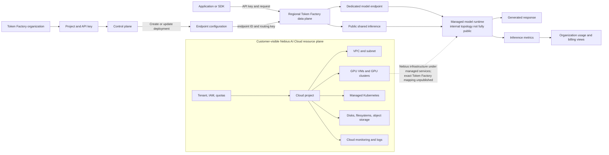

# 20.30 From AI factory to Token Factory: a public architecture map

> **Outline proposal.** This is a proposed addition after 20.29, not a claim that Nebius has published its complete internal architecture. Use official product documentation for product behavior; label blog case studies, customer-side designs, and unknown internals separately.

## What the interviewer is testing

- The ability to trace a request from organization, identity, and capacity through deployment and serving to usage, telemetry, and recovery.
- The ability to distinguish Nebius AI Cloud infrastructure customers operate from Token Factory's managed inference service.
- The ability to separate documented product contracts from a public proof of concept, marketing statements, and reasonable design inference.
- Likely prompt: “Walk me from GPU capacity and model deployment to the response returned by the inference API. What fails, who owns recovery, and how is usage charged?”

## The core ideas

### 1. Set the evidence boundary before drawing the architecture

- Start with the role of a public architecture map: teach the visible interfaces and resource boundaries, not reverse-engineer hidden internals.
- Keep three evidence labels throughout: **official product documentation**, **Nebius engineering/blog case study**, and **customer-side reference design or inference**.
- Make explicit that the Token Factory service is not simply a customer-managed Kubernetes cluster exposed through a UI. Public documentation describes a managed service and region-specific inference endpoints; implementation details are not fully disclosed.
- Contrast the broader AI Cloud resource catalog with Token Factory's managed inference control and data planes. Do not imply every Token Factory deployment maps one-to-one to customer-visible AI Cloud resources.

### 2. Trace the customer-visible AI Cloud foundation

- Describe the documented layers: tenant and projects; IAM groups and service accounts; quotas and capacity; regional VPCs; GPU VMs and GPU clusters; Kubernetes; block, file, object, and container storage; monitoring and logs.
- Explain which are customer-operated building blocks and which are managed services. The service catalog documents GPU VMs and InfiniBand-connected GPU clusters, Managed Kubernetes, Object Storage, shared filesystems, and observability.
- Use one small example to follow a platform team that separates dev and production projects, grants service-account access, stores model artifacts, and launches GPU-backed workloads.
- Do not assert that Token Factory internally uses a particular customer-visible storage service, Kubernetes layout, or network topology unless a current official source says so.

### Proposed architecture map

Use this as a teaching map, not a claim that it reveals Nebius's internal service topology. Keep the AI Cloud customer resource plane visually separate from Token Factory's managed service.

The written explanation should walk left to right along a request, then trace the separate provisioning, resource, telemetry, and billing paths.

### 3. Map Token Factory organizations, projects, identity, and usage boundaries

- Explain the documented Token Factory hierarchy: organization → projects → resources such as API keys, endpoints, files, and datasets.
- Distinguish a Token Factory API key used to call inference from Nebius AI Cloud service-account credentials used to manage cloud resources.
- Show why project separation matters for access, endpoint ownership, metrics filtering, and cost attribution.
- Treat billing as a first-class architecture concern, not as a metric inferred from GPU utilization.

### 4. Separate the API boundary, control plane, and data plane

- Show the documented API path: list model templates through the control-plane API; create or update a dedicated endpoint; receive an endpoint ID and routing key; call a region-appropriate OpenAI-compatible `/v1` endpoint using the routing key as the model identifier.
- Explain the distinction between endpoint lifecycle state and serving readiness. A deployment can be starting, partially ready, or updating; inference may not work before it becomes routable.
- Introduce the public/shared and dedicated deployment models carefully. The current docs describe per-token public serverless pricing and dynamic limits, and dedicated capacity with per-GPU-hour pricing billed at per-minute granularity. Model availability changes; check current catalog and deprecation notices.
- State plainly that public docs do not reveal the gateway implementation, internal service decomposition, tenant-isolation mechanism, or production routing algorithm.

### 5. Follow a model from template to production endpoint

- Cover model and flavor selection; region; GPU type and count per replica; minimum and maximum replicas; endpoint creation, update, start, stop, and deletion.
- Explain the custom-weights path only as documented: custom weights are currently beta and access/configuration may require support.
- Connect deployment configuration to performance: GPUs per replica shape per-replica capability; replica count shapes concurrency and capacity. Avoid implying extra replicas fix insufficient per-request GPU resources.
- Include a short lifecycle state diagram and define the safe point at which a client should send traffic.

### 6. Explain serving optimizations without claiming a universal backend

- Teach the published concepts: continuous batching, paged attention, KV cache, context caching, quantization, flash attention, and speculative decoding.
- Explain prefill versus decode as distinct workload phases and why long context, concurrency, and batching affect latency and cost differently.
- A Nebius conversational-workload blog describes prefill/decode specialization, cache locality, backpressure, and operational lessons from a particular proof of concept. Label these as case-study evidence, not a specification for every Token Factory endpoint.
- Link to Part 15 for engine internals; keep this chapter focused on the public product boundary and architecture reasoning.

### 7. Treat routing and cache as one stateful serving problem

- Begin with the failure mode: round-robin or connection-based distribution can scatter related requests and lose reusable context across replicas.
- Summarize the published vLLM routing experiment: cache-aware routing selected a replica based on likely KV-cache reuse and fell back when overloaded. Report its measured results only with the workload, comparison, and proof-of-concept caveats.
- Explain the documented observability signal `KV-cache hit rate`, which includes local and external cache hits. Do not infer that the metric reveals the cache product or the full routing policy.
- Add a design exercise: choose locality, queue pressure, fairness, and failure avoidance signals; explain when a router should sacrifice a cache hit to avoid overload.

### 8. Connect telemetry to billing, SLOs, and capacity decisions

- Map documented Token Factory metrics: request and token rates, prompt/output size, p50/p90/p99 latency, streaming TTFT, output speed, active replicas/GPUs, GPU utilization, errors by status code, and cache hit rate.
- Explain that Token Factory observability is for operations and performance analysis, not billing reconciliation. Use the organization usage/billing surface for charges.
- Contrast per-token public inference pricing with dedicated GPU-time pricing. Explain how minimum replicas, scale-out, idle baseline, and capacity availability change the cost/reliability trade-off.
- If showing Nebius AI Cloud budgets, state that cloud budgets are alerts, do not stop or cap usage, and can lag recorded spend. Keep AI Cloud billing distinct from Token Factory billing unless a current source documents their relationship.

### 9. Analyze availability, failure, and recovery ownership

- Separate lifecycle from readiness and endpoint-level availability from capacity availability.
- Highlight the dedicated-endpoint caveat: minimum replicas apply while the endpoint is active; stopping or an incident releases self-service on-demand GPUs to the shared pool. Restart may wait for capacity, become partially ready, or remain not ready.
- State that self-service dedicated endpoints do not include a formal SLA unless covered by contract. Do not promise automatic cross-region failover or restoration of the previous GPU allocation.
- Build a failure table for API-key/access errors, 429 throttling, provisioning delays, partial readiness, insufficient burst capacity, model/runtime 5xx, cache loss, and regional/capacity interruption. For each: customer-visible signal, first diagnostic, safe mitigation, retry guidance, and what remains unknown.
- Mark recommendations such as bounded retries, circuit breaking, explicit readiness gates, warm minimum capacity, reserved capacity, tested restore/failover, and multi-region application routing as customer-side design—not as Nebius guarantees.

### 10. Walk through an end-to-end deployment and two incident scenarios

- Scenario A: create an endpoint from a template, inspect lifecycle/readiness, wait for routability, then call the regional API with the returned routing key.
- Scenario B: traffic rises, clients receive 429s, and replicas approach their ceiling. Read response headers and endpoint metrics; distinguish dynamic public rate limits from dedicated-endpoint replica scaling.
- Scenario C: an endpoint stops during an incident and does not reacquire its former GPU capacity. Decide whether the service needs reservations, warm spare capacity, a second region, or a documented degraded mode.
- Lab should be safe by default: use API examples as dry-run walkthroughs and a worksheet/simulator; require an explicit warning before any paid live deployment.

### 11. Close with a compact system-design answer

- Rehearse a five-minute answer in this order: user and tenant boundary → GPU/cloud substrate → endpoint control plane → regional inference API → model/replicas/cache → telemetry and billing → failure domains and recovery.
- Finish with a “known / inferred / unpublished” checklist so the candidate does not invent Nebius internals in an interview.

## How to answer out loud

Outline three rehearsals: explain a dedicated endpoint request path; explain why more replicas can worsen cache locality; explain why active minimum replicas do not equal guaranteed recovery after an interruption. Each answer should identify facts, assumptions, and customer-owned decisions.

## Worked scenarios

- Endpoint creation takes several minutes and an early request fails: distinguish control-plane success from data-plane readiness.
- Agent traffic reuses long contexts across replicas: compare default routing with cache-aware routing and explain the case-study limits.
- An incident releases self-service GPU capacity: design a recovery plan without promising that the same GPUs return.

## Hands-on lab

- Draw the two product boundaries: customer-visible AI Cloud resources and the Token Factory managed service.
- Walk through the documented template → endpoint ID/routing key → regional `/v1` request flow without creating paid resources.
- Use sample metrics and billing statements to classify operational metrics versus billable usage; mark all synthetic values as synthetic.
- Optional live exercise only after checking current prices, capacity, model availability, and cleanup steps.

## Drill questions

1. What is the difference between Nebius AI Cloud and Token Factory?
2. What does the endpoint ID identify, and what is the routing key used for?
3. Why are control-plane status and readiness different?
4. What do minimum and maximum replicas control, and what do they not guarantee?
5. Why can ordinary load balancing waste KV-cache work?
6. Which Token Factory metrics help separate request pressure from replica capacity?
7. Why is the observability dashboard not a billing ledger?
8. What can happen to self-service GPU capacity after an endpoint stops or is interrupted?
9. Which high-availability guarantees are documented, and which must be designed by the customer?
10. How would you answer an interviewer who asks how Nebius routes requests internally?

## Common mistakes and weak answers

- Do not describe a blog proof of concept as the production implementation of every endpoint.
- Do not conflate a Token Factory API key with Nebius AI Cloud IAM service-account credentials.
- Do not assume a customer-managed Kubernetes cluster is the implementation of Token Factory.
- Do not equate a configured maximum replica count with available GPU capacity.
- Do not equate a running minimum replica count with recovery guarantees after the endpoint stops.
- Do not claim billing from utilization charts or describe budgets as hard spending caps.

## Connections to the rest of the handbook

- Part 15: inference engines, KV cache, benchmarking, autoscaling, and serving reliability.
- Part 16: MLOps lifecycle, model artifacts, deployment, and platform design.
- Part 17: observability, SLOs, incident response, capacity planning, and recovery.
- Volume 20 chapters 12–16, 18–25: estimation, inference system design, failure modes, SLOs, scaling, routing, Kubernetes, Terraform, and telemetry.

## Sources and review notes

Official Nebius documentation and product pages checked 2026-11-09:

- [Nebius AI Cloud services](https://docs.nebius.com/overview/services) — customer-visible compute, storage, AI, network, identity, and observability services.
- [Nebius AI Cloud IAM overview](https://docs.nebius.com/iam/overview) — tenant, project, groups, quotas, billing, audit, and resource hierarchy.
- [Compute VM configuration](https://docs.nebius.com/compute/virtual-machines/params) and [Compute storage types](https://docs.nebius.com/compute/storage/types) — GPU, network, disks, shared filesystems, and storage trade-offs.
- [Managed Kubernetes cluster management](https://docs.nebius.com/kubernetes/clusters/manage) — control plane, node groups, autoscaling, repair, and reservation options.
- [Token Factory organizations and projects](https://docs.tokenfactory.nebius.com/team-access/org-projects) and [API introduction](https://docs.tokenfactory.nebius.com/api-reference/introduction) — project hierarchy and API-key access.
- [Dedicated Endpoints overview](https://docs.tokenfactory.nebius.com/ai-models-inference/dedicated-endpoints/overview), [Deploy via API](https://docs.tokenfactory.nebius.com/ai-models-inference/dedicated-endpoints/deploy-api), [capacity and scaling](https://docs.tokenfactory.nebius.com/ai-models-inference/dedicated-endpoints/capacity-and-scaling), and [lifecycle/readiness](https://docs.tokenfactory.nebius.com/ai-models-inference/dedicated-endpoints/lifecycle-and-status).
- [Inference overview](https://docs.tokenfactory.nebius.com/ai-models-inference/overview), [rate limits](https://docs.tokenfactory.nebius.com/ai-models-inference/rate-limits), [observability](https://docs.tokenfactory.nebius.com/ai-models-inference/observability), and [Token Factory billing](https://docs.tokenfactory.nebius.com/other-capabilities/billing-new).
- [Nebius AI Cloud budgets](https://docs.nebius.com/signup-billing/budgets) — alerting behavior and limits of budget controls.
- [The invisible architecture behind great chat apps](https://nebius.com/blog/posts/the-invisible-architecture-behind-great-chat-apps) — an anonymized conversational-workload proof of concept; not a universal product specification.
- [Routing in LLM inference is the difference between scaling and stalling](https://nebius.com/blog/posts/routing-is-the-difference-between-scaling-and-stalling) — a specific vLLM cache-aware routing experiment and its stated limitations.
- [June 2026 model deprecations](https://docs.tokenfactory.nebius.com/june-2026-deprecation-notice) — model availability is time-sensitive; this notice covers listed serverless models, not a blanket removal of all serverless inference.

**Explicitly labelled inferences:** customer-side multi-region routing, retry budgets, spare capacity, and recovery designs unless directly tied to an official documented feature.

**Not verified:** Nebius's internal gateway code, production router algorithm, Token Factory's internal Kubernetes/network/storage topology, exact autoscaling signals, internal billing-meter pipeline, or cross-region failover guarantees.
