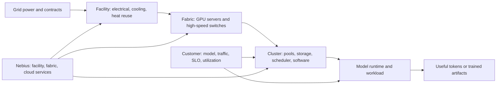
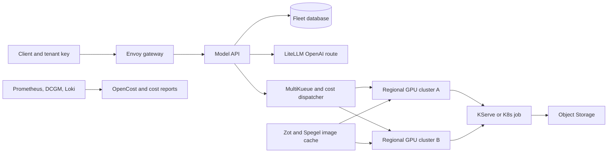

# 20.31 Nebius AI Cloud foundation: facilities, GPUs, fabrics, storage and platform choices

An architect receives a request that sounds simple: “We need an AI factory for model training and production inference.” The hidden requirements are not simple. The workload needs enough GPUs, a network that matches its parallelism, a place to put multi-terabyte artifacts, a way to isolate teams, and a recovery plan that fits the business promise.

Nebius AI Cloud exposes a full set of customer-operated resources and managed services. Understanding those layers helps you design the part you own without confusing it with the internals of Token Factory. This chapter follows the stack from energy and physical GPU capacity through clusters, network, storage, orchestration, identity, observability, and cost. It also shows how to choose the service boundary for a real workload.

## What the interviewer is testing

This chapter supports the system-design and project-deep-dive rounds. Nebius says interviewers may ask you to estimate compute, meet load and availability targets, and weigh storage and processing trade-offs. A solutions architect should also explain who operates each layer, what can fail, which assumptions require a live quota check, and how the design changes the bill.

A likely prompt is: “A customer wants to train a model, host a fine-tuned version, and serve an agent in Europe. How would you build that on Nebius, and which parts would you let the provider manage?”

## The core ideas

### 1. Define the AI factory as a production system

“AI factory” is a useful architecture metaphor, not a single Nebius product or a claim that every component sits in one service. The system turns power, silicon, data, software, and operations into trained models or useful inference. An architect maps each transformation and identifies its owner.

Nebius's 2026 *Energy behind AI* whitepaper organizes the energy-to-output process into four layers: model, cluster, fabric, and data center. The model layer captures workload and runtime choices. The cluster layer captures GPU reliability and utilization. The fabric layer captures how physical servers are grouped and how spare capacity is fragmented. The data-center layer converts incoming power into stable IT capacity through electrical and cooling systems.

That model is helpful because a performance problem can originate at any layer. A long prompt can waste prefill work. A bad placement can stretch an all-reduce across network tiers. Underused nodes can consume power without producing output. A facility constraint can limit new GPU allocations even when the product catalog lists the GPU type.

| Layer | Architect asks | Public evidence available |
|---|---|---|
| Model/workload | What quality, latency, context, concurrency, and precision are required? | Model cards, Token Factory templates, runtime and customer case studies |
| Cluster | What GPU shape, memory, CPU, storage, and node count fit the workload? | Compute platforms, presets, capacity advisor, maintenance and monitoring docs |
| Fabric | Does the workload need NVLink inside a node, InfiniBand between nodes, or ordinary VPC connectivity? | GPU-cluster fabric and topology documentation |
| Facility | Where is capacity located, how is it powered and cooled, and when is it operational? | Dated company announcements and sustainability material; detailed site topology is not public |

Use the diagram to ask where a proposed optimization moves the bottleneck. Better cooling can create a denser thermal envelope; that does not help if a job is starved on storage or the model keeps a large, idle GPU pool.

The whitepaper contains internal efficiency claims. Treat them as company-authored evidence, not independent measurements or guarantees for a specific customer deployment. **Trace a requirement to the layer that can satisfy it before choosing a product.**

### 2. Separate announced facilities from usable capacity

A customer may see a press release announcing a large AI factory and assume a matching number of GPUs can be provisioned today. Capacity announcements describe an investment plan or campus ceiling, not a regional inventory API.

Nebius's March 2026 announcement describes a planned Lappeenranta campus with up to 310 MW and first capacity expected in 2027. A separate March 2026 announcement reports approval for a planned Independence, Missouri, campus with potential capacity up to 1.2 GW. These are forward-looking projects, not available production capacity in November 2026. In contrast, Nebius said the expansion of its Mäntsälä site to 75 MW had been completed earlier in 2026. Its December 2025 announcement also described an operational GB300 NVL72 deployment in Finland.

| Publicly described site/facility | Published state at announcement | Architect's interpretation |
|---|---|---|
| Mäntsälä, Finland | Expansion to 75 MW described as completed in early 2026; GB300 NVL72 described as operational in Dec. 2025 | Existing AI Cloud supply, but project quota and platform availability still need a live check |
| Lappeenranta, Finland | Up to 310 MW announced Mar. 2026; first capacity expected in 2027 | Planned capacity, not an orderable 2026 GPU pool |
| Independence, Missouri | Up to 1.2 GW potential campus announced Mar. 2026 after local approval | Projected campus ceiling, not live service capacity or a committed customer reservation |

Nebius also announced a company-wide target of more than 3 GW of contracted power by the end of 2026. Contracted power is not the same as commissioned IT load, a powered rack, an available GPU preset, or a customer's quota. Ask which milestone the number represents.

For a regional design, move from press-release scale to the actual provisionability path. Check whether the region is public or private, whether the product is offered there, whether the selected platform/preset appears in the project, whether quotas permit it, and whether the capacity advisor reports room. A GPU may exist in the fleet but remain unavailable to a new project because it is reserved, committed, or fully consumed.

Facility metrics require the same care. A 2024 press release said Mäntsälä could reach PUE as low as 1.1 under high IT loads. A 2026 company whitepaper says Nebius data centers had recently operated as low as 1.15. Those are company-reported figures with different dates and conditions. PUE compares total facility energy with IT energy; it does not measure tokens per watt, model efficiency, GPU utilization, or customer workload efficiency.

The public announcements describe closed-loop liquid cooling, low-carbon electricity sourcing, and heat recovery for newer facilities. The design implication is that capacity planning increasingly includes power, heat rejection, water policy, utility delivery schedules, and community approvals—not only server purchase orders. **Use project quota and live capacity signals for a deployment commitment; use facility announcements only for market context.**

### 3. Select a GPU platform by model shape and service region

The platform list is not a menu where every GPU can be selected in every region. Compute publishes platforms, presets, and region availability. The preset bundles GPU count, vCPU count, and RAM. A capacity advisor combines those choices with project quota and current physical capacity.

The current Compute GPU table includes the following representative profiles:

| GPU | Architecture/form | GPU memory and bandwidth | Best-fit discussion |
|---|---|---|---|
| B300 | Blackwell Ultra, SXM | 270 GB HBM3e; 7.7 TB/s | Very large-memory models and high-throughput inference or training |
| B200 | Blackwell, SXM | 180 GB HBM3e; 7.7 TB/s | Large models and rack-scale training/inference |
| H200 | Hopper, SXM | 141 GB HBM3e; 4.8 TB/s | Large model serving and training where H200 capacity is available |
| H100 | Hopper, SXM | 80 GB HBM3; 3.35 TB/s | Broad training and inference compatibility |
| RTX PRO 6000 | Blackwell, PCIe | 96 GB GDDR7; 1.6 TB/s | Cost-conscious inference, visual computing, and simulation |
| L40S | Ada, PCIe | 48 GB GDDR6; 864 GB/s | Smaller or optimized models and lower-cost inference |

These specifications are vendor-reported and should be checked against the current product catalog. Work out weight memory, KV cache, activation headroom, concurrency, and latency target before comparing GPU prices. A higher-memory GPU may fit a model in one replica; a lower-cost GPU may need more replicas or quantization. Those are different operational designs, not just price substitutions.

The region constraint can dominate the choice. Compute's public platform table lists B300 in `uk-south1`, `eu-west2`, and `us-north1`; B200 in `us-central1` and `me-west1`; H200 in several European and US regions; H100 and L40S in fewer listed regions. Private regions and project-level availability can differ. Never promise an exact hardware/region combination from a generic marketing page.

For workloads that can pause, preemptible capacity may reduce costs, but spot price changes and the VM can stop. For continuous production inference, decide whether the service needs a fixed minimum, a capacity reservation, a fall-back GPU class, or a graceful overload response. **Choose model/GPU/region together, then validate that tuple in the target project.**

### 4. Design the GPU cluster and network around communication

An eight-GPU node is not a complete distributed training cluster. Data parallelism, tensor parallelism, expert parallelism, checkpoint traffic, and storage reads put different pressure on the fabric. Decide how many bytes must move, how often, and between which ranks before selecting the cluster topology.

Nebius Compute GPU clusters connect supported eight-GPU VM presets through InfiniBand. The documentation describes eight 400-Gbps network interfaces on an H100 node, for 3.2 Tbps of aggregate host-facing bandwidth, and GPUDirect RDMA to move data between GPU and NIC without staging through the CPU. Other GPU generations have their own published rates and network adapters; use the platform-specific row, not an H100 number as a universal spec.

The physical topology is hierarchical. A scalable unit groups servers behind leaf switches. PODs group racks behind core switches. A fabric layer connects PODs. Crossing a hierarchy tier can add communication cost, so Slurm or Volcano can use a topology file to place ranks close together. Nebius reports up to a 20 percent AllReduce gain in some tested cluster sizes with topology-aware placement. That is a measured example, not a promised gain for every workload.

Isolation also has a physical/network dimension. Nebius assigns an InfiniBand partition key to each GPU cluster, so VMs in separate clusters cannot exchange fabric traffic even when the clusters share physical switches. This is useful for multi-tenant design, but it does not replace VPC security groups, IAM, or application authorization.

In Managed Kubernetes, GPU node groups can join a GPU cluster only when the preset is compatible. InfiniBand in pods depends on the node group and the managed RDMA/DRA components; an ordinary pod-network route is not equivalent to GPU Direct RDMA. The inference fleet reference architecture similarly treats multi-node jobs as a distinct placement class, with one model/job constrained to a single GPU pool and fabric.

An architect should state whether the product needs intra-node NVLink, inter-node InfiniBand, or only ordinary client/network traffic. **Do not buy an InfiniBand cluster for a workload that cannot use it; do not design multi-node collectives over an unvalidated path.**

### 5. Place network and security boundaries before workloads

Nebius Virtual Networks provides the IPv4 networks, subnets, IP pools, routes, allocations, DNS zones, and security groups used by cloud resources. Projects receive a default network and subnet. The default route sends public destinations through an egress gateway; private destinations outside the network are discarded unless a route directs them elsewhere.

That behavior matters for an AI factory. Private model-serving nodes may need to pull images or read artifacts from approved sources. An architect can keep nodes without public addresses, provide controlled egress through a NAT gateway or route, and use a WireGuard jump VM or Nebius Tunnels for administration. Managed Kubernetes adds a provider-managed system security group that preserves API-server/kubelet traffic; customer security groups add restrictions rather than replace the system group.

Virtual Networks currently documents IPv4-only support. If a customer's design assumes dual stack, private IPv6, BGP, or arbitrary VPC peering, treat that as a discovery item rather than an available feature. Network objects can also become disruptive to change after workloads attach, so allocate CIDRs for cluster services, pods, endpoints, and future growth before production.

Keep three traffic classes on the whiteboard: client-to-API traffic, east-west application and model traffic, and management/control traffic. Token Factory exposes a public regional API; its documentation does not promise that the customer can attach that managed data plane to a private VPC. For customer-managed Kubernetes or VMs, you own the in-cluster access policy and ingress path. **Draw the network reachability matrix before opening public IPs or attaching a gateway.**

### 6. Match storage to data temperature and failure behavior

AI infrastructure commonly moves the same data through several stages: source datasets, preprocessing, model weights, optimizer/checkpoint state, cached weights, and inference output. The storage service should reflect how often each object is read, how much parallel throughput is needed, and what happens if a node disappears.

Nebius Compute provides network block disks, local SSD, and shared filesystems. Object Storage provides S3-compatible buckets with Standard, Intelligent, and Enhanced Throughput classes. Container Registry stores images and charts. Managed PostgreSQL provides metadata or application state where a relational store is appropriate.

| Storage | Good architectural use | Failure/operational caution |
|---|---|---|
| Network SSD | VM boot and durable block data | Select size/block size for IOPS and bandwidth; encryption defaults vary by disk type |
| Network SSD NRD | High-performance transient node disks | No redundancy; do not store the only copy of checkpoints |
| Local SSD | Scratch, cache, staging, high-IOPS work | Ephemeral; disappears when VM stops or is replaced |
| Shared filesystem | Shared checkpoints, model weights, training data | Shared metadata and consistency semantics differ from a local POSIX disk |
| Object Storage | Datasets, model artifacts, backups, outputs | Choose storage class and lifecycle rules; concurrent S3 patterns affect throughput |
| Container Registry | Versioned OCI images and Helm charts | Pin digests and pre-pull large images to reduce cold-start variance |

The Compute guide recommends shared filesystems for model weights shared across inference VMs and Object Storage for large, unstructured datasets and retained outputs. The Object Storage Enhanced Throughput class is designed for high-bandwidth, low-latency access; the Standard and Intelligent classes trade cost and access patterns differently. Its performance guide recommends concurrency and carefully sized multipart ranges, while warning against concurrent overwrites to the same object key.

The storage contract also matters to application correctness. A shared filesystem used by several VMs offers close-to-open visibility for file contents, while directory and inode metadata can remain cached on another VM for up to 15 seconds. A training pipeline that writes a checkpoint and immediately asks another node to enumerate the directory must account for that visibility window. Object Storage's Intelligent class lowers storage price for colder objects without moving them or changing performance; Enhanced Throughput costs more to store but has different throughput and operation-cost characteristics. Check the current price table before using a class transition as an optimization.

For every failure, ask what must survive: a pod restart, a VM replacement, a regional outage, or accidental deletion. Local NVMe can improve data-path speed but needs a durable copy. A checkpoint in Object Storage survives VM replacement but may not meet an extremely low checkpoint interval without tuning. **Use scratch for speed and durable storage for recovery; never confuse the two.**

### 7. Pick an orchestration and ownership model

Nebius's AI Cloud portfolio offers several paths, and an AI factory may use more than one. The right choice is based on the customer's workload and operating capability, not on a vendor preference for one orchestrator.

Managed Kubernetes provides a Nebius-operated control plane and Compute-backed node groups. Its documented control plane has an API server, scheduler, controller manager, and etcd; clusters default to three etcd stores for high availability. Node groups can be fixed or autoscaled. The cluster autoscaler adds nodes for unschedulable pods and removes underused nodes. For GPU clusters, a CPU node group can keep Cilium and CoreDNS alive while GPU nodes scale down.

Soperator is Nebius's Kubernetes operator for Slurm. A `SlurmCluster` custom resource reconciles controllers, login and worker nodes, storage, and Slurm configuration. The shared “jail” filesystem gives users a familiar Slurm root while Kubernetes manages pod lifecycles. It is a fit for traditional training/HPC workflows that need Slurm accounting, fair share, and batch semantics—not a substitute for the Token Factory inference API.

The public Soperator documentation describes a Kubernetes operator that renders the Slurm cluster into Pods, StatefulSets, ConfigMaps, and persistent volumes. The shared root filesystem makes package and user changes visible across login and worker nodes, but it is also a shared failure surface: a bad change can affect the whole cluster. Managed Soperator, Soperator Pro, and self-deployment are distinct operating models with different ownership and support boundaries. Check the current Soperator release notes; older Nebius blog articles describe earlier limitations that may no longer apply.

Serverless AI lets customers run custom containers as jobs, Devlabs, or HTTP/TCP endpoints without first building a cluster. Nebius handles the resource and lifecycle surface; the customer still owns its container, data path, application behavior, and request semantics. Token Factory Public Serverless instead gives access to hosted models. Dedicated Endpoints supply a region- and GPU-configurable managed model deployment.

The trade-off is operational ownership. VMs offer the most host control but leave the OS, drivers, runtime, and repair policy with the customer. Managed Kubernetes reduces control-plane toil but leaves workload engineering to the tenant. Soperator changes the user scheduler while relying on Kubernetes underneath. Serverless AI reduces infrastructure work for custom containers. Token Factory removes most of the model-serving stack from the customer, while constraining the customer to its public API, model templates, and endpoint contract.

**Choose the highest managed layer that satisfies the requirements without hiding a capability the customer needs to own.**

### 8. Operate the cloud platform through its control surfaces

An AI factory is only as manageable as its provisioning and policy interfaces. Nebius exposes resources through the web console, CLI, REST/gRPC APIs, SDKs, and a Terraform provider. The operator can use Terraform for durable desired state, a CLI/SDK for diagnostic and workflow actions, and cloud APIs for service automation. Avoid having manual console edits silently diverge from Terraform state.

Cloud projects have quotas and limits for GPUs, VMs, disks, networks, and managed services. A quota is not necessarily free physical capacity. Compute's capacity advisor checks platform/preset availability against project quotas and current physical supply. For capacity that must remain available, capacity block groups reserve a GPU platform and fabric over scheduled intervals and connect to committed-use billing. Spot pricing is dynamic and can be capped through pricing policy; spot VMs may be stopped when the price exceeds a cap or capacity is reclaimed.

Nebius AI Cloud distinguishes pay-as-you-go from commitment discounts. PAYG covers usage not included in a commitment; eligible companies can combine the two. Budgets report spend against thresholds but do not cap consumption and may update with delay. Cost allocation labels can group Compute costs by application or team; current docs limit this feature to Compute billable resources. Usage exports in FOCUS format support external FinOps pipelines.

For Compute, usage is metered by the second while published prices are expressed per GPU-hour. Preemptible spot prices can change every 15 minutes and, since the Nov. 2026 update, may rise above regular on-demand rates. A pricing policy with a maximum price is the control that stops accepting a higher spot quote; “spot is cheaper” is not a safe invariant. For reserved capacity, align the GPU platform, region, fabric, interval, project limits, and rollout policy. A full reservation with zero surge can block a node replacement.

Cost attribution needs its own design. Nebius cost-allocation labels apply to Compute billable resources, not all managed services. Export usage data and combine labels with workload identifiers where supported. For customer-operated inference, compare billed node-hours with useful tokens and latency-qualified goodput; do not treat utilization percentage as an invoice line.

These are separate controls: quota limits resource creation, capacity blocks address supply, a pricing policy sets a spot ceiling, budgets alert on spend, and application-level quotas protect a model service. They are not interchangeable. **Use both a capacity control and a cost control; neither automatically substitutes for the other.**

### 9. Reference platform pattern for training and inference

The public [Nebius Solutions Library Kubernetes inference fleet](https://github.com/nebius/nebius-solutions-library/tree/main/k8s-inference) demonstrates a customer-operated multi-region architecture. It is a reference implementation, not Nebius's managed Token Factory internals. It is unusually useful because the README describes the architecture and its limitations openly.

The sample uses a CPU-only control cluster for an API, LiteLLM, a Kueue MultiKueue manager, cost dispatcher, and fleet database. Each region has a worker Kubernetes cluster with GPU pools, KServe/Knative endpoints, Kueue, an Envoy gateway, image cache, DCGM, OpenCost, logs, and shared weights storage. Object Storage buckets hold per-tenant artifacts. A customer API registers arbitrary containerized models and renders them as KServe endpoints or jobs. The reference platform adds tenant API keys, budgets, model allow-lists, queues, and cross-region GPU placement.

The request path illustrates gateway architecture. A regional Envoy gateway validates a key against the central fleet API, then forwards to a model endpoint. A call to a separate OpenAI-compatible LiteLLM route is accounted by LiteLLM; direct platform invokes are accounted by the fleet API. This distinction is crucial in architecture reviews: one user-facing product can have multiple ingress routes and accounting authorities.

The reference fleet also chooses cheaper free capacity across regions, keeps warm spare nodes, uses Zot/Spegel image caching, provides queued runs and multi-node jobs, and resumes checkpointed work after spot preemption. It also documents real limits: its GPU nodes are shared across customer namespaces, internal VPC traffic is not encrypted by its default design, and it is a template rather than a hardened multi-tenant service. Those caveats make it a learning architecture, not a production recommendation without review.

The repo describes one API and one fleet database, with regional worker clusters. That is a useful customer-built pattern for centralized policy plus regional compute. It introduces cross-region authentication, database availability, gateway dependencies, and more operator work; it is not equivalent to a fully managed endpoint.

For training, the Managed Soperator path turns Slurm resources into Kubernetes objects, while the reference Kubernetes fleet uses Kueue/JobSet for training jobs. For serving, the same solution uses Knative/KServe endpoints and a custom gateway. Dedicated Token Factory Endpoints offer a managed alternative. **Use the reference repository to learn one implementation pattern, then keep it distinct from provider-managed products.**

### 10. Plan recovery by failure domain

A good AI factory design does not have one “HA” switch. It identifies failure domains and assigns detection, mitigation, recovery, and the responsible operator to each one.

At a data-center level, power, cooling, or site work may make an entire region unavailable. At a fabric level, an InfiniBand link or switch may degrade collectives without breaking basic IP reachability. At a node level, a GPU Xid, failed disk, or unreachable kubelet can drain a worker. At an application level, a model can return 5xx or burn its KV cache while all GPUs remain powered. At a control-plane level, IAM, endpoint state, or a database outage can block new changes even while data-plane workers serve existing traffic.

Nebius Managed Kubernetes documents Node Problem Detector and GPU health checks. For a failed GPU node, the service can cordon it, wait for workloads, drain it, stop/start its underlying VM, then uncordon it. This is a recovery path for customer Managed Kubernetes nodes; the public docs do not say Token Factory Dedicated Endpoint workers follow the same procedure.

The open-source Soperator repository describes separate passive and active health checks, Slurm drain/replacement behavior, worker controllers, checkpointing, and shared storage. The exact behavior depends on whether a customer self-deploys the operator, uses Managed Soperator, or has a Pro engagement. Do not transfer one deployment's guarantee to another.

For a fault-tolerant training job, recovery is application-aware. Choose a checkpoint interval that bounds lost work, store checkpoints outside node-local scratch, and test recovery after a real worker failure. For inference, protect user-visible SLOs with spare capacity, bounded queues, retry budgets, and a tested endpoint rollout. Across regions, comply with the serving product's residency contract before moving traffic.

**For each failure domain, name the signal, the first safe action, and who owns the final repair.**

### 11. Solution-architect walkthrough and deployment decisions

The interviewer asks, “A customer wants an AI platform for training, experimentation, and a production agent. What would you propose?” Start by collecting requirements: training versus inference, model families and sizes, prompt/output distributions, concurrency, modality, streaming, TTFT/TPOT targets, data residency, retention, user/tenant count, required RTO/RPO, expected utilization, and budget.

Then draw separate paths. A training path may use Object Storage or shared filesystems for datasets, Compute GPU clusters or Soperator for distributed training, and checkpointed outputs. A custom-model serving path may use customer-managed Kubernetes, Serverless AI for an isolated container endpoint, or a self-managed multi-region KServe/Kueue fleet. A hosted-model path may use Token Factory Public Serverless for evaluation or Dedicated Endpoints for stable region and per-replica controls. Fine-tuning/Data Lab can connect observed product behavior to updated model or drafter artifacts, subject to retention settings.

The [Nebius Agents Blueprint](https://nebius.com/blog/posts/introducing-the-nebius-agents-blueprint) is a published partner-stack example: Token Factory inference sits alongside orchestration, tracing, retrieval, grounding, and simulation components. The [DataRobot validated AI Factory](https://nebius.com/blog/posts/datarobot-validated-ai-factory-stack) separates the enterprise agent platform, NVIDIA AI software, Nebius Cloud infrastructure, and Token Factory model access. In those examples, Token Factory is one layer of the architecture, not the entire agent factory. Both are vendor/partner examples; verify their deployment details before presenting them as a template for another customer.

Finish with an ownership map. Nebius provides the selected cloud or managed-inference service. The customer owns application keys, prompts, workload policy, model acceptance, user-facing SLOs, and approved failover. If a managed product does not disclose a gateway, capacity controller, or worker recovery implementation, say so and ask the account team what the contract covers. **A good architecture review ends with named owners and testable assumptions.**

## How to answer out loud

Start with the workload, then walk down the stack: “I need sustained online inference with long prompts, a low TTFT objective, EU processing, a monthly cost ceiling, and a documented recovery path. I would first verify whether a fixed regional managed endpoint meets that contract. If custom runtime control, private networking, or cross-provider instrumentation is required, I would compare Managed Kubernetes or Serverless AI. For training, I would compare Soperator with a GPU VM cluster based on Slurm requirements and fabric scale.”

Be ready for these follow-ups:

- **“Why do you care about the fabric?”** “A job's collectives may cross multiple switch tiers. I'll use topology-aware placement if the job is communication-bound, and benchmark it on the actual platform. The published up-to-20-percent NCCL gain is workload-specific.”
- **“Where do model weights and checkpoints live?”** “Weights can be staged on shared filesystems for serving, datasets and retained artifacts can use Object Storage, and local NVMe is scratch only. The recovery objective decides which copy is authoritative.”
- **“Can we fail over to another region?”** “The product's own contract determines that. Dedicated Token Factory endpoints are region-pinned with no provider failover; a customer-owned alternate needs legal approval, tested model parity, and preplanned capacity.”
- **“What would you estimate first?”** “The model's memory and serving profile, requested GPUs per replica, region/preset availability, sustained and burst traffic, data movement, and idle floor. Then I would replace ceilings with a representative benchmark.”

For a month-long preparation plan, spend week one on the four-layer factory model and the service-selection table. In week two, draw one training and one serving architecture, including identity, network, and storage. In week three, rehearse node/fabric/storage failures and cost trade-offs. In the last week, recheck platform availability and prices, then practise this answer aloud.

## Worked scenarios

### Scenario 1: The GPU exists, but the project cannot create it

A customer asks for an eight-GPU B300 training cluster in a new region and assumes the capacity announcement means those nodes are ready to provision. First verify the region and platform in Compute, then query the project's available platforms and capacity advisor. Check GPU quota, preemptible eligibility, required network/subnet, selected InfiniBand fabric, and whether capacity must be reserved. If the region or fabric has no available capacity, present a supported alternate region/platform and the performance trade-off. Do not treat planned data-center megawatts as allocatable project capacity.

### Scenario 2: A distributed training job is slower than the single-node benchmark

The application team says H100 utilization is high, but all-reduce time doubled after scaling from one node to several. Check whether the VMs belong to one GPU cluster, whether the platform is compatible with the chosen fabric, whether the job placement is topology-aware, and whether NCCL is actually using InfiniBand rather than TCP. Then inspect link-error counters and compare an NCCL test on the intended ranks. Keep dataset loading and checkpoint traffic separate from collective traffic. If the job is mostly compute-bound, a more expensive fabric may not change its runtime.

### Scenario 3: A GPU node is replaced while a job is using local scratch

Managed Kubernetes detects a GPU problem and begins node recovery. The job had only a local NVMe checkpoint. The node's local data is ephemeral, so replacement can recover the node while losing application progress. Use the workload's checkpoint interval and RPO to decide what durable checkpoint path is required. A customer-managed pipeline may write to a shared filesystem or Object Storage; a provider-managed product has its own documented behavior. Never promise that node auto-repair restores state that was stored only on the failed host.

## Hands-on lab

This lab uses only public documentation and a spreadsheet or notebook. Do not create a cloud resource unless you have an approved project and understand its current price.

1. Select one workload: distributed training, online LLM serving, or an agent using several models. Write its latency, throughput, residency, retention, and recovery needs. **Expected:** each need has a measurable target or is marked unknown.
2. Use the Compute platform table to choose a GPU/preset/region candidate and the topology guide to decide whether an InfiniBand GPU cluster is justified. **Expected:** the choice includes a fallback and states which capacity facts require a project lookup.
3. Assign each dataset, weight, checkpoint, container image, and output to Network SSD, local SSD, shared filesystem, Object Storage, or Container Registry. **Expected:** every durable artifact has a failure/recovery story; no unique checkpoint exists only on local SSD.
4. Choose the operating service from section 7 and draw the owner boundary. **Expected:** the answer identifies who owns drivers, pods, endpoint keys, autoscaling, billing reconciliation, and regional recovery.
5. Add one failure injection and one cost check. **Expected:** the failure has a safe test, observable signal, first mitigation, and named owner; the bill estimate separates reserved/in-use capacity from budget alerts.

I reviewed public product documentation, company announcements, the public Soperator and Nebius Solutions Library repositories, and a Nebius-authored energy-efficiency whitepaper on 2026-11-09. I did not provision GPUs or validate the benchmark claims live. Announced future facilities and company-reported efficiency results are labeled as such.

## Drill questions

1. What are the four layers in Nebius's public energy-to-AI framework?

Answer

Model, cluster, fabric, and data center. It is a company-authored efficiency framework, not a complete internal architecture diagram.

2. Does a 310 MW announcement mean a customer can provision B300s there today?

Answer

No. The Lappeenranta announcement said first capacity was expected in 2027. Check service availability, project quotas, and live capacity for an actual deployment.

3. What is the distinction between an eight-GPU VM and a GPU cluster?

Answer

A VM supplies one host's GPUs. A GPU cluster links compatible VMs through a selected InfiniBand fabric for multi-node communication, with placement and capacity constrained by that fabric.

4. Why is a GPU utilization percentage not enough to diagnose a slow distributed job?

Answer

High utilization can coexist with poor communication, storage stalls, or topology-crossing collectives. Check job-level throughput, fabric counters, placement, and the workload's actual bottleneck.

5. When would you choose Object Storage rather than local SSD?

Answer

Use Object Storage for durable datasets, checkpoints, artifacts, and outputs. Local SSD is fast scratch that can disappear when its VM stops or is replaced.

6. What does a VPC security group provide, and what does it not provide?

Answer

It filters resource network traffic. It does not replace IAM, application authorization, data retention controls, or tenant isolation inside a shared model service.

7. When is Soperator a better fit than Managed Kubernetes alone?

Answer

When teams need Slurm batch scheduling, job semantics, and an HPC training workflow while using Kubernetes as the control substrate. It is not the Token Factory inference API.

8. What is the difference between capacity blocks, quotas, and budgets?

Answer

Capacity blocks reserve eligible GPU supply over intervals. Quotas limit resource creation or consumption. Budgets alert on spending and do not stop it.

9. Why can Kubernetes auto-repair fail to meet an application's recovery target?

Answer

It can replace a faulty node, but it cannot recreate application state that existed only on ephemeral local storage. Checkpoints and retry semantics determine data recovery.

10. What do you verify before promising a GPU platform and region to a customer?

Answer

Verify the platform is offered in the project and region, quota and capacity are sufficient, the required fabric is available, and any capacity commitment has a valid contract.

## Common mistakes and weak answers

- Treating an announced campus or power target as current GPU inventory.
- Treating a GPU SKU as an architecture without checking preset, memory, networking, and region.
- Treating local NVMe as durable storage or Object Storage as a filesystem.
- Conflating Token Factory Public Serverless, AI Cloud Serverless AI, and a customer-operated Kubernetes fleet.
- Saying “Kubernetes will fix it” without naming node, workload, data, and recovery behavior.
- Quoting an example PUE, benchmark, or autoscaling result as a contractual guarantee.

## Connections to the rest of the handbook

- [20.30 Public architecture map](./30-nebius-ai-factory-to-token-factory-architecture.md) — evidence boundary and product overview.
- [20.32 Token Factory model lifecycle and serving](./32-token-factory-model-lifecycle-serving-and-economics.md) — control/data plane, caching, billing, and model operations.
- [20.33 AI Factory solution patterns and production operations](./33-ai-factory-solution-architecture-ha-and-recovery.md) — reference designs, SLOs, and incident handling.
- Parts 6, 11, 12, 13, 15, and 17 — Slurm, GPU Kubernetes, networking, storage, inference engines, and reliability operations.

## Sources and review notes

Official product and public materials checked 2026-11-09. Recheck current availability, prices, regions, and facility timelines before making a deployment commitment.

- [Compute VM types and GPU specs](https://docs.nebius.com/compute/virtual-machines/types), [InfiniBand clusters](https://docs.nebius.com/compute/clusters/gpu/index), [GPU topology](https://docs.nebius.com/compute/clusters/gpu/topology/index), and [capacity reservations](https://docs.nebius.com/overview/limits/capacity-block-groups).
- [Nebius AI Cloud VPC](https://docs.nebius.com/vpc/overview), [Compute storage types](https://docs.nebius.com/compute/storage/types), [Object Storage classes](https://docs.nebius.com/object-storage/storage-classes), [cloud billing models](https://docs.nebius.com/signup-billing/billing-models/overview), and [Managed Kubernetes components](https://docs.nebius.com/kubernetes/components).
- [Managed Kubernetes autoscaling](https://docs.nebius.com/kubernetes/node-groups/autoscaling) and [node health recovery](https://docs.nebius.com/kubernetes/maintenance/health-checks); [Soperator cluster architecture](https://docs.nebius.com/slurm-soperator/overview/architecture).
- Nebius announcements: [Mäntsälä 75 MW expansion](https://nebius.com/newsroom/nebius-to-triple-capacity-at-finland-data-center-to-75-mw), [operational GB300 NVL72 deployment](https://nebius.com/blog/posts/first-live-nvidia-gb300-nvl72-deployment-in-europe), [planned Lappeenranta 310 MW facility](https://nebius.com/newsroom/nebius-to-construct-310-mw-ai-factory-in-finland), and [planned Independence campus](https://nebius.com/newsroom/nebius-secures-approval-for-its-first-gigawatt-scale-ai-factory). Announcements contain forward-looking statements; distinguish live facilities from planned capacity.
- [The Energy Behind AI](https://nebius.com/blog/posts/the-energy-behind-ai) and its [company-authored whitepaper](https://26806167.fs1.hubspotusercontent-eu1.net/hubfs/26806167/gated/nebius-the-energy-behind-ai.pdf) — four-layer model and internally measured efficiency claims. These are not independent audits.
- [Nebius Solutions Library](https://github.com/nebius/nebius-solutions-library/tree/main/k8s-inference) — customer-operated multi-region inference example, not Token Factory internals; [Soperator](https://github.com/nebius/soperator) — open-source Slurm-on-Kubernetes implementation.
- Generic source books: *NVIDIA DGX SuperPOD Data Center Best Practices with DGX B200*; *AI Data Center Network Design and Technologies*, Chapters 2, 3, and 5; *GPU Compute Cluster Design*, Volume 21, Chapter 2; *Why AI Storage Is Different*, Volume 15, Chapter 1.

**Explicitly labelled inferences:** workload-to-GPU sizing, capacity buffer, storage placement, cost strategy, and recovery objectives where they are proposed design choices rather than product guarantees.

**Not verified live:** project-specific GPU capacity, pricing, facility telemetry, a production Nebius rack/fabric diagram, and the customer's contracted service levels.
