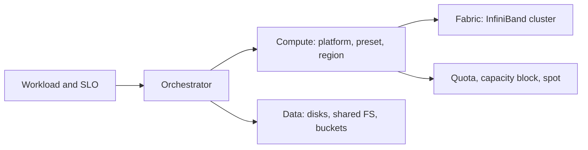

# 20.31 Nebius AI Cloud foundation: GPUs, fabric, storage and platform choices

An interviewer says: "A customer wants to train a model, host a fine-tuned version and serve an agent in Europe. Build it on Nebius." You have a whiteboard and ten minutes. You need to know which layer you can pick, which layer Nebius runs for you, and which facts you must check live before you promise anything.

This chapter covers the AI Cloud layer under Token Factory. It uses only public Nebius documentation fetched on 2026-11-09. Evidence tags follow the volume plan. [official] is a Nebius docs page. [vendor] is Nebius marketing or a company announcement. [inference] is my design reasoning. Where Nebius has not published something, the text says so.

Every line you draw on the whiteboard is only as strong as its source. A whiteboard hides the difference between a docs page and a press release, so the tags bring that difference back into view. When you speak in the room, use the tag as a guide to how firmly to say a fact, and to whether you need to ask the account team before you repeat it.

## What the interviewer is testing

Picture the system design round a few minutes in. The interviewer has described the customer, and now they wait to see whether you start drawing boxes or start asking which facts the drawing depends on. This chapter serves the system design round and the project deep dive. The plan records the official wording as: a whole or partial distributed system, meet load and availability targets, estimate performance and compute, and weigh data storage and processing trade-offs [official]. Nobody has published what Nebius asks in the design round for this team. Treat the chapter as a way to speak accurately about the platform, not as a list of expected questions.

The skills are three. You name the layer that owns each requirement. You say which facts depend on project, region and live capacity. You show how a choice changes failure behaviour and the bill.

They are habits the interviewer listens for in every answer. A candidate who names a layer but never mentions capacity sounds like someone who has read a brochure.

A realistic question in the interviewer's voice: "A customer needs eight-GPU nodes for multi-node training in the EU, plus a durable place for checkpoints. What do you check before you promise it?"

Notice that the question asks what you check, not what you build. That wording is a hint. A good answer starts with the checks and then draws the design those checks allow.

## The core ideas

### 1. Know the layers and who owns each

Imagine a customer email that asks for "an AI platform" in a single sentence. That sentence hides several owners. Someone owns the model, someone owns the GPUs, someone owns the network between the GPUs, and someone owns the data. Until you split the sentence apart, you cannot say who fixes what when something breaks.

"AI factory" is a metaphor, not a Nebius product [inference]. The useful habit is to split any request into layers and name an owner for each. Nebius describes its energy-to-output process as four layers of efficiency: model, cluster, fabric and data center [vendor, *The Energy Behind AI* blog post]. The post is company-authored. It gives no customer guarantee. The four layers are still a useful picture of the path from electricity to an answer. A gain at one layer does not carry over to the next, and a slow layer limits the whole path.

For a customer design, a more practical split is the one below. Rows 2 to 5 are AI Cloud resources a customer can pick. Token Factory sits on top and hides most of them. Chapter [20.30](./30-nebius-ai-factory-to-token-factory-architecture.md) covers that boundary, so this chapter stays below it. Read the table from the top. The first row is the request the customer made, and each row under it is a point where someone has to decide something. The table uses SLO, the service level objective, which is the target a service promises to meet.

| Layer | Customer decides | Where to look |
|---|---|---|
| Workload | model, precision, concurrency, SLO | model card, chapters 12 and 19 |
| Compute | GPU platform, preset, region, quota | Compute VM types page |
| Fabric | InfiniBand cluster or none, placement | GPU clusters and topology pages |
| Data | storage class per artifact | Compute storage and Object Storage pages |
| Orchestrator | VMs, Managed Kubernetes, Soperator, Serverless AI | each service's docs |
| Money and supply | quota, reservation, spot, budget | quotas, capacity blocks, billing pages |

**Before choosing a product, trace each requirement to the layer that can satisfy it.**

### 2. Announced facilities are not orderable capacity

A customer forwards a news article about a new data center and asks whether their team can start next week. The article is real, and the honest answer is probably no, because it describes a building and not a quota.

A press release about a campus does not put GPUs in your project. You need to separate three things: what is announced, what is operating, and what your project can create today. Those are different questions with different sources, and a press release can only answer the first.

Here is what the public pages say, as fetched on 2026-11-09.

| Item | What the page says | Tag |
|---|---|---|
| Mäntsälä, Finland | 8 Oct 2024 release titled "triple capacity ... to 75 MW". It describes an expansion in progress and says up to 60,000 GPUs fit at the site. It claims a PUE "as low as 1.1 under high IT loads". It gives no completion date. | [vendor] |
| GB300 NVL72 | 17 Dec 2025 post says the expanded Finland data center hosts Europe's first operational production deployment of this platform. | [vendor] |
| Lappeenranta, Finland | 31 Mar 2026 release. Up to 310 MW planned, expected available to customers in 2027. | [vendor] |
| Independence, Missouri | 3 Mar 2026 release. City council approved an incentive plan. "Potential capacity of up to 1.2 GW". No completion date. | [vendor] |

Some claims I first wrote down are not on the pages I fetched. One said the Mäntsälä expansion "had been completed earlier in 2026". Another gave a second PUE of 1.15. A last one said Nebius targets more than 3 GW of contracted power by the end of 2026. I could not find any of those three claims on the pages I fetched, and I could not read the gated whitepaper PDF either. They are removed. Do not repeat them in the interview unless you find a dated source.

PUE stands for power usage effectiveness. It compares total facility energy with IT energy, so a lower value means less of the energy goes to cooling and power delivery. It says nothing about tokens per watt or GPU utilisation. A PUE figure in a press release is a marketing number for one site.

To know what you can order, use the project, not the press release. Check that the platform is listed in the region, that quota allows it, and that the capacity advisor shows room. The advisor reports the maximum number of VMs you can launch "based on your quotas and the current physical capacity" [official, capacity advisor page]. For VMs with reservations it counts from your active reservations instead.

A news article answers "is there a building?" A quota and the advisor answer "can my team create nodes now?" Those are not the same question, and the interview gets easier once you keep them apart.

**Use facility news for context only. Use quota and the capacity advisor for any commitment.**

### 3. Pick the GPU platform and region together

A team asks for the biggest GPU in the catalogue, and the region they want lists only a smaller one. You now have to choose between the GPU they asked for and the place they need to run. Platform and region are a pair, so you decide them together.

The Compute VM types page is the source of truth, and it changes. The table below is what it listed on 2026-11-09. Memory and bandwidth are Nebius-published figures [official]. The InfiniBand column is the per-node figure the page gives. Memory and bandwidth decide how much model fits on one GPU and how fast the GPU can move data within itself. The InfiniBand column decides how fast nodes can reach each other.

| Platform | GPU memory, bandwidth | InfiniBand per node | Regions listed |
|---|---|---|---|
| `gpu-b300-sxm` | 270 GB HBM3e, 7.7 TB/s | 800 Gbps, 8x ConnectX-8 | uk-south1, eu-west2, us-north1 |
| `gpu-b200-sxm` | 180 GB HBM3e, 7.7 TB/s | 400 Gbps, 8x ConnectX-7 | us-central1 |
| `gpu-b200-sxm-a` | same as above | same as above | me-west1 |
| `gpu-h200-sxm` | 141 GB HBM3e, 4.8 TB/s | 400 Gbps, 8x ConnectX-7 | eu-north1, eu-north2 (private), eu-west1, us-central1 |
| `gpu-h100-sxm` | 80 GB HBM3, 3.35 TB/s | 400 Gbps, 8x ConnectX-7 | eu-north1 |
| `gpu-rtx6000` and `-a` | 96 GB GDDR7, 1.6 TB/s | not listed | us-central1, uk-south2, eu-south1 |
| `gpu-l40s-a` and `-d` | 48 GB GDDR6, 864 GB/s | not listed | eu-north1 |

Two points surprise people. An early reading of the page gave "3.2 Tbps per node" as if it fitted every platform. The pages give 400 Gbps per GPU on the clusters page, and the VM types page lists the B300 at 800 Gbps per node adapter rate. Read the row for your platform. Also, the RTX PRO 6000 and L40S platforms list no InfiniBand, so they are inference or single-node choices, not multi-node training clusters.

Presets bundle GPU count, vCPU and RAM. A preset is a named size, so you pick the whole bundle instead of counting parts by hand. For example the H100 platform offers `1gpu-16vcpu-200gb` and `8gpu-128vcpu-1600gb`. Check the exact size on the page before you quote it. The page itself says availability depends on region and project, and tells you to use the platform list command or the capacity advisor.

Sizing is your job, not the docs'. Work out weight memory, KV cache and concurrency first, as chapter [20.12](./12-estimation-toolkit-for-inference-capacity.md) shows. Weight memory is the space the model parameters take. KV cache is the memory that holds attention state for each request in flight. Concurrency is how many requests a replica serves at the same time. Then compare GPUs. A bigger-memory GPU may fit the model in one replica. A smaller one may need quantisation or more replicas, and quantisation stores the weights in fewer bits to save memory. These are different operating designs, not only different prices [inference].

Preemptible capacity is cheaper but unsafe for a fixed-SLO service. Compute can stop a preemptible VM at any time. It sends SIGTERM 60 seconds before the stop, then SIGKILL. Attached volumes are kept. Local SSD data is lost, and the VM is not restarted automatically [official, preemptible VMs page]. A signal is a short message the operating system sends to a running program. SIGTERM asks the program to shut down cleanly, and SIGKILL stops it with no chance to clean up.

**Choose model, GPU, region and fabric as one tuple, then validate that tuple in the target project.**

### 4. Fabric: InfiniBand clusters and topology

A team runs the same training script on a single node, then on several nodes, and the second run takes longer than the first. The GPUs look busy in both runs, so the real question is what the extra nodes are waiting for. Often the answer is the network between the nodes.

Eight GPUs in one node talk over NVLink. NVLink is the fast link between GPUs inside a single server. Many nodes training one model need a network between nodes. Nebius offers GPU clusters for that. A cluster connects compatible GPU VMs through InfiniBand, a high-speed network technology built for this kind of traffic. The clusters page says each GPU "is connected through a network interface card (NIC) that provides 400 Gbps", so an eight-GPU H100 node has 3.2 Tbps in total [official]. It names GPUDirect RDMA, the NVIDIA technology that moves data between a GPU and its NIC without going through the CPU. The arithmetic is simple, eight GPUs at 400 Gbps each.

Think of a fabric as a private road network that reaches only some places. The clusters page lists for example H100 fabrics in `eu-north1`, H200 fabrics in `eu-west1`, `eu-north1`, `eu-north2` and `us-central1`, B200 in `me-west1` and `us-central1`, and B300 in `eu-west2`, `uk-south1` and `us-north1`. A fabric accepts only the platform it is listed with [official].

Isolation uses InfiniBand partition keys. Each GPU cluster gets its own P-Key, so nodes in different clusters cannot talk even when they share physical hardware [official]. This is network isolation only. It does not replace IAM or security groups, which control who may do what.

Topology matters because the network has layers. The topology page describes a fabric with a root switch, PODs under it joined by core switches, and scalable units inside PODs joined by leaf switches. Crossing a higher layer costs more [official]. A switch is the device that forwards packets, and a POD is a group of racks that share a set of switches. Slurm and Volcano can read a topology file so the scheduler places distributed jobs on nearby nodes. Nebius reports NCCL AllReduce tests with "performance gains of up to 20%, depending on cluster size" and gives no test setup [vendor]. NCCL is NVIDIA's library for communication between GPUs, and AllReduce is the operation in which every GPU ends up with the combined result from all of them. Treat that as a reason to benchmark your own job, not as a promise.

For tuning inside the job, the *AI Data Center Network Design and Technologies* chapter on network design considerations covers rail-optimised design and why collectives are sensitive to path length. Chapter [20.18](./18-how-llm-serving-fails.md) section 6 covers NCCL hangs. I did not find a public Nebius page that documents RDMA in Kubernetes pods in detail, so do not claim how it is exposed [gap].

**Buy an InfiniBand cluster only for a job that does multi-node collectives, and benchmark it on the intended ranks.**

### 5. Network boundaries before workloads

A web team asks for a public address on their database because it is quicker than fixing a route. That shortcut makes the database reachable by anyone who finds the address. Network rules exist to stop that kind of shortcut.

Think of the VPC page as the rules for where traffic can go. VPC means virtual private cloud, a private network inside the cloud. Virtual Networks supports IPv4 only. Each project gets `default-network` and `default-subnet`. A subnet is a range of addresses inside the network. The default routing table has one route sending all egress traffic to public IP addresses out to the internet [official, VPC overview]. Egress means traffic leaving a network, and a routing table is the list that tells packets which way to go.

Each network has a system DNS zone and you can add custom zones. A zone resolves only from workloads inside its network [official]. DNS turns names into addresses. A zone that answers only inside its network keeps those names private, so callers outside never see them.

A custom NAT gateway is a Compute VM. You create a route for `0.0.0.0/0` whose next hop is the gateway's private allocation, then attach that routing table to the subnets that should use it. Attaching it to the gateway's own subnet causes routing loops [official, custom NAT gateway page]. NAT, network address translation, lets private machines reach outside networks through a gateway that holds the public address. The gateway must have a path out of its own, so its traffic cannot loop back through itself.

Managed Kubernetes attaches a system security group to worker nodes. A security group is a set of firewall rules attached to a machine. Your own groups add to it and cannot override or remove it [official, Kubernetes security groups page]. Nebius Tunnels expose a service from a VM or laptop to the internet without opening inbound ports. The page warns that tunnels add no authentication of their own [official]. Reaching a service through a tunnel is not the same as being allowed to use it, so they are not an admin path.

The Token Factory API is a public regional endpoint. Nebius has not published a way to attach that managed data plane to your VPC. If private connectivity is a hard requirement, say so and ask the account team [gap].

**Draw the reachability matrix of client, east-west and management traffic before you give anything a public address.**

### 6. Match storage to data temperature

A training run takes a long time to start after each restart, and the team blames the GPUs. Often the GPUs are waiting on weights that load from slow storage. The question is which bytes live where, and how fast each place can serve them.

The same bytes pass through stages. Datasets are read many times. Weights are loaded by every replica. Checkpoints are written under time pressure. Each stage fails differently. A common way to think about this is data temperature. Hot data is read constantly and needs speed. Cold data is kept for later and needs to be cheap and safe. The table below sorts the options by what each one is good at.

| Storage | Facts from the docs [official] | Use it for |
|---|---|---|
| Network SSD | Erasure coded, survives two concurrent hardware failures, encrypted by default | boot and durable block data |
| Network SSD non-replicated | No redundancy, data lost if the disk fails | fast disks whose data can be rebuilt |
| Local SSD | Ephemeral, erased when the VM stops or is deleted, not encrypted | scratch and caches |
| Shared filesystem | Erasure coded, encrypted by default, close-to-open consistency | shared weights, checkpoints, training data |
| Object Storage | S3-compatible buckets, three classes | datasets, artifacts, outputs, backups |

Erasure coding splits data into pieces with extra parity pieces, so the data can be rebuilt when some pieces are lost. Close-to-open consistency means a change to a file becomes visible to another client once the writer closes the file and the reader opens it. Both are general storage ideas, and the table gives the Nebius-specific claims.

The Compute storage page recommends SSD shared filesystems for sharing weights between GPUs during autoscaling. It recommends Object Storage for storing and preprocessing large datasets, and shared filesystems for streaming data to training workers in most cases [official].

Shared filesystems have one trap. Directory entries and inode metadata are cached on each VM for up to 15 seconds, so one VM's changes may not be instantly visible on another [official]. An inode is the record that holds a file's metadata, such as its size and permissions. A job that writes a checkpoint on node A and lists the directory on node B right away can miss it, much like two editors who each work from an old copy of the table of contents. Design for that window [inference].

Object Storage has three classes. Standard is the default. Intelligent moves objects to a cheaper Cold tier after 30 days without access, and moving does not change performance. Enhanced Throughput has no speed throttle, a higher storage price, and free operations and egress. Standard and Intelligent are capped at 20 GBps per tenant per region [official, storage classes page]. The page lists weights, datasets and checkpoints as Enhanced Throughput use cases. S3-compatible means the buckets speak the same API as Amazon S3, so tools written for S3 can usually point at them.

Container Registry stores images. Pre-pulling a large image means fetching it onto a node before a pod needs it, so the start does not wait on the download. Pre-pulling large images to cut cold-start time is standard practice, covered in chapter 18 section 7, not a documented Nebius feature [inference].

**Use scratch for speed and durable storage for recovery, and never let a unique checkpoint live only on local SSD.**

### 7. Choose the orchestrator by who owns what

A pod on a managed cluster sits in a pending state, and the team asks whether the fix belongs to them or to Nebius. Pending means the scheduler has not yet placed the pod on a node. Before you can answer, you need to know who runs which part of the stack.

Five paths exist, and a design may use several. Each path moves some of the work from your team to the provider.

Virtual machines give the most control. You own the OS, drivers, runtime and repair. That control also means the work of keeping the machine healthy stays with you.

Managed Kubernetes gives a Nebius-run control plane with an API server, scheduler, cluster autoscaler, controller manager and etcd. The control plane is the set of components that makes decisions for the cluster, and etcd is the store that holds the cluster's state. Clusters are created with three etcd stores by default [official, components page]. The autoscaler adds nodes for unschedulable pods and removes underused ones. For GPU groups the docs recommend a CPU node group so CoreDNS and Cilium keep running while GPU nodes scale down [official]. They also document a known issue. With the NVIDIA GPU Operator and Network Operator installed, the autoscaler can create more nodes than the workloads need [official]. That is a good detail to cite.

Soperator is Nebius's Kubernetes operator for Slurm. Slurm is a batch scheduler that many HPC sites use to queue and run jobs. A `SlurmCluster` custom resource describes the cluster. The operator creates controller, login and worker nodes and storage. It rewrites Slurm config from the spec on every update, so manual `scontrol` edits are overwritten. In practice, a hand edit on a running node is a temporary change that the next update removes. Login and worker nodes share one root filesystem, called the jail in the repository [official, architecture page, and Soperator README]. Three ways to run it are listed in the README: self-deploy on any Kubernetes, Managed Service for Soperator, and Soperator Pro where Nebius engineers install and support the cluster [vendor].

Serverless AI runs your containers as Devlabs, jobs or endpoints. Jobs end when the task ends. Endpoints respond until you stop them and have a public URL [official, Serverless overview]. This is different from Token Factory Public Serverless, which is a hosted model API. Chapter [20.30](./30-nebius-ai-factory-to-token-factory-architecture.md) draws that line.

Token Factory Dedicated Endpoints are a managed model deployment, covered in chapters [20.14](./14-design-dedicated-endpoints-and-safe-model-rollout.md) and 32.

**Choose the highest managed layer that does not hide something the customer must control.**

### 8. Capacity, quota and cost are separate controls

An alert says "we cannot launch the nodes". On call, at night, that message could mean several different things. The cause could be quota, supply or money, and each has its own control. The first job is to find which one is blocking you. Mixing them up is a classic weak answer.

| Control | What it does | What it does not do |
|---|---|---|
| Quota | Limits how much you can create, per region. Only users in groups with the `admin` role can request changes. | Does not guarantee physical capacity |
| Capacity advisor | Shows what you can launch given quota and live capacity | Does not reserve anything |
| Capacity block group | Reserves a number of GPUs in a region on one platform and one InfiniBand fabric, in daily UTC intervals. Requested through your Nebius manager. GPUs from it do not count toward GPU quotas. | Does not appear to be self-service |
| Pricing policy | Sets a maximum spot price. If it is below the spot price, Compute can stop the VM. | Does not cap on-demand cost |
| Budget | Alerts on spend. Updates every few hours, so alerts can be late. | Does not stop or cap usage. A quota decrease is the page's suggestion for that. |

All five rows are [official]. Quota asks whether you may create the nodes, the advisor asks whether there is room, and the pricing policy and budget ask what the bill will do.

Two further billing facts are [official] and worth stating. Spot price "may change as often as every 15 minutes", and spot prices "aren't capped and can rise above the regular on-demand service rates" [pricing policy page]. Spot means a discounted price for capacity that the provider can take back. So "spot is cheaper" is not a safe rule. Billing is either pay-as-you-go or commitment discounts for companies, and you can mix them [billing models page].

Cost allocation labels group costs, but only for Compute billable resources. Labels on other resources are unavailable in the billing report [official]. Usage export in FOCUS format exists for FinOps pipelines [official, per the docs index]. FOCUS is a shared format for cloud billing data, which makes it easier to feed costs into a FinOps team's own reports.

I could not find a page that states per-second metering, so this chapter does not claim it. Check the pricing page for your service before you quote billing granularity. For an inference service you run yourself, compare billed node-hours with useful tokens, not with GPU utilisation [inference].

**Pair a capacity control with a cost control. Neither substitutes for the other.**

### 9. A customer-built reference pattern

A platform team asks for a template to run inference in several regions, and they want to see how a published example is laid out. The example is useful for learning, and it is not a product you buy.

Nebius publishes a Solutions Library example, `k8s-inference`. It is a customer-operated multi-region platform, not Token Factory internals, and its README says it is "a template for a platform team, not a hardened multi-tenant service" [vendor, GitHub README].

Its shape is: one CPU-only control cluster with the customer API, LiteLLM, a Kueue MultiKueue manager with a cost dispatcher, and Grafana. A managed PostgreSQL fleet database holds model definitions, keys, budgets, spend and the GPU ledger. Each region has a worker cluster with GPU pools, Knative and KServe endpoints, an Envoy gateway that checks keys against the control cluster, an image cache, DCGM, OpenCost, Loki and a weights filesystem [vendor]. The control cluster is where the rules live, such as keys, budgets and routing decisions. The worker clusters are where the GPUs run, close to the users they serve.

The README lists its own limits. Tenant containers share the GPU nodes of a region, which is container isolation, not VM isolation. Container isolation means tenants share the host's kernel, which is a weaker wall than a separate VM. Traffic inside the clusters is not encrypted, and no service mesh is installed [vendor]. The lesson for an architect is that central policy with regional compute adds cross-region authentication, a database dependency and operator work. A managed endpoint avoids that, at the price of less control [inference].

**Use the example to learn one pattern. Do not present it as what Nebius runs.**

### 10. Plan recovery by failure domain

Say a GPU node falls over at 3 a.m. What happens next depends on who runs the node, and on how much state lived only on that node. A failure domain is the part of the system that can fail together, such as a node, a rack or a region.

For customer Managed Kubernetes, the docs describe Node Problem Detector on each node and GPU health checks every five minutes. Node Problem Detector is a Kubernetes add-on that reports node faults as conditions. The checks cover GPUs, InfiniBand and NVLink using `nvidia-smi`, `dcgmi` and `dmesg`, and look for Xid and ECC errors. Xid is an error code the NVIDIA driver writes to the kernel log when a GPU misbehaves, and ECC errors come from the GPU's error-correcting memory. When the `NebiusGPUError` condition is true, recovery cordons the node, waits for GPU workloads to release the GPUs, drains the node, stops and starts its VM, then uncordons it. Cordon marks a node so that no new pods land on it. Drain moves the running pods off it. The drain takes up to one hour [official, health checks page].

The docs say this for Managed Kubernetes. They do not say Token Factory Dedicated Endpoint workers follow the same steps, so do not claim it [gap].

For Soperator the README says passive and active health checks detect GPU, network, storage and system issues, and failed nodes are drained and replaced automatically [vendor]. Whether that applies depends on whether you self-deploy, use the managed service, or have Pro.

Node replacement does not restore state that lived only on the old host. Local SSD is erased when the VM stops [official]. Put checkpoints on shared storage or buckets and choose an interval that bounds lost work [inference]. The interval sets how much work you can afford to lose. Chapters [20.16](./16-design-gpu-fleet-health-and-capacity.md) and [20.23](./23-kubernetes-failure-drills-for-gpu-platforms.md) go deeper.

**For each failure domain, name the signal, the first safe action and who owns the final repair.**

## How to answer out loud

The interviewer finishes the question and waits. Your first sentence sets the frame, so open with the requirements, then walk down the stack. A model opening: "I need sustained online inference, EU processing, a latency target and a monthly ceiling. First I check whether a regional managed endpoint meets the contract. If I need custom runtimes or private networking, I compare Managed Kubernetes and Serverless AI. For training I compare Soperator with a GPU VM cluster, based on Slurm needs and fabric scale."

Expect these follow-ups.

- **"Why do you care about the fabric?"** Collectives cross switch layers, so placement matters. I benchmark on the real ranks. Nebius reports up to 20 percent AllReduce gain, but that is a vendor test.
- **"Where do weights and checkpoints live?"** Weights on a shared filesystem for replicas. Datasets and retained artifacts in Object Storage. Local SSD is scratch only. The recovery objective picks the authoritative copy.
- **"Can we fail over to another region?"** The product contract decides. Self-managed, I need legal approval, model parity and pre-planned capacity.
- **"What do you estimate first?"** Weight memory and KV cache per replica, then GPUs per replica, region availability, traffic, and the idle floor. Then I replace estimates with a benchmark.

## Worked scenarios

### Scenario 1: The GPU is announced but the project cannot create it

A customer wants eight B300 GPUs in a new region. Check the VM types table: B300 is listed in `uk-south1`, `eu-west2` and `us-north1`. Then check the project's quota and the capacity advisor. If the fabric has no room, offer another region or a platform such as B200 and state the memory trade-off, 180 GB against 270 GB. Do not point to any announced megawatts. The answer is a tuple you verified, with a named fallback.

### Scenario 2: Training slows down after moving from one node to four

A team moves its training job onto more nodes, and the GPU graphs still look busy. Utilisation looks high but step time doubled. Step time is how long a single pass of training takes. Check that the VMs are in one GPU cluster and that the platform has a fabric. Check that placement is topology-aware. Confirm NCCL is using InfiniBand and not TCP by running its debug output on the intended ranks. Look at link error counters. Keep dataset reads and checkpoint writes separate from the collective traffic. If the job is compute-bound, a faster fabric will change little. The answer comes from a measurement, not from the SKU.

### Scenario 3: A node is repaired while the job keeps only local checkpoints

A long training run is in the middle of its work when the GPU health check sets `NebiusGPUError`. Managed Kubernetes cordons, drains and restarts the VM, and the job seems to recover. Then the team finds that the newest checkpoint is gone. Local SSD is erased on stop, so the job loses everything since its last durable copy. Fix the design, not the repair: write checkpoints to a shared filesystem or a bucket, test a restore, and choose an interval from your RPO. RPO, the recovery point objective, is how much recent work you can afford to lose.

## Hands-on lab

Imagine a planning meeting on Monday where the team wants a cluster by Friday. You have only a browser and a notebook, and nobody has approved a project yet. This lab needs only a browser and a notebook. I did not create any cloud resource while writing this chapter. Do not create one without an approved project and a price check.

1. Pick one workload: multi-node training, online serving, or an agent. Write latency, throughput, residency and recovery targets. **Expected:** every item has a number or is marked unknown.
2. Open the VM types page. Choose a platform, preset and region, and a fallback. **Expected:** you can say which facts need a live project check.
3. Open the GPU clusters page. Decide if InfiniBand is justified. **Expected:** a yes or no with a reason tied to collectives.
4. Assign each dataset, weight file, checkpoint and image to a storage type from section 6. **Expected:** no unique checkpoint exists only on local SSD.
5. Pick an orchestrator from section 7 and list who owns drivers, scaling, keys and regional recovery. **Expected:** a one-line owner per item.
6. Write one failure and one cost check from section 8. **Expected:** each has a signal, a first action and an owner.

## Drill questions

Imagine a colleague asking these questions across a table, with no laptop open.

1. What are the four layers in Nebius's public energy-to-output framework?

Model, cluster, fabric and data center. It comes from a company-authored blog post and whitepaper. It is not an internal architecture diagram.

2. Does a 310 MW announcement mean a customer can create B300 nodes there today?

No. The March 2026 release says the Lappeenranta site is expected to be available to customers in 2027. Check the platform list, quota and the capacity advisor.

3. What is the difference between an eight-GPU VM and a GPU cluster?

A VM is one host. A GPU cluster joins compatible VMs through an InfiniBand fabric so multi-node jobs can communicate. Fabrics are tied to a platform and region.

4. Why can a B300 node have a different InfiniBand figure from an H100 node?

The VM types page lists 800 Gbps for B300 and 400 Gbps for H100, B200 and H200. Never reuse one platform's number for another.

5. A job shows high GPU utilisation but slows down on four nodes. What do you check?

Check cluster membership, topology-aware placement, whether NCCL uses InfiniBand, and link error counters. High utilisation can hide communication stalls.

6. When do you pick Object Storage over local SSD?

For durable datasets, checkpoints, artifacts and outputs. Local SSD is erased when the VM stops or is deleted, so it is only scratch.

7. What surprise does a shared filesystem hold for a checkpointing job?

Directory entries and inode metadata are cached on each VM for up to 15 seconds. Another node may not see a new file at once.

8. When is Soperator a better fit than plain Managed Kubernetes?

When the team needs Slurm batch semantics, accounting and the HPC workflow, with Kubernetes underneath. It is not an inference API.

9. Quotas, capacity blocks and budgets: what does each do?

Quotas limit creation per region. Capacity blocks reserve GPUs on one platform and fabric over set intervals. Budgets only alert, and the alerts can be late.

10. Can Kubernetes node repair save a job's local-only checkpoint?

No. Repair restarts the VM and local SSD is erased on stop. Durable checkpoints on shared storage or a bucket are what recover the job.

## Common mistakes and weak answers

Picture the interviewer's notes at the end of the round. Each weak answer below is easy to fix with a sentence you rehearse in advance.

- Treating an announced campus or power target as GPU inventory. Say: "I check quota and the capacity advisor." A news item does not put a GPU in your project.
- Quoting one platform's network figure for all GPUs. Say: "I read the row for this platform." The InfiniBand figures differ between platforms.
- Calling spot "cheaper". Say: "Spot can rise above on-demand, so I set a price ceiling or avoid it for fixed SLOs."
- Using budgets as a spend cap. Say: "Budgets alert, quotas limit." An alert tells you about the bill after it has grown.
- Saying Kubernetes auto-repair fixes data loss. Say: "It replaces the node. Checkpoints decide recovery."
- Claiming Token Factory runs the Managed Kubernetes repair flow. Say: "Nebius has not published that."

## Connections to the rest of the handbook

Imagine a colleague asking how to set up a new customer on Nebius, a week after the interview. The links below cover each part of that answer.

- [20.30](./30-nebius-ai-factory-to-token-factory-architecture.md) for the evidence boundary and product map.
- [20.12](./12-estimation-toolkit-for-inference-capacity.md) for sizing, [20.16](./16-design-gpu-fleet-health-and-capacity.md) for fleet health.
- [20.20](./20-autoscaling-gpu-inference.md) and [20.23](./23-kubernetes-failure-drills-for-gpu-platforms.md) for scaling and Kubernetes failure drills.
- [20.24](./24-terraform-for-resilient-gpu-clusters.md) for Terraform, and [20.32](./32-token-factory-model-lifecycle-serving-and-economics.md) and [20.33](./33-ai-factory-solution-architecture-ha-and-recovery.md) for the managed layer.

## Sources and review notes

All Nebius pages fetched on 2026-11-09. Recheck regions, prices and timelines before any commitment.

- Compute: [VM types](https://docs.nebius.com/compute/virtual-machines/types), [GPU clusters](https://docs.nebius.com/compute/clusters/gpu/index), [topology](https://docs.nebius.com/compute/clusters/gpu/topology/index), [capacity advisor](https://docs.nebius.com/compute/virtual-machines/capacity-advisor), [preemptible VMs](https://docs.nebius.com/compute/virtual-machines/preemptible), [storage types](https://docs.nebius.com/compute/storage/types), [capacity block groups](https://docs.nebius.com/overview/limits/capacity-block-groups), [quotas](https://docs.nebius.com/overview/quotas).
- Network and storage: [VPC overview](https://docs.nebius.com/vpc/overview), [custom NAT gateway](https://docs.nebius.com/vpc/routing/custom-nat-gateway), [Kubernetes security groups](https://docs.nebius.com/kubernetes/networking/security-groups), [Tunnels](https://docs.nebius.com/tunnels/overview), [Object Storage classes](https://docs.nebius.com/object-storage/storage-classes).
- Kubernetes, Slurm, serverless: [components](https://docs.nebius.com/kubernetes/components), [autoscaling](https://docs.nebius.com/kubernetes/node-groups/autoscaling), [health checks](https://docs.nebius.com/kubernetes/maintenance/health-checks), [Soperator architecture](https://docs.nebius.com/slurm-soperator/overview/architecture), [Serverless AI overview](https://docs.nebius.com/serverless/overview).
- Billing: [billing models](https://docs.nebius.com/signup-billing/billing-models/overview), [pricing policy](https://docs.nebius.com/signup-billing/pricing-policy), [spot prices](https://docs.nebius.com/signup-billing/spot-prices), [budgets](https://docs.nebius.com/signup-billing/budgets), [cost allocation labels](https://docs.nebius.com/signup-billing/usage/cost-allocation-labels).
- Announcements [vendor]: [Mäntsälä, 8 Oct 2024](https://nebius.com/newsroom/nebius-to-triple-capacity-at-finland-data-center-to-75-mw), [GB300 NVL72, 17 Dec 2025](https://nebius.com/blog/posts/first-live-nvidia-gb300-nvl72-deployment-in-europe), [Lappeenranta, 31 Mar 2026](https://nebius.com/newsroom/nebius-to-construct-310-mw-ai-factory-in-finland), [Independence, 3 Mar 2026](https://nebius.com/newsroom/nebius-secures-approval-for-its-first-gigawatt-scale-ai-factory), [The Energy Behind AI](https://nebius.com/blog/posts/the-energy-behind-ai).
- Repositories [vendor]: [Solutions Library k8s-inference](https://github.com/nebius/nebius-solutions-library/tree/main/k8s-inference), [Soperator](https://github.com/nebius/soperator).
- Book: *AI Data Center Network Design and Technologies*, chapter "Network Design Considerations". Used only as general background. Nebius-specific numbers come from the pages above.

**Explicitly labelled inferences:** the layer split, GPU sizing logic, the 15-second visibility design advice, checkpoint placement, image pre-pull, and the managed-versus-self-built trade-off in section 9.

**Not verified:** project-specific quota and capacity, live prices, the gated whitepaper PDF (unreachable as text), RDMA exposure inside pods, private connectivity to Token Factory, and per-second metering. I ran no commands because nothing here needs code.

### Verification log

About 60 claims and 33 URLs checked. 41 claims confirmed. 9 corrected: B300 InfiniBand rate (800 Gbps, not the H100 3.2 Tbps rule), region lists for B200, H200, H100, L40S and RTX PRO 6000, Mäntsälä status, NAT gateway wording, Enhanced Throughput cost description, spot-price date framing. 10 removed as unsupported: Mäntsälä completed in 2026, PUE 1.15, 3 GW target, per-second metering, "since Nov. 2026 update", managed RDMA/DRA components, WireGuard jump VM, private routes discarded, zero-surge reservation blocking replacement, object multipart tuning advice. Section 9 and the Solutions Library detail were shortened. All fetched links resolved. The whitepaper PDF resolved but could not be read.
