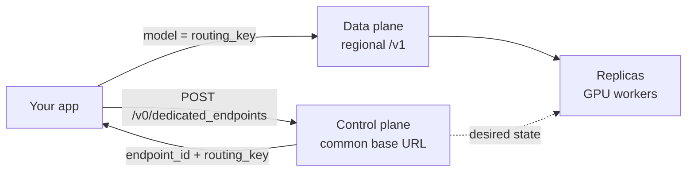

# 20.32 Token Factory: model lifecycle, serving and economics

## What the interviewer is testing

A customer writes to support: "Our fine-tuned model worked in the test. In production we see 404 for ten minutes after every restart, the bill is higher than the token count suggests, and legal asks where prompts are processed." Each part of that message is a question about the product contract. This chapter serves the system design round and the project deep dive. It also feeds the incident round, because most customer incidents on a managed inference product start with a misread contract.

The job posting asks you to design "a whole or partial distributed system" and to run production back-ends. The interviewer wants to hear you separate three things. What Nebius documents, what Nebius markets, and what you would design yourself. Nebius has not published its gateway, router, scheduler or billing pipeline [gap]. So the skill being tested is accuracy about the public contract, plus honest reasoning about the rest.

A realistic question in the interviewer's voice: "A customer on a dedicated endpoint says their bill did not change after they enabled prompt caching. Another says their serverless bill dropped. Explain both, and tell me what you would check."

Every fact below carries a tag. **[official]** means a Nebius documentation page fetched on 2026-11-09. **[vendor]** means a Nebius blog or sales page. **[gap]** means not public. **[mine]** means my reasoning, not a Nebius statement.

## The core ideas

### 1. Two products behind one API

A new engineer says "we use Token Factory" and nobody asks which product. That is the first mistake. Token Factory has Public Serverless endpoints and Dedicated Endpoints. Both speak an OpenAI-compatible API under `/v1`, and the API accepts the vLLM parameter set [official]. After that they differ in almost every way that matters to an SRE.

| Question | Public Serverless | Dedicated Endpoint |
|---|---|---|
| Capacity | Shared multi-tenant | Isolated deployment you configure |
| Region | Shows Global, can change without notice | Fixed at creation, chosen by you |
| Rate limits | Dynamic limits apply | No standard rate limits, throughput depends on deployed capacity |
| Scaling | Platform managed | You set minimum and maximum replicas |
| Custom weights | Base models only | Supported for eligible models, beta, on request |
| Pricing | Per token | Per GPU hour, billed per minute |

The table follows the Dedicated Endpoints overview page [official]. One cell needs care. The overview says capacity is "reserved for your organization". The capacity page says self-service endpoints use an on-demand shared pool, that the capacity is "not a long-term reservation", and that minimum replicas are guaranteed only while the endpoint is active [official]. The second page is more precise. Read "reserved" as "held while active".

The Public Serverless page says these endpoints suit testing and non-critical work, and are not intended for production that needs a stable region [official]. The legal guide repeats it [official]. An answer that proposes Serverless for a regulated production path without that caveat loses points.

**Choose the product from the region, capacity and billing contract first, and talk about models second.**

### 2. Identity: organisation, project, group, key

An SRE must revoke a contractor without stopping a production endpoint. The resource model makes that possible. An organisation holds projects. A project holds API keys, fine-tuning jobs, dedicated endpoints, files and datasets [official]. Being listed as a user grants nothing until the user is placed in a group.

| Level | Group | What it can do |
|---|---|---|
| Organisation | Admin | All settings, billing, users and all projects, including Zero Data Retention settings |
| Organisation | Billing Manager | Billing settings and usage. No project resources, no user invites, no ZDR settings |
| Project | Admin | Full control of project resources and membership, can create and delete keys |
| Project | Member | Operate project resources, create and delete only its own keys |

The permission tables are on the Groups and Organizations pages [official]. Two details are easy to miss. Billing Manager has no access to inference observability, so a finance user cannot see latency. And an Organisation Admin automatically administers every project, so admin membership should be rare.

**Map every human and every workload to one group and one project before you issue a key.**

### 3. Control plane, data plane and the routing key

An engineer runs a create call, gets a 201, and sends a request one second later. The request fails with 404. The two planes explain why.

The control plane changes configuration. It has one common base URL, `https://api.tokenfactory.nebius.com`, and the paths start with `/v0/dedicated_endpoints` [official]. The data plane serves inference and has a regional base URL under `/v1`. For `eu-north1` the data-plane URL is the same host as the control plane. For `eu-west1` and `us-central1` the docs show their own hosts [official]. The API schema, version 20261105, lists sixteen region values, while the docs table lists three [official]. Do not assume all sixteen are orderable. Ask the template call.



The create response returns two identifiers. `endpoint_id` is for update and delete. `routing_key` is what you pass as `model` in inference calls, exactly as returned [official]. The quickstart says that while the endpoint provisions, inference may fail, often with 404, until it is routable [official]. So a 404 after creation is expected, and the fix is to wait for readiness. The FAQ lists three causes of 404: not ready, wrong inference domain, wrong routing key [official].

Which proxy, load balancer or scheduler sits between the data plane and the replicas is not published [gap]. Chapter [20.14](./14-design-dedicated-endpoints-and-safe-model-rollout.md) gives a reasonable design for that hidden part, labelled as design.

**Keep provisioning and serving apart in every diagram, and send traffic only after readiness.**

### 4. Lifecycle is deployment state, readiness is serving state

A dashboard shows an endpoint as Running, yet half the requests fail. The docs split status into two fields for this reason. Lifecycle says what stage the deployment is in. Readiness says whether it can serve traffic now [official].

| Lifecycle | Readiness | Meaning from the docs |
|---|---|---|
| Starting | Not ready | Provisioning |
| Starting | Partially ready | Serving, still scaling |
| Updating | Ready | Serving normally during an update |
| Running | Ready | Fully operational |
| Running | Partially ready | Degraded capacity |
| Running | Not ready | Unexpected outage |
| Stopping | Partially ready | Shutting down |
| Stopped | Not ready | Fully stopped |


The docs say to contact support if a Warning or Partially ready state lasts more than three hours [official]. There is a small inconsistency to know. The prose lists the lifecycle states as Starting, Updating, Running, Warning, Stopping and Stopped. The table uses Error, and the API schema's `DeploymentStatus` enum has exactly `starting`, `running`, `updating`, `stopping`, `stopped`, `error` [official]. Code against the schema. The readiness enum is `ready`, `partially_ready`, `not_ready`. The deployment object also returns `ready_replicas`.

**Gate your client and your deploy pipeline on readiness, and treat `partially_ready` as degraded, not as healthy.**

### 5. Capacity: what is guaranteed and what is not

At 3 a.m. a team stops its endpoint to save money. At 9 a.m. they start it and it sits in Starting. Nothing is broken. The capacity page describes exactly this.

Self-service dedicated endpoints run on on-demand Nebius AI Cloud capacity from a shared pool. Capacity is allocated only while the endpoint is active. When it stops, for any reason, the GPUs return to the pool. That includes a manual stop, an incident interruption and maintenance. A restart asks the pool again and gets whatever is free [official].

Four statements follow from the page.

- Minimum replicas are reserved and non-preemptible while the endpoint is active [official].
- Scaling above minimum depends on burst capacity and is not guaranteed [official].
- There is no formal SLA for self-service dedicated endpoints unless a contract says so [official].
- Guaranteed capacity across restarts needs a sales conversation about reserved GPUs [official].

The create schema has an optional `reservation_policy` with values `AUTO`, `FORBID` and `STRICT`, plus `reservation_ids` [official]. The docs do not explain these values [gap]. A reasonable reading is that they control whether the endpoint draws on a customer reservation [mine]. Do not promise behaviour from the names.

Chapter [20.20](./20-autoscaling-gpu-inference.md) covers autoscaling in depth. Chapter [20.12](./12-estimation-toolkit-for-inference-capacity.md) covers how many GPUs a load needs.

**Say "minimum replicas are held while active, everything else is best effort" and offer reserved capacity when a customer needs more.**

### 6. Flavors and serving techniques, with the mechanism

A customer asks why `-fast` costs more. Nebius says there are two flavors, Base and Fast, that give identical model outputs and differ in token pricing, latency and optimisation level. Fast uses smaller batch sizes, more compute and techniques such as speculative decoding. You select it by appending `-fast` to the model name [official]. The docs name the GPU types L40, H100, H200 and B200. The API schema also lists B300 and some variant names [official].

Why would smaller batches lower latency? Hands-On LLM Serving and Optimization, chapter 6, says that as batch size goes up, processing latency goes up too, and memory use grows until the GPU runs out. A large batch gives more throughput and each request waits longer. A small batch gives the opposite trade. That is the reasoning behind a latency flavor.

Speculative decoding fits that picture. The vLLM docs say it reduces inter-token latency for memory-bound workloads at medium to low request rates, and that its sampling is lossless up to hardware numeric precision [vLLM v0.32.0 docs]. A small draft model proposes several tokens and the main model verifies them in one pass. At high load the extra work matters more, so the technique gains less. That is a reasonable explanation of why Fast pairs it with smaller batches [mine].

Here is a short, correct glossary of the techniques Nebius lists. The Nebius cards describe some of them loosely, so use these definitions in an interview.

| Technique | What it really does |
|---|---|
| KV cache | Keeps each token's attention keys and values so the model does not recompute them for every new token |
| Paged attention | Stores the KV cache in fixed-size blocks that need not be contiguous, which cuts fragmentation |
| Continuous batching | When one running request finishes, a queued request joins the batch at once, with no fixed wait |
| Prefix caching | Reuses the KV blocks of an earlier prompt when a new prompt starts with the same tokens |
| Speculative decoding | Draft model proposes tokens, main model verifies them |
| Quantisation | Stores weights or activations at lower precision to save memory and compute, at a small quality cost |

One claim needs a caveat. Nebius says the optimised models keep "approximately 99%" of the original quality [vendor]. The same overview also says the two flavors give identical outputs. Quantisation can change outputs, and speculative decoding alone does not. So treat the quality statements as marketing and ask for an evaluation on your own data [mine].

For the engine itself, the docs say the API supports the full set of vLLM parameters [official]. They do not say which engine version runs, or that every model uses vLLM [gap]. Chapter [20.22](./22-operating-vllm-triton-ray-and-tensorrt-llm.md) covers operating vLLM.

**Pick Fast when tail latency at moderate load matters more than cost per token, and prove it with a benchmark on the customer's prompts.**

### 7. Cached tokens: a performance feature and a billing line

Take the example from the docs. A request has 3,108 prompt tokens, and 3,072 came from the cache. It is billed for 36 input tokens, 3,072 cached input tokens and the output tokens [official]. The rule is that prompt tokens equal uncached input plus cached input, so each token is billed once.

Run it with placeholder prices to see the effect. The script `c32_token_economics.py` takes prices as arguments, because the real per-model prices live on the Nebius pricing page and change. With input at 1.00, cached at 0.10 and output at 3.00 per million tokens, and 62 output tokens, the cached request costs 0.0005292 and the uncached one costs 0.003294. The cache removes about 84 percent of that bill. Those prices are invented for the demonstration. Do not quote them.

```python
# code/part20/c32_token_economics.py
"""Token Factory unit economics (chapter 20.32).

Rules come from the public Token Factory docs fetched 2026-11-09:
- Cached Tokens page: prompt tokens = uncached input + cached input, each billed once.
- Rate Limits page: a rolling 15-minute window, x1.2 up when usage >= 80 percent,
  divide by 1.5 when usage <= 50 percent, hard ceiling 20x the base allocation.
- Billing Policy page: the prose and the table disagree for partially ready capacity,
  so both readings are modelled.
Prices are always arguments. The numbers in the tests are placeholders, not Nebius prices.
"""
import math
from dataclasses import dataclass

PER_MILLION = 1_000_000
UP_FACTOR = 1.2
DOWN_DIVISOR = 1.5
UP_THRESHOLD = 0.80
DOWN_THRESHOLD = 0.50
CEILING_MULTIPLE = 20.0


def request_cost(prompt_tokens, cached_tokens, output_tokens,
                 input_price, cached_price, output_price):
    """Cost of one Serverless request. Prices are per million tokens."""
    if cached_tokens < 0 or cached_tokens > prompt_tokens:
        raise ValueError("cached_tokens must be between 0 and prompt_tokens")
    uncached = prompt_tokens - cached_tokens
    return (uncached * input_price + cached_tokens * cached_price
            + output_tokens * output_price) / PER_MILLION


def cache_saving_fraction(prompt_tokens, cached_tokens, output_tokens,
                          input_price, cached_price, output_price):
    """Share of the no-cache bill that the cache removed."""
    base = request_cost(prompt_tokens, 0, output_tokens,
                        input_price, cached_price, output_price)
    real = request_cost(prompt_tokens, cached_tokens, output_tokens,
                        input_price, cached_price, output_price)
    return 0.0 if base == 0 else (base - real) / base


def dedicated_cost(gpu_hour_price, gpu_count, billed_minutes, replicas=1):
    """GPU-time cost. The docs say per-minute granularity, so minutes are the unit."""
    return gpu_hour_price * gpu_count * replicas * billed_minutes / 60.0


def breakeven_tokens_per_month(dedicated_monthly, blended_price_per_million):
    """Tokens per month at which Serverless would cost as much as the dedicated floor."""
    return dedicated_monthly / blended_price_per_million * PER_MILLION


@dataclass
class Segment:
    minutes: float
    readiness: str        # "ready", "partially_ready", "not_ready"
    running_replicas: int


def billed_minutes(segments, policy):
    """policy 'table': bill only ready capacity. policy 'prose': bill while any replica runs."""
    if policy not in ("table", "prose"):
        raise ValueError("policy must be 'table' or 'prose'")
    total = 0.0
    for s in segments:
        if policy == "table" and s.readiness == "ready":
            total += s.minutes
        elif policy == "prose" and s.running_replicas >= 1:
            total += s.minutes
    return total


def next_scale(scale, usage_fraction):
    """One 15-minute window of the dynamic rate limit."""
    if usage_fraction >= UP_THRESHOLD:
        scale *= UP_FACTOR
    elif usage_fraction <= DOWN_THRESHOLD:
        scale /= DOWN_DIVISOR
    return min(max(scale, 1.0), CEILING_MULTIPLE)


def ramp(windows, usage_fraction=1.0, start=1.0):
    """Scale factor after each window of constant usage. Index 0 is the baseline."""
    out = [start]
    for _ in range(windows):
        out.append(next_scale(out[-1], usage_fraction))
    return out


def windows_to_reach(multiple):
    """Windows of sustained 80 percent usage needed to reach a multiple of the base limit."""
    if multiple <= 1:
        return 0
    return math.ceil(math.log(multiple) / math.log(UP_FACTOR))


if __name__ == "__main__":
    prices = (1.00, 0.10, 3.00)   # placeholders per million tokens, not Nebius prices
    print("cost with cache   :", request_cost(3108, 3072, 62, *prices))
    print("cost without cache:", request_cost(3108, 0, 62, *prices))
    print("saving            :", round(cache_saving_fraction(3108, 3072, 62, *prices), 3))
    print("ramp 0,1,2,4,8    :", [round(ramp(8)[i], 2) for i in (0, 1, 2, 4, 8)])
    print("windows to 20x    :", windows_to_reach(20), "=", windows_to_reach(20) * 15, "minutes")
```

Notice what cached tokens do not do. The cached price applies only to Serverless text generation through Chat Completions, Completions and the Responses API. Embeddings, rerank and image APIs do not report cached tokens. Batch inference is not covered [official]. On Dedicated Endpoints the cache still works, but you pay per GPU hour, so the bill does not change. Cache hits there improve throughput and latency [official]. That answers the interview question about the two customers. The dedicated customer sees no change in the bill by itself. The serverless customer saw a drop because the prefix was stable and the cache hit.

The cache is best effort. Nebius promises no hit rate, no discount and no lifetime. A repeated request can return `cached_tokens: 0`. Reasons listed are eviction, a different replica serving the request, or a model or service update [official]. An unused prefix may go after a few minutes [official]. You cannot set a TTL or pin a prompt.

Why can `cached_tokens` be lower than the length of the shared part? The docs say the engine caches in internal blocks and the value is usually rounded down to a block boundary [official]. The vLLM design doc shows a likely mechanism. vLLM hashes each KV block from its tokens and its prefix, and it caches only full blocks [vLLM v0.32.0 docs]. Whether Nebius runs vLLM block logic is not stated [gap], so treat that as a plausible match [mine].

To raise the hit rate, follow the docs. Put static content first and dynamic content last. Keep the prefix identical. Append to the history instead of rewriting it. Send requests that share a prefix close together. Use the same model, since the cache is not shared between models [official]. In a streaming request, set `stream_options.include_usage` to true, or the response may not report cached tokens even though they are billed [official].

Scope is where privacy enters. On Serverless the cache is shared within a model, across organisations, projects and API keys. A hit does not reveal who sent the earlier request. On Dedicated Endpoints each customer has an isolated cache. Traffic that arrives through OpenRouter is served as ordinary Serverless traffic, so it shares the same cache [official]. The page says plainly: do not use caching as an access control boundary, and `prompt_cache_key` only helps route to the server that holds the cache [official]. Note the contrast with vLLM, whose prefix cache can mix a cache salt into the block hash to isolate tenants [vLLM v0.32.0 docs]. Nebius does not describe such a salt for Serverless [gap].

The chat-app case study claims a cache-aware design took hit rate from about 5 percent to 50 or 60 percent and cut cost about fourfold on mirrored production traffic [vendor]. It is one workload. Quote it with that label.

**Design prompts for a stable prefix, read `cached_tokens` from every response, and never assume a hit.**

### 8. Dynamic rate limits on Serverless

A customer launches and gets 429 at the first spike. The Serverless limit is not a fixed number. Nebius calls it dynamic, and gives the rules [official].

Usage is evaluated in rolling 15-minute windows. If average usage in a window is at least 80 percent of the limit, the next window's limit is multiplied by 1.2. If average usage is at most 50 percent, the next limit is divided by 1.5. The limit can grow to at most 20 times the base allocation, and beyond that Nebius requires an Enterprise plan [official]. Between 50 and 80 percent the limit holds.

The docs show a ramp from a base of 60 requests per minute and 400,000 tokens per minute. I reproduced it in code and it matches.

| After | Scale | Requests per minute | Tokens per minute |
|---|---|---|---|
| Start | 1.00 | 60 | 400,000 |
| 15 minutes | 1.20 | 72 | 480,000 |
| 30 minutes | 1.44 | 86 | 576,000 |
| 1 hour | 2.07 | 124 | 828,000 |
| 2 hours | 4.30 | 258 | 1,720,000 |

The arithmetic is 1.2 to the power n. Eight windows give 4.30. Reaching 20 times needs 17 windows, because 1.2 to the 16th is about 18.5 and to the 17th is about 22.2. That is 255 minutes, so a customer who starts at the base limit and runs hot cannot reach the ceiling inside a launch hour. The function `windows_to_reach` returns 17. The base values of 60 and 400,000 are the docs' example, and each account has its own default [official].

Over-limit requests may still be processed at lower priority when there is spare capacity, and the response carries `x-ratelimit-over-limit: yes` [official]. A 429 comes with `Retry-After` [official]. The headers include remaining requests and tokens, and `x-ratelimit-dynamic-scale-requests` for the current factor [official].

The design lesson is client-side. Ramp traffic you can predict, honour `Retry-After`, and cap retries. Chapter [20.21](./21-request-routing-retries-and-overload-control.md) covers retry budgets and overload control.

**On a 429, read the headers, back off with jitter, and tell the customer to ramp or move to a dedicated endpoint.**

### 9. Billing: tokens, GPU minutes, and three documented conflicts

The two products bill in different units, so the cost question is a break-even question. Serverless bills tokens. Dedicated bills GPU time with per-minute granularity [official].

A simple model is enough for an interview. The dedicated floor is GPU price times GPUs per replica times replicas times hours. Serverless cost is tokens times the blended per-token price. Break-even is the floor divided by the blended price. With placeholder numbers of 2.00 per GPU-hour, one GPU, one replica and 730 hours, the floor is 1,460. At a blended 0.50 per million tokens, break-even is 2.92 billion tokens a month, about 1,111 tokens per second on average [mine, placeholder inputs]. The point is the shape. The floor is paid whether or not traffic arrives, and one replica must actually deliver that throughput. Measure it. Chapter [20.12](./12-estimation-toolkit-for-inference-capacity.md) shows how to estimate throughput per GPU.

Now the documented conflicts. Each one is a good question to raise with an account team.

**Conflict 1, when is capacity billed.** The Billing Policy prose says an endpoint is active, accessible and billable when at least one replica runs, and is not billed at zero replicas. The table on the same page says provisioning, not ready and partially ready are not billed, and ready is billed. It also says replica restarts and graceful shutdown for a rolling update are not billed [official]. Take an endpoint with 10 minutes not ready, 20 minutes partially ready with one replica, and 30 minutes ready. The table reading bills 30 minutes. The prose reading bills 50. The function `billed_minutes` shows both. The page says charges may vary under a custom contract. Get the line-item rule in writing.

**Conflict 2, prepaid or post-paid.** The Supplemental Terms say fees are post-paid unless an Order Form says otherwise, and the AI Cloud changelog for October 19 to 25, 2026 repeats that Token Factory fees are now post-paid [official]. The Billing and Consumption page still describes top-ups, a balance, and automatic card charges that bring the balance to zero. A failed card charge suspends the account [official]. Both may be partly true during a transition. Ask which applies to the tenant.

**Conflict 3, the SLA.** The Supplemental Terms say the Nebius SLA does not apply to Token Factory and that no uptime commitment or credits exist unless agreed otherwise in writing [official]. The capacity page agrees for self-service endpoints. The enterprise sales page says "99.9% SLA with reserved capacity and fail-over" and contrasts it with "Best-effort 99% availability" for the shared tier [vendor]. The chat-app case study also says dedicated endpoints run with a 99.9% SLA [vendor]. These fit together only if the enterprise contract grants it. A self-service customer has no SLA. And the legal guide says dedicated endpoints never fail over to another region [official]. So "fail-over" on the sales page cannot mean cross-region [mine].

**Quote cost from the pricing page and the contract, and ask which billing reading applies before you promise a number.**

### 10. Where data goes: ZDR, speculative decoding, Data Lab, fine-tuning

Legal asks where prompts are processed and stored. Processing and storage are different questions, and the legal guide answers them separately [official].

| Data | Processing | Storage | Source |
|---|---|---|---|
| Serverless prompts | Global, can change without notice | Inputs and outputs kept for speculative decoding, if ZDR is off, are stored in Finland | Legal guide section 5.1 |
| Dedicated prompts | The region you chose, a DPA commitment, no multi-region routing or overflow | The guide states the Finland rule in the public-endpoint section and does not carve out dedicated, so confirm it | Legal guide sections 5.1, 5.2 |
| Fine-tuning | EU users in the EU, US users in the US | All datasets, artifacts and outputs stored in the EU | Legal guide section 5.3 |
| Data Lab | EU-North1 Finland only | Raw completions not exported are deleted after 1 year, datasets kept until deleted | Data Processing page |
| Observability metrics | Collected where inference runs | Eventually stored in `eu-north` | Observability page |

The surprise is that the region promise covers real-time processing. Retained data and metrics can live elsewhere, so legal must review storage separately.

ZDR is an organisation-level setting that covers every project and endpoint. With ZDR on, inputs and outputs are not stored, are not used for speculative decoding, and are not used for training [official]. The guide warns that ZDR may reduce service quality, for example inference speed. It does not say that speculative decoding itself is turned off, only that your data is not used for it [official]. Without ZDR, inputs and outputs are kept to run speculative decoding, and the guide says content is never used to train any model [official].

The Supplemental Terms are wider. They let Nebius process input and output to run the service or to "train smaller Models used for Speculative Decoding" [official]. So draft-model training is a form of training, and the guide's "no training" sentence has to be read as no training of the main models [mine]. The guide says the terms and DPA prevail where they differ [official]. The terms describe opt-out through the onboarding form or an email to support, and the guide describes a setting on the account profile page [official]. For regulated work, ask for written confirmation of ZDR status. The guide says support can give it [official].

Data Lab collects chat-completion logs unless ZDR is on. Importing a time range where ZDR was fully on gives an empty import [official]. This matters for fine-tuning plans. A team that enables ZDR cannot later build a training set from its own traffic logs.

**Answer "where is my data" as four separate questions: processed, stored, logged and deleted.**

### 11. Post-training and custom weights

A coding assistant team wants a model tuned on its accepted completions. Post-training in Token Factory offers supervised fine-tuning, on full weights or LoRA adapters, with long-context support, and custom speculator training [official].

The custom speculator job uses the fine-tuning API with `method.type="spec-draft"`. It trains a drafter with 1 to 7 decoding heads and produces an artifact you serve with vLLM through `--speculative-config` [official]. The page says the speculator generally performs best when `num_speculative_tokens` matches or is below the number of heads trained [official]. The reason it can help is acceptance. A drafter trained on your traffic proposes tokens the main model accepts more often [mine].

Custom weights on Dedicated Endpoints are beta and available on request through support. The create schema has `custom_weights_id` [official]. Public Serverless supports base models only [official]. So the loop from logs to fine-tune to dedicated endpoint exists, but each step has an eligibility check. A model missing from the list is a support request with the Hugging Face link and traffic details [official].

**Describe the lifecycle as data, train, evaluate, deploy, observe, and name the eligibility gate at each step.**

### 12. Observability and deprecations

A customer says latency doubled at noon. Observability can show it, but only for Dedicated Endpoints. The page states this in a note, even though its introduction mentions public endpoints [official]. So Serverless customers have no per-endpoint dashboard.

The documented metrics are requests per minute, input and output tokens per minute, tokens per request, KV-cache hit rate, end-to-end latency, time to first token, output speed, active replicas, active GPUs, average and busiest GPU utilisation, and error rate by status code. Latency shows p50, p90 and p99. TTFT is measured on streaming requests only [official]. Some capacity metrics may be hidden depending on the pricing model [official]. Filters include project, API key, region, prompt length and error code.

For export, the Prometheus config scrapes `read.monitoring.api.nebius.cloud` through a federate path scoped to the project, authenticated with a static API key. The docs recommend a scrape interval of at least 15 seconds [official]. Metrics are near real time, usually within tens of seconds, and are explicitly not for billing reconciliation [official]. 

Deprecations are the other lifecycle you must track. The November 2026 notice says that on November 9, 2026 the affected models stop being available through the API and Playground on Serverless. It lists 11 model rows with recommended replacements. Dedicated Endpoints for those models are unaffected. Token Factory does not reroute requests from a deprecated model [official]. The August 2026 notice used the same rules with a removal date of August 31, 2026 [official]. The date in the November notice is the day this chapter was checked, so read the live catalog.

**Alert on error rate by status code, keep a model inventory, and read the deprecation page monthly.**

### 13. Failure handling: what the customer sees and what to do

Most incidents on a managed product reach you as an HTTP status. The FAQ gives the mapping [official].

| Status | Documented cause | First action |
|---|---|---|
| 401 | Missing or invalid token | Check the `Authorization: Bearer` header and that the key is active |
| 403 | Token lacks permission | Use a key with dedicated endpoint permissions |
| 404 | Not ready, wrong inference domain, or wrong routing key | Wait for readiness, use the regional base URL, pass the routing key exactly |
| 409 | Capacity or configuration conflict | Pick a supported GPU and region from templates, or reduce max replicas |
| 422 | Invalid payload values | Validate against the template list |

The rate-limit page adds 429, with headers and `Retry-After` [official]. A rule follows from the capacity and legal pages. Provider failover across regions does not exist for dedicated endpoints. If a customer needs cross-region continuity, the customer builds it. A reasonable design is a second endpoint in an approved region, tested under load, with a client-side router that fails closed when residency forbids the second region [mine]. Chapter [20.33](./33-ai-factory-solution-architecture-ha-and-recovery.md) works through recovery patterns, and chapter [20.18](./18-how-llm-serving-fails.md) covers the failure modes inside the engine.

The Nebius case studies add evidence from specific workloads. In the routing study, 300 trajectories ran on one or three vLLM replicas. Cache-aware routing cut average step time about 50 percent and total runtime about 36 percent against default Kubernetes ClusterIP routing, and P95 latency fell from over a minute to under 20 seconds [vendor]. That is one agent workload on a customer-style setup. It is not a Token Factory SLA and it is not a statement of how Token Factory routes [gap].

**On any incident, map the status code to the documented cause first, then check readiness, then capacity.**

## How to answer out loud

**Question 1. "Serverless or dedicated for this customer?"** Start with three discovery questions. Does the customer need a fixed region, a predictable tail latency, or a custom model? If any answer is yes, say Dedicated Endpoint. Name the cost of that choice: GPU hours while active, no guaranteed capacity after a stop, no SLA unless contracted. Then say Serverless suits tests, spiky use and non-critical work.

**Question 2. "Explain the bill."** Say the units: tokens on Serverless, split into uncached input, cached input and output, and GPU time per minute on Dedicated. Give the 3,108 example. State that Dedicated caching does not change the bill. Then say you would verify against the response `usage` object and the consumption report.

**Question 3. "A dedicated endpoint returns 404 after a restart."** Check lifecycle and readiness, then the routing key and the regional base URL. Say a stop released the GPUs and a restart needs capacity again. Name the three-hour rule for contacting support. Say you would not loop on retries.

**Question 4. "Where do prompts go?"** Answer processed, stored, logged, deleted. Serverless is Global. Dedicated is pinned to the chosen region. Retained data goes to Finland unless ZDR is on. Data Lab runs in EU-North1. Say that legal gets written confirmation from support.

## Worked scenarios

### Scenario 1: The bill did not drop

A customer enabled a long system prompt and expected a lower serverless bill. The first response shows `prompt_tokens` 3,108 and `cached_tokens` 0. The second shows 3,072. The third shows 0 again.

Reasoning. Zero is valid. The docs list eviction, a different replica and a service update as causes. The customer's prompt also puts a timestamp at the start, which changes the prefix for every call. Move dynamic fields to the end. Check streaming calls for `stream_options.include_usage`. Then track the hit share as the sum of cached tokens over the sum of prompt tokens across a day, and do not judge single requests.

Answer. Cached input is billed at the cached price only when the cache is hit. With a stable prefix, hits rise. No hit rate is promised.

### Scenario 2: The morning restart

A team stops an endpoint at night and starts it at 09:00. It stays Starting and Not ready for 25 minutes.

Reasoning. The stop released the GPUs. The start asks the shared pool again. If the GPU type is scarce, the wait can be longer than the first deployment [official]. Lifecycle Starting with readiness Not ready means provisioning. The billing table says this time is not billed. Check the status page, and check whether the requested replicas exceed what the pool has, which can cause a 409.

Answer. Do not loop on creation. Wait for readiness, and after three hours contact support. For a morning start that must work, ask sales about reserved capacity.

### Scenario 3: The surprise 429 ramp

A customer with the docs' example base of 60 requests per minute jumps to 400 during a launch. They get 429.

Reasoning. Usage near the limit raises the next window's limit by 1.2 at most every 15 minutes. The jump is 400 over 60, which is 6.67 times the base. Powers of 1.2 give 6.19 at the 10th window and 7.43 at the 11th. So it takes 11 windows, or 165 minutes. The customer cannot ramp fast enough for a launch.

Answer. Ramp before launch, use the Batch API for asynchronous work, or move to a dedicated endpoint with its own capacity. Honour `Retry-After` meanwhile.

## Hands-on lab

Steps 1 and 2 run on a laptop and I ran them. Step 3 needs a Token Factory account and was not run.

1. Run the calculator and the tests.

```bash
python3 code/part20/c32_token_economics.py
python3 -m pytest code/part20/test_c32_token_economics.py -q
```

Expected result: the script prints a cost with cache of 0.0005292, a cost without cache of 0.003294, a saving of 0.839, a ramp of 1.0, 1.2, 1.44, 2.07, 4.3, and 17 windows or 255 minutes to 20x. The tests report 10 passed.

2. Fetch the documentation index and find the pages named in this chapter.

```bash
curl -sL https://docs.tokenfactory.nebius.com/llms.txt | grep -i "cached-tokens\|capacity\|billing-policy\|lifecycle"
```

Expected result: four or more lines with page links.

3. With an API key, list templates and read the valid model, flavor, GPU and region combinations. Expected shape of the output: a JSON list. This step was not run.

```bash
curl -sS -H "Authorization: Bearer $API_TOKEN" https://api.tokenfactory.nebius.com/v0/dedicated_endpoints/templates
```


## Drill questions

<details><summary>1. What is the difference between lifecycle and readiness on a Dedicated Endpoint?</summary>
Lifecycle is the deployment stage: starting, updating, running, stopping, stopped, or error. Readiness is whether it can serve now: ready, partially ready, or not ready. Use readiness to decide whether to send traffic.
</details>

<details><summary>2. A request has 3,108 prompt tokens and 3,072 are cached. What is billed on Serverless?</summary>
36 input tokens at the input price, 3,072 cached input tokens at the cached price, and the output tokens. Prompt tokens equal uncached plus cached, so each token is billed once.
</details>

<details><summary>3. Does prompt caching reduce the bill on a Dedicated Endpoint?</summary>
Not directly. Dedicated is billed per GPU hour, so there is no cached input price. Hits improve throughput and latency, which may let you run fewer replicas.
</details>

<details><summary>4. After a stop and restart, the endpoint stays in Starting. Why?</summary>
A stop releases the GPUs to the shared pool. A restart requests capacity again and gets what is free. Scarce GPU types can take longer than the first deployment. Contact support if it lasts more than three hours.
</details>

<details><summary>5. How fast can a Serverless rate limit grow, and what is the ceiling?</summary>
If average usage in a 15-minute window is at least 80 percent, the next limit is multiplied by 1.2. At 50 percent or less it is divided by 1.5. The ceiling is 20 times the base. Reaching it takes 17 windows, or 255 minutes.
</details>

<details><summary>6. Can you rely on the Serverless prefix cache to keep one tenant's prompt private?</summary>
No. The Serverless cache is shared within a model across organisations. Nebius says not to use it as an access control or isolation boundary, and that `prompt_cache_key` is only a routing hint. Dedicated Endpoints have an isolated cache.
</details>

<details><summary>7. What does the Dedicated Endpoint region commitment cover, and what does it not?</summary>
Inference runs only in the chosen region, with no multi-region routing, overflow or failover. Retained data and metrics can be stored elsewhere. The guide puts retained speculative-decoding data in Finland unless ZDR is on, and metrics are eventually stored in eu-north.
</details>

<details><summary>8. What happens to a request for a deprecated Serverless model ID after the removal date?</summary>
It fails. Token Factory does not reroute to a replacement. Dedicated Endpoints for that model are unaffected. Test the recommended replacement before moving traffic.
</details>

<details><summary>9. Where do the Dedicated Endpoint billing prose and table disagree?</summary>
The prose bills an endpoint while at least one replica runs. The table says provisioning, not ready and partially ready are not billed, and only ready capacity is billed. Ask for the line-item rule in writing.
</details>

<details><summary>10. Does Token Factory have an SLA, and where does a 99.9 percent figure come from?</summary>
The Supplemental Terms say the Nebius SLA does not apply and no uptime commitment exists unless agreed in writing. Self-service dedicated endpoints have no SLA unless contracted. The 99.9 percent figure comes from the enterprise sales page and a case study, so it depends on the contract.
</details>

## Common mistakes and weak answers

Calling Token Factory "serverless" without saying which product. Say Public Serverless or Dedicated Endpoint, and state the region and capacity consequence.

Promising a cache discount. The cache is best effort, with no hit rate or lifetime guaranteed. Say the cached price applies only to tokens actually served from cache.

Promising an SLA or failover from the sales page. The terms say no SLA unless written. The legal guide says no cross-region failover for dedicated endpoints.

Reading a 201 on create as "ready". Say the endpoint can be Starting and return 404 for minutes, and that you gate on readiness.

Saying "ZDR turns off speculative decoding". The guide says your data is not stored or used for it, and that speed may drop. Say exactly that.

Treating observability as the bill. Nebius says it is for operations. Reconcile from the `usage` object and the consumption report.

## Connections to the rest of the handbook

- [20.12 Estimation toolkit for inference capacity](./12-estimation-toolkit-for-inference-capacity.md) for sizing the GPU floor behind the break-even.
- [20.13 Design: a multi-tenant LLM inference API](./13-design-a-multi-tenant-llm-inference-api.md) for the tenant isolation that a shared cache lacks.
- [20.14 Design: dedicated endpoints and safe model rollout](./14-design-dedicated-endpoints-and-safe-model-rollout.md) for the control-plane design behind sections 3 to 5.
- [20.18 How LLM serving fails](./18-how-llm-serving-fails.md) for engine-level failure modes.
- [20.19 SLIs, SLOs and alerts for token APIs](./19-slis-slos-and-alerts-for-token-apis.md) for customer-side SLIs.
- [20.20 Autoscaling GPU inference](./20-autoscaling-gpu-inference.md) for replica scaling.
- [20.21 Request routing, retries and overload control](./21-request-routing-retries-and-overload-control.md) for 429 handling.
- [20.30 Architecture map](./30-nebius-ai-factory-to-token-factory-architecture.md) and [20.33 HA and recovery](./33-ai-factory-solution-architecture-ha-and-recovery.md) for the wider product map and recovery.

## Sources and review notes

All fetched 2026-11-09. Token Factory pages are under `https://docs.tokenfactory.nebius.com/`. The OpenAPI schema version read was 20261105-4c58718c5.

- Documentation index: [llms.txt](https://docs.tokenfactory.nebius.com/llms.txt).
- Dedicated endpoints: [overview](https://docs.tokenfactory.nebius.com/ai-models-inference/dedicated-endpoints/overview), [control and data plane](https://docs.tokenfactory.nebius.com/ai-models-inference/dedicated-endpoints/control-data-plane), [capacity](https://docs.tokenfactory.nebius.com/ai-models-inference/dedicated-endpoints/capacity-and-scaling), [billing policy](https://docs.tokenfactory.nebius.com/ai-models-inference/dedicated-endpoints/billing-policy), [lifecycle](https://docs.tokenfactory.nebius.com/ai-models-inference/dedicated-endpoints/lifecycle-and-status), [best practices](https://docs.tokenfactory.nebius.com/ai-models-inference/dedicated-endpoints/best-practice), [custom weights](https://docs.tokenfactory.nebius.com/ai-models-inference/dedicated-endpoints/custom-weights), [FAQ](https://docs.tokenfactory.nebius.com/ai-models-inference/dedicated-endpoints/faq), [operating](https://docs.tokenfactory.nebius.com/ai-models-inference/dedicated-endpoints/operating), [deploy via API](https://docs.tokenfactory.nebius.com/ai-models-inference/dedicated-endpoints/deploy-api), and the [create endpoint schema](https://docs.tokenfactory.nebius.com/api-reference/dedicated-endpoints/create-dedicated-endpoint) with [openapi.json](https://api.tokenfactory.nebius.com/openapi.json).
- Inference: [overview and flavors](https://docs.tokenfactory.nebius.com/ai-models-inference/overview), [rate limits](https://docs.tokenfactory.nebius.com/ai-models-inference/rate-limits), [Public Serverless](https://docs.tokenfactory.nebius.com/public-serverless), [cached tokens](https://docs.tokenfactory.nebius.com/cached-tokens), [observability](https://docs.tokenfactory.nebius.com/ai-models-inference/observability), [observability integrations](https://docs.tokenfactory.nebius.com/ai-models-inference/observability-api-integrations).
- Access and billing: [organizations and projects](https://docs.tokenfactory.nebius.com/team-access/org-projects), [groups](https://docs.tokenfactory.nebius.com/team-access/groups), [billing and consumption](https://docs.tokenfactory.nebius.com/other-capabilities/billing-new).
- Data and legal: [Legal Quick Guide](https://docs.tokenfactory.nebius.com/legal/legal-quick-guide), [Token Factory Supplemental Terms](https://docs.nebius.com/legal/token-factory), [Data Lab overview](https://docs.tokenfactory.nebius.com/data-lab/overview), [chat completions import](https://docs.tokenfactory.nebius.com/data-lab/chat-completions), [data processing](https://docs.tokenfactory.nebius.com/data-lab/data-processing), [post-training overview](https://docs.tokenfactory.nebius.com/post-training/overview), [custom speculator](https://docs.tokenfactory.nebius.com/post-training/custom-speculator).
- Deprecations: [November 2026](https://docs.tokenfactory.nebius.com/november-2026-deprecation-notice), [August 2026](https://docs.tokenfactory.nebius.com/august-2026-deprecation-notice). Status: [status.nebius.com](https://status.nebius.com).
- AI Cloud [changelog](https://docs.nebius.com/changelog), entry for October 19 to 25, 2026, post-paid fees.
- Vendor pages: [enterprise inference page](https://nebius.com/services/token-factory/enterprise-grade-inference), [chat-app case study](https://nebius.com/blog/posts/the-invisible-architecture-behind-great-chat-apps), [routing study](https://nebius.com/blog/posts/routing-is-the-difference-between-scaling-and-stalling). The [pricing page](https://nebius.com/token-factory/prices) loads prices with JavaScript, so I could not read prices and no real price appears in this chapter.
- vLLM v0.32.0 docs from the repository: `docs/features/automatic_prefix_caching.md`, `docs/design/prefix_caching.md`, `docs/features/speculative_decoding/README.md`.
- Hands-On LLM Serving and Optimization, chapter 6 "Essential LLM Optimization Techniques", the sections on dynamic and continuous batching, for the batch-size and latency trade-off.

**Explicitly labelled inferences:** the reading of the `reservation_policy` values, why Fast pairs smaller batches with speculative decoding, the block-rounding explanation for cached tokens, the break-even numbers and all prices in the code and tests, the reading that draft-model training is a form of training, the second-endpoint failover design, and that "fail-over" on the sales page cannot mean cross-region.

**Not verified:** real per-model prices, the dedicated GPU-hour price, the actual billing rule for partial readiness, whether Token Factory is prepaid or post-paid for a given tenant, the meaning of `reservation_policy`, whether the Finland storage rule applies to dedicated endpoints, the engine and version behind each model, and any live API call. Step 3 of the lab was not run because it needs an account.

### Verification log

The earlier draft was found to be mostly about AI Cloud, not Token Factory. Its scenarios, hands-on lab, drill questions, common mistakes and "how to answer" text came from the neighbouring AI Cloud chapters and did not cover Token Factory serving or billing. I replaced those sections.

- Claims checked: about 60 Token Factory statements and 11 cited URLs. Confirmed: about 38. Examples are the control and data plane URLs, `routing_key` and `endpoint_id`, region immutability, the `enabled` flag, the minimum replica guarantee, no SLA for self-service endpoints, the cached-token example, cache scope, `prompt_cache_key`, observability being dedicated only, `eu-north` metric storage, the 15-second scrape interval, role permissions, ZDR scope, fine-tuning data stored in the EU, the November 9 deprecation date, and no silent remap.
- Corrected: lifecycle value `error` aligned to the schema and the Warning wording flagged; "ZDR disables speculative decoding" changed to "data not used for it, speed may drop"; Public Serverless described as not for production that needs a fixed region, where the draft offered it as a production path; "capacity reserved" versus "not a long-term reservation" reconciled; the 99.9 percent SLA tied to the sales page and contract with the terms quoted; GPU and region lists reconciled with the API schema; the cached price scoped to Serverless text generation and not batch.
- Removed or relabelled: all AI Cloud content on facility size, Lappeenranta, B300 capacity, InfiniBand, Soperator and node repair, which belongs in chapters 20.31 and 20.33; the DataRobot benchmark figure of 245,000 tokens per second, because it came from a partner stack on a gpt-oss model and not from Token Factory; prefill and decode and cache-aware routing statements, now tagged vendor or dropped; canary and shadow remarks, now tagged as my design.
- Non-Nebius claims checked: prefix caching, block hashing, cache salt and speculative decoding against the vLLM v0.32.0 docs, and the batching trade-off against the Hands-On LLM Serving and Optimization book. No errors found beyond loose wording on Nebius's own technique cards, which this chapter replaces with a short glossary.
- Arithmetic re-derived and tested: the rate-limit ramp, 17 windows to 20 times, 11 windows to 6.67 times, the cached-token example, the break-even and the billed minutes.
