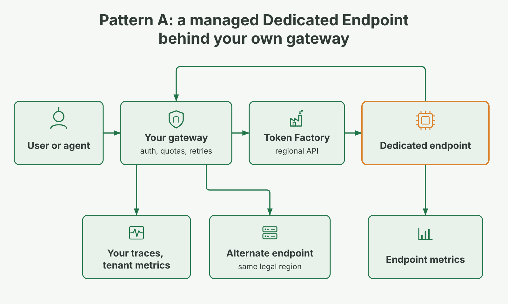

# 20.33 AI Factory architecture on Nebius: patterns, HA and recovery

## What the interviewer is testing

A customer says, "We want an AI factory, not a collection of GPU instances." Then the interviewer asks, "How does it survive an outage?" That second question is where many weak answers start, because it sounds like a request for one clever design. It is really a request for a list of failures, the owner of each one, and the promise you can make about each. This chapter serves the system design round and the project deep dive. The job posting asks for knowledge of how distributed back-ends fail and for designing for load and availability. Nebius has not published the interview questions. So the skill is a method: name the boundary, name the owner, and say what is documented and what is your own design.

Evidence tags follow the volume plan. `[official]` is a Nebius documentation page fetched on 2026-11-09. `[vendor]` is Nebius marketing or a blog post. `[gap]` means Nebius has not published it. `[design]` marks my own reasoning, which you must present as your recommendation and never as a Nebius fact. Keep the tags visible when you speak. The difference between a fact and a design choice is exactly what the interviewer is listening for.

Here is a realistic question in the interviewer's voice: "Design an AI factory for an enterprise that fine-tunes models and serves them to customers in Europe. Who owns each part, what does it cost, and what happens when the region has no GPUs?"

Notice the three parts of that question: ownership, cost, and a region with no GPUs. Each one needs its own answer, and each answer points at a different layer of the design.

A good structure for the whole answer is short. Name the boundary you will draw, walk the failure table, state the promise you can make, and list the open items you could not verify. That sequence keeps the answer honest and leaves the interviewer room to steer.

## The core ideas

### 1. Turn a vague request into decision requirements

Picture a Monday meeting where an executive says, "We need B200s." The sentence sounds like a plan, but it is an answer to a question nobody has asked yet. Requests often arrive as products: "We need B200s" or "We need a private LLM". Those are answers, not requirements. Requirements describe what must be true. Products describe what you would buy to make it true. Write the requirement first, and you can change the product later without changing the goal.

So ask what the business process is and what an outage costs. Then characterise the workload: training, batch, chat, embeddings, or an agent that calls tools in a loop. Ask for model size, context length, token distributions, peak concurrency, and streaming needs.

Next ask for objectives and policy. You need time to first token, inter-token latency, request availability, a recovery point objective (RPO) and a recovery time objective (RTO). RPO is how much recent work you can afford to lose. RTO is how long you can be down. The two are different on purpose. RPO is about data, and RTO is about time. Ask whether prompts may leave a region, who may create endpoints, and which failure the system must survive: one GPU, one node, one cluster, or one region.

The failure you choose sets the cost. Surviving a single GPU failure is a node-level design. Surviving the loss of a region means a second region with copies of the model, the keys, the data and the capacity. Say which of those you are paying for, because a customer often assumes the cheap version and the expensive promise at the same time.

| Requirement | Question to ask | Design decision it changes |
|---|---|---|
| Workload | Training, batch, interactive, agent, mixed? | Soperator, Kubernetes, Serverless AI, Token Factory, own fleet |
| Demand | Peak requests, tokens, contexts, growth? | GPU type, replicas, warm capacity |
| Latency | Target TTFT and time per output token? | Model, GPU shape, cache, routing |
| Data | What is processed, retained, exported? | Product mode, region, ZDR, DPA review |
| Availability | Which failure domain, which RPO and RTO? | Spare capacity, checkpoints, alternate endpoint, contract |
| Ownership | Who runs runtime, gateway, pager, billing? | Managed service or customer-run platform |

The capacity arithmetic comes from [20.12](./12-estimation-toolkit-for-inference-capacity.md). **Do not choose a product until the workload, data rules, objectives and owner are written down.**

### 2. Compose services by operating boundary

A team proposes a prototype on one product, production on another, and training on a third. Each choice may be sensible, but nobody has said who runs what in each case. Serverless AI, Token Factory Public Serverless, Token Factory Dedicated Endpoints, Managed Kubernetes and Soperator are not interchangeable flavours of "an endpoint". They differ in who runs what. The product map is in [20.30](./30-nebius-ai-factory-to-token-factory-architecture.md) and [20.31](./31-nebius-ai-cloud-foundation-gpu-fabric-and-platform-choices.md). The table below keeps only what decides an HA design.

| Pattern | Nebius runs | Customer runs | Region behaviour [official] |
|---|---|---|---|
| Token Factory Public Serverless | Shared model API | Caller, prompts, retries | Region shows Global and can change without notice |
| Token Factory Dedicated Endpoint | Regional model deployment | Template choice, keys, min and max replicas, client SLO | Fixed at creation, no multi-region routing or overflow |
| AI Cloud Serverless AI | Container lifecycle | Image, server, data | Follows the Serverless AI regions in the region table |
| Managed Kubernetes | Control plane, node health checks | Pods, runtime, policy, observability | One region per cluster |
| Managed Soperator | Slurm on Kubernetes | Jobs, checkpoints, data staging | One region per cluster |
| Compute GPU VMs | VM capacity | Everything above the VM | One region per VM |

A team may prototype on Public Serverless, run production on a Dedicated Endpoint, and fine-tune on Soperator. Another may build a Kubernetes fleet. Multi-product designs cost more to operate, because each product has its own logs, quotas and upgrade path. The benefit is that each part uses the product that carries the least burden for its job. Do not force every workload into one product. Ask for an exit path too. An exit path is a way to leave a product without rewriting the application. If the application calls a gateway you own, you can move the model behind it later without changing the public contract. **Choose a service for the operating burden it removes, not for the GPUs it lists.**

### 3. What Nebius documents about regions and zones

An interviewer asks, "Which zone is the GPU in?" and waits. Most cloud designs use zone to mean a separate failure area inside a region, and it is easy to say that about Nebius without checking. An interviewer will probe the words region and zone, so know exactly which ones the documents use.

The public regions list is `eu-north1` (Finland), `eu-south1` (Madrid), `eu-west1` and `eu-west2` (France), `me-west1` (Israel), `us-central1` (Kansas City), `us-north1` (Woodbury), `uk-south1` and `uk-south2` (UK) [official]. `eu-north2` (Iceland) is private to customers who already have deployments there [official]. Services and GPU platforms are available per region, and the table is uneven. For example the Managed PostgreSQL row is ticked only for `eu-north1`, `eu-west1`, `me-west1`, `us-central1`, `uk-south1` and `eu-west2` [official]. Read the availability row by row, the way you would read a stock list, and never assume a service exists everywhere because it exists somewhere.

A good answer to the zone question has three parts: what Nebius documents, what you have not found, and what you will ask for in writing. That sequence keeps you honest without sounding unhelpful.

I found no page about availability zones in the documentation index. Nebius has not published whether a region has several independent failure zones, or how a Managed Kubernetes control plane or a node group is spread inside one. A reasonable design is to treat the region as the failure domain you can name, and to ask the account team in writing for any placement guarantee [design]. Do not say "multi-AZ" in an interview as a Nebius fact. AZ stands for availability zone, a separate failure area that some clouds publish inside a region.

Two more facts shape any multi-region plan. Disk snapshots are available only in the project where they were created [official]. A snapshot is a point-in-time copy of a disk, so a copy that lives in another project is not a snapshot you can restore from in place. Object Storage bucket names are unique per region and the endpoint carries the region ID [official]. I found no documented cross-region replication or durability figure for Object Storage, so copy data across regions yourself and test the copy [design].

**Say "region" when you mean what Nebius documents, and ask about anything finer.**

### 4. What each failure domain looks like and who owns it

A pager fires at night with a message about a whole region. The first question is which layer actually failed, because the answer decides who must act. The phrase "the cloud is highly available" hides many failures. Use this table to say what Nebius does and what you must do.

| Layer | Example failure | Documented Nebius behaviour | Your job |
|---|---|---|---|
| Whole region | Power or cooling loss, service outage | Nothing published about regional failover [gap] | Alternate region, tested, inside the legal region rules |
| Compute VM | Host hardware or software fault | Maintenance event. You may stop and start the VM before the due date, or it is stopped after it. Support can reschedule up to two times, up to seven days each [official] | Restart tolerance, checkpoints |
| Kubernetes node | Not Ready, GPU Xid or ECC error, boot disk I/O errors | Node Problem Detector, automatic recovery. A node Ready false for more than five minutes or Unknown for more than 15 minutes is deleted and replaced [official] | Pod disruption budgets, spare capacity, state outside the node |
| Maintenance | Planned or emergency node work | Cordon, wait for GPU Pods until one hour before the SLA deadline, drain for up to one hour, stop and start the VM [official] | Finish or checkpoint GPU work, label CPU Pods that must defer drain |
| Control plane | API server unreachable | 99.90% target for control plane access, with exclusions (see section 5) | Running workloads do not depend on it, but rescheduling does [design] |
| Dedicated Endpoint | Incident, maintenance, manual stop | GPUs are released to the shared pool and requested again on restart [official] | Reserved capacity by contract, or an alternate endpoint |
| Customer fleet | Database, dispatcher or cache outage | Reference template only (section 8) | Control plane HA and restore drills |

The last column for the control plane row is my reasoning, not a Nebius statement. A running Pod keeps running when the API server is down, but nothing can schedule a replacement. The upstream Kubernetes documentation describes the control plane as the component that makes scheduling decisions. In the room, the sentence that fits is this: the work keeps going, but the repair waits. For node repair details and the PodDisruptionBudget idea, see [20.23](./23-kubernetes-failure-drills-for-gpu-platforms.md) and [20.16](./16-design-gpu-fleet-health-and-capacity.md).

Walk a GPU node failure through the table. Detection comes from the node checks. Repair follows the maintenance row, with a cordon and a drain before the VM restarts. The state that survives is whatever you put outside the node. Your job is to make sure the checkpoint, the queue entry and the endpoint's route all live somewhere the failed node does not own.

**For each layer, write who detects it, who repairs it, and what state survives.**

### 5. What the SLAs actually promise

A customer asks whether the platform is covered by an SLA, and you have a page that uses the word availability many times. Start by finding out which SLA it is, what it measures and what it excludes. An SLA is a service level agreement, the contract that promises a level of service and a remedy if the promise is missed.

Start with the Managed Kubernetes service level [official]. The target is 99.90%. Unavailability means no customer access to the control plane, from inside or outside the platform, for at least five minutes. The credit is 10% of the service fee if uptime falls below 99.90% down to 95.00%, and 25% below 95.00%. The page excludes events beyond Nebius control, control planes that are not the highly available kind, defined as an etcd cluster size of three, outages caused by your firewall or routing rules, disabled clusters caused by an add-on you installed, changed pre-installed add-ons, and end-of-life Kubernetes versions. Nebius gives at least 30 days notice before a version reaches end of life, and after that date the service level no longer applies to the cluster. Read the exclusions first. They decide the cases in which the promise does not apply, and most disputes start there.

When you quote an SLA in an interview, say the target, the window and the remedy in one breath. A missed target earns a credit, and the page makes that credit the exclusive remedy. A credit is not a refund of the work you lost, so the work you lost is still yours to protect.

The general SLA page adds rules for every service [official]. Credit is against future fees, claims go through the console within 14 calendar days after the reporting period, credit is the exclusive remedy, and planned node maintenance and emergency works are excluded from downtime up to eight hours per reporting period. It does not name the services and percentages. That list is on the service levels page.

Now work out what 99.90% means. Multiply out the month, then take the fraction. A 30-day month has 30 times 24 times 60, which is 43,200 minutes. The allowed downtime is 0.1% of that, which is 43.2 minutes. At 99.99% it is 4.32 minutes. Run `python3 code/part20/c33_recovery_math.py` to see the same numbers. This SLA covers control plane access. It says nothing about GPU supply, time to first token, node repair time, or whether your model answered. A useful way to phrase it is that the SLA measures the door and not the room behind it.

Token Factory is different. The Supplemental Terms say the SLA does not apply to the Token Factory service and that no credits are available unless agreed in writing [official]. The Supplemental Terms are the extra legal text that applies on top of the main terms. The Dedicated Endpoint capacity page says self-service endpoints have no formal SLA unless covered by contract [official]. The enterprise page advertises "99.9% SLA with reserved capacity and fail-over" for dedicated endpoints [vendor]. Treat that sentence as a sales pointer. The thing you can rely on is the Order Form. Nebius has not published what "fail-over" means there, since its own legal guide says there is no automatic cross-region failover for dedicated endpoints [gap].

**Quote the SLA page for the service, state its exclusions, and say which party can act when it burns.**

### 6. Dedicated endpoint capacity and recovery

You are asked, "What happens to a dedicated endpoint when its node fails?" The documented answer is narrow and important [official]. Answer both parts of the question: what happens during the failure, and what happens when the endpoint comes back. Self-service endpoints run on on-demand capacity from a shared pool. Capacity is held for the endpoint only while it is active. When an endpoint stops, for any reason, its GPUs go back to the pool. The reasons listed are a manual stop, an incident and maintenance. When it starts again, capacity is requested anew and allocated based on availability at that moment. Nothing holds your previous GPUs.

Here is the recovery story in order. The node fails. The endpoint is stopped or restarted. The pool is asked for capacity. The endpoint waits in its state until capacity appears. Your gateway should send requests to the alternate during that wait, not hold them in a queue for the original endpoint.

Minimum replicas are reserved and non-preemptible while the endpoint is active. Scaling above the minimum depends on burst capacity and is not guaranteed, and extra replicas may not come back after scale-down. After a restart the endpoint can sit in Starting or Not ready, or reach only Partially ready, until capacity appears. Lifecycle and readiness are separate statuses, and a Warning state unresolved for more than three hours means you should contact support [official]. If you need guaranteed capacity across restarts, incidents and maintenance, the page points you to Nebius sales to reserve capacity. That sentence is the one to repeat to a customer who asks for a guarantee, because it moves the promise from the product to a contract.

Billing follows readiness. The billing policy says an endpoint is billable when at least one replica is running, yet its table says provisioning, Not ready and Partially ready are not billed, and Ready is billed [official]. Those two statements disagree for a partially ready endpoint. Ask support which one your invoice follows. The enterprise page says "pay only for what you serve" and "no idle GPU costs" [vendor]. That conflicts with the billing policy, where GPU time is billed while at least one replica is running. Plan on the billing policy. When you explain this to a customer, say which statement your contract follows, and get that in writing.

**Never promise that a restarted dedicated endpoint gets its capacity back. Promise a restart procedure and an alternate.**

### 7. Pattern A: a managed Dedicated Endpoint behind your own gateway

An application needs a hosted open model, a stable region and a small operations team. A Dedicated Endpoint fits when the template, region, performance and contract fit. The application still needs a gateway of its own for end-user identity, tenant quotas, retry budgets and fallback. The gateway is the piece you own. It holds the rules the provider does not know about, such as which user may call which model.



*Figure 20.33.1. Pattern A: a managed Dedicated Endpoint behind your own gateway, as a diagram.*

Read the diagram left to right. The user never talks to the endpoint directly, so you can change the endpoint behind the gateway without changing the application.

The alternate endpoint in the diagram is only useful if it is in the same legal region and has been tested with the same model and keys. An untested alternate is a hope, not a recovery plan.

The gateway is a design choice of yours. Token Factory does not document it as a component. Keep its secrets server-side and call the regional URL with the routing key as documented. Then decide what you promise:

- **Region.** Public Serverless is Global and "can change at any time without prior notice". Dedicated is fixed to the chosen region as a DPA commitment. The legal guide says there is no multi-region routing, load balancing or automatic overflow for dedicated endpoints [official].
- **Capacity.** The minimum replicas are your baseline while active. The maximum is a best-effort ceiling.
- **Recovery.** A stopped endpoint releases its GPUs. If that is unacceptable, buy reserved capacity in writing, or keep a warm second endpoint.
- **Data.** ZDR is an organisation-level setting. Without it, inputs and outputs are kept for speculative decoding and are stored in Finland regardless of where processing happens [official]. With ZDR no speculative decoding data is kept, and the guide warns inference speed may drop.

For fine-tuning, the guide says all datasets, artifacts and outputs are stored in EU data centers even when a US job is processed in the US, and there is no regional choice [official]. A cross-region fallback therefore has to be checked against what you promised the data owner.

**Put your own gateway in front when identity, tenant policy or failover goes beyond the provider API.**

### 8. Pattern B: a customer-operated multi-region fleet

Some platform teams need arbitrary containers, per-tenant GPU budgets, spot recovery, multi-node serving or one API across regions. This is the pattern for teams that want to own the platform, not rent it. The Nebius Solutions Library contains a Kubernetes inference fleet for this [official, repository]. Its README says it is a template for a platform team and not a hardened multi-tenant service.

The design is a CPU control cluster plus one worker cluster per region. The control side holds the API, LiteLLM, a Kueue MultiKueue manager, a cost dispatcher and a Managed PostgreSQL fleet database. Each region has GPU pools, KServe on Knative, Kueue, Envoy gateways, image caches and weights filesystems. A regional Envoy gateway checks a tenant key against the central API, then forwards to the model. Follow one call through that path. It enters at the regional gateway, the key is checked, and the request goes on to a model in the same region. Calls entering through LiteLLM are accounted by LiteLLM. Direct calls through the fleet API are accounted by the custom API.

The operations guide in the same repository gives HA facts you can reuse [official, repository]. Request-path components run two replicas spread over two system nodes: Envoy, LiteLLM, the API, Kueue and Knative Serving. The request path is the route a live call takes. Several reconcile-only components run a single replica on purpose, because an outage delays changes and not traffic. Reconcile-only components are controllers that keep the system moving toward its desired state, so losing one slows changes and leaves live calls alone. The fleet database is a Managed PostgreSQL cluster with one host by default, and setting two hosts adds a replica with the service's failover. A CronJob recovers stopped spot nodes every two minutes.

Backups are the managed service's. The Managed PostgreSQL docs say backups run daily, with a retention of 7 to 30 days and a 7-day default, and the retention also covers the write-ahead log [official]. The write-ahead log is the database's record of changes, which is what makes point-in-time recovery possible. They support point-in-time recovery, which means restoring the database to a chosen moment. A restore creates a new cluster. Backup settings cannot be changed after the cluster is created [official]. So a database outage in this template ends with a new cluster, new endpoints, and repointing the API and LiteLLM secrets. That cutover is yours and you must rehearse it.

| Component | Responsibility | New failure dependency |
|---|---|---|
| Control API and database | Model registry, keys, operations | Database restore is a new cluster and a cutover |
| Envoy gateway | TLS, key check, routing | Key lookup is on the request path |
| LiteLLM | OpenAI-compatible route, spend | Key mirror can drift after a restore |
| Kueue and MultiKueue | Admission, cross-cluster placement | Worker API reachability |
| Cost dispatcher | Region and pool choice by price and quota | Stale prices misplace jobs |
| KServe and Knative | Endpoint lifecycle, scale to zero | Cold start is your duty |
| Image cache | Faster image pulls | Cold pulls slow node start |

The cost dispatcher chooses a region and pool using prices and quota, which means a stale price is a placement bug and not only a billing error.

The README lists limits you must repeat: tenant containers share GPU nodes with container isolation and not VM isolation, traffic inside the clusters is not encrypted, user images are not scanned, and a formal security review is due before outside tenants get keys [official, repository]. **Build this fleet only when the extra control is worth owning every control plane in it.**

### 9. Pattern C: share reserved GPUs between training and inference

Picture a training run that finishes at midnight, and an inference service that needs more replicas at breakfast. Training demand rises and falls, and a reserved pool can serve both sides if the handover is planned. Idle training GPUs are wasted money, and idle inference GPUs are wasted money too, so sharing one pool can lower the total. The price is the handover, which is where a move is most likely to fail. Nebius documents moving capacity between Soperator workers and a Managed Kubernetes inference node group that draw from the same capacity block group [official]. A capacity block group is the reserved pool both sides draw from.

The prerequisites are strict. Both sides must consume the same reserved capacity block group. Soperator must be version 3.0 or later with ephemeral nodes enabled. You need the editor role and a login node. To move capacity to inference, power the chosen Slurm nodes down, drain them so the queue does not power them back, check that they show powered down, then raise the inference node group by the same count. There are three power-down modes. Plain power down acts when the node is idle, and queued jobs may still start on it first. The `asap` mode drains, waits for the current job and powers down. The `force` mode powers down at once and cancels running jobs. The choice between them is a choice about how much running work you will interrupt. To move back, shrink the inference group, wait until the GPUs return to the block, resume the drained nodes and power them up.

The documentation gives the steps and gives no policy. That part is yours [design]. Decide who wins when both want GPUs, how much training capacity stays, how much inference headroom stays, how much notice a training job gets, and who may trigger a move. Inference that needs a GPU during a move can fail because the capacity is in transit. The pattern does not create capacity the reservation does not hold.

A runbook for the move is a numbered page with the owner's name on each step. The steps are the ones above, in order, with a stop condition after each one. A stop condition says what to check before you go on, such as the node showing powered down or the inference traffic having fallen. **Use shared reservation capacity only with a written priority rule and a rehearsed drain and power-up.**

### 10. Recovery arithmetic: RPO, RTO and the lost work you can compute

A panel asks, "If the job crashes in the middle of the night, how much work do we lose?" Interviewers like numbers, because a number forces you to state your inputs. Here is the arithmetic, with the inputs stated.

**Lost training work.** A job checkpoints every 30 minutes. A crash just before the next checkpoint loses 30 minutes. A crash at a random time loses 15 minutes on average. For 512 GPUs, worst case lost compute is 512 times 30 / 60, which is 256 GPU-hours. The average is 128 GPU-hours. So the checkpoint interval is your RPO for the training job. Add the restart time to get the full cost. The worst case is the full interval, and the average is about half of it when crashes arrive at random.

**Restart time.** A 70 billion parameter model trained with mixed precision Adam is often sized at about 16 bytes per parameter for weights, gradients and optimizer state. That figure is an assumption I am stating, not a Nebius number, and you should replace it with your own measured checkpoint size. 70 times 16 is 1,120 GB. At a sustained 5 GB/s the read alone is 1,120 / 5 = 224 seconds. The weights of the same model in 16-bit are 140 GB, and at 2 GB/s a replica takes 70 seconds just to load them. Those are floors. Image pull, scheduling and warm-up come on top, so measure them in a drill. A floor tells you the least a restart can take, not what it will take on your cluster. When you present this, label the 16 bytes as your assumption and show how the number changes if your checkpoint is smaller.

**Availability in series and in parallel.** If a request needs your gateway and an endpoint, both at 99.9%, the result is 0.999 times 0.999, which is 0.998001, or 86.4 minutes a month. Multiplying means both parts must work at once. If two independent endpoints at 99.9% each can serve, the chance both are down is 0.001 squared, so availability is 0.999999, about 2.6 seconds a month. Multiplying the failure chances means both must fail together for the service to be down. That only holds if failures are independent. A shared gateway, shared key, shared model version or a shared region breaks independence. The calculation also ignores the time your switch takes to notice a failure. For a dedicated endpoint the second one must be in the same legal region, which weakens independence further [design].

**etcd quorum.** A consensus group of n members needs floor(n/2) + 1 votes to commit, so it tolerates n minus that. Quorum is the majority of votes a cluster needs to agree on a write. Three members tolerate one failure, five tolerate two, four still tolerate one. Production Kubernetes explains that etcd keeps state on several machines with a consensus algorithm and that its defaults assume one datacenter, so stretching it across sites needs testing of round trips [Production Kubernetes, chapter 2]. The SLA above counts only an etcd size of three as highly available. On Managed Kubernetes Nebius operates etcd, and nothing public says how it is backed up or restored [gap]. For a cluster you run yourself, the upstream Kubernetes and etcd documents describe snapshot backup and restore, and you should rehearse restore on a throwaway cluster.

**Terraform state.** Your recovery plan depends on the state file, which is Terraform's record of what it built. Terraform: Up and Running, chapter 3, explains that remote backends provide locking and versioning and that state files can contain secrets. Nebius documents storing state in an Object Storage bucket through the S3 backend and notes that Terraform recommends bucket versioning [official]. Versioning is off by default, cannot be fully disabled once enabled, and the docs recommend it disabled for high-load buckets [official]. So keep the state bucket small and separate, turn versioning on, and put it in a region you can still reach when the workload region is down [design]. See [20.24](./24-terraform-for-resilient-gpu-clusters.md).

**Multi-region.** Active-passive needs the model, keys, quota, capacity, data policy and traffic switch all pre-built and tested. Active-passive means a standby region sits ready and takes traffic only after a switch. Without a reservation, GPUs in the second region are not held for you either [design, from the capacity page]. Production Kubernetes recommends federating by region and then globally to limit the blast radius of the management layer [Production Kubernetes, chapter 2]. The overload and retry rules for the switch itself are in [20.21](./21-request-routing-retries-and-overload-control.md).

Put the answer into one sentence before the numbers. The RPO is set by the checkpoint interval, and the RTO is set by the restore and cutover time you measured. Only then show the arithmetic, so the interviewer hears the target first and the evidence second.

**State a recovery target as a pair: what you lose and how long you are down, and how you tested both.**

### 11. Security, tenancy and cost under failure

Imagine the region is back, the GPUs are healthy, and the failover still fails because the service account was never created in the second project. Failure plans often break on access and billing, not on GPUs.

Projects mean different things in different places. An AI Cloud project holds VMs, networks, clusters and storage. A Token Factory project holds endpoints, keys and fine-tuning jobs. Keep administrator, billing, model operator and runtime roles in separate groups. A role is a named set of permissions, and a clean split means one leaked credential does not give the whole company's access. In a customer fleet, tenancy is application-level, and the template does not give VM isolation. A practical check is to ask who can read another tenant's prompts in the fleet. If the answer depends on application code alone, say so and plan a review of that code.

Billing is an availability risk. The Token Factory Billing page says that with a bank card the balance is debited in real time, the card is charged when the balance is negative at the start of the month or a threshold is reached, and if a card charge fails the account is suspended [official]. A declined card is an outage in disguise, because the endpoint can stop serving for reasons nothing in the cluster shows. The Supplemental Terms say fees are post-paid unless an Order Form says otherwise [official]. The two descriptions differ in tone. Confirm which applies to your organisation, and keep a valid payment method or an invoice arrangement before launch. AI Cloud budgets are alerts that can lag and do not stop spending, as noted in [20.32](./32-token-factory-model-lifecycle-serving-and-economics.md).

Test the billing path the same way you test the failover. A failover that works on the day the card expires still fails for the customer.

For cost, state the billable unit: tokens for Public Serverless, GPU time per minute for Dedicated, running resources by time for Compute. Minimum replicas are an idle baseline. Retries cost tokens. Ask the customer which of those units they pay for before you design anything. Use consumption reports for reconciliation and endpoint metrics for explanation. Token Factory observability is documented as available only for Dedicated Endpoints and is not a billing record [official]. Metrics design is in [20.19](./19-slis-slos-and-alerts-for-token-apis.md).

**Write the billable unit, the idle baseline and the payment dependency into the design.**

### 12. A customer-ready review

A review ends with a customer asking, "Can I quote this to my board?" That question tests whether every number in your design has a source you can name. Close a review with a record that has five columns: requirement, chosen service, customer-owned part, recovery promise and open validation item. Record whether each number came from a public benchmark, a vendor case study, your measurement or an estimate, with date and model version. A board quote needs a source with a date, and a vendor case study is not the same as a contract.

The Nebius chat-app case study reports separate prefill and decode pools, cache-aware routing, backpressure, retry changes and X+1 redundancy [vendor]. It is one workload and not a Token Factory guarantee. Likewise the DataRobot validated stack is one partner configuration announced in March 2026 [vendor]. Use these sources to sharpen your questions, not to set your targets. A case study shows what one team measured on one setup, and your targets have to come from your own workload. Attach the governing page or Order Form to any SLA, capacity or region claim. **A design is ready when owners, costs, failure behaviour and open assumptions are written down.**

## How to answer out loud

The interviewer gives you a whiteboard, a clock and a question with no hints. Your first sentence should name the boundary you are about to draw. Use the five answers below as rehearsal. Say each one aloud, then listen for the place where you stall, because that is where the answer needs one more concrete fact.

**Question 1: "Design an AI factory for a European enterprise."** Open with discovery. Say "I would first separate training, custom serving and hosted-model inference." Then choose the boundary: Dedicated Endpoint plus your own gateway for a small team, a Kubernetes fleet only for real control needs, Soperator for training. State the region rule: Dedicated is region-fixed and has no provider failover. Close with the cost unit and one failure test. Expect the follow-up "why not Public Serverless?" Answer: its region is Global and can change without notice.

**Question 2: "How does it survive a regional outage?"** Say what is documented: Nebius publishes no regional failover for these products, and dedicated endpoints never overflow to another region. Then give your design: an alternate endpoint in an allowed region, tested model and keys, reserved capacity in writing, a gateway that switches, data copied by you. Give the arithmetic from section 10 and name the independence caveat.

**Question 3: "What does the SLA give you?"** Give 99.90% for control plane access, five minutes of downtime, credits of 10% and 25%, the etcd size three condition. Say it does not cover inference. Say Token Factory carries no SLA unless in writing. Follow-up: "What would you do with that?" Answer: set your own SLO at your gateway.

**Question 4: "A dedicated endpoint restarts after an incident and stays Partially ready."** Say capacity is requested again and may be short. Check readiness status and the endpoint state, shift traffic to the alternate, contact support, and escalate if Warning exceeds three hours. Do not promise the same GPUs.

**Question 5: "How do you recover the fleet database?"** The managed service takes daily backups with point-in-time recovery, restore makes a new cluster, so the answer is restore, repoint secrets, reconcile the LiteLLM key mirror, and verify with a test request. Name the RPO as unpublished [gap] and measure it.

## Worked scenarios

### Scenario 1: Enterprise agent with compliance-sensitive prompts

The customer wants an agent that searches internal data and calls tools with an open model. Prompts may not leave the EU. Reasoning: Public Serverless is out because its region is Global. A Dedicated Endpoint in an EU region is a DPA-backed commitment. Turn ZDR on at the organisation, accepting that speculative decoding is off. Put your gateway, retrieval and evaluation outside the endpoint. For failure, name a second EU region endpoint as the alternate, and check that the template exists there. The answer: Dedicated in an EU region, ZDR, own gateway, written reserved capacity, warm alternate in a second EU region, tested monthly. Record every open item, including the unpublished failover meaning in the "99.9% fail-over" sales line.

### Scenario 2: Training and inference share committed GPUs

Overnight, training drops and inference needs more replicas. Reasoning: confirm the Soperator version and ephemeral nodes, and that both sides use one capacity block group. Choose `asap` for planned moves, never `force` as routine. Drain the nodes, wait for powered-down state, then raise the inference group by the same count. The reverse move shrinks inference first and waits for the GPUs to return. The answer: a runbook with an owner and a written priority rule, tested in both directions, plus the check that inference traffic really fell before shrinking. Say the risk out loud before you start, since a move that cancels running jobs can cost the training team a night of work.

### Scenario 3: Unit economics deteriorate while latency looks fine

A finance review shows the cost per response rising while the latency dashboard stays green. Reasoning: split endpoint GPU time, idle minimum replicas, retries, model mix, evaluation traffic and cache profile. Compare billing records with your gateway request IDs and endpoint metrics. Do not read the dashboard as an invoice, and do not assume a cache hit reduces a Dedicated GPU bill, since that bill is per GPU minute. The answer: report cost per latency-qualified response, not per token. Ask the finance team which unit they reconcile to, because that answer decides which metric belongs on the dashboard.

### Scenario 4: The fleet database host dies

Imagine a Sunday night page. A fleet from the Solutions Library runs with one database host, the default. The API and Envoy key checks start failing. Reasoning: the request path depends on the key lookup, so new requests fail while established ones may continue [design]. With one host the service has no replica to fail over to. The answer: restore from the latest backup or point in time, as a new cluster. Repoint the secrets, reconcile the key mirror, and test. The prevention is two hosts and a rehearsed restore. Estimate the outage as detection plus new cluster build plus cutover and measure it, because Nebius has not published a build time.

## Hands-on lab

Imagine a planning session where the team wants a recovery number by Friday, and nobody wants to pay for a test cluster yet. This lab runs on a laptop and needs no paid deployment. I ran step 1 and step 2. Steps 3 to 5 are worksheet work.

1. Run the tests: from `code/part20`, run `python3 -m pytest -q test_c33_recovery_math.py`. Expected and observed: 11 passed.
2. Run `python3 c33_recovery_math.py`. Expected and observed: 43.2 minutes for 99.9%.
   Next check the series case. Expected and observed: 86.4 minutes for two in series.
   Then check the restore time. Expected and observed: 224.0 seconds for the restore.
   Last, check the etcd members. Expected and observed: three members tolerate 1.
3. Change the checkpoint interval to 10 minutes in the script. Compute the worst case for 512 GPUs. Expected: 512 times 10 gives the GPU minutes. Divide by 60, and the expected result is about 85.3 GPU-hours.
4. Pick one pattern. Fill a responsibility matrix for facility, GPUs, fabric, control plane, runtime, gateway, data, metrics, security and billing. Write one normal procedure and one failure runbook with its recovery owner.
5. Read the capacity page, the billing policy, the legal quick guide and the SLA pages. Mark every claim that needs an Order Form. Expected result: a one-page decision record and at least five facts to verify in the live project.

Keep the decision record short. A reviewer reads it in a few minutes, and each line should name its source and its tag.

The code file is below, and the same code is in `code/part20/c33_recovery_math.py`.

```python
# code/part20/c33_recovery_math.py
"""Recovery arithmetic for chapter 20.33. Standard library only."""


def downtime_minutes(availability, days=30):
    """Allowed downtime in minutes for an availability target over a period."""
    return (1.0 - availability) * days * 24 * 60


def serial_availability(*parts):
    """All parts must work: multiply the availabilities."""
    result = 1.0
    for p in parts:
        result *= p
    return result


def parallel_availability(*parts):
    """Any one part is enough, assuming independent failures."""
    miss = 1.0
    for p in parts:
        miss *= 1.0 - p
    return 1.0 - miss


def lost_work_minutes(checkpoint_interval_min):
    """Return (worst case, average) minutes of training lost on a crash."""
    return checkpoint_interval_min, checkpoint_interval_min / 2.0


def lost_gpu_hours(gpus, minutes):
    return gpus * minutes / 60.0


def transfer_seconds(size_gb, gb_per_s):
    """Time to read a checkpoint or model weights at a sustained rate."""
    return size_gb / gb_per_s


def quorum(members):
    """Votes an etcd style consensus group needs to commit a write."""
    return members // 2 + 1


def tolerated_failures(members):
    return members - quorum(members)


if __name__ == "__main__":
    print("99.9% month:", round(downtime_minutes(0.999), 1), "min")
    print("99.99% month:", round(downtime_minutes(0.9999), 2), "min")
    both = serial_availability(0.999, 0.999)
    print("two 99.9% in series:", round(both, 6), round(downtime_minutes(both), 1), "min")
    two = parallel_availability(0.999, 0.999)
    print("two 99.9% independent in parallel:", round(two, 6),
          round(downtime_minutes(two), 3), "min")
    worst, mean = lost_work_minutes(30)
    print("30 min checkpoints, 512 GPUs: worst", lost_gpu_hours(512, worst),
          "GPU-h, mean", lost_gpu_hours(512, mean), "GPU-h")
    params_b = 70
    ckpt_gb = params_b * 16
    print("70B checkpoint at 16 B/param:", ckpt_gb, "GB;",
          "restore at 5 GB/s:", round(transfer_seconds(ckpt_gb, 5), 1), "s")
    print("weights 140 GB at 2 GB/s:", transfer_seconds(140, 2), "s")
    for n in (1, 3, 5):
        print("etcd members", n, "quorum", quorum(n), "tolerates", tolerated_failures(n))
```

## Drill questions

Imagine a colleague asking these questions across a table, while you have no notes and about a minute for each. Answer first, then open the answer.

<details><summary>1. What does the Managed Kubernetes 99.90% service level cover, and what does it not?</summary>
It covers customer access to the control plane, where downtime is no access for at least five minutes. Credits are 10% and 25%. It excludes control planes that are not the highly available kind with an etcd size of three, your firewall changes, modified add-ons and end-of-life versions. It does not promise GPU supply, time to first token, or inference availability.
</details>

<details><summary>2. Is there a Token Factory SLA?</summary>
The Supplemental Terms say the SLA does not apply to Token Factory unless agreed in writing, and the capacity page says self-service dedicated endpoints have no formal SLA unless covered by contract. The enterprise page advertises 99.9% with reserved capacity. That is a sales claim, so rely on the Order Form.
</details>

<details><summary>3. A dedicated endpoint is stopped by maintenance. What happens to its GPUs?</summary>
They are released to the shared pool, as for any stop. On restart, capacity is requested again and depends on availability. The endpoint can stay Starting or Not ready, or reach only Partially ready. Guaranteed capacity needs a reservation by contract.
</details>

<details><summary>4. Can a dedicated endpoint fail over to another region automatically?</summary>
No. The legal guide says there is no multi-region routing, load balancing or automatic overflow for dedicated endpoints, and processing stays in the chosen region. Cross-region recovery is a design you build and test, with the data rules checked first.
</details>

<details><summary>5. Why is Public Serverless a poor fit for a strict region requirement?</summary>
Its Region field shows Global, and the processing location can change at any time without notice. Use a Dedicated Endpoint in the chosen region and keep the region commitment in the contract.
</details>

<details><summary>6. Two independent endpoints are each 99.9% available. What is the combined availability, and what is the caveat?</summary>
The chance both are down is 0.001 squared, so availability is 0.999999, about 2.6 seconds a month. It holds only if failures are independent and the switch is instant. A shared gateway, model version, key or region breaks that.
</details>

<details><summary>7. A job checkpoints every 30 minutes on 512 GPUs. What is the lost compute on a crash?</summary>
The worst case is 30 minutes, which is 512 times 30 divided by 60, so 256 GPU-hours. The average is half of that, 128 GPU-hours. The checkpoint interval is the training RPO. Restart and warm-up time add to it.
</details>

<details><summary>8. How many failures does a five-member etcd cluster tolerate, and why?</summary>
Two. A write needs floor(5/2) + 1, which is 3 votes, so five minus three leaves two members that can fail. A four-member cluster still tolerates one, which is why odd sizes are used.
</details>

<details><summary>9. A fleet database from the Solutions Library fails. What is the recovery path?</summary>
The managed PostgreSQL service has daily backups with point-in-time recovery, and a restore creates a new cluster. Restore, repoint the API and LiteLLM secrets, reconcile the key mirror, and test. The template defaults to one host, and two hosts add a replica with service failover. Nebius has not published the restore time, so measure it.
</details>

<details><summary>10. What is the difference between cloud node repair and workload recovery?</summary>
Node repair is Nebius replacing or restarting the node. It cordons, waits for GPU Pods, drains for up to an hour, and restarts the VM. Workload recovery is yours: checkpoints, idempotent restarts, and a place for the state to live. Node repair does not bring your data back.
</details>

## Common mistakes and weak answers

Picture the reviewer's margin notes at the end of the round. The same few mistakes show up on most of them, and each has a one-sentence fix you can rehearse.

- Saying "multi-AZ" as a Nebius fact. The documentation index names regions, and zones are a gap. Say so and ask the account team.
- Treating the Kubernetes SLA as an inference SLA. It covers control plane access only. Quote its five-minute rule and its exclusions.
- Promising a dedicated endpoint gets its GPUs back after maintenance. The capacity page says it does not.
- Treating "99.9% SLA with fail-over" as a published guarantee. It is marketing. The legal guide says there is no automatic cross-region failover.
- Using a case-study design as the standard Nebius topology. Say "one vendor case study reported".
- Quoting availability numbers without independence and switching time.
- Planning recovery without a payment method, a quota, a model in the second region, or a restore drill.
- Using "reserved", "guaranteed" and "minimum replicas" as synonyms. Minimum replicas are guaranteed only while the endpoint is active.

Each of these mistakes starts with a confident sentence that the documentation does not support. Slow down before you say a fact aloud, and check its tag first.

## Connections to the rest of the handbook

Imagine a colleague asking how to design a recovery plan for a new customer, a week after the interview. The links below cover each part of that answer.

- [20.30 Public architecture map](./30-nebius-ai-factory-to-token-factory-architecture.md), [20.31 AI Cloud foundation](./31-nebius-ai-cloud-foundation-gpu-fabric-and-platform-choices.md) and [20.32 Token Factory lifecycle and economics](./32-token-factory-model-lifecycle-serving-and-economics.md).
- [20.12 Capacity estimation](./12-estimation-toolkit-for-inference-capacity.md), [20.13 Multi-tenant inference API](./13-design-a-multi-tenant-llm-inference-api.md) and [20.14 Dedicated endpoints and safe rollout](./14-design-dedicated-endpoints-and-safe-model-rollout.md).
- [20.16 GPU fleet health and capacity](./16-design-gpu-fleet-health-and-capacity.md), [20.18 How serving fails](./18-how-llm-serving-fails.md) and [20.19 SLIs, SLOs and alerts](./19-slis-slos-and-alerts-for-token-apis.md).
- [20.21 Routing, retries and overload](./21-request-routing-retries-and-overload-control.md), [20.23 Kubernetes failure drills](./23-kubernetes-failure-drills-for-gpu-platforms.md) and [20.24 Terraform for resilient clusters](./24-terraform-for-resilient-gpu-clusters.md).
- [20.26 The incident round](./26-the-stress-interview-production-incident-role-play.md) and [20.27 Post-mortems and on-call](./27-post-mortems-on-call-and-incident-leadership.md).

## Sources and review notes

All Nebius pages below were fetched on 2026-11-09.

- Nebius AI Cloud documentation index (`https://docs.nebius.com/llms.txt`), regions page `https://docs.nebius.com/overview/regions`.
- Managed Kubernetes service level `https://docs.nebius.com/legal/sla-levels/managed-kubernetes` and general SLA `https://docs.nebius.com/legal/sla`.
- Token Factory Supplemental Terms `https://docs.nebius.com/legal/token-factory`. Section numbers 6.1 (post-paid) and 7.4 (no SLA) as fetched.
- Token Factory documentation index `https://docs.tokenfactory.nebius.com/llms.txt`, with the Capacity, availability and service guarantees page, the Dedicated Endpoint Billing Policy, Lifecycle and Readiness Status, Billing and Consumption, Inference Observability, and the Legal Quick Guide (`https://docs.tokenfactory.nebius.com/legal/legal-quick-guide`).
- Managed Kubernetes maintenance and health checks pages, Compute VM maintenance page, Managed PostgreSQL backups page, disk snapshots page, Object Storage versioning and Terraform state pages under `https://docs.nebius.com/`.
- Soperator capacity movement `https://docs.nebius.com/slurm-soperator/capacity/move-capacity`, and the Soperator architecture page `https://github.com/nebius/soperator/blob/main/docs/architecture.md` (reachable, not read in depth).
- Solutions Library inference fleet: `https://github.com/nebius/nebius-solutions-library/tree/main/k8s-inference`, README and `docs/OPERATIONS.md` on the main branch.
- Marketing and blogs `[vendor]`: Token Factory enterprise page `https://nebius.com/services/token-factory/enterprise-grade-inference`, the Agents Blueprint post, the DataRobot validated stack post and DataRobot's own post, the Inference Frontier Program post, and the routing post. All reachable, cited only as examples.
- Books: Production Kubernetes, chapter 2 "Deployment Models" (etcd deployment models, federation by region, availability zone definition). Terraform: Up and Running, 3rd edition, chapter 3 "How to Manage Terraform State" (locking, versioning, secrets in state).
- Upstream: Kubernetes documentation on operating etcd clusters and the etcd FAQ. Only the page structure and the recommendation of five members in production were confirmed. I did not read the restore steps.

**Explicitly labelled inferences:** region as the only nameable failure domain, control plane versus running Pods behaviour, the 16 bytes per parameter checkpoint size, bandwidth figures, the independence caveat, the shared-capacity priority policy, and the database restore outage estimate.

**Not verified:** account Order Forms, live capacity reservations, any intra-region zone placement, Object Storage durability and replication, the Managed Kubernetes etcd backup practice, the Managed PostgreSQL recovery point and restore time, the internal Token Factory gateway and router, and the checkpoint sizes and bandwidths used above. The code and tests were run on a laptop.

### Verification log

| Item | Count | Detail |
|---|---|---|
| Claims and URLs checked | 38 claims, 17 URLs | Nebius docs, legal pages, repository docs, blogs, upstream pages |
| Confirmed | 24 | 99.90% control plane SLA, region-fixed dedicated endpoints, no overflow, capacity release on stop, minimum replica guarantee, no formal SLA for self-service endpoints, ZDR scope, Global region of Public Serverless, post-paid terms, observability only for dedicated, three power-down modes, ephemeral nodes prerequisite, repository security limits, fleet database with managed backups, node health check timings |
| Corrected | 8 | Region, ZDR and fine-tuning storage claims moved to the Legal Quick Guide URL instead of the Supplemental Terms. The Supplemental Terms support only post-paid and no SLA. SLA detail added: five-minute rule, credits, etcd size three. Soperator 3.0 prerequisite and power-down modes. Database backup is a managed service and restore makes a new cluster, where the draft called it a customer concern. Default fleet database has one host. Compute VM maintenance reschedule rules added. Account suspension on a failed card charge added. |
| Removed or relabelled | 6 | Drill on PUE and DataRobot dropped as off-topic for HA. Unsupported "documented node repair respects PodDisruptionBudgets" relabelled as upstream design advice. "Token Factory manages internal deployment" removed. Statement that a stopped endpoint is "the provider does not promise" kept but now sourced. Marketing "no idle GPU costs" flagged as conflicting with the billing policy. Reserved "fail-over" line relabelled `[vendor]` with meaning marked `[gap]`. |
| Unreachable | 0 | Every cited URL returned 200 |
| Conflicts to flag | 2 | Billing policy prose versus its table for partially ready endpoints. Billing page top-up model versus post-paid terms. |
