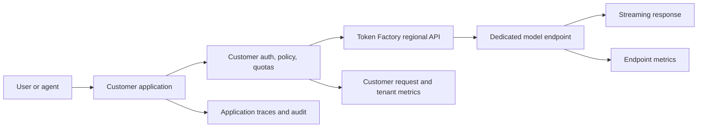

# 20.33 Production AI Factory architecture on Nebius: patterns, economics, HA and recovery

The customer says, “We want an AI factory, not a collection of GPU instances.” That is a useful starting point, but it is not a design. You still need to decide where data lives, which team operates the model runtime, how traffic reaches it, how costs are allocated, and what happens when the chosen region has no capacity.

An AI factory is a production system with several control boundaries. Some services are managed by Nebius, some are run by the customer's platform team, and some sit above the cloud as application platforms. A strong solution-architect answer makes each boundary explicit. It then tests the paths between them with a workload, a cost model, and a failure scenario.

This chapter turns the public architecture map from 20.30, the AI Cloud foundation from 20.31, and the Token Factory contract from 20.32 into complete customer designs. The three architectures below are intentionally different. One is a managed Token Factory deployment. One is a Nebius reference inference fleet operated by the customer. One moves capacity between training and inference. They illustrate options, not one universal Nebius stack.

## What the interviewer is testing

This chapter serves the system-design, project-deep-dive, and production-incident rounds. The interviewer is looking for discovery before diagrams, explicit ownership, a cost unit that matches the service, and a recovery plan that respects residency and capacity. They also want to hear when you would choose a managed model endpoint instead of building another platform team.

Likely prompt: “Design an AI factory for an enterprise that trains models, builds agents, and serves them to customers in Europe. Give me the architecture, who owns each part, what it costs, and how it survives an outage.”

## The core ideas

### 1. Turn a vague AI-factory request into decision requirements

An executive request often arrives as a desired technology: “We need B200s,” “We need a private LLM,” or “We need Kubernetes.” Those are possible implementation choices, not requirements. A solution architect first asks what business process the system must support and what failure would cost.

Characterize the workload before selecting services. Is it pretraining, fine-tuning, batch inference, online chat, image generation, embeddings, or an agent that calls tools repeatedly? What are model size, context length, input/output token distributions, concurrency, traffic peaks, and streaming requirements? Is the model a public catalog model, a fine-tuned checkpoint, or a customer-owned runtime?

Then define service objectives and policy. Ask for a target time to first token, inter-token latency, goodput, request availability, recovery point, and recovery time. Establish whether prompts can leave a region, whether data retention is allowed, which groups may create endpoints, and whether the system must survive a single GPU, node, rack, cluster, or region failure. Finally, set a monthly spend envelope and decide who can pause workloads or approve a capacity commitment.

Use a discovery table rather than arguing about brands:

| Requirement | Question to ask | Design decision it changes |
|---|---|---|
| Workload | Training, batch, interactive inference, agent, or mixed? | Soperator, Kubernetes, Serverless AI, Token Factory, or own fleet |
| Demand | Average/peak requests, tokens, contexts, concurrency, growth? | GPU type, replicas, queues, warm capacity, and limits |
| Latency | TTFT, time per output token, end-to-end target? | Model, GPU shape, cache, routing, batching, and placement |
| Data | What is processed, retained, logged, or exported? | Product mode, region, ZDR, object policy, and DPA review |
| Availability | What failure domain and RTO/RPO must be met? | Spare capacity, checkpointing, alternate endpoint, support contract |
| Ownership | Who operates runtime, gateway, model versions, pager, billing? | Managed service versus customer-run platform |

**Do not size or choose a product until the workload, data, service level, and owner are clear.**

### 2. Compose services by operating boundary

Nebius offers multiple layers that can be composed, but product names can sound more similar than their responsibilities. Serverless AI, Token Factory Public Serverless, Token Factory Dedicated Endpoints, Managed Kubernetes, and Soperator are not interchangeable endpoint flavors.

Use this selection matrix in a design review:

| Pattern | Managed layer | Customer team owns | Typical fit |
|---|---|---|---|
| Token Factory Public Serverless | Hosted catalog models, shared inference API, dynamic service capacity | Caller, prompts, app-level security and retries | Evaluation, prototypes, variable/non-critical workloads that accept Global processing |
| Token Factory Dedicated Endpoint | Regional model deployment, selected GPU/replica settings, inference surface | Model/template choice, key policy, min/max, client SLO, contractual capacity discussions | Stable region and a managed model endpoint |
| AI Cloud Serverless AI | Container jobs, Devlabs, and endpoints with service-managed lifecycle | Container image, server, request behavior, application data | Custom container work without owning a cluster |
| Managed Kubernetes | Kubernetes control plane and node-group service | Pods, operators, policy, model runtime, platform observability | Custom serving stack, service mesh, schedulers, or multiple workloads |
| Managed Soperator | Managed Slurm-on-Kubernetes cluster | Job design, data staging, checkpointing, workload operations | Slurm-oriented distributed training and HPC |
| Compute GPU VMs | VM capacity, GPU host and cloud primitives | OS/runtime, cluster configuration, gateway, monitoring, repair | Full host/network control, bespoke stack, HPC or specialized topology |

The right architecture can use several of these. A team may prototype on Public Serverless, run an endpoint in a fixed region for production, and use Soperator for fine-tuning. A platform team may instead build a multi-region Kubernetes fleet for customers that need their own job API, queues, private VPC access, and cost policies. Do not force all workloads into Token Factory or all workloads into Kubernetes.

The architecture decision should include an exit path. If a team starts with a managed endpoint, can it move to a customer-owned runtime without changing the public application contract? If it builds a fleet, who maintains the controller, gateway, API keys, model images, and upgrade cadence? A flexible API is useful only if operations stay sustainable.

**Select a service for the operational boundary it removes, not only for the GPUs it advertises.**

### 3. Pattern A: a managed Token Factory endpoint behind an application gateway

An application needs a hosted open model, a predictable region, and a small operations team. A Dedicated Endpoint is a reasonable starting point when its template, region, performance, and contract meet the requirement. The application still needs a gateway of its own if it has product-specific users, quotas, policy, or fallback behavior.

One reference path is:

The customer gateway is a design choice, not a documented Token Factory internal component. It can validate the end-user identity, map it to a Token Factory project/key, enforce prompt-size and spend limits, record request IDs, manage retry budgets, and protect the product from noisy clients. Keep its secrets server-side. Call the region URL and routing key exactly as documented; do not assume a direct browser request is an acceptable production security design.

The team then decides which of these promises it can make:

- **Region:** Public Serverless is Global and can change processing location. Dedicated Endpoint is fixed to its selected region by the documented legal terms. There is no Token Factory provider-side automatic cross-region overflow for Dedicated Endpoints.
- **Capacity:** `min_replicas` provides active baseline capacity; `max_replicas` caps attempted burst capacity. The provider warns that capacity above the minimum may not be available after scale-down.
- **Cost:** Public Serverless charges tokens, with cached-input pricing for supported models. Dedicated charges GPU time, so quiet periods may still cost money while replicas remain active.
- **Recovery:** A stopped self-service endpoint releases GPUs and must request capacity again. If that is unacceptable, discuss reserved capacity and written terms before launch.

Model lifecycle can sit alongside the endpoint. Teams may use Data Lab and post-training to prepare datasets, tune full model weights or LoRA adapters, train a speculator, then deploy a supported checkpoint to a Dedicated Endpoint. The custom-weight path is described as beta and access-controlled. The architect must confirm which exact model, artifact, region, ZDR, and deployment workflow the account can use.

This is the managed pattern: Nebius operates most serving infrastructure; the customer owns the application gateway and user promise. It is not equivalent to purchasing a private Kubernetes cluster.

**Put an application gateway in front when customer identity, tenant policy, or product-level failover exceeds the provider API contract.**

### 4. Pattern B: a customer-operated multi-region inference fleet

Some platform organizations need more control than a managed endpoint exposes. They may need arbitrary containers, model-specific queues, custom per-tenant GPU budgets, spot recovery, multi-node serving, private routing, or a single API across several regions. Nebius's public Solutions Library contains a detailed Kubernetes inference-fleet example for this pattern.

The repository describes a control cluster and one worker cluster per region. The control side hosts a customer API, LiteLLM, Kueue MultiKueue manager, cost dispatcher, and managed PostgreSQL. Region clusters host GPU pools, KServe on Knative for model endpoints, Kueue for jobs, Envoy gateways, image caches, DCGM, OpenCost, Loki, and shared weights filesystems. Object Storage provides tenant artifacts.

The request path in that solution has two main edges. A regional Envoy gateway validates a tenant key by calling the central API, then forwards to the endpoint. A LiteLLM OpenAI-compatible route sits alongside the direct platform API. The API stores model definitions and key records in the fleet database and renders KServe endpoints in the selected regions. That reference implementation makes the accounting distinction explicit: calls entering through LiteLLM are accounted by LiteLLM; direct calls through the fleet API are accounted by the custom API.

The job path is separate from the endpoint path. The client submits an operation. Kueue holds it against quotas. MultiKueue selects a worker cluster. A cost dispatcher ranks eligible region/pool candidates by capacity class, free quota, and price. Kubernetes Jobs or JobSets execute work; object storage carries inputs and outputs; a shared filesystem can provide checkpoints or weights; a runner uploads status and artifacts. On spot interruption, a checkpointed job can restart in-region or continue on a new attempt according to the platform's rules.

| Component | Responsibility in this reference design | New failure dependency |
|---|---|---|
| Control API | Model registry, keys, invocation, operations, results | Central database/API outage can block management and API entry |
| Envoy gateway | TLS, key check, rate limits, routing to model or API | Gateway and authorization dependencies lie on request path |
| LiteLLM | OpenAI-compatible model groups and token accounting | Key mirror and spend records need reconciliation |
| Kueue/MultiKueue | Admission and cross-cluster job placement | Queue configuration and worker API reachability affect job start |
| Cost dispatcher | Chooses region/pool by preference, quota, and price | Stale prices or missing pool metadata can misplace or delay jobs |
| KServe/Knative | Model endpoint lifecycle and scale-to-zero | Cold start, readiness and revision management become platform duties |
| Zot/Spegel | Pull-through image cache and peer layer distribution | Cache outage/cold pull slows model and node startup |
| PostgreSQL | Desired model state, keys, operations and accounting | Database backup/restore and schema migrations become customer concerns |

This is a useful worked architecture, but its README explicitly says it is a customer-operated template, not Token Factory. It has meaningful limitations: tenant containers share GPU nodes; baseline pod security is not VM isolation; default inter-pod traffic may be unencrypted; the team owns upgrades, incidents, PostgreSQL, and gateway security. It should undergo a security review before external tenants receive keys.

**Build this fleet only when its extra control is worth owning every control plane and operational burden.**

### 5. Pattern C: share reserved GPUs between training and inference

Training demand rises and falls. Inference may need GPUs when a training run is idle. Nebius documents a pattern that moves GPU capacity between Soperator training workers and Managed Kubernetes inference node groups by sharing a Capacity Block Group.

The precondition is not merely “both services are in the same cloud.” Both the Soperator worker nodes and inference node group must be configured to consume the same compatible capacity reservation. Soperator must have ephemeral nodes enabled. To move capacity to inference, an operator powers down or drains selected idle Slurm workers, waits for the GPUs to be released, then increases the inference node-group size. To move capacity back, the operator scales down the inference node group, resumes drained Slurm nodes, and powers them up. A force power-down can cancel training jobs; it is not a routine elasticity step.

This design can improve utilization but couples two workload domains. The teams need an arbitration rule: which workload wins during simultaneous demand, how much minimum training capacity remains, how much inference headroom is reserved, how much notice a training job needs, and who can trigger capacity movement. It also needs shared-capacity billing and quota review. It does not create capacity that the reservation block does not contain.

It is different from Token Factory Dedicated Endpoint autoscaling. Token Factory manages replica scaling inside its product boundary; the documented public behavior still says that a stopped endpoint can release capacity. The training/inference block-sharing workflow described here is a customer-managed Soperator/Managed Kubernetes pattern.

**Use shared reservation capacity only with an explicit priority policy and a tested drain/power-up workflow.**

### 6. Design tenancy, security, and compliance across planes

“Project” does not mean the same boundary everywhere. Nebius AI Cloud projects hold VMs, networks, Kubernetes clusters, storage, service accounts, quotas, and groups. Token Factory projects hold endpoint resources, API keys, files, datasets, and fine-tuning jobs. An enterprise platform may add another tenant hierarchy above either product.

For a managed Token Factory application, define organization and project groups separately for administrators, billing, model operators, and runtime clients. The product's Billing Manager can see organization usage without project endpoint access. For a custom fleet, the reference repository creates namespaces, queues, object-storage buckets, API keys with budgets, and allow-lists. That is application-level tenancy. The repository warns it does not provide VM isolation: customer images share worker nodes.

On AI Cloud, combine IAM with VPC security groups, subnet routes, private/public addressing, service accounts, KMS, SecretStash, and Audit Logs. Kubernetes adds RBAC, Pod Security Admission, network policies/Cilium, workload identity, and secrets. A project should not give the serving pod a broad node or cloud identity. In the customer-managed fleet, a node service account and a pod workload identity have different privileges; avoid mounting a general-purpose API credential into model containers.

For data governance, make a data-flow inventory. List prompt and response content, cached computation, Data Lab logs, training datasets, checkpoints, metrics, traces, audit events, support tickets, and billing records. Apply the right region, retention, encryption, access, and deletion policy to each. The Token Factory legal guide says Dedicated Endpoint processing is region-pinned, while Public Serverless is Global. It also says fine-tuning data is stored in the EU even for US-processed jobs. The Token Factory Supplemental Terms and DPA take precedence over simplified product summaries where they differ.

| Control | Applies to | Architect's validation |
|---|---|---|
| Organization/project roles | Human and application access | Can billing see cost without endpoint credentials? |
| API keys and budgets | Token Factory or customer API edge | Are keys scoped, rotated, revocable and server-side? |
| Cloud IAM/service accounts | VMs, Kubernetes, storage, Terraform | Does the workload have only the needed API actions? |
| VPC/security groups | Customer-operated resources | Are ingress, egress, DNS, NAT and control-plane paths explicit? |
| ZDR and region selection | Token Factory content | What is retained, used for speculators, or processed outside the region? |
| Audit and cost records | Cloud and product operations | Who can export, retain and review each record? |

**Threat-model the managed product boundary and the customer edge separately.**

### 7. Design FinOps and unit economics around the chargeable unit

“Cost per million tokens” is not enough for an architecture review. The answer depends on whether the service charges per token, per active GPU, per VM, per node, or per committed capacity interval. It also depends on idle time, cache hit rate, utilization, storage, egress, platform services, and support contracts.

Token Factory Public Serverless charges input, cached-input where supported, and output tokens. Dedicated Endpoints charge GPU time at per-minute granularity. AI Cloud Compute charges running resources by time; Cloud PAYG and commitment discounts can coexist. Capacity blocks reserve specified GPU capacity over intervals and tie into commercial commitments. Customer-managed fleets also pay for control nodes, GPU pools, managed databases, storage, registries, observability, and data transfer even when token throughput is low.

The denominator should reflect the product outcome. For inference, compare cost per useful token or latency-qualified request, not raw GPU utilization. For training, compare cost per completed experiment or checkpoint that survives failures. For agents, include retries, tool calls, and evaluation runs. The GPU-utilization chart is a diagnostic, not a billable unit.

A customer-operated platform can meter each key, model, project, or run. The Solutions Library example maintains a GPU-charge ledger and OpenCost views, but says its own metering and platform limits are part of that implementation. In a managed Token Factory deployment, use Token Factory consumption reports for reconciliation and use endpoint metrics to explain cost drivers. Do not derive the invoice from the observability API.

Budget enforcement also needs care. Nebius AI Cloud budgets alert on spending and may lag; they do not stop charges. Token Factory product billing and legal terms have changed over time: its changelog and Supplemental Terms say fees are post-paid, while the Billing & Consumption page still describes balance top-ups and threshold charging. The Dedicated Endpoint billing policy also has wording/table nuance for partially-ready endpoints. Confirm the actual account's contract and invoice process before quoting cost.

**State the billable unit, idle baseline, cost owner, and enforcement mechanism in the architecture.**

### 8. Set service objectives that match ownership

The customer cannot page a cloud provider on an SLI it cannot observe, and the provider's availability promise may apply only to a control plane, not to the model's quality or the application path. Define objectives at each boundary.

For a Token Factory application, the customer can measure request success, TTFT, inter-token latency, completion time, output quality/finish reasons, retries, cache usage where returned, and tenant-specific goodput at its own gateway. Dedicated Endpoint metrics add request/token rates, latency percentiles, active replicas/GPUs, utilization, error codes, and cache-hit share. The docs say Token Factory Inference Observability is currently for Dedicated Endpoints only and is for operations, not billing.

For a customer-managed cloud stack, observe GPU utilization/memory/power/temperature, InfiniBand errors/throughput, node readiness, pod pending time, Kueue queue/admission, model cold starts, storage throughput, object request performance, API SLOs, and cost allocation. Nebius AI Cloud Observability integrates metrics, logs, and traces for supported services but is marked preview in the service catalogue. Check the current service matrix and retention before depending on it as your only pager pipeline.

The [Managed Kubernetes SLA](https://docs.nebius.com/legal/sla-levels/managed-kubernetes) is not an application SLA. Its 99.90% objective covers customer access to the control plane, with exclusions for customer firewall/routing changes, unsupported versions, and modified add-ons. It does not guarantee inference availability, GPU supply, TTFT, or job completion. Token Factory's [Supplemental Terms](https://docs.nebius.com/legal/token-factory) say no SLA applies unless a written Order Form says otherwise. Enterprise marketing advertises 99.9%; confirm the exact plan and contract.

**Write one objective per boundary and say which party can act when it burns.**

### 9. Map recovery and failure ownership

The phrase “the cloud is highly available” hides too many failure modes. A facility power event, a fabric partition, an unhealthy GPU, a failed endpoint deployment, a lost checkpoint, and an invalid API key need different signals and owners.

| Layer | Example failure | Signal/evidence | First mitigation | Recovery boundary |
|---|---|---|---|---|
| Facility/region | Power, cooling or regional service issue | Status page, capacity unavailability, regional API errors | Keep user-impact bounded; activate only an approved alternate | Nebius operates facilities; customer owns cross-region application decision |
| GPU fabric | Link errors, NCCL slowdown, topology spread | IB port counters, NCCL tests, collective time | Drain/avoid affected nodes; confirm fabric and placement | Customer cloud operator or managed service based on product |
| K8s node | GPU Xid, disk/Ready condition | Node conditions, NPD, DCGM, events | Cordon/drain/replace using the service path | Managed K8s documented node repair; application checkpoint is customer-owned |
| Storage | Slow shared reads, failed volume, missing checkpoint | IOPS/throughput, mount state, object/version audit | Restore durable copy; move scratch load away | Depends on storage class and backup/retention contract |
| Model endpoint | 404 during start, partial readiness, 429 or 5xx | Endpoint state, API error, metrics/status page | Wait for readiness, apply backpressure, contact support | Token Factory manages internal deployment; customer owns caller policy |
| Customer fleet | Dispatcher/database/cache outage | API health, queue admission, database and gateway alerts | Fail closed where needed; restore service from tested state | Platform team owns control-plane HA and recovery |

For training, checkpoint interval defines potential lost work. Keep checkpoints on durable/shared storage and rehearse restart. For online inference, a new endpoint in another region is not a failover until its model, keys, capacity, data policy, and traffic path have been tested. For Kubernetes node repair, respect PodDisruptionBudgets, Slurm draining, and the documented drain window. For Token Factory Dedicated Endpoints, stopped capacity is released; the provider does not promise the same GPUs back unless the account has a matching reservation/contract.

**Test failure recovery as a product workflow, not as a claim that the infrastructure will never fail.**

### 10. A customer-ready architecture review

Close a design review with a clear picture of the service, its responsible teams, and its evidence. A practical architecture decision record can use five columns: requirement, chosen Nebius service, customer-owned component, failure/recovery promise, and open validation item.

For a regulated agent, one defensible design might use a customer identity gateway, Token Factory Dedicated Endpoint in the contract-approved region, ZDR configured at the organization, a customer-owned orchestration/retrieval layer, an evaluation/simulation pipeline, per-tenant gateway telemetry, Token Factory endpoint metrics, and a tested application-level fallback that stays in the permitted data region. A different organization may choose a self-managed Kubernetes fleet to own all model images, private networking, custom scale rules, and chargeback. The latter can use the Solutions Library as a reference but must close its documented security gaps and operate its components.

The architecture review should record whether performance numbers came from a public benchmark, a vendor case study, a customer's measurement, or an estimate. Keep deployment date and model version with the result. If the SLA, billing unit, capacity guarantee, data retention, subprocessor, or region claim is important, attach the governing documentation or written contract to the decision record.

**A solution is ready for approval when owners, cost boundaries, failure behavior, and open assumptions are explicit.**

## How to answer out loud

Open with the workload and boundary. “I would first determine whether this is training, custom-container serving, or hosted-model inference. I would then choose among Compute, Managed Kubernetes, Soperator, Serverless AI, Token Factory Public Serverless, and Dedicated Endpoints based on control, region, and operating burden. I would map the data and cost flows, set user-facing objectives, then prove capacity and recovery in the account.”

Prepare three follow-ups: why fabric topology changes distributed training, what Dedicated Endpoint region pinning means for failover, and how you distinguish an infrastructure SLO from application goodput. Give one public fact and one customer decision in each answer.

## Worked scenarios

### Scenario 1: Enterprise agent with compliance-sensitive prompts

The customer wants an agent that searches internal data, calls tools, and uses an open model. Ask whether the prompts may be retained, which region is allowed, and whether the customer needs the model endpoint or the entire runtime hosted. Compare a Dedicated Endpoint plus customer-owned gateway/orchestration with a full Kubernetes fleet. Record ZDR, region, DPA, endpoint capacity, cached-token behavior, and failure plan as separate decisions. Do not assume a Token Factory marketing feature overrides contract terms.

### Scenario 2: Training and inference share committed GPUs

Training demand drops overnight, but inference needs more replicas. If the customer uses Soperator ephemeral workers and a Managed Kubernetes inference node group on the same Capacity Block Group, follow the documented capacity-move procedure: release/drain Slurm workers, wait for capacity return, then increase the inference group. Make the priority policy explicit; a forced `power down` can cancel training. Test the reverse move and ensure inference does not still need the GPUs.

### Scenario 3: The model serves but unit economics deteriorate

The service has low request latency and high GPU utilization, but cost per useful response is rising. Separate endpoint GPU time, idle minimum replicas, cloud platform services, cache-hit profile, retry amplification, model mix, and evaluation workload. Compare direct Token Factory billing records with customer gateway request IDs and endpoint metrics. Do not use the observability dashboard as the invoice or infer that a high cache-hit rate guarantees a price reduction on Dedicated Endpoints.

## Hands-on lab

Use browser research and an architecture worksheet; no paid deployment is required.

1. Pick one of the three patterns in the worked scenarios. Write the workload, user, model, data region, SLO, and budget.
2. Fill a responsibility matrix for facilities, GPUs, fabric, cloud control plane, model runtime, gateway, data, metrics, security, and billing.
3. Draw the end-to-end request and artifact paths; label which steps use Cloud versus Token Factory APIs and where region boundaries apply.
4. Write one normal operating procedure and one failure runbook. Include status/metrics, mitigation, recovery owner, and the condition that proves recovery.
5. Review the official terms and pricing pages. Mark every sales claim that requires an Order Form or written confirmation.

Expected result: a one-page architecture decision record plus a list of at least five facts you must verify in the customer's live project or contract before go-live.

## Drill questions

1. What does an AI factory include beyond GPU servers?

Answer

Facility power/cooling, GPU and network fabric, compute/orchestration, storage/data, model/runtime, security, operations, and the business processes that turn those resources into useful output.

2. When is the Nebius Solutions Library inference fleet useful, and what does it not represent?

Answer

It is a customer-operated multi-region Kubernetes reference for custom models, queues, tenants, jobs, and cost controls. It is not Token Factory's internal implementation and requires its own security/operations review.

3. Which billing statements are safe to make about Token Factory without an Order Form?

Answer

Public Serverless is token-metered and Dedicated Endpoints are GPU-time priced in the product docs. Fees are post-paid by default in supplemental terms, but account billing pages and custom Order Forms may differ; verify the current account terms.

4. What does the Managed Kubernetes 99.90% SLA cover?

Answer

It covers documented control-plane availability under the SLA definition and exclusions. It does not guarantee application or inference availability, GPU supply, TTFT, or job completion.

5. What is the difference between cloud node repair and workload recovery?

Answer

Node repair replaces or restores infrastructure. Workload recovery requires checkpoints, idempotency, restart semantics, and a valid destination for data and model state.

6. Why is the DataRobot AI Factory material evidence but not a universal architecture?

Answer

It documents one partner-validated configuration with DataRobot, NVIDIA software, Nebius AI Cloud, and Token Factory. Other customers may use different components and contractual services.

7. How would you justify a customer-owned Kubernetes inference fleet over Dedicated Endpoints?

Answer

Only for a requirement that needs custom gateways, private networking, arbitrary containers, multi-region placement, or customer-owned scheduling/tenancy—and with a team prepared to operate the control plane and security.

8. What does a high PUE say, and what does it not say?

Answer

PUE compares total facility energy with IT-equipment energy. It does not measure tokens per watt, model quality, GPU utilization, or a customer's workload efficiency.

9. Why is a public Token Factory endpoint a poor fit for a strict region commitment?

Answer

Public Serverless is Global and its processing location can change without notice. Use a Dedicated Endpoint with the selected region and contract terms when stable regional processing is required.

10. What must an architecture decision record say about a benchmark number?

Answer

Name source, date, model, hardware, workload, topology, metric, and test boundary. Label vendor/partner results and do not treat them as universal service guarantees.

## Common mistakes and weak answers

- Treating one vendor case study as the standard Nebius topology.
- Quoting PUE or GPU throughput as an application efficiency promise.
- Confusing Soperator, Managed Kubernetes, Serverless AI, and Token Factory ownership.
- Using “reserved,” “guaranteed,” and “minimum replicas” as synonyms.
- Assuming monitoring data and billing data are the same record.
- Designing cross-region recovery without checking the legal region boundary.

## Connections to the rest of the handbook

- [20.30 Public architecture map](./30-nebius-ai-factory-to-token-factory-architecture.md), [20.31 AI Cloud foundation](./31-nebius-ai-cloud-foundation-gpu-fabric-and-platform-choices.md), and [20.32 Token Factory architecture](./32-token-factory-model-lifecycle-serving-and-economics.md).
- [20.12 Capacity estimation](./12-estimation-toolkit-for-inference-capacity.md), [20.13 inference API design](./13-design-a-multi-tenant-llm-inference-api.md), [20.18 serving failures](./18-how-llm-serving-fails.md), [20.19 token API SLOs](./19-slis-slos-and-alerts-for-token-apis.md), and [20.26 incident drills](./26-the-stress-interview-production-incident-role-play.md).
- Parts 6, 11, 12, 13, 15, 16, 17, and 18 — Slurm, GPU Kubernetes, networks, storage, inference, MLOps, operations, and security.

## Sources and review notes

Official Nebius documentation indexes and relevant Cloud/Token Factory product pages checked 2026-11-09. Public reference designs and company-authored announcements are dated evidence; marketing claims and customer results are not service guarantees.

- [Nebius Solutions Library inference fleet](https://github.com/nebius/nebius-solutions-library/tree/main/k8s-inference) — customer-operated KServe/Knative, Envoy, LiteLLM, Kueue/MultiKueue, database, image cache, cost dispatcher and tenant controls.
- [Nebius Agents Blueprint](https://nebius.com/blog/posts/introducing-the-nebius-agents-blueprint), [DataRobot validated AI Factory stack](https://nebius.com/blog/posts/datarobot-validated-ai-factory-stack), and [DataRobot's benchmark/architecture analysis](https://www.datarobot.com/blog/datarobot-nebius-enterprise-ai-factory-optimized-for-agents/) — examples of enterprise AI stack composition; partner-specific, not universal.
- [Nebius Inference Frontier Program](https://nebius.com/blog/posts/elevating-the-craft-introducing-the-inference-frontier-program), [routing experiment](https://nebius.com/blog/posts/routing-is-the-difference-between-scaling-and-stalling), and [Token Factory legal terms](https://docs.nebius.com/legal/token-factory) — production-inference themes, a single measured route experiment, and default legal terms.
- [Managed Kubernetes SLA](https://docs.nebius.com/legal/sla-levels/managed-kubernetes) and [AI Cloud terms/SLA](https://docs.nebius.com/legal/sla) — read scope and exclusions; do not map a control-plane SLA to model-serving behavior.
- [Soperator open-source architecture](https://github.com/nebius/soperator/blob/main/docs/architecture.md) and [training/inference capacity movement](https://docs.nebius.com/slurm-soperator/capacity/move-capacity) — open implementation and documented shared-capacity workflow.
- Generic sources: *NVIDIA DevOps Zero-to-Hero*, Vol. 19, Chs. 2, 3, 6, 7, 10; Vol. 21, Chs. 1, 2, 9, Lab 01; and AI Systems Performance Engineering, Chs. 16–18. These support SRE and capacity methods, not Nebius-specific guarantees.

**Explicitly labelled inferences:** customer workload sizing, customer-owned API gateways, multi-region app routing, and recommended SLOs unless directly contracted or documented.

**Not verified:** account-specific Order Forms, live capacity reservations, the internal Token Factory gateway/router/fleet, and any customer-specific SLA or recovery target.
