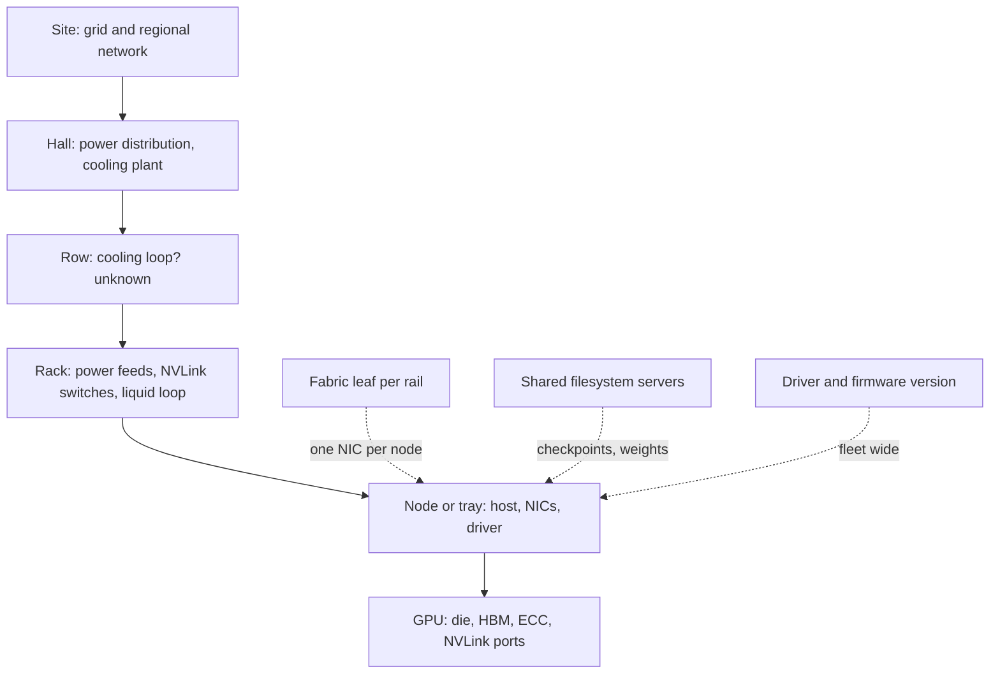

# 20.34 Nebius hardware, data centers and the GPU fleet

At 02:10 an alert says forty GPU nodes dropped out of one pool at the same minute. The pool is serving customer traffic, and you are the one on call. Your interviewer, playing the role of the manager on that call, asks the question that matters most: "Is that forty bad GPUs or one bad thing?" The answer depends on what those forty nodes share. Which of them sit on the same power feed, the same cooling loop, the same fabric switch or the same driver version? If you cannot draw that picture, you cannot tell forty separate faults from one shared fault, and the two call for very different responses.

This chapter is technical architecture only. It leaves out site lists, company history, power-efficiency claims, capacity announcements and benchmark commentary, except where one of them changes an operational decision. That is deliberate. Those topics are interesting, but none of them tells you what to do at 02:10. What an SRE needs is the set of failure domains, meaning the groups of hardware that fail together. The chapter covers how hardware faults surface, what Nebius and the NVIDIA reference architectures actually state, and what all of that means for blast radius, spares and drain order. Blast radius is how much of the service one fault takes down. Spares are the extra hardware you hold so a repair does not cost you capacity. Drain order is the sequence in which you empty nodes before maintenance. The prose stays under 4,500 words. It adds a tested model, `c34_failure_domains.py`, that you can run on any layout you state.

Every claim carries a tag, so you can see where it came from before you repeat it. Evidence tags follow the volume plan. [official] is a Nebius documentation page. [vendor] is Nebius marketing or a blog post. [filing] is the Nebius annual report on Form 20-F for 2025 or a shareholder letter. [book] is a gem book or the handbook chapter built from it. [inference] is my reasoning. Pages were fetched on 2026-11-11.

## Why an SRE here should know this

Picture the system design round. The interviewer draws a box on the whiteboard and asks you to size a service that runs on a few hundred GPU nodes. Later, the same hardware shows up again as a page at night, in the incident round. This chapter prepares you for both rounds. An SRE here is a site reliability engineer, the person who keeps a service within its targets, and hardware faults are one of the most common ways those targets slip.

The plan records the official job wording as meeting load and availability targets, estimating performance and compute, and weighing data storage trade-offs [official]. Those three phrases tell you what the interviewers care about. Nobody has published which hardware questions the loop asks. Treat the chapter as preparation to reason about a fleet, not as a list of expected questions.

The skill being checked is blast-radius thinking. You name the domain, say how big it is, say how the fault shows up in telemetry, which means the data a system emits about itself such as metrics and logs, and say how many spares you hold against it. A realistic question sounds like this: "You run inference on a few hundred GPU nodes. One rack loses power. What happens to your serving capacity, and what did you do beforehand to limit it?"

## The core ideas

### 1. A fleet is a tree, and each level shares something

Suppose one page says a rack went dark, and a few minutes later a second page says a different rack in another row went dark too. You want to know whether those two events are related. The answer lives in the shape of the fleet, so start by drawing that shape.

Picture the fleet as a tree. Nodes sit in racks. Racks sit in rows. Rows sit in halls. Halls sit on sites. Each level shares something that can fail: a power feed, a cooling loop, a network switch, a software rollout. A fault takes out one subtree, which is the branch hanging below the failed part. The size of that subtree is the blast radius.

The levels that matter and what each one shares are in the table. The right column says what is published. Read it from the GPU up to the site, the way a fault travels when it grows.

| Level | What it shares | What is published |
|---|---|---|
| GPU | one die, its memory, its NVLink ports | Xid and ECC behaviour, NVIDIA docs [official] |
| Node | host, PCIe, NICs, driver, firmware | Nebius reason codes for GPU and NIC faults [official] |
| NVLink rack | NVLink switches, power shelves, liquid loop | NVIDIA rack design [book]. Nebius lists GB300 NVL72 as a liquid-cooled rack [vendor] |
| Fabric leaf | one rail's links for many nodes | NVIDIA reference counts [book]. Nebius counts not published |
| Row, hall | cooling plant, power distribution | Not published for Nebius |
| Site | grid, regional network, local events | Not published as a failure policy |

A die is the single piece of silicon that does the computing inside a GPU. NVLink is NVIDIA's high-speed link between GPUs, and a PCIe connection is the slower bus that attaches a card to the host computer. A NIC is a network interface card. Each of those words names something that can break alone, and each one sits at a different level of the tree.

**Before you quote a number about a fleet, say which level it describes and whether Nebius or a reference architecture published it.**

### 2. How Nebius says it builds hardware, and why you care

Imagine a support ticket that reads only "node degraded, replaced, no root cause." Before you ask what went wrong, you want to know who designed the box, because the designer decides who can explain it. Nebius says it designs its servers and racks in-house. The 2025 annual report states this, and adds proprietary server firmware, a toolless rack design, and servers engineered for inlet temperatures up to 40 degrees Celsius [filing]. The inlet is where the cooling air or coolant enters the server, so an inlet rating is the highest temperature the box is built to accept.

I confirmed the temperature and tool-less points in Nebius's 2025 Sustainability Report, which says air up to 40 degrees Celsius and liquid up to 45 degrees Celsius for the cooling systems, with tool-less component replacement [vendor, read 2026-11-11]. A toolless rack lets a technician swap a part without a screwdriver, which shortens the time a node sits broken. The report claims components can be swapped in minutes and that one engineer can manage thousands of servers. It gives no uptime figure, so the claims are qualitative. A November 2024 company digest says hardware engineers gave a talk at the Open Compute Project summit, that the designs rest on several OCP principles, and that Nebius brought its own work back to the community [vendor]. I found no named contribution and I could not read the talk.

The same filing says Nebius relies on NVIDIA for GPUs and on a limited number of other suppliers for key components. It lists limited access to the latest components and limits on power availability as risks [filing]. The filing names no server maker.

What does this mean for you? Proprietary firmware means the team that runs the fleet also owns the fault-handling code on the host. A fault therefore looks the same across the fleet only if their firmware makes it look the same. A toolless rack makes a swap fast, but only if a spare is on the shelf. The 40 degree inlet claim applies to the air-cooled design in the filing. A liquid-cooled rack has a different thermal failure path, which idea 5 covers.

**Treat in-house design as a reason to ask how faults are reported and repaired, because the public text says only that they are.**

### 3. GPU generations set the shape of the failure domain

Imagine a customer who asks whether their training job survives one GPU dying. The honest answer depends on which box that GPU sits in. Platform choice is also a failure-domain choice.

An HGX node holds eight GPUs on one board, joined by NVSwitch inside the node. HGX is NVIDIA's board design for eight GPUs, and NVSwitch is the chip that connects them to each other at high speed. If that node dies, you lose eight GPUs and nothing else. A GB300 NVL72 rack joins 72 GPUs in one NVLink domain. The product page calls it a fully liquid-cooled rack-scale system, and says Nebius servers are in-house designed [vendor]. An NVLink domain is a set of GPUs that can talk to each other over NVLink as if they were one large machine. The bigger the domain, the more work can share it, and the more one fault can disturb.

The reference architecture gives the internals [book, *DGX GB300 SuperPOD* reference, handbook chapter 9.8]. One rack has 18 compute trays, each with four GPUs and two Grace CPUs. Eighteen NVLink switch ASICs give each GPU 1.8 TB per second and the rack 130 TB per second. A scalable unit is eight racks with 576 GPUs and 1.2 MW design power. The rack is the unit that shares NVLink, power shelves and a liquid loop. A tray is the sled that holds the GPUs and CPUs, and it slides into the rack as one piece.

Nebius has not published whether a customer VM on an NVL72 maps to one tray, to several, or to single GPUs. A reasonable design is to assume the tray is the smallest unit that can be repaired and the rack the smallest unit that shares NVLink and cooling [inference]. That assumption tells you where to look first when a single GPU misbehaves inside a rack.

The generations Nebius lists in the annual report are GB300 NVL72, GB200 NVL72, HGX B200, HGX B300, HGX H100 and RTX PRO 6000 [filing]. Chapter [20.31](./31-nebius-ai-cloud-foundation-gpu-fabric-and-platform-choices.md) has the per-region platform table from the docs. The Q2 2026 shareholder letter says Nebius has received its first Vera Rubin NVL72 systems and is validating them [filing]. Validating is not offering. A platform that is still being validated is not yet something a customer can order. Do not say customers can run Rubin until the docs list it.

**For each platform, state the smallest unit that fails together: eight GPUs for an HGX node, a rack for NVLink and cooling on NVL72.**

### 4. The fabric: rails, leaves and what a leaf failure does

A training job on many nodes does not run on one machine. The nodes pass gradients and activations to each other over a scale-out network, which is the network that links separate machines. When that network degrades, the job slows down, and the nodes look fine on their own dashboards. That is the situation this section prepares you for.

Nebius uses NVIDIA InfiniBand NDR and XDR for GPU clusters [filing], and Quantum-X800 at 800 Gb per second per GPU for GB300 [vendor]. InfiniBand is a high-speed network technology common in GPU clusters, and NDR and XDR are its generations. Nebius has not published how many switches it deploys, so I use the NVIDIA reference numbers as a worked example. They are not Nebius's layout.

The book *AI Data Center Network Design and Technologies* explains rail-optimised design. A rail is one lane of the network, and each GPU in a server uses its own lane. GPU number n of every server connects to leaf switch n. A leaf is a switch at the edge of the network that the servers plug into directly. Traffic on one rail crosses one leaf. Traffic between rails crosses the spine, which is the layer of switches above the leaves. The GB300 reference unit uses eight leaf switches arranged as four rails with two leaves per rail. Each leaf has 72 links down to trays and 72 links up to the spine, so it is not oversubscribed [book, handbook chapter 9.8]. Oversubscribed means the links going up carry less bandwidth than the links coming in, so traffic can queue. The deriving of 72 plus 72 is that chapter's own inference from the switch port count.

Now apply it. Each compute tray has four 800 Gb NICs, one per rail. A leaf in that unit serves 72 of the 144 trays. If a leaf dies, 72 trays lose one of four NICs. Each of them keeps 75 percent of its scale-out bandwidth. The nodes stay up, so no node-level alert fires. A collective, which is a coordinated operation in which every GPU exchanges data with the others, runs at the speed of its slowest link, so the whole job slows down. The model's `rail_bandwidth_fraction` function gives that 0.75.

Notice what just happened. Nothing crashed and no node went red. Capacity fell quietly, and the only evidence is a slower job. That is why the lesson is about what you alert on.

For large clusters the book says oversubscription is applied at the super spine, and ECN counts and leaf-to-spine utilisation are the first signals of trouble [book, chapters "Network Design Considerations" and "Monitoring and Telemetry"]. ECN is explicit congestion notification, a marker the switches set when a queue starts to fill. Nebius documents one topology fact: its fabric has a root, PODs and scalable units, and Slurm and Volcano can place jobs by topology [official, see 20.31].

**A leaf failure degrades many nodes a little instead of removing a few, so alert on per-rail link state and job step time, not only on node health.**

### 5. Power and cooling are shared fates

Think of an alert that says forty nodes are gone, with no Xid in any log. You open the dashboard, you open the logs, and every node looks clean. Xid is NVIDIA's name for a family of GPU error messages that the driver writes to the kernel log. A shared power or cooling fault looks exactly like that. The nodes did not fail. Something under them did.

The B200 data centre reference shows how wiring decides blast radius [book, handbook chapter 9.7]. A DGX B200 has six power supplies and needs five energised. Wire three cords to each of two feeds, and losing one feed leaves three of six supplies, so every node in the rack crashes. Wire all six cords of each node to one feed, and losing a feed takes out half the nodes. Use six discrete sources with one cord each, and losing any one source leaves five of six, so no node stops. The book calls the interleaved two-feed model a serious mistake for this reason. The model's `nodes_lost_on_single_feed_failure` function encodes the three cases.

The pattern in that paragraph is called N+1 redundancy. The node is built to run on fewer supplies than it has, so a single failed supply does not stop it. Wiring then decides whether one feed can take out more than one supply at a time. A good layout spreads the cords so that no single feed carries too many of them.

For the GB300 reference unit, each rack has eight power shelves of 33 kW, and cooling is hybrid, with direct liquid cooling for GPUs, CPUs and NVLink switches and air for the rest. Direct liquid cooling means coolant runs through cold plates bolted onto the hot chips. Building management telemetry feeds Mission Control [book, handbook chapter 9.8]. Nebius says the GB300 product is fully liquid-cooled [vendor]. Nebius has not published the cooling loop layout, so whether a loop serves one rack, a row or a hall is unknown. A reasonable design is to assume a loop serves at least a rack and ask for the real mapping [inference].

Nebius's own reason codes tie heat and power to hardware faults. The code for a GPU or NVSwitch that drops off the PCI bus says the cause is usually overheating or power problems [official]. So a burst of that code across neighbouring nodes points at a shared facility fault, not at a bad batch of GPUs.

**When many nodes fail together with no application error, check shared power and cooling before blaming hardware lots.**

### 6. How hardware faults surface

Imagine a GPU that starts logging errors in the middle of the night. The first thing that happens is not a page to you. A system you did not write has already decided what to do with that GPU, and it may have drained the node before anyone looked. You need to know which system acts, how quickly it acts, and what it does, because your recovery plan has to fit inside its clock.

Hardware faults arrive through four paths. You need to know each path, how fast it is, and what it triggers. The table lists them.

| Path | Signal | Latency and action | Source |
|---|---|---|---|
| Compute maintenance event | Reason codes such as `HW_GPU_PCI_FALLEN_OFF_BUS`, `HW_GPU_NVLINK_DOWN`, `HW_GPU_XID_119`, `HW_IB_LINK_DOWN` | The IB link must be down over 3 minutes. Recovery is a GPU reset or VM restart, or hardware inspection | [official] maintenance reasons |
| Managed Kubernetes GPU check | `NebiusGPUError` from `nvidia-smi`, `dcgmi`, `dmesg`, Xid and ECC | Every 5 minutes. Cordon, wait for GPUs to free, drain up to 1 hour, stop and start the VM, uncordon | [official] health checks |
| Node status | `Ready` false over 5 minutes, or Unknown over 15 minutes | Node deleted and replaced with a new name | [official] health checks |
| Soperator checks | NCCL tests, DCGM diagnostics, GPU stress, memory bandwidth | Drain with `[node_problem]`, extensive tests, then `[hardware_problem]` and node re-creation | [official] Soperator health page |

Read each row as a question and its answer. The first row asks what the platform's maintenance system saw. The second asks what the GPU check found. The third asks whether the node itself stopped reporting. The fourth asks what the Slurm side ran. Each row has its own clock, so a node can be in the middle of one repair while another clock is still running.

The reason codes also include `HW_NODE_OFFLINE`, which force-migrates the VM, `HW_GPU_PCI_CONFIG_ERROR`, which needs physical maintenance, `HW_GPU_XID_62` and `HW_GPU_XID_109`, and `HW_GPU_DRIVER_INIT_FAILED` [official]. The Xid meanings are in the NVIDIA catalog, and chapter [20.16](./16-design-gpu-fleet-health-and-capacity.md) section 3 turns them into ignore, suspect and drain.

Three timing facts follow. A five-minute check interval means a GPU can be sick for up to five minutes before the condition flips. A drain of up to one hour means a repair can hold a node out much longer than the fault. And the Soperator page names no Xid, ECC, NVLink or thermal checks, so you cannot assume it checks them [official]. Custom prolog and epilog checks are not auto-healed by default. A prolog is a script that runs before a job starts on a node, and an epilog runs after it ends.

An independent test gives one more fact [vendor, quoting SemiAnalysis]. When a synthetic error was injected into a GB300 NVL72 rack, Nebius detected it and returned the node to service with no manual step. SemiAnalysis said other GB300 NVL72 racks it tested did not do this. The test used a synthetic error, and rack-level recovery results were not given. Take it as evidence about the recovery path, not about fault rates.

**Know the four paths, and remember that detection is minutes, not seconds, so spares must cover the gap.**

### 7. Storage hardware and what it does to recovery

Imagine a node that is repaired on Monday and comes back empty. If your checkpoint lived on that node's local disk, the work from the last several hours went with the old box. A node repair is only safe if checkpoints and model weights live somewhere that survives it. A checkpoint is a saved snapshot of a training run, and the weights are the learned numbers that make up a model.

The storage page says Nebius uses proprietary hardware designs for most AI infrastructure, naming NVMe-based storage servers, and describes the shared filesystem as all-flash NVMe [vendor]. NVMe is a fast protocol for flash storage, and all-flash means no spinning disks. The same page quotes over 500 GB per second of aggregate reads, with a footnote that it was a burst on a 254-GPU customer cluster. That is one workload, not a guarantee.

Nebius has not published how the shared filesystem is laid out across racks or halls, or what it does when a storage server fails. Chapter [20.31](./31-nebius-ai-cloud-foundation-gpu-fabric-and-platform-choices.md) covers the 15-second metadata cache and the disk types. Metadata is the information about files, such as names, sizes and directories, as opposed to the file contents themselves.

One operational fact is worth keeping. In the ClusterMAX test, SemiAnalysis found slow 4 KiB sequential allocating writes and metadata problems when 128 or more ranks created directories at once. A rank is one process in a distributed job. Nebius retuned the filesystem and the problems were reported as resolved [vendor]. For you, it means a checkpoint pattern where many ranks create directories at the same instant is a known stress point. Picture every process in the job asking the filesystem for a new folder in the same moment. Stagger the writes, or write one file per rank into a tree that already exists [inference].

**Keep a checkpoint on shared storage, and test the write pattern of your job at your rank count.**

### 8. What benchmark and certification claims do and do not tell you

Imagine a vendor slide with a record score, and a manager who asks whether you should buy that platform for inference. A benchmark or a certification can answer part of that question. It cannot answer all of it.

Nebius reports NVIDIA Exemplar Cloud status for training on H200, GB300 NVL72 and HGX B300 [vendor]. NVIDIA checks performance, resiliency and cost against its reference architecture, and Nebius says it reached a 95 percent threshold on the GB300 recipes. A recipe here means a tested configuration for a training workload. The B300 post says each GPU platform needs its own validation. All of it covers training. None of it states an inference result or a failure rate.

MLPerf results and the SemiAnalysis rating measure speed and some recovery behaviour on healthy, well-tested clusters. Exactly one detail changes an operational decision. The inference post says the GB300 NVL72 run used bare metal and the other systems ran as virtual machines on Nebius AI Cloud [vendor]. Bare metal means you run directly on the physical machine, while a virtual machine shares it with a hypervisor layer. So performance on one platform need not hold on another. Benchmark your own model on your own platform.

**Use these claims to know a platform was validated at all, never to size your spares.**

### 9. Supply and capacity constraints, as filings state them

Imagine a node fails on a Friday evening and the replacement queue is empty. The fault itself is routine. What turns it into an incident is that no spare exists. When a node fails and no spare exists, the cause is supply, meaning the hardware is simply not available to buy or to install in time.

The annual report lists limited availability of the latest components, power limits and delays in opening data centres as risks, and says lack of capacity in existing data centres can limit revenue [filing]. The Q2 2026 letter says capacity remains a binding constraint, and that prepayments are now the standard way to secure capacity [filing]. These are the company's own statements about its business. I give no opinion on them.

The operational reading is simple. Spare GPUs are paid-for idle capacity in a market where demand is described as exceeding supply, so there will be pressure to hold few spares. Your job is to say what one spare costs, what the worst single fault costs, and why the two numbers belong in the same sentence. A manager who hears only the cost of a spare will cut it. A manager who hears the cost of the worst fault next to it can make a real decision.

**Make the case for spares with the blast radius of the worst fault, not with a feeling about reliability.**

### 10. The fleet failure-domain diagram

Before you draw a picture for an incident review, you need one diagram that shows which box shares which thing. Without it, the review meeting argues about the same fault from five different angles. The diagram shows the domains in one stack and what each shares. The layout is generic. Rack counts, loops and leaf mappings for Nebius are unknown, so each box is a role and not a claim.



Solid arrows are physical containment. Dotted arrows are shared dependencies that cut across the tree. The firmware box matters most for the incident round. A bad driver rollout is a fault domain that does not follow racks at all. It can reach a node in every hall in the same afternoon, which is why it can look like a fleet-wide event with no obvious physical cause.

**Draw both the containment tree and the cross-cutting dependencies, since incidents follow the second kind as often as the first.**

### 11. Blast radius, spares and drain order with the model

Imagine you are asked to hold spare nodes for an inference service, and the budget owner asks how many. A guess based on a failure rate will not survive that meeting. A count based on the worst single fault will. The model in `c34_failure_domains.py` takes a layout you state and answers three questions. How many nodes does one fault at each level remove? How many serving replicas survive the worst single fault? How many spares do you need so that the required count survives?

Take the default layout: two halls, four rows per hall, six racks per row, eight nodes per rack, eight GPUs per node. It has 384 nodes and 3,072 GPUs. A node fault removes 0.3 percent of the fleet. A rack removes 2.1 percent, a row 12.5 percent and a hall 50 percent. The output below is real.

```text
384 nodes, 3072 GPUs
node  fault removes   1 nodes (0.3% of fleet)
rack  fault removes   8 nodes (2.1% of fleet)
row   fault removes  48 nodes (12.5% of fleet)
hall  fault removes 192 nodes (50.0% of fleet)
policy=pack   level=rack spares for 40 nodes: 8
policy=pack   level=row  spares for 40 nodes: 48
policy=pack   level=hall spares for 40 nodes: 192
policy=spread level=rack spares for 40 nodes: 1
policy=spread level=row  spares for 40 nodes: 6
policy=spread level=hall spares for 40 nodes: 40
```

Read the last six lines. You need forty single-node replicas, and a replica is one running copy of the service. If you pack them into as few racks as possible, one rack fault takes eight, so you hold eight spares. If you spread them across racks, rows and halls, one rack fault takes at most one, so you hold one. Spreading cuts the spare cost from eight to one for rack faults. For a hall fault, spreading across two halls means half the replicas die, so you need forty spares. That number is simply a second copy of the service. The hall level is where spares stop being the answer and a second site or a degraded mode becomes one.

The model places a replica inside one rack, as a rack-scale NVLink replica must. The `spares_needed` function returns nothing when the layout cannot hold the replicas at all. Now the drain order. The `plan_drain` function splits a planned drain of one domain into batches so that nodes-out never exceeds a fleet fraction you set. It counts nodes already out and sends the least loaded nodes first. If earlier faults already used the whole budget, it returns nothing, which is the right answer: do not start the maintenance.

The drain rule behind it is the one from chapter [20.16](./16-design-gpu-fleet-health-and-capacity.md) section 7. Automation may act on small, rare events and must hand over to a human when many nodes ask at once. Your layout adds a second limit. Never drain two nodes that hold replicas of the same service in the same domain at once, unless a spare covers the pair [inference].

**State the layout, compute the worst single fault, and size spares from it, then say the numbers are your assumptions.**

### 12. Firmware and driver fleets, and GPU return to vendor

Imagine a new driver goes out on a Tuesday. By Thursday, several racks show the same odd slowdown, and none of them has a hardware alert. A fleet runs one driver and firmware stack per node, so a bad version is a fault domain that spans every rack that received it. Firmware is the low-level code stored on a device, and the driver is the software the operating system uses to talk to the GPU.

Nebius has not published how it rolls out firmware or drivers, how it canaries them, or what its spare-to-RMA flow looks like. A canary is a small first batch that gets the change before everyone else. RMA stands for return merchandise authorisation, the process for sending a faulty part back to the vendor. A reasonable design is to roll one rack first, then one row, then a hall, with a soak period that includes a workload with NCCL traffic, and to halt on any new Xid code [inference]. NCCL is NVIDIA's library for collective communication between GPUs. A soak period is a stretch of time in which the change runs under load before you trust it.

Version skew inside one job is worse than a bad version. Skew means different versions running side by side. Different driver or NCCL versions inside one communicator can hang or slow it. A communicator is the group of GPUs that a single collective spans. For a repair that swaps a node, check that the replacement runs the same stack before it rejoins [inference, see 20.18 section 12].

For GPU return, chapter [20.16](./16-design-gpu-fleet-health-and-capacity.md) section 12 describes the vendor process at a conceptual level. The public Nebius text says only that toolless racks let components be swapped quickly [filing]. Ask about the turnaround, not the process.

**Treat a software rollout as a failure domain and give it the same blast-radius limit as a rack.**

## How to answer out loud

These four answers are short scripts you can rehearse. Each one starts with what is stated, then says what is not, then gives the numbers you would compare against.

**Question 1: "What do you know about Nebius's hardware?"** Say what is stated. Servers and racks are designed in-house, with proprietary firmware and a toolless rack [filing]. It lists GB300 NVL72, B300, B200 and H100 platforms. Fabric is NVIDIA InfiniBand. Then say what is not: rack power, cooling layout and leaf counts are not published. Do not guess a number.

**Question 2: "Forty nodes dropped at once. What do you check?"** Order your answer by shared things. First a rollout, because a driver or firmware change spans racks. Then power and cooling, because the PCI-bus codes are usually heat or power. Then the fabric leaf, then storage. Name the domain sizes you would compare against.

**Question 3: "How many spares do you hold?"** Compute the worst single fault, not the average failure rate. Give the pack-versus-spread difference. State that you assume the layout, and that you would ask for the real mapping.

**Question 4: "A rack needs liquid-loop maintenance."** Plan a drain by batches inside a fleet-out budget. Move load first, least loaded nodes first. Check spares cover the rack before the first batch.

Expect the follow-up "how do you detect it?" Answer with the four paths and the five-minute check interval.

## Worked scenarios

These three scenarios take a layout and walk it through a fault. Work through each one before you look at the answer, because the reasoning is what the interviewer is listening for.

### Scenario 1: One NVL72 unit serves whole-rack replicas

A team has a scalable unit of eight racks, with 18 trays per rack and four GPUs per tray, so 576 GPUs. Each replica uses half a rack, nine trays. They need twelve replicas. Run `spares_needed(layout, 12, 9, "rack", "spread")`. The result is 2 spares. A rack holds two replicas, so one rack fault kills two. With sixteen replicas total, two per rack, a rack fault leaves fourteen. Now change the replica size to a full rack, eighteen trays, and ask for eight. The function returns nothing, because eight whole-rack replicas fill the unit and one rack fault always removes one. The answer is that this unit cannot survive a rack loss without a second unit. Say so and propose the second unit as design reasoning [inference].

### Scenario 2: A leaf dies and nothing alerts

Step time on a training job rises by a third. No node is unhealthy. Check per-rail link state and the leaf in the reference layout. One leaf serves 72 trays, each now at three of four NICs, so 75 percent of scale-out bandwidth. The model's `rail_bandwidth_fraction(4, 1)` returns 0.75. The fix is to route the job away from that leaf or restore it. The point is that capacity fell without a node fault, so a node-health dashboard shows green.

### Scenario 3: A hall power event

A hall loses power in a site with two halls. In the default layout that is 192 nodes, 50 percent. Spread forty replicas across both halls and twenty survive. You cannot cover this with spares inside the same site. The answer is the policy one. State the degraded capacity, shed load by priority, and say a second site or a smaller model is the real mitigation. Shedding load means turning away the least important requests so the rest keep working. Nebius has not published regional failover for these products, as chapter [20.33](./33-ai-factory-solution-architecture-ha-and-recovery.md) shows.

## Hands-on lab

This lab runs on a laptop. I ran steps 1 to 3, and the steps are short enough to do in one sitting. Each one asks a single question of the model: what does it print, and does it match the output shown above.

1. From `code/part20`, run `python3 c34_failure_domains.py`. **Expected:** the 384-node output shown in idea 11.
2. Run `python3 -m pytest -q test_c34_failure_domains.py`. **Expected:** 16 passed.
3. In a Python shell, build `Layout(1, 1, 1, 8, 18, 4)` and call `spares_needed(layout, 12, 9, "rack", "spread")`. **Expected:** 2.
4. Change the layout to match a fleet you know. Write down the worst single fault and whether your spares cover it. **Expected:** one sentence naming the domain and the number. This step is worksheet work and was not run.
5. Pick one hardware fault from the reason-code table and write its detection path, latency and first safe action. **Expected:** three short phrases.

## Drill questions

<details><summary>1. What does Nebius say about how it builds servers?</summary>

The annual report says servers and racks are designed in-house, with proprietary firmware and a toolless rack design, and servers rated for inlet temperatures up to 40 degrees Celsius. It gives no uptime figure.
</details>

<details><summary>2. Which hardware faults does Compute report by reason code?</summary>

Node offline, GPU or NVSwitch off the PCI bus, PCI config errors, NVLink down on Blackwell and newer, Xid 62, 109 and 119, firmware or driver failures, and InfiniBand link down for over three minutes, plus other.
</details>

<details><summary>3. How often does Managed Kubernetes check GPUs, and what does it do on failure?</summary>

Every five minutes. On `NebiusGPUError` it cordons, waits for GPUs to free, drains for up to one hour, stops and starts the VM, then uncordons.
</details>

<details><summary>4. Why does one NVL72 rack change your failure-domain thinking?</summary>

The rack shares NVLink, power shelves and a liquid loop, so it fails as one unit for any job that spans trays.
</details>

<details><summary>5. A leaf switch fails in a rail-optimised fabric. What happens to a node with four NICs?</summary>

It stays up and keeps three of four rails, 75 percent of scale-out bandwidth. The job slows down, and no node-health alert fires.
</details>

<details><summary>6. Why is wiring three cords to each of two feeds a mistake on a B200 rack?</summary>

The node needs five of six supplies. Losing one feed leaves three, so every node in the rack crashes.
</details>

<details><summary>7. Does Exemplar Cloud status tell you about inference reliability?</summary>

No. It covers training recipes against an NVIDIA reference, per platform. It gives no failure rate.
</details>

<details><summary>8. Why does spreading replicas reduce spares?</summary>

The worst single fault removes at most the replicas in one domain. Spread keeps that number small, so fewer spares keep the required count alive.
</details>

<details><summary>9. What do the filings say about supply?</summary>

Nebius relies on NVIDIA for GPUs and a limited number of suppliers for key components, lists limited access to the latest components and power limits as risks, and the Q2 2026 letter calls capacity a binding constraint.
</details>

<details><summary>10. Name three things that Nebius has not published about its fleet.</summary>

Hall, row and rack counts, the fabric leaf and spine counts, and the cooling loop layout. Also the firmware rollout process and the spare ratio.
</details>

## Common mistakes and weak answers

Most weak answers in this topic come from quoting a number without its level, or from trusting a green dashboard. Check each bullet against your own answer before the interview.

- Quoting reference-architecture numbers as Nebius's layout. Say: "That is NVIDIA's reference. Nebius has not published its counts."
- Planning spares from average failure rate. Say: "I size from the worst single fault."
- Looking only at node health during a slowdown. Say: "A leaf failure leaves every node up."
- Treating a software rollout as safe because it is not hardware. Say: "It is a domain across racks."
- Using benchmark results to justify spares. Say: "Those tests show speed, not fault rates."
- Claiming Token Factory uses the Managed Kubernetes repair flow. Say: "Nebius has not published that."

## Connections to the rest of the handbook

- [20.16](./16-design-gpu-fleet-health-and-capacity.md) for Xid handling, blast-radius limits and spare pool arithmetic.
- [20.31](./31-nebius-ai-cloud-foundation-gpu-fabric-and-platform-choices.md) for platforms, fabric topology and storage.
- [20.33](./33-ai-factory-solution-architecture-ha-and-recovery.md) for regions, SLAs and recovery.
- [20.18](./18-how-llm-serving-fails.md) for NCCL hangs and version skew.
- [9.7 and 9.8](../part-09-nvidia-systems/08-gb300-superpod-reference-architecture.md) for the power, cooling and fabric reference numbers.

## Questions to ask the interviewer

These questions show that you think in failure domains. Ask them when the interviewer invites your questions, and listen to the answers, because a vague answer is information too.

1. How many nodes share a power feed and a cooling loop in the pools I would operate?
2. What does a node-offline event look like to the inference platform, and how fast does it learn?
3. Which hardware faults page a person, and which are repaired by automation?
4. How do you canary a driver or firmware change across racks?
5. What is the spare policy for inference pools, and what does the worst single fault cost?
6. Do inference nodes follow the same repair path as Managed Kubernetes nodes?
7. How do you detect a fabric leaf failure that leaves every node up?

## What I could not find

- Any named OCP contribution, and the OCP talk content.
- Rack power, density and cooling layout for Nebius halls.
- Nebius fabric switch counts and oversubscription.
- Shared filesystem layout and its failure behaviour.
- Spare ratios, GPU return process and repair time.
- Whether a customer VM on NVL72 maps to a tray, several trays or GPUs.
- Q3 2026 results. They are due 2026-11-12 and I did not use them.

## Sources and review notes

Pages fetched on 2026-11-11. Raw notes with every URL are in `planning/research/nebius_hardware.md`.

- Filings [filing]: Nebius Group N.V. Form 20-F for 2025 (sec.gov, Item 3 and Item 4, read in three chunks, last part not reviewed). Q2 2026 shareholder letter dated 2026-08-12.
- Vendor [vendor]: Nebius 2025 Sustainability Report (assets.nebius.com PDF, read 2026-11-11), pages on server design, cooling temperatures and tool-less serviceability.
- Nebius docs [official]: Managed Kubernetes health checks, Compute maintenance reasons, Compute VM maintenance, Soperator worker node health.
- Nebius pages [vendor]: GB300 product page, Aether 3.1 release post, Storage page, ClusterMAX 3.0 post, Exemplar Cloud posts for GB300 and B300, MLPerf Inference v6.1 post, November 2024 digest.
- Books: *DGX GB300 SuperPOD* reference and *DGX B200 SuperPOD data center design*, through handbook chapters 9.8 and 9.7. *AI Data Center Network Design and Technologies*, chapters "Network Design Considerations", "Optics and Cable Management", "Thermal and Power Efficiency Considerations" and "Monitoring and Telemetry". The book *AI Factory* has no data-centre hardware content and I did not use it.
- Code: `c34_failure_domains.py` and `test_c34_failure_domains.py`, run here.

**Explicitly labelled inferences:** tray as smallest repair unit and rack as the NVLink and cooling unit, a cooling loop serving at least a rack, staggering checkpoint directory creation, the rollout order rack then row then hall, the version-skew check on replacement, the rule against draining same-service nodes in one domain, and the second-unit advice in scenario 1.

**Not verified:** the OCP talk, the SemiAnalysis report itself, actual Nebius layouts, and any live fault behaviour. I ran only the model and its tests.

### Verification log

About 40 claims checked across 20 sources. 31 confirmed from fetched pages or books. 6 qualified with a vendor or unverified tag. 3 removed as unsupported: an OCP contribution by name, hybrid liquid and air cooling for Nebius NVL72 racks, and Nebius leaf counts. Two pages returned errors and were not used. Q3 2026 figures do not exist yet.
