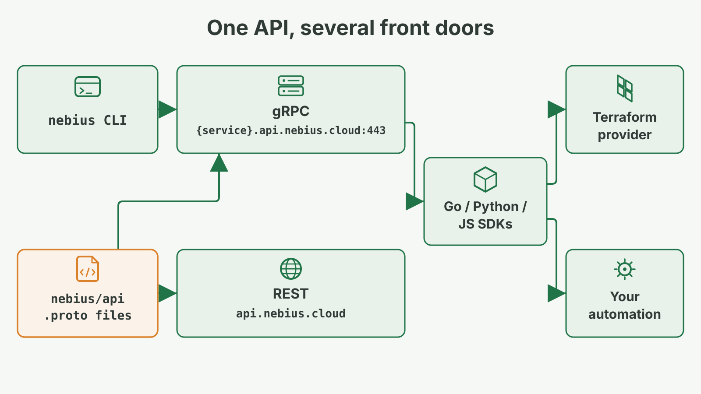

# 20.35 The Nebius API surface: gRPC, CLI, SDKs, IAM and Terraform

## Why an SRE here should know this

Your automation fails at 03:00 with `RESOURCE_EXHAUSTED`. You are the one awake, and the script has been creating nodes since the start of the run. Is that a quota, a rate limit, or missing GPU capacity? The right reaction differs for each, and guessing wrong makes the outage longer. An SRE, which means a site reliability engineer, on an inference platform scripts against this API constantly, so the error model is operational knowledge and not trivia for an interview. This chapter covers the API surface and nothing else. For the product map see [20.30](./30-nebius-ai-factory-to-token-factory-architecture.md) and [20.31](./31-nebius-ai-cloud-foundation-gpu-fabric-and-platform-choices.md).

Evidence tags: `[official]` is a Nebius docs page, `[source-code]` is a public repository read at a stated commit, `[inference]` is my reasoning and `[gap]` means Nebius has not published it. All pages and repositories were read on 2026-11-11. The protobuf repository is `github.com/nebius/api` at commit `06f5307cad6ac4622f839e3cdecebb53d7222656`. Protobuf is the schema language that describes the messages the API sends, and the commit hash pins the exact version I read.

A realistic question: "You have a script that creates 200 nodes. Halfway through, the network drops. How do you make the re-run safe?" Keep that question in mind for the whole chapter, because almost every section gives you a piece of the answer.

## The core ideas

### 1. One API, several front doors

A colleague asks you how to add a set of machines, and you realise the command line tool, the Python library and Terraform all seem to do the same job. They do, because they are all clients of one API. The API is defined in `.proto` files, which are protobuf schema files. Protobuf is a compact binary format for structured messages, and gRPC is the remote procedure call system that carries those messages over the network. A remote procedure call is a function call whose code runs on another machine.

Everything starts from `.proto` files. The repository README says they define the gRPC API, and it recommends the CLI, the Terraform provider and the Go and Python SDKs [source-code]. The REST docs say REST is generated from the same service definitions and exposes the same resources, operations and versions [official]. REST here means the familiar HTTP style of calls, with URLs and JSON bodies. The provider changelog says its releases track a Go SDK version, so Terraform sits on top of the Go SDK [source-code]. An SDK is a software development kit, a library that wraps the raw calls in functions your language can use.



*Figure 20.35.1. One API, several front doors, as a diagram.*

The diagram explains a useful habit. When a client misbehaves, you can ask which layer produced the behaviour. If the SDK adds a retry, that is the SDK. If the server sends an error, that is the API. Because every front door sits on the same definitions, the lowest layer you can reach tells you the most.

I did not find the CLI source. The org has no CLI repository, so CLI behaviour in this chapter comes from its docs only. The web console is not documented as sitting on this API, so I make no claim about it.

**Debug at the lowest layer you can reach: the gRPC call.**

### 2. The resource model: parent, metadata, spec, status

A script breaks on a second run in a way the first run did not predict. The usual cause is that the script treats a resource as a single blob, when the API treats it as three parts with different rules. Every resource follows one pattern in the protobuf files. It has `metadata`, `spec` and `status`. Metadata carries `id`, `parent_id`, `name`, `resource_version`, timestamps and `labels`. The spec is what you ask for and the status is what the platform reports. The status is marked output only [source-code].

Read those three parts as a request, a receipt and a live report. You write the spec, the platform records the metadata, and the status tells you what is actually happening. Your script should never write to status, and it should expect the status to change on its own.

Three details matter for automation. First, `parent_id` is required, and for most resources it is a project. A tenant contains projects, groups, quotas and audit logs, and a project isolates resources [official]. Projects are created per region at signup, so a project ID also fixes a region [official]. Second, field annotations such as `IMMUTABLE` mean a change to that field is an `INVALID_ARGUMENT` error and needs a recreate. In the access permit message both `resource_id` and `role` are immutable. Immutable means the value is fixed once set, so you delete and create again rather than edit. Third, `resource_version` gives optimistic concurrency. The idea is simple. You read the version, make your change, and send the version back, so the server can refuse the write if someone else changed the resource in between. The comment says the service accepts zero or the current value. The docs say `ABORTED` is usually a resource version mismatch [official].

Names are unique within a resource type and parent for services that support `GetByName`. That gives you a natural lookup key for idempotent scripts, as section 8 shows. **Look a resource up by parent and name before you create it.**

### 3. Services and endpoints

Imagine a firewall rule that allows traffic to one host name, and a call to a different host name that fails with a connection error. Every service in this API has its own host name, so the endpoint you pick decides which door you knock on. The endpoint of a service is `{api_service_name}.api.nebius.cloud:443`. The name comes from an option in the proto file. Compute is `compute`, IAM control plane is `cpl.iam`, token exchange is `tokens.iam` and audit is `audit` [source-code]. The control plane is the part of the system that handles management actions such as creating and deleting resources, as opposed to the data plane that serves the traffic itself. IAM stands for identity and access management, the system that decides who may do what. Port 443 is the standard encrypted HTTPS port.

One special case matters: `OperationService` has no endpoint of its own. You poll an operation on the endpoint of the service that created it [source-code]. If you send the poll to the wrong host, you will not find the operation, and that looks like a lost job.

I wrote a small parser, `code/part20/c35_proto_catalog.py`, to list services, methods and long-running methods. On six verbatim proto files copied from the commit above it prints this, and I ran it:

```text
nebius.compute.v1.InstanceService  endpoint=compute.api.nebius.cloud:443  methods=11 long_running=5
nebius.iam.v1.ServiceAccountService  endpoint=cpl.iam.api.nebius.cloud:443  methods=6 long_running=3
nebius.common.v1.OperationService  endpoint=(none: use the initiating service)  methods=2 long_running=0
nebius.iam.v1.TokenExchangeService  endpoint=tokens.iam.api.nebius.cloud:443  methods=1 long_running=0
```

On the whole repository at that commit the same parser counts 226 proto files, 90 services, 487 methods and 210 of them returning an `Operation` [source-code, my count]. Of the methods named Create, Update or Delete, only one does not return an operation, a v1alpha1 maintenance update. The parser taught me one trap. `OperationService.Get` also returns an `Operation`, but it only reads one. A naive rule "returns Operation means long-running" is wrong, so the parser excludes that service. A rule that looks right on paper can still be wrong on the real files, and the only cure is to count the real files.

You will also meet `v1alpha1` packages next to `v1`. Alpha means an early version whose shape may still change. Alpha operations use a separate message type, and the alpha operation message in the repository is marked deprecated with a note to migrate to `common/v1` [source-code]. **Prefer `v1` and treat alpha packages as ones that can change.**

### 4. Long-running operations

Imagine you ask for a new node and the call returns in less than a second, with no node in sight. Nothing is broken. The platform accepted your request and will build the node later. A method such as `InstanceService/Create` returns an `Operation`. It does not return the instance. The README says a synchronous operation comes back already completed and an asynchronous one updates over time [source-code]. Creating a VM takes real time on real hardware, so most creates are asynchronous.

Think of the operation as a claim ticket at a repair shop. It proves the work was accepted, and it tells you where the work stands, but it is not the car. The rules for reading one are exact.

| Field or rule | Meaning | Source |
|---|---|---|
| `status` unset | Still running | operation.proto |
| `status.code` is `OK` | Succeeded | operation.proto |
| `status.code` not `OK` | Failed or cancelled, with details | operation.proto |
| Allowed failure codes | `CANCELLED`, `PERMISSION_DENIED`, `RESOURCE_EXHAUSTED`, `FAILED_PRECONDITION`, `ABORTED`, `INTERNAL` | operation.proto |
| `resource_id` | The affected resource, empty if several or none | operation.proto |
| `finished_at` | Set when complete | README |
| Concurrent operations on one resource | Not supported: an error, or the first is aborted | README |
| Retention | Running operations are never deleted, finished ones may be | README |

Two points follow. The operation holds no resource body, so after success you call `Get`. The Go README says so directly. And an operation can be listed by resource through `OperationService/List`, with `page_size` between 1 and 1000 [source-code]. That is how you find an operation you lost track of, which matters a lot in section 7 and in scenario A.

The Go SDK `Wait` is a good reference loop [source-code]. A reference loop is a worked example you can copy the shape of. It returns at once if the operation is done. Otherwise it sleeps the poll interval, which defaults to one second, and polls. If a poll fails with a retriable error it backs off exponentially with 20 percent jitter, capped at 30 seconds, and the streak resets after one good poll. Backoff means waiting longer after each failure, and jitter adds a little randomness so many clients do not wait and retry in lockstep. The loop stops when the context ends. The Python SDK `wait` has the same one-second default interval and separate poll timeouts [source-code].

My offline version is `c35_operation_poller.py`. Its tests cover success after running polls, a synchronous failure, a failed operation, a timeout, retriable poll errors, and a non-retriable error. One decision deserves attention. A timeout raises `OperationTimeout` carrying the operation ID. It is not a failure. The operation may still finish, so the caller must look at it and never create the resource again blindly. Treating a timeout as a failure is the most common way a fleet script ends up with duplicate machines.

```python
op = server.create(key, "gpu-node-7")          # returns an Operation, not a node
done = wait_operation(op, server.get, clock, interval=1.0, timeout=600)
```

**Treat create as submit, then wait, then get, and keep the operation ID in your logs.**

### 5. Update is full-replace, with a reset mask

This catches people. A colleague edits one field in a config, sends the edit to the update call, and a neighbouring field quietly goes back to its default. The surprise comes from how protobuf sends data. The README says `Update` replaces fields rather than patching them [source-code]. Protobuf drops default values on the wire, so an empty value is indistinguishable from "not sent". The server therefore changes a field only if the request carries a non-default value or the field is named in the `X-ResetMask` header. The mask is not Google's field mask. A resource `{a: {b:1, c:2}}` updated with an empty request and mask `a.b` becomes `{a: null}`, which is surprising.

Put simply, the server cannot tell an empty value you meant from a field that was never sent, so it needs a list of the fields you really mean to touch. The mask is that list.

The SDKs manage the header for you. The CLI exposes two modes [official]. Command-line parameters give a patch by default. A file or standard input gives a full update by default, and the docs warn it resets omitted parameters it recognises. `--clear-mask` clears one field in patch mode. For automation this means a script that reads a resource, edits one field and writes it back is correct, and a script that sends only the field it cares about to a full-update path can silently clear the rest. The operation records essential request headers such as `x-resetmask`, so a repeated request is processed the same way [source-code].

**Use patch mode or read-modify-write, and never send a partial spec to a full update.**

### 6. Pagination and read-after-write

A script lists the instances in a project and reports fewer than it expects. The listing is not wrong. It is one page of a longer list. List methods take `parent_id`, `page_size` and `page_token` and return `items` and `next_page_token` [source-code]. A page is a slice of the results, and the token is a bookmark that tells the server where the next slice starts. A page size of 1 to 1000 is stated for several services, and a default is chosen by the service if you omit it. An empty `next_page_token` ends the listing. The JavaScript SDK `filter()` and the CLI `--all` flag loop for you, so you rarely need to write the loop yourself.

Pagination brings a second question. Once you have written something, can you read it back at once? What does Nebius publish about consistency after a write? Not much. Consistency here means whether a read right after a write sees the write. The deprecated alpha operation message says its resource snapshot is a moment in time and that you should call the resource `Get` for the current state [source-code]. The Terraform provider saves the new ID into state even when create returns an error, and then reads the resource with a short five-second timeout [source-code]. I read that as the provider expecting a read right after create to work. A guaranteed consistency model is `[gap]`. A reasonable design, labelled `[inference]`: after an operation succeeds, `Get` with a short retry on `NOT_FOUND`, and confirm the status you need rather than only existence.

**Loop until the page token is empty, and read the resource after the operation, never before.**

### 7. The error model and the retry decision

A pipeline fails with a 429 status, and the first instinct of most people is to retry in a loop until it works. That instinct is right for some errors and expensive for others. Errors arrive as `google.rpc.Status`, which is the standard error envelope for this kind of API. The details can hold a `ServiceError` with a service name, a code, one typed detail and a `retry_type` [source-code]. The typed details tell you what to do.

| Detail | What it says | Right reaction |
|---|---|---|
| `BadRequest` | Field violations | Fix the request, no retry |
| `ResourceNotFound`, `ResourceAlreadyExists` | Lookup or create conflict | Adopt the existing resource |
| `BadResourceState` | Resource cannot be used now | Wait or repair, then retry |
| `ResourceConflict` | Actual state differs from expected | Re-read, rebuild the change |
| `OperationConflict` | Another operation runs on the resource | Wait for that operation, then retry |
| `OperationAborted` | A later operation replaced yours | Check who aborted it |
| `TooManyRequests` | Request rate exceeded | Back off and retry |
| `QuotaFailure` | A quota check failed, with limit, requested and region | Do not retry, raise the quota or reduce the ask |
| `NotEnoughResources` | Not enough capacity | Do not hammer, try another preset or region |
| `InternalError` | Carries a request ID and trace ID | Retry, and keep the IDs for support |

`retry_type` is the server's hint. `CALL` means retry the failed call. `UNIT_OF_WORK` means redo the whole logic before the call and make a new one. `NOTHING` means fatal [source-code]. The Go SDK classifier uses these in order [source-code]. An explicit `CALL` means retry. `NOTHING` or `UNIT_OF_WORK` means do not retry the call. With no hint it retries `RESOURCE_EXHAUSTED` and `UNAVAILABLE`, network timeouts and connection resets, and a Cloudflare-style 520 to 529 status. It never retries a cancelled or deadline error.

Now the trap. The docs define `RESOURCE_EXHAUSTED` as quotas exhausted, mapped to HTTP 429 [official]. The SDK also retries that code by default. So a pure quota failure is retried by default unless the server sets `retry_type`. I did not find how the services set `retry_type` for `QuotaFailure`. So my guard in `c35_client_guard.py` refuses to retry `QuotaFailure` and `NotEnoughResources` no matter the code. That is `[inference]`, and a deliberate choice. Retrying a quota failure cannot help, because the limit does not move while you wait. Retrying a capacity failure in a tight loop only adds load to a platform that is already short.

The deadline code has its own warning. The docs say a state-changing request can return `DEADLINE_EXCEEDED` even though it completed and only the response was late [official]. A deadline is the time limit a client gives a call. A retry is safe only with an idempotency key.

The CLI turns this into exit codes [official]. It inspects the first `ServiceError` in the status details, and falls back to the gRPC code. A script in CI can branch on these, which means the exit code becomes the input to the next step of your pipeline.

| Exit code | Meaning |
|---|---|
| 3 | Validation error or `INVALID_ARGUMENT` |
| 7 | Authentication error |
| 12 | Target call `DEADLINE_EXCEEDED` |
| 16 | Target call `RESOURCE_EXHAUSTED` |
| 20 | Target call `UNAVAILABLE` |
| 23, 24, 25 | `TooManyRequests`, `QuotaFailure`, `NotEnoughResources` on the target call |
| 51 to 65 | The same meanings for "extra calls", the wait and the follow-up read |

The split between target and extra calls is the useful part. For `nebius compute instance create` the target call is `InstanceService/Create`. Waiting for the operation and fetching the result are extra calls. An exit code of 52 means the create was accepted and the wait timed out. It does not mean the create failed. **Always read the error detail, not just the gRPC code.**

### 8. Idempotency

Imagine a create call that times out on your side. The server may have built the node, or it may never have received the request. You cannot tell which from the timeout alone. Idempotency is the property that makes repeating a request safe, because the second attempt has the same effect as the first. The `X-Idempotency-Key` header makes a mutating call safe to repeat. A mutating call is one that changes state, such as a create or a delete. The README says the same operation is not executed twice, even if the client retries after a timeout, and that the value should be a long random string, preferably a UUID. A UUID is a long random identifier that is practically unique. `Get` and `List` ignore it [source-code]. Reads do not need protection, because reading twice changes nothing. The audit event reference shows the other side: two requests that are retries of the same action share an `idempotency_id` [official].

Both SDKs add a random key by default. In the Go SDK the idempotency interceptor is registered before the retry interceptor, so one key is created per call and reused by the SDK retries [source-code, my reading of the chain order]. An interceptor is a hook that wraps each call before it leaves the client, and the order of the hooks decides which one sees the request first. The Go SDK also lets you pass your own key per call.

What Nebius has not published is how long a key is remembered `[gap]`. So treat keys as protection for retries within one process and a short window. They are not a way to make a re-run tomorrow safe. For re-runs use the resource name as the natural key, as in section 2: `GetByName` first, then create, and treat `ALREADY_EXISTS` as a hint to adopt the resource after you check its spec matches.

**Generate one key per logical mutation, reuse it on every retry, and use names for re-runs.**

### 9. Identity and tokens

A job that ran fine yesterday fails in the middle of a long run with an authentication error, and nobody changed the code. The cause is usually a token that expired. The API accepts a bearer token in the `Authorization` header [source-code]. A bearer token is a credential that proves who you are to whoever holds it, so anyone holding it can use it. An IAM access token is valid for 12 hours [official]. The kinds of identity and credential differ, and an SRE must pick the right one for each job.

| Credential | Used for | Lifetime and notes |
|---|---|---|
| User access token from `nebius iam get-access-token` | Local work, testing | 12 hours, SDK does not refresh it |
| Service account with an authorized key | CLI, Terraform, SDK automation | Key pair, optional `--expires-at`, token refreshed by SDK |
| Access key | Object Storage and other AWS-compatible APIs | Optional expiry, not a control-plane credential |
| Static key | Third-party tools needing long-term credentials | Up to three years |
| Federated credentials | A workload impersonating a service account through OIDC | Provider must expose OIDC discovery |

Read the table by asking who is calling and for how long. A person at a laptop gets a user token. An unattended pipeline gets a service account, which is an identity that belongs to the automation rather than to a person. OIDC is OpenID Connect, a standard way for one system to trust identities issued by another, and federated credentials use it so a workload can prove its identity without a stored secret.

The service account flow is explicit in the README [source-code]. You sign a short-lived JWT with RS256 using the claims `kid`, `iss`, `sub` and `exp`, then exchange it through RFC 8693. A JWT is a signed token that carries claims, which are statements about the identity, and RFC 8693 is the standard for exchanging one token for another. The gRPC method is `TokenExchangeService/Exchange` on `tokens.iam`, and there is an HTTPS endpoint as well. The Go SDK does this for you and refreshes in the background after 90 percent of the token's lifespan, so a 12-hour token is renewed after about 10 hours 48 minutes [source-code, my arithmetic]. A raw token from the CLI is never refreshed, so a long job using one fails with an authentication error after 12 hours. The CLI maps that to exit code 7.

Authorization sits on groups. A new account has no access. Default groups are `auditors`, `viewers`, `editors` and `admins`, and custom groups get roles through access permits at tenant, project or resource level [official]. The docs advise custom groups with the fewest permissions. Least privilege is the rule that an identity gets only the access its job needs. I did not find a per-method permission list, so I cannot tell you which role `InstanceService/Stop` needs `[gap]`.

Two credential hygiene facts come from the docs. In CI, store the credentials file content as a secret and write it at job start [official]. And the proto marks fields such as `subject_token` with a `credentials` option so that they are masked in logs and storage [source-code]. Your own logging does not get that protection. A line that prints a request body can still leak a token, so scrub what your own code writes. **Give automation its own service account in a least-privilege group, with an expiring key, and never reuse a person's token.**

### 10. Quotas, capacity and rate limits

A script creates a set of nodes and gets an error that says the request is over a limit. Three different limits look alike in the error, and they need three different reactions. Mixing them up is how a team waits for capacity that a quota change would have fixed, or asks an admin for quota when the platform only needed a pause.

Quotas are per region and can differ per project [official]. They are resource counts. A quota is a ceiling on how many of something a project may hold. A VM counts against the quota from creation to deletion, even while stopped, and Managed Kubernetes and Soperator nodes count too, since they are VMs [official]. Only the `admin` group changes quotas. Nebius may also reduce a quota automatically after long low usage. It sends an email and usually gives two days of grace, and running workloads are not affected [official]. You can read quotas through `nebius quotas quota-allowance list`, and the quota service exists in the API at its own endpoint [source-code]. In the proto, creating an allowance that already exists replaces its value. So a script that sets quotas must be careful, because a create that looks harmless can overwrite a value someone else chose.

Capacity is different. `NotEnoughResources` means the platform lacks the resource at this moment, whatever your quota says. A quota is permission to ask. It is not a promise of supply. The CLI and API have a capacity advice service for finding where a VM can launch [official, source-code]. When capacity is the problem, the useful move is to try another preset or region, not to wait in the same spot.

Rate limits are the third kind. A rate limit caps how fast you may call, not how many things you hold. The proto has `TooManyRequests`, and its `violation` field is "service-dependent" [source-code]. That phrase means the meaning of the field depends on the service. Nebius has not published request-per-second limits for the control plane `[gap]`. So a client must learn the limit from the error, which is what a rate-limit wrapper does.

Token Factory has its own, published rate limits on the inference side. They are dynamic. In 15-minute windows the limit grows by 20 percent after average use of 80 percent or more, and shrinks by one third at 50 percent or less, up to 20 times the base [official]. Responses carry `x-ratelimit-*` headers, and an over-limit request may still be served with `x-ratelimit-over-limit: yes` [official]. That is the data plane. Do not mix it with the control-plane API.

**Classify `RESOURCE_EXHAUSTED` by its detail first: rate means wait, quota means ask, capacity means move.**

### 11. Layered retries and timeouts

A single failing call can turn into many calls without anyone writing a loop on purpose. This happens when each library quietly retries on its own. Each client has its own defaults, and they stack. These are from the sources.

| Client | Overall timeout | Per attempt | Attempts | Backoff |
|---|---|---|---|---|
| CLI | `--timeout` 1 minute | `--per-retry-timeout` 20 seconds | `--retries` 3 | not documented |
| Go SDK | 1 minute | one third of timeout, 20 s for streams | 3 | none by default |
| Python SDK | 60 seconds | 20 seconds | internal retry layer | not documented |
| JavaScript SDK | not stated here | not stated here | 3 total | not stated here |

The Go default has no cooldown between attempts, and the source says so. Three immediate retries against an overloaded service are a small storm. A storm here means a burst of extra requests that makes the overload worse. The SDK documentation itself advises setting backoff and timeout for your usage. Chapter [20.21](./21-request-routing-retries-and-overload-control.md) explains why stacked retries multiply and why a retry budget caps them. The same arithmetic applies here. If your script retries 3 times around an SDK that retries 3 times, one failing call makes 9 attempts.

I measured the budget idea with the guard. One hundred calls that always fail, five attempts each, produce 500 attempts without a budget. With a 10 percent budget and 3 retries in reserve they produce 112 attempts, which is 1.12 per call. A retry budget means you may only retry while the retries stay under a fraction of the calls you have made, so a failing service sees a bounded load. I ran that, and it is a simulation, not a Nebius measurement.

**Retry in one layer only, add backoff yourself, and cap retries with a budget.**

### 12. A safe fleet-automation client

Put together, a safe client has six parts. Picture the client as a gate in front of the API. Every request passes through it, and the gate decides whether the request may go out, how often, and what happens when it fails. The parts are in `c35_client_guard.py`, which has 19 tests. This is my design `[inference]` built on the documented error model, not a Nebius component.

1. A token-bucket rate limiter, so you never exceed a rate you chose. A token bucket holds spare permission that refills over time, and each call spends one. It waits up to a limit and then raises.
2. A retry budget that allows retries as a fraction of calls.
3. A classifier: retry `UNAVAILABLE`, plain `RESOURCE_EXHAUSTED` and `DEADLINE_EXCEEDED`, follow `retry_type`, never retry quota or capacity errors.
4. One idempotency key per mutation, reused on every attempt.
5. A mutation cap per run, so a bug cannot touch 5,000 resources.
6. A dry-run mode that counts mutations and never sends them.

```python
guard = ClientGuard(clock, limiter=TokenBucket(5, 10, clock),
                    budget=RetryBudget(0.1, 10), max_mutations=20)
op = guard.call(lambda key: api.create(key, spec), mutating=True)
finished = wait_operation(op, api.get_operation, clock, timeout=900)
```

Pair it with the poller. The guard protects the submit call. The poller waits. The guard treats `CANCELLED` as final, and it never sends a mutation without a key, because it always creates one. Notice the design choice in part 5. A mutation cap is a blunt tool, and it is meant to be. If a loop goes wrong, the cap stops it after a known number of changes, which is far better than discovering the damage after thousands. **A fleet script should be unable to do more than its cap, and unable to retry faster than its budget.**

### 13. How Terraform fits

Terraform apply reports an error, and when you look, the node you wanted is already running. That looks like a bug in Terraform, and it is usually the API doing exactly what the provider asked. The provider calls the service `Create` and then `Wait` on the operation, through the Go SDK [source-code]. That explains Terraform behaviour. A timeout in the provider is a wait timeout on an operation that may still run, and the resource may exist even though apply failed. The provider keeps the ID in state on a failed create so a later plan can see it. A plan is Terraform's preview of what it will change, and state is its record of what it already made. Import is by resource ID, with `terraform import` or an `import` block and `-generate-config-out`. The support document warns that import cannot recover write-only or input-only values the API does not return [source-code]. Write-only values are fields the API accepts but never shows you again, so there is nothing to read back. For drift, state layout and the node group facts, reuse [20.24](./24-terraform-for-resilient-gpu-clusters.md) and do not repeat them.

The provider authenticates as a service account through a `service_account` block or from `NEBIUS_IAM_TOKEN`. If both are present, the user credentials win [official]. That is a real trap in CI where a developer token leaks into the environment. A developer's shell may export a personal token that the pipeline then picks up, and the apply runs as that person. Check the environment of the job, not only the configuration file.

### 14. Audit logs and tracing a failed call

A security team asks which call created a node last Tuesday, and your logs only show that the script ran. The audit log is the record of who called what. When a call fails, three IDs identify it. The `InternalError` detail has a request ID and a trace ID. The Python SDK README tells you to keep both for support [source-code]. A request ID names one call, and a trace ID follows that call across the services it touched. The audit event has `request_id`, `idempotency_id`, `trace_id`, the response status code and a `STARTED`, `DONE` or `ERROR` status [official]. You can filter by subject, service, resource and status. The service is in preview and covers control-plane events for many services [official]. Data-plane events have a quota of 1000 per second per region and extra events are dropped [official]. For incident work: log the operation ID, request ID and idempotency key on every call, then join with audit events. A join here means matching rows from two sources on a shared ID, so one failed call can be traced from your script to the platform's record.

### 15. Token Factory has its own control plane

Your team wants to automate Token Factory dedicated endpoints with the same client you wrote for compute. That is a reasonable plan to test, but the sources do not show that the two share a control plane, so test before you assume. Dedicated Endpoints for Token Factory are managed through a separate REST API. The docs show `GET /v0/dedicated_endpoints/templates`, `POST /v0/dedicated_endpoints`, `PATCH` with only the provided fields, `GET` for the list and `DELETE` on `https://api.tokenfactory.nebius.com` [official]. The data plane has regional base URLs. Whether this control plane is built on the gRPC API is not stated in the sources I read `[gap]`. So do not assume Operation objects, idempotency keys or `X-ResetMask` apply. Check the quickstart and operating pages before you automate it. The lifecycle and readiness meanings are in [20.32](./32-token-factory-model-lifecycle-serving-and-economics.md).

## How to answer out loud

These are short scripts for the interview. Each one gives the answer you can stand behind, then names what you did not check. Practise them out loud, because the spoken version is what the interviewer hears.

**"What do you know about our API?"** Say: it is protobuf first. Services live at `{name}.api.nebius.cloud:443`, REST is generated from the same files, and the CLI, the SDKs and Terraform are clients of it. Mutations return an `Operation` that you poll. Errors carry a typed `ServiceError` with a retry hint. Say this is from the public repository, and that you have not seen the internals.

**"A script that creates 200 nodes loses its network halfway. Make the re-run safe."** Order of speech: key per mutation inside a run, name lookup across runs, operation IDs persisted, `GetByName` then adopt, cap and dry run. Name the trap: a timeout is not a failure.

**"How would you handle `RESOURCE_EXHAUSTED`?"** Split by detail into rate, quota and capacity. Rate: back off. Quota: stop and request more, since only admins change it. Capacity: another preset or region. Mention exit codes 23, 24 and 25 in CI.

**"How do you authenticate automation?"** A service account in a least-privilege group, an authorized key with an expiry, the SDK refreshing 12-hour tokens, the key as a CI secret. Never a person's token. Follow-up: key rotation, and federated credentials to avoid stored keys.

**"How would you design a fleet client?"** The six parts from section 12, with numbers: a 10 percent retry budget turns 5.0 attempts per call into 1.12 in my simulation. Say it is a simulation.

## Worked scenarios

Each scenario starts from a symptom you might actually see. Read the symptom first, then try to name the layer and the rule before you read the answer.

### Scenario A: the CI job exits with 52

A pipeline runs `nebius compute instance create` and exits with 52. The table says 52 is `DEADLINE_EXCEEDED` on an extra call. The create call was accepted and the wait ran out. Do not rerun the create. List instances by name in the project, or list operations for the resource, and find the operation. If it is still running, wait on it. If the instance exists, adopt it. The fix in the pipeline: use `--async`, keep the operation ID and poll it with a deadline you control. `--async` returns the operation ID instead of waiting [official].

### Scenario B: two 429s with different causes

One job fails with exit code 24 and another with 23. Code 24 is `QuotaFailure`. The detail has the quota name, limit, requested value and region, so read it and ask an admin to change the quota. Retrying only burns calls. Code 23 is `TooManyRequests`. Here the job is too fast, so lower its rate and add jitter. A script that treats both as "retry" fails the first forever. The test `test_quota_failure_is_not_retried_even_though_code_is_resource_exhausted` captures this.

### Scenario C: a crash between submit and record

A rollout script submits a create, crashes before saving the operation ID, and restarts. A fresh idempotency key would create a second node. The design: before every create, call `GetByName` for the planned name. If it exists, check the spec and adopt it. If not, create with a key derived and stored before the call, so a restart reuses it. Nebius has not published how long a key lives, so the name check is the real protection. Test it offline with the fake server: `test_idempotent_create_survives_a_lost_response` and `test_new_key_would_have_created_a_second_resource`.

### Scenario D: a 14-hour job fails with exit 7

A batch job reads a token once with `nebius iam get-access-token`. The token lives 12 hours, so after 12 hours every call returns `UNAUTHENTICATED`. The fix is a service account and an SDK that exchanges and refreshes tokens in the background.

## Hands-on lab

This runs on a laptop with Python 3 and pytest. I ran steps 1 to 4. Step 5 needs a Nebius account and I did not run it. Each step asks one question of the code or the API, so you can stop after any step and still have learned something.

1. From `code/part20`, run `python3 -m pytest -q test_c35_proto_catalog.py test_c35_operation_poller.py test_c35_client_guard.py`. Observed result: 42 passed.
2. Run `python3 c35_proto_catalog.py`. Expected and observed: six services, with `OperationService` showing no endpoint and no long-running methods.
3. Run `python3 c35_proto_catalog.py /path/to/nebius/api/nebius` on a clone of the public repository. I got 90 services and 487 methods at the commit above. Your numbers will differ when the repository moves.
4. Run the budget simulation from section 11 by building a `ClientGuard` whose function always raises `ApiError("UNAVAILABLE", "x")`. Compare `guard.stats.attempts` for `RetryBudget(1.0, 10**9)` against `RetryBudget(0.1, 3)`. Observed: 500 and 112 for 100 calls.
5. Not run: with a service account profile, run `nebius compute instance list --format json` and a create with `--async`. Expected shape: the create prints an operation ID. Then find it with `nebius compute v1 operation get` or the matching command in the CLI reference. Check the exact command in the reference before relying on it.

## Drill questions

<details><summary>1. What does a create call return, and how do you know it finished?</summary>
It returns an `Operation`, not the resource. The operation is done when its `status` field is set, and it succeeded when the status code is `OK`. After success you call `Get`, because the operation holds no resource body.
</details>

<details><summary>2. Where do you poll an operation?</summary>
On the endpoint of the service that created it. `OperationService` has no endpoint of its own.
</details>

<details><summary>3. Is Update a patch?</summary>
No. It is a full replace guarded by the `X-ResetMask` header, which the SDKs manage. The CLI patches by default when you give parameters and does a full update when you give a file or standard input.
</details>

<details><summary>4. What does `retry_type` mean?</summary>
`CALL` retries just the failed call. `UNIT_OF_WORK` means redo the logic before the call and make a new one. `NOTHING` is fatal. The Go SDK follows it before it looks at the gRPC code.
</details>

<details><summary>5. Name three reasons for `RESOURCE_EXHAUSTED`, and the reaction to each.</summary>
Rate limit, which means back off. Quota, which means stop and ask an admin to raise it. Capacity shortage, which arrives as `NotEnoughResources`, so try another preset or region. Read the `ServiceError` detail to tell them apart.
</details>

<details><summary>6. A create times out. May you retry it?</summary>
Only with the same idempotency key, and after checking the operation or the resource by name. The docs say a write can complete although the response was late.
</details>

<details><summary>7. How long does an access token live, and who refreshes it?</summary>
12 hours. The Go SDK refreshes a service-account token in the background after 90 percent of its life. A raw token from the CLI is not refreshed.
</details>

<details><summary>8. What do CLI exit codes 24 and 52 tell you?</summary>
24 is a `QuotaFailure` on the target call. 52 is `DEADLINE_EXCEEDED` on an extra call, so the target call was accepted and the wait failed.
</details>

<details><summary>9. Which Go SDK retry default is risky for a fleet?</summary>
Three attempts with no cooldown or backoff. Set backoff and an overall timeout, and retry in one layer only.
</details>

<details><summary>10. How does Terraform relate to the API?</summary>
The provider is built on the Go SDK. It calls the create method and waits on the operation. A timeout may leave the resource existing, so the next plan shows the truth. Import is by resource ID.
</details>

## Common mistakes and weak answers

Most of these mistakes share one root. The speaker treats a symptom as its own cause, or treats an unknown as a known. Check your own answers against this list before the interview.

- Treating `Operation` as the resource. Say: submit, wait, get.
- Treating a timeout as a failure and creating again. Say: look up the operation and the name first.
- Retrying every 429 the same way. Say: rate, quota and capacity are three answers.
- Sending a partial spec to a full-update path. Say: patch mode or read-modify-write.
- Using a person's token in automation. Say: a service account with an expiring key.
- Claiming Nebius internals, such as how the console works or how long idempotency keys live. Say what the repository shows and name the gap.
- Stacking retries in the CLI, the SDK and your wrapper. Say: one layer, with a budget.

## Connections to the rest of the handbook

- [20.21](./21-request-routing-retries-and-overload-control.md): backoff, jitter, budgets and retry amplification.
- [20.24](./24-terraform-for-resilient-gpu-clusters.md): state, drift, node pools and the provider's schema.
- [20.30](./30-nebius-ai-factory-to-token-factory-architecture.md) and [20.31](./31-nebius-ai-cloud-foundation-gpu-fabric-and-platform-choices.md): what the services are.
- [20.32](./32-token-factory-model-lifecycle-serving-and-economics.md): the Dedicated Endpoint lifecycle.
- [20.33](./33-ai-factory-solution-architecture-ha-and-recovery.md): failure domains and recovery.

## Questions to ask the interviewer

These questions show that you have read past the marketing page. Ask the ones that match the team you would join, and listen for whether the answer is clear or vague.

1. Which control-plane API do the Token Factory dedicated endpoints use internally, and do operations and idempotency keys apply to the REST control plane?
2. How are `retry_type` values chosen for quota and capacity errors, and do clients see them reliably?
3. Is there a published or negotiable rate limit for the control plane, and how should automation discover it?
4. How long are idempotency keys remembered?
5. What does the SRE team automate through the public SDKs, and what through internal tooling?
6. How do you detect and handle a client that retries too hard against the platform?
7. What is the on-call experience when quota or capacity errors hit customers during a model rollout?

## What I could not find

- The CLI source code.
- Control-plane request rate limits.
- Idempotency key retention and operation retention periods.
- A consistency model for reads after writes.
- A per-method permission list for roles.
- Whether Token Factory's REST control plane shares the gRPC resource model.
- Whether and how the web console uses this API.

## Sources and review notes

All fetched 2026-11-11. Notes are in `planning/research/nebius_api.md`.

- `github.com/nebius/api` at commit `06f5307cad6ac4622f839e3cdecebb53d7222656`: README, `endpoints.md`, `nebius/common/v1/` operation, operation service, error and metadata protos, `annotations.proto`, and the compute, IAM, quotas and audit service protos. Six proto files are copied verbatim into `code/part20/c35_fixtures/` under the MIT licence.
- `github.com/nebius/gosdk` at `1926a12`: README, `conn/retries.go`, `conn/idempotency.go`, `operations/`, `auth/cache.go`, `options.go`, `sdk.go`.
- `github.com/nebius/pysdk` at `0fd9c6f` and `github.com/nebius/js-sdk` at `8d20821`: READMEs and the Python operation and idempotency modules.
- `github.com/nebius/terraform-provider-nebius` at `d963a01`: README, `SUPPORT.md`, `CHANGELOG.md`, `service/resource.go`, one generated service file.
- docs.nebius.com pages: CLI install, configure, no-browser, update, exit codes, reference for `compute instance create`; IAM overview, access tokens, groups, roles, workload identity; quotas; Compute quotas; gRPC and REST error pages; endpoints; Audit Logs index, reference, quotas; Terraform provider authentication; docs.tokenfactory.nebius.com dedicated endpoint control plane, deploy via API, operating and rate limits pages.

**Explicitly labelled inferences:** one idempotency key covering SDK retries, which I read from the chain order in `sdk.go`. The guard design. The refusal to retry quota errors. The read-after-create design. The 10 hours 48 minutes arithmetic. The 5.0 versus 1.12 simulation.

**Not verified:** any call against a real Nebius account, the CLI behaviour beyond its docs, whether `--timeout` covers the operation wait, and the Python and JavaScript backoff behaviour.

### Verification log

| Item | Count | Detail |
|---|---|---|
| Sources fetched | 4 repositories, about 60 docs pages | URLs in the research notes, all returned 200 |
| Claims checked | 41 | Against proto text, SDK source or docs page |
| Confirmed | 33 | Operation rules, error types, retry classifier, defaults, token lifetimes, exit codes |
| Corrected | 3 | `OperationService.Get` is not long-running. Alpha operations are a separate type. CLI wait counts as an extra call |
| Removed | 3 | Any claim about the console, rate limit numbers, and idempotency retention |
| Still unverified | 6 | See the Not verified paragraph |
| Tests | 42 passed | Three test files, offline, standard library plus pytest |
