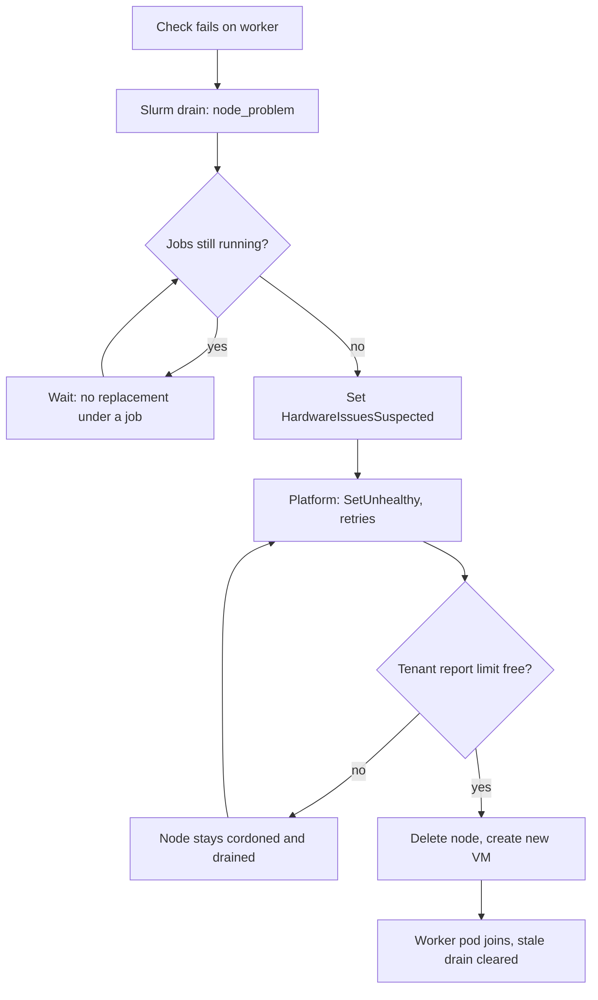

# 20.36 Managed Kubernetes and Soperator: how Nebius runs Kubernetes and Slurm

A training customer pings you: "Job 4182 has been pending for an hour and `sinfo` shows half the nodes drained." You open the Kubernetes side and see worker pods that look fine. The question is which of three controllers drained those nodes, and whether it is safe to undrain them. A controller is a loop that watches the state of some objects and pushes them toward the state you asked for. You can only answer if you know how the layers fit, and this chapter draws that picture layer by layer.

This chapter covers only how the technology works, fails and is operated. It uses Nebius docs fetched on 2026-11-11 [official], the public repositories nebius/soperator at commit f10392e1264a and nebius/nebius-solutions-library at commit 3db4054d463d [source-code], and my reasoning [inference]. Soperator is the open-source operator that runs Slurm, the batch scheduler many training teams use, inside Kubernetes. The Token Factory data plane is in [20.32](./32-token-factory-model-lifecycle-serving-and-economics.md). The cloud layers are in [20.31](./31-nebius-ai-cloud-foundation-gpu-fabric-and-platform-choices.md).

## Why an SRE here should know this

A new SRE on the platform team gets a ticket on the first morning. The customer wants to know whether their training nodes will be replaced automatically if a GPU fails, and the answer decides whether they need their own health checks. That is the everyday reason to know this layer. Kubernetes is the first required skill in the posting. Nebius has not published whether Token Factory runs on Managed Kubernetes, so do not claim it. What you can state is how the managed service behaves, because every drill in [20.23](./23-kubernetes-failure-drills-for-gpu-platforms.md) lands on these mechanics. Soperator is also a public example of how Nebius engineers wire health checks to node replacement.

A realistic question: "A GPU node reports Xid errors under a 64-node training job. Who notices, who drains, who replaces, and where can this go wrong?"

## The core ideas

### 1. What the managed service runs and what you run

Imagine a cluster that a colleague breaks by editing a system component in the middle of the night. The useful first question is whose job that component is. Nebius runs the control plane: API server, scheduler, cluster autoscaler, controller manager and etcd. The API server is the front door every component talks through, the scheduler places pods on nodes, the autoscaler adds and removes nodes, the controller manager runs the control loops, and etcd is the database that stores the cluster state. A new cluster gets three etcd members by default at no extra cost, and a control plane with one member is unavailable during its own upgrade [official, components page]. Nodes are Compute VMs in node groups of up to 100 nodes sharing one template. Do not modify them in Compute, because the service reconciles them [official]. Reconcile means the service keeps comparing the real nodes against the template and corrects any difference, which is why a manual edit does not stick.

CoreDNS and Cilium are installed and maintained by the service. CoreDNS is the DNS server inside the cluster that resolves service names, and Cilium is the networking layer that connects pods. Their configuration is not in the API. CoreDNS takes a custom ConfigMap with `.override` and `.server` keys, and `helm upgrade` changes may be rolled back immediately [official, add-ons page]. Alpha feature gates cannot be enabled. Node count is bounded by the VPC Allocations quota: at the default 1000, the docs compute 331 nodes with public and private addresses and high availability [official, quotas page]. The VPC allocation is the pool of network addresses the cluster draws from, so the quota caps how many nodes you can grow to, no matter how much hardware you have.

**Ask "platform component or mine" before you touch anything in `kube-system`.**

### 2. Node groups, GPU drivers and the fabric

A node group is a template plus a size, fixed or autoscaled between a minimum and a maximum. The template holds platform, preset, boot disk, reservation policy, taints and labels. Taints and labels are how the scheduler decides which pods may land on which nodes. Changing it rolls every node [official, node groups page]. A rolling change replaces nodes in small batches, so an edit to the template touches the whole group over time, not all at once.

With GPU settings on, the node boots an image with the NVIDIA driver and Container Toolkit. The NVIDIA Container Toolkit lets containers see the GPUs on the host. The preset `cuda12.8` carries driver series 570.x and `cuda13.0` carries 580.x [official, GPU setup page]. Turn GPU settings off only to install the GPU Operator yourself, for example for MIG, and then the driver lifecycle is yours. MIG, multi-instance GPU, splits one physical GPU into smaller isolated pieces. For InfiniBand you create a GPU cluster in a fabric and give its id to the node group. The Soperator Terraform recipe rejects a GPU preset without a fabric or cluster id and taints GPU workers `nvidia.com/gpu` with `NO_SCHEDULE` [source-code, `gpu_fabric_validation.tf`]. The taint means ordinary pods that do not ask for a GPU are kept off those nodes.

Fabric, platform and region are tied together, so a replacement node presumably must land in the same fabric [inference]. A node that lands in the wrong fabric cannot join the job's network even though it looks healthy. Nebius has not published how. Ask.

**Pin the driver preset in code and record each GPU node group's fabric.**

### 3. How nodes fail and how Nebius repairs them

A node goes `NotReady` on a Friday evening, and the first repair starts before anyone is paged. That is the normal behaviour of a managed service, and you need to know its clock to plan around it. The service runs Node Problem Detector on every node and turns findings into node conditions. Node Problem Detector is an open-source daemon that reports node-level problems to the Kubernetes API. Read the table as a lookup of condition, trigger and action [official, health checks and maintenance pages].

| Condition | Trigger | Automatic action |
|---|---|---|
| `NebiusBootDiskIOError` | Network SSD non-replicated boot disk I/O errors for 30 seconds | Delete node, create a new one with a new name |
| `Ready` False | False for more than 5 minutes | Delete and recreate |
| `Ready` Unknown | Unknown for more than 15 minutes | Delete and recreate |
| `NebiusGPUError` | GPU, InfiniBand, NVLink checks, Xid or ECC errors, run every 5 minutes | Cordon, wait for GPU workloads to finish, drain up to 1 hour, stop and start the VM |
| `NebiusMaintenanceScheduled` | Compute maintenance event | Cordon, wait for GPU pods, drain up to 1 hour, stop and start the VM, uncordon |

Each row has its own clock. Ready False and Ready Unknown differ in meaning. False means the node reports that it is unhealthy, and Unknown means the control plane has stopped hearing from it at all. The second case is harder to diagnose, which is why the service gives it a longer wait before it acts.

Maintenance deserves its own detail. The node message carries an SLA deadline, the latest time the event should happen. An SLA here is the promised time by which the platform will complete the event. The service waits for GPU pods until one hour before that deadline, then drains. CPU pods are not waited for unless they carry the label `nebius.com/defer-maintenance-node-drain: "true"`. A DaemonSet pod cannot postpone the drain past the deadline. A DaemonSet is a pod that runs one copy on every node, such as a logging agent. You can start it early with the label `nebius.com/perform-maintenance` set to `true` or to a time [official].

Notice the shape. A GPU fault does not live-migrate anything. Live migration would move a running VM to other hardware with its memory intact, and here the node is cordoned, the job must finish or die, and the VM is stopped and started to land on healthy hardware. Checkpointing is the recovery story for training and replica count is the story for inference. The job loses whatever it did since its last checkpoint, so the checkpoint interval is a decision you make with the job owner.

**When a GPU node disappears, find the condition first, because each condition has a different clock and a different workload impact.**

### 4. Upgrades are manual until a version dies

Imagine you are asked why a cluster is still on an older Kubernetes version. The honest answer is that the upgrade is yours to schedule, and the service only forces it at the end of a version's life. You pick the Kubernetes version at creation and upgrade yourself: control plane first, then each node group. A node group cannot be ahead of the control plane [official, versions page, 2026-11-11: 1.36 recommended]. Skew means version difference, and the control plane must lead, because the newer components expect to talk to the older ones, not the reverse.

The deprecation policy holds the surprises. At most four minor versions are offered. A deprecated version stays for existing clusters for two months. At end of life the service upgrades the control plane, and upgrades node groups only when needed to stay within three minor versions of skew, possibly jumping several at once [official, deprecation page]. A version jump is the risk here, because a large jump skips the steps in between, and each step carries its own changes.

A node group upgrade is a rolling replacement. The defaults are max unavailable 1, max surge 0 and a drain timeout of 10 minutes, after which the node is force-drained and deleted [official]. Max unavailable is how many nodes may be out of service at once, and max surge is how many extra nodes may be added during the upgrade. A GPU node with a long job is deleted after ten minutes of draining unless you raised the timeout. The Soperator recipe sets `drain_timeout` to `0s`, meaning wait indefinitely, and max unavailable to 50 percent with surge 0 [source-code, `k8s_ng_workers_v2.tf`, README]. Any surge needs quota for the extra nodes or the update fails.

**Upgrade on your own date, one node group at a time, with a drain timeout you chose.**

### 5. Autoscaling and capacity

The cluster autoscaler adds nodes for unschedulable pods and removes underused ones, inside each node group's minimum and maximum. An unschedulable pod is one the scheduler cannot place on any existing node, so it waits in Pending. A GPU node group that scales to zero needs a CPU node group of at least two nodes so CoreDNS and Cilium have somewhere to run [official, autoscaling page]. The reason is simple. If every node in the cluster is a GPU node that has scaled away, the cluster's own system pods have nowhere to run, and the autoscaler cannot start a GPU node that needs DNS to join. Scale-up can still fail on quota, physical capacity or a full reservation, and the autoscaler will not page you about it.
**Alert on pods Pending for unschedulable reasons and on node group size below target.**

### 6. How Soperator maps Slurm onto Kubernetes

Think of Slurm as a job board for a training cluster. Users submit jobs, the scheduler assigns them to nodes, and the daemons on each node run the work. Soperator takes that job board and rebuilds each piece as Kubernetes objects. You apply a `SlurmCluster` resource and the operator creates the Kubernetes objects. All Slurm nodes are pods [official, architecture page]. An operator is a Kubernetes controller that knows how to run one specific application, here Slurm.

| Slurm piece | Kubernetes shape |
|---|---|
| `slurmctld` and munge | Controller StatefulSet, one replica in the render code, spool on a PVC, grace period 120 s |
| `slurmd` and munge | Worker pods of a `NodeSet` in an OpenKruise StatefulSet, GPUs as `nvidia.com/gpu` |
| `sshd` | Login StatefulSet behind a LoadBalancer, delayed rollout with 720 hours default notice |
| `slurmdbd` | Accounting pod, MariaDB via mariadb-operator or external |
| Slurm configuration | ConfigMap `<cluster>-slurm-configs` plus a `JailedConfig`, written into the jail by the sconfigcontroller |
| Root filesystem | The jail, a shared PVC populated once by a Job |

Read the table as a translation. `slurmctld` is the Slurm controller that decides where jobs run, and in Soperator it becomes a StatefulSet, which is a Kubernetes object for workloads that need a stable identity and storage. `slurmd` runs on each worker and launches the job processes, and in Soperator each worker is a pod. Munge is the authentication service Slurm daemons use to trust one another. A PVC is a persistent volume claim, a request for storage that outlives the pod that uses it.

The managed service lists two controller nodes, one accounting node and three to five system nodes, all `8vcpu-32gb` [official]. The render code runs one controller replica, and Nebius has not published what the second controller node does. Ask. The render code is the code that turns the cluster definition into the Kubernetes objects. The reconcile order in the source is: populate jail, common objects, accounting, sconfigcontroller, controllers, login, REST, exporter [source-code, `reconcile.go`]. Order matters because later steps need earlier ones to exist. One bad field can stall that sequence, and everything after it waits.

**For each Slurm daemon, know the pod and the controller that owns it before you edit anything.**

### 7. The jail and what a shared root costs you

Imagine a package that is installed on one worker and missing on another. On a normal cluster, that is a classic drift problem. Soperator is designed to remove drift, and the way it does so is worth understanding. The jail is the shared root filesystem that every login and worker pod sees. Login and worker pods see one shared PVC as their root. A SPANK plugin runs after `slurmd` forks and does `pivot_root` into it. SPANK is Slurm's plugin system for running code at job steps, and `pivot_root` changes which directory is the root for a process. SSH sessions enter through a PAM module. PAM is the Linux authentication framework that handles logins. `/dev`, `/proc` and `/run` stay local, and jobs get private tmpfs for `/tmp`, `/dev/shm` and `/mnt/memory`, whose pages count against the job's cgroup memory [source-code, `architecture.md`]. A tmpfs is a memory-backed filesystem, and a cgroup is the Linux mechanism that caps how much memory and CPU a group of processes may use.

This removes drift between nodes and creates other failures. One stalled filesystem stalls every job. GPU-bound low-level software such as drivers cannot be upgraded inside a running jail. Attaching an existing filesystem as the jail makes the cluster overwrite it, so use submounts [source-code, README]. A submount is a filesystem attached inside the jail at a chosen path, so your data stays outside the root that the cluster rewrites.

**"A package is missing on one node" is rarely drift. "Everything is slow" may be the one shared filesystem.**

### 8. The custom resources, validated

A custom resource is an object that the operator defines, and the Custom Resource Definition, or CRD, is the schema that says which fields it may have. Six CRDs ship in `config/crd/bases`: `SlurmCluster` in `slurm.nebius.ai/v1`, and `NodeSet`, `NodeSetPowerState`, `ActiveCheck`, `JailedConfig` and `NodeConfigurator` in `v1alpha1`. The repository's `config/samples` files are empty scaffolds, so I rendered the Helm charts at default values and validated the output with `tools/check_crd_yaml.py`. Helm is the package manager that renders Kubernetes templates into plain YAML. The files are in `code/part20/c36_crd_examples/` and all seven pass. The validator found two things.

First, the `nodesets` chart default values give the worker `spool` a `volumeClaimTemplateSpec`. The NodeSet CRD types `spool` as a plain Kubernetes volume source, which has no such field. The validator rejected it. The Terraform recipe uses `emptyDir: {}`, and my copies do too [source-code, `flux_release_nodesets.yaml.tftpl`]. An emptyDir is a scratch volume that lives as long as the pod. I did not apply this to a cluster, so I do not know whether the API server prunes the field or rejects it. Either way, check chart defaults against the CRD. A chart can render a file that looks correct and still carry a field the CRD never defined.

Second, my first `NodeSetPowerState` wrote `nodeSetRef` as an object, but the field is a string. The correct file is short.

```yaml
# ADAPTED from docs/ephemeral-nodes.md in soperator f10392e1264a: activeNodes [0, 3, 5] means worker-gpu-ephemeral-0, -3, -5 have pods.
# Normally written by the power-manager binary, not by hand.
apiVersion: slurm.nebius.ai/v1alpha1
kind: NodeSetPowerState
metadata:
  name: worker-gpu-ephemeral
  namespace: slurm
spec:
  nodeSetRef: worker-gpu-ephemeral
  activeNodes:
  - 0
  - 3
  - 5
```

The fields of the validated `NodeSet` that you will read during incidents are below. This excerpt has no `kind` line because it is a fragment of `nodeset_ephemeral_slurm_aware.yaml`. Read the excerpt as a control panel. Each field decides how much of the worker set may be disturbed at once, and when a worker is treated as dead.

```yaml
# excerpt of code/part20/c36_crd_examples/nodeset_ephemeral_slurm_aware.yaml
spec:
  replicas: 8
  maxUnavailable: 1
  updateStrategy: slurmAwareRollingUpdate
  ephemeralNodes: true
  initialNumberEphemeralNodes: 1
  gpu:
    enabled: true
  nodeConfig:
    gresConfig:
    - AutoDetect=nvidia
  tolerations:
  - effect: NoExecute
    key: node.kubernetes.io/unreachable
    operator: Exists
    tolerationSeconds: 120
```

`maxUnavailable` is a shared budget for worker updates and for node maintenance, and it defaults to 500 [source-code, `nodeset_types.go`]. A budget of 500 on a 16-node group means no limit at all. The unreachable toleration of 120 seconds is shorter than the Kubernetes default of 300 seconds, so worker pods leave a dead node faster. A toleration tells the scheduler that a pod may stay on a node with a given problem for a set time. Shorter means the pod is evicted sooner, which helps a job restart but also means a brief network blip costs more.

The `ActiveCheck` for GPU checks carries its own reaction.

```yaml
# excerpt of code/part20/c36_crd_examples/activecheck_gpu-checks.yaml
spec:
  checkType: slurmJob
  schedule: 0 0,12 * * *
  activeDeadlineSeconds: 3600
  slurmJobSpec:
    eachWorkerJobs: true
  failureReactions:
    drainSlurmNode:
      drainReasonPrefix: '[node_problem]'
```

**When you change a resource, validate the YAML against the CRD first, because chart defaults and CRDs can disagree.**

### 9. Two repair systems and one rule to avoid a fight

Imagine two supervisors on the same shift, each with the authority to fire the same employee. Each one is doing their job correctly, and together they can cause a mess. Soperator and the Kubernetes service both watch GPU health and both can replace a node. The Terraform recipe settles it. On Soperator worker node groups it disables the service's `Ready` False and Unknown repairs, the boot disk repair, the `NebiusGPUError` repair and the container runtime repair, each commented as avoiding races with Soperator. A race here means two repairs acting on one node at the same time, so the second action runs against a node the first one is already removing. It leaves one enabled: `HardwareIssuesSuspected` with a timeout of 1 second [source-code, `k8s_ng_workers_v2.tf`].

So Soperator decides, by setting that node condition. Then the platform calls Compute `SetUnhealthy` with unlimited retries and replaces the node only after the call succeeds, so the replacement does not land on the failed host. A per-tenant limit on unhealthy reports exists. While it is exhausted the node stays cordoned and drained. The number is not published [source-code, `passive-checks.md`].
On the Slurm side, passive checks run in the job prolog, the epilog and every 120 seconds as `HealthCheckProgram`. A passive check is one that runs alongside the work and reports on it, rather than one you trigger on purpose. A failed check drains the node, and the reason prefix decides what happens.

| Reason prefix | What reacts |
|---|---|
| `[node_problem]` or `[hardware_problem]` | soperatorchecks sets `HardwareIssuesSuspected` once the node is fully drained, then the platform replaces it |
| `[user_problem]` or `[software_problem]` | Nobody. Node stays drained, rollouts continue |
| `Kill task failed` | Drain with a reboot reason, node marked degraded |
| Anything else, such as `Prolog error` | Nobody. Drained until a human resumes it |

The last row is the dangerous one. A non-zero prolog exit other than the runner's own exit 1 makes Slurm drain with `Prolog error`, which has no known prefix, so no controller replaces the node and no check undrains it. Matching is by substring and the first match in a fixed list wins [source-code, `consts/slurm.go`]. Matching by substring means the classifier looks for a fragment anywhere in the reason text, so the order of the list decides which fragment counts. The public docs add an extensive check procedure: a critical failure drains with `[node_problem]` and moves the node into a suspicious reservation for deeper tests. A reservation holds nodes away from the normal queue. If they fail the reason becomes `[hardware_problem]` and the node is re-created. If they pass the node returns [official, worker health page].



Two details protect you. If the drain time predates the new node's creation or the pod's scheduling time, the controller undrains, because the hardware was already replaced. In other words, a drain that is older than the fix is stale, and the controller clears it so the node is not held out for no reason. And it builds the `HardwareIssuesSuspected` message from the drain reason and node comment, because the platform needs a failure description.

One default to check. The `soperatorchecks` Helm values set `enableNodeReplacement: false`, while the binary flag defaults to true. With the chart default nothing is replaced and degraded nodes stay drained. This is the kind of mismatch that makes an on-call engineer think the automation is broken, when it is only switched off in one place.

**Know which system owns replacement on your cluster, and disable overlapping conditions before enabling a second one.**

### 10. Slurm-aware rollouts and node maintenance

A plain rolling update deletes pods on its own schedule, so it can kill a job in the middle. A Slurm-aware rollout waits for the jobs to finish first. With `updateStrategy: slurmAwareRollingUpdate` a template change does not delete pods. Soperator picks outdated workers within `maxUnavailable`, drains each with the reason `soperator rolling update`, and issues a Slurm reboot request with the power action `soperator-worker-handoff`. A handoff is the point where Slurm confirms it has finished with the node. Slurm runs it only after the node's jobs finish. Then the controller deletes the old pod and the StatefulSet starts the new one [source-code, `worker-node-rollout.md`].

When a Kubernetes node is cordoned for replacement, a PodDisruptionBudget does the holding. A PodDisruptionBudget, or PDB, limits how many pods a drain may evict at once. It is `maxUnavailable: 0` and excludes pods labelled `slurm.nebius.ai/worker-operation-phase: ready`, so eviction stays blocked until the handoff finishes and the controller flips the label. A node-failure drain takes priority and the rollout waits.

This interacts with the service drain timeout, 10 minutes by default. The recipe sets `0s` so the service waits for the handoff. A large value such as `30m` or `2h` means jobs past that time are killed [source-code, README]. Watch `soperator_rollout_workers{stage}`, `soperator_rollout_waiting{reason}` and `soperator_rollout_last_progress_timestamp_seconds`. The last one is a timestamp, so a rollout that has stopped moving shows up as a value that stops advancing.

**Before an update, confirm NodeSet strategy, PDB and drain timeout agree, or a stuck handoff becomes a force kill.**

### 11. Ephemeral nodes, the Slurm power-saving path

Ephemeral nodes are workers that exist only when there is work for them. They save money when the queue is quiet, and they add a startup step that can go wrong. Ephemeral NodeSets appear in `slurm.conf` as `State=CLOUD` and get pods only when a pending job needs them. `slurm.conf` is Slurm's main configuration file, and `CLOUD` is the state Slurm uses for nodes it can power up on demand. Slurm runs the resume program, `power-manager` adds ordinals to `NodeSetPowerState.spec.activeNodes`, the NodeSet controller creates pods, and `slurmd` registers [source-code, `ephemeral-nodes.md`]. An ordinal is the number that identifies one pod within its set, so adding one turns on that worker.

The failure mode is the resume timeout, default 1800 seconds in Soperator. The pod must pull images, populate topology data and reach Ready inside it. Topology data tells the scheduler which nodes sit close to each other on the fabric. If not, Slurm marks the node down, the resume-fail program deletes the pod and the job is requeued. The repo warns that a timeout set too low means the cluster "never converges". In other words, every resume fails, the pods are deleted, and nothing ever gets to run. Slurm's own default of 60 seconds is one no worker pod can meet.

**When an ephemeral job never starts, read the node's `CLOUD` and power flags before you look at pods.**

### 12. What this architecture creates and removes

Every layer you add removes one class of problem and creates another. This table lists the trade in one place, so you can say out loud what you gained and what you took on.

| Failure mode | With managed Kubernetes plus Soperator |
|---|---|
| Config drift between nodes | Removed by the jail and the operator |
| Bad GPU node under a job | Drain, extensive check, replacement chain |
| `scontrol` config edit | Silently reverted at next reconfigure |
| Two repair systems | Race, unless overlapping conditions are disabled |
| Kubernetes API outage | Config changes and rollouts stop, running jobs likely continue [inference] |
| Shared filesystem stall | Cluster-wide |
| `Prolog error` | Drained node nobody replaces |
| Slurm config over 1 MiB | ConfigMap update rejected, so avoid per-node lines in `customSlurmConfig` |
| One bad CRD field | One resource controls the whole cluster |

**For every convenience, name the new single point and its alert.**

### 13. How to monitor it

Use three layers. Node health: `slurm_node_info` (labels `state_base`, `state_is_drain`, `is_unavailable`, `reason`, `instance_id`) and `slurm_node_fails_total`. Each distinct reason is a new series, so reasons must be short fixed phrases [source-code, `slurm-exporter.md`]. A series is one time series in the metrics store, and free-form reasons with timestamps or IDs in them would create a new series every time, which swamps the store. Rollouts: `soperator_rollout_active`, `soperator_rollout_outdated_pods`, `soperator_rollout_waiting`. Kubernetes: the conditions `NebiusGPUError`, `NebiusMaintenanceScheduled`, `HardwareIssuesSuspected`, `SlurmNodeDrain`, plus Pending reasons.

My proposed alerts are [inference]: a node drained longer than replacement time, a drain reason with no known prefix, a rollout with no progress for an hour, and a maintenance SLA deadline within a day. There is no ActiveCheck metric in the repo, so use each resource's status and the Job history. The Job history is the record of past check runs, which you can read with the usual Kubernetes tools.

**Alert on drained nodes that no automation owns.**

### 14. Debugging a stuck Slurm job versus a stuck pod

Someone says a job is stuck, and two very different problems look the same from the outside. A stuck pod is a Kubernetes question about scheduler, kubelet or admission. The kubelet is the agent on each node that runs the pods, and admission is the check that decides whether an object may be created at all. A stuck Slurm job is a Slurm question about reasons and nodes, and Kubernetes matters only when a node or pod beneath it is wrong. The first step is to decide which side you are on. None of these commands ran against a cluster. They come from the Nebius docs and the repository.

For a pending job, start on a login node.

1. `squeue` shows the reason. `Licenses` means the job waits for a license slot and holds no node [source-code]. `Resources` or priority reasons mean capacity or queue order.
2. `sinfo -R` and `sinfo -N -o "%N %t %E"` show drained and down nodes. Read the prefix against section 9.
3. `scontrol show node <name>` shows flags and comment.
4. For an ephemeral NodeSet, run `kubectl get nodeset,nodesetpowerstate -n <namespace>` and grep the controller logs for `power_resume_fail` [source-code].
5. A requeued job prints `Slurm healthcheck failed on node <name>`. The runner log is `/opt/soperator-outputs/local/slurm_scripts/<node>.check_runner.<context>.out` in the jail. `--comment skip_checks` skips prolog and epilog checks for one job [source-code].

Go to Kubernetes only when the node is the problem: `kubectl get pods -n <namespace> -l app.kubernetes.io/component=nodeset`, node conditions, the PDB and `kubectl get jailedconfig`.

For a stuck pod use the order in [20.23](./23-kubernetes-failure-drills-for-gpu-platforms.md) plus three facts. A worker pod that will not leave a node is usually held by the PDB until the Slurm handoff ends. A worker that restarts after registering may be hitting the resume timeout. A login pod replacement ends SSH sessions and follows a notice period, unless the pod was not Ready [source-code, login updates doc]. The notice period gives logged-in users time to save their work before the pod goes away.

**Decide whether the symptom is a Slurm reason, a Kubernetes object or the platform below, then read the owner's evidence.**

### 15. Day-2 rules in one place

Day-2 work is the ongoing operation of a cluster after it is built: upgrades, rollouts, config changes and runbooks. Upgrade on your own date, control plane first. For Soperator install updated CRDs and the operator before the new slurmctld image [source-code, `ephemeral-nodes.md`]. Keep both GPU health layers: the service finds Xid and ECC, Soperator finds performance faults such as a slow all-reduce, and its `gpu_checks` license caps that InfiniBand test at 200 nodes at once. An all-reduce is the collective operation that sums gradients across GPUs, and a slow one is a classic sign of a degraded fabric. Change configuration only in the `SlurmCluster` source, because the repo's `scontrol` wrapper warns that other edits vanish at the next reconfigure.

**Give each runbook an owner, a precondition and a stop condition.**

### 16. A tested model of the replacement chain

Reading the chain is one thing. Watching it run minute by minute is another. `code/part20/c36_node_lifecycle.py` models section 9 minute by minute, with 12 tests. It encodes the first-match reason classifier, no replacement under a running job, a shared budget on nodes in flight, a rate limit on unhealthy reports, oldest-failure-first order, stale-drain cleanup and the NotReady timeout. Budget and report limit are parameters, because Nebius has not published its numbers [inference]. The demo drains five of six nodes with a budget of 2 and 2 reports per 20 minutes. I ran it.

```text
t=  1 worker-1 hardware-issues-suspected
t=  1 worker-2 hardware-issues-suspected
t= 16 worker-1 undrain-stale
t= 16 worker-2 undrain-stale
t= 21 worker-0 hardware-issues-suspected
t= 21 worker-3 hardware-issues-suspected
t= 36 worker-0 undrain-stale
t= 36 worker-3 undrain-stale
t= 41 worker-4 hardware-issues-suspected
t= 56 worker-4 undrain-stale
max concurrent in flight: 2 capacity at end: 6
```

Worker 0 waited because it had a job until minute 12. Healing five nodes took 56 minutes.

Read the output as a timeline. The shared budget holds back the next nodes until earlier ones finish, which is what keeps the cluster from losing too much capacity at once. The cost is that healing a large failure takes longer than you might expect.

**Use the model to estimate how long a mass failure takes to heal, and say the budget numbers are yours.**

## How to answer out loud

These answers are scripts you can rehearse. Say the part that is known, name the part that is not, and then describe what you would check. Practise them out loud, because the spoken version is the one the interviewer hears.

### "What do you know about our Kubernetes and Slurm offerings?"

Say: "Managed Kubernetes runs the control plane with three etcd members by default, nodes are Compute VMs in node groups, and node health is checked with Node Problem Detector. GPU faults are found every five minutes and lead to cordon, drain and a VM stop and start. Soperator is an open-source operator that runs Slurm as pods around a shared root filesystem called the jail." Then name one failure mode you checked in the source, such as the repair-race rule in the Terraform recipe. Expect: "Is that what we run for Token Factory?" Answer: "I don't know. Nebius has not published it."

### "A GPU node fails under a long job. Walk me through it."

Order: the condition or Slurm reason, the owner, the wait for jobs, the replacement chain, the checkpoint. Say that the platform does not migrate the job, so recovery depends on checkpoints. Name the two clocks, the 5-minute Ready False and the one-hour drain. Follow-up: who replaces on Soperator? Answer with the 1-second `HardwareIssuesSuspected` rule.

### "How do you upgrade a GPU node group safely?"

Control plane first, then node groups, one at a time, with a surge only if quota exists, a deliberate drain timeout and a Slurm-aware strategy for Soperator. Mention the deprecation policy: two months, then forced upgrades with possible multi-version jumps. State that the default drain timeout of 10 minutes force-deletes.

### "How would you monitor a Soperator cluster?"

Three layers: node conditions and drained share, `slurm_node_info` and `slurm_node_fails_total`, rollout metrics. Add the alert for drained nodes with an unknown reason prefix. Follow-up: cardinality. Say reasons must be fixed phrases, since each distinct reason is a series.

## Worked scenarios

Each scenario gives you a symptom and a set of facts. Work out the first check yourself before you read the answer, because the order of your checks is what the interviewer will judge.

### Scenario 1: Half the nodes are drained and nothing is replaced

`sinfo -R` shows 12 of 32 nodes drained with `[node_problem] gpu_health_check`, and no node was recreated.

1. The prefix is replaceable, so look for `HardwareIssuesSuspected` on the Kubernetes nodes.
2. If it is missing, check whether node replacement is enabled. The chart default is off and the binary default is on.
3. If it is set, the platform is retrying `SetUnhealthy`, possibly blocked by a report limit, and the node stays cordoned.
4. Nodes that still run jobs wait until the jobs end.

Answer: find which gate is closed, and do not resume nodes while hardware is suspected. In the model, set `reports_per_window=1` to see the pattern.

### Scenario 2: A node group upgrade hangs for hours

The first worker pod will not leave its node. The PDB with `maxUnavailable: 0` blocks eviction until the Slurm handoff. `soperator_rollout_workers{stage="waiting_for_jobs"}` is above zero, so a long job holds the node. The service waits because the recipe set the drain timeout to `0s`.

Answer: the system does what it was told. Decide with the job owner whether to wait, checkpoint, or set a timeout and accept the kill.

### Scenario 3: A resumed ephemeral node never gets its job

The node powered up, and after 30 minutes it is down with `ResumeTimeout reached`. The pod needed image pull, jail checks and topology data before `slurmd` registered. The resume-fail program deleted the pod and requeued the job.

Answer: measure pod time to Ready, then set `slurmConfig.resumeTimeout` above it.

## Hands-on lab

I ran steps 1 to 4 on macOS with Python 3.12 and Helm v4.2.3. Step 5 was not run because I had no cluster. Each step checks one thing against the text above, so you can stop after any of them and still have something solid.

1. Run the model tests: from `code/part20`, run `python3 -m pytest -q test_c36_node_lifecycle.py`. Observed: 12 passed. Then run `python3 c36_node_lifecycle.py` and compare with the output above.
2. Clone `https://github.com/nebius/soperator` with `--depth 1` and check `git log -1` against the commit above.
3. Render a chart: `helm template t helm/nodesets -n slurm > nodesets.yaml`. Observed: two `NodeSet` objects, `worker-gpu` and `worker-cpu`.
4. Validate: `python3 -I tools/check_crd_yaml.py soperator/config/crd/bases/slurm.nebius.ai_*.yaml -- code/part20/c36_crd_examples/*.yaml`. Observed: `checked 7 resources, 0 problems`. Run it on the raw render of step 3 to see the `spool` rejection, which I observed before fixing the examples.
5. Not run. On a cluster, read `kubectl get nodeset,nodesetpowerstate -n <namespace>` and `kubectl describe node` for the conditions in section 3. Expected shape: the `NodeSet` list with replicas, and a conditions table with `Ready` and the Nebius conditions.

## Drill questions

<details><summary>1. How many etcd members does a new Managed Kubernetes cluster get by default?</summary>

Three, for high availability at no extra cost.

</details>

<details><summary>2. A node's Ready condition is False for six minutes. What does the service do, and what changes on a Soperator cluster?</summary>

The service deletes and recreates the node after five minutes of False. On Soperator worker node groups the Terraform recipe disables that repair to avoid races, and only `HardwareIssuesSuspected` triggers replacement.

</details>

<details><summary>3. How often do GPU health checks run, and what do they inspect?</summary>

Every five minutes, using `nvidia-smi`, `dcgmi` and `dmesg`, for GPU, InfiniBand, NVLink, Xid and ECC problems.

</details>

<details><summary>4. What is the default drain timeout during a node group update?</summary>

Ten minutes, then the node is force-drained and deleted. The Soperator recipe sets `0s` to wait indefinitely.

</details>

<details><summary>5. Who upgrades node groups when a Kubernetes version reaches end of life?</summary>

The service upgrades the control plane, and node groups only to stay within three minor versions of skew, possibly jumping several.

</details>

<details><summary>6. What do the Slurm drain prefixes decide?</summary>

`[node_problem]` and `[hardware_problem]` lead to replacement. `[user_problem]` and `[software_problem]` leave the node drained with no automation. Unknown reasons such as `Prolog error` also stay drained.

</details>

<details><summary>7. Why does Soperator wait for running jobs before it flags suspected hardware?</summary>

The controller checks that the Slurm nodes on that Kubernetes node are fully drained first. This avoids killing a job during replacement.

</details>

<details><summary>8. What blocks a Kubernetes drain of a Soperator worker, and what releases it?</summary>

A PodDisruptionBudget with `maxUnavailable: 0`. The controller releases it by labelling the pod phase `ready` after the Slurm handoff acknowledges.

</details>

<details><summary>9. Why does an ephemeral resume fail if the resume timeout is too short?</summary>

The pod must register `slurmd` before the timeout, or Slurm marks the node down, the pod is deleted and the job requeued.

</details>

<details><summary>10. Why are scontrol partition changes dangerous on Soperator?</summary>

They live only in `slurmctld` memory and vanish at the next reconfigure. Change the `SlurmCluster` source.

</details>

## Common mistakes and weak answers

Most weak answers come from a confident sentence that skips the layer where the real behaviour lives. Compare your own answers against this table before an interview.

| Weak answer | What loses points | Say instead |
|---|---|---|
| "Kubernetes live-migrates the job" | False for GPU faults | "The node drains after jobs end, the VM restarts, checkpoints save the job" |
| "Resume the drained nodes" | May return bad hardware | "I check the reason prefix and the condition first" |
| "Soperator and the service both repair, so it is safe" | Misses the race | "The recipe disables overlapping conditions" |
| "Nebius runs Token Factory on this" | Unsupported claim | "Nebius has not published that" |

## Questions to ask the interviewer

These questions show that you have thought about the failure paths, not only the happy path. Ask the ones that match the team, and listen for whether the answer is specific.

1. Does Token Factory run on Managed Kubernetes node groups, and which repair conditions are enabled there?
2. How do you avoid repair races between your own health system and the platform's node repair?
3. What limits do you apply to unhealthy-node reports, and what do you alert on when the limit is reached?
4. How do you place a replacement node in the same InfiniBand fabric?
5. How do you upgrade node groups under live inference, and what drain timeout do you use?
6. Which signals from node conditions feed the on-call dashboards today?
7. How is the second controller node in Managed Soperator used?

## What I could not find

- SLA terms. I did not fetch the legal page and the docs index has none. [20.33](./33-ai-factory-solution-architecture-ha-and-recovery.md) covers the control plane service level.
- Release channels. The versions page describes explicit selection.
- The unhealthy-report limit, replacement placement inside a fabric, and the role of the second Managed Soperator controller node.
- The Nebius Slurm fork patches (`github.com/nebius/slurm` was not read) and any conference talk. I read one 2024 blog post, for its date only.
- Whether the API server prunes or rejects the chart default `spool` field. I did not apply it.

## Connections to the rest of the handbook

- [19.1 Capstone: a Slurm GPU cluster](../part-19-capstone/01-capstone-a-slurm-gpu-cluster.md) covers the Slurm health-check loop and node lifecycle that Soperator automates.
- [19.2 Capstone: a Kubernetes GPU platform with KAI and Kueue](../part-19-capstone/02-capstone-a-kubernetes-gpu-platform-with-kai-and-kueue.md) covers the scheduling layer on the Kubernetes side.
- [20.16 Design GPU fleet health and capacity](./16-design-gpu-fleet-health-and-capacity.md) covers spare pools and the repair loop in general.
- [20.23 Kubernetes failure drills for GPU platforms](./23-kubernetes-failure-drills-for-gpu-platforms.md) gives the debugging order used in section 14.
- [20.24 Terraform for resilient GPU clusters](./24-terraform-for-resilient-gpu-clusters.md) covers the Terraform side of node group definitions.
- [20.31](./31-nebius-ai-cloud-foundation-gpu-fabric-and-platform-choices.md) and [20.33](./33-ai-factory-solution-architecture-ha-and-recovery.md) cover the platform layers and recovery.

## Sources and review notes

Fetched 2026-11-11. Raw notes are in `planning/research/nebius_k8s_slurm.md`.

- [official] docs.nebius.com: Kubernetes components, versions, deprecation, maintenance, health checks, node groups, autoscaling, GPU setup, add-ons, quotas; Soperator architecture, worker node health, service nodes.
- [source-code] github.com/nebius/soperator commit f10392e1264a (2026-11-10), version file 5.0.0: README and docs files named above, CRDs, API types, controllers, consts, helm charts. github.com/nebius/nebius-solutions-library commit 3db4054d463d (2026-11-10): `soperator/README.md`, `modules/k8s`, `modules/slurm/templates`.
- [vendor] Nebius blog, Explaining Soperator, 24 September 2024, read for date only.

**Explicitly labelled inferences.** The reading of the second controller node, the alert list, the claim that a Kubernetes API outage stops config changes but not running jobs, and the numbers in the lifecycle model.

**Not verified.** No command ran against a cluster. The state model follows the source's mechanisms, not Nebius's closed platform component. I did not verify the 1 December 2025 default date for health checks on the page I read, only via a search snippet, so I left it out of the chapter.

### Verification log

Sources fetched: 20 docs pages, 2 repositories. Claims checked against the fetched text: 18. Confirmed: 17. Corrected: the NodeSet `spool` default and the `nodeSetRef` type, both found with the CRD validator and fixed in the example files. Removed: the health-check enablement date and any SLA or release-channel statement. Still unverified: platform report limit, second controller role, fabric placement of replacements.
