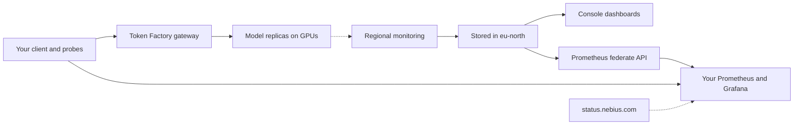

# 20.37 Observability, status and operations on Nebius: what is visible and what is not

## Why an SRE here should know this

Your pager fires at 02:10. Error rate on your Token Factory calls is 8 percent. Is it your client, your quota, a Nebius incident, or a bad rollout of your own? The answer depends on what you can see from outside. An interviewer for a Token Factory SRE role will ask the mirror question too: "What would you need to see inside our platform to answer that for a customer?"

This chapter serves the system design and incident rounds. The posting asks for alert design and SLOs for high-throughput APIs. Nebius has not published its interview questions.

Tags: `[official]` is a Nebius documentation or legal page fetched on 2026-11-11. `[vendor]` is a Nebius blog post. `[inference]` is my reasoning, to be presented as yours. Architecture is in [20.30](./30-nebius-ai-factory-to-token-factory-architecture.md) and [20.32](./32-token-factory-model-lifecycle-serving-and-economics.md).

A realistic question: "A customer says our Token Factory endpoint was down for an hour and you were on call for them. What did you see, what did you not see, and what goes in the post-mortem?"

## The core ideas

### 1. The visibility map: three layers, and you own only one

Think of three layers. The top layer is your client: you see every request you sent. The middle layer is the provider's dashboard and metrics API for your endpoint. The bottom layer is the provider's fleet: GPUs, fabric, power, cooling, control plane. You never see the bottom layer directly. You see it through the middle layer, through the status page, and through post-mortems.



The solid arrows are what you can scrape. The dotted arrow into monitoring is what Nebius runs for you. The path from replicas to storage is `[official]` only as far as "metrics are collected in the region where inference runs, but eventually stored at eu-north". Everything inside Nebius's collection path is unpublished.

**Decide per question which layer can answer it, and build your own probe for the layers you cannot see.**

### 2. What Token Factory Observability documents

The Observability page `[official]` lists metrics in four groups. Here are the definitions, close to the page's wording.

| Group | Metric | Definition on the page |
|---|---|---|
| Traffic | Requests per minute | Requests sent to the API |
| Traffic | Input and output tokens per minute | Tokens processed and generated |
| Traffic | Input and output tokens per request | Distribution of prompt and response sizes |
| Traffic | KV-cache hit rate | Share of prefix cache lookups served from cache, local and external |
| Latency | End-to-end latency | Request sent to full response received |
| Latency | TTFT | Time until first token, streaming requests only |
| Latency | Output speed | Tokens generated per second |
| Capacity | Active replicas, active GPUs | Currently running |
| Capacity | GPU utilisation, avg and busiest | Fraction of time the GPU was active, average over replicas or the busiest replica |
| Errors | Error rate by status code | Percent of failed requests per HTTP status |

Five limits matter more than the list.

First, metrics exist only for Dedicated Endpoints. For the shared Public Serverless API the page documents no metrics. Second, latency charts show only p50, p90 and p99. You cannot rebuild a histogram from them. Third, some capacity metrics may be hidden depending on your pricing model. Fourth, the page says the data is for operational debugging and not billing reconciliation. Fifth, the data refreshes within tens of seconds, so it is not a source for a one-minute alert.

Observability follows project permissions, the Billing Manager role has no access, and metrics are removed with the project. Export early.

One design point is `[inference]`: metrics from every region are stored in eu-north, so your view of a us-central1 endpoint depends on a cross-region path. Nebius says it is removing in-region monitoring dependencies and extending cross-region monitoring.

**Treat the dashboard as an explanation tool, and your own gateway metrics as the alert source.**

### 3. Getting the data out: the federation path

The dashboard is not enough for alerting. The integrations page `[official]` gives two routes. Prometheus scrapes a federate endpoint. Grafana uses a Prometheus data source.

Here is the Prometheus 3 scrape job as the page gives it, trimmed.

```yaml
scrape_configs:
  - job_name: 'Export time series from Nebius Monitoring'
    honor_labels: true
    scrape_interval: 15s
    scheme: https
    metrics_path: '/projects/<project_ID>/service-provider/prometheus/federate'
    params:
      match[]:
        - '{__name__=~".+"}'
    bearer_token: '<static_API_key>'
    static_configs:
      - targets: ['read.monitoring.api.nebius.cloud']
```

You issue the static API key in the Token Factory UI. The recommended scrape interval is no less than 15 seconds. The Prometheus 2 variant adds `metric_name_validation_scheme: legacy` and a scrape protocol line. The page warns that Prometheus can show only a limited amount of data and suggests a Grafana data source for large setups. The related Compute docs describe splitting a large scrape with non-overlapping `match[]` selectors.

What the page does not give is the metric names and labels. The dashboard names above are not necessarily the series names. **Your first act is to list the series names with a query, then write recording rules against what you find.** I could not do this, because I have no key.

Replace `.+` with the few series you need, store the federated series in your own long-term store because retention is not stated, and alert on a missing scrape as well as on values. See [20.15](./15-design-an-observability-pipeline-for-very-high-volume.md).

### 4. Endpoint state and rate-limit headers are free telemetry

Two documented signals cost you nothing and are often overlooked.

The first is endpoint state. The Dedicated Endpoint page `[official]` separates lifecycle from readiness. Lifecycle is deployment state: Starting, Updating, Running, Warning, Stopping, Stopped. Readiness is traffic-serving capability: Not ready, Partially ready, Ready. The page says to use readiness to decide whether to send traffic. It also says to contact support if Warning or Partially ready lasts more than three hours. The page uses "Warning" in one place and "Error" in a table, and does not say they are the same.

A stopped endpoint, for any reason, returns its GPUs to a shared pool and nothing holds them, so a restart can stay Not ready while capacity is scarce `[official]`. Self-service endpoints carry no formal SLA unless a contract says so.

The second signal is response headers. The rate-limit page `[official]` lists `x-ratelimit-remaining-requests`, `x-ratelimit-remaining-tokens`, `x-ratelimit-over-limit`, `x-ratelimit-dynamic-scale-requests` and `Retry-After`. Limits are evaluated in 15-minute windows. If average usage reaches 80 percent of the limit, the next limit is multiplied by 1.2. At 50 percent or less it is divided by 1.5. Growth is capped at 20 times the base allocation.

Log these headers in your client. A 429 with remaining requests at zero is your quota. A 429 with plenty remaining deserves suspicion of provider capacity. That reading is `[inference]`, because the page does not say which cause a 429 carries.

**Export endpoint readiness and the rate-limit headers into your own metrics from day one.**

### 5. Customer-side SLIs on top of percentile-only data

[20.19](./19-slis-slos-and-alerts-for-token-apis.md) defines SLIs as good events over valid events and measures at the gateway. Reuse it unchanged. The only new problem is that Token Factory's metrics give you three percentiles per window, not a histogram. The file `c37_customer_slis.py` handles that.

The availability SLI is direct. Count 5xx as bad. Remove client 4xx from the valid events. Decide your 429 policy in writing, as 20.19 says. On a dedicated endpoint where you chose the capacity, a 429 below your provisioned traffic is probably the provider's problem. Above it, it is yours.

The latency SLI is harder. Take a window with TTFT p50 0.35 s, p90 0.8 s and p99 1.4 s. What share of requests started streaming within 1.0 s? The percentiles tell you only that it is between 90 and 99 percent. The code returns that range and weights each window by its streaming request count. TTFT counts streaming requests only, so weight by those.

```python
def fraction_below_bounds(p50, p90, p99, limit):
    if limit >= p99: return 0.99, 1.0
    if limit >= p90: return 0.90, 0.99
    if limit >= p50: return 0.50, 0.90
    return 0.0, 0.50
```

A verdict then has three outcomes: met if the lower bound reaches the SLO, missed if the upper bound falls short, and indeterminate otherwise. Indeterminate is honest. When you need an exact number, measure TTFT at your gateway with real histograms and use the dashboard only to cross-check.

| SLI | Source of truth | What the provider dashboard adds |
|---|---|---|
| Availability | Your gateway counters | Error rate by status code, to separate 5xx from 429 |
| TTFT within limit | Your gateway histogram | p50/p90/p99 per endpoint, bounds only |
| Output speed | Your client timing | Tokens per second, per window |
| Saturation | Not available from outside | Active replicas, GPU utilisation avg and busiest |
| Public Serverless | Your probes only | Nothing documented |

Busiest GPU utilisation far above average means one replica is overloaded. Active replicas at your maximum with high utilisation means you hit the ceiling.

**Compute exact SLIs from your own gateway, bound them from the dashboard, and never claim precision the percentiles cannot give.**

### 6. Reading the status page like data

The status page is Atlassian Statuspage `[official]`. It has a JSON API, so you can fetch it. The paths used here are `/api/v2/status.json`, `/components.json` and `/incidents.json`. I fetched them on 2026-11-11. The status said "All Systems Operational".

Components are grouped by region, such as EU-NORTH1 and US-CENTRAL1, plus three groups named TF-US1, TF-US2 and TF-CA1 for Token Factory. Under each group are about twenty-two services, including Compute Cloud, Managed Service for Kubernetes, Object Storage, Monitoring, Logging and Token Factory. That makes 213 components. Incident impacts are none, minor, major and critical. Updates move through investigating, identified, monitoring, resolved, and sometimes a postmortem link.

Cautions: only the 50 most recent incidents are returned, here about 195 days from 2026-04-29. Times are posted by people. Six of 50 incidents list no component, including a 437-minute Token Factory dedicated-endpoint incident on 2026-10-31. A partial outage is posted as the whole component. And 16 of 50 have a first update at least 30 minutes after the stated start.

The file `c37_status_history.py` parses a trimmed copy of that JSON, stored as `c37_status_incidents_fixture.json` with the fetch date. It merges overlapping incidents so double counting cannot happen, treats an open incident as running to the as-of time, and counts a component as fully down for the whole incident. The result is a pessimistic estimate of how often a component was posted as impaired. It is not an SLA measurement.

My run, impact at least major, 195 days: Compute Cloud 12 incidents and 98.59 percent, Token Factory 7 and 98.91 percent, Managed Kubernetes 4 and 99.09 percent, Object Storage 7 and 99.29 percent.

Per region, Token Factory with minor impact included reads US-CENTRAL1 99.12 percent, TF-CA1 99.83 percent and EU-WEST2 99.95 percent.

**Use the history to choose failure modes to design for, and say aloud that the availability figure is a posted-impact estimate.**

### 7. The failure modes Nebius has actually had

The fixture is a catalogue. Group the 50 incidents by what broke, and ask for each what you would see from outside.

| Pattern | Examples from the incident list | What you see from outside |
|---|---|---|
| Shared network or fabric | 2026-07-27 network issues listed 22 services; three InfiniBand incidents in eu-west2 between 10-03 and 10-15 | Many unrelated calls fail together, timeouts rather than 5xx |
| Power and cooling | 2026-10-07 power for several dozen nodes; 2026-08-19 overheating in us-central1 | Capacity loss, endpoints Partially ready, slow restarts |
| Token Factory regional | 2026-10-24 503s in eu-west2, 62 min; 2026-11-05 models unavailable in eu-north1, 36 min | 5xx on some models or one region, others fine |
| Upstream dependency | 2026-04-29 external models down | Only the models served from an external provider fail |
| Control plane and scaling | Compute VM creation failures, Managed Kubernetes operations slow | Existing traffic fine, scale-up and restart fail |
| Observability itself | Monitoring unavailable in eu-west1 on 2026-09-16 and 10-08; Logging read failures in US regions 2026-11-02 | Your dashboard is blank while traffic flows |

Two lessons are specific to a Token Factory SRE. A region-level event causes slow recovery of scaling and provisioning as well as errors, which the August post-mortem confirms. And the provider's observability can fail with the thing it observes, so the dashboard going dark during an incident is itself a signal.

The capacity page says dedicated endpoints do not route across regions, so a second-region fallback is something you build `[inference]`.

**Map each documented failure mode to the signal you would see and the mitigation you own.**

### 8. Case study: the 2026-08-19 us-central1 post-mortem

Nebius published a post-mortem for the 2026-08-19 event `[vendor]`. It is the best public source on how an incident looks from inside. All times are UTC from the post.

A storm took the building management system offline and stopped the chilled-water loop at about 08:30. Regional dashboards showed temperature rising from about 09:15, but no alert existed on it. The first actionable alerts were component over-temperature at 10:15 and the incident was declared at 10:21. Racks tripped on thermal protection between about 10:40 and 11:00, including control-plane racks. Token Factory models were partly or fully unavailable from about 10:37 and fully recovered at 20:25. Capacity elsewhere kept serving existing traffic, but provisioning and autoscaling in the region were degraded.

For a customer the timeline reads differently. The status page opened at 10:43 and direct notifications went out from 12:29. Your own probe would have seen errors about six minutes earlier.

Five observability lessons in the post matter for your interview answers. Facility monitoring depended on the system that failed, so it needs to be independent. No alert existed on temperature trends. Regional monitoring depended on in-region components and was restored only between about 14:50 and 16:03. A regional health check wrongly reported the region healthy and sent console traffic back for about seven minutes. Recovery automation was built for isolated failure, not mass failure. Nebius lists corrective actions, including cross-region monitoring and a dependency-ordered region cold-start procedure.

**When an interviewer asks about a bad region-wide event, name the detection gap first, then the slow cold start, then the monitoring that failed with the region.**

### 8b. What the SLA and support terms mean for your design


Dedicated Endpoints carry no formal SLA unless a contract covers them `[official]`. I found no Token Factory SLA page. The universal SLA, effective 2026-11-02, pays compensation as a credit against future bills, not cash. You claim through the console within 14 days of the end of the reporting period. Emergency works and planned node maintenance are excluded up to 8 hours per period. Exceeding quotas is excluded. The Compute SLA defines VM unavailability as a missing GPU, NVLink, fabric link, boot disk or external network, and excludes slower bandwidth without loss of connectivity `[official]`.

Support priorities changed recently. Customers before 2026-11-01 have Critical at 30 minutes, High at 60, Medium at 4 hours and Low at one business day. Other customers from 2026-11-02 have only Medium at 4 hours and Low `[official]`. So for a new customer, "wait for support" is a four-hour plan. Your own detection and fallback must carry that time.

**Design as if the provider's first response takes four hours, and record minutes for any credit claim.**

### 9. The infrastructure layer is richer on Compute than on Token Factory

The VM monitoring docs `[official]` list GPU metrics with DCGM names such as `DCGM_FI_DEV_GPU_UTIL` and `DCGM_FI_DEV_CLOCK_THROTTLE_REASONS` (the pre-4.9.0 spelling; dcgm-exporter 4.9.0 renamed the utilisation field to `DCGM_FI_DEV_GPU_UTIL_RATIO`, see 17.4, and I could not confirm a new name for the throttle bitmask), a throttle bitmask where 72 means overheating plus slowdown, and InfiniBand counters for link downs and port errors. They do not mention XID errors. A Nebius blog `[vendor]` describes passive and active GPU health checks and automatic node draining for Soperator and Managed Kubernetes clusters. Nothing says a Token Factory dedicated endpoint exposes any of this, so assume it does not. On your own vLLM fleet, as in [20.33](./33-ai-factory-solution-architecture-ha-and-recovery.md), you scrape these yourself.

**Know which product exposes which layer before promising a root cause to a customer.**

### 10. Writing a post-mortem when the provider is the cause

A post-mortem is not a place to assign blame to a vendor. It describes what your system did when a dependency failed. [20.27](./27-post-mortems-on-call-and-incident-leadership.md) gives the structure. Four changes apply when the cause is external.

Build the timeline from your own telemetry first, and quote the provider's status posts as a second column. The gap between the two columns is your detection and communication result. Measure impact in your SLO budget, not in provider minutes. Write the root cause as far as it is known and mark the rest "provider has not published". And put every action item on your side: probe, fallback, retry policy, alert, runbook, and contract.

A constructed example, not a real customer. You run a dedicated endpoint in eu-west2 at a 99.9 percent monthly availability SLO, so the budget is 43.2 minutes in 30 days. The status page shows 503 errors from 13:22 to 14:24 on 2026-10-24, 62 minutes. If every request failed for the whole period, you consumed 62 divided by 43.2, which is about 144 percent of the budget. Your own gateway data replaces that with the real fraction.

Put impact, detection, timeline, root cause, what went well and action items in the 20.27 template. Take impact and detection from your gateway and alerts, and the cause only from the provider.

The 2026-10-24 status page says only that the cause was identified and a fix applied, and gives no cause. Say so.

**Own the response, report the cause only as far as the provider has published it, and file for credit within the deadline if a contract gives you one.**

### 11. What an inference platform SRE would need inside

Nebius has not published its internal telemetry design for Token Factory. What follows is `[inference]` drawn from the public failure modes above and from [20.15](./15-design-an-observability-pipeline-for-very-high-volume.md). Job postings I read for the Compute Node and NetSRE teams name no monitoring product.

| Layer | Signals needed | Why, from a public incident |
|---|---|---|
| Facility | Room temperature trend, cooling state, power, independent of the building system | 2026-08-19: no alert on temperature |
| Node and fabric | GPU XID and ECC, throttle reasons, InfiniBand error counters, link flaps | Repeated InfiniBand incidents |
| Engine | Queue depth, KV-cache use, TTFT and ITL histograms per model | Models unavailable in one region |
| Gateway | Per-tenant requests, 4xx, 429 with cause, 5xx, retries | Separating quota from capacity |
| Control plane | Endpoint reconcile time, scale-up latency, restart time to Ready | Slow region cold start |
| Observability health | Scrape success, ingestion lag, cross-region heartbeat | Monitoring failing with the region |

Two design rules follow. Monitoring must not share a failure domain with what it monitors, which Nebius itself states as a lesson. And health checks must reflect real availability, not process liveness.

**Say plainly that this table is your design, then use the incidents as evidence for each row.**

## How to answer out loud

### Question 1: "What can a customer see about a Token Factory endpoint?"

Say it in this order. Dedicated Endpoints have an Observability dashboard and a Prometheus federate API with traffic, latency percentiles, replicas, GPU utilisation and errors by status code. Public Serverless has none documented. Then the limits: three percentiles, TTFT for streaming only, not for billing, tens of seconds old. Then what you add: gateway metrics, probes, rate-limit headers, endpoint readiness. Expect the follow-up "how do you alert on it". Answer: on your own gateway SLIs with burn rates, per 20.19.

### Question 2: "How would you know whether an outage is yours or Nebius's?"

Check four things in order. Your recent change log. The status page JSON for the region and service. Error mix: 5xx versus 429 versus timeouts, and the rate-limit headers. A probe from a second region and a second endpoint. State that you act before the page is updated, because on 2026-08-19 first customer reports came shortly after 10:00 and the page opened at 10:43.

### Question 3: "How would you build an SLI from Nebius metrics?"

Say that you cannot compute a latency fraction from p50, p90 and p99, only bound it. Give the example: a limit between p90 and p99 means 90 to 99 percent. Then say the exact SLI comes from your own histograms. This is the trap in the question.

### Question 4: "What went wrong on 2026-08-19 and what would you monitor?"

Cooling and the building management system failed. No temperature alert. Monitoring depended on the region. Recovery was slow because automation assumed isolated failure. For monitoring: facility signals independent of the building system, cross-region heartbeat, restart-time-to-Ready as an SLI. Mention that these are from the post-mortem, and the signal list is your design.

## Worked scenarios

### Scenario 1: "Is Token Factory reliable enough for us?"

You are asked this before a contract. Run the status parser. It shows seven Token Factory incidents posted at major or critical impact in 195 days, with the longest 1,293 minutes. The honest answer: there is no published Token Factory SLA, the incident rate is visible, and the design must survive a multi-hour regional event.

```bash
cd code/part20
python3 c37_status_history.py c37_status_incidents_fixture.json
```

Reasoning: a 99.9 percent monthly target allows 43.2 minutes. The 62-minute and 493-minute incidents each exceed that alone. So either the endpoint is not the only path, or the target is lower. Answer: design a second-region fallback and set a looser SLO for the single endpoint.

### Scenario 2: 503s at 02:10

Your dashboard shows 8 percent errors. Reasoning: look at the status-code mix. If all are 503 and the headers show quota remaining, it is not your quota. Check the status JSON for Token Factory in your region. If nothing is posted, probe a second model and a second region. If only one model fails, that matches the 2026-11-05 pattern. Mitigate with fallback and backoff with jitter per [20.21](./21-request-routing-retries-and-overload-control.md). Then open a ticket, and note that new customers get a four-hour Medium response.

## Hands-on lab

I ran steps 1 to 3 on this Mac. I did not run step 4 because it needs a Token Factory key and a Dedicated Endpoint.

1. Run the tests. Expected: 17 passed.

```bash
cd code/part20
python3 -m pytest -q test_c37_status_history.py test_c37_customer_slis.py
```

2. Print the availability table. Expected: Compute Cloud first, with 12 incidents at major and above.

```bash
python3 c37_status_history.py c37_status_incidents_fixture.json
```

3. Fetch fresh data and compare. Counts will differ from 2026-11-11.

```bash
curl -s https://status.nebius.com/api/v2/incidents.json | python3 -c "import json,sys;print(len(json.load(sys.stdin)['incidents']))"
```

4. Not run. With a key, scrape the federate endpoint with `match[]` set to one narrow selector, then query `{__name__=~".+"}` once to list the series names. Expected shape: the dashboard metrics under names Nebius has not documented.

## Drill questions

<details><summary>1. Which Token Factory products have Observability metrics?</summary>
Dedicated Endpoints. The page says metrics are only accessible for Dedicated Endpoints.
</details>

<details><summary>2. Which percentiles do the latency charts show, and what follows?</summary>
p50, p90 and p99. You cannot compute an exact fraction under a limit, only bound it.
</details>

<details><summary>3. On which requests is TTFT measured?</summary>
Streaming requests only.
</details>

<details><summary>4. How do you export the metrics?</summary>
Prometheus scrapes the federate endpoint with a static API key, 15 seconds or slower, or Grafana uses a Prometheus data source.
</details>

<details><summary>5. What is the difference between lifecycle and readiness?</summary>
Lifecycle is deployment state. Readiness is whether the endpoint can serve traffic. Route on readiness.
</details>

<details><summary>6. What does the rate-limit page say about scaling limits?</summary>
15-minute windows. At 80 percent usage the next limit is multiplied by 1.2. At 50 percent or less it is divided by 1.5. The ceiling is 20 times base.
</details>

<details><summary>7. Why are status-page availability figures only estimates?</summary>
Only the latest 50 incidents are returned, times are posted by people, some incidents list no component, and partial outages count as whole.
</details>

<details><summary>8. What was the main detection gap on 2026-08-19?</summary>
No alert existed on room temperature, and facility monitoring depended on the system that failed.
</details>

<details><summary>9. A dedicated endpoint stops during an incident. What happens to its GPUs?</summary>
They return to the shared pool. Nothing holds the previous GPUs, so the restart can wait for capacity.
</details>

<details><summary>10. Who owns the action items in a vendor-caused post-mortem?</summary>
You do. Probe, fallback, retry policy, alert and contract claim. The vendor's cause is quoted only as published.
</details>

## Common mistakes and weak answers

- Alerting on dashboard values. They lag by tens of seconds and cover only dedicated endpoints. Alert on your gateway.
- Computing "p99 below 1 s" as an SLI. It is a quantile, not a ratio. Use good over valid events.
- Blaming the vendor in the post-mortem. Report your detection, your fallback and your gaps.

## Connections to the rest of the handbook

- [20.15](./15-design-an-observability-pipeline-for-very-high-volume.md): cardinality, federation, long-term storage and monitoring the monitoring.
- [20.18](./18-how-llm-serving-fails.md): the serving failure modes behind the 5xx patterns.
- [20.19](./19-slis-slos-and-alerts-for-token-apis.md): the SLI and burn-rate rules that the code here reuses.
- [20.25](./25-promql-grafana-and-tracing-traps.md): the PromQL traps for the federated series.
- [20.27](./27-post-mortems-on-call-and-incident-leadership.md): the post-mortem structure.
- [20.30](./30-nebius-ai-factory-to-token-factory-architecture.md), [20.31](./31-nebius-ai-cloud-foundation-gpu-fabric-and-platform-choices.md), [20.32](./32-token-factory-model-lifecycle-serving-and-economics.md), [20.33](./33-ai-factory-solution-architecture-ha-and-recovery.md): architecture, GPU fabric, lifecycle and HA.

## Questions to ask the interviewer

1. Which Token Factory metrics are page-worthy, per model or per endpoint?
2. How does your monitoring survive loss of a region when metrics are stored in one place?
3. How do you separate quota 429 from capacity 429 in your own SLOs?
4. How long between first internal alert and the status post, and what do you target?
5. Do Public Serverless customers get any metrics, or only the status page?

## What I could not find

- The federated metric names and labels for Token Factory.
- Metrics for Public Serverless endpoints.
- A Token Factory SLA page, and retention periods for metrics and audit logs.
- Any statement of the internal monitoring stack. Job postings I read name no monitoring product.
- Post-mortems for Token Factory-only incidents. The only detailed post-mortem in the fetched incident window is for 2026-08-19.

## Sources and review notes

Raw notes with every URL and date are in `planning/research/nebius_observability.md`. All fetched on 2026-11-11.

- Status page and API: status.nebius.com, `/api/v2/status.json`, `/components.json`, `/incidents.json` `[official]`.
- Token Factory docs: `ai-models-inference/observability.md`, `observability-api-integrations.md`, `rate-limits.md`, `dedicated-endpoints/lifecycle-and-status.md`, `dedicated-endpoints/capacity-and-scaling.md`, `other-capabilities/billing-new.md` on docs.tokenfactory.nebius.com `[official]`.
- docs.nebius.com: `legal/sla`, `legal/sla-levels/compute`, `overview/support.md`, `compute/monitoring/virtual-machines.md`, `observability` `[official]`.
- Nebius blog: the 2026-08-19 and 2026-02-26 post-mortems, "How we build reliable clusters" `[vendor]`.
- Code: `c37_status_history.py`, `c37_customer_slis.py`, with tests and the fixture in `code/part20/`. The fixture is a trimmed copy of the incidents API response fetched 2026-11-11, update bodies cut to 160 characters.

Labelled inferences: the eu-north dependency concern, the 429 reading, the fallback design, the internal telemetry table and the constructed example.

Not verified: federation against a live key, the posted-impact estimates against any customer measurement, and the observability backend job posting claim.

### Verification log

- Checked by running the parser on the fixture: 50 incidents, 27 major, 16 minor, 6 none, 1 critical, one postmortem link.
- Confirmed against fetched pages: metric list, the 15-minute scaling rule, the SLA claim deadline, the support tables.
- Corrected: a search summary claimed a job posting listed a full monitoring stack. The fetch returned unrelated content, so it is not used.
- Removed: any claim of ClickHouse or other internal stack, which no source supports.
- Still unverified: metric names and retention.
