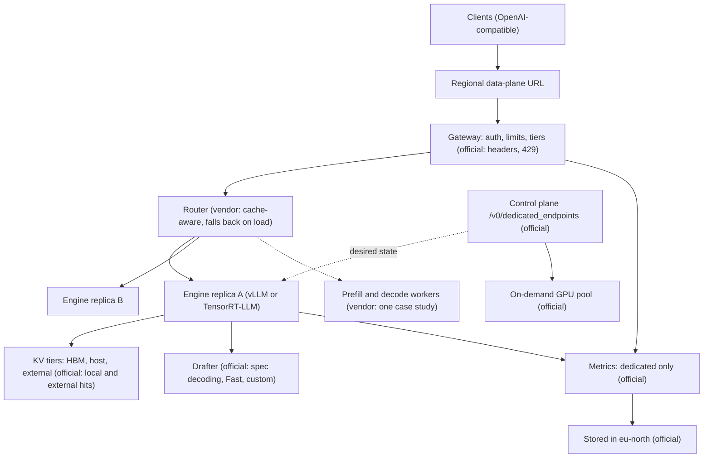

# 20.38 Token Factory inference engineering: everything Nebius has published

## Why an SRE here should know this

The interviewer says: "You have read our docs. Tell me what you know about how we serve inference, and where you think it breaks." You have about two minutes. If you list product names, you lose. If you separate what Nebius documents, what Nebius markets, and what you would build yourself, you win.

This chapter serves the system design round, the incident round and the project deep dive. It gathers every public technical fact about Token Factory inference. It is the lookup chapter for the other Nebius chapters, and it links to them instead of repeating them: [20.30](./30-nebius-ai-factory-to-token-factory-architecture.md) for the product boundary, [20.32](./32-token-factory-model-lifecycle-serving-and-economics.md) for lifecycle and billing, [20.37](./37-observability-status-and-operations-on-nebius.md) for the observability surface.

Scope is technical only. Business, customer stories and marketing are left out unless a measured number changes a design decision. The research was done on 2026-11-11. Evidence tags are used on every claim.

| Tag | Meaning |
|---|---|
| [official] | Nebius docs, API schema, legal guide or a Nebius post-mortem |
| [vendor] | Nebius blog or press release, quoted with the workload |
| [source-code] | A public repository or model hub |
| [third-party] | Someone else's report |
| [inference] | My reasoning, never a Nebius statement |

The raw register behind this chapter is `code/part20/c38_claim_register.json`. It has 55 entries, and a validator refuses any entry without a source, a date or a tag.

## The core ideas

### 1. What Nebius has not published

Start with the gap, because the gap decides how you speak. Nebius has not published its gateway, its router product, its scheduler, its autoscaler signal, its KV-transfer layer or its quantisation recipe per model. No Nebius-authored talk with architecture detail was found. The `github.com/nebius` organisation holds 53 repositories, and none is an inference engine or a fork of one [source-code].

What is public is a set of outcomes and a few hints. The docs say the API accepts the full vLLM parameter set [official]. A Nebius blog benchmark runs "vLLM as the inference backend" [vendor]. A different Nebius post says a TensorRT-LLM upgrade fixed KV-cache corruption [vendor]. So at least two engines appear in public text. Which model runs on which engine is not stated.

**Say "Nebius has not published that" early and often, then offer a labelled design.**

### 2. Two products, one API, very different operating contracts

Public Serverless is shared. Its region reads Global and "can change at any time, without notice" [official]. Rate limits are dynamic. The cache is shared across customers within a model. Observability metrics do not exist for it, because the observability page says metrics are only for Dedicated Endpoints [official].

A Dedicated Endpoint is an isolated deployment. You pick region, GPU type, GPUs per replica and min and max replicas [official]. Capacity comes from an on-demand shared pool. Only the minimum replicas are held, and only while the endpoint is active. There is no formal SLA unless a contract says so [official]. The legal guide adds a hard fact for failure design: dedicated endpoints use no multi-region routing, load balancing or automatic failover to another region [official].

A Nebius chat case study states a 99.9 percent SLA for dedicated endpoints, and so does the launch press release [vendor]. The docs say otherwise for self-service endpoints. Treat the number as a contract term, not a platform property.

**Always ask which product and which contract before you talk about reliability.**

### 3. Routing and the KV cache: the best-documented part

An agent sends fifty requests in one session. Each request carries all earlier context. If the router sends each one to a different replica, each replica prefills the whole history again. That is the whole story, and Nebius has measured it.

The routing post compared default Kubernetes ClusterIP routing with a cache-aware router [vendor]. The workload was SWE-style agent trajectories on `devstral-2-small-2512`, 300 trajectories at once, three vLLM replicas, six runs. The cache-aware router picks the replica with the best KV-cache match and falls back to a less loaded replica if the best one is overloaded. Results:

| Metric | Cache-aware | Default routing |
|---|---|---|
| Average step time | 4.8 s | 9.0 s |
| p95 latency | 17 s | 70.8 s |
| Tokens served from cache | about 95 percent | about 62 percent |

Median latency barely moved. The tail moved a lot. Three replicas without cache-aware routing did worse than one replica. Nebius did not test a plain least-loaded baseline, so the post cannot tell you how much of the gain is locality and how much is load awareness [vendor].

Here is the arithmetic that makes this useful in an interview. A hit rate of 95 percent means 5 percent of tokens are prefilled. A hit rate of 62 percent means 38 percent are. The ratio is 0.38 divided by 0.05, which is 7.6. The default setup did about 7.6 times more prefill work on the same traffic. That is why the tail exploded. It is my arithmetic on their numbers.

The docs give two hints about the router. The cache page says `cached_tokens` can be zero when a different replica serves the request, and `prompt_cache_key` "only helps route requests to the server that holds the cache" [official]. So a routing hint exists on Serverless. The mechanism behind it is not published.

Other measured facts from agentic work [vendor]. In an RL rollout workload on GLM-5.2 across four B300 nodes, sticky routing to the node and data-parallel rank holding the history raised exact prefix reuse from 48 to about 96 percent and throughput by 17.1 percent. FP8 KV storage instead of BF16 added 55.7 percent throughput because more context fit in memory. Cache offload cost 3.1 to 7.8 percent throughput, because evicted prefixes were almost never read again. The lesson is that offload is a bet on reuse, not a free gain.

**Locality is a first-class routing input, and every cache-capacity change needs a measured hit rate before and after.**

### 4. Beyond HBM: the external cache tier

Dedicated observability reports a KV-cache hit rate that "includes both local and external cache hits" [official]. The word external implies a second tier, but the docs do not describe it. A Nebius and WEKA benchmark shows what such a tier looks like [vendor]. On one 8-GPU B300 node running vLLM v0.23 and DeepSeek-V4-Pro in NVFP4, replayed agentic coding traffic with 512 active sessions, a shared NVMe-backed tier over RDMA reached a 93 percent hit rate against 40 percent for HBM alone. It served 2.4 times the requests in eight hours, and p95 TTFT fell from 23.12 s to 3.82 s.

Read the stability line too. The HBM-only run degraded over eight hours as the working set grew. Median TTFT climbed from 6.7 s to 7.9 s and timeouts rose from 1.1 to 5.2 percent. A cache that decays forces you to provision for the worst hour.

This benchmark ran on AI Cloud instances at a partner's request for a proof of concept. It does not show that Token Factory serves production traffic this way. It shows a design the company can build on its own hardware.

**Treat "external cache" as a known unknown, ask what it is, and watch hit rate over hours, not minutes.**

### 5. Prefill and decode disaggregation: one case study, no general claim

The chat proof of concept split work into prefill-specialised workers with large memory, decode-specialised workers tuned for stable batching, a locality-first router and backpressure controls [vendor]. Four B200 GPUs sustained about 10 requests per second in controlled tests. Around 40 GPUs carried about 100 QPS of real traffic. The post says disaggregation is "one of the key distinctions" for chat.

Nebius has not said which products run split. Do not claim that all of Token Factory is disaggregated. Say: "one published case study used it, and here is how I would operate it", then use the signals in section 12. The mechanics of the split are in [20.13](./13-design-a-multi-tenant-llm-inference-api.md).

The same post lists the failures it hit. They are the best public list of what breaks in a split pipeline [vendor]. Decode workers entered invalid states and sessions hung until restart. KV-cache corruption in the prefill-to-decode path produced gibberish, and a TensorRT-LLM upgrade fixed it. Malformed token IDs reached the engine and caused error cascades. Restarted workers were not reattached, so capacity shrank silently. Retry storms turned 500s into instability. Router queues saturated under prefill and decode imbalance. Aggressive liveness probes restarted healthy workers. Logging pipelines drowned in telemetry in a new region.

**Memorise that list. It is a real failure catalogue, and each item maps to a signal you can name.**

### 6. Speculative decoding is a full product line

Speculative decoding appears in five places, and it is the most developed inference theme in Nebius's public work.

First, Fast flavors use it, with smaller batches [official]. Second, Nebius says drafters improve tail latency, not only throughput, for long-context non-streaming MoE use. No numbers were given for that claim [vendor]. Third, Custom Speculator Training launched on 2026-06-25. You run a fine-tuning job with `method.type` set to `spec-draft` and an architecture of `eagle3` or `eagle3_original` [official]. `eagle3` is "TokenFactory-optimized" and can only be served on the platform. `eagle3_original` is portable to vLLM. At launch, deployment of a custom drafter to a Dedicated Endpoint was reviewed by solutions engineers [vendor].

Fourth, the research behind it is public. LK losses train a drafter to maximise acceptance rate directly instead of using KL divergence, tested from 8B to 685B targets [vendor], and the code was merged into SpecForge as pull request 492 [source-code]. SlimSpec shrinks the drafter's output projection cost by four to five times in EAGLE-3 experiments on H200 with vLLM 0.17.1 [vendor]. Fifth, drafters are public on Hugging Face under the `nebius` organisation for Llama 3.1 8B, Llama 3.3 70B, gpt-oss and Qwen3 [source-code].

Three operational facts matter. The docs tell you to tune `num_speculative_tokens` near the observed acceptance, because a long speculation wastes compute [official]. Acceptance rate, tokens per second and latency are reported with the rest of the serving metrics [vendor]. And an open vLLM issue reports corrupted greedy output from `nebius/EAGLE3-gpt-oss-20b` at five or more speculative tokens on an AMD MI355X, correct with eager mode [third-party]. One reporter, unconfirmed. It shows the pattern: drafter plus engine plus hardware is a version matrix.

There is also a data fact you must know. By default, prompts and outputs may be stored and used for speculative decoding, in Finland, and Zero Data Retention opts out and "may impact" speed [official]. That ties performance to a privacy setting. A customer who turns on ZDR may see slower tokens.

**Know the drafter lifecycle: train, review, attach, measure acceptance, retrain when traffic drifts.**

### 7. Quantisation, flavors and quality claims

The overview says optimised models keep "approximately 99%" of original quality, and also that Base and Fast outputs are identical [official]. Those two statements do not fit together unless "identical" means the same model weights. Quantisation can change outputs. Speculative decoding verified by the target does not, in the lossless setting.

The API schema gives one hard fact: each model flavor has a `quantization` field [official]. The pages I read do not list the values. The chat case study gives the best evidence of why you cannot trust a single quality number. An FP4 checkpoint made replies shorter, raised repetition and produced empty outputs, and the early signals were product metrics, not benchmarks. The fix was re-quantising with thousands of real sessions and testing FP8 against BF16 for the KV cache [vendor]. One workload, one model, one claim.

Eigen AI is credited with optimised models in Token Factory. Its public claim is output speed up to 911 tokens per second for GPT-OSS-120B on Artificial Analysis as of 2026-03-13 [vendor]. Quote it with that date and benchmark.

**Quote "99 percent" only as a vendor claim, and propose a per-workload evaluation instead.**

### 8. Rate limits, tiers and admission

The rate-limit rules are exact and already worked through in [20.32](./32-token-factory-model-lifecycle-serving-and-economics.md). Windows are 15 minutes, the limit rises 1.2 times at 80 percent use and falls by a third at 50 percent, up to 20 times the base [official]. Two newer details matter for an SRE.

Over-limit requests may be processed at lower priority when spare capacity exists, flagged by `x-ratelimit-over-limit: yes` [official]. And the request field `service_tier` takes `auto`, `default`, `over-limit`, `flex` and `no-limit` [official]. `default` returns 429 at the limit. `flex` does not consume rate-limit credits, runs at lower priority and can still return 429. So the admission layer has at least two priority classes and spare-capacity borrowing. How the scheduler enforces priority inside an engine is not published.

**Teach clients to read the headers and to treat over-limit success as a warning, not a promise.**

### 9. Model lifecycle: removal dates, flavors and fine-tuned weights

Serverless models are removed on dated notices. The three public notices are 2026-06-22, 2026-08-31 and 2026-11-09. Requests to a removed model ID fail, there is no automatic rerouting, and Dedicated Endpoints for the same models keep working [official]. June removed several `-fast` variants. So a flavor is a separate deployable, with its own lifetime.

Fine-tuned weights deploy only through Dedicated Endpoints, and the custom weights path is beta on request [official]. A LoRA adapter on a mixture-of-experts model must be merged into the exact base weights first [official]. That means a merged checkpoint is a new full-size artifact, with its own load time and its own validation, not a small adapter swap. How multi-LoRA serving works, if it exists, is not published.

**Plan every deprecation as a change request with a canary, and ask whether adapters or merged weights are being served.**

### 10. Regions, failure domains and the us-central1 incident

Dedicated endpoints are single-region by contract [official]. The API schema lists 16 region values, but the docs table lists three orderable regions, so do not assume all 16 are available [official]. Metrics are collected where inference runs and stored in `eu-north` [official]. That means a region outage can also hurt the data you need to debug it.

The 2026-08-19 us-central1 post-mortem is the one public Token Factory incident analysis [official]. A storm hit the data centre, cooling failed, and Token Factory models in the region were partially or fully unavailable from 10:37 UTC until 20:25 UTC. Capacity outside the region "continued serving existing traffic, but depends on us-central1 for deployment and scaling operations". Read the second sentence slowly. It says deployment and scaling for some capacity had a dependency on a region that was down. The post does not say what that dependency is, so do not guess its mechanism.

Customer-facing metrics and logs for the region were also incomplete during the incident. The lesson for your own design: put your SLI measurement outside the failure domain you are measuring.

**Say plainly that cross-region failover is not offered for dedicated endpoints, and design the customer's multi-endpoint failover on the client side.**

### 11. Hardware and benchmarks: what they do and do not prove

Nebius submits to MLPerf Inference every round. v6.1 had five first places in 20 entries, plus a Vera Rubin NVL72 preview that posted 16,427 tokens per second per GPU for DeepSeek R1 in the server scenario [vendor]. v5.1 claimed bare-metal-class results because virtual instances do not virtualise the GPU or the InfiniBand adapter [vendor]. These measure AI Cloud systems running benchmark harnesses. They are not Token Factory production traffic.

Two hardware items are announced for Token Factory. NVIDIA Groq 3 LPX will run "on the same Token Factory platform", initially for a subset of models, with Artificial Analysis recording 3,400 output tokens per second for one user on Gemma 4 31B [vendor]. SemiAnalysis InferenceX lists Nebius as a compute supporter, and no Nebius-ranked inference result was found [third-party]. Clarifai is described as strengthening "serving, orchestration, hardware support" [vendor]. None of these says how the router or scheduler changed.

For an SRE a new accelerator is a new failure matrix: different engine, different metrics, different health signals, a smaller model subset. "Same platform" is a product statement. It is not proof of the same signals.

**Do not use MLPerf or single-user speed records as evidence of fleet reliability.**

## The master table

Each row is a capability, the evidence, the source, the tag, what an SRE must operate, and the failure modes. Failure modes are my reasoning unless the evidence cell says otherwise.

| Capability | Evidence | Source | Tag | An SRE must operate | Failure modes |
|---|---|---|---|---|---|
| Serverless endpoints | Shared, region Global, dynamic limits | public-serverless, rate-limits | official | Shared capacity, tenant fairness, limit adjuster | Noisy tenant, silent region move, 429 storms |
| Dedicated endpoints | GPU type, count, min/max replicas, region | dedicated-endpoints/operating | official | Control plane, replica lifecycle, capacity pool | Stuck Starting, partial readiness, pool exhausted after stop |
| Cache-aware routing | Step 9.0 s to 4.8 s, p95 70.8 s to 17 s | routing blog | vendor | Router, replica load, cache hit rate | Hot replica, locality versus load, cold start after restart |
| Prefix and context cache | Billed cached tokens, best effort | cached-tokens | official | Hit rate, eviction, block size | cached_tokens 0 after replica change or update |
| External or shared KV tier | "local and external" hits; 93 vs 40 percent | observability, WEKA post | official, vendor | Tier health, fetch latency, capacity | Tier slow or down, decaying hit rate, stale blocks |
| Prefill and decode split | One chat case study | chat blog | vendor | Two pools, transfer path, backpressure | Corrupt KV, hung decode, silent capacity loss |
| Speculative decoding, Fast flavor | Fast uses it with smaller batches | overview | official | Acceptance, speculation length, drafter versions | Low acceptance at high load, drafter-engine bugs |
| Custom drafters | spec-draft jobs, eagle3 variants | custom-speculator | official | Drafter lifecycle, review gate, retrain trigger | Drift lowers acceptance, wrong drafter for model |
| Quantisation | `quantization` field, 99 percent claim | OpenAPI, overview | official, vendor | Per-flavor precision, quality canary | Behaviour drift with healthy latency |
| KV cache precision | FP8 +55.7 percent throughput | RL blog | vendor | Memory headroom, preemption | Eviction churn, accuracy drift |
| Rate limits and tiers | 15-minute windows, `service_tier` | rate-limits, OpenAPI | official | Admission, priority, headers | Limit lag during bursts, flex starved |
| LoRA and fine-tuned serving | Dedicated only, merge MoE adapters | post-training pages | official | Weight distribution, validation | Wrong base model, slow load, version skew |
| Custom weights hub | Beta, on request | custom-weights | official | Onboarding, artifact checks | Unreviewed weights reach production |
| Batch inference | Referenced, no schema published | rate-limits, Data Lab | official | Unknown | Not documented, so ask |
| Structured output, tools | json_schema, tool_choice, per-model support | json, function-calling | official | Grammar-constrained decoding, parser versions | Model-specific failures, schema latency |
| Observability | Dedicated only, p50/p90/p99, TTFT stream-only | observability | official | Metric pipeline, federate scrape | No serverless view, region-stored metrics lost in outage |
| Model deprecation | Dated removals, no reroute | deprecation notices | official | Migration comms, canary | Clients pin dead IDs |
| Multi-region | None for dedicated | legal guide | official | Client-side failover | Single-region outage is total |
| New silicon | Groq 3 LPX, Vera Rubin | Groq post, MLPerf v6.1 | vendor | New health and metric set | Smaller model subset, different failure modes |

## A reconstructed data plane, clearly labelled as inference

**This diagram is my reconstruction.** Every box is either named in a public source or implied by one. The tag on each box says which. Nebius has not published an architecture diagram.



Components, and the signals you would watch for each. The signals come from [20.18](./18-how-llm-serving-fails.md) for failures, [20.19](./19-slis-slos-and-alerts-for-token-apis.md) for SLIs, [20.20](./20-autoscaling-gpu-inference.md) for scaling and [20.21](./21-request-routing-retries-and-overload-control.md) for routing. Metric names for each engine are in [20.22](./22-operating-vllm-triton-ray-and-tensorrt-llm.md).

| Component | Status | Signals to watch | Why |
|---|---|---|---|
| Regional URL and gateway | Headers and 429 are official. Internals inferred. | Error rate by status code, 429 split by cause, request rate, `x-ratelimit-dynamic-scale-*` | Separates client limits from platform faults |
| Router | Cache-aware routing is a vendor claim. Product unknown. | Per-replica load skew, cache hit rate per replica, retry rate, queue depth at router | Locality can pile load on one replica |
| Engine replicas | vLLM and TensorRT-LLM appear in public text | Waiting versus running requests, KV usage, preemptions, TTFT, inter-token latency, restarts | The three waiting places in 20.18 |
| Prefill and decode pools | Vendor, one case study | Prefill queue age, decode queue age, KV transfer time, imbalance ratio | Imbalance saturates the router, as in the case study |
| KV tiers | External tier implied | Hit rate over hours, evictions, tier fetch latency | A decaying tier hides inside a healthy average |
| Drafter | Official feature | Acceptance rate, accepted tokens per step, speculation length | Falling acceptance means slower tokens at the same load |
| Control plane | Official API | Create and update success, time to ready, `ready_replicas` versus desired | Provisioning is a separate failure domain |
| GPU pool | Official capacity page | Free capacity by region and GPU type, start failures (409), time in Starting | Stop-and-restart can lose capacity |
| Metrics path | Official | Scrape freshness, gaps, lag from serving to dashboard | Metrics for a region die with the region |
| Quality | Not a component | `finish_reason` mix, empty-output rate, output length, repetition, per-model canary | Healthy latency can hide bad behaviour |

## How to answer out loud

### Question 1: "What do you know about our inference platform?"

Speak for about two minutes in this order. First, the products: Public Serverless, shared, region Global, dynamic limits, and Dedicated Endpoints, isolated, one region, minimum replicas held while active, no formal SLA without a contract. Second, what is documented about serving: OpenAI-compatible API, vLLM parameter set, Base and Fast flavors with speculative decoding, cached-token billing, custom speculator training, and `service_tier`.

Third, what is measured and published: cache-aware routing moved p95 from 70.8 s to 17 s on one agent workload, and a shared KV tier moved hit rate from 40 to 93 percent on another. Fourth, what is not published: the router, the scheduler, the autoscaling signal, the multi-LoRA path. Fifth, finish with the failure you would worry about first: tail latency from lost cache locality after restarts. Expect the follow-up "which of these are measured and which are marketing". Answer with the tags.

### Question 2: "Design our cache-aware router."

Say first that Nebius has not published its router, so this is my design, built around the public result that locality beats default routing. Requirements: keep a session on the replica that holds its prefix, never overload that replica, and survive replica loss.

My design [inference]. Hash the prompt prefix in fixed-size blocks, the same block idea the cache page implies by rounding `cached_tokens` to a block boundary. Keep a per-replica approximate index of which prefix blocks it holds, fed by the replicas. Score each replica as expected cache hit minus a load penalty from its queue depth and KV usage. Fall back to the least loaded replica above a load threshold, as the Nebius post describes. Honour `prompt_cache_key` as a hint.

Then name the trade-offs. Index staleness makes the router send traffic to a replica that evicted the blocks. A hot prefix, such as a shared system prompt, concentrates load, so cap per-replica share and replicate hot prefixes. After a restart the cache is cold, so ramp traffic and do not count it as a hit. Add the measurements: hit rate per replica, load skew and tail TTFT. Close with the failure Nebius itself names: routing cannot fix eviction once the working set exceeds memory, which is where the external tier or memory-aware routing comes in. The routing details are in [20.21](./21-request-routing-retries-and-overload-control.md).

### Question 3: "How would you improve the reliability of our dedicated endpoints?"

Start from what the docs say, then improve at the seams.

First, readiness. Gate traffic on `ready` and alarm on `partially_ready` lasting more than a few minutes, not three hours. Second, capacity. The shared-pool design means a stopped endpoint may not restart, so offer a "warm floor" option and alert on time in Starting. Third, the single-region contract: since Nebius does not fail over, help customers run two endpoints in two regions behind a client-side switch, with the data-residency rule stated up front. Fourth, probes and restarts. The chat case study blamed aggressive liveness probes and silently lost capacity after restarts, so separate liveness from readiness and alert when ready replicas stay below desired. Fifth, retries. Budget them, because a retry storm turned 500s into instability in the same case study. Sixth, drafter and engine versions. Pin them as a pair, with a canary for acceptance. Seventh, dependency isolation. The us-central1 incident shows deployment and scaling dependent on a down region, so test that serving survives control-plane loss. Put numbers on each as targets I would propose, not as Nebius facts. The deployment design is in [20.14](./14-design-dedicated-endpoints-and-safe-model-rollout.md).

### Question 4: "How would you detect silent quality regressions?"

Open with the case: latency was fine and users noticed shorter replies and repetition. So quality needs its own signals.

Layer one is cheap and always on, per model and flavor. Track `finish_reason` mix, empty-output rate, output length distribution, repetition rate and error cascade counts. These are the signals the chat case study named. Layer two is a canary set: a fixed prompt suite run at temperature zero against each model, flavor, drafter and engine version after every change, compared with a stored baseline. Layer three is paired replay: replay a sample of anonymised traffic against old and new configurations and compare outputs with a judge or task metric. Layer four is a customer product signal, where available.

Say the statistics out loud. Example inputs are mine. If the empty-output rate is 0.5 percent over 20,000 requests an hour, the expected count is 100 and the standard deviation about 10. An alert at baseline plus three standard deviations fires near 130, which is 0.65 percent. Then say what changes trigger a check: quantisation, KV precision, drafter swap, engine upgrade, kernel change and deprecation migration. Note that a lossless speculative decoder must not change outputs, so any shift after enabling it is a bug signal. Cross-link [20.19](./19-slis-slos-and-alerts-for-token-apis.md) for the SLI side.

## Worked scenarios

### Scenario A: three replicas worse than one

A customer scaled from one replica to three and p95 got worse. Using only public facts: Nebius reported exactly this for default routing [vendor]. Check the hit rate per replica. If hit rate fell, locality was lost. The prefill ratio explains the size: a drop from 95 to 62 percent hit rate is about 7.6 times more prefill tokens. Fix by routing on prefix or session, then re-measure. Do not add a fourth replica first.

### Scenario B: sizing the value of a shared cache tier

A WEKA-style tier shows 93 versus 40 percent hit rate. Uncached tokens per request were 4,400 versus 33,900, a ratio of 7.7. Requests served in eight hours were 55,694 versus 23,015, which is about 6,960 versus 2,880 per hour. Both numbers come from one replay of agentic coding sessions on one node [vendor], so do not carry them to a chat workload. The SRE question is operational: what does the tier cost in failure modes. Ask what happens when it is slow, when a node holding blocks dies, and whether a miss falls back to recompute within the latency budget.

### Scenario C: acceptance rate falls after a model update

TTFT is flat, tokens per second fall 15 percent on a Fast endpoint after a base-model revision. Public facts say a custom drafter is trained against a specific base model [official]. A drafter trained on the old revision will accept fewer tokens. Check acceptance rate first, then speculation length, then the drafter version. Fix by retraining, or by lowering speculation length as the docs advise. This is my diagnosis path, built from the documented mechanism.

## Hands-on lab

Run on a laptop. All steps below were run on 2026-11-11 in `code/part20`.

1. Validate the register: `python3 -I c38_claim_register.py`. Expected: `55 entries, 0 problems` and a count by tag.
2. Run the tests: `python3 -m pytest -q test_c38_claim_register.py`. Expected: `23 passed`.
3. Break it on purpose. Copy the JSON to `/tmp/r.json`, delete the `date` of one entry, run the validator with that path. Expected: a `FAIL` line naming the entry and `missing date`, and exit code 1.
4. List what is vendor-only: load the JSON in Python and print entries where `tag` is `vendor`. Each has a workload. That is the rule for every number you quote in an interview.
5. Read the live API schema: `curl -s https://api.tokenfactory.nebius.com/openapi.json`, then look at `components.schemas.ServiceTier` and `ModelFlavor`. Expected: the five tier values and a `quantization` string. Not run in CI, since the schema can change.

```python
# code/part20/c38_claim_register.py (the check at the core)
def validate_entry(entry, as_of=None):
    """Return a list of problems for one entry. An empty list means the entry is valid."""
    as_of = as_of or date.today()
    if not isinstance(entry, dict):
        return ["entry is not an object"]
    ident = entry.get("id") or "<no id>"
    problems = []
    for key in REQUIRED:
        if _blank(entry.get(key)):
            problems.append(f"{ident}: missing {key}")
    tag = entry.get("tag")
    if tag in WORKLOAD_TAGS and _blank(entry.get("workload")):
        problems.append(f"{ident}: tag {tag} requires a workload")
    return problems
```

The full file also checks https URLs, ISO dates not in the future, known tags, duplicate ids and quote length.

## Drill questions

<details><summary>1. What is the one network fact about dedicated endpoints that shapes failure design?</summary>
Nebius states that dedicated endpoints use no multi-region routing, load balancing or automatic failover to another region. The region is fixed at creation and cannot be changed. So any cross-region resilience must be built by the customer.
</details>

<details><summary>2. What did the cache-aware routing post measure, and what did it not?</summary>
On agent trajectories with three vLLM replicas, average step time went from 9.0 s to 4.8 s and p95 from 70.8 s to 17 s, with cache share about 95 against 62 percent. It did not test a plain least-loaded baseline, so it cannot split the gain between locality and load awareness.
</details>

<details><summary>3. Why does a 62 percent hit rate versus 95 percent hurt so much?</summary>
Misses are 38 percent versus 5 percent of tokens. That is 7.6 times more prefill work for the same traffic, and prefill is where tails come from.
</details>

<details><summary>4. What does "includes external cache hits" tell you, and what does it not?</summary>
It implies a second cache tier beyond the replica's own memory. Nebius has not documented what that tier is or where it lives.
</details>

<details><summary>5. What two options exist for a speculative decoding architecture in custom speculator jobs, and what differs?</summary>
`eagle3` is Token Factory optimised and can only be served on the platform. `eagle3_original` is the reference version and is portable to vLLM.
</details>

<details><summary>6. A customer turns on Zero Data Retention and tokens get slower. Is that plausible?</summary>
Yes. The legal guide says that by default prompts and outputs may be stored and used for speculative decoding, and that Zero Data Retention may reduce inference speed.
</details>

<details><summary>7. What do the Nebius docs say about Fast versus Base quality, and what is the conflict?</summary>
They say outputs are identical, and also that optimised models keep about 99 percent of original quality. Both cannot hold if quantisation changes outputs, so treat the number as a vendor claim and test on your own prompts.
</details>

<details><summary>8. A model ID returns an error after 2026-11-09. What happened and what is your first action?</summary>
The model was removed from Serverless on that date, with no automatic reroute. Switch to the recommended replacement after a test, or move the workload to a Dedicated Endpoint, which is unaffected.
</details>

<details><summary>9. Which Nebius measurements show that cache offload is not free?</summary>
In the RL rollout workload, offload cost 3.1 to 7.8 percent throughput because evicted prefixes were almost never reloaded. The gain only exists if the prefix is reused.
</details>

<details><summary>10. Why are MLPerf results weak evidence about Token Factory reliability?</summary>
They measure AI Cloud systems on benchmark harnesses, throughput on fixed models. They do not measure routing, tenancy, restarts or incidents on the production data plane.
</details>

## Common mistakes and weak answers

- Saying "Nebius uses vLLM". Say: the docs accept the vLLM parameter set, one benchmark used vLLM, and another post names TensorRT-LLM.
- Quoting the 4.8 s and 70.8 s numbers without the workload. Always add: agent trajectories, three replicas, one model.
- Calling disaggregation "how Token Factory works". It is one case study.
- Promising a 99.9 percent SLA for any dedicated endpoint. The docs promise none without a contract.
- Using MLPerf as proof of production reliability.
- Describing the "external cache" as if you knew what it is.
- Proposing cross-region failover as a platform feature. The legal guide rules it out.
- Detecting quality by latency and error rate alone.
- Blaming a model update before checking the drafter and the quantisation settings.

## Questions to ask the interviewer

1. Which engine or engines serve which model families, and how do you pin engine and drafter versions together?
2. The observability page mentions external cache hits. What sits behind that tier, and how do you alert on its health?
3. For dedicated endpoints, what signal triggers autoscaling, and how long from trigger to a ready replica?
4. The us-central1 post-mortem says scaling depended on a down region. What was changed so serving and scaling stay independent?
5. How do you detect silent quality regressions after a quantisation, drafter or engine change?
6. Is prefill and decode disaggregation used beyond the chat case study, and how do you keep the pools balanced?
7. Serverless has no customer metrics. What do you use internally for its SLOs?
8. What is the plan for a Batch API contract that the docs mention and the schema does not show?

## What I could not find

- Any statement of the router product, gateway, scheduler or autoscaler signal.
- Which flavor uses which precision, or how quality is evaluated beyond "approximately 99%".
- What the "external" cache tier is.
- Multi-LoRA serving, or whether adapters are hot-swapped.
- A Batch API page or an API path for it.
- Nebius-authored talks with architecture detail, or verifiable Nebius-affiliated contributions to vLLM, SGLang, LMCache, llm-d, Dynamo or TensorRT-LLM. Search hits were third parties running on Nebius hardware, apart from the SpecForge and docs items in the register.
- Serverless SLOs. Any measured latency of Token Factory itself from a neutral benchmark that I could read.
- SEC filing detail, which was out of scope.

## Connections to the rest of the handbook

- [20.13](./13-design-a-multi-tenant-llm-inference-api.md) router, prefill and decode, tenancy.
- [20.14](./14-design-dedicated-endpoints-and-safe-model-rollout.md) dedicated endpoints and rollout.
- [20.18](./18-how-llm-serving-fails.md) failure catalogue.
- [20.19](./19-slis-slos-and-alerts-for-token-apis.md) SLIs and alerts.
- [20.20](./20-autoscaling-gpu-inference.md) autoscaling.
- [20.21](./21-request-routing-retries-and-overload-control.md) routing and retries.
- [20.22](./22-operating-vllm-triton-ray-and-tensorrt-llm.md) engine operations.
- [20.30](./30-nebius-ai-factory-to-token-factory-architecture.md), [20.32](./32-token-factory-model-lifecycle-serving-and-economics.md), [20.37](./37-observability-status-and-operations-on-nebius.md).

## Sources and review notes

Fetched 2026-11-11 unless dated. The full list with URLs is in `planning/research/nebius_inference.md` and in `code/part20/c38_claim_register.json`.

- docs.tokenfactory.nebius.com: overview, dedicated endpoints (operating, best practice, capacity, FAQ, custom weights), rate limits, observability and API integrations, cached tokens, public serverless, legal quick guide, custom speculator, models and merge guide, JSON, function calling, Data Lab, three deprecation notices, and `openapi.json` version 20261109.
- nebius.com blog: routing (2026-02-17), chat architecture (2025-12-15), WEKA shared KV cache (2026-09-24), agentic RL (2026-09-28), LK losses (2026-04-10), SlimSpec (2026-07-20), custom speculator launch (2026-06-25), MoE speculative decoding (2026-01-14), Groq 3 LPX (2026-08-24), Eigen AI (2026-03-17), software layer (2026-05-13), Dedicated Endpoints (2026-02-26), MLPerf v5.1, v6.0, v6.1, Inference Frontier Program (2026-03-15), us-central1 post-mortem (2026-08-27).
- HPCwire launch release (2025-11-07). GitHub: `nebius` organisation repository list, SpecForge pull request 492, vLLM pull request 56414 and issue 65611. Hugging Face `nebius` organisation. Web search summaries for SemiAnalysis InferenceX and a job listing, not read in full.

Explicitly labelled inferences: the component diagram, the router design, the 7.6 and 7.7 ratios, the per-hour request rates, the empty-output alert threshold, the acceptance-drop diagnosis path and the reliability proposals.

Not verified: no live Token Factory calls were made, since no account was used. The claim register was validated and tested. Statements from blog posts are vendor claims and were not reproduced.

### Verification log

| Item | Result |
|---|---|
| Docs pages fetched and read | About 35 pages, confirmed against the `llms.txt` index |
| OpenAPI 20261109 | Read `ServiceTier`, `SupportedGPU`, `ModelFlavor`, `ReservationPolicy`. No `/v1/batches` path |
| Blog numbers | Re-read from the page text. Routing, WEKA and RL numbers match the register |
| Docs against blog conflicts | 3 found and tagged: SLA, zero retention, identical output versus 99 percent |
| Chat post "99.9 percent SLA" | Kept as vendor. Docs say no SLA without a contract |
| GitHub contributions | Searched six engine repositories. Only SpecForge pull request 492 is clearly Nebius work. Others are third parties |
| Removed | Customer case-study names, funding and business claims, per the scope change |
| Still unverified | External cache tier, engine per model, Batch API, Serverless SLOs, LK-loss change inside vLLM claimed by Nebius |
