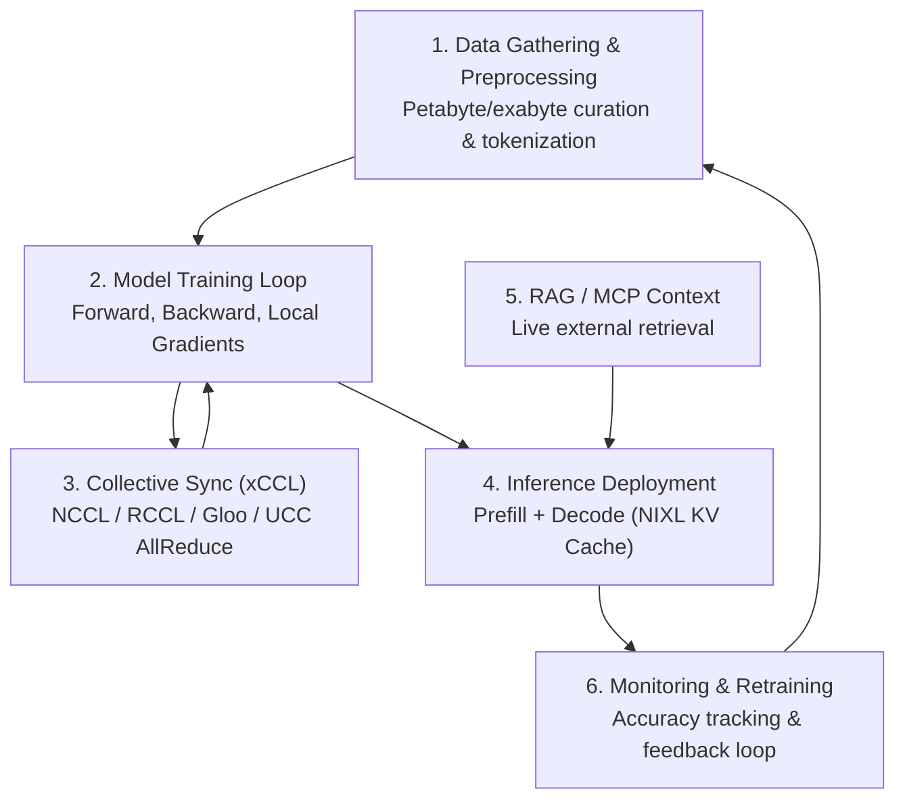
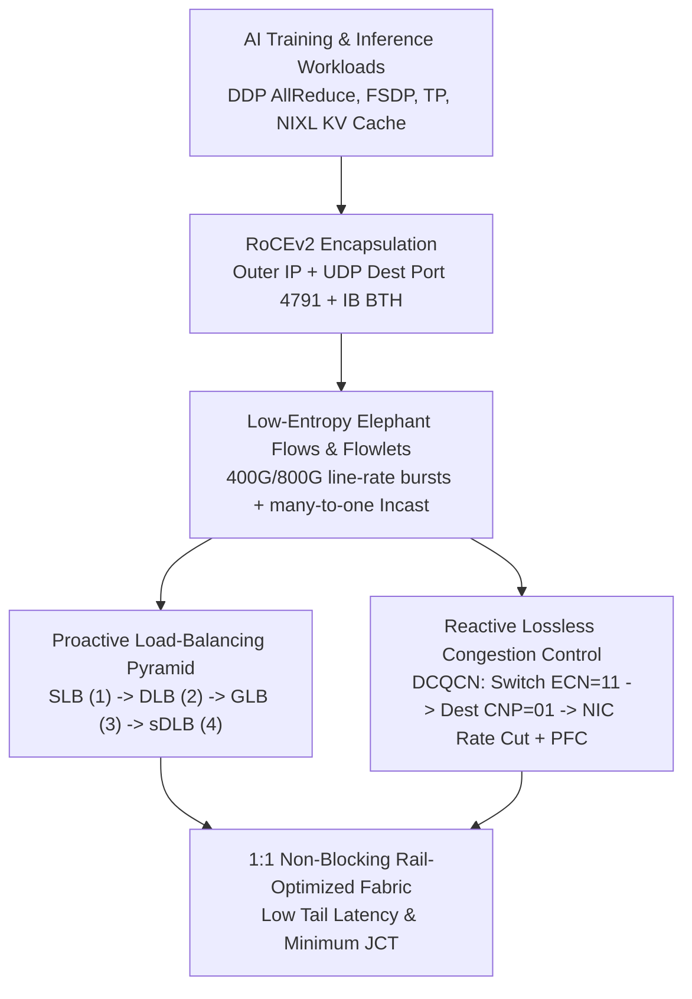

# 12.1 AI traffic: collectives, incast and elephant flows

| | |
|---|---|
| Level | Intermediate |
| Priority tier | 1 |
| Lab venue | Nebius GPU |
| Part | Part 12: Complete AI networking |
| Sources used | `ai-data-center-network-design-and-technologies` Ch 1 & Ch 2; `ai-systems-performance-engineering` Ch 4; `nvidia-devops` V7 Ch 1–12 & Labs 01–04; `bcm11-admin` §3.6, §3.12 & §5.3.3 |
| Coverage file | `planning/coverage/chapters/12-01.md` |
| Claim ledger | `planning/ledgers/12-01.md` |

## Why this matters for AI infrastructure

An `NVIDIA H100 SXM` GPU packs `16,896` CUDA cores and `3.35 TB/s` of High-Bandwidth Memory (`HBM3`) bandwidth, yet in a distributed cluster its effective utilization is governed by the wires and switches connecting it to every other GPU. When a frontier model is partitioned across `1,024`, `10,000`, or `64,000` GPUs, the workload no longer behaves like traditional cloud or web traffic:

- **The `4.0%` Compute-to-Sync Trap:** If `10,000` GPUs finish a forward and backward micro-step in `2 ms`, but synchronizing their gradients across the network takes `50 ms`, the compute-to-sync ratio is `2 / 50 = 4.0%` (`3.85%` of the `52 ms` total step time). A billion-dollar cluster sits idle for over `96%` of wall-clock time waiting on the network.
- **Tail Latency Governs Job Completion Time (`JCT`):** In a `100`-thread (or `10`-task) parallel job where `99%` of workers finish in `1 ms` (`0.001 s`) and `1` straggler task (`taskX`) takes `1,000 ms` (`1.0 s`) due to switch buffer congestion or a single dropped RoCEv2 packet, every fast GPU waits `999 ms` at the barrier. The parallel step `JCT` inflates by `1,000x` (`1,000 ms` vs `1 ms`).
- **Low-Entropy Elephant Flows and Synchronous Incast:** Unlike north-south web traffic with millions of diverse TCP 5-tuples, AI training generates massive, synchronized east-west **elephant flows** over `RoCEv2` (`UDP` destination port `4791`). Because all RoCEv2 packets between a pair of GPUs share the same outer IP addresses and `UDP 4791`, static 5-tuple `ECMP` (`SLB`) hashes multiple `400 Gbps` or `800 Gbps` flows onto the same spine link while neighboring links sit idle, triggering buffer exhaustion, incast, and `ProcessGroupNCCL` watchdog timeouts.

This chapter opens **Part 12 (Complete AI networking)** by establishing the workload physics that drive every hardware and protocol decision in the rest of Part 12: how **Data, Pipeline, and Tensor Parallelism** generate **collective communication** (`AllReduce`, `AllGather`, `ReduceScatter`, `AllToAll`) and **point-to-point KV cache transfers (`NIXL`)**, why **tail latency** and **incast** dominate **Job Completion Time (`JCT`)**, how **RDMA** and **RoCEv2 (`UDP 4791`, `IB BTH`)** create low-entropy **elephant flows** and **flowlets**, how the **four-tier load-balancing pyramid (`SLB`, `DLB`, `GLB`, `sDLB`)** and **`DCQCN` (`ECN` + `PFC`)** keep Ethernet lossless, and how **compute-communication overlap (`DDP`, `SHARP`, `NVLS`)** hides network latency behind GPU compute.

:::tip In one minute
- **3D Parallelism traffic patterns:**
  - **Data Parallelism (`DP` / `DDP` / `FSDP`):** Splits batches across model replicas/shards; synchronizes gradients via **`AllReduce`** (`DDP`) or **`AllGather` + `ReduceScatter`** (`FSDP`) across the scale-out fabric (`InfiniBand` / `RoCEv2`).
  - **Pipeline Parallelism (`PP`):** Slices layers horizontally across sequential GPUs; sends activations forward and gradients backward via **point-to-point `Send`/`Recv`**.
  - **Tensor Parallelism (`TP`):** Slices weight matrices vertically within a node/rack; runs latency-critical `AllReduce` / `AllGather` / `ReduceScatter` on every layer over **`NVLink` / `NVSwitch`** (`900 GB/s` on `H100`, `1,800 GB/s` on `B200` / `NVL72`; stalls on `32–64 GB/s` `PCIe`).
- **Tail latency & `JCT` math:** For `n = 10` tasks (`1 ms` normal, `1,000 ms` = `1 s` straggler `taskX`), serial execution takes `1.010 s` (`1,010 ms` book formula `1 s + n × 1 ms`, or `1,009 ms` strict sum), whereas parallel execution forces `n - 1` GPUs to wait **`999 ms`** for an overall `JCT` of **`1.0 s` (`1,000 ms`, a `1,000x` slowdown)**.
- **Collective byte & step scaling (`B` bytes across `n` GPUs):**
  - **Ring `ReduceScatter` or `AllGather`:** `n - 1` steps, transferring `B × (n - 1) / n` bytes per GPU (`87.5 MB` for `B = 100 MB, n = 8`).
  - **Ring `AllReduce`:** `2 × (n - 1)` steps (`14` steps at `n = 8`; `2,046` steps at `n = 1,024`), transferring `2 × B × (n - 1) / n` bytes (`175 MB` at `n = 8`, `12.5 MB` per step).
  - **Tree `AllReduce`:** `2 × ceil(log2(n))` steps (`6` steps at `n = 8`; `20` steps at `n = 1,024`, `O(log N)` vs `O(N)`).
  - **`SHARP` / `NVLS` in-network reduction:** Switch silicon aggregates vectors so each GPU receives only `B / n` bytes (`12.5 MB` at `n = 8`), a **`1 / (n - 1)`** volume reduction (`1/7` at `n = 8`, `1/1,023` at `n = 1,024`) and **`2x–5x` `AllReduce` speedup** at scale.
- **RoCEv2 elephant flows & the 4-tier load-balancing pyramid:** `RoCEv2` encapsulates the InfiniBand Base Transport Header (`IB BTH`) inside `UDP` destination port **`4791`**, creating low-entropy **elephant flows** and **flowlets**. AI fabrics progress up the load-balancing pyramid: **`SLB`** (static 5-tuple ECMP, level `1`) → **`DLB`** (local link/buffer load, level `2`) → **`GLB`** (Next-to-Next-Hop `NNH` downstream spine quality, level `3`) → **`sDLB`** (`BTH` Read/Write opcode elephant detection + packet spraying, level `4`), backed by reactive **`DCQCN`** (`ECN = 11` marking + `CNP` `01` notification + `PFC` pause frames) and **`1:1` non-blocking** fat-tree topology (`32` Leaf + `16` Spine 64-port switches for `128` servers / `1,024` GPUs).
:::

---

## Prerequisites and outcomes

**Prerequisites:** Chapters `2.16`–`2.19` (data center BGP, leaf-spine Clos topologies, and RDMA/RoCEv2 basics), Chapters `9.2`–`9.9` (DGX/HGX servers, `NVL72` racks, and SuperPOD compute/storage fabrics), and Chapters `10.6` and `10.10` (`PCIe`, `NVLink`, `NVSwitch`, `Fabric Manager`, and the 3-step hardware benchmark hierarchy).

**Outcomes:** After completing this chapter, you will be able to:
1. Map **Data Parallelism (`DP`/`DDP`/`FSDP`)**, **Pipeline Parallelism (`PP`)**, **Tensor Parallelism (`TP`)**, and **disaggregated inference (`Prefill` vs `Decode`)** to their exact network traffic patterns, collective primitives (`NCCL`), and point-to-point transfer engines (`NIXL`).
2. Calculate **Job Completion Time (`JCT`)**, **tail-latency amplification** (`serial` vs `parallel` tasks), and **synchronous cluster efficiency** (`compute_ms` vs `comm_sync_ms`) with and without **`DistributedDataParallel` (`DDP`)** compute-communication overlap.
3. Compute exact per-GPU byte volumes and step counts for **Ring**, **Tree**, **CollNet**, **Parallel Aggregated Tree (`PAT`)**, and **`SHARP` / `NVLS`** collectives, and diagnose the six multi-node communication and `NCCL` lifecycle pitfalls (`Gloo` `200 ms` vs `NCCL` `4 ms`, `DP` `45 ms` vs `DDP` `30 ms`, `48.0 ms` repeated communicator init, `64`-socket ceiling, and Meta's `54`-day Llama 3 405B `419`-interruption breakdown).
4. Explain **RDMA** (`WQE`, `SQ`/`RQ`/`CQ`, `IB`, `RoCEv1`, `RoCEv2` `UDP 4791` + `BTH`/`RETH`/`AETH`, `iWARP`), diagnose **low-entropy elephant flows**, **flowlets**, and **incast**, compare the **four-tier load-balancing pyramid (`SLB`, `DLB`, `GLB`, `sDLB`)** and **`DCQCN` (`ECN` + `PFC`)**, and size a **2-tier `1:1` non-blocking rail-optimized fat-tree** (`128` servers / `1,024` GPUs).

---

## 1. AI Workloads, 3D Parallelism, Job Completion Time (JCT), and Tail Latency

### 1.1 The AI model lifecycle and the training iteration loop

Unlike traditional enterprise workloads that serve independent client requests over north-south links, generative AI workloads follow a continuous five-stage lifecycle across petabyte-scale datasets:
1. **Data gathering and preprocessing:** Raw text, image, audio, and video datasets (often petabytes or exabytes) are collected, deduplicated, cleaned, labeled, and tokenized.
2. **Model training:** An algorithm (model architecture and parameter weights) runs iteratively across batches of curated tokens using **supervised** learning (labeled input/output pairs), **unsupervised** learning (finding latent structure in unlabeled data), or **reinforcement** learning (reward/penalty trial-and-error).
3. **Inference (deployment):** The trained model serves live user queries in milliseconds to seconds, measured by **Time to First Token (`TTFT`)** and inter-token latency.
4. **Retrieval-Augmented Generation (`RAG`) and Model Context Protocol (`MCP`):** At inference time, external vector/relational databases or tools supply up-to-date context before generation.
5. **Monitoring and continuous retraining:** Production accuracy and drift are monitored, feeding new datasets back into training.

Inside the **training stage**, every single iteration executes a strict seven-step loop:
1. **Batching:** Training data is partitioned into mini-batches across GPUs.
2. **Forward propagation:** Each layer multiplies inputs by weights, adds biases, and applies activation functions to produce a prediction.
3. **Error (loss) calculation:** The predicted output is compared against the ground-truth target at the end of the forward pass.
4. **Backward propagation:** Errors propagate backward through the layers via chain-rule calculus to compute local gradients.
5. **Local gradient generation:** Each GPU holds a gradient tensor representing the weight updates derived from its local mini-batch.
6. **Collective communication (`xCCL`):** Before weights can be updated for the next step, GPUs must synchronize their gradients across the cluster using a collective communication library—**`NCCL`** on NVIDIA GPUs, **`RCCL`** on AMD GPUs, **`Gloo`** from Meta, or **`UCC`** from OpenUCX.
7. **Optimizer update and next iteration:** Once synchronized gradients arrive, every GPU updates its model parameters identically and begins the next mini-batch.



| Stage | Primary Operation | Network & Compute Impact |
|---|---|---|
| **1. Data Gathering & Preprocessing** | Collect, deduplicate, label, and tokenize petabyte-scale datasets | High storage ingest throughput from object/file stores |
| **2. Model Training Loop** | Forward propagation, loss calculation, and backward propagation | Intensive GPU Tensor Core math (`FP8`/`BF16`) and HBM bandwidth |
| **3. Collective Sync (`xCCL`)** | Synchronize gradients across GPUs via `NCCL`, `RCCL`, `Gloo`, or `UCC` | Synchronous east-west elephant flows; tail latency directly governs `JCT` |
| **4. Inference Deployment** | Serve live user queries (`TTFT` and inter-token decode latency) | Disaggregated Prefill-to-Decode `KV` cache transfers via `NIXL` |
| **5. `RAG` / `MCP` Context** | Retrieve up-to-date facts from vector/relational stores at inference time | Low-latency frontend/storage queries prior to prompt prefill |
| **6. Monitoring & Retraining** | Track production accuracy and feed new data back into training | Closes the continuous AI factory feedback loop |

### 1.2 3D Parallelism: Data, Pipeline, and Tensor Parallelism traffic profiles

Because frontier models and petabyte datasets cannot fit on a single processor, modern training combines **Data Parallelism (`DP`)** and **Model Parallelism** (**Pipeline Parallelism (`PP`)** + **Tensor Parallelism (`TP`)**) into **3D Parallelism** (extended at ultrascale with **Fully Sharded Data Parallelism (`FSDP`)**, **Expert Parallelism (`EP`)**, and **Context Parallelism (`CP`)**). As encoded in `PARALLELISM_TRAFFIC_PROFILES` (`code/part12/ai_traffic_collectives.py`), each parallelism dimension generates a distinct network traffic signature:

| Parallelism Dimension | What Is Partitioned | Primary Collective / Transfer Primitive | Target Interconnect Domain | Network Traffic Signature & Bottleneck |
|---|---|---|---|---|
| **Data Parallelism (`DP` / `DDP` / `FSDP`)** | Training dataset split into mini-batches across GPUs holding replicas (`DDP`) or shards (`FSDP`) of the model | `AllReduce` (`DDP`), `AllGather` + `ReduceScatter` (`FSDP`), or `AllToAll` | Scale-out fabric (`400G`/`800G` InfiniBand or RoCEv2 Ethernet) + intra-node NVLink | Periodic, synchronous, high-bandwidth east-west **elephant flows** bursts at the end of (or overlapped with) backward propagation |
| **Pipeline Parallelism (`PP`)** | Neural network layers sliced **horizontally** across sequential GPUs or nodes (e.g., Layers `1–10` on GPU 1, `11–20` on GPU 2) | Point-to-point `Send` / `Recv` (or `NIXL` / `UCX` stage transfers; book also notes ring-style layer passing) | Scale-out fabric across nodes or intra-rack NVLink | Sequential activation handoffs forward (`GPU k -> GPU k+1`) and gradient handoffs in reverse; sensitive to pipeline bubble latency |
| **Tensor Parallelism (`TP`)** | Individual layer weight matrices sliced **vertically** across GPUs within a server or rack | `AllReduce`, `AllGather`, and `ReduceScatter` inside **every** transformer layer (forward and backward) | Scale-up **`NVLink` / `NVSwitch`** (`900 GB/s` `H100`, `1,800 GB/s` `B200` / `NVL72`) | Ultra-frequent, sub-microsecond transfers; **catastrophically bottlenecks on `32–64 GB/s` `PCIe`** if run across non-NVLink PCIe cards (`L40S`) or across standard scale-out Ethernet |

### 1.3 Job Completion Time (`JCT`), tail latency, and synchronous efficiency math

In an AI training cluster, the North Star metric is **Job Completion Time (`JCT`)**:

$$\text{JCT} = t_{\text{job\_end}} - t_{\text{job\_start}}$$

A distributed training job splits each step into $n$ parallel tasks (threads/ranks) running across $n$ GPUs, where each rank computes locally and exchanges flows over the fabric. **Tail latency** is high-percentile latency—the response or flow completion time of the slowest `1%` (or `1` in `1,000,000`) of tasks compared to the remaining `99%`. For example, if `99%` of requests complete in `< 100 ms` while `1%` take several seconds, the tail latency is measured in seconds. And if a system performs badly only `1` in `1,000,000` times, a job that executes `1,000,000` parallel tasks is guaranteed to hit that tail-latency stall on **every single run**.

As modeled in `compute_tail_latency_jct()` (`code/part12/ai_traffic_collectives.py`), consider a job with $n = 10$ tasks where normal tasks execute in $t_{\text{normal}} = 1\text{ ms}$ (`0.001 s`), except for one straggler task (`taskX`) that takes $t_{\text{straggler}} = 1\text{ s}$ (`1,000 ms`) due to fabric congestion:
- **Serial execution:** The book expresses serial JCT with one `1 s` straggler and $n$ `1 ms` tasks as:
  $$\text{JCT}_{\text{serial, book}} = 1\text{ s} + (n \times 1\text{ ms}) = 1.010\text{ s}\quad (1,010\text{ ms for } n = 10)$$
  (Or strictly $(n - 1) \times 1\text{ ms} + 1,000\text{ ms} = 1,009\text{ ms} = 1.009\text{ s}$ when `taskX` is one of the $n = 10$ tasks.)
- **Parallel execution (`n = 10` or `n = 100` GPUs):** All $n$ tasks launch simultaneously at $t = 0$. The $n - 1$ healthy GPUs (`9` of `10`, or `99` of `100`) finish in **`1 ms`**, but cannot advance to the optimizer step until `taskX` completes at **`1,000 ms` (`1.0 s`)**:
  $$\text{Wait Time}_{\text{fast GPUs}} = t_{\text{straggler}} - t_{\text{normal}} = 1,000\text{ ms} - 1\text{ ms} = 999\text{ ms}$$
  $$\text{JCT}_{\text{parallel}} = \max_{i \in \{1..n\}} t_i = 1,000\text{ ms} = 1.0\text{ s}\quad (\text{a } 1,000\times \text{ inflation over the } 1\text{ ms ideal step})$$

The same barrier physics governs **cluster compute efficiency** (`compute_synchronous_efficiency()` in `code/part12/ai_traffic_collectives.py`). In the `10,000`-GPU example where each GPU finishes its math in $t_{\text{compute}} = 2.0\text{ ms}$ and waits $t_{\text{comm}} = 50.0\text{ ms}$ for network gradient synchronization without overlap:
- **Compute-to-communication ratio:** $2.0\text{ ms} / 50.0\text{ ms} = \mathbf{4.0\%}$.
- **Serial step time and compute share:** $t_{\text{step}} = 2.0 + 50.0 = \mathbf{52.0\text{ ms}}$, so GPUs spend only $2.0 / 52.0 = \mathbf{3.85\%}$ of total wall time performing math.
- **Why deep-buffer enterprise Ethernet switches fail here:** A standard enterprise core switch is engineered with deep packet buffers to absorb web bursts without dropping TCP connections, delaying packets by `10 ms` or more under load. In a `10,000`-GPU job, if `9,999` GPUs receive their gradients immediately but `1` GPU's packet sits in a deep switch buffer for `10 ms` (**jitter**), all `10,000` GPUs halt for `10 ms`. Saving `$2 Million` on `500` H100 servers by putting AI traffic on a shared `400G` enterprise VLAN with QoS queues still exposes collectives to shared-backplane microburst jitter and packet drops.

---

## 2. RDMA, RoCEv2 (`UDP 4791`), Elephant Flows, Flowlets, and Incast

### 2.1 Host TCP/IP vs RDMA (`WQE`, `SQ`/`RQ`/`CQ`) and transport headers (`IB`, `RoCEv1`, `RoCEv2`, `iWARP`)

Why can't an AI cluster run over the standard Linux kernel TCP/IP stack? When an application sends data over kernel TCP/IP, every message traverses a heavy software pipeline: the application buffer is copied into a socket buffer, wrapped in TCP/IP headers with kernel checksums and interrupts, copied across PCIe to the NIC, and reversed at the receiver. At `100–800 Gbps`, software interrupts and memory copies saturate host CPU cores and add tens of microseconds of latency (for example, capping a `100`-node Ray reinforcement learning cluster on `100GbE` `ConnectX-5` cards at **`30 Gbps`** over TCP sockets).

**Remote Direct Memory Access (`RDMA`)** bypasses the OS kernel and host CPU on both sender and receiver so the NIC (`HCA` / `RNIC`) reads and writes application memory (and, with **GPUDirect RDMA**, GPU `HBM` via PCIe `BAR1` and `nvidia-peermem`) directly:
- **RDMA Queue Architecture:** An application submits a **Work Queue Element (`WQE`)**—a descriptor containing a virtual address pointer, byte length, and memory keys—through the **Verbs API** to the RDMA driver, which manages three hardware-backed queues on the NIC:
  1. **Send Queue (`SQ`):** Outbound work requests (`Send`, `RDMA Write`, `RDMA Read` request, `Atomic`).
  2. **Receive Queue (`RQ`):** Pre-posted buffers for inbound `Recv` operations (`SQ` and `RQ` together form a **Queue Pair, `QP`**).
  3. **Completion Queue (`CQ`):** Receives a Completion Queue Entry (`CQE`) once the NIC hardware completes a WQE.
- **Unidirectional vs Bidirectional Verbs:** `RDMA Read`, `RDMA Write`, and `Atomic` operations are **unidirectional** (one-sided: the remote CPU is completely unaware of the memory access once connection setup finishes), whereas `Send` and `Receive` are **bidirectional** (two-sided: the receiver must post a matching `RQ` WQE).
- **Three RDMA Transport Protocols:**
  1. **InfiniBand (`IB`):** Native lossless, channel-based fabric standardized by the `IBTA` using credit-based flow control at the link layer. Packet format: `IB Local Routing Header (LRH)` → `IB Global Routing Header (GRH)` → `IB Base Transport Header (BTH)` → `IB Payload` → `ICRC` / `VCRC`.
  2. **RoCEv1:** Replaces the IB link layer with Ethernet L2 (`EtherType 0x8915`) while keeping the `IB GRH` and `IB BTH`—non-routable across L3 IP subnets.
  3. **RoCEv2:** Replaces both L2 and L3 with standard **Ethernet + IP (IPv4/IPv6) + `UDP` (destination port `4791`)**, followed immediately by the **`IB BTH`**, `IB Payload`, **`ICRC`** (`32-bit` InfiniBand invariant CRC), and Ethernet **`FCS`**.
  4. **iWARP:** Runs RDMA on top of TCP/IP (`DDP` / `MPA` / `RDMAP`); avoids lossless Ethernet requirements but incurs higher latency and NIC complexity, making it rare in GPU training clusters.

### 2.2 Inside the `RoCEv2` packet (`UDP 4791`, `BTH`, `RETH`, `AETH`) and the 11/13-step RDMA state machines

In a **RoCEv2** packet, the outer **UDP destination port is always `4791`**, signaling to the receiving RNIC that the next header is the **InfiniBand Base Transport Header (`IB BTH`)**, while the UDP source port is hashed from the Queue Pair (`QP`). Inside the InfiniBand headers:
- **`BTH` (Base Transport Header):** Carries the RDMA **Opcode** (e.g., `Opcode 12` = `RC RDMA READ Request`, `Opcode 14` = `RC RDMA READ response Middle`, `Opcode 17` = `RC Acknowledge`), `Solicited Event`, `MigReq`, `Pad Count`, `Header Version`, **`Partition Key` (`P_Key`, e.g., `65535`, mapped to VLAN ID)**, **`Destination Queue Pair` (`Dest QP`, e.g., `0x0000fe1`, `0x00007b`, `0x000123`)**, `Acknowledge Request` flag (`True`/`False` for selective ACK), and the **24-bit `Packet Sequence Number` (`PSN`, e.g., `16548361`, `16543980`, `2592248`)** used by the NIC to track in-order delivery and detect packet loss over connectionless UDP.
- **`RETH` (RDMA Extended Transport Header):** Follows `BTH` on an RDMA Read/Write request and carries the 64-bit **`Virtual Address`** (`0x00007ff9de5f4000`), **`Remote Key` (`R_Key`, `0x00207100`)**, and **`DMA Length`** (`65536` bytes = `0x00010000`).
- **`AETH` (ACK Extended Transport Header):** Follows `BTH` on an `Opcode 17` acknowledgement packet and carries the **`Syndrome`** (`0 = Ack` vs `NACK` code and `Credit Count`) plus the **`Message Sequence Number` (`MSN`, e.g., `1`)** of the last completed message.
- **Connection Manager (`CM`) Handshake State Machines:** Before data flows between a client (`20.0.0.2`) and server (`60.0.0.2`), the RDMA Connection Manager (`CM`) runs a **3-step handshake** (`Step 1: CM Connect Request with client QPN` → `Step 2: CM Connect Reply with server QPN` → `Step 3: CM Ready to Use`), exchanges transfer size, remote virtual address, `R_Key`, payload data, and `ACK` frames (`Steps 4–9` in the **13-step RDMA Write** flow; `Steps 4–7` in the **11-step RDMA Read** flow), and closes with a **4-step disconnect handshake** (`Steps 10–13` for Write; `Steps 8–11` for Read).

### 2.3 Why AI traffic breaks traditional Ethernet: low entropy, elephant flows, flowlets, and incast

When thousands of GPUs execute synchronous collectives over `RoCEv2`, five traffic properties collide on the Ethernet fabric:

1. **Low entropy at Layer 3 (IP):** In an east-west GPU collective, each GPU often communicates with a fixed peer (`1:1` in a Ring or Pipeline step) or a small subgroup of GPUs. Thus, the outer Source IP and Destination IP pairs are few and repetitive.
2. **Low entropy at Layer 4 (UDP):** Every single RoCEv2 packet uses **UDP destination port `4791`**, and the QP-derived UDP source port often stays constant across a long-lived NCCL channel. Standard switches hashing on the outer 5-tuple (`Src IP`, `Dst IP`, `Protocol 17`, `Src Port`, `Dst Port 4791`) see almost zero entropy.
3. **Flowlets (simultaneous and sequential):** Because switches do not inspect the inner `IB BTH` Queue Pair or PSN by default, distinct RDMA transfers with similar outer headers collapse into the same hash bucket as **flowlets**:
   - *Simultaneous flowlets:* Multiple concurrent QP transfers between the same two GPUs differ only in the inner `BTH` QP/PSN fields, so a traditional switch pins all of them onto the same physical uplink.
   - *Sequential flowlets:* When Job A finishes between two GPUs and Job B starts between the same pair, identical outer headers trick the switch into treating both jobs as a single long-lived flow unless paths are dynamically rebalanced.
4. **High-bandwidth elephant flows:** Each GPU NIC drives line-rate RDMA (`400 Gbps` = `50 GB/s` on `ConnectX-7`, `800 Gbps` = `100 GB/s` on `ConnectX-8`) for tens of megabytes to gigabytes per collective step.
5. **Synchronous burstiness and many-to-one Incast:** Gradient synchronization and `AllToAll` / storage checkpointing fire simultaneously across all ranks. When multiple senders transmit line-rate elephant flows toward the same egress switch port (for example, at a leaf-to-spine uplink or when storage and compute share a leaf switch), instantaneous arrival rate exceeds port speed (**incast**), rapidly filling shallow switch buffers.



| Architectural Stage | Mechanism | Operational Role in the AI Fabric |
|---|---|---|
| **1. Workload Layer** | `NCCL` collectives (`AllReduce`, `AllGather`, `ReduceScatter`) & `NIXL` P2P transfers | Generates synchronized bursts across `8` to `64,000+` GPUs |
| **2. RoCEv2 Transport** | Outer `IP` + `UDP 4791` + inner `IB BTH` (`Opcode`, `Dest QP`, `PSN`) + `RETH`/`AETH` | Bypasses OS kernel (`GPUDirect RDMA`), but hides QP/opcode entropy inside `BTH` |
| **3. Traffic Hazard** | Low-entropy **elephant flows**, **flowlets**, and synchronous **incast** | Causes hash collisions on static 5-tuple ECMP and microburst buffer overflow |
| **4. Proactive Defense** | 4-tier load-balancing pyramid (`SLB` → `DLB` → `GLB` → `sDLB`) | Spreads elephant flows and flowlets across all equal-cost leaf-to-spine links |
| **5. Reactive Defense** | **`DCQCN`** (`ECN = 11` + `CNP` with `IP ECN = 01` + link-level `PFC` pause) | Throttles offending sender NICs per-flow and pauses queues before any packet drops |
| **6. Physical Topology** | `1:1` non-blocking rail-optimized fat-tree + isolated storage fabric | Eliminates bandwidth oversubscription and storage checkpoint buffer collisions |

---

## 3. Proactive and Reactive Fabric Defense: Load-Balancing Pyramid, DCQCN, and Fat-Tree Sizing

### 3.1 The four-tier load-balancing pyramid (`SLB`, `DLB`, `GLB`, `sDLB`)

To prevent elephant-flow hash collisions before buffers fill (**proactive congestion avoidance**), modern AI Ethernet switches implement a four-tier load-balancing pyramid (`LOAD_BALANCING_PYRAMID` and `audit_rocev2_and_fabric_design()` in `code/part12/ai_traffic_collectives.py`; Chapter `12.14` dives into the ASIC-level CRC32 and BGP extensions):

| Pyramid Level | Code & Name | Path Selection Inputs | Reordering & Hardware Requirements | Suitability for AI Training Fabrics |
|---:|---|---|---|---|
| **Level 1 (Base)** | **`SLB`** — Static Load Balancing (5-tuple ECMP) | Static hash of outer 5-tuple (`Src IP`, `Dst IP`, `Proto`, `Src Port`, `Dst Port 4791`) only; blind to link load | Zero reordering (all packets of a 5-tuple pinned to one path); standard L3 switch | **Poor:** Low RoCEv2 entropy causes severe hash collisions where two `400G` elephant flows collide on one link while others sit at `0%` |
| **Level 2** | **`DLB`** — Dynamic Load Balancing | Real-time **local member-link bandwidth utilization** and **local egress queue buffer depth** on the leaf switch | Low reordering (assigns new flows and reassigns existing flowlets when local link quality changes) | **Moderate:** Resolves local leaf-uplink imbalance, but is blind to congestion one hop downstream on spine-to-leaf links |
| **Level 3** | **`GLB`** — Global Load Balancing | Local link/buffer state **plus Next-to-Next-Hop (`NNH`) downstream path quality** advertised by spine switches | Low reordering; upstream leaf avoids downstream spine-to-leaf congestion hotspots | **High:** End-to-end congestion avoidance across multi-stage leaf-spine Clos fabrics |
| **Level 4 (Apex)** | **`sDLB`** — Selective Dynamic Load Balancing | Deep inspection of **`RoCEv2` `IB BTH` Read/Write opcodes** to detect RDMA elephant flows and enable **per-packet spraying** | Requires destination NIC out-of-order **`PSN`** handling (supported on `ConnectX-6/7/8` and `BlueField-3`) | **Highest:** Near-`100%` bisection utilization for massive RDMA Read/Write elephant collectives |

In addition to the four pyramid tiers, switches can apply **flow pinning** (mapping GPU flows across outgoing interfaces in round-robin order based on path state) so concurrent rails never collide on the same uplink.

### 3.2 Reactive congestion management: `DCQCN` (`ECN = 11`, `CNP = 01`, and `PFC`)

Even with dynamic load balancing, microsecond `AllReduce` bursts or many-to-one incast can temporarily exceed an egress port's drain rate. Because standard RDMA NICs treat any dropped packet as a fatal sequence error requiring go-back-N retransmission or timeout, a lossless RoCEv2 fabric pairs proactive load balancing with reactive **Data Center Quantized Congestion Notification (`DCQCN`)** (explored at the register and queue level in Chapter `12.4`):

1. **Explicit Congestion Notification (`ECN` — End-to-End Rate Control):**
   - **Step 1 & 2:** A source GPU server under `Leaf A` sends RoCEv2 packets through `Spine A` / `Spine B` toward a destination GPU server under `Leaf D`.
   - **Step 3 (Switch `ECN = 11` marking):** When an egress queue on `Spine B` crosses its Random Early Detection (`RED` / `WRED`) marking threshold, the switch sets the two IP header ECN bits to **`11` (`Congestion Experienced`, `CE`)** instead of dropping the packet.
   - **Step 4 (`CNP` return packet with `IP ECN = 01`):** The destination RNIC sees `ECN = 11` in the arriving RoCEv2 packet and immediately transmits a **Congestion Notification Packet (`CNP`)** (marked with `IP ECN = 01`) back through the fabric to the source GPU server.
   - **Step 5 (Per-flow NIC rate cut):** Upon receiving the `CNP`, the source RNIC throttles the transmission rate of that specific offending Queue Pair (`QP`) in hardware.
2. **Priority Flow Control (`PFC` — Hop-by-Hop Link Pause Safety Net):**
   - If a sudden burst fills `Spine B`'s ingress/headroom buffer faster than `ECN`/`CNP` can slow the sender down, `Spine B` transmits an IEEE `802.1Qbb` **`PFC` pause frame** upstream to `Spine A` (and `Spine A` propagates pause to `Leaf A`) for that specific lossless traffic class (`DSCP` / priority queue, e.g., priority `3`), carries a **pause quanta** timer, and halts transmission before a single frame is dropped.

### 3.3 Sizing a `1:1` non-blocking rail-optimized fat-tree and isolating storage planes

No congestion control protocol can compensate for an undersized spine or a noisy storage plane (`size_two_tier_nonblocking_fattree()` and `audit_rocev2_and_fabric_design()` in `code/part12/ai_traffic_collectives.py`):
- **Worked `1,024`-GPU Non-Blocking Fat-Tree Sizing (`128` DGX H100 servers on `64`-port Quantum-2 `400G` NDR switches):**
  - Each `DGX H100` server has `8` GPUs and `8` dedicated `400 Gbps` `ConnectX-7` compute NICs (`1,024` GPUs and `1,024` compute ports total).
  - For a **`1:1` non-blocking** leaf switch, half of the `64` ports (`32` downlinks) connect down to servers and half (`32` uplinks) connect up to spine switches (`32 × 400G` down = `32 × 400G` up).
  - In a **Rail-Optimized Design (`ROD`)**, `NIC 0` of `32` servers plugs into `Leaf 0`, `NIC 1` into `Leaf 1`, ..., `NIC 7` into `Leaf 7`. Thus, **one Leaf Group (`SU` / Pod) of `8` Leaf switches** serves **`32` servers (`256` GPUs)**.
  - Scaling to **`128` servers (`1,024` GPUs)** requires $128 / 32 = \mathbf{4\text{ Leaf Groups}}$, totaling $4 \times 8 = \mathbf{32\text{ Leaf switches}}$ with $32 \times 32 = \mathbf{1,024\text{ server downlinks}}$ and $\mathbf{1,024\text{ spine uplinks}}$.
  - Terminating `1,024` uplinks on `64`-port Spine switches requires $1,024 / 64 = \mathbf{16\text{ Spine switches}}$.
- **Why `2:1` spine oversubscription fails (even across two `512`-GPU tenants):** If a network team cables only `16` uplinks per `32`-server Leaf (`2:1` oversubscription) assuming two `512`-GPU departments will not communicate simultaneously, a single `512`-GPU job executing a synchronous `AllReduce` drives `400 Gbps` from every GPU at the same microsecond, saturating the `2:1` uplinks and stalling the job. (In rare shallow-buffer Ethernet designs, architects even use *undersubscription*—more links to spines than down to servers—to gain extra spine egress buffer and packet-spraying headroom.)
- **Why storage (`100 GB` checkpoints) must never share compute switches:** Routing parallel file system storage traffic over the same switches as GPU compute does not fail on average bandwidth; it fails on **buffer-induced latency jitter**. When a job writes a **`100 GB` model checkpoint**, bulk storage frames pack the switch queues; lossless flow control (`IB` credits or `PFC`) prevents drops, but tiny, latency-critical `AllReduce` packets queue behind the `100 GB` burst, delaying one rank and stalling the entire collective. Production clusters isolate storage onto a separate **Storage Fabric** attached to `BlueField-3` DPUs or dedicated storage NICs.

---

## 4. Overlapping Communication with Computation and Collective Algorithms (`NCCL`, `SHARP`, `NVLS`)

### 4.1 Hiding network latency: CUDA streams, `DDP` bucketing (`25 MB`), gradient accumulation, and `DP` vs `DDP`

Even on a `1:1` non-blocking fabric, serializing computation and communication wastes GPU cycles. As modeled in `compute_synchronous_efficiency()` (`code/part12/ai_traffic_collectives.py`), if a training step requires $t_{\text{compute}} = 10.0\text{ ms}$ for forward/backward passes and $t_{\text{comm}} = 12.0\text{ ms}$ for manual gradient `all_reduce` after `loss.backward()`, serial execution takes:

$$t_{\text{serial}} = t_{\text{compute}} + t_{\text{comm}} = 10.0\text{ ms} + 12.0\text{ ms} = 22.0\text{ ms}$$

When communication is pipelined concurrently on a dedicated **CUDA stream** alongside backward computation (**Wait-Free Backpropagation, `WFBP`**), ideal full overlap approaches:

$$t_{\text{ideal\_overlap}} = \max(t_{\text{compute}}, t_{\text{comm}}) = \max(10.0\text{ ms}, 12.0\text{ ms}) = 12.0\text{ ms}\quad (\text{a } 45.45\% \text{ step-time reduction})$$

In practice, PyTorch **`DistributedDataParallel` (`DDP`)** installs autograd backward hooks that group per-layer gradients into **buckets (`bucket_cap_mb = 25 MB` / `25 MiB` default)** and launch an asynchronous `NCCL` `all_reduce` on a background communication stream as soon as each bucket fills:
- **Measured `DDP` overlap impact:** When `50%` of a `60 ms` communication window is hidden behind `40 ms` of computation (`100 ms` serial baseline), iteration time drops from **`100 ms` to `70 ms` (`30.0%` faster)** and GPU Streaming Multiprocessor (`SM`) utilization rises from **`60%` to `90%`**.
- **Tuning `bucket_cap_mb` (`25 MB` → `50 MB`):** If a neural network has thousands of tiny layers that emit microscopic `256 KB` `AllReduce` calls, handshake latency dominates and training can run **`40%` slower** even when `ib_write_bw` (`~390 Gbps`) and `nccl-tests` pass at line rate. Increasing `bucket_cap_mb` from `25 MB` to `50 MB` coalesces small transfers into bandwidth-optimal elephant chunks (while setting it too large delays the start of the first bucket).
- **Avoiding accidental host syncs:** Calling `torch.cuda.synchronize()`, `.item()`, `.cpu()`, or `print(tensor)` inside the training loop forces a full GPU-to-CPU synchronization barrier that destroys stream overlap.
- **Gradient accumulation & compression:** Accumulating gradients locally across `4` minibatches before calling `all_reduce` cuts network synchronization frequency by **`4x`** (at the cost of larger effective batch size and gradient buffer memory), while gradient quantization/compression shrinks payload bytes.
- **Why `nn.DataParallel` (`DP`) must be replaced with `DDP` (`45.00 ms` vs `30.00 ms`):** `nn.DataParallel` runs inside a **single Python process** where multi-threaded kernel launches contend on the **Python Global Interpreter Lock (`GIL`)**, gathers all outputs and gradients onto a bottleneck master device (`GPU 0`), and performs synchronous, non-overlapped reductions. On a `512`-sample batch (`2 × 256` across `2` GPUs), switching from `DP` (**`45.00 ms`**) to multi-process `DDP` (**`30.00 ms`**) reduces iteration time by **`33.33%` (`1.5x` speedup)** and scales cleanly to thousands of GPUs.

### 4.2 `NCCL` collective algorithms (`Ring`, `Tree`, `CollNet`, `PAT`) and `SHARP` / `NVLS` in-network math

When `NCCL` executes a collective of size $B$ bytes across $n$ GPUs, it selects an algorithm (`NCCL_ALGO=Ring,Tree,CollNet,NVLS,NVLSTree,PAT`) based on message size and topology (`compute_collective_bytes_and_steps()` in `code/part12/ai_traffic_collectives.py`):

| Algorithm | Step Count (`AllReduce`) | Per-GPU Bytes Transferred | Latency vs Bandwidth Scaling | Ideal Regime & Hardware Support |
|---|---:|---:|---|---|
| **Ring (`ReduceScatter` or `AllGather`)** | $n - 1$ steps (`7` at $n=8$) | $B \times \frac{n - 1}{n}$ (`87.5 MB` for $B=100\text{ MB}, n=8$) | $O(N)$ latency hops; `100%` link-balanced bandwidth | Building block of Ring `AllReduce` and `FSDP` |
| **Ring `AllReduce`** (`RS` + `AG`) | $2(n - 1)$ steps (`14` at $n=8$; `2,046` at $n=1,024$) | $2 B \times \frac{n - 1}{n}$ (`175 MB` at $n=8$, chunk $B/n = 12.5\text{ MB}$/step) | **Bandwidth-optimal** for large tensors, but $O(N)$ hop latency hurts at `1,000+` GPUs | Large messages (`> 10s of MB`) on small-to-medium rank counts |
| **Tree `AllReduce`** | $2 \lceil \log_2 n \rceil$ steps (`6` at $n=8$; `20` at $n=1,024$) | Hierarchical reduce to root + broadcast down | **$O(\log N)$ latency** (`20` steps vs `2,046` for Ring at $n=1,024$) | Small/medium latency-bound messages or massive node counts |
| **`CollNet`** (`Direct` / `Chain`) | Local intra-node ring/tree + cross-node leader tree | Offloads inter-group reduction to switch fabric | Combines intra-node NVLink bandwidth with inter-node `SHARP` | Multi-node clusters with InfiniBand `SHARP` (`NCCL_COLLNET_ENABLE=1`) |
| **`PAT`** (Parallel Aggregated Tree) | Interleaved round-robin chunked trees | Near-Ring bandwidth (`2B(n-1)/n`) | Bounds per-segment startup latency to **$O(\log N)$** while keeping links saturated | Medium-to-large messages across multi-node topologies (up to `~7.6x` small/medium speedup with symmetric memory) |
| **`SHARP` / `NVLS` (`NVLSTree`)** | Switch-assisted in-network reduction + multicast | **`ReduceScatter` receive: $B / n$** (`12.5 MB` at $n=8$)<br/>**Volume ratio: $\frac{1}{n - 1}$** (`1/7` at $n=8$; `1/1,023` at $n=1,024$) | Cuts endpoint traffic by $1/(n-1)$, drops overlapped `RS`+`AG` phase time by **`~1/2`**, and yields **`2x–5x` `AllReduce` speedup** | Intra-rack `NVSwitch` (`NVLS`, `72`-GPU `NVL72` at `~130 TB/s`) and `Quantum` InfiniBand switches (`SHARP`) |

Why is **`SHARP`** (on Quantum InfiniBand switches via the `NCCL` RDMA SHARP plugin and `SHARP Aggregation Manager`) and **`NVLink SHARP` (`NVLS`)** (on 3rd/4th-gen `NVSwitch` domains such as `HGX H100/B200` and `72`-GPU `GB200/GB300 NVL72`) so transformative?
- In a standard **Ring `ReduceScatter`** of $B = 100\text{ MB}$ across $n = 8$ GPUs, each GPU sends and receives $B(n - 1)/n = \mathbf{87.5\text{ MB}}$ over $n - 1 = 7$ serialized hops (`12.5 MB` per hop).
- With **`SHARP` or `NVLS` in-network reduction**, the switch ASIC sums the incoming vectors in hardware and returns only the final reduced shard of size **$B / n = 12.5\text{ MB}$** to each GPU—reducing per-endpoint receive volume to **$\frac{B/n}{B(n-1)/n} = \frac{1}{n - 1}$** (`1/7` on `8` GPUs; `1/1,023` on `1,024` GPUs).
- Similarly, for **`AllGather`**, `NVLS` hardware multicast lets each GPU transmit its $B/n$ shard once while the switch replicates it to all peers (`1/(n-1)` sender volume vs Ring). When an `NVLS` multicast `AllGather` is overlapped with an in-network `ReduceScatter`, the wall time of a sharded exchange drops by **`~1/2`** ($\max(t_{\text{RS}}, t_{\text{AG}})$ instead of $t_{\text{RS}} + t_{\text{AG}}$). Furthermore, registering persistent user buffers via **`ncclCommRegister()` / `ncclCommDeregister()`** enables zero-copy `NVLS`/`SHARP` execution without internal staging buffers.

---

## 5. Multi-Node Pitfalls, `NCCL` Lifecycle Gotchas, and Disaggregated Inference (`NIXL`)

### 5.1 Six multi-node pitfalls, six `NCCL` lifecycle gotchas, and Meta's `54`-day Llama 3 405B failure data

Scaling from one server to hundreds of nodes exposes two categories of operational failures (`evaluate_multinode_pitfalls()` and `summarize_llama3_405b_interruptions()` in `code/part12/ai_traffic_collectives.py`; see also Chapters `2.24` and `6.12` for host/Slurm launch details):

1. **Six Multi-Node Communication Pitfalls:**
   - **Pitfall 1 — CPU-bound `Gloo` backend instead of `NCCL` (`200.00 ms` vs `4.00 ms`, `50x` speedup):** Running a `400.0 MB` (`100M` `float32`) `all_reduce` across two nodes on an `800 Gb/s` (`100 GB/s`) InfiniBand fabric with `backend="gloo"` stages tensors through CPU RAM and TCP sockets in **`200.00 ms` (`2.0 GB/s`)**. Switching to `backend="nccl"` with GPUDirect RDMA completes the exact same `400.0 MB` collective in **`4.00 ms` (`100.0 GB/s`, `50.0x` faster)**. Always set `NCCL_SOCKET_IFNAME=ib0` so out-of-band bootstrap handshakes use the high-speed fabric rather than a `10 Gbps` management interface.
   - **Pitfall 2 — Mismatched `NCCL` versions:** Mixing PyTorch's bundled `NCCL` with an incompatible system `libnccl` causes silent fallbacks or communicator hangs.
   - **Pitfall 3 — Ephemeral TCP port exhaustion during bootstrap:** Widen `/proc/sys/net/ipv4/ip_local_port_range` (e.g., `50000 51000`) on large clusters.
   - **Pitfall 4 — Underutilized multi-rail NICs and the `64`-socket cap:** Two `800 Gbps` NICs deliver `1.6 Tbps` (`~3.2 Tbps` across four links), or GPU-initiated **InfiniBand GPUDirect Async (`IBGDA`)** drives RDMA directly from the GPU without CPU proxy threads. When socket transport is used, `NCCL_SOCKET_NTHREADS` (e.g., `2`) $\times$ `NCCL_NSOCKS_PERTHREAD` (e.g., `2` = `4` connections) **must never exceed `64`** (`16 × 8 = 128` violates the `64`-connection ceiling).
   - **Pitfall 5 — Straggler nodes/links:** Monitor with `DCGM`, `ibstat`, and `torch.distributed.monitored_barrier`.
   - **Pitfall 6 — GPU memory fragmentation under `UCX`/RDMA (`0.800 GB` → `1.240 GB`):** PyTorch's caching allocator retains freed blocks (`40 MB` and `200 MB` temporaries on top of a `0.800 GB` registered buffer grow `memory_reserved()` from `0.800 GB` at `Iter 00` to `1.040 GB` at `Iter 01` and `1.240 GB` at `Iter 02..10` even when `memory_allocated()` drops to `0.000 GB`), starving `UCX` RDMA registration pools.

2. **Six `NCCL` Communicator Lifecycle and Environment Gotchas:**
   - **Gotcha 1 & 2 — Repeated `init_process_group` + `destroy_process_group` inside the training loop (`48.5 ms` → `0.5 ms`, `98.97%` reduction):** Creating an `NCCL` communicator requires all-to-all rank handshakes (`2–3 minutes` vs `2–3 seconds` if `32` separate communicators are created on `32` GPUs). Calling `init_process_group` + `destroy_process_group` inside the loop costs **`48.0 ms`** per step on top of a **`0.5 ms`** 1-element `all_reduce` (**`48.5 ms` total**). Initializing once outside the loop (and grouping sub-communicators via `ncclGroupStart()` / `ncclGroupEnd()` or `torch.distributed.new_group()`) drops step time to **`0.5 ms` (`98.97%` > `98%` reduction)**.
   - **Gotcha 3 — Leaving debug overrides enabled in production:** Leaving `NCCL_P2P_DISABLE=1` or `NCCL_SHM_DISABLE=1` enabled forces intra-node traffic off NVLink/shared memory onto host CPU bounce buffers (`hundreds of GB/s` → `tens of GB/s`), and `NCCL_DEBUG=DEBUG` adds heavy logging overhead (use `WARN` or `VERSION` in production; start `NCCL_BUFFSIZE` at `4 MB` if tuning).
   - **Gotcha 4 — Collapsed CPU thread affinity:** Set `NCCL_IGNORE_CPU_AFFINITY=1` alongside NUMA-aligned `numactl` / Slurm `--cpu-bind` so `NCCL` proxy threads spread cleanly across local NUMA cores.
   - **Gotcha 5 — Ignoring `NCCL` fallback warnings:** Never ignore `unable to enable P2P, falling back to copy` or `NCCL INFO NET/Socket: using Ethernet interface eth0`.
   - **Gotcha 6 — Unhandled rank crashes and Meta's `54`-day Llama 3 405B interruption table:** During Meta's **`54`-day** pretraining run of **Llama 3 405B**, the cluster experienced **`419` unexpected interruptions across `18` root-cause categories**: **`148` Faulty GPU (`30.1%`)**, **`72` GPU HBM3 memory (`17.2%`)**, **`54` Software bug (`12.9%`)**, **`35` Network switch/cable (`8.4%`)**, **`32` Host maintenance (`7.6%`)**, **`19` GPU SRAM memory (`4.5%`)**, **`17` GPU system processor (`4.1%`)**, **`7` NIC (`1.7%`)**, **`7` `NCCL` watchdog timeouts (`1.7%`)**, **`6` Silent data corruption (`1.4%`)**, **`6` GPU thermal interface/sensor (`1.4%`)**, **`3` SSD (`0.7%`)**, **`3` Power supply (`0.7%`)**, and **`2` each (`0.5%`)** for Server chassis, IO expansion board, Dependency, CPU, and System memory. Network switches/cables (`35`), NICs (`7`), and `NCCL` watchdog timeouts (`7`) together accounted for **`49` interruptions (`11.7%`)**. Always set `TORCH_NCCL_ASYNC_ERROR_HANDLING=1` (and `NCCL_ASYNC_ERROR_HANDLING=1`) and monitor via the **`NCCL` Profiler Plugin API** (`NCCL_PROFILER_PLUGIN`, 32-bit event activation mask, 5 callbacks: `init`, `startEvent`, `stopEvent`, `recordEventState`, `finalize`).

### 5.2 Disaggregated inference and `NIXL` (`Prefill` vs `Decode` KV cache routing)

While training traffic is dominated by synchronized many-to-many `NCCL` collectives, large-scale LLM inference introduces a different network pattern. Transformer inference comprises two distinct phases:
1. **Prefill (prompt ingestion):** Compute-bound matrix multiplications that process the input prompt in parallel and generate the attention **Key-Value (`KV`) cache** (often `1 GB` to `100 GB` for long context windows).
2. **Decode (token generation):** Memory-bandwidth-bound steps that read model weights and the `KV` cache from `HBM` to generate one token at a time.

In **disaggregated serving** (implemented in **NVIDIA Dynamo**, `vLLM`, `SGLang`, and `TensorRT-LLM`), **Prefill workers** and **Decode workers** run on separate GPU pools so each stage can be scaled and batched independently. However, the Prefill GPU must transfer tens of gigabytes of `KV` cache to the Decode GPU (or offload inactive `KV` caches across `GPU HBM` → `CPU DRAM` → `local NVMe SSD` → `network/object storage`) in near-real time without stalling token generation.

To solve this, NVIDIA released the open-source **NVIDIA Inference Xfer Library (`NIXL`)** in early `2025` as a core component of **NVIDIA Dynamo**:

| Dimension | `NCCL` (Collective Communication) | `NIXL` (Point-to-Point Inference Transfer) |
|---|---|---|
| **Primary Workload** | Synchronized many-to-many collectives (`AllReduce`, `AllGather`, `ReduceScatter`) in distributed training and `TP` | Asynchronous `1:1` or `1:few` transfers (e.g., `1 GB`–`100 GB` `KV` cache handoff between Prefill and Decode or tiered storage offload) |
| **Execution Semantics** | Barrier-style group collective (all participating ranks must invoke the call) | Non-blocking one-sided initiator (`nixlAgent`: `registerMem` → `trim` → `prepXfer` → `postXfer` → poll `checkXfer` → `releaseReqH`) |
| **Interconnect & Memory Tiers** | `NVLink`, `NVSwitch`, `PCIe`, `InfiniBand` / `RoCEv2` (`GPUDirect RDMA`), TCP sockets across GPU memory | Unified routing across **`GPU HBM` (`VRAM_SEG`)**, **`CPU DRAM` (`900 GB/s NVLink-C2C` on Grace Hopper/Blackwell)**, **`NVMe SSD` (`GDS`)**, and **Object Store (`S3`)** via `UCX`, `GPUDirect RDMA`, and **`IBGDA`** |
| **Measured Impact** | `100 GB/s` (`4.00 ms` for `400 MB`) on `800G` IB; `2x–5x` speedup with `SHARP` | **`14x` `TTFT` speedup** offloading KV cache on `x86 + H100` vs recomputing; **`2x` faster `TTFT`** on `Grace Hopper` (`900 GB/s NVLink-C2C`) vs `x86 H100`; up to **`30x` higher inference throughput** with NVIDIA Dynamo on a `~680B` LLM across a `72`-GPU `Blackwell NVL72` rack |

---

## Commands and configurations that matter

All host, fabric, and benchmark commands below are marked `(untested here)` when referencing multi-node InfiniBand/RoCEv2 clusters or BCM head nodes not attached to this build environment.

### 1. Inspecting GPU/NIC topology, RoCEv2 / InfiniBand state, and kernel bypass (`(untested here)`)

```bash
# (untested here) 1. Verify intra-node NVLink/NVSwitch & GPU-to-NIC PCIe switch locality (PIX vs SYS)
nvidia-smi topo -m
nvidia-smi nvlink --status

# (untested here) 2. Confirm GPUDirect RDMA kernel module is loaded
lsmod | grep nvidia_peermem

# (untested here) 3. Inspect HCA link state (must be State: Active + Physical state: LinkUp) and error counters
ibstat mlx5_0
grep . /sys/class/infiniband/mlx5_0/ports/1/counters/{symbol_error,link_error_recovery,port_rcv_errors,port_xmit_discards,VL15_dropped}

# (untested here) 4. Widen ephemeral TCP port range for large-scale NCCL bootstrap and enable MTU 9000 on RoCEv2
sudo sysctl -w net.ipv4.ip_local_port_range="50000 51000"
ip link show dev eth0
```

### 2. Running the 3-step hardware isolation hierarchy (`nvbandwidth` → `ib_write_bw` → `nccl-tests`) (`(untested here)`)

```bash
# (untested here) Step 1: Intra-node PCIe Gen5 x16 check (expect ~50-60 GB/s; ~25-30 GB/s indicates x8 downtrain)
nvbandwidth -t device_to_host_memcpy_ce

# (untested here) Step 2: Raw RDMA wire & optics check on 400G NDR / RoCEv2 (expect ~390 Gbps; never use iperf3)
# On Server A (listener):
ib_write_bw -d mlx5_0 --report_gbits
# On Server B (sender, with --use_cuda=0 to test GPUDirect RDMA directly from GPU 0 HBM):
ib_write_bw -d mlx5_0 --use_cuda=0 --report_gbits <Server_A_IP>

# (untested here) Step 3: Multi-node NCCL collective verification with explicit RDMA & SHARP/NVLS logging
export NCCL_DEBUG=INFO
export NCCL_ASYNC_ERROR_HANDLING=1
export TORCH_NCCL_ASYNC_ERROR_HANDLING=1
export NCCL_SOCKET_IFNAME=ib0
export NCCL_IGNORE_CPU_AFFINITY=1
mpirun -np 16 -H node01:8,node02:8 \
  -x NCCL_DEBUG -x NCCL_ASYNC_ERROR_HANDLING -x NCCL_SOCKET_IFNAME \
  all_reduce_perf -b 8M -e 1G -f 2 -g 1
```

### 3. Base Command Manager (`bcm11-admin`) fabric health checks (`ibnetdiscover`, `ibdiagnet`, `cablecheck`) (`(untested here)`)

In **NVIDIA Base Command Manager 11** (`bcm11-admin` Sections `3.6`, `3.12`, and `5.3.3`), administrators validate InfiniBand/RoCE fabric wiring and automated collective readiness directly from `cmsh`:

```text
# (untested here) Run BCM cluster-wide cable verification and InfiniBand fabric diagnostics
[root@headnode ~]# cablecheck -f
[root@headnode ~]# ibnetdiscover
[root@headnode ~]# ibdiagnet

# (untested here) Trigger pre-job health checks in cmsh (device mode -> burn / check)
[headnode]% device
[headnode->device]% foreach -n node001..node128 (check)
```

---

## How it fails

| Failure Mode | Observable Symptom | Root Cause | Diagnostic Command & Remediation |
|---|---|---|---|
| **1. Silent fallback from `NCCL` GPUDirect RDMA to `Gloo` or `NET/Socket` TCP** | `400 MB` `AllReduce` jumps from `4.00 ms` (`100 GB/s`) to `200.00 ms` (`2.0 GB/s`) or `~50 Gbps` on a `400G` fabric; host CPU cores peg at `100%` while GPU SMs sit idle | Container missing `/dev/infiniband`, `nvidia_peermem` not loaded, mismatched container GID, or `backend="gloo"` used instead of `backend="nccl"` | Run with `NCCL_DEBUG=INFO` and check for `NET/Socket` vs `NET/IB` (`GPU Direct RDMA`); load `nvidia_peermem`, expose `/dev/infiniband`, and set `NCCL_SOCKET_IFNAME=ib0`. |
| **2. RoCEv2 static 5-tuple ECMP (`SLB`) elephant-flow collision & incast** | Certain leaf-to-spine uplinks saturate at `100%` with rising `PFC` pauses and `ECN = 11` marks while parallel spine uplinks carry `< 10%` traffic; `JCT` tail latency spikes | All RoCEv2 flows share outer `UDP` destination port `4791` and low-entropy GPU IP pairs, causing static 5-tuple `SLB` to hash multiple `400G`/`800G` elephant flows onto one link | Upgrade switch load balancing from `SLB` to **`DLB`**, **`GLB`** (`NNH` spine awareness), or **`sDLB`** (`BTH` Read/Write opcode packet spraying) and verify `DCQCN` (`ECN` + `PFC`) thresholds. |
| **3. `ProcessGroupNCCL` watchdog timeout after `48.0 ms` per-step init or straggler stall** | Training hangs and aborts with `ProcessGroupNCCL` watchdog timeout (`7` occurrences in Meta's `54`-day Llama 3 405B run), or tiny steps take `48.5 ms` instead of `0.5 ms` | Either a rank/cable degraded (`35` network switch/cable + `7` NIC faults in Llama 3 405B) or code calls `init_process_group` (`48.0 ms`) inside the iteration loop | Inspect the *first* failing rank with `TORCH_NCCL_ASYNC_ERROR_HANDLING=1` and `NCCL_PROFILER_PLUGIN`; move `init_process_group` outside the loop (`98.97%` step-time reduction). |
| **4. `40%` slow PyTorch `DDP` job despite `~390 Gbps` `ib_write_bw` and healthy `nccl-tests`** | `nvbandwidth` (`50–60 GB/s`), `ib_write_bw` (`~390 Gbps`), and `nccl-tests` (`1 GB` buffers) all pass at line rate, yet real PyTorch training is `40%` slower than expected | Model has thousands of small layers generating `256 KB` latency-bound `AllReduce` calls, or `nn.DataParallel` (`45 ms`) / accidental `.item()` host syncs prevent overlap | Profile with Nsight Systems; switch from `DP` to `DDP` (`30 ms`, `33.33%` faster), remove in-loop `.item()`/`torch.cuda.synchronize()`, and raise `DDP` `bucket_cap_mb` from `25 MB` to `50 MB`. |
| **5. `2:1` spine oversubscription or `100 GB` storage checkpoint buffer collision** | Multi-node scaling efficiency collapses whenever two jobs run or whenever a job writes a `100 GB` checkpoint to parallel storage | `2:1` leaf-to-spine uplink oversubscription (`16` uplinks for `32` servers) or routing storage traffic over compute switches fills switch buffers and delays synchronous `AllReduce` packets | Enforce a **`1:1` non-blocking fat-tree** (`32` downlinks / `32` uplinks on `64`-port switches) and physically isolate storage onto a dedicated Storage Fabric (`BlueField-3` DPUs). |

---

## Hands-on lab

**Venue:** Runs locally on CPU/GPU (including **Nebius GPU** nodes) using the chapter's self-contained verification model in `code/part12/ai_traffic_collectives.py` and `code/part12/ai_traffic_collectives_lab.py`.

### Run the Chapter 12.1 verification lab (tested here)

```bash
python3 code/part12/ai_traffic_collectives_lab.py
```

Expected output (`27 passed, 0 failed`):

```text
=== Chapter 12.1 Lab: AI Traffic, Collectives, Incast, and Elephant Flows ===
  [PASS] ADC Ch1 & V7 Ch1: Data, Pipeline, and Tensor parallelism traffic profiles are modeled
  [INFO] ADC Ch1 n=10 tasks (1 ms normal, 1000 ms straggler): serial_book_formula=1.01s (1010.0 ms), serial_strict=1009.0 ms, parallel_wait=999.0 ms, parallel_JCT=1000.0 ms (1000.0x)
  [PASS] ADC Ch1 Fig 1-5: Serial tail latency for n=10 tasks (1 ms normal, 1 s taskX) yields 1.010 s (1010 ms) book formula and 1009 ms strict sum
  [PASS] ADC Ch1 Fig 1-6: Parallel tail latency for n=10 tasks (1 ms normal, 1000 ms taskX) makes fast tasks wait 999 ms for a 1000 ms (1 s) JCT
  [PASS] ADC Ch1 Fig 1-4: In a 100-thread parallel job where 99 finish in 1 ms and 1 straggles at 1000 ms, JCT is governed by the worst thread (1000 ms)
  [INFO] V7 Ch1 10,000-GPU example (2 ms compute, 50 ms sync): compute_to_comm_ratio=4.0%, serial_step=52.0 ms, compute_share=3.85%
  [PASS] V7 Ch1 §1: 2 ms compute vs 50 ms network sync yields 4.0% compute-to-sync ratio (3.85% of 52 ms step)
  [INFO] ASP Ch4 manual sync vs full overlap (10 ms compute, 12 ms all-reduce): serial=22.0 ms, ideal_full_overlap=12.0 ms (45.45% reduction)
  [PASS] ASP Ch4 p.86: 10 ms compute + 12 ms all-reduce takes 22 ms without overlap vs 12 ms with full overlap (45.45% reduction)
  [INFO] ASP Ch4 Tables 4-1 & 4-2 (100 ms no-overlap -> 70 ms with 50% comm overlap): overlapped_step=70.0 ms, reduction=30.0%
  [PASS] ASP Ch4 Tables 4-1 & 4-2: 50% communication overlap cuts 100 ms iteration time to 70 ms (30.0% faster)
  [INFO] ASP Ch4 8-GPU 100 MB collective: chunk=12.50 MB, ring_RS=87.50 MB, ring_AR=175.00 MB (14 steps), tree_AR_steps=6, SHARP_RS=12.50 MB (1/7 of ring)
  [PASS] ASP Ch4 p.394: 8-GPU Ring All-Reduce of 100 MB transfers 2*B*(n-1)/n = 175 MB in 14 steps (12.5 MB per step, 87.5 MB per RS/AG phase)
  [PASS] ASP Ch4 p.736: On 8 GPUs, SHARP / NVLS in-network Reduce-Scatter cuts per-endpoint receive volume to B/n = 12.5 MB, which is 1/(n-1) = 1/7 of full-ring (87.5 MB)
  [INFO] 1024-GPU 1 GiB collective: ring_AR_steps=2046, tree_AR_steps=20, SHARP_factor=1/1023
  [PASS] ASP Ch4 & V7 Ch9: At 1,024 GPUs, Ring All-Reduce requires 2,046 steps O(N) vs 20 steps O(log N) for a binary Tree, and SHARP cuts endpoint RS volume by 1/1023
  [INFO] ASP Ch4 pitfalls: Gloo=2.0 GB/s vs NCCL=100.0 GB/s (50.0x); DP->DDP saving=33.33%; Repeated init=48.5 ms -> 0.5 ms (98.97% reduction)
  [PASS] ASP Ch4 pp.274-281: 400 MB All-Reduce on Gloo (CPU/TCP) takes 200 ms (2.0 GB/s) vs 4 ms (100.0 GB/s, 50x faster) on NCCL over 800 Gb/s IB
  [PASS] ASP Ch4 pp.521-525: Switching from nn.DataParallel (45 ms) to DistributedDataParallel (30 ms) reduces step time by 33.33% (~33%)
  [PASS] ASP Ch4 Table 4-3: Moving init_process_group (48.0 ms) outside the loop cuts per-iteration time from 48.5 ms to 0.5 ms (98.97% > 98% reduction)
  [PASS] ASP Ch4 p.299 & p.617: NCCL_SOCKET_NTHREADS=2 * NCCL_NSOCKS_PERTHREAD=2 = 4 connections (<= 64 limit)
  [PASS] ASP Ch4 p.617: NCCL_SOCKET_NTHREADS=16 * NCCL_NSOCKS_PERTHREAD=8 = 128 connections violates the 64-connection ceiling
  [INFO] ASP Ch4 Table 4-4 (Llama 3 405B 54-day run): total=419 interruptions across 18 categories; network+NIC+watchdog=49
  [PASS] ASP Ch4 Table 4-4: Meta 54-day Llama 3 405B run recorded 419 total interruptions across 18 categories (148 Faulty GPU = 30.1%, 72 HBM3 = 17.2%)
  [PASS] ASP Ch4 Table 4-4: Network switches/cables caused 35 interruptions (8.4%), NICs 7 (1.7%), and NCCL watchdog timeouts 7 (1.7%), totaling 49 events
  [PASS] ADC Ch2 Fig 2-3: Four-tier load-balancing pyramid orders SLB (1) < DLB (2) < GLB (3) < sDLB (4)
  [PASS] ADC Ch1/Ch2 & V7 Ch11: RoCEv2 port 4791 + GLB/sDLB + DCQCN (ECN+PFC) + 1:1 non-blocking + isolated storage plane passes audit
  [PASS] ADC Ch2 & V7 Ch1/Ch11: Flags SLB 5-tuple collisions, missing ECN/PFC, 2:1 spine oversubscription, and storage/compute switch sharing
  [INFO] V7 Ch11 128-server (1,024-GPU) fat-tree on 64-port Quantum-2: leaf_groups=4, leaves=32, spines=16, uplinks=1024
  [PASS] V7 Ch11 Scenario 1: 128 DGX H100 servers (1,024 GPUs) on 64-port switches require 4 leaf groups (32 leaves, 32 down / 32 up) and 16 spines (1:1 non-blocking)
  [PASS] compute_tail_latency_jct rejects num_tasks < 2
  [PASS] compute_synchronous_efficiency rejects overlapped_comm_fraction outside [0, 1]
  [PASS] compute_collective_bytes_and_steps rejects non-positive data_size_bytes
  [PASS] audit_rocev2_and_fabric_design rejects unknown load-balancing mode
  [PASS] size_two_tier_nonblocking_fattree rejects server counts not divisible by downlinks_per_leaf
  [PASS] evaluate_multinode_pitfalls rejects non-positive tensor_mb

Summary: 27 passed, 0 failed (total 27)
```

---

## Common first mistakes

1. **Benchmarking a `400 Gbps` InfiniBand or RoCEv2 link with `iperf3`:** `iperf3` measures the Linux kernel TCP/IP socket path, which saturates a single CPU core around `20–30 Gbps` and completely misses RDMA Verbs. Always benchmark raw fabric links with `ib_write_bw` and `ib_write_lat` (using `--use_cuda` to include GPUDirect RDMA).
2. **Assuming static 5-tuple ECMP (`SLB`) balances `RoCEv2` traffic across spine links:** Because RoCEv2 sets `UDP` destination port `4791` on every packet and uses long-lived Queue Pairs between fixed GPU IP pairs, static 5-tuple hashing pins multiple `400G` elephant flows onto one uplink. AI Ethernet fabrics require `DLB`, `GLB`, or `sDLB` packet spraying.
3. **Leaving debug flags (`NCCL_P2P_DISABLE=1`, `NCCL_SHM_DISABLE=1`, `NCCL_DEBUG=DEBUG`) in production job manifests:** Temporary troubleshooting variables left in container manifests silently disable NVLink P2P and shared memory, routing intra-node traffic through CPU bounce buffers.
4. **Calling `.item()` or `print(loss_tensor)` on every training step:** Copying a scalar loss from GPU HBM to host CPU memory mid-step forces an implicit `cudaStreamSynchronize`, destroying `DDP`'s Wait-Free Backpropagation (`WFBP`) compute-communication overlap.
5. **Oversubscribing leaf-to-spine uplinks (`2:1`) or sharing compute switches with parallel storage:** Synchronous `AllReduce` collectives and `100 GB` storage checkpoints burst across all nodes simultaneously; any spine oversubscription or shared storage buffer queue translates directly into tail-latency jitter and `JCT` inflation.

---

## Exercises

1. **Exercise 1 — Serial vs Parallel Tail-Latency & JCT Math:** A distributed job splits a step into $n = 10$ tasks where normal tasks finish in `1.0 ms` (`0.001 s`), and `1` straggler task (`taskX`) takes `1,000.0 ms` (`1.0 s`) due to RoCEv2 congestion. Calculate: (a) the serial JCT using both the book formula $1\text{ s} + (n \times 1\text{ ms})$ and the strict $n$-task sum; (b) the wait time experienced by the `9` fast GPUs in parallel execution and the parallel JCT inflation factor; and (c) the compute-to-sync ratio and step time of a `10,000`-GPU job that computes for `2.0 ms` and synchronizes for `50.0 ms`. Verify with `compute_tail_latency_jct()` and `compute_synchronous_efficiency()`.
2. **Exercise 2 — Compute-Communication Overlap & `DP` vs `DDP` Math:** (a) A manual non-overlapped training loop spends `10.0 ms` in forward/backward compute and `12.0 ms` in `all_reduce`. What is the serial step time, the ideal fully overlapped step time $\max(t_{\text{compute}}, t_{\text{comm}})$, and the percentage reduction? (b) If a `100.0 ms` step (`40.0 ms` compute + `60.0 ms` comm) overlaps `50%` of its communication using `DDP` (`25 MB` default buckets), what is the new step time and SM busy improvement? (c) How much faster is `DDP` (`30.00 ms`) than `nn.DataParallel` (`45.00 ms`) on a `512`-sample batch?
3. **Exercise 3 — Ring, Tree, and `SHARP` / `NVLS` Collective Byte & Step Scaling:** Using `compute_collective_bytes_and_steps()`, compute for a $B = 100\text{ MB}$ (`100,000,000`-byte) tensor across $n = 8$ GPUs: (a) chunk size $B/n$, Ring `ReduceScatter` bytes per GPU, Ring `AllReduce` bytes per GPU, and Ring `AllReduce` steps; (b) `SHARP` / `NVLS` in-network `ReduceScatter` receive bytes per GPU and its volume reduction factor vs Ring; and (c) at $n = 1,024$ GPUs (`1 GiB` tensor), compare Ring `AllReduce` steps (`O(N)`) against binary Tree `AllReduce` steps (`O(log N)`) and state the `SHARP` volume reduction factor.
4. **Exercise 4 — Multi-Node Pitfalls & Meta's Llama 3 405B Interruption Audit:** Using `evaluate_multinode_pitfalls()` and `summarize_llama3_405b_interruptions()`: (a) compare `Gloo` (`200.00 ms`) vs `NCCL` (`4.00 ms`) bandwidth (`GB/s`) and speedup for a `400.0 MB` `AllReduce` on `800 Gb/s` IB; (b) compute the per-iteration time reduction when moving a `48.0 ms` `init_process_group` + `destroy_process_group` call outside a `0.5 ms` `all_reduce` loop; (c) evaluate whether `NCCL_SOCKET_NTHREADS=16` with `NCCL_NSOCKS_PERTHREAD=8` is valid; and (d) state the total interruptions, `Faulty GPU` count/share, and combined `Network switch/cable + NIC + NCCL watchdog` count during Meta's `54`-day Llama 3 405B run.
5. **Exercise 5 — RoCEv2 Packet Headers, the 4-Tier Load-Balancing Pyramid, and `DCQCN`:** Explain why static 5-tuple `SLB` fails on `RoCEv2` (`UDP` port `4791` + `IB BTH`), contrast `SLB`, `DLB`, `GLB` (`NNH`), and `sDLB` (`BTH` Read/Write opcodes), and trace the 5-step `DCQCN` `ECN = 11` → `CNP` (`IP ECN = 01`) loop alongside `PFC` hop-by-hop pause frames.
6. **Exercise 6 — `1,024`-GPU Non-Blocking Rail-Optimized Fat-Tree Sizing:** Using `size_two_tier_nonblocking_fattree(128, 8, 64)`, calculate the number of downlinks/uplinks per leaf, servers per Leaf Group, total Leaf Groups, total Leaf switches, total uplinks, and total Spine switches required to connect `128` DGX H100 servers (`1,024` GPUs) using `64`-port `Quantum-2` NDR switches at a `1:1` non-blocking ratio.

---

## Interview angles

1. **"Why is `10 ms` of switch buffer jitter much more destructive to a `10,000`-GPU training job than to a web microservice?"**
   - *Target answer:* Distributed training uses barrier-synchronized collectives (`AllReduce`, `AllGather`, `ReduceScatter`). If `9,999` GPUs finish in `1 ms` or `2 ms` and `1` GPU's packet is delayed by `10 ms` (or `1,000 ms`) in a deep switch buffer, all `10,000` GPUs stall at the barrier waiting for the single slowest flow (`JCT` is governed by $\max(t_i)$).
2. **"Why does traditional 5-tuple ECMP (`SLB`) fail on RoCEv2 AI training traffic, and how do `DLB`, `GLB`, and `sDLB` fix it?"**
   - *Target answer:* `RoCEv2` encapsulates `IB BTH` inside `UDP` destination port `4791` between a small set of fixed GPU IP pairs, producing low-entropy elephant flows and flowlets that hash onto the same uplink under static 5-tuple `SLB`. `DLB` rebalances flows/flowlets using local member-link load and queue depth; `GLB` adds downstream Next-to-Next-Hop (`NNH`) spine link quality; and `sDLB` inspects the inner `RoCEv2` `BTH` Read/Write opcodes to detect RDMA elephant flows and spray packets across all paths (relying on destination NIC out-of-order `PSN` reassembly).
3. **"When should an architect use `NCCL` versus `NIXL`?"**
   - *Target answer:* Use **`NCCL`** for synchronous many-to-many group collectives (`AllReduce`, `AllGather`, `ReduceScatter`) in training and intra-stage tensor parallelism. Use **`NIXL`** (`nixlAgent` non-blocking `registerMem` → `trim` → `prepXfer` → `postXfer` → `checkXfer`) for asynchronous point-to-point (`1:1` or `1:few`) transfers in disaggregated inference—specifically moving `1 GB`–`100 GB` attention `KV` caches between Prefill and Decode GPU clusters or offloading `KV` caches across `GPU HBM`, `CPU DRAM` (`900 GB/s NVLink-C2C`), `NVMe SSD` (`GDS`), and object storage in NVIDIA Dynamo (`14x` `x86 H100` `TTFT` speedup, `2x` additional `GH200` `TTFT` speedup, and up to `30x` throughput on a `~680B` model on `NVL72`).

---

## Checkpoint questions (20)

<details>
<summary><strong>1. Name the five lifecycle stages of an AI workload and the seven iterative steps inside the model training stage.</strong></summary>

- **Five AI lifecycle stages:** (1) Data gathering and preprocessing, (2) Model training (supervised, unsupervised, or reinforcement), (3) Inference deployment, (4) Retrieval-Augmented Generation (`RAG`) / Model Context Protocol (`MCP`), and (5) Monitoring and continuous retraining.
- **Seven training iteration steps:** (1) Batching data, (2) Forward propagation, (3) Error (loss) calculation, (4) Backward propagation, (5) Local gradient calculation, (6) Collective communication (`xCCL`: `NCCL`, `RCCL`, `Gloo`, `UCC`), and (7) Parameter update / next iteration.
</details>

<details>
<summary><strong>2. Compare Data Parallelism (`DP`/`DDP`/`FSDP`), Pipeline Parallelism (`PP`), and Tensor Parallelism (`TP`) in terms of what is split, which communication primitives run, and which interconnect domain each requires.</strong></summary>

- **Data Parallelism (`DP`/`DDP`/`FSDP`):** Splits the training dataset into batches across GPUs holding model replicas (`DDP`) or shards (`FSDP`); synchronizes gradients via **`AllReduce`** (`DDP`), **`AllGather` + `ReduceScatter`** (`FSDP`), or `AllToAll` over the scale-out fabric (`InfiniBand` / `RoCEv2`) and intra-node NVLink.
- **Pipeline Parallelism (`PP`):** Slices neural network layers horizontally across sequential GPUs; passes activations forward and gradients backward via **point-to-point `Send`/`Recv`** across nodes or racks.
- **Tensor Parallelism (`TP`):** Slices individual layer weight matrices vertically across GPUs within a node/rack; executes `AllReduce`/`AllGather`/`ReduceScatter` on **every layer** and strictly requires **`NVLink` / `NVSwitch`** (`900 GB/s` `H100`, `1,800 GB/s` `B200`/`NVL72`).
</details>

<details>
<summary><strong>3. In a job with `n = 10` tasks where normal tasks take `1 ms` and one straggler `taskX` takes `1,000 ms` (`1 s`), what is the serial JCT vs the parallel JCT, and how long do the fast parallel tasks wait?</strong></summary>

- **Serial JCT:** Using the book formula $1\text{ s} + (n \times 1\text{ ms})$, serial JCT is **`1.010 seconds` (`1,010 ms`)** (or **`1,009 ms` / `1.009 s`** strictly summing $9 \times 1\text{ ms} + 1,000\text{ ms}$).
- **Parallel JCT & wait time:** In parallel execution, the `9` fast tasks finish at `1 ms` and wait **`999 ms`** for `taskX`, resulting in an overall parallel JCT of **`1.0 second` (`1,000 ms`)**—a **`1,000x` slowdown** relative to a `1 ms` ideal parallel step.
</details>

<details>
<summary><strong>4. If `10,000` GPUs finish their local forward/backward calculation in `2 ms` but spend `50 ms` synchronizing gradients over the network without overlap, what is the cluster's compute-to-sync efficiency?</strong></summary>

The compute-to-synchronization ratio is $2\text{ ms} / 50\text{ ms} = \mathbf{4.0\%}$ (and $2\text{ ms} / 52\text{ ms} = \mathbf{3.85\%}$ of the `52 ms` total step time), leaving the `10,000` GPUs idle waiting on network communication for over `96%` of wall time.
</details>

<details>
<summary><strong>5. Why is a standard enterprise `400G` Ethernet switch with deep buffers and VLAN QoS unsuitable for synchronous GPU training even if it saves `$2 Million` on `500` H100 servers?</strong></summary>

Enterprise core switches use deep packet buffers to absorb bursty web traffic without dropping TCP sessions, introducing millisecond-scale queueing delay (**jitter**, e.g., `10 ms`). Because distributed training collectives are barrier-synchronized, a `10 ms` buffer delay on a single GPU's packet stalls all `500` servers (`4,000` GPUs), and without lossless `RDMA` (`RoCEv2` with tuned `PFC` and `ECN`/`DCQCN`), microburst packet drops trigger costly retransmissions and timeouts.
</details>

<details>
<summary><strong>6. What three queues does the RDMA driver manage on an RNIC, what is a `WQE`, and which RDMA operations are unidirectional vs bidirectional?</strong></summary>

- **`WQE` (Work Queue Element):** A request descriptor containing a pointer to an application/GPU memory buffer posted via the Verbs API.
- **Three RDMA queues:** (1) **Send Queue (`SQ`)** for outbound work requests, (2) **Receive Queue (`RQ`)** for inbound receive buffers (`SQ` + `RQ` = **Queue Pair, `QP`**), and (3) **Completion Queue (`CQ`)** where completed WQEs are reported.
- **Unidirectional (one-sided) vs Bidirectional (two-sided):** `RDMA Read`, `RDMA Write`, and `Atomic` operations are **unidirectional** (bypassing the remote CPU entirely after setup), whereas `RDMA Send` and `Receive` are **bidirectional**.
</details>

<details>
<summary><strong>7. Compare `InfiniBand`, `RoCEv1`, `RoCEv2`, and `iWARP` header stacks, and state the exact `UDP` destination port used by `RoCEv2`.</strong></summary>

- **InfiniBand (`IB`):** Native lossless IB Link Layer (`LRH`) + IB Network Layer (`GRH`) + `IB BTH` + `IB Payload` + `ICRC`/`VCRC`.
- **`RoCEv1`:** Ethernet L2 header + `IB GRH` + `IB BTH` + `IB Payload` + `FCS` (L2 only, non-routable across IP subnets).
- **`RoCEv2`:** Ethernet L2 + `IP` (IPv4/IPv6) + **`UDP` (destination port `4791`)** + **`IB BTH`** + `IB Payload` + `ICRC` (`32-bit`) + Ethernet `FCS`.
- **`iWARP`:** RDMA over `TCP/IP` + Ethernet; avoids lossless Ethernet requirements but has higher latency and lower adoption in AI clusters.
</details>

<details>
<summary><strong>8. What fields are carried inside the `RoCEv2` `BTH`, `RETH`, and `AETH` headers, and how many steps are in the RDMA Write vs RDMA Read message exchanges?</strong></summary>

- **`BTH` (Base Transport Header):** `Opcode` (e.g., `12` = RDMA Read Request, `14` = RDMA Read Response Middle, `17` = Acknowledge), `Solicited Event`, `MigReq`, `Pad Count`, `Header Version`, `Partition Key` (`P_Key` = VLAN ID, e.g., `65535`), `Destination Queue Pair` (`Dest QP`), `Acknowledge Request` flag, and 24-bit **`Packet Sequence Number` (`PSN`)**.
- **`RETH` (RDMA Extended Transport Header):** `Virtual Address` (64-bit), `Remote Key` (`R_Key`), and `DMA Length` (e.g., `65536` bytes).
- **`AETH` (ACK Extended Transport Header):** `Syndrome` (`ACK` vs `NACK` + `Credit Count`) and `Message Sequence Number` (`MSN`).
- **Session state machines:** **13 steps** for RDMA Write (`Steps 1–3` CM 3-way handshake, `Steps 4–9` size/address/memory-region/data/ACK exchange, `Steps 10–13` 4-step CM disconnect) and **11 steps** for RDMA Read (`Steps 1–3` CM handshake, `Steps 4–7` Read request/ACK/data/ACK, `Steps 8–11` CM disconnect).
</details>

<details>
<summary><strong>9. Why do `RoCEv2` AI collectives suffer from low entropy at both Layer 3 and Layer 4, and what are the two types of `flowlets` that result?</strong></summary>

- **Low L3 & L4 entropy:** At L3, east-west GPU collectives communicate repeatedly between fixed `1:1` or small-group GPU IP pairs; at L4, every RoCEv2 packet uses **`UDP` destination port `4791`** while the real Queue Pair (`QP`) and `PSN` entropy is hidden inside the `IB BTH` header.
- **Two flowlet types:** (1) **Simultaneous flowlets with low entropy**, where concurrent QP transfers between the same GPU pair differ only in the inner `BTH` header and get hashed onto the same link; and (2) **Sequential flowlets with low entropy**, where a new job's flow between the same GPU pair immediately follows a completed job and is pinned as a single long-lived flow by the switch.
</details>

<details>
<summary><strong>10. Compare the four levels of the AI fabric load-balancing pyramid (`SLB`, `DLB`, `GLB`, `sDLB`).</strong></summary>

1. **`SLB` (Static Load Balancing — Level 1):** Hashes only the outer 5-tuple; preserves packet order but suffers severe elephant-flow collisions on RoCEv2.
2. **`DLB` (Dynamic Load Balancing — Level 2):** Selects paths and reassigns flowlets using **local member-link bandwidth** and **local queue buffer utilization**.
3. **`GLB` (Global Load Balancing — Level 3):** Extends `DLB` with **Next-to-Next-Hop (`NNH`)** downstream path quality from spine switches so leaves route around downstream spine-to-leaf congestion.
4. **`sDLB` (Selective Dynamic Load Balancing — Level 4):** Inspects `RoCEv2` **`IB BTH` Read/Write opcodes** to identify elephant flows and apply **per-packet spraying** (supported by out-of-order `PSN` handling on `ConnectX-6/7/8` and `BlueField-3` NICs).
</details>

<details>
<summary><strong>11. Trace how `DCQCN` coordinates `ECN` (`11` and `01`) and `PFC` across a leaf-spine RoCEv2 fabric when a spine link congests.</strong></summary>

- **`ECN` (end-to-end per-flow rate control):** When a queue on a congested spine crosses its `RED` threshold, the switch sets the packet's IP **`ECN` bits to `11`** (`Step 3`). The destination GPU server sees `ECN = 11` and sends a **Congestion Notification Packet (`CNP`)** with **`IP ECN = 01`** back to the source server (`Step 4`), causing the source NIC to cut the transmission rate of that specific flow (`Step 5`).
- **`PFC` (link-level hop-by-hop pause):** If buffers still approach saturation, the congested switch sends an IEEE `802.1Qbb` **`PFC` pause frame** with pause quanta upstream to the previous hop on that specific priority queue (`Steps 3–5`), pausing transmission before any packet is dropped.
</details>

<details>
<summary><strong>12. How many Leaf Groups, Leaf switches, and Spine switches are required to build a `1:1` non-blocking 2-tier rail-optimized fat-tree for `128` DGX H100 servers (`1,024` GPUs) using `64`-port Quantum-2 NDR switches?</strong></summary>

Each `64`-port Leaf switch uses `32` ports down to servers and `32` ports up to spines (`1:1` non-blocking). One rail-optimized Leaf Group of `8` Leaf switches connects `32` servers (`256` GPUs). For `128` servers (`1,024` GPUs), you need **`4` Leaf Groups = `32` Leaf switches** (`1,024` downlinks and `1,024` uplinks) and $1,024 / 64 = \mathbf{16\text{ Spine switches}}$.
</details>

<details>
<summary><strong>13. If forward+backward compute takes `10 ms` and gradient `AllReduce` takes `12 ms`, compare serial step time vs ideal overlapped step time, and state the measured step-time and SM-busy improvements from `DDP` in `ASP` Chapter 4 Tables 4-1 and 4-2.</strong></summary>

- **`10 ms` compute + `12 ms` `AllReduce`:** Non-overlapped manual sync takes $10 + 12 = \mathbf{22\text{ ms}}$, whereas ideal full overlap achieves $\max(10, 12) = \mathbf{12\text{ ms}}$ (saving `10 ms`, a **`45.45%` reduction**).
- **Tables 4-1 & 4-2 (`50%` comm overlap):** Overlapping backward computation with `DDP` (`25 MB` default buckets) cuts iteration time by **`30%`** (from **`100 ms` to `70 ms`**) and raises GPU `SM busy` utilization from **`60%` to `90%`**.
</details>

<details>
<summary><strong>14. State the exact per-GPU byte volume and step count formulas for Ring `ReduceScatter`, Ring `AllReduce`, and Tree `AllReduce`, and evaluate them for `B = 100 MB` across `n = 8` GPUs (and steps at `n = 1,024`).</strong></summary>

- **Ring `ReduceScatter` (or `AllGather`):** $n - 1 = \mathbf{7\text{ steps}}$; transfers $B(n - 1)/n = \mathbf{87.5\text{ MB}}$ per GPU (`12.5 MB` per step).
- **Ring `AllReduce`:** $2(n - 1) = \mathbf{14\text{ steps}}$ at $n = 8$ (**`2,046` steps** at $n = 1,024$); transfers $2B(n - 1)/n = \mathbf{175\text{ MB}}$ per GPU.
- **Tree `AllReduce`:** $2\lceil \log_2 n \rceil = \mathbf{6\text{ steps}}$ at $n = 8$ (**`20` steps** at $n = 1,024$, scaling as $O(\log N)$ instead of $O(N)$).
</details>

<details>
<summary><strong>15. How do `CollNet`, `PAT` (Parallel Aggregated Tree), and `SHARP` / `NVLS` improve collective performance, and what is the exact `SHARP`/`NVLS` endpoint volume reduction formula?</strong></summary>

- **`CollNet`:** Combines intra-node NVLink ring/tree aggregation with an inter-node leader tree that offloads reductions to switch-level `SHARP` (`NCCL_COLLNET_ENABLE=1`).
- **`PAT` (Parallel Aggregated Tree):** Splits large tensors into chunks and pipelines staggered tree reductions in round-robin order, achieving near-Ring bandwidth with $O(\log N)$ per-chunk startup latency (up to `~7.6x` speedup on small/medium messages with symmetric memory).
- **`SHARP` / `NVLS` math:** Switch silicon reduces vectors in hardware and returns only $B / n$ bytes (`12.5 MB` at $n = 8$) instead of $B(n - 1)/n$ (`87.5 MB`), cutting per-endpoint traffic to **`1 / (n - 1)`** (`1/7` at $n = 8$; `1/1,023` at $n = 1,024$), halving (`~1/2`) overlapped `ReduceScatter` + multicast `AllGather` phase time, and delivering **`2x–5x` `AllReduce` speedups** at scale.
</details>

<details>
<summary><strong>16. Why is PyTorch `DistributedDataParallel` (`DDP`) `33.33%` faster (`30.00 ms` vs `45.00 ms`) than `nn.DataParallel` (`DP`) on a `512`-sample two-GPU benchmark?</strong></summary>

`nn.DataParallel` uses a single Python process with multi-threading that serializes kernel launches behind the **Python `GIL`**, gathers all outputs and gradients onto a bottleneck master GPU (`GPU 0`), and executes synchronous, non-overlapped gradient reductions (`45.00 ms`). `DDP` spawns one independent process per GPU (eliminating the `GIL`), overlaps bucketed `NCCL` `AllReduce` kernels on a background CUDA stream during backpropagation, and balances reduction work symmetrically across all GPUs (`30.00 ms`, a `33.33%` reduction).
</details>

<details>
<summary><strong>17. What are the measured performance penalties of (a) using `Gloo` instead of `NCCL` for a `400 MB` `AllReduce` on `800 Gb/s` IB, and (b) calling `init_process_group` inside the training loop?</strong></summary>

- **`Gloo` vs `NCCL` (`400.0 MB` tensor on `800 Gb/s` = `100 GB/s` IB):** CPU-bound `Gloo` over TCP takes **`200.00 ms` (`2.0 GB/s`)**, whereas `NCCL` with GPUDirect RDMA takes **`4.00 ms` (`100.0 GB/s`)**—a **`50x` speedup**.
- **Repeated `init_process_group` + `destroy_process_group` (Table 4-3):** Re-initializing the communicator every step adds **`48.0 ms`** to a **`0.5 ms`** `all_reduce` (**`48.5 ms` total**); initializing once outside the loop cuts step time to **`0.5 ms` (`98.97%` > `98%` reduction)**.
</details>

<details>
<summary><strong>18. What is the maximum allowed product of `NCCL_SOCKET_NTHREADS * NCCL_NSOCKS_PERTHREAD`, and why should `NCCL_IGNORE_CPU_AFFINITY=1` be set when processes are pinned with `numactl` or `taskset`?</strong></summary>

- **`64`-socket ceiling:** The product `NCCL_SOCKET_NTHREADS * NCCL_NSOCKS_PERTHREAD` must **never exceed `64`** TCP connections per communicator (e.g., `2 × 2 = 4 <= 64` is valid; `16 × 8 = 128` violates the limit).
- **`NCCL_IGNORE_CPU_AFFINITY=1`:** Prevents `NCCL` background proxy/polling threads from collapsing onto a single inherited CPU core, allowing `NCCL` to spread its worker threads across the cores of the local NUMA domain.
</details>

<details>
<summary><strong>19. During Meta's `54`-day Llama 3 405B pretraining run (`Table 4-4`), how many total unexpected interruptions occurred across how many categories, and what were the top four root causes?</strong></summary>

There were **`419` unexpected interruptions across `18` categories** over `54` days. The top four causes were: (1) **`Faulty GPU`: `148` (`30.1%`)**, (2) **`GPU HBM3 memory`: `72` (`17.2%`)**, (3) **`Software bug`: `54` (`12.9%`)**, and (4) **`Network switch/cable`: `35` (`8.4%`)** (plus `32` Host maintenance at `7.6%`, `7` NIC at `1.7%`, and `7` `NCCL` watchdog timeouts at `1.7%`, for `49` network/NIC/watchdog events total).
</details>

<details>
<summary><strong>20. How does `NIXL` accelerate disaggregated LLM inference (`Prefill` vs `Decode`) in NVIDIA Dynamo, what are its six core C++ API calls on `nixlAgent`, and what speedups were measured on `x86 H100`, `Grace Hopper`, and `Blackwell NVL72`?</strong></summary>

- **Role & API:** In disaggregated serving, `NIXL` asynchronously transfers `KV` cache blocks between Prefill GPUs, Decode GPUs, CPU DRAM, NVMe SSDs (`GDS`), and object storage (`S3`) using `UCX`, `GPUDirect RDMA`, and `IBGDA`. Two `nixlAgent` endpoints (`srcAgent`, `dstAgent`) execute: (1) `registerMem`, (2) `trim`, (3) `prepXfer(NIXL_WRITE, ...)`, (4) `postXfer(...)`, (5) non-blocking poll `checkXfer(reqHandle)`, and (6) `releaseReqH` / `deregisterMem`.
- **Measured speedups:** **`14x` `TTFT` speedup** offloading KV cache on `x86 + H100` vs recomputation; **`2x` faster `TTFT`** on ARM `Grace Hopper` (`900 GB/s NVLink-C2C`) vs `x86 H100`; and up to **`30x` higher inference throughput** with NVIDIA Dynamo on a `~680B`-parameter LLM across a `72`-GPU `Blackwell NVL72` rack.
</details>

---

## Sources and review notes

### Primary sources read in full for this chapter
1. ***AI Data Center Network Design and Technologies* (`ai-data-center-network-design-and-technologies`), Chapter 1 (*Wonders in the Workload*) and Chapter 2 (*"The Common-Man View" of AI Data Center Fabrics*):**
   - Chapter 1: AI workload lifecycle (data gathering, preprocessing, supervised/unsupervised/reinforcement training, inference, RAG/MCP, monitoring), 7 training stages (`Table 1-1`: training, forward propagation, error calculation, backward propagation, local gradients, collective communication `xCCLs` `NCCL`/`RCCL`/`Gloo`/`UCC`, iteration), Data Parallelism (`AllReduce`, `AllGather`, `AllToAll`) vs Model Parallelism (Pipeline + Tensor Parallelism), Job Completion Time (`JCT` = job end minus job start across `100` threads where `99` finish and `1` lags), Tail Latency serial (`Figure 1-5`: `n = 10` tasks at `1 ms` + `1 s` `taskX` = `1.010 seconds` book formula / `1,009 ms` strict) vs parallel (`Figure 1-6`: `999 ms` wait, `1 second` = `1,000 ms` JCT; `1` in `1,000,000` bad task rate), RDMA (`WQE`, `Send Queue`, `Receive Queue`, `Completion Queue`, unidirectional `Read`/`Write`/`Atomic` vs bidirectional `Send`/`Receive`, Verbs API), RDMA transports (`InfiniBand` `LRH`/`GRH`/`BTH`/`ICRC`, `RoCEv1`, `RoCEv2` `UDP 4791` + `IB BTH` + `ICRC` + `FCS`, `iWARP`), 13-step RDMA Write (`Figure 1-12`) and 11-step RDMA Read (`Figure 1-13`: client `20.0.0.2`, server `60.0.0.2`), packet decodes (`Figures 1-14, 1-15, 1-16`: `Opcode 12` RC RDMA READ Request `P_Key 65535`, `Dest QP 0x0000fe1`, `PSN 16548361`, `RETH` `VA 0x00007ff9de5f4000`, `R_Key 0x00207100`, `DMA Length 65536`; `Opcode 14` READ response Middle `Dest QP 0x00007b`, `PSN 16543980`, `1024 bytes`; `Opcode 17` Acknowledge `Dest QP 0x000123`, `PSN 2592248`, `AETH` `Syndrome 0 Ack`, `MSN 1`), and `Table 1-2` InfiniBand vs Ethernet (`SDR`–`NDR` vs `10 Mbps`–`1.6 Tbps`).
   - Chapter 2: Training (petabytes/exabytes, hours to months) vs Inference (`TTFT`, milliseconds to seconds, `100G`/`200G` switches, `EVPN VXLAN`), InfiniBand vs Ethernet trade-offs, RoCEv2 low L3/L4 entropy (`UDP 4791`), simultaneous and sequential **flowlets**, high-bandwidth **elephant flows**, synchronous burstiness, `32,000` and `64,000` GPU clusters (`8` GPUs/server, Rail-Optimized `ROD` vs Rail-Unified `RUD`), proactive vs reactive congestion management (`Figure 2-2`), the four-tier load-balancing pyramid (`Figure 2-3`: `SLB` 5-tuple ECMP → `DLB` local bandwidth/queue → `GLB` Next-to-Next-Hop `NNH` → `sDLB` `BTH` Read/Write opcode packet spraying + flow pinning), reactive **`DCQCN`** (`Figures 2-4, 2-5`: `ECN = 11` switch marking + destination `CNP` with `IP ECN = 01` + hop-by-hop `PFC` pause quanta + `RED`), and oversubscription vs undersubscription.
2. ***AI Systems Performance Engineering* (`ai-systems-performance-engineering`), Chapter 4 (*Tuning Distributed Networking Communication*):**
   - Overlapping communication and computation with CUDA streams (`WFBP`, `10 ms` compute + `12 ms` all-reduce = `22 ms` serial vs `12 ms` ideal full overlap = `45.45%` reduction; `Tables 4-1 & 4-2`: `100 ms` no-overlap → `70 ms` with `50%` overlap = `30%` faster, `SM busy` `60%` → `90%`; `DDP` `25 MB` / `25 MiB` default bucket size; `4x` gradient accumulation; avoiding `.item()` / `torch.cuda.synchronize()`).
   - NVIDIA Magnum IO stack (Storage I/O `GDS` / `BlueField SNAP`, Network I/O `GPUDirect RDMA` / `NCCL` / `NVSHMEM` / `UCX` / `HPC-X`, In-network compute `SHARP` / `NVLS`, I/O management `NetQ` / `UFM`), `GB200`/`GB300 NVL72` (`72` GPUs, `18` NVLink 5 links × `100 GB/s` = `1.8 TB/s` per GPU vs `900 GB/s` H100, `~130 TB/s` rack bisection, `< 1 µs` / few-hundred-ns latency, `900 GB/s NVLink-C2C` on Grace Hopper/Blackwell), `800 Gb/s` Quantum IB, dual `800G` (`1.6 Tbps`) and quad `800G` (`~3.2 Tbps`) multi-rail NICs, and `IBGDA`.
   - Six multi-node communication pitfalls: (1) `Gloo` (`200.00 ms`, `2.0 GB/s`) vs `NCCL` (`4.00 ms`, `100.0 GB/s`, `50x` faster) for `400.0 MB` (`100M` floats) on `800 Gb/s` IB + `NCCL_SOCKET_IFNAME=ib0`, (2) mismatched `NCCL` versions, (3) TCP port exhaustion (`net.ipv4.ip_local_port_range="50000 51000"`), (4) insufficient bandwidth & socket thread product limit (`NCCL_SOCKET_NTHREADS * NCCL_NSOCKS_PERTHREAD <= 64`, e.g., `2 × 2 = 4`), (5) straggler nodes (`monitored_barrier`), and (6) `UCX`/RDMA caching allocator fragmentation (`0.800 GB` → `1.040 GB` → `1.240 GB` reserved while allocated is `0.000 GB` after freeing `40 MB` + `200 MB` tensors).
   - `NCCL` algorithms: `Ring` ($2 \times \text{data\_size} \times (n-1)/n$ bytes in $2(n-1)$ steps), `Tree` / `NVLSTree` ($O(\log N)$ steps), `CollNet` (`Direct` and `Chain`), and `PAT` (Parallel Aggregated Tree, up to `~7.6x` speedup on small/medium messages with symmetric memory).
   - `nn.DataParallel` (`DP`, `45.00 ms`, Python `GIL` + `GPU 0` gather bottleneck) vs `DistributedDataParallel` (`DDP`, `30.00 ms`, `33.33%` faster on batch size `512` = `2 × 256`).
   - Six `NCCL` communicator lifecycle gotchas: (1 & 2) repeated `init_process_group` + `destroy_process_group` inside the loop (`Table 4-3`: `48.0 ms` init + `0.5 ms` all-reduce = `48.5 ms` vs `0.5 ms` = `98.97%` > `98%` reduction; `32` communicators on `32` GPUs taking `2–3 minutes` vs `2–3 seconds`; `ncclGroupStart`/`ncclGroupEnd`), (3) leaving `NCCL_P2P_DISABLE=1` / `NCCL_SHM_DISABLE=1` / `NCCL_DEBUG=DEBUG` on (`NCCL_BUFFSIZE` start at `4 MB`), (4) `NCCL_IGNORE_CPU_AFFINITY=1`, (5) ignoring fallback warnings, and (6) Meta's `54`-day Llama 3 405B interruption table (`Table 4-4`: `419` total interruptions across `18` categories; `148` Faulty GPU `30.1%`, `72` HBM3 `17.2%`, `54` Software bug `12.9%`, `35` Network switch/cable `8.4%`, `32` Host maintenance `7.6%`, `19` SRAM `4.5%`, `17` GPU system processor `4.1%`, `7` NIC `1.7%`, `7` `NCCL` watchdog `1.7%`, `6` SDC `1.4%`, `6` Thermal `1.4%`, `3` SSD `0.7%`, `3` PSU `0.7%`, and `2` each `0.5%` for Chassis, IO board, Dependency, CPU, System RAM) + `NCCL_PROFILER_PLUGIN` (32-bit mask, 5 callbacks).
   - `SHARP` and `NVLS`: Ring `ReduceScatter` $B(n-1)/n$ vs in-network $B/n$ (`1/(n-1)` endpoint volume reduction, `~1/2` overlapped `RS`+`AG` phase time, `2x–5x` `AllReduce` speedup on `32+` nodes, `NCCL_COLLNET_ENABLE=1`, `NCCL_NVLS_ENABLE=1`, `NCCL_SHARP_DISABLE=1`, and persistent user buffers via `ncclCommRegister`/`ncclCommDeregister`).
   - `NIXL` and disaggregated inference (`Prefill` vs `Decode` in NVIDIA Dynamo, `0.5.x` C++ API `nixlAgent` `registerMem`/`trim`/`prepXfer`/`postXfer`/`checkXfer`/`releaseReqH`, `14x` `x86 H100` `TTFT` speedup, `2x` `Grace Hopper` `900 GB/s NVLink-C2C` `TTFT` speedup, `30x` Dynamo throughput on `~680B` LLM on `72`-GPU `NVL72`, and `Table 4-5` `NCCL` vs `NIXL` comparison: `100 MB` `AllReduce` on `8` GPUs vs `1 GB` KV cache transfer).
3. **`nvidia-devops` Volume 07 (*GPU Networking and Data Paths*, `index.md`, `chapter-01` through `chapter-12`, and `labs/lab-01` through `lab-04`) and *NVIDIA Base Command Manager 11 Administrator Manual* (`bcm11-admin`, §3.6, §3.12, §5.3.3):**
   - All 17 mapped `nvidia-devops` Volume 07 files are cited and integrated (with intra-node `Fabric Manager` / `NVSM` / `Topology Manager` covered in depth in Chapter `10.10` and scale-out traffic, collectives, fat-tree sizing, and benchmarking synthesized here):
     - `nvidia-zero-to-hero/volume-07/index.md`
     - `nvidia-zero-to-hero/volume-07/chapter-01-why-gpu-networking-exists.md` (`16,896` CUDA cores, `3.35 TB/s` HBM, `2 ms` compute vs `50 ms` sync = `4%` efficiency, `10 ms` deep-buffer jitter, `$2 Million` / `500` H100 enterprise VLAN scenario)
     - `nvidia-zero-to-hero/volume-07/chapter-02-pcie-numa-and-host-data-paths.md`
     - `nvidia-zero-to-hero/volume-07/chapter-03-nvlink-and-nvswitch.md`
     - `nvidia-zero-to-hero/volume-07/chapter-04-dma-rdma-and-peer-to-peer.md` (`100`-node Ray `100GbE` `30 Gbps` TCP cap)
     - `nvidia-zero-to-hero/volume-07/chapter-05-gpudirect-rdma.md` (`~50 Gbps` Host Bounce Buffer fallback on `400G`)
     - `nvidia-zero-to-hero/volume-07/chapter-06-gpudirect-storage.md` (`GDS` `cuFileRead` / `NVMe-oF`)
     - `nvidia-zero-to-hero/volume-07/chapter-07-connectx-and-gpu-network-adapters.md` (`ConnectX-6` `200G`, `ConnectX-7` `400G` = `50 GB/s` on `PCIe Gen5` `64 GB/s`, `ConnectX-8` `800G` = `100 GB/s` on `PCIe Gen6` `128 GB/s`)
     - `nvidia-zero-to-hero/volume-07/chapter-08-topology-aware-placement.md` (`single-numa-node`)
     - `nvidia-zero-to-hero/volume-07/chapter-09-multi-node-collectives-and-nccl-paths.md` (`AllReduce` vs `AllGather`, `Ring` vs `Tree`, `SHARP`, `ProcessGroupNCCL` watchdog timeout, `NCCL_TOPO_FILE`, `NCCL_DEBUG=INFO`)
     - `nvidia-zero-to-hero/volume-07/chapter-10-performance-bottlenecks-and-benchmarking.md` (`nvbandwidth` `50–60 GB/s` vs `25–30 GB/s` x8 downtrain → `ib_write_bw` `~390 Gbps` → `nccl-tests`, and the `40%` slowdown from `256 KB` `AllReduce` messages fixed by raising `DDP` `bucket_cap_mb` from `25 MB` to `50 MB`)
     - `nvidia-zero-to-hero/volume-07/chapter-11-production-design-scenarios.md` (`128` DGX H100 = `1,024` GPUs on `64`-port Quantum-2: `4` Leaf Groups = `32` Leaves + `16` Spines at `1:1` non-blocking; `512`-GPU `2:1` oversubscription trap; `100 GB` checkpoint storage collision)
     - `nvidia-zero-to-hero/volume-07/chapter-12-volume-07-summary.md` (4 network planes: Compute, Storage, In-Band Management, Out-of-Band `OOB`)
     - `nvidia-zero-to-hero/volume-07/labs/lab-01-inspect-pcie-numa-and-gpu-topology.md`
     - `nvidia-zero-to-hero/volume-07/labs/lab-02-validate-peer-access-and-nvlink.md`
     - `nvidia-zero-to-hero/volume-07/labs/lab-03-benchmark-rdma-and-gpudirect-paths.md`
     - `nvidia-zero-to-hero/volume-07/labs/lab-04-troubleshoot-a-multi-gpu-data-path.md`
   - `bcm11-admin` §3.6, §3.12, and §5.3.3 (`cablecheck`, `ibnetdiscover`, `ibdiagnet`, and `cmsh` `device -> check` / `burn`).

### Run here
- `code/part12/ai_traffic_collectives_lab.py`: 27 checks passed (`0 failed`).

### Explicitly labelled inferences
- Combining the serial/parallel tail-latency `JCT` calculator (preserving both the `1 s + n × 1 ms = 1.010 s` book formula and the `1,009 ms` strict sum), synchronous overlap calculator, Ring/Tree/`SHARP` byte-and-step model, `ASP` Chapter 4 pitfall verifier, `RoCEv2` `SLB`/`DLB`/`GLB`/`sDLB` + `DCQCN` fabric auditor, and `1,024`-GPU non-blocking fat-tree port sizer into `code/part12/ai_traffic_collectives.py` is **my inference** synthesizing `ai-data-center-network-design-and-technologies` Chapters 1–2, `ai-systems-performance-engineering` Chapter 4, and `nvidia-devops` Volume 07.

### Not verified on live hardware
- Multi-node `400G`/`800G` InfiniBand and RoCEv2 switches were not attached during this build; all `ibstat`, `nvbandwidth`, `ib_write_bw`, `all_reduce_perf`, and `cmsh` commands in `Commands and configurations that matter` are marked `(untested here)`.

