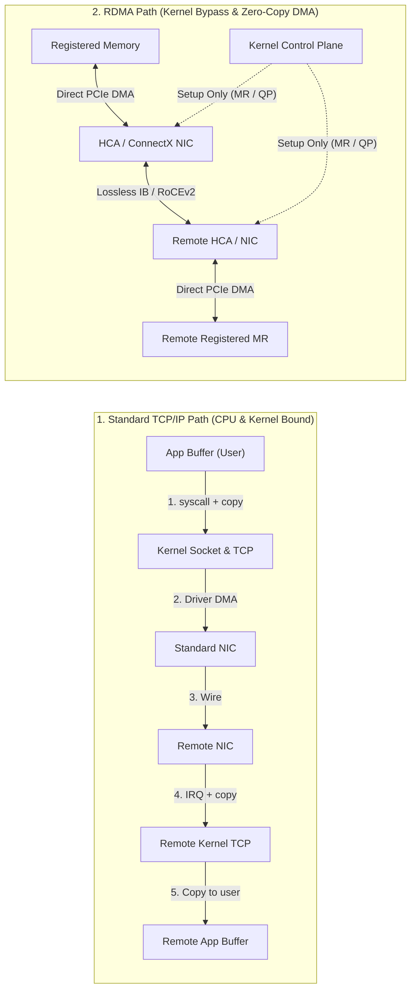
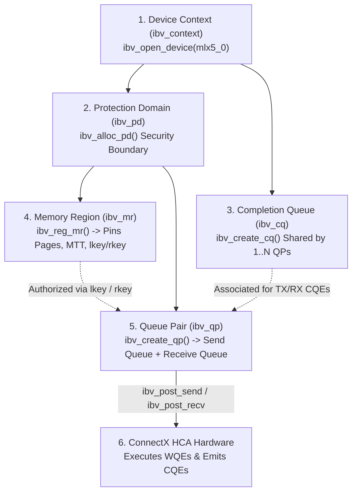
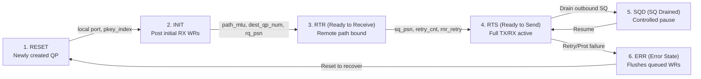

# 12.2 RDMA fundamentals: verbs, queue pairs and memory registration

| | |
|---|---|
| Level | Intermediate |
| Priority tier | 1 |
| Lab venue | Nebius GPU |
| Part | Part 12: Complete AI networking |
| Sources used | `nvidia-devops` Volume 08 Ch 3, Ch 12, `index.md` & Labs 01–04; Volume 07 Ch 4; Volume 09 Ch 3; Legacy Volume 06 Ch 1; *AI Data Center Network Design and Technologies* Ch 1 & Ch 7; *Supercomputers for Linux SysAdmins* Ch 5 & Ch 24; *NVIDIA Base Command Manager 11 Installation & Administrator Manuals* |
| Coverage file | `planning/coverage/chapters/12-02.md` |
| Claim ledger | `planning/ledgers/12-02.md` |

## Why this matters for AI infrastructure

"Every physical link on the fabric is `Active` at `400 Gbps`, `ping` succeeds across every node, and switches show zero drop counters—yet the distributed training job still crashes at startup with a generic network timeout."

This production failure occurs repeatedly on multi-node GPU clusters when engineers treat Remote Direct Memory Access (`RDMA`) as if it were a faster version of TCP sockets. In traditional socket programming, an application writes bytes to a file descriptor, the Linux kernel copies those bytes into kernel-space socket buffers (`sk_buff`), executes the TCP/IP state machine, and hands packets to the network interface card (`NIC`) driver. That model hides the hardware behind the operating system, but at `100 Gbps` to `400 Gbps` line rates across hundreds of GPUs, per-packet system calls, context switches, kernel buffer copies, and software checksums saturate host CPU cores (`100%` kernel `system` time, capping a `100 Gbps` ConnectX-5 cluster at `30 Gbps`) and inject tens of microseconds of latency jitter. Because synchronous collective operations (`AllReduce`, `AllGather`, `ReduceScatter`) force every GPU rank in a job to wait at a barrier for the slowest rank, a single delayed transfer stalls the entire training cluster (**straggler amplification**).

RDMA eliminates that software bottleneck by shifting transport execution into the **Host Channel Adapter (`HCA`)** or RDMA-capable NIC hardware (**kernel bypass** and **zero-copy DMA**). However, bypassing the kernel means the application and communication library (`NCCL`, `NVSHMEM`, `UCX`, `MPI`, or storage clients) become directly responsible for explicit hardware resources:
1. **Endpoint Queue Lifecycle Failure:** In the opening production incident, the application created **Queue Pairs (`QPs`)** on healthy `400 Gbps` ports, but failed to transition them through the required **`RESET -> INIT -> RTR -> RTS`** state machine with consistent peer addressing and `active_mtu` values (`4096` vs `2048`), left **Receive Queues (`RQs`)** unreplenished under burst traffic, and discarded the detailed **Completion Queue Entry (`CQE`)** error statuses—logging a generic `"network timeout"` when the hardware had explicitly reported `IBV_WC_RNR_RETRY_EXC_ERR` (Receiver Not Ready) and `IBV_WC_LOC_PROT_ERR` (Protection Error).
2. **The `ulimit -l` (`memlock`) Container Crash:** An RDMA adapter performs Direct Memory Access (`DMA`) using physical memory addresses translated by its on-NIC **Memory Translation Table (`MTT`)**. It cannot handle OS page faults or swapped pages. When a Kubernetes container or Slurm node attempts to register gigabytes of host or GPU BAR1 memory via `ibv_reg_mr()` while the Linux locked-memory limit (`ulimit -l` / `memlock`) is left at its `64 KiB` (`65,536` bytes) default instead of `unlimited`, memory registration fails immediately before a single packet leaves the server.
3. **The `O(N^2)` Queue Pair Scaling Wall:** On a `128`-node cluster with `8` GPUs per node (`1,024` total GPU ranks), a naive full-mesh **Reliable Connected (`RC`)** design requires `1,023` QPs per rank, `8,184` QPs per node, and **`1,047,552` QPs cluster-wide**. Because each active QP consumes scarce on-NIC SRAM cache (`ICM`) for its context and work queues, uncontrolled QP proliferation triggers NIC cache thrashing over PCIe unless mitigated by shared transports, hierarchical rings/trees, or **Dynamic Connected (`DC`)** transport.

This chapter builds the complete RDMA execution model from first principles: kernel bypass versus TCP/IP, the `libibverbs` (`rdma-core`) object hierarchy (`ibv_context`, `Protection Domain`, `Memory Region` with `lkey`/`rkey` and `MTT` page-pinning math, `Completion Queue`, and `Queue Pair`), Work Requests (`WRs`), Work Queue Elements (`WQEs`), and Scatter-Gather Entries (`SGEs`), two-sided `Send`/`Receive` versus one-sided `RDMA Write` (`13`-step CM lifecycle) and `RDMA Read` (`11`-step CM lifecycle), transport service types (`RC`, `UC`, `UD`, `DC`), the `6`-state QP state machine, wire-level packet headers (`BTH`, `RETH`, `AETH`, `ICRC`), and endpoint troubleshooting verified by our Python simulation lab.

:::tip In one minute
- **Why RDMA exists:** Standard TCP/IP forces every message through `send()` system calls, CPU context switches, user-to-kernel buffer copies, and software TCP processing. RDMA uses **kernel bypass** (user space posts descriptors directly to hardware doorbells after control-plane setup) and **zero-copy DMA** (the HCA reads and writes registered application or GPU memory directly), dropping small-message latency from tens of microseconds to low single-digit microseconds.
- **Core Verbs objects (`rdma-core` / `libibverbs`):**
  - **Device Context (`ibv_context`):** Queries HCA capabilities via `ibv_devinfo -v` (`max_qp: 262144`, `max_qp_wr: 32768`, `max_sge: 30`, `max_cq: 16777216`, `max_cqe: 4194303`, `max_mr: 16777216`, `active_mtu: 4096`).
  - **Protection Domain (`PD`):** Security boundary grouping QPs and Memory Regions; a QP in `PD A` cannot access an MR in `PD B`.
  - **Memory Region (`MR`):** Pins virtual memory pages in physical RAM (`memlock unlimited` in `/etc/security/limits.conf`), programs the HCA's **Memory Translation Table (`MTT`)** (where `1 GiB` uses `262,144 × 4 KiB` pages = `2 MiB` of `8`-byte MTT entries vs `512 × 2 MiB` hugepages = `4 KiB` of MTT entries, a `512x` reduction), and returns a `32`-bit local key (**`lkey`**) and optional remote key (**`rkey`**).
  - **Queue Pair (`QP`) and Completion Queue (`CQ`):** Each QP holds a **Send Queue (`SQ`)** and **Receive Queue (`RQ`)**. Applications post Work Requests (`WRs`) with up to `max_sge` Scatter-Gather Entries (`SGEs`); the HCA executes Work Queue Elements (`WQEs`) and writes Completion Queue Entries (`CQEs`) to the `CQ`.
- **Two-sided vs one-sided operations:**
  - **Two-sided (`Send`/`Receive`):** Requires the remote peer to pre-post a matching Receive WR (`ibv_post_recv`). Starving the RQ triggers **`IBV_WC_RNR_RETRY_EXC_ERR`** (Receiver Not Ready).
  - **One-sided (`RDMA Write`, `RDMA Read`, `Atomics`):** Targets a remote virtual address + `rkey` encoded in the **RDMA Extended Transport Header (`RETH`, `16` bytes)** completely bypassing the remote CPU and Receive Queue.
- **QP state machine:** `RESET -> INIT -> RTR (Ready to Receive) -> RTS (Ready to Send) -> SQD / ERR`. When a QP hits an error (such as `wr_id=1043` failing with `IBV_WC_RETRY_EXC_ERR`, `vendor_err=0x81`), it transitions to **`ERR`** and flushes all subsequent queued work with **`IBV_WC_WR_FLUSH_ERR`** (`wr_id=1044..1046`). Always debug the **first non-flush CQE**.
:::

---

## Prerequisites and outcomes

**Prerequisites:** Part 2 (Linux networking and QoS/ECN/PFC basics in Chapter `2.19`), Part 10 (PCIe, NUMA, and pinned memory in Chapters `10.6` and `10.12`), Chapter `11.11` (NVIDIA Network Operator overview), and Chapter `12.1` (AI collective traffic patterns, incast, and tail latency).

**Outcomes:** After completing this chapter, you will be able to:
1. Contrast the 7-step OS-mediated **TCP/IP socket path** against the **RDMA kernel-bypass data path**, separating control-plane setup (kernel-mediated resource creation and memory registration) from data-plane execution (user-space doorbells and hardware DMA).
2. Explain every core `libibverbs` object (**Device Context**, **Protection Domain**, **Memory Region**, **Queue Pair**, **Completion Queue**, **Work Request / WQE**, and **Scatter-Gather Entry**) and interpret `ibv_devinfo -v` capability limits before deploying workloads.
3. Calculate **Memory Translation Table (`MTT`)** entry footprints (`4 KiB` pages vs `2 MiB` hugepages), configure `memlock unlimited`, and diagnose `IBV_WC_LOC_PROT_ERR` versus `IBV_WC_REM_ACCESS_ERR`.
4. Compare **two-sided (`Send`/`Receive`)** and **one-sided (`RDMA Write`, `RDMA Read`, `Atomic`)** verbs, trace the **`13`-step RDMA Write** and **`11`-step RDMA Read** Connection Manager (`CM`) lifecycles, and select between **`RC`**, **`UC`**, **`UD`**, and **`DC`** transport service types.
5. Walk a Queue Pair through **`RESET -> INIT -> RTR -> RTS -> SQD / ERR`**, decode wire-level **`BTH` (`12` B)**, **`RETH` (`16` B)**, **`AETH` (`4` B)**, and **`ICRC` (`4` B)** packet captures, and isolate root-cause `CQE` errors ahead of `IBV_WC_WR_FLUSH_ERR` cascades.

---

## 1. Why TCP/IP Stalls AI Collectives and How RDMA Bypasses the Kernel

When a distributed training job synchronizes gradients across nodes, network latency and throughput directly govern **Job Completion Time (`JCT`)**—the elapsed time from job start to job completion. Consider a job split into `100` parallel threads or tasks across GPUs: if `99` tasks finish in `1 ms` (`< 100 ms`), but `1` task suffers congestion or transport stalls and takes `1 second` (`1,000 ms`), the other `99` threads must wait `999 ms` at the synchronization barrier. In serial execution of `n = 10` tasks where `9` tasks take `1 ms` and `taskX` takes `1 second`, total JCT is `1 second + (10 × 1 ms) = 1.010 seconds`; in parallel execution, overall JCT is still pinned at `1 second` by that single straggler.

### 1.1 The 7-step TCP/IP kernel penalty vs RDMA kernel bypass

Why does standard TCP/IP introduce high latency, jitter, and CPU saturation on `100 Gbps`–`800 Gbps` AI fabrics? Trace what happens when an application sends a tensor over a standard Linux TCP socket:
1. The application prepares payload bytes in user-space virtual memory.
2. The application invokes a `send()` system call into the Linux kernel.
3. **Context switch:** The CPU halts user-space execution and switches privilege rings into kernel mode.
4. **CPU data copy:** The CPU copies payload bytes from the user-space buffer into kernel-space socket and transport buffers (`sk_buff`).
5. **Protocol stack execution:** The CPU executes the TCP/IP stack—constructing TCP/IP headers, computing software checksums, managing congestion windows, and fragmenting packets to the path `MTU`.
6. **Driver signaling:** The kernel signals the NIC driver over PCIe.
7. **Receive-side reversal:** On the destination server, incoming packets trigger hardware interrupts (`IRQs`), kernel TCP reassembly, and another CPU copy from kernel buffers back into the receiving application's user-space memory.

On a `10 Gbps` web server, host CPUs absorb this overhead easily. On a `100 Gbps` to `400 Gbps` GPU cluster, processing millions of TCP packets per second pins host CPU cores at `100%` `system` (kernel) utilization and caps a `100 Gbps` ConnectX-5 link around `30 Gbps`.

**Remote Direct Memory Access (`RDMA`)** solves this by combining two hardware mechanisms:
- **Direct Memory Access (`DMA`):** Instead of the CPU copying bytes between RAM and the NIC, the DMA engine inside the adapter reads and writes physical host RAM (or GPU `BAR1` VRAM via **GPUDirect RDMA**) directly across the PCIe bus.
- **Kernel Bypass and Transport Offload:** The Linux kernel is invoked *only* during the **control path**—to open the device context, allocate a Protection Domain, pin and register Memory Regions, and transition Queue Pairs into the connected state. Once setup is complete, the **data path** bypasses the OS kernel on both endpoints. The application writes a descriptor directly to a memory-mapped hardware register (**doorbell**) in user space; the local HCA DMAs the buffer, encapsulates packets in hardware, transmits them across the fabric, and the remote HCA DMAs the payload straight into the destination's registered physical memory without waking the remote OS kernel.



| Architectural Layer | Standard TCP/IP Socket Stack | RDMA Verbs Stack (`InfiniBand` / `RoCEv2`) | Operational Impact on AI Workloads |
|---|---|---|---|
| **Control Path Setup** | `socket()`, `bind()`, `connect()` in kernel | `ibv_open_device()`, `ibv_alloc_pd()`, `ibv_reg_mr()`, `ibv_create_qp()`, `ibv_modify_qp()` via `/dev/infiniband/uverbsN` | Kernel validates permissions, pins pages, and configures HCA contexts once at startup |
| **Per-Message Submission** | `send()` / `recv()` system call per message | User-space `ibv_post_send()` / `ibv_post_recv()` ring MMIO doorbell directly | **Zero system calls** and **zero context switches** on the hot data path |
| **Memory Copy Path** | User buffer -> Kernel Socket Buffer -> Kernel Transport Buffer -> NIC (and reverse on RX) | Direct hardware DMA between registered application buffer (or GPU VRAM) and HCA | **Zero CPU bounce-buffer copies**; frees host CPUs for data loading and kernel launches |
| **Transport & Reliability** | Executed in software by host CPU threads (`TCP` sliding window, timers, ACKs) | Executed in silicon on the HCA (`PSN` tracking, hardware `ACK`/`NAK`, hardware retry) | Small-message latency drops from tens of microseconds to **low single-digit microseconds** (`~0.78–1.08 us` MPI PingPong) |
| **Fabric Requirement** | Tolerates lossy Ethernet via software TCP selective retransmission | Expects lossless or near-lossless fabric (InfiniBand link-layer credits or RoCEv2 with `PFC` + `ECN`/`DCQCN`) | Packet drops trigger hardware Go-Back-N or retry stalls unless fabric congestion control is active |

### 1.2 The five node-local RDMA layers and three RDMA transport protocols

Within each server node, RDMA communication flows through five distinct layers:
1. **Application / Collective Library (`NCCL`, `MPI`, `UCX`):** Generates work requests for tensor buffers.
2. **Verbs API (`libibverbs` / `rdma-core`):** Exposes standardized C verbs to manage resources, post work, and poll completions.
3. **RDMA Provider & Kernel Driver (`mlx5_ib`, `ib_uverbs`, `ib_core`):** Translates user-space verbs into hardware-specific Work Queue Elements (`WQEs`) and manages virtual-to-physical address translation tables.
4. **RDMA NIC / Host Channel Adapter (`HCA`, e.g., ConnectX-6/7/8):** Executes DMA, packet segmentation, sequence numbering (`PSN`), `ICRC` generation, and hardware acknowledgements.
5. **Physical Wire (`InfiniBand` or `Ethernet`):** Transmits frames across copper (`DAC`/`ACC`) or optical (`AOC`/transceiver) links (`4x` lanes at `SDR` `2.5 Gbps` / `8 Gbps` effective `8b/10b`, `DDR` `5 Gbps` / `16 Gbps`, `QDR` `10 Gbps` / `32 Gbps`, `FDR` `14.0625 Gbps` / `54.4 Gbps` `64b/66b`, `EDR` `25 Gbps` / `100 Gbps`, `HDR` `53.125 Gbps` / `200 Gbps` `64b/66b`, `NDR` `106.25 Gbps` / `400 Gbps` `256b/257b`, `XDR` `200 Gbps` / `800 Gbps`, and `GDR` `400 Gbps` / `1,600 Gbps`).

Across the wire, three RDMA transport protocols exist:
- **InfiniBand (`IB`):** Governed by the InfiniBand Trade Association (`IBTA`). Uses an InfiniBand link layer (`LRH`, `8` bytes, credit-based lossless flow control), optional InfiniBand network layer (`GRH`, `40` bytes, for inter-subnet routing), and InfiniBand transport layer (`BTH`, `12` bytes + payload + `ICRC` `4` B + `VCRC` `2` B). A single InfiniBand subnet supports up to `2^15 + 2^14 - 1 = 49,151` end ports and switches (`16`-bit unicast `LIDs` `1..0xBFFF`, multicast `0xC000..0xFFFE`, permissive `0xFFFF`).
- **RDMA over Converged Ethernet (`RoCEv1` and `RoCEv2`):** Also governed by `IBTA`. `RoCEv1` replaced the IB link layer with Ethernet L2 (`EtherType 0x8915`) while keeping the IB `GRH` network header, confining traffic to a single L2 broadcast domain. **`RoCEv2`** replaced the IB network layer with standard **`IPv4`/`IPv6` + `UDP` (`destination port 4791`)**, followed immediately by the **`12`-byte InfiniBand Base Transport Header (`BTH`)**, payload, **`4`-byte Invariant CRC (`ICRC`)**, and **`4`-byte Ethernet FCS**. The UDP source port is hashed from the Queue Pair Number (`QPN`) to provide ECMP entropy across spine switches.
- **iWARP (Internet Wide Area RDMA Protocol):** Runs RDMA over hardware-offloaded TCP/IP (`MPA`/`DDP`/`RDMAP`), avoiding lossless Ethernet requirements at the cost of higher latency and complexity; rarely used in modern GPU training clusters.

---

## 2. The Verbs Object Hierarchy and `ibv_devinfo -v` Capability Inspection

Before an application can post a single RDMA operation, it must construct a strict hierarchy of hardware-backed resource objects through the **Verbs interface** (`libibverbs` in the `rdma-core` / `DOCA-OFED` stack).



| Verbs Object (`libibverbs`) | Creation API | Hardware / Kernel Function | Key Attributes & Limits (`mlx5_0` Example) |
|---|---|---|---|
| **Device Context (`ibv_context`)** | `ibv_open_device()` | Opens `/dev/infiniband/uverbsN` and maps user-space doorbell pages | Queried via `ibv_query_device()` / `ibv_devinfo -v` (`fw_ver: 28.39.2048`, `vendor_id: 0x02c9`, `vendor_part_id: 4129`) |
| **Protection Domain (`ibv_pd`)** | `ibv_alloc_pd()` | Hardware isolation container binding compatible `QPs` and `MRs` | Prevents a `QP` in `PD A` from performing DMA against an `MR` in `PD B` |
| **Memory Region (`ibv_mr`)** | `ibv_reg_mr()` | Pins virtual pages in physical RAM, populates NIC `MTT`, issues DMA keys | Returns `lkey` (`32`-bit local key) and `rkey` (`32`-bit remote key); `max_mr: 16777216`, `max_mr_size: 0xffffffffffffffff` |
| **Completion Queue (`ibv_cq`)** | `ibv_create_cq()` | Ring buffer where the HCA writes `64`-byte Completion Queue Entries (`CQEs`) | Polled via `ibv_poll_cq()` or armed via `ibv_req_notify_cq()`; `max_cq: 16777216`, `max_cqe: 4194303` |
| **Queue Pair (`ibv_qp`)** | `ibv_create_qp()` | Transport endpoint containing a **Send Queue (`SQ`)** and **Receive Queue (`RQ`)** | Identified by `24`-bit `qp_num` (`QPN`); `max_qp: 262144`, `max_qp_wr: 32768`, `max_sge: 30` |

### 2.1 Annotated `ibv_devinfo -v`: Answering the seven capability questions before writing code

Production software must query adapter capabilities rather than hard-coding assumptions. Consider the illustrative `ibv_devinfo -v -d mlx5_0` output from an NVIDIA ConnectX-7 HCA (`vendor_part_id: 4129`, `MT4129`, `vendor_id: 0x02c9`):

```text
$ ibv_devinfo -v -d mlx5_0
hca_id: mlx5_0
    transport:                  InfiniBand (0)
    fw_ver:                     28.39.2048
    node_guid:                  08c0:eb03:00f1:a2c3
    sys_image_guid:             08c0:eb03:00f1:a2c3
    vendor_id:                  0x02c9
    vendor_part_id:             4129
    max_mr_size:                0xffffffffffffffff
    max_qp:                     262144
    max_qp_wr:                  32768
    max_sge:                    30
    max_cq:                     16777216
    max_cqe:                    4194303
    max_mr:                     16777216
    atomic_cap:                 ATOMIC_HCA (1)
        port:   1
            state:              PORT_ACTIVE (4)
            max_mtu:            4096 (5)
            active_mtu:         4096 (5)
            phys_state:         LINK_UP (5)
            link_layer:         InfiniBand
```

Every field in this output directly constrains application and collective-library design:
1. **Maximum Queue Pairs (`max_qp: 262144`):** Caps how many total QPs can exist on `mlx5_0`.
2. **Maximum Work Requests per Queue (`max_qp_wr: 32768`):** Bounds the depth of any single Send Queue or Receive Queue. Any application requesting `100,000` outstanding work requests on one QP will fail `ibv_create_qp()` immediately.
3. **Maximum Scatter-Gather Entries (`max_sge: 30`):** Bounds how many discontiguous local memory segments a single Work Request can gather or scatter. Passing `32` SGEs triggers a local work-request submission failure.
4. **Maximum Completion Queues and Entries (`max_cq: 16777216`, `max_cqe: 4194303`):** Determines how many QPs can share a single CQ without overflowing (`IBV_EVENT_CQ_ERR`).
5. **Maximum Memory Regions (`max_mr: 16777216`, `max_mr_size: 0xffffffffffffffff`):** Bounds the number of registered buffers (`MRs`) on the adapter.
6. **Atomic Capability (`atomic_cap: ATOMIC_HCA (1)`):** Confirms whether hardware `64`-bit Compare-and-Swap (`CAS`) and Fetch-and-Add (`FAA`) operations are supported on the HCA.
7. **Port State and Active MTU (`state: PORT_ACTIVE (4)`, `phys_state: LINK_UP (5)`, `active_mtu: 4096 (5)`):** If one endpoint has `active_mtu: 4096` and its peer has `active_mtu: 2048`, requesting a `4096`-byte `path_mtu` during QP connection setup causes `ibv_modify_qp()` to fail the `INIT -> RTR` transition with `EINVAL` even though both ports report `PORT_ACTIVE`.

---

## 3. Protection Domains, Memory Registration, `lkey`/`rkey`, and MTT Math

Why can an RDMA NIC not simply read or write any `malloc()` or `torch.empty()` pointer passed by a user program?

### 3.1 What `ibv_reg_mr()` actually does in the kernel and on the NIC

When a CPU dereferences a virtual address, the CPU's Memory Management Unit (`MMU`) walks the process page tables in hardware; if the page is not resident in physical RAM, the CPU raises a page fault, the Linux kernel swaps or allocates a physical page frame, updates the page table, and resumes the instruction.

An RDMA HCA performing line-rate DMA across PCIe cannot stall the wire to wait for Linux kernel page faults, nor can it risk writing incoming network packets to a physical RAM frame that the Linux kernel silently reassigned to another process. Therefore, calling `ibv_reg_mr(pd, addr, length, access_flags)` executes four mandatory steps:
1. **Page Pinning (`get_user_pages` / `pin_user_pages`):** The kernel locks the virtual pages backing `[addr, addr + length)` in physical RAM (or maps GPU `BAR1` physical pages via `nvidia-peermem` / `dma-buf`) so the OS kernel can never swap or relocate them while the Memory Region exists.
2. **Enforcing `ulimit -l` (`memlock`):** Because pinned pages cannot be paged out by the OS, Linux accounts them against the user's `RLIMIT_MEMLOCK` (`ulimit -l`) quota. On an unconfigured Linux host or container, `ulimit -l` defaults to **`64 KiB` (`65,536` bytes)**. Attempting to register a `128 KiB` (`131,072` bytes) buffer when `memlock` is `65,536` bytes causes `ibv_reg_mr()` to fail with `ENOMEM` (`IBV_REG_MR_ENOMEM_MEMLOCK`). On every HPC and AI compute node, `/etc/security/limits.conf` (and Kubernetes container `securityContext` / DaemonSet limits) must set:
   ```text
   * soft memlock unlimited
   * hard memlock unlimited
   ```
3. **Programming the HCA Memory Translation Table (`MTT`):** The driver writes the virtual-to-physical (or IOMMU `IOVA`) page mappings into the HCA's **Memory Translation Table (`MTT`)** so the NIC hardware can translate virtual addresses in incoming `RETH` headers or local `SGEs` into PCIe physical DMA addresses.
4. **Issuing Hardware Protection Keys (`lkey` and `rkey`):** The HCA binds the Memory Region to the specified **Protection Domain (`PD`)**, stores the authorized access flags (`IBV_ACCESS_LOCAL_WRITE`, `IBV_ACCESS_REMOTE_WRITE`, `IBV_ACCESS_REMOTE_READ`, `IBV_ACCESS_REMOTE_ATOMIC`), and returns two `32`-bit cryptographic-style capability tokens:
   - **`lkey` (Local Key):** Must be supplied in every local **Scatter-Gather Entry (`SGE`)** so the local HCA verifies the local QP belongs to the same `PD` and stays within `[addr, addr + length)`.
   - **`rkey` (Remote Key):** Exchanged out-of-band with a remote peer so the remote peer can include `(virtual_address, rkey, dma_length)` in one-sided `RDMA Write`, `RDMA Read`, or `Atomic` packets.

### 3.2 MTT page-table scaling math and NIC cache thrashing (`4 KiB` vs `2 MiB` hugepages)

Each page pinned in a Memory Region requires an `8`-byte (`64`-bit) physical address entry in the HCA's `MTT`:

```text
Number of Pinned Pages = ceil(Buffer_Bytes / Page_Size_Bytes)
MTT_Table_Bytes        = Number of Pinned Pages * 8 bytes
```

Compare two registrations calculated in `evaluate_memory_registration_and_mtt()` (`code/part12/rdma_fundamentals.py`):
- **A `64 KiB` (`65,536` bytes = `0x00010000`) DMA buffer on `4 KiB` (`4,096` B) pages:**
  - `65,536 / 4,096 = 16` pinned pages -> `16 × 8 B = 128 bytes` of MTT entries.
- **A `1 GiB` (`1,073,741,824` bytes) tensor buffer on standard `4 KiB` (`4,096` B) pages vs `2 MiB` (`2,097,152` B) hugepages:**
  - **With `4 KiB` pages:** `1,073,741,824 / 4,096 = 262,144` pinned pages -> `262,144 × 8 B = 2,097,152 bytes` (**`2 MiB`** of MTT entries per GiB).
  - **With `2 MiB` hugepages:** `1,073,741,824 / 2,097,152 = 512` pinned hugepages -> `512 × 8 B = 4,096 bytes` (**`4 KiB`** of MTT entries per GiB—a **`512x` reduction** in MTT footprint).

Why does this `512x` reduction matter in production? ConnectX HCAs cache hot `MTT` entries and `QP`/`CQ` contexts in a small, fast on-NIC SRAM cache (**Interconnect Context Memory, `ICM`**). When a node registers tens of gigabytes of fragmented `4 KiB` pages, the `MTT` working set overflows the NIC's on-chip SRAM cache. Every cache miss forces the HCA to fetch `MTT` page translations across the host PCIe bus *before* it can DMA the actual tensor payload (**MTT cache thrashing**), inflating tail latency and cutting effective RDMA bandwidth. Backing large host buffers with `2 MiB` or `1 GiB` hugepages (and using a pre-registered **buffer pool** rather than calling `ibv_reg_mr()` on the per-message hot path) eliminates both registration latency and NIC MTT cache misses.

### 3.3 Protection Domain and Memory Region failure semantics

| Violation Type | Where Detected | Completion Queue Status (`ibv_wc_status`) | Root Cause |
|---|---|---|---|
| **Local `PD` Mismatch** | Local HCA before wire transmission | **`IBV_WC_LOC_PROT_ERR`** | QP belongs to `Protection Domain A`, but SGE references an `lkey` registered in `Protection Domain B` |
| **Local Out-of-Bounds / Invalid `lkey`** | Local HCA before wire transmission | **`IBV_WC_LOC_PROT_ERR`** or **`IBV_WC_LOC_LEN_ERR`** | Local SGE `addr + length` exceeds the registered MR bounds, or `MR` was prematurely deregistered (`ibv_dereg_mr`) while a WQE was still in flight |
| **Remote Invalid `rkey` / Missing Flag / Out-of-Bounds** | Remote HCA upon inspecting incoming `RETH` header; returns `NAK` (`AETH`) to initiator | **`IBV_WC_REM_ACCESS_ERR`** on initiator `CQ` | Initiator supplied a stale/wrong `rkey`, accessed `offset + length > buffer_bytes` (e.g., `32,768 + 65,536 > 65,536`), or targeted an MR registered without `IBV_ACCESS_REMOTE_WRITE` / `IBV_ACCESS_REMOTE_READ` |

---

## 4. Work Requests, SGEs, Operation Types, and Transport Services (`RC`, `UC`, `UD`, `DC`)

### 4.1 Work Requests (`WR`), Work Queue Elements (`WQE`), and Scatter-Gather Entries (`SGE`)

An application submits work by constructing a `struct ibv_send_wr` or `struct ibv_recv_wr` (**Work Request, `WR`**) containing:
- **`wr_id` (`uint64_t`):** An application-defined `64`-bit tag (such as `1042` or a pointer to a request context) echoed verbatim in the resulting Completion Queue Entry (`CQE`).
- **`opcode`:** The operation (`IBV_WR_SEND`, `IBV_WR_RDMA_WRITE`, `IBV_WR_RDMA_WRITE_WITH_IMM`, `IBV_WR_RDMA_READ`, `IBV_WR_ATOMIC_CMP_AND_SWP`, `IBV_WR_ATOMIC_FETCH_AND_ADD`).
- **`sg_list` and `num_sge`:** An array of **Scatter-Gather Entries (`SGEs`)**, up to `max_sge` (`30` on `mlx5_0`), where each `struct ibv_sge` specifies `{addr, length, lkey}`. A single WR can gather a protocol header (`SGE 1`), a tensor chunk (`SGE 2`), and trailing metadata (`SGE 3`) from three separate buffers into one contiguous wire transfer without copying them into a staging buffer first.
- **`send_flags`:**
  - **`IBV_SEND_SIGNALED`:** Instructs the HCA to generate a `CQE` when this WR completes. To reduce CQ pressure and PCIe DMA overhead, high-performance libraries post `K - 1` **unsignaled** WRs followed by `1` **signaled** WR (for example, `1` signaled WR every `16`, `32`, or `64` WRs). Because `RC` queues complete work in strict FIFO order, consuming the `CQE` for WR `#64` proves WRs `#1..#63` have also completed and their Send Queue slots can be reused. (Warning: never post more than `max_qp_wr` unsignaled WRs without a signaled WR—doing so overflows the Send Queue silently because no CQE ever arrives to free SQ descriptors).
  - **`IBV_SEND_INLINE`:** For tiny payloads (typically `<= 64` to `256` bytes), copies the payload bytes directly into the WQE descriptor itself when ringing the doorbell, saving the HCA a separate PCIe DMA read transaction to fetch the buffer.

### 4.2 Two-sided (`Send`/`Receive`) vs one-sided (`RDMA Write`, `RDMA Read`, `Atomics`)

| Operation Type | Remote Receive WQE Required? | Remote CPU Involved in Data Path? | Wire Headers (`IB` / `RoCEv2`) | Primary AI / HPC Use Case & Operational Risk |
|---|---|---|---|---|
| **1. `Send` / `Receive` (Two-Sided Channel Semantics)** | **Yes** (Remote peer must pre-post `ibv_post_recv` before packet arrives) | Only to post RX buffer and poll RX `CQE` | `BTH` (`12` B) + Payload + `ICRC` (`4` B) | Control messages, RPC headers, and metadata exchange. **Risk:** If the receiver's `RQ` runs empty under a burst, the remote HCA returns an **RNR NAK**, eventually failing the sender with **`IBV_WC_RNR_RETRY_EXC_ERR`**. |
| **2. `RDMA Write` (One-Sided Memory Push)** | **No** (Unless using `WRITE_WITH_IMM`, which consumes 1 RX WQE for `32`-bit immediate notification) | **Zero** (Completely silent to remote CPU unless notified separately) | First packet: `BTH` (`12` B) + **`RETH` (`16` B)** + Payload + `ICRC` (`4` B); Middle/Last: `BTH` + Payload + `ICRC` | Bulk gradient/activation streaming (`NCCL` Ring/Tree channels, `ib_write_bw`). **Nuance:** An initiator's local `RDMA_WRITE` `CQE` proves the remote HCA acknowledged placement into remote RAM/VRAM—it does *not* prove the remote application noticed the data without a separate flag, immediate value, or follow-up `Send`. |
| **3. `RDMA Read` (One-Sided Memory Pull)** | **No** | **Zero** | Request: `BTH` (`12` B) + **`RETH` (`16` B)** + `ICRC` (`4` B) (`32` B total); Response: `BTH` + (`AETH` on First/Last/Only) + Payload + `ICRC` | Storage target pulls (`NVMe-oF`, `NFS-RDMA`) and KV-cache / parameter pulls. |
| **4. `Atomics` (`CAS` / `FAA`)** | **No** | **Zero** | Request: `BTH` (`12` B) + `AtomicETH` (`28` B) + `ICRC` (`4` B); Response: `BTH` + `AtomicAckETH` + `ICRC` | Distributed locks, queue-tail pointers, and barrier counters (`64`-bit aligned; requires `atomic_cap: ATOMIC_HCA`). |

### 4.3 Tracing the 13-step RDMA Write and 11-step RDMA Read CM sessions

How does a complete RDMA Connection Manager (`CM`) session establish a Queue Pair connection, exchange memory metadata, transfer data, and tear down cleanly? Our model function `trace_rdma_cm_session_steps()` (`code/part12/rdma_fundamentals.py`) encodes the two canonical session sequences:

1. **The `13`-Step RDMA Write Session (`3` Handshake + `6` RDMA Write + `4` Terminate):**
   - **Phase 1 — CM Handshake (`3` steps):**
     - *Step 1 (`Client -> Server`):* `CM: Connect request with client QPN`
     - *Step 2 (`Server -> Client`):* `CM: Connect reply with server QPN`
     - *Step 3 (`Client -> Server`):* `CM: Ready to use (Connection established)`
   - **Phase 2 — RDMA Write Exchange (`6` steps):**
     - *Step 4 (`Client -> Server`):* `Transfer size and remote address information`
     - *Step 5 (`Server -> Client`):* `Acknowledgement`
     - *Step 6 (`Client -> Server`):* `Memory region information`
     - *Step 7 (`Server -> Client`):* `Acknowledgement`
     - *Step 8 (`Client -> Server`):* `Data` (One-sided RDMA Write payload pushed directly to server memory)
     - *Step 9 (`Server -> Client`):* `Acknowledgement`
   - **Phase 3 — CM Teardown (`4` steps):**
     - *Step 10 (`Client -> Server`):* `CM: Disconnect request with server QPN`
     - *Step 11 (`Server -> Client`):* `CM: Disconnect reply`
     - *Step 12 (`Client -> Server`):* `CM: Disconnect request with client QPN`
     - *Step 13 (`Server -> Client`):* `CM: Disconnect reply`

2. **The `11`-Step RDMA Read Session (`Client 20.0.0.2` and `Server 60.0.0.2`: `3` Handshake + `4` RDMA Read + `4` Terminate):**
   - **Phase 1 — CM Handshake (`3` steps):**
     - *Step 1 (`20.0.0.2 -> 60.0.0.2`):* `CM: Connect request with client QPN`
     - *Step 2 (`60.0.0.2 -> 20.0.0.2`):* `CM: Connect reply with server QPN`
     - *Step 3 (`20.0.0.2 -> 60.0.0.2`):* `CM: Ready to use (Connection established)`
   - **Phase 2 — RDMA Read Exchange (`4` steps):**
     - *Step 4 (`Client -> Server`):* `Transfer size, remote address, and memory region information` (`RDMA READ Request`, `BTH opcode 12` + `RETH`)
     - *Step 5 (`Server -> Client`):* `Acknowledgement`
     - *Step 6 (`Server -> Client`):* `Data` (`RDMA READ Response`, `BTH opcode 13/14/15/16` carrying server memory payload back to client)
     - *Step 7 (`Client -> Server`):* `Acknowledgement`
   - **Phase 3 — CM Teardown (`4` steps):**
     - *Step 8 (`Client -> Server`):* `CM: Disconnect request with server QPN`
     - *Step 9 (`Server -> Client`):* `CM: Disconnect reply`
     - *Step 10 (`Server -> Client`):* `CM: Disconnect request with client QPN`
     - *Step 11 (`Client -> Server`):* `CM: Disconnect reply`

### 4.4 Transport Service Types (`RC`, `UC`, `UD`, `DC`) and `O(N^2)` QP Scaling Math

When creating a Queue Pair, the application selects a transport service type that governs reliability, ordering, supported verbs, and cluster-wide scaling:

| Transport Code | Full Name | Connection Model | Reliable (ACK / Retry)? | Ordered? | Supported Verbs | QPs per Rank for `N` Peers |
|---|---|---|---|---|---|---|
| **`RC`** | **Reliable Connected** | `1:1` dedicated logical peer QP per local QP | **Yes** (`PSN` + `AETH` `ACK`/`NAK`) | **Yes** | `Send`/`Recv`, `RDMA Write`, `RDMA Read`, `Atomics` | **`N - 1`** (`O(N^2)` cluster-wide) |
| **`UC`** | **Unreliable Connected** | `1:1` dedicated peer QP (no `ACK` or retransmission) | **No** (corrupted/lost packets dropped silently) | **Yes** | `Send`/`Recv`, `RDMA Write` *(No Read or Atomics)* | **`N - 1`** (`O(N^2)` cluster-wide) |
| **`UD`** | **Unreliable Datagram** | `1:M` connectionless; addressed per WQE via an **Address Handle (`AH`)** | **No** | **No** | `Send`/`Recv` only (`<= 1 MTU` payload + `40`-byte `GRH`) | **`1`** (single QP reaches any peer; supports multicast) |
| **`DC`** | **Dynamic Connected** *(Mellanox/NVIDIA extension)* | `1:M` reliable connected; a **DC Initiator (`DCI`)** dynamically connects to any remote **DC Target (`DCT`)** per packet burst | **Yes** | **Yes** | `Send`/`Recv`, `RDMA Write`, `RDMA Read`, `Atomics` | **`O(1)`** small pool of `DCI` QPs per process |

**Worked `O(N^2)` QP Scaling Calculation (`evaluate_qp_scaling_and_perftest` in `code/part12/rdma_fundamentals.py`):**
Suppose a customer deploys **`128` GPU nodes with `8` GPUs per node (`1,024` total GPU ranks)** and asks for a full all-to-all mesh of dedicated **`RC` Queue Pairs**:
- **QPs per GPU rank:** `N - 1 = 1,024 - 1 = 1,023` `RC` QPs per rank.
- **QPs per 8-GPU node:** `8 × 1,023 = 8,184` `RC` QPs per node.
- **Total cluster-wide `RC` QPs:** `1,024 × 1,023 = 1,047,552` `RC` QPs across the cluster.

While `8,184` QPs per node fits below `mlx5_0`'s hard `max_qp: 262144` ceiling, scaling to thousands of nodes with multiple QPs per peer pushes each node past `max_qp: 262144`—exhausting HCA `ICM` SRAM cache and degrading throughput due to PCIe context-fetch thrashing. Production communication libraries avoid full-mesh `RC` explosion by using **Ring / Tree topologies** (where each rank connects only to a small constant number of neighbors in `NCCL`), **Shared Receive Queues (`SRQ`)**, or **Dynamic Connected (`DC`)** transport for all-to-all (`AllToAll` MoE) communication.

---

## 5. Queue Pair State Machine, Completion Queues, and Wire-Level Packet Headers

### 5.1 The 6-state Queue Pair lifecycle (`RESET -> INIT -> RTR -> RTS -> SQD / ERR`)

A newly created Queue Pair (`ibv_create_qp()`) cannot transmit or receive packets immediately. It starts in **`RESET`** and must be stepped through a strict hardware state machine via `ibv_modify_qp()` calls (`validate_qp_transition()` in `code/part12/rdma_fundamentals.py`):



| QP State | Valid Next States | Mandatory `ibv_modify_qp()` Attributes | Operational Behavior & Failure Signature |
|---|---|---|---|
| **1. `RESET`** | `INIT` | None at creation | Queues are empty; posting `send` or `recv` WRs is rejected immediately. Skipping straight from `RESET -> RTS` fails with `EINVAL`. |
| **2. `INIT`** | `RTR`, `ERR`, `RESET` | `port_num >= 1`, `pkey_index >= 0` (`0xFFFF` default `P_Key`), `qp_access_flags` | **Receive WRs (`ibv_post_recv`) can now be pre-posted**, though packets are not yet accepted from the wire. |
| **3. `RTR` (Ready to Receive)** | `RTS`, `ERR`, `RESET` | `path_mtu` (`256`, `512`, `1024`, `2048`, or `4096`), `dest_qp_num` (`> 0`), `rq_psn` (`24`-bit starting RX PSN), `ah_attr` (peer `dlid` or `dgid` + `sgid_index`, `sl`) | Binds the QP to its remote peer and path. **Fails with `Failed to modify QP to RTR` (`EINVAL`)** if `requested_path_mtu` (`4096`) exceeds `local_active_mtu` (`2048`) or if RoCEv2 GID index (`-x 2`) fails handshake (`QPN 0x0000`). |
| **4. `RTS` (Ready to Send)** | `SQD`, `ERR`, `RESET` | `sq_psn` (`24`-bit starting TX PSN), `timeout` (`5`-bit local ACK timer), `retry_cnt` (`0..7`), `rnr_retry` (`0..7`), `max_rd_atomic` | Full bidirectional Send/Receive and one-sided RDMA Write/Read/Atomic execution active. |
| **5. `SQD` (Send Queue Drained)** | `RTS`, `ERR`, `RESET` | Drain notification | Halts new outbound sends while in-flight WQEs complete cleanly so path attributes can be modified safely. |
| **6. `ERR` (Error State)** | `RESET` | Triggered automatically by HCA on fatal WQE / retry failure | Immediately halts wire transmission and drains all remaining queued WQEs into the `CQ` with status **`IBV_WC_WR_FLUSH_ERR`**. Must transition `ERR -> RESET` (or destroy/recreate QP) before reuse. |

### 5.2 Completion Queue (`CQ`) semantics, busy polling vs events, and flush cascades

When the HCA finishes processing a signaled Work Queue Element (or encounters a local or remote transport error even on an unsignaled WQE), it DMAs a **Completion Queue Entry (`CQE`)** into the **Completion Queue (`CQ`)**.

Applications consume `CQEs` using one of two mechanisms:
- **Busy Polling (`ibv_poll_cq()`):** A dedicated thread spins in user space checking the `CQ` ring buffer in host RAM. Busy polling delivers the lowest possible wake-up latency and most deterministic tail latency (`p99`), which is why `NCCL` proxy threads and `perftest` (`ib_write_bw`, `ib_write_lat`) busy-poll by default—at the cost of pinning `100%` of that CPU core (`Scenario 5: High CPU despite RDMA`).
- **Event-Driven Completion (`ibv_req_notify_cq()` + `ibv_get_cq_event()`):** The application arms the `CQ` doorbell and sleeps on a completion channel file descriptor until the HCA fires an MSI-X interrupt. Event mode saves CPU cycles during idle periods, but incurs kernel interrupt and thread wake-up latency (`5–15 us`). Production storage and RPC engines often use **hybrid polling** (spin-poll for a few microseconds, then arm interrupts and sleep if idle).

**Decoding a CQ Error Cascade (`analyze_cq_completion_stream()` in `code/part12/rdma_fundamentals.py`):**
When an RDMA job fails, inspecting the `ibv_poll_cq()` stream is the single most important diagnostic step. Consider this captured sequence of five completions:

```text
wr_id=1042  status=IBV_WC_SUCCESS          opcode=RDMA_WRITE
wr_id=1043  status=IBV_WC_RETRY_EXC_ERR    opcode=RDMA_WRITE   vendor_err=0x81
wr_id=1044  status=IBV_WC_WR_FLUSH_ERR     opcode=RDMA_WRITE
wr_id=1045  status=IBV_WC_WR_FLUSH_ERR     opcode=SEND
wr_id=1046  status=IBV_WC_WR_FLUSH_ERR     opcode=SEND
```

Why do `wr_id=1044`, `1045`, and `1046` all report `IBV_WC_WR_FLUSH_ERR`? Because **`wr_id=1043` is the root cause**: the local HCA transmitted `RDMA_WRITE` `wr_id=1043` and exhausted all `retry_cnt` (`7`) hardware retransmission attempts without receiving a valid `ACK` from the peer (`IBV_WC_RETRY_EXC_ERR`, `vendor_err=0x81`, `NCCL error 12`). The instant `wr_id=1043` failed, the HCA transitioned the Queue Pair into the **`ERR`** state and automatically flushed every subsequent queued work request (`1044..1046`) with `IBV_WC_WR_FLUSH_ERR`. Never waste time debugging flushed WRs—always filter for the **first non-`SUCCESS`, non-`WR_FLUSH_ERR` completion**.

**Safe Teardown Lifecycle:** Never call `ibv_dereg_mr()` or `free()` on a buffer while a QP can still DMA into or out of it. The mandatory lifecycle order is: `1. Open & Query Device` -> `2. Allocate PD & CQ` -> `3. Register Memory (MR)` -> `4. Create QP` -> `5. Transition RESET->INIT->RTR->RTS` -> `6. Post Work & Drain Completions` -> `7. Quiesce New Work` -> `8. Drain or Flush Outstanding Work` -> `9. Destroy QP, then MR, then CQ, then PD`.

### 5.3 Wire-level packet headers: `BTH` (`12` B), `RETH` (`16` B), `AETH` (`4` B), and `ICRC` (`4` B)

Whether carried over native InfiniBand (`LRH` `8` B + optional `GRH` `40` B) or RoCEv2 (`Ethernet` L2 + `IPv4`/`IPv6` + `UDP dst port 4791`), every RDMA packet shares the exact same InfiniBand transport headers decoded by `decode_rdma_transport_headers()` (`code/part12/rdma_fundamentals.py`):

1. **Base Transport Header (`BTH`, `12` bytes — present in every RDMA packet):**
   - **`Opcode` (`8` bits):** Specifies the transport service and operation type—for example:
     - `12` (`0x0c`): `RC RDMA READ Request`
     - `14` (`0x0e`): `RC RDMA READ Response Middle`
     - `17` (`0x11`): `RC Acknowledge`
     - `129` (`0x81` = `10000001` binary): `RoCEv2 Congestion Notification Packet (CNP)`
   - **`SE` (`Solicited Event`, `1` bit), `M` (`MigReq`, `1` bit), `PadCnt` (`2` bits), `TVer` (`Header Version`, `4` bits)**
   - **`Partition Key (`P_Key`)` (`16` bits):** Default full-membership partition is `65535` (`0xffff`).
   - **`Destination Queue Pair (`Dest QP`)` (`24` bits):** Identifies the target QP on the receiving HCA (for example `0x000fe1`, `0x00007b`, or `0x000123`).
   - **`A` (`Acknowledge Request`, `1` bit):** Requests an explicit `ACK` from the responder.
   - **`Packet Sequence Number (`PSN`)` (`24` bits):** Monotonically increasing `24`-bit per-packet sequence counter (`0..0xffffff`, e.g., `16548361`, `16543980`, or `2592248`) used by the receiving HCA to detect missing, duplicate, or out-of-order packets in hardware.
2. **RDMA Extended Transport Header (`RETH`, `16` bytes — present on `RDMA WRITE First/Only` and `RDMA READ Request` `opcode 12`):**
   - **`Virtual Address (`VA`)` (`64` bits / `8` bytes):** Target virtual memory address on the remote peer (e.g., `0x00007ff9de5f4000`).
   - **`Remote Key (`rkey`)` (`32` bits / `4` bytes):** Authorization key for the target Memory Region (e.g., `0x00207100`).
   - **`DMA Length` (`32` bits / `4` bytes):** Total transfer byte length (e.g., `65536` = `0x00010000` bytes).
3. **ACK Extended Transport Header (`AETH`, `4` bytes — present on `RC Acknowledge` `opcode 17` and `RDMA READ Response First/Last/Only`):**
   - **`Syndrome` (`8` bits):** Encodes whether the packet is a positive **`ACK`** (bits `6:5 == 00`, e.g., `Syndrome: 0` with credit count) or a **`NAK`** (`RNR NAK`, `PSN Sequence Error NAK`, `Invalid Request NAK`, or `Remote Access Error NAK`).
   - **`Message Sequence Number (`MSN`)` (`24` bits):** Sequence number of the last completed work request message at the responder (e.g., `MSN: 1`).
4. **Invariant CRC (`ICRC`, `4` bytes):** End-to-end `32`-bit CRC covering all fields that do not change in transit from source HCA to destination HCA.

| Captured Packet Type | `BTH` (`12` B) Fields | Extended Header (`RETH` / `AETH`) | Payload & `ICRC` (`4` B) | IB Transport Total Bytes |
|---|---|---|---|---:|
| **1. `RC RDMA READ Request`** | `Opcode: 12`, `SE: False`, `MigReq: True`, `Pad: 0`, `TVer: 0`, `P_Key: 65535 (0xffff)`, `Dest QP: 0x000fe1`, `AckReq: True`, `PSN: 16548361` | **`RETH` (`16` B):** `VA: 0x00007ff9de5f4000`, `rkey: 0x00207100`, `DMA Length: 65536 (0x00010000)` | `0` B payload, `ICRC: 0xb87e1cbc` | **`32` B** (`12 + 16 + 0 + 4`) |
| **2. `RC RDMA READ Response Middle`** | `Opcode: 14`, `SE: False`, `MigReq: True`, `Pad: 0`, `TVer: 0`, `P_Key: 65535 (0xffff)`, `Dest QP: 0x00007b`, `AckReq: False`, `PSN: 16543980` | **None (`0` B)** (`Middle` packets omit `AETH`) | `1024` B payload (`a704e5c6...`), `ICRC: 0x5b522360` | **`1040` B** (`12 + 0 + 1024 + 4`) |
| **3. `RC Acknowledge`** | `Opcode: 17`, `SE: False`, `MigReq: True`, `Pad: 0`, `TVer: 0`, `P_Key: 65535 (0xffff)`, `Dest QP: 0x000123`, `AckReq: False`, `PSN: 2592248` | **`AETH` (`4` B):** `Syndrome: 0 (Ack, OpCode 0, Credit 0)`, `MSN: 1` | `0` B payload, `ICRC: 0x33e6e2af` | **`20` B** (`12 + 4 + 0 + 4`) |

### 5.4 How transport congestion control (`ECN`, `CNP 0x81`, `PFC`, `DCQCN`, `SFC`, `CSIG`) protects RDMA QPs

Because an `RC` Queue Pair treats any unacknowledged packet loss as a sequence error that triggers hardware Go-Back-N retransmission (or fails the QP with `IBV_WC_RETRY_EXC_ERR` after `retry_cnt` timeouts), the underlying fabric must prevent buffer overflow across all six Clos congestion points (local leaf south-facing links, leaf-to-spine uplinks, spine-to-leaf downlinks, leaf-to-server egress links, spine-to-super-spine links, and super-spine-to-spine links):
- **InfiniBand:** Prevents congestion drops natively at Layer 2 via **credit-based flow control** across Virtual Lanes (`VLs`), paired with centralized **Subnet Manager (`OpenSM` or `UFM`)** routing, **Adaptive Routing (`AR`)**, and optional **NVIDIA SHARP** in-network collective offloads.
- **RoCEv2 (`UDP port 4791`):** Combines **Explicit Congestion Notification (`ECN`)** (`2`-bit IP header field: `00` non-ECT, `01`/`10` ECN-capable transport set by sender, `11` Congestion Experienced marked by switch when queue crosses the `ECN` threshold), **Congestion Notification Packets (`CNPs`)** (generated by the receiving NIC with `ECN = 01` and **`BTH opcode 129` (`0x81`)** carrying the congested `QPN` back to the sender to throttle injection rate), and **Priority Flow Control (`PFC`, IEEE 802.1Qbb)** (Layer 2 pause frame with EtherType `0x8808`, control opcode `0x0101`, destination MAC `01:80:c2:00:00:01`, `XOFF` pause time `65535` vs `XON` `0` on lossless class `C3` / Priority `3`, guarded by a **PFC Watchdog**). Together, **DCQCN** orders queue thresholds strictly as **`XON < ECN < XOFF`** so `ECN`/`CNP` rate pacing resolves microbursts before hop-by-hop `PFC` pauses fire, while emerging standards add **Source Flow Control (`SFC`, IEEE 802.1Qdw)** (direct switch-to-sender flow signaling) and **Congestion Signaling (`CSIG`, `draft-ravi-ippm-csig-01`)** (in-band Layer 2 telemetry tags reflected by receivers). (Chapters `12.3` and `12.4` cover RoCEv2 and `PFC`/`ECN`/`DCQCN` switch tuning in full depth; Chapters `12.6`–`12.9` cover InfiniBand addressing, `OpenSM`/`UFM`, and `SHARP` in full depth).

---

## Commands and configurations that matter

All operational commands below are marked `(untested here)` because physical multi-node ConnectX InfiniBand / RoCEv2 fabrics are not attached in the local build environment; all model logic is verified in `code/part12/rdma_fundamentals_lab.py`.

### 1. Host OFED / DOCA-OFED installation, `memlock unlimited`, and BCM `mlxconfig` (`untested here`)

On bare-metal Linux or NVIDIA Base Command Manager 11 (`bcm11-install` Ch 10 & `bcm11-admin` §3.6, §5.3.3, §9.6; *Supercomputers for Linux SysAdmins* Ch 5 & Ch 24):

```bash
# 1. Configure unlimited locked memory for RDMA Memory Region page pinning (untested here)
cat << 'EOF' | sudo tee /etc/security/limits.d/99-rdma-memlock.conf
* soft memlock unlimited
* hard memlock unlimited
EOF
ulimit -l

# 2. Check installed DOCA-OFED / MLNX_OFED version and loaded kernel modules (untested here)
ofed_info -s
lsmod | egrep "mlx5_ib|mlx5_core|ib_uverbs|ib_core|rdma_cm|ib_ipoib"

# 3. BCM 11: Inspect supported DOCA-OFED versions (e.g., 2.9.4, 3.2.2) and install on head/image (untested here)
cat /cm/local/apps/cluster-tools/doca/etc/doca-ofed-versions.conf
/cm/local/apps/cluster-tools/bin/cm-doca-ofed-install.sh -v 3.2.2 -h
cat /etc/cm-ofed

# 4. BCM 11 cmsh: Configure ConnectX link type (IB vs ETH), SR-IOV VFs, OpenSM, and IPoIB (untested here)
cmsh -c "device; mlxconfig node001 --adapters"
cmsh -c "category use default; set -e MLX_link_type_p1 ETH; commit"
cmsh -c "device use node001; set -e MLX_num_vfs 16; interfaces; use ib0; set connectedmode yes; commit"
cmsh -c "device roles node001; assign subnetmanager; commit"
```

### 2. Enumerating RDMA Verbs devices, port states, GIDs, and fabric counters (`untested here`)

```bash
# 1. List RDMA verbs devices and inspect full HCA capability limits (untested here)
ibv_devices
ibv_devinfo -v -d mlx5_0

# 2. Inspect port logical state (Active), physical state (LinkUp), rate, Base LID, and SM LID (untested here)
ibstat
ibstatus
ibdev2netdev

# 3. Inspect RoCEv2 / InfiniBand GID tables (never hard-code GID index across heterogeneous hosts) (untested here)
show_gids

# 4. Query InfiniBand SM / SA records, link topology, optical BER (mlxlink), and error counters (untested here)
smpquery nodedesc 914
saquery 914
iblinkinfo
mlxlink -d mlx5_1 -c -m --json
perfquery -x 123 1
ibqueryerrors
ibdiagnet -c 1000
```

### 3. Validating Queue Pair transitions, latency, and line-rate bandwidth with `libibverbs` and `perftest` (`untested here`)

```bash
# 1. Minimal raw-verbs RC Queue Pair handshake test (surfaces INIT -> RTR MTU/GID mismatches) (untested here)
# Server (Node A):
ibv_rc_pingpong -d mlx5_0 -g 0
# Client (Node B):
ibv_rc_pingpong -d mlx5_0 -g 0 <node-a-ip>

# 2. NUMA-pinned RDMA Write latency sweep (2 B to 4 MiB) and bandwidth test (untested here)
# Server (Node A, pinned to HCA local NUMA node 0):
numactl --cpunodebind=0 --membind=0 ib_write_lat -d mlx5_0 -i 1 -a
numactl --cpunodebind=0 --membind=0 ib_write_bw -d mlx5_0 -i 1 --report_gbits

# Client (Node B, pinned to HCA local NUMA node 0):
numactl --cpunodebind=0 --membind=0 ib_write_lat -d mlx5_0 -i 1 -a <node-a-ip>
numactl --cpunodebind=0 --membind=0 ib_write_bw -d mlx5_0 -i 1 --report_gbits <node-a-ip>

# 3. Check RDMA hardware transport counters for PSN sequence errors, RNR NAKs, and timeouts (untested here)
head -n 20 /sys/class/infiniband/mlx5_0/ports/1/hw_counters/*
```

---

## How it fails

The diagnostic functions in `code/part12/rdma_fundamentals.py` (`validate_qp_transition()`, `analyze_cq_completion_stream()`, and `evaluate_memory_registration_and_mtt()`) model the six primary RDMA endpoint failure modes encountered in production AI clusters:

| # | Failure Mode | Exact Symptom & Evidence | Root Cause Boundary | Deterministic Fix |
|---|---|---|---|---|
| **1** | **QP fails `INIT -> RTR` (`Failed to modify QP to RTR`, `EINVAL`)** | `rc_pingpong` or `ib_write_bw -x 2` prints `Failed to modify QP to RTR`; `ibstat` shows both ports `Active` and `ping` succeeds. | **Endpoint Path / MTU / GID Mismatch:** Either the requested `path_mtu` (`4096`) exceeds one port's `active_mtu` (`2048` in `ibv_devinfo -v`), or hard-coded GID index `-x 2` maps to `eth0.100` on Host A and a different VLAN/RoCEv1 entry on Host B (`QPN 0x0000`). | Compare `ibv_devinfo -v` (`active_mtu`) and `show_gids` (`VER v2`, netdev, VLAN) on both peers; standardize end-to-end jumbo MTU (`4096` IB / `9000` Ethernet) and select GIDs by semantic interface/version rather than raw index assumption. |
| **2** | **Receive Queue Starvation (`IBV_WC_RNR_RETRY_EXC_ERR`)** | Two-sided `Send`/`Receive` traffic stalls under burst load; sender `CQ` reports **`IBV_WC_RNR_RETRY_EXC_ERR`** and `hw_counters/rnr_nak_retry_err` increments. | **Remote Receive Queue Empty:** A `Send` arrived at the remote HCA when zero `ibv_post_recv()` WQEs were available in the Receive Queue, exhausting `rnr_retry` (`7`) RNR NAK backoff attempts. | Pre-post sufficient Receive WRs before transitioning to `RTR`, replenish RX descriptors in batches before hitting the low-water mark, or use a **Shared Receive Queue (`SRQ`)** / one-sided `RDMA Write`. |
| **3** | **Local or Remote Memory Protection Fault (`IBV_WC_LOC_PROT_ERR` / `IBV_WC_REM_ACCESS_ERR`)** | One specific buffer transfer fails immediately; `CQ` reports `IBV_WC_LOC_PROT_ERR` (local) or `IBV_WC_REM_ACCESS_ERR` (remote). | **PD Mismatch, Invalid Key, or Out-of-Bounds DMA:** QP and MR belong to different Protection Domains (`PD A` vs `PD B`), `addr + length` exceeds the registered MR size (`32768 + 65536 > 65536`), `MR` lacked `IBV_ACCESS_REMOTE_WRITE`, or `ibv_dereg_mr()` was called before in-flight WQEs completed. | Verify QP and MR share the same `ibv_pd`, check buffer bounds and `IBV_ACCESS_*` flags, and enforce the teardown rule: never deregister or free an MR until its completion entry (`CQE`) has been consumed. |
| **4** | **CQ Flush Storm (`1` `IBV_WC_RETRY_EXC_ERR` followed by `100s` of `IBV_WC_WR_FLUSH_ERR`)** | Application logs hundreds of `IBV_WC_WR_FLUSH_ERR` (`wr_id=1044..1046`) and blames a global fabric collapse. | **Secondary Queue Error Flushing:** `wr_id=1043` failed with `IBV_WC_RETRY_EXC_ERR` (`vendor_err=0x81`, peer crashed or path dropped ACKs), transitioning the QP to **`ERR`** and automatically flushing all subsequent queued WQEs. | Isolate the **first non-flush error (`wr_id=1043`)**; inspect `hw_counters/{packet_seq_err,local_ack_timeout_err}` and peer process health, then transition the QP `ERR -> RESET` (or recreate it) before resuming. |
| **5** | **`ibv_reg_mr()` fails at job startup with `ENOMEM` (`IBV_REG_MR_ENOMEM_MEMLOCK`)** | `NCCL` or `perftest` crashes during initialization before sending traffic: `Failed to register memory region` / `Cannot allocate memory`. | **Locked Memory Quota (`ulimit -l`) Too Low:** Container or host `memlock` limit is set to the Linux default of `64 KiB` (`65,536` bytes), blocking `ibv_reg_mr()` from pinning multi-megabyte or multi-gigabyte buffers. | Set `* soft memlock unlimited` and `* hard memlock unlimited` in `/etc/security/limits.conf` on hosts and `ulimits: memlock: -1` (or privileged / `IPC_LOCK`) in container runtimes. |
| **6** | **High Host CPU (`100%` core) or Bandwidth Collapse at Scale Despite RDMA** | Either `1` CPU core per rank is pegged at `100%`, or multi-node bandwidth degrades when scaling to `1,000+` GPUs with `4 KiB` pages. | **Busy Polling or HCA `MTT`/`ICM` Cache Thrashing:** Polling threads spin in `ibv_poll_cq()` continuously (intentional latency trade-off), or registering gigabytes of `4 KiB` pages (`262,144` MTT entries/GiB) plus `O(N^2)` `RC` QPs overflows NIC SRAM cache. | Bind busy-polling threads to the HCA's local NUMA node (`numactl`), register persistent **buffer pools backed by `2 MiB` hugepages** (`512x` fewer MTT entries), and use Ring/Tree or `DC` transport instead of full-mesh `RC` QPs. |

---

## Hands-on lab

### Venue and scope
**Venue:** Local workstation or Nebius GPU VM with Python 3.10+ (`code/part12/rdma_fundamentals.py` and `code/part12/rdma_fundamentals_lab.py`).

All live InfiniBand and RoCEv2 hardware commands in `Commands and configurations that matter` are marked `(untested here)` because physical multi-node ConnectX fabrics are not attached in this build environment. Every formula, state transition, packet decode, and troubleshooting scenario in this chapter is executed and verified deterministically by `code/part12/rdma_fundamentals_lab.py`.

### Step 1: Run the self-checking Chapter 12.2 RDMA fundamentals lab (`tested here`)

Run the verification suite from the repository root:

```bash
python3 code/part12/rdma_fundamentals_lab.py
```

Expected and verified output (`25 passed, 0 failed`):

```text
=== Chapter 12.2 Lab: RDMA Fundamentals — Verbs, Queue Pairs & Memory Registration ===
  [PASS] V8 Ch3 & Lab 01: mlx5_0 capability profile matches ibv_devinfo -v (fw 28.39.2048, vendor 0x02c9, part 4129)
  [PASS] V8 Ch3 & Lab 01: mlx5_0 queue and MR limits (max_qp=262144, max_qp_wr=32768, max_sge=30, max_cq=16777216, max_cqe=4194303, max_mr=16777216)
  [PASS] V8 Ch3 & SCL Ch5: Transport service types RC, UC, UD, and DC are modeled with exact operation support
  [PASS] V8 Ch3 Fig 8.3.4: Valid QP lifecycle transitions RESET -> INIT -> RTR -> RTS -> SQD / ERR -> RESET succeed
  [PASS] V8 Ch3 Fig 8.3.4: Skipping INIT/RTR (RESET -> RTS directly) is rejected with EINVAL
  [PASS] V8 Ch3 Scenario 1 (rc_pingpong): Requesting path_mtu=4096 when port active_mtu=2048 fails INIT -> RTR with EINVAL
  [PASS] V9 Ch3 Scenario 1 (ib_write_bw -x 2): Mismatched GID index (QPN 0x0000, invalid peer GID) fails INIT -> RTR
  [INFO] V8 Ch3 CQ stream: first_fail=wr_id 1043 (IBV_WC_RETRY_EXC_ERR, vendor_err=0x81), flushed=[1044, 1045, 1046]
  [PASS] V8 Ch3 Scenario 4: wr_id=1043 (IBV_WC_RETRY_EXC_ERR, vendor_err=0x81) is isolated as root cause before 3 flushed WRs (1044..1046)
  [PASS] V8 Ch3 Scenario 2: IBV_WC_RNR_RETRY_EXC_ERR maps to REMOTE_RECEIVE_QUEUE_STARVATION
  [INFO] 65,536 B (64 KiB) MR on 4,096 B pages: pinned_pages=16, mtt_bytes=128 B, status=IBV_WC_SUCCESS
  [PASS] V8 Ch3 & ADC Ch1 Fig 1-14: 65,536 B (0x00010000) DMA region pins 16 x 4,096 B pages (128 B MTT entries) and succeeds
  [INFO] 1 GiB (1,073,741,824 B) MR MTT comparison: 4 KiB pages=262144 pages (2097152 B = 2 MiB MTT) vs 2 MiB hugepages=512 pages (4096 B = 4 KiB MTT)
  [PASS] MTT Scaling Math: 1 GiB (1,073,741,824 B) requires 262,144 x 4 KiB pages (2,097,152 B = 2 MiB MTT) vs 512 x 2 MiB pages (4,096 B = 4 KiB MTT, 512x reduction)
  [PASS] SCL Ch24 & VL10 Ch15: Registering 131,072 B when ulimit -l (memlock) is 65,536 B fails with IBV_REG_MR_ENOMEM_MEMLOCK
  [PASS] V8 Ch3 Fig 8.3.2 & Scenario 3: Protection Domain mismatch raises IBV_WC_LOC_PROT_ERR; remote bounds violation raises IBV_WC_REM_ACCESS_ERR
  [PASS] ADC Ch1 Fig 1-12: RDMA Write CM session has 13 total steps (3 handshake + 6 RDMA write + 4 terminate)
  [PASS] ADC Ch1 Fig 1-13: RDMA Read CM session (20.0.0.2 -> 60.0.0.2) has 11 total steps (3 handshake + 4 RDMA read + 4 terminate)
  [PASS] ADC Ch1 Fig 1-14: RDMA READ Request (opcode 12, P_Key 65535, Dest QP 0x000fe1, PSN 16548361) decodes 16B RETH (VA 0x00007ff9de5f4000, rkey 0x00207100, len 65536, ICRC 0xb87e1cbc)
  [PASS] ADC Ch1 Fig 1-15: RDMA READ Response Middle (opcode 14, Dest QP 0x00007b, PSN 16543980, 1024 B payload, ICRC 0x5b522360) has 1040 B transport frame
  [PASS] ADC Ch1 Fig 1-16: RC Acknowledge (opcode 17, Dest QP 0x000123, PSN 2592248) decodes 4B AETH (Syndrome 0 Ack, MSN 1, ICRC 0x33e6e2af)
  [PASS] ADC Ch7 & VL6 Ch1: RoCEv2 CNP uses BTH opcode 129 (0x81 = 10000001) over UDP destination port 4791
  [INFO] 128-node x 8-GPU (1,024 ranks) full RC mesh: qps_per_rank=1023, qps_per_node=8184, cluster_qps=1047552; VL6 ib_write_bw 65536B: avg=23450.5 MB/s (93.8% of 25000 MB/s HDR)
  [PASS] V8 Ch3 Customer Scenario: 128 nodes x 8 GPUs (1,024 ranks) full-mesh RC requires 1,023 QPs/rank, 8,184 QPs/node, and 1,047,552 cluster QPs
  [PASS] VL6 Ch1 §5.2 ib_write_bw (65,536 B, 5,000 iters, 200G HDR = 25,000 MB/s line rate): 23,450.5 MB/s is 93.8% of line rate
  [PASS] Rejects unknown QP state name in validate_qp_transition
  [PASS] Rejects empty completions list in analyze_cq_completion_stream
  [PASS] Rejects non-positive buffer_bytes in evaluate_memory_registration_and_mtt
  [PASS] Rejects opcode 12 (RDMA READ Request) without RETH fields

Summary: 25 passed, 0 failed (total 25)
```

---

## Common first mistakes

1. **Discarding `ibv_wc.status` and logging a generic `"network timeout"`:** Every non-`SUCCESS` completion status (`IBV_WC_LOC_PROT_ERR`, `IBV_WC_REM_ACCESS_ERR`, `IBV_WC_RNR_RETRY_EXC_ERR`, `IBV_WC_RETRY_EXC_ERR`) points to a specific fault domain. Swallowing the status code blinds operators and triggers days of wasted switch debugging.
2. **Investigating `IBV_WC_WR_FLUSH_ERR` completions instead of the first failing WR:** When a QP enters `ERR`, all subsequent queued WQEs flush with `IBV_WC_WR_FLUSH_ERR`. Always log and alert on the **first non-flush error** (`wr_id=1043`).
3. **Hard-coding RoCEv2 GID index numbers (`-x 1` or `-x 2`) across a cluster:** GID table ordering depends on the order in which the Linux kernel discovers base interfaces, VLANs (`eth0.100`), and IPv4/IPv6 addresses. Resolve the GID index dynamically by matching `VER = v2`, interface name, and subnet.
4. **Assuming an initiator's local `RDMA Write` completion means the remote application processed the buffer:** A local `RDMA_WRITE` `CQE` proves only that the remote HCA acknowledged DMA placement into remote memory. If the remote CPU or GPU kernel needs to know the buffer is ready, use `IBV_WR_RDMA_WRITE_WITH_IMM`, a follow-up `Send`, or an atomic/polled completion flag.
5. **Deregistering or freeing memory before draining the QP (`Use-After-Deregister`):** Calling `ibv_dereg_mr()` while outstanding WQEs still reference that buffer causes immediate `IBV_WC_LOC_PROT_ERR` or `IBV_WC_REM_ACCESS_ERR` crashes. Always transition the QP to `ERR`/`RESET` and drain all `CQEs` before destroying `MRs`.
6. **Forgetting `memlock unlimited` in container specs or registering `4 KiB` buffers on the per-message hot path:** `ibv_reg_mr()` pins physical pages (requiring `ulimit -l unlimited`) and performs a synchronous kernel call + MTT update. Pre-register a reusable **hugepage-backed buffer pool** at startup.

---

## Exercises

1. **Exercise 1 — `ibv_devinfo -v` Capability Audit and `INIT -> RTR` Triage:** Using `V8_CH3_MLX5_PROFILE` and `validate_qp_transition()` in `code/part12/rdma_fundamentals.py`, state the exact `mlx5_0` values for `fw_ver`, `vendor_id_hex`, `vendor_part_id`, `max_qp`, `max_qp_wr`, `max_sge`, `max_cq`, `max_cqe`, `max_mr`, and `active_mtu`. Then explain why `rc_pingpong` (`LID 0x000c, QPN 0x00012a, PSN 0x3a1f2e` -> `LID 0x0051, QPN 0x0000e3, PSN 0x0091ab`) fails with `Failed to modify QP to RTR` (`EINVAL`) when requesting `path_mtu=4096` against a peer port with `active_mtu=2048`.
2. **Exercise 2 — MTT Page-Table Scaling (`4 KiB` vs `2 MiB` Hugepages) and `memlock` Gate:** Using `evaluate_memory_registration_and_mtt()`, calculate the number of pinned pages and `8`-byte `MTT` table size in bytes for: (a) a `65,536`-byte (`64 KiB`) DMA region on `4,096`-byte pages, (b) a `1 GiB` (`1,073,741,824`-byte) buffer on `4,096`-byte pages, and (c) a `1 GiB` buffer on `2 MiB` (`2,097,152`-byte) hugepages. Why does registering `131,072` bytes fail when `ulimit -l` is `65,536` bytes, and what two lines in `/etc/security/limits.conf` fix it?
3. **Exercise 3 — Isolating Root-Cause CQEs from Flush Cascades:** Given the `ibv_poll_cq()` completion stream `[(1042, "IBV_WC_SUCCESS", "RDMA_WRITE", 0x00), (1043, "IBV_WC_RETRY_EXC_ERR", "RDMA_WRITE", 0x81), (1044, "IBV_WC_WR_FLUSH_ERR", "RDMA_WRITE", 0x00), (1045, "IBV_WC_WR_FLUSH_ERR", "SEND", 0x00), (1046, "IBV_WC_WR_FLUSH_ERR", "SEND", 0x00)]`, use `analyze_cq_completion_stream()` to identify the root-cause `wr_id`, status, `vendor_err`, flushed `wr_id` list, and fault domain. Contrast how your remediation changes if `wr_id=1043` instead reported `IBV_WC_RNR_RETRY_EXC_ERR`, `IBV_WC_LOC_PROT_ERR`, or `IBV_WC_REM_ACCESS_ERR`.
4. **Exercise 4 — Comparing the 13-Step RDMA Write and 11-Step RDMA Read CM State Machines:** Using `trace_rdma_cm_session_steps()`, list the `3` phases and exact step counts for `RDMA_WRITE` (`13` steps) versus `RDMA_READ` (`11` steps between `20.0.0.2` and `60.0.0.2`). Why does `RDMA_WRITE` in that CM exchange take `6` transfer steps (`Steps 4..9`) while `RDMA_READ` takes `4` transfer steps (`Steps 4..7`)?
5. **Exercise 5 — Decoding `BTH`, `RETH`, `AETH`, and `ICRC` Wire Captures:** Using `decode_rdma_transport_headers()`, compute the InfiniBand transport frame byte size and decode all header fields for: (a) `RC RDMA READ Request` (`opcode 12`, `P_Key 65535`, `Dest QP 0x000fe1`, `PSN 16548361`, `RETH VA 0x00007ff9de5f4000`, `rkey 0x00207100`, `DMA len 65536`, `ICRC 0xb87e1cbc`), (b) `RC RDMA READ Response Middle` (`opcode 14`, `Dest QP 0x00007b`, `PSN 16543980`, `1,024` B payload, `ICRC 0x5b522360`), and (c) `RC Acknowledge` (`opcode 17`, `Dest QP 0x000123`, `PSN 2592248`, `AETH Syndrome 0 Ack`, `MSN 1`, `ICRC 0x33e6e2af`).
6. **Exercise 6 — Cluster-Wide `O(N^2)` RC Queue Pair Scaling and `ib_write_bw` Line-Rate Efficiency:** Using `evaluate_qp_scaling_and_perftest()`, compute `total_ranks`, `rc_qps_per_rank`, `rc_qps_per_node`, and `total_cluster_rc_qps` for a `128`-node, `8`-GPU-per-node cluster (`1,024` ranks), and compare `RC`, `UC`, `UD`, and `DC` transport service types. Finally, verify the line-rate utilization percentage and message rate (`Mpps`) when `ib_write_bw` (`65,536` B messages, `5,000` iterations) achieves `23,450.5 MB/sec` average (`23,500.2 MB/sec` peak) on a `200 Gbps` (`25,000 MB/sec`) HDR link.

---

## Interview angles

1. **Whiteboard Question — End-to-End Verbs Object Graph and Ownership Transfer (`Send` vs `RDMA Write`):**
   - *Prompt:* "Draw the local and remote RDMA objects required for a Reliable Connected (`RC`) path and mark where buffer ownership changes during a two-sided `Send` versus a one-sided `RDMA Write`."
   - *What to draw and say:* Place the **Protection Domain (`PD`)** at the top of each endpoint, with the **Memory Region (`MR`, `lkey`/`rkey`)** and **Queue Pair (`QP`: `SQ` + `RQ`)** both hanging off the same `PD`, the **Completion Queue (`CQ`)** as a sibling (since one `CQ` can serve many `QPs`), and the **HCA** in the middle. For a **two-sided `Send`**, the remote peer must *first* post a Receive WR (`ibv_post_recv`) to its `RQ`—ownership of that remote buffer passes to the remote HCA the moment it is posted, and returns to the remote application only when the RX `CQE` fires. For a **one-sided `RDMA Write`**, the remote `RQ` is completely untouched: the initiator includes the remote `VA` and `rkey` in the `RETH` header, the remote HCA DMAs payload bytes straight into the remote `MR`, and the remote CPU never knows the write occurred unless the initiator sends immediate data (`RDMA_WRITE_WITH_IMM`), a follow-up `Send`, or updates a polled memory flag.
2. **Scenario Question — "The Network Is Healthy, `ping` Works, `ibstat` Is `Active`, but Every QP Fails":**
   - *Prompt:* "After a VLAN or switch maintenance window, `ping` and `ibstat` (`Active`, `LinkUp`) succeed on all nodes, yet distributed jobs fail during connection setup (`Failed to modify QP to RTR`). How do you isolate the fault?"
   - *Model response:* "`ping` only exercises the Linux kernel IP stack (`ib0` or `eth0`). `Failed to modify QP to RTR` means the Queue Pair reached `INIT` locally, but the kernel verbs provider rejected the remote path attributes during the `INIT -> RTR` transition. I check three things immediately across both endpoints: (1) `ibv_devinfo -v` to verify `active_mtu` matches on both ports and across every switch hop (`4096` requested on a `2048` port fails `RTR`), (2) `show_gids` to verify both hosts selected a GID index with matching `VER = v2`, VLAN, and netdev rather than hard-coding `-x 2` across differently ordered GID tables, and (3) `P_Key` partition membership (`0xffff` / `65535`) on InfiniBand."
3. **Architecture Question — Designing a Reusable Registered Buffer Pool and Surviving `O(N^2)` QP Scale:**
   - *Prompt:* "Why should an AI framework never call `ibv_reg_mr()` per message, and how do you prevent QP context thrashing on a `1,024`-GPU or `16,384`-GPU cluster?"
   - *Model response:* "`ibv_reg_mr()` invokes the OS kernel to pin physical pages (`pin_user_pages`) and writes physical page addresses into the HCA's Memory Translation Table (`MTT`). Calling it per message reintroduces the exact kernel overhead RDMA was meant to bypass. Instead, pre-register a fixed pool of `2 MiB` hugepage-backed buffers at startup (`512` MTT entries/GiB instead of `262,144` `4 KiB` entries/GiB), track buffer slots via a lock-free free-list, and return a buffer to the free-list *only* after its `CQE` has been consumed from the `CQ`. At cluster scale (`1,024` ranks = `1,047,552` full-mesh `RC` QPs), avoid all-to-all dedicated `RC` QPs by using `NCCL` Ring/Tree neighbor channels (`O(1)` peers per rank), Shared Receive Queues (`SRQ`), or Mellanox **Dynamic Connected (`DC`)** transport (`DCI` to `DCT`)."

---

## Checkpoint questions (20)

<details>
<summary><strong>1. Why does standard Linux TCP/IP networking bottleneck a 100 Gbps–400 Gbps GPU cluster even when the NIC hardware is rated for line rate?</strong></summary>

Every TCP/IP socket `send()` and `recv()` requires a user-to-kernel system call, CPU privilege context switch, CPU copy between user space and kernel socket buffers (`sk_buff`), software TCP header/checksum/window processing, and hardware interrupt (`IRQ`) handling on the receiver. At `100–400 Gbps`, millions of packets per second saturate host CPU cores at `100%` kernel `system` time (capping a `100 Gbps` ConnectX-5 cluster around `30 Gbps`) and add tens of microseconds of tail-latency jitter.
</details>

<details>
<summary><strong>2. Does RDMA eliminate the operating system kernel completely? Explain the difference between the RDMA control path and data path.</strong></summary>

No. RDMA removes the OS kernel from the **per-message data path**, not from the system. The **control path** still uses the Linux kernel (`/dev/infiniband/uverbsN`) to open the device context, allocate Protection Domains, pin virtual pages in physical RAM (`ibv_reg_mr`), and transition Queue Pairs (`RESET -> INIT -> RTR -> RTS`). Once connected, the **data path** uses user-space memory-mapped doorbells (`ibv_post_send` / `ibv_post_recv`) and hardware DMA so packets flow without system calls, context switches, or kernel buffer copies.
</details>

<details>
<summary><strong>3. In AI Data Center Network Design Chapter 1, how does a single slow thread (tail latency) affect Job Completion Time (JCT) across 100 parallel GPU tasks versus 10 serial tasks?</strong></summary>

**Job Completion Time (`JCT`)** is `Job End Time - Job Start Time` and is governed by the slowest thread. In **serial execution** of `n = 10` tasks where `9` tasks take `1 ms` and `taskX` takes `1 second`, total JCT is `1 second + (10 × 1 ms) = 1.010 seconds`. In **parallel execution** across `100` threads where `99` threads finish in `1 ms` and `1` thread takes `1 second` due to fabric congestion or RDMA retry stalls, the `99` fast threads sit idle waiting `999 ms` at the synchronization barrier, pinning overall JCT at **`1 second`**.
</details>

<details>
<summary><strong>4. What are the five node-local RDMA architectural layers from the application down to the physical wire?</strong></summary>

1. **Application / Collective Library (`NCCL`, `MPI`, `UCX`)** posting work requests.
2. **Verbs API (`libibverbs` / `rdma-core`)** exposing standardized queue, memory, and completion verbs.
3. **RDMA Driver (`mlx5_ib`, `ib_uverbs`, `ib_core`)** managing work queues and virtual-to-physical `MTT` address translation.
4. **RDMA NIC / Host Channel Adapter (`HCA`)** executing DMA, packetization, `PSN` sequencing, and hardware `ACK`/`NAK` reliability.
5. **Physical Wire (`InfiniBand` or `Ethernet`)** carrying frames across copper or optical media.
</details>

<details>
<summary><strong>5. Compare InfiniBand, RoCEv1, RoCEv2, and iWARP in terms of network/transport encapsulation and routing scope.</strong></summary>

- **InfiniBand (`IB`):** Native IB link layer (`LRH` `8` B, credit-based lossless) + optional IB network layer (`GRH` `40` B) + IB transport layer (`BTH` `12` B + payload + `ICRC` `4` B + `VCRC` `2` B).
- **RoCEv1:** Ethernet L2 header (`EtherType 0x8915`) + IB `GRH` + IB `BTH` + payload + `ICRC` + Ethernet `FCS` (confined to a single Layer 2 broadcast domain).
- **RoCEv2:** Ethernet L2 header + **`IPv4`/`IPv6` header** + **`UDP` header (`destination port 4791`, source port hashed from `QPN`)** + IB **`BTH` (`12` B)** + payload + **`ICRC` (`4` B)** + Ethernet `FCS` (Layer 3 IP-routable across spine-leaf fabrics).
- **iWARP:** RDMA over hardware-offloaded TCP/IP (`MPA`/`DDP`/`RDMAP`), higher latency and complexity.
</details>

<details>
<summary><strong>6. In the annotated ibv_devinfo -v -d mlx5_0 output, what do max_qp (262144), max_qp_wr (32768), max_sge (30), max_cqe (4194303), atomic_cap (ATOMIC_HCA), and active_mtu (4096) tell an architect?</strong></summary>

- `max_qp: 262144`: Maximum Queue Pairs supported on `mlx5_0`.
- `max_qp_wr: 32768`: Maximum Work Requests queued on a single QP (requesting `100,000` fails allocation).
- `max_sge: 30`: Maximum Scatter-Gather Entries per Work Request.
- `max_cqe: 4194303`: Maximum entries per Completion Queue.
- `atomic_cap: ATOMIC_HCA (1)`: Hardware supports `64`-bit RDMA Atomic operations (`CAS` / `FAA`).
- `active_mtu: 4096 (5)`: Currently negotiated InfiniBand/RoCE payload MTU (`4,096` bytes); must be `>= requested_path_mtu` on all hops or `INIT -> RTR` fails.
</details>

<details>
<summary><strong>7. What is a Protection Domain (ibv_pd), and what happens if Queue Pair A in PD A references a Memory Region registered in PD B?</strong></summary>

A **Protection Domain (`PD`)** is the hardware security and isolation container that groups compatible Queue Pairs and Memory Regions. If `QP A` (created in `PD A`) posts a Work Request whose Scatter-Gather Entry (`SGE`) references an `lkey` belonging to `MR B` (registered in `PD B`), the local HCA blocks the DMA before touching the wire, transitions `QP A` to `ERR`, and posts a completion entry with status **`IBV_WC_LOC_PROT_ERR`**.
</details>

<details>
<summary><strong>8. What four actions occur when an application calls ibv_reg_mr(), and why is ulimit -l (memlock) a frequent source of container startup failures?</strong></summary>

`ibv_reg_mr()` (1) pins the virtual memory pages in physical RAM so the Linux kernel cannot swap or move them during DMA, (2) checks the pinned byte count against the process's `RLIMIT_MEMLOCK` (`ulimit -l`) quota, (3) programs the virtual-to-physical page translations into the HCA's **Memory Translation Table (`MTT`)**, and (4) returns the `32`-bit **`lkey`** and **`rkey`**. Because unconfigured Linux systems and containers default `ulimit -l` to **`64 KiB` (`65,536` bytes)**, registering any larger buffer (`131,072` bytes or multi-GB tensors) fails with `ENOMEM` unless `* soft/hard memlock unlimited` is configured.
</details>

<details>
<summary><strong>9. Calculate the number of pinned pages and 8-byte MTT table footprint for a 1 GiB (1,073,741,824 B) Memory Region using 4 KiB pages versus 2 MiB hugepages. Why does this affect tail latency?</strong></summary>

- **With `4 KiB` (`4,096` B) pages:** `1,073,741,824 / 4,096 = 262,144` pages × `8` B = **`2,097,152` bytes (`2 MiB`)** of MTT entries per GiB.
- **With `2 MiB` (`2,097,152` B) hugepages:** `1,073,741,824 / 2,097,152 = 512` pages × `8` B = **`4,096` bytes (`4 KiB`)** of MTT entries per GiB—a **`512x` reduction**.
When large buffers are registered with `4 KiB` pages, millions of MTT entries overflow the HCA's on-chip `ICM` SRAM cache, forcing the NIC to fetch page-table translations across the PCIe bus (`MTT cache thrashing`) before executing payload DMA.
</details>

<details>
<summary><strong>10. What is the difference between a Work Request (WR), a Work Queue Element (WQE), and a Scatter-Gather Entry (SGE)?</strong></summary>

A **Work Request (`WR`, `struct ibv_send_wr` / `ibv_recv_wr`)** is the user-space C structure passed to `ibv_post_send()` or `ibv_post_recv()`. The user-space provider driver translates the `WR` into a hardware-formatted **Work Queue Element (`WQE`)** descriptor inside the QP's ring buffer and rings the HCA doorbell. Inside the `WR`, each **Scatter-Gather Entry (`SGE`, `struct ibv_sge`)** describes one contiguous registered memory segment (`{addr, length, lkey}`), allowing a single `WR` to gather or scatter up to `max_sge` (`30`) discontiguous buffers (such as header + tensor chunk + metadata) in one hardware DMA operation.
</details>

<details>
<summary><strong>11. Contrast two-sided Send/Receive operations with one-sided RDMA Write and RDMA Read operations. What does a local RDMA Write completion prove—and what does it NOT prove?</strong></summary>

- **Two-sided (`Send`/`Receive`):** Channel semantics; the remote application must pre-post a Receive WR (`ibv_post_recv`) to its Receive Queue (`RQ`) before the `Send` arrives, and the remote CPU receives an RX `CQE`.
- **One-sided (`RDMA Write` / `RDMA Read`):** Memory semantics; the initiator specifies the remote virtual address and `rkey` in the `16`-byte `RETH` header. The remote HCA DMAs directly into or out of the remote `MR` with zero remote CPU involvement and no Receive Queue WQE.
- **RDMA Write completion nuance:** On an `RC` QP, the initiator's local `CQE` (`IBV_WC_SUCCESS`) proves the data reached the remote HCA and was placed into remote memory—it does **not** prove the remote application noticed or consumed the data unless notified via `RDMA_WRITE_WITH_IMM`, a subsequent `Send`, or a polled memory flag.
</details>

<details>
<summary><strong>12. Why do high-performance RDMA applications use unsignaled Work Requests (omitting IBV_SEND_SIGNALED on most sends), and what happens if they never post a signaled WR?</strong></summary>

Generating and DMA-writing a `64`-byte `CQE` plus polling it in user space for every single Work Request adds PCIe and CPU overhead. By marking only every `K`-th WR (e.g., every `16`th or `32`nd WR) with `IBV_SEND_SIGNALED`, the application relies on FIFO Send Queue ordering: when the `CQE` for WR `#32` arrives, WRs `#1..#31` are guaranteed complete. If an application posts unsignaled WRs without ever posting a signaled WR, no `CQEs` are generated to reclaim Send Queue slots, and the Send Queue overflows (`ENOMEM` on `ibv_post_send`) after `max_qp_wr` posts.
</details>

<details>
<summary><strong>13. Compare the four RDMA transport service types (RC, UC, UD, and DC) across connection model, reliability, supported verbs, and Queue Pair scaling.</strong></summary>

- **`RC` (Reliable Connected):** `1:1` connected peer QP; hardware `ACK`/`NAK` and retry; supports `Send`/`Recv`, `RDMA Write`, `RDMA Read`, and `Atomics`; scales as `N - 1` QPs per rank (`O(N^2)` cluster-wide).
- **`UC` (Unreliable Connected):** `1:1` connected peer QP; no `ACK` or retry; supports `Send`/`Recv` and `RDMA Write` only (no `Read` or `Atomics`); scales as `O(N^2)`.
- **`UD` (Unreliable Datagram):** `1:M` connectionless via Address Handles (`AH`); unreliable and unordered; supports `Send`/`Recv` (`<= 1 MTU`) and multicast; requires only `1` QP per rank.
- **`DC` (Dynamic Connected):** `1:M` reliable connected (`DCI` initiator dynamically connects to remote `DCT` target per burst); supports `Send`/`Recv`, `RDMA Write`, `RDMA Read`, and `Atomics` while keeping initiator QP count `O(1)`.
</details>

<details>
<summary><strong>14. In a 128-node cluster with 8 GPUs per node (1,024 total GPU ranks), how many Queue Pairs are required per rank, per node, and cluster-wide for a full-mesh RC design?</strong></summary>

- **Total ranks (`N`):** `128 × 8 = 1,024` ranks.
- **RC QPs per rank (`N - 1`):** `1,024 - 1 = 1,023` QPs.
- **RC QPs per 8-GPU node:** `8 × 1,023 = 8,184` QPs.
- **Total cluster-wide RC QPs:** `1,024 × 1,023 = 1,047,552` QPs.
</details>

<details>
<summary><strong>15. Walk through the six states of the Queue Pair state machine (RESET, INIT, RTR, RTS, SQD, ERR) and the mandatory attributes for INIT -> RTR and RTR -> RTS.</strong></summary>

- **`RESET`:** Initial state after `ibv_create_qp()`.
- **`RESET -> INIT`:** Requires `port_num`, `pkey_index`, and `qp_access_flags`; allows pre-posting Receive WRs (`ibv_post_recv`).
- **`INIT -> RTR (Ready to Receive)`:** Requires `path_mtu`, `dest_qp_num`, `rq_psn` (initial receive PSN), and `ah_attr` (remote `LID` or `GID` + `sgid_index`, `sl`).
- **`RTR -> RTS (Ready to Send)`:** Requires `sq_psn` (initial send PSN), `timeout`, `retry_cnt` (`0..7`), `rnr_retry` (`0..7`), and `max_rd_atomic`.
- **`RTS -> SQD (Send Queue Drained)`:** Controlled drain of in-flight sends before modifying attributes or returning to `RTS`.
- **`ERR (Error State)`:** Entered on fatal transport/protection error; flushes remaining WRs with `IBV_WC_WR_FLUSH_ERR` and must transition to `RESET` to recover.
</details>

<details>
<summary><strong>16. An ibv_poll_cq() loop returns wr_id=1042 (IBV_WC_SUCCESS), wr_id=1043 (IBV_WC_RETRY_EXC_ERR, vendor_err=0x81), and wr_id=1044..1046 (IBV_WC_WR_FLUSH_ERR). Which WR is the root cause, and why did 1044..1046 fail?</strong></summary>

**`wr_id=1043` (`IBV_WC_RETRY_EXC_ERR`, `vendor_err=0x81`)** is the sole root cause: the local HCA exhausted its hardware retry counter waiting for an `ACK` from the remote peer. That failure transitioned the Queue Pair into the **`ERR`** state, causing the HCA to automatically drain all subsequent queued requests (`wr_id=1044..1046`) into the Completion Queue with **`IBV_WC_WR_FLUSH_ERR`**.
</details>

<details>
<summary><strong>17. Compare busy polling (ibv_poll_cq) and event-driven completion (ibv_req_notify_cq + ibv_get_cq_event). Why can 100% CPU utilization on one core be normal in an RDMA job?</strong></summary>

**Busy polling** spins in user space checking the `CQ` ring buffer, achieving sub-microsecond completion detection and minimal tail-latency jitter at the cost of `100%` utilization on the polling CPU core (used by `NCCL` proxy threads and `perftest`). **Event-driven completion** sleeps until a hardware interrupt wakes the thread, saving CPU during idle periods but adding interrupt and scheduler wake-up latency. Therefore, `100%` CPU on a dedicated polling thread is an intentional low-latency design choice rather than a broken TCP fallback—provided the thread is pinned to the HCA's local NUMA node.
</details>

<details>
<summary><strong>18. Decode the fields and byte sizes of the Base Transport Header (BTH), RDMA Extended Transport Header (RETH), ACK Extended Transport Header (AETH), and Invariant CRC (ICRC) in an RDMA READ Request, Response Middle, and RC Acknowledge.</strong></summary>

- **`BTH` (`12` B):** `Opcode` (`8`b), `SE`/`MigReq`/`PadCnt`/`TVer` (`8`b), `P_Key` (`16`b, `65535`), `Reserved` (`8`b), `Dest QP` (`24`b), `AckReq` + `Reserved` (`8`b), and `PSN` (`24`b).
- **`RETH` (`16` B, in `RDMA READ Request` `opcode 12`, `Dest QP 0x000fe1`, `PSN 16548361`):** `Virtual Address` (`8` B, `0x00007ff9de5f4000`) + `Remote Key` (`4` B, `0x00207100`) + `DMA Length` (`4` B, `65536` / `0x00010000`), plus `4` B `ICRC` (`0xb87e1cbc`) = **`32` bytes** total transport frame.
- **`RDMA READ Response Middle` (`opcode 14`, `Dest QP 0x00007b`, `PSN 16543980`):** `12` B `BTH` + `1,024` B payload + `4` B `ICRC` (`0x5b522360`) = **`1,040` bytes** (no `RETH` or `AETH`).
- **`AETH` (`4` B, in `RC Acknowledge` `opcode 17`, `Dest QP 0x000123`, `PSN 2592248`):** `Syndrome` (`1` B, `0` = `Ack`) + `Message Sequence Number` (`3` B, `MSN = 1`), plus `12` B `BTH` and `4` B `ICRC` (`0x33e6e2af`) = **`20` bytes** total transport frame.
</details>

<details>
<summary><strong>19. How do ECN, Congestion Notification Packets (CNPs), Priority Flow Control (PFC), and DCQCN interact to keep RoCEv2 Queue Pairs from hitting IBV_WC_RETRY_EXC_ERR?</strong></summary>

In **DCQCN**, switch buffer thresholds are ordered **`XON < ECN < XOFF`**:
1. When a switch egress queue crosses the **`ECN` threshold**, the switch sets the `2`-bit IP ECN field to **`11` (`Congestion Experienced`)** and forwards the packet.
2. The destination NIC sees `ECN = 11` and generates a RoCEv2 **Congestion Notification Packet (`CNP`)** over `UDP port 4791` with **`BTH opcode 129` (`0x81` = `10000001`)** and `ECN = 01` back to the sender, which throttles the offending Queue Pair's injection rate.
3. If a microburst still pushes the buffer past the **`XOFF` threshold**, the switch transmits a Layer 2 **PFC pause frame** (`EtherType 0x8808`, opcode `0x0101`, MAC `01:80:c2:00:00:01`, timer `65535` us on Priority `3` / `C3`) upstream to halt transmission before any packet is dropped, resuming when the queue drains below **`XON`** (timer `0` us), while a **PFC Watchdog** guards against circular pause storms.
</details>

<details>
<summary><strong>20. How do Supercomputers for Linux SysAdmins Chapter 5 and BCM 11 distinguish GUIDs, LIDs (with LMC), GIDs, Directed-Route SMPs, and IPoIB (ib0) link-layer addresses?</strong></summary>

- **`GUID` (`64`-bit):** Manufacturer-assigned hardware identifier (`NodeGUID`, `PortGUID`, `SystemImage GUID`); used to identify components, never as a routing header address.
- **`LID` (`16`-bit):** Subnet-local forwarding address assigned by the **Subnet Manager (`OpenSM`/`UFM`)** (`1..0xBFFF` unicast, `0xC000..0xFFFE` multicast, `0xFFFF` permissive, max `49,151` devices/subnet; `2^LMC` consecutive LIDs per port for multipath routing).
- **`GID` (`128`-bit):** IPv6-formatted global port address (`0xFE80::/64` link-local prefix + `64`-bit `PortGUID`, `0xFEC0::/64` site-local, `0xFF00::/8` multicast) carried in the `40`-byte `GRH`.
- **Directed-Route Addressing:** Used by Subnet Management Packets (`SMPs`, `smpquery`) before LIDs exist, listing explicit switch hop port numbers (`hop count`, `hop pointer`, `D` direction bit `0` forward / `1` reverse).
- **IPoIB (`ib0`):** Runs TCP/IP over InfiniBand using a **`20`-byte hardware address** (`Flags + QPN + GID`, requiring `ip addr` rather than `6`-byte `ifconfig`) in **datagram (`UD`, up to `4K` MTU)** or **connected (`RC`/`UC`, up to `64K` MTU)** mode (`set connectedmode yes` in BCM `cmsh`).
</details>

---

## Sources and review notes

### Primary sources read in full for this chapter
1. **Author's `nvidia-devops` Notes (all mapped files for `12.2` read and migrated in full):**
   - `nvidia-zero-to-hero/volume-08/chapter-03-verbs-queue-pairs-and-completion-queues.md` (*Chapter 03 — Verbs, Queue Pairs, and Completion Queues*, 4,826 words: opening production story, Figure 8.3.1 CQE decision tree, Verbs interface, `ibv_devinfo -v -d mlx5_0` `fw_ver 28.39.2048` `vendor_id 0x02c9` `part 4129` `max_qp 262144` `max_qp_wr 32768` `max_sge 30` `max_cq 16777216` `max_cqe 4194303` `max_mr 16777216` `atomic_cap ATOMIC_HCA (1)` `active_mtu 4096`, Protection Domains, Memory Regions, Completion Queues, Queue Pairs, WRs/WQEs/SGEs, Send/Receive vs RDMA Write/Read/Atomics, `RC`/`UC`/`UD` transports, `RESET -> INIT -> RTR -> RTS -> SQD / ERR` state machine, signaled vs unsignaled WRs, busy polling vs event completion, safe teardown lifecycle, Scenarios 1–5 including `rc_pingpong` `Failed to modify QP to RTR` and `wr_id=1042..1046` `IBV_WC_RETRY_EXC_ERR` `0x81` + `IBV_WC_WR_FLUSH_ERR`, and `O(N^2)` QP scaling customer scenario).
   - `nvidia-zero-to-hero/volume-08/chapter-12-volume-08-summary.md` (*Chapter 12 — Volume 08 Summary*, 2,293 words: 8-layer Architecture Summary Table from Physical/Link/Subnet/Routing to Transport `QP`/`CQ`/`MR`/keys, GPU Direct, Collective, and Application; 10 Production Design Principles; layered troubleshooting sequence).
   - `nvidia-zero-to-hero/volume-08/index.md` (*Volume 08 — InfiniBand*, 1,406 words: `128`-node `>20%` step-time variation production story, managed RDMA fabric model, and learning path).
   - `nvidia-zero-to-hero/volume-08/labs/lab-01-inventory-an-infiniband-fabric.md` (*Lab 01 — Inventory an InfiniBand Fabric*, 1,244 words: `ibv_devices`, `ibv_devinfo -v -d mlx5_0`, `ibstat` `MT4129` `Rate: 400` `Base lid: 12` `SM lid: 1`, `show_gids`, `lspci`, `numactl --hardware`, `iblinkinfo`).
   - `nvidia-zero-to-hero/volume-08/labs/lab-02-benchmark-infiniband-bandwidth-and-latency.md` (*Lab 02 — Benchmark InfiniBand Bandwidth and Latency*, 1,072 words: `numactl --cpunodebind --membind`, `ib_write_lat -a`, `ib_write_bw --report_gbits`, bidirectional tests, and counter deltas).
   - `nvidia-zero-to-hero/volume-08/labs/lab-03-inspect-subnet-routing-and-counters.md` (*Lab 03 — Inspect Subnet Routing and Counters*, 1,088 words: `iblinkinfo`, `ibstat`, `ibroute`, `ibqueryerrors` before/after workload deltas).
   - `nvidia-zero-to-hero/volume-08/labs/lab-04-troubleshoot-an-infiniband-path.md` (*Lab 04 — Troubleshoot an InfiniBand Path*, 1,368 words: 7-step bottom-up decision tree and reversible remote-NUMA fault injection).
   - `volume-06/01-ai-networking-rdma-masterclass.md` / `volume-06/01-rocev2-and-infiniband-architecture.md` (*AI Networking & RDMA Masterclass: Ethernet, InfiniBand, and RoCEv2*, 3,225 words: straggler amplification, 6-step TCP/IP vs RDMA `QP`/`WR`/`MR`/`CQ`, IB `LRH 8B`/`GRH 40B`/`BTH 12B`/`ICRC 4B`/`VCRC 2B` vs RoCEv2 `UDP 4791`, `ibstat` `MT4123` `20.31.1014` `Rate: 200 (HDR)` `Base lid: 32` `SM lid: 1` vs `mlx5_1` `Rate: 400` `Base lid: 0`, `ib_write_bw` `65536` B `5000` iters `TX depth: 128` `23500.2 MB/sec` peak / `23450.5 MB/sec` average / `0.375208 Mpps`, Onyx `traffic-class 3` `ecn minimum-absolute 150 maximum-absolute 1500`, `50ms` PFC Watchdog, `tcpdump`/`ibdump` `0x81`, and `ibdiagnet -c 1000`).
   - `nvidia-zero-to-hero/volume-07/chapter-04-dma-rdma-and-peer-to-peer.md` (*Chapter 4 — DMA, RDMA, and Peer-to-Peer*: 7-step TCP/IP penalty vs DMA and RDMA kernel bypass, and the `100`-node Ray cluster `100GbE` ConnectX-5 scenario capped at `30 Gbps` with `100%` kernel CPU until switched to RoCEv2 RDMA).
   - `nvidia-zero-to-hero/volume-09/chapter-03-rocev2-and-rdma-over-ethernet.md` (*Chapter 03 — RoCEv2 and RDMA over Ethernet*: Figure 9.3.1 CQE triage, `show_gids` index `0..3` `eth0` vs `eth0.100`, `ib_write_bw -d mlx5_0 -x 2` `Failed to modify QP to RTR`, and `mlnx_perf` `rx_prio3_congestion_events: 118` at `4.12 Gb/s` RX / `3.98 Gb/s` TX).
2. **Book Sources from the Local TOON-RAG Corpus (read in full):**
   - **Rajeshunga, *AI Data Center Network Design and Technologies* (`ai-data-center-network-design-and-technologies`), Chapter 1 (*Wonders in the Workload*) and Chapter 7 (*RoCEv2 Transport and Congestion Management*):**
     - Chapter 1: AI training stages, data/model/pipeline/tensor parallelism, Job Completion Time (`JCT`, `100` threads with `99` finishing on time and `1` delayed; serial `1s + n × 1ms = 1.010s` for `n = 10` vs parallel `1s` waiting `999ms`), CPU-based vs RDMA-based communication (Figure 1-7), 5 node RDMA layers (Figure 1-8), IB vs RoCEv1 vs RoCEv2 stacks and headers (`UDP dst port 4791`, `BTH`, `ICRC`, `FCS`, Figures 1-9 to 1-11), **`13`-step RDMA Write CM message exchange** (Figure 1-12), **`11`-step RDMA Read CM message exchange** (`20.0.0.2` and `60.0.0.2`, Figure 1-13), and **Wireshark packet decodes** for `RC RDMA READ Request` (`opcode 12`, `P_Key 65535`, `Dest QP 0x000fe1`, `PSN 16548361`, `RETH VA 0x00007ff9de5f4000`, `rkey 0x00207100`, `DMA Length 65536`, `ICRC 0xb87e1cbc`, Figure 1-14), `RC RDMA READ Response Middle` (`opcode 14`, `Dest QP 0x00007b`, `PSN 16543980`, `1024` B data, `ICRC 0x5b522360`, Figure 1-15), and `RC Acknowledge` (`opcode 17`, `Dest QP 0x000123`, `PSN 2592248`, `AETH Syndrome 0 Ack`, `MSN 1`, `ICRC 0x33e6e2af`, Figure 1-16).
     - Chapter 7: Six Clos congestion points (Figures 7-1 to 7-6), `ECN` `2`-bit table (`00`, `01`, `10`, `11`, Table 7-1) and `CNP` (`BTH opcode 129` = `10000001` / `0x81`), `PFC` (`EtherType 0x8808`, opcode `0x0101`, MAC `01:80:c2:00:00:01`, class enable vector `0x0008` `C3`, pause timer `65535` us `XOFF` vs `0` us `XON`, `PFC watchdog` detection/mitigation/restoration), `DCQCN` (`XON < ECN < XOFF`), `Source Flow Control` (`SFC`, `802.1Qdw`), and `Congestion Signaling` (`CSIG`, `draft-ravi-ippm-csig-01`).
   - **Sergey Zhumatiy, *Supercomputers for Linux SysAdmins* (`supercomputers-for-linux-sysadmins-managing-modern-hpc-clusters-and-supercomputers-from-software-to`), Chapter 5 (*InfiniBand*) and Chapter 24 (*Node Setup and Software Installation*):**
     - Chapter 5: IB link generations and coding (`SDR` `2.5G`/`8G` `8b/10b`, `DDR` `5G`/`16G`, `QDR` `10G`/`32G`, `FDR` `14.0625G`/`54.4G` `64b/66b`, `HDR` `53.125G`/`200G` `4x` / `600G` `12x` `64b/66b`, `NDR` `106.25G`/`400G` `4x` / `1200G` `12x` `256b/257b`, `XDR` `200G`/`800G` `4x` / `2400G` `12x`, `GDR` `400G`/`1600G` `4x` / `4800G` `12x`, Table 5-1), `HCA` vs `TCA`, switch management port `0`, subnet limit `2^15 + 2^14 - 1 = 49,151`, `64`-bit `GUID` (`NodeGUID`, `PortGUID`, `SystemImage GUID`), `16`-bit `LID` (`1..0xBFFF` unicast, `0xC000..0xFFFE` multicast, `0xFFFF` permissive) and `LMC` (`2^LMC` consecutive LIDs), `128`-bit `GID` (`0xFE80::/64`, `0xFEC0::/64`, `0xFF00::/8`), directed-route `SMP` (`hop count`, `hop pointer`, `D = 0/1`), `Subnet Manager` (`OpenSM`, `UFM`, `SHARP`, sweeping), `IPoIB` (`ib0`, `20`-byte hardware address = `GID + QPN + flags`, `ip` vs `ifconfig`), OFED tools (`ibstat` `MT4113` `fw 10.12.1100` `Rate: 56` `Base lid: 913`/`1361` `SM lid: 43`/`698`, `ibstatus`, `ibdev2netdev`, `perfquery -a/-x 123`, `ibqueryerrors`, `mlxlink -d mlx5_1 -c -m` `BER 15E-255` `850 nm VCSEL` `38 C` `3255.2 mV` `6.750 mA`, `ibping -S`, `smpquery nodedesc 914` `n51001 HCA-1`, `saquery 914` `0x1011` `0x2C9`, `ibnetdiscover`, `ibdiagnet`, `ofed_info`), connected vs datagram QPs, and RoCE vs Slingshot (`libfabric`).
     - Chapter 24: OFED kernel/libc dependency, `/etc/security/limits.conf` `* soft memlock unlimited` and `* hard memlock unlimited` for InfiniBand/RDMA page pinning.
   - ***NVIDIA Base Command Manager 11 Installation Manual* (`bcm11-install`, Chapter 10 *OFED Software Stack*) and *Administrator Manual* (`bcm11-admin`, §3.6, §5.3.3, §9.6):**
     - `bcm11-install` Ch 10: Legacy `mlnx-ofed` deprecation (June 2025) in favor of `DOCA OFED` (`/cm/local/apps/cluster-tools/doca/etc/doca-ofed-versions.conf` with `2.9.4` and `3.2.2`, `/cm/local/apps/cluster-tools/bin/cm-doca-ofed-install.sh -v <version> -h`, `/var/log/cm-doca-ofed.log`, `/etc/cm-ofed`).
     - `bcm11-admin` §3.6, §5.3.3, §9.6: `ibstat` (`MT4123` `20.31.2006`), `cmsh` `mlxconfig node001 --adapters` (`MCX653105A-HDA_Ax_Bx` `0000:03:00.0`), `MLX_link_type_p1 ETH`, `MLX_num_vfs 16`, `MLX_KEEP_ETH_LINK_UP_P1 true`, `assign subnetmanager` (`opensm`), `ibnet` (`10.149.0.0/16`, `up to 4k in datagram mode`, `up to 64k in connected mode`, `set connectedmode yes`), `IMB-MPI1 PingPong` (`0.78 us` at `0` B, `1.08 us` at `1..8` B), ramdisk IB modules (`ib_ipoib`, `rdma_ucm`, `ib_uverbs`, `ib_umad`, `rdma_cm`, `ib_cm`, `ib_sa`, `ib_mad`, `ib_core`), and `cm-create-image --dgx` (`UBUNTU2404-dist-extrapackages.xml` `doca_ofed_2.9.1-2` through `3.0.0`).

### Explicitly labelled inferences
- The MTT page-count and byte-size comparisons (`65,536 B / 4,096 B = 16` pages = `128 B`; `1 GiB / 4 KiB = 262,144` pages = `2,097,152 B` vs `1 GiB / 2 MiB = 512` pages = `4,096 B`, a `512x` reduction), the InfiniBand transport frame byte totals (`12 + 16 + 0 + 4 = 32 B`, `12 + 0 + 1024 + 4 = 1040 B`, and `12 + 4 + 0 + 4 = 20 B`), the `128`-node × `8`-GPU full-mesh `RC` Queue Pair totals (`1,024` ranks, `1,023` QPs/rank, `8,184` QPs/node, `1,047,552` cluster QPs), and the `ib_write_bw` HDR line-rate utilization (`23,450.5 / 25,000 = 93.8%`) are exact arithmetic derivations verified by `code/part12/rdma_fundamentals_lab.py`.

### Run here
- `python3 code/part12/rdma_fundamentals_lab.py` (`25 passed, 0 failed`).

### Not verified on live hardware
- All `ibv_devices`, `ibv_devinfo`, `ibstat`, `show_gids`, `ibv_rc_pingpong`, `ib_write_lat`, `ib_write_bw`, `mlxlink`, `perfquery`, `ibdiagnet`, and `cmsh` commands are marked `(untested here)`.

### Not in the corpus
- Low-level C code for `mlx5dv_*` Direct Verbs (`DEVX`) provider-specific hardware doorbell programming; this chapter focuses on the standard `libibverbs` (`rdma-core`) architecture, queue state machine, memory registration, and wire packet formats.

### Corrections to the author's notes
- In *AI Data Center Network Design and Technologies* Chapter 1 Table 1-2 (line 156), InfiniBand `HDR` is expanded as "Hundred Gigabit Data Rate" and InfiniBand is described as "Slower than Ethernet"; as shown in *Supercomputers for Linux SysAdmins* Chapter 5 Table 5-1 and `volume-06/01`, `HDR` is `200 Gbps` (`4x 53.125 Gbps` `64b/66b`), `NDR` is `400 Gbps` (`4x 106.25 Gbps` `256b/257b`), `XDR` is `800 Gbps`, and `GDR` is `1,600 Gbps`, matching Ethernet link speeds per generation while delivering lower switch/NIC latency.

