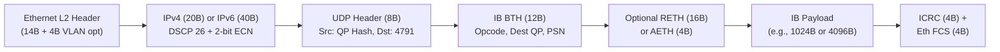
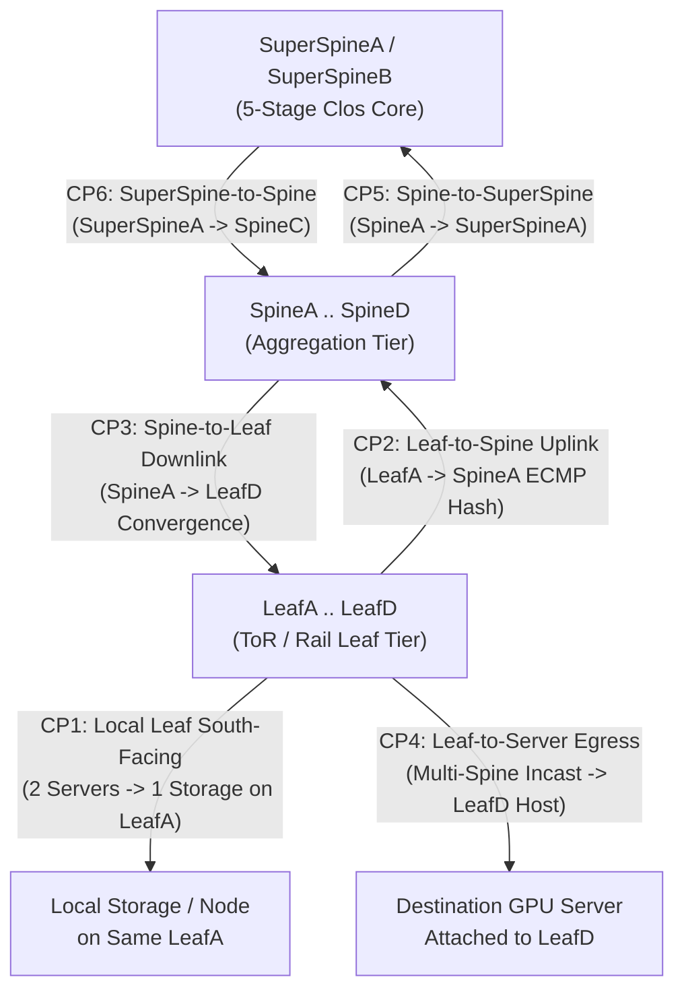
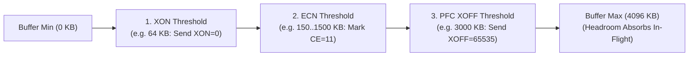
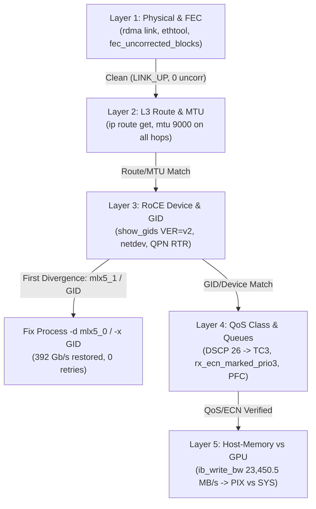

# 12.3 RoCEv2 transport and congestion management

| | |
|---|---|
| Level | Advanced |
| Priority tier | 1 |
| Lab venue | Nebius GPU (plus local Python 3 simulation lab) |
| Part | Part 12: Complete AI networking |
| Sources used | `ai-data-center-network-design-and-technologies` (Ch 1, Ch 7); `nvidia-zero-to-hero/volume-09/chapter-03-rocev2-and-rdma-over-ethernet.md`; `nvidia-zero-to-hero/volume-09/labs/lab-01-inventory-an-ai-ethernet-path.md` through `lab-04-troubleshoot-a-roce-path.md`; `volume-06/01-ai-networking-rdma-masterclass.md`; `bcm11-admin` |
| Coverage file | `planning/coverage/chapters/12-03.md` |

## Why this matters for AI infrastructure

RDMA over Converged Ethernet version 2 (`RoCEv2`) is the dominant transport protocol used to synchronize gradient, activation, and weight buffers across distributed GPU servers on Ethernet AI fabrics. Because RoCEv2 encapsulates InfiniBand transport headers inside connectionless UDP/IP frames (`UDP` destination port `4791`) and executes Direct Memory Access (`DMA`) directly between host or GPU memory (`GPUDirect RDMA`) and the network adapter (`ConnectX` or `BlueField` SuperNIC) without engaging the server CPU or OS kernel, it scales to thousands of parallel collective sessions far better than TCP-based transports such as `NVMe/TCP` or `iWARP`.

Yet putting a lossless-assuming RDMA transport atop standard Ethernet—which is inherently lossy—creates four operational failure modes that routinely stall multi-thousand-GPU training jobs:
1. **Straggler amplification and Job Completion Time (`JCT`) collapse:** In a synchronous collective (`AllReduce`, `AllGather`, `ReduceScatter`, or `AllToAll`), overall job completion time (`JCT = job end time - job start time`) is governed by the slowest thread. If `99` out of `100` parallel flows complete in `1 ms` (`< 100 ms`), or `9` out of `10` tasks finish in `1 ms` while a single congested flow (`taskX`) experiences a `1 second` (`1,000 ms`) tail-latency stall, a serial job takes `1.010 seconds` (`1 s + 10 * 1 ms`) and a parallel job stalls for `999 ms` waiting at the barrier for a `1.000 second` JCT. Even a `1 in 1,000,000` slow event guarantees a stall on every million-task training step.
2. **Wrong GID index selection when `ping` and TCP succeed:** After a VLAN or interface change, ICMP `ping` and SSH work over the kernel routing table, yet `ib_write_bw -d mlx5_0 -x 2` fails with `Failed to modify QP to RTR` or drops from `392 Gb/s` to `156 Gb/s` with `24` `IBV_WC_RETRY_EXC_ERR` completions (`8.2 s` vs `2.1 s`). A Global Identifier (`GID`) index is a local table position discovered at boot—not a portable cluster identity—and hard-coding `-x 1` or `-x 2` across nodes can bind one peer to base `eth0` and the other to VLAN `eth0.100` or link-local `RoCEv1` (`fe80::`).
3. **Six distinct Clos fabric incast bottlenecks and Go-Back-N retransmission amplification:** Even in a non-oversubscribed leaf-spine or 5-stage super-spine Clos fabric, elephant flows with low entropy collide at six distinct congestion points—from south-facing local leaf switching (where spine load balancing never engages) to spine-to-leaf and super-spine-to-spine downlinks. When a buffer overflows on a `400 Gbps` link with a `20.48 us` round-trip time (`1 MB` bandwidth-delay product, `250` packets of `4096 B`), classic `Go-Back-N` error recovery discards and retransmits all `250` in-flight packets (`250x` retransmission amplification compared to `1` packet under `Selective Repeat`).
4. **Misordered `DCQCN` thresholds, `PFC` pause storms, and head-of-line (`HoL`) blocking:** Explicit Congestion Notification (`ECN`) marks packets end-to-end so the receiver returns a Congestion Notification Packet (`CNP`, `IB BTH` opcode `129` / `0x81`), but the round-trip signaling delay makes an ECN-only queue *lossy* under microbursts. Priority Flow Control (`PFC`, EtherType `0x8808`, opcode `0x0101`, destination MAC `01:80:c2:00:00:01`) prevents drops via hop-by-hop `XOFF` pause frames (`65,535` quanta), but pauses all flows sharing Traffic Class `3` (`HoL` blocking) and can cascade into a fabric-wide `PFC storm` or cyclical deadlock unless `DCQCN` threshold ordering (`XON < ECN < XOFF`), `PFC Watchdog` (`Detection`, `Mitigation`, `Restoration`), or newer mechanisms like `Source Flow Control` (`SFC`, `IEEE 802.1Qdw`) and `Congestion Signaling` (`CSIG`, `draft-ravi-ippm-csig-01`) are engineered properly.

## Prerequisites and outcomes

### Prerequisites
- Completion of Chapters 12.1 (Ethernet architecture and Clos fabric topologies for AI) and 12.2 (RDMA fundamentals, Verbs, Queue Pairs, Memory Regions, and Completion Queues).
- Familiarity with IPv4/IPv6 headers, UDP ports, IEEE 802.1Q VLAN tagging, and basic Linux networking (`iproute2`, `ethtool`, `rdma-core`).

### Outcomes
After completing this chapter, you will be able to:
- Contrast `InfiniBand`, `RoCEv1` (EtherType `0x8915` with `40 B` `IB GRH`), `RoCEv2` (`UDP` port `4791` over `IPv4`/`IPv6` with `12 B` `IB BTH` and `4 B` `ICRC`), and `iWARP`, and trace the `13`-step `RDMA Write` and `11`-step `RDMA Read` connection and packet sequences (`RETH` opcode `12`, `Read Response Middle` opcode `14`, `AETH` `ACK` opcode `17`).
- Audit per-port `GID` tables (`show_gids`, `ibv_devinfo`), resolve `IPv4`-mapped `RoCEv2` GIDs (`0000:0000:0000:0000:0000:ffff:0a14:040f` for `10.20.4.15`), and enforce end-to-end `MTU` (`4096 B` IB MTU inside `9000 B` Ethernet jumbo frames) and `QoS` trust (`DSCP 26` / `AF31` or `DSCP 24` / `CS3` mapped to lossless Priority / `CoS 3`).
- Identify all six Clos congestion points in 3-stage and 5-stage AI fabrics and configure `ECN` (`00`, `01`, `10`, `11` bits and `CNP` opcode `129`), `PFC` (`XOFF`/`XON` thresholds and `PFC Watchdog` `Detection`, `Mitigation`, and `Restoration`), and `DCQCN` (`XON < ECN < XOFF`).
- Quantify `Go-Back-N` vs `Selective Repeat` retransmission amplification and evaluate next-generation congestion control: `Source Flow Control` (`SFC`, `IEEE 802.1Qdw`) and in-band `Congestion Signaling` (`CSIG`, `draft-ravi-ippm-csig-01`).
- Execute a 5-layer link-to-application evidence ladder (`Physical -> L3/MTU -> RoCE/GID -> QoS/Queues -> Workload`) to isolate silent congestion and endpoint-selection faults without blindly tuning live switch buffers.

---

## 1. RoCEv1 (`0x8915`) vs RoCEv2 (`UDP 4791`) encapsulation, wire headers, and RDMA session flows

### 1.1 Comparing InfiniBand, RoCEv1, RoCEv2, and iWARP
When an application or collective communication library (`NCCL`, `RCCL`, `Gloo`, or `OpenUCX`) posts a Work Queue Element (`WQE`—a struct holding a pointer to a registered pinned memory buffer) through the `Verbs API` to the RDMA driver's `Send Queue`, `Receive Queue`, and `Completion Queue`, the RDMA NIC (`RNIC`) handles transport segmentation and reliability directly on the wire. Across data center fabrics, three transport families carry RDMA operations:
- **InfiniBand (`IB`):** Governed by the InfiniBand Trade Association (`IBTA`), supporting `SDR`, `DDR`, `QDR`, `FDR`, `EDR`, `HDR` (`200 Gbps`, `~25 GB/s` line rate), `NDR` (`400 Gbps`, `~50 GB/s`), and `XDR`. Native InfiniBand uses credit-based link-layer flow control (inherently lossless, with lower latency and lower power consumption), per-packet Adaptive Routing, and a centralized Subnet Manager (`OpenSM` or `UFM`), with outer-to-inner framing consisting of the `Local Routing Header` (`LRH`, `8 B`), optional `Global Routing Header` (`GRH`, `40 B`), `Base Transport Header` (`BTH`, `12 B`), optional extended transport headers, `IB Payload`, `Invariant CRC` (`ICRC`, `4 B`), and `Variant CRC` (`VCRC`, `2 B`).
- **RoCEv1 (`RDMA over Converged Ethernet v1`):** Also governed by `IBTA`. `RoCEv1` replaced the InfiniBand link layer (`LRH`) with an `Ethernet II` L2 header using **EtherType `0x8915`** while preserving the `40-byte` `InfiniBand Global Routing Header` (`IB GRH`), `12-byte` `IB BTH`, `IB Payload`, `4-byte` `ICRC`, and `4-byte` Ethernet `FCS`. Because `RoCEv1` has no IP header, it is strictly limited to a single Layer 2 Ethernet broadcast domain and cannot traverse Layer 3 routers.
- **RoCEv2 (`RDMA over Converged Ethernet v2`):** Replaces the `40-byte` `IB GRH` with standard **`IPv4` (`20 B`) or `IPv6` (`40 B`)** Layer 3 headers and an **`8-byte` `UDP` header** whose **destination port is fixed at `4791`** (indicating that the next header is `IB BTH`) and whose **UDP source port is hashed from the Queue Pair (`QP`)** to provide 5-tuple ECMP entropy across routed Layer 3 leaf-spine and super-spine fabrics.
- **iWARP (`Internet Wide Area RDMA Protocol`):** Carries RDMA over connection-oriented `TCP/IP`, incurring higher latency and state overhead and seeing far less adoption in GPU training clusters.



| Header / Trailer Layer | `InfiniBand` (Native) | `RoCEv1` (L2 Ethernet, `0x8915`) | `RoCEv2` (`UDP/IPv4`, Port `4791`) | `RoCEv2` (`UDP/IPv6`, Port `4791`) | Key Fields & Operational Role |
|---|---|---|---|---|---|
| **Data Link (`L2`)** | `IB LRH` (`8 B`) | `Ethernet II` (`14 B`, EtherType `0x8915`, `+4 B` VLAN opt) | `Ethernet II` (`14 B`, EtherType `0x0800`, `+4 B` VLAN opt) | `Ethernet II` (`14 B`, EtherType `0x86DD`, `+4 B` VLAN opt) | Carries source/destination MAC and `802.1p` Priority Code Point (`PCP` / `CoS 3`). |
| **Network (`L3`)** | `IB GRH` (`40 B`, optional across subnets) | `IB GRH` (`40 B`, non-IPv4 routable) | `IPv4 Header` (`20 B`) | `IPv6 Header` (`40 B`) | Carries source/destination IP, `6-bit` `DSCP` (`26` / `AF31` or `24` / `CS3`), and `2-bit` `ECN` (`00`, `01`, `10`, `11`). |
| **Outer Transport (`L4`)** | None | None | `UDP Header` (`8 B`, Dst Port `4791`) | `UDP Header` (`8 B`, Dst Port `4791`) | `UDP` Dst Port `4791` identifies `IB BTH`; `UDP` Src Port is derived from `QP` for ECMP hashing. |
| **RDMA Base Transport (`IB BTH`)** | `IB BTH` (`12 B`) | `IB BTH` (`12 B`) | `IB BTH` (`12 B`) | `IB BTH` (`12 B`) | `Opcode` (`12` Read Req, `14` Read Resp Mid, `17` ACK, `129` CNP), `PKey` (`65535` default), `Dest QP` (`24-bit`), `AckReq` (`1-bit`), `PSN` (`24-bit`). |
| **Extended Transport (`RETH` / `AETH`)** | Opcode-dependent (`0–16 B`) | Opcode-dependent (`0–16 B`) | `RETH` (`16 B`) or `AETH` (`4 B`) | `RETH` (`16 B`) or `AETH` (`4 B`) | `RETH`: `Virtual Address` (`8 B`), `Remote Key` (`4 B`), `DMA Length` (`4 B`). `AETH`: `Syndrome` (`ACK`/`NAK`) + `Message Sequence Number` (`MSN`). |
| **Payload (`IB Payload`)** | `256 B` – `4096 B` | `256 B` – `4096 B` | `256 B` – `4096 B` | `256 B` – `4096 B` | Power-of-two IB MTU payload (`1024 B` or `4096 B` typical on `9000 B` jumbo Ethernet). |
| **Checksums (`ICRC` + `FCS`)** | `ICRC` (`4 B`) + `VCRC` (`2 B`) | `ICRC` (`4 B`) + `FCS` (`4 B`) | `ICRC` (`4 B`) + `FCS` (`4 B`) | `ICRC` (`4 B`) + `FCS` (`4 B`) | `32-bit` end-to-end Invariant CRC (`ICRC`) masking mutable IP TTL/DSCP/ECN fields + `32-bit` link `FCS`. |
| **Total Non-Payload Overhead (no VLAN/RETH)** | `26 B` (local) / `66 B` (with GRH) | `74 B` (`4170 B` wire frame at `4096 B` payload; `98.23%` efficiency) | `62 B` (`4158 B` wire frame at `4096 B` payload; `98.51%` efficiency vs `94.29%` at `1024 B`) | `82 B` (`4178 B` wire frame at `4096 B` payload; `98.04%` efficiency) | `RoCEv2-IPv4` saves `12 B` per packet over `RoCEv1` while adding full Layer 3 IP routability. |

### 1.2 Inside the `IB BTH`, `RETH`, and `AETH` Headers and Session State Machines
Because `UDP` is connectionless and unreliable, `RoCEv2` implements reliability, ordering, and memory protection inside the `IB BTH` and extended headers processed by the `ConnectX` / `BlueField` hardware engine:
- **Session establishment and teardown (`13`-step `RDMA Write` and `11`-step `RDMA Read`):**
  - **Phase 1 — CM 3-Way Handshake (`Steps 1–3`):** Regardless of whether the operation is an `RDMA Write` or `RDMA Read` (for example between Client `20.0.0.2` and Server `60.0.0.2`), the Connection Manager (`CM`) exchanges Queue Pair Numbers (`QPN`) and starting Packet Sequence Numbers (`PSN`) in three messages: `Step 1` Client sends `CM: Connect request with client QPN`; `Step 2` Server responds with `CM: Connect reply with server QPN`; `Step 3` Client sends `CM: Ready to use`, transitioning the Queue Pair through `INIT -> RTR (Ready to Receive) -> RTS (Ready to Send)`.
  - **Phase 2 — Data Transfer (`Steps 4–9` for `RDMA Write` vs `Steps 4–7` for `RDMA Read`):** In an `RDMA Write` flow, the client exchanges transfer size and remote address (`Step 4`, `ACK` in `Step 5`), memory region metadata (`Step 6`, `ACK` in `Step 7`), and pushes the `Data` (`Step 8`, `ACK` in `Step 9`), followed by a `4`-step bidirectional disconnect (`Steps 10–13`). In an `RDMA Read` flow, `Step 4` sends a single request carrying transfer size, remote virtual address, and memory region key (`ACK` in `Step 5`), `Step 6` streams the `Data` from server to client (`ACK` in `Step 7`), and `Steps 8–11` execute the `4`-step `CM: Disconnect` handshake.
- **Concrete packet captures on the wire:**
  - **`RDMA Read Request` (`IB BTH` Opcode `12`):** Carries `Solicited Event: False`, `MigReq: True`, `Pad Count: 0`, `Header Version: 0`, `Partition Key: 65535` (`0xffff`), `Destination Queue Pair: 0x0000fe1`, `Acknowledge Request: True` (enabling selective acknowledgement tracking), and `Packet Sequence Number: 16548361`, followed by the `16-byte` **`RETH` (`RDMA Extended Transport Header`)** containing `Virtual Address: 0x00007ff9de5f4000`, `Remote Key: 0x00207100`, `DMA Length: 65536` (`0x00010000`), and `Invariant CRC: 0xb87e1cbc`.
  - **`RDMA Read Response Middle` (`IB BTH` Opcode `14`):** Carries `Partition Key: 65535`, `Destination Queue Pair: 0x00007b`, `Acknowledge Request: False`, `Packet Sequence Number: 16543980`, `Data: 1024 bytes`, and `Invariant CRC: 0x5b522360`.
  - **`RC Acknowledge` (`IB BTH` Opcode `17` + `AETH`):** Carries `Partition Key: 65535`, `Destination Queue Pair: 0x000123`, `Acknowledge Request: False`, and `Packet Sequence Number: 2592248`, followed by the **`AETH` (`ACK Extended Transport Header`)** with `Syndrome: 0 (Ack)`, `OpCode: Ack 0`, `Credit Count: 0`, `Message Sequence Number (MSN): 1` (the sequence number of the last completed message at the receiver, used to detect missed acknowledgements), and `Invariant CRC: 0x33e6e2af`.

---

## 2. Addressing, GID tables, MTU, and end-to-end QoS trust boundaries

### 2.1 Why the GID Index Is a Local Table Position, Not a Portable Identity
Every RDMA port exposes a **Global Identifier (`GID`) table** with `128-bit` (IPv6-formatted) entries representing every combination of RoCE version (`v1` vs `v2`), address family (`IPv4` vs `IPv6`), and Linux network device (`netdev`, including base interfaces, `802.1Q` VLAN sub-interfaces, and SR-IOV Virtual Functions). Consider the `show_gids` output from a production host with base interface `eth0` and VLAN interface `eth0.100` sharing `10.20.4.15`:

```text
$ show_gids
DEV     PORT    INDEX   GID                                     IPv4            VER     DEV
------  ----    -----   ---                                     ------------    ---     ---
mlx5_0  1       0       fe80:0000:0000:0000:...                 n/a             v1      eth0
mlx5_0  1       1       0000:0000:0000:0000:0000:ffff:0a14:040f 10.20.4.15      v2      eth0
mlx5_0  1       2       0000:0000:0000:0000:0000:ffff:0a14:040f 10.20.4.15      v2      eth0.100
mlx5_0  1       3       fe80:0000:0000:0000:...                 n/a             v1      eth0.100
```

Three operational rules govern `GID` selection on GPU clusters:
1. **`IPv4`-mapped `RoCEv2` GID encoding:** An `IPv4` address is encoded into the lower `32` bits of an IPv4-mapped IPv6 GID (`0000:0000:0000:0000:0000:ffff:XXXX:YYYY`). For `10.20.4.15`, `10 = 0x0a`, `20 = 0x14`, `4 = 0x04`, and `15 = 0x0f`, producing `0000:0000:0000:0000:0000:ffff:0a14:040f` with `VER = v2`.
2. **Same IP, different L2 and QoS boundary:** In the table above, `INDEX 1` and `INDEX 2` both show `VER v2` and `10.20.4.15`, but `INDEX 1` is bound to untagged `eth0` whereas `INDEX 2` is bound to `802.1Q` VLAN sub-interface `eth0.100`. Because the kernel populates the GID table in the order interfaces and addresses are discovered, if Node A creates `eth0.100` after `eth0` (`INDEX 2`) and Node B brings up `eth0.100` before a secondary address (`INDEX 1`), hard-coding `NCCL_IB_GID_INDEX=2` (or `ib_write_bw -x 2`) across the cluster causes one peer to transmit on the wrong VLAN or match a `v1` (`fe80::`) entry, failing with `Failed to modify QP to RTR`.
3. **Completion Queue (`CQ`) status codes isolate the fault owner:** Only `IBV_WC_SUCCESS` proves an end-to-end RDMA transfer succeeded. Every error completion points to a distinct owner:
   - **`IBV_WC_RETRY_EXC_ERR` (Transport Retry Counter Exceeded, `NCCL error 12`):** The sender exhausted hardware retries without receiving an `ACK`—pointing to fabric congestion drops, a wrong `GID`/VLAN/MTU along the path, or a degraded optical transceiver (`fec_uncorrected_blocks` / `packet_seq_err`).
   - **`IBV_WC_REM_ACCESS_ERR`:** Remote Memory Region (`MR`) registration or `RKey` permission mismatch.
   - **`IBV_WC_LOC_LEN_ERR`:** Local application buffer length bug—not a network fault.

### 2.2 End-to-End MTU and QoS Classification (`DSCP 26` / `AF31` -> `CoS 3`)
Both **effective MTU** and **QoS classification** are end-to-end path invariants:
- **MTU alignment:** `RoCEv2` frames carry power-of-two InfiniBand payloads (`1024 B`, `2048 B`, or `4096 B`). A `4096 B` IB MTU requires `4158 B` on the wire (`IPv4`) or `4178 B` (`IPv6`), so host interfaces (`ens1f0`), VLAN sub-interfaces (`eth0.100`), and every leaf, spine, and super-spine switch port along the route must be standardized to **jumbo MTU (`9000 B`**, or at minimum `>= 4200 B`). If a single routed hop is left at `1500 B`, `64-byte` ICMP `ping` and `CM` connection setup packets pass while `4096 B` `RDMA Write` data frames are silently dropped, triggering `IBV_WC_RETRY_EXC_ERR`.
- **QoS marking and switch trust:** In the `8-bit` IPv4 `Type of Service` (`ToS`) / IPv6 `Traffic Class` byte, the **upper `6` bits carry the Differentiated Services Code Point (`DSCP`)** and the **lower `2` bits carry `ECN`**. Production AI fabrics classify `RoCEv2` into **Traffic Class / Priority `3` (`CoS 3`)** using **`DSCP 26` (`AF31`, binary `011010`)** or **`DSCP 24` (`CS3`, binary `011000`)**. For example, `DSCP 26` combined with `ECN = 10` (`ECT(0)`) produces IP `ToS` byte `0x6a` (`106`), and when a congested switch marks `ECN = 11` (`CE`), the `ToS` byte becomes `0x6b` (`107`). Every switch ingress port must be configured to trust `DSCP` (or `802.1p` `PCP = 3` on VLAN tags) and map it to lossless egress queue `3`.

---

## 3. Six Clos congestion points, ECN (`CNP` opcode `129`), and PFC (`0x8808`)

### 3.1 The Six Clos Congestion Points in 3-Stage and 5-Stage AI Fabrics
Even in a non-blocking, `1:1` non-oversubscribed Clos fabric with `400 Gbps` or `800 Gbps` links, synchronized GPU collectives burst at line rate with low flow count, creating incast or hash-collision bottlenecks at **six distinct fabric locations**:



| Congestion Point (`ADC` Ch 7) | Topology Stage & Direction | Traffic Pattern & Why Load Balancing Fails to Prevent It | Primary Mitigation |
|---|---|---|---|
| **1. Local leaf link congestion** | `LeafA` south-facing port (3-stage or 5-stage) | Two servers attached to `LeafA` send line-rate traffic simultaneously to a storage or compute server attached to the *same* `LeafA`. Traffic is switched locally at `LeafA` without ever reaching a spine, so spine load balancing does not apply and the `2:1` fan-in overloads the single south-facing link. | End-to-end `DCQCN` (`ECN` + `CNP` rate reduction) backed by `PFC` on the south-facing queue. |
| **2. Leaf-to-spine link congestion** | Ingress leaf uplink (`LeafA -> SpineA`) | Two servers on `LeafA` send line-rate flows toward a destination on `LeafD`. Static 5-tuple ECMP hashes both elephant flows onto the *same* `LeafA -> SpineA` uplink while `SpineB` sits idle. | Dynamic Load Balancing (`DLB`), flowlet switching, or adaptive routing (`Spectrum-X` / packet spraying) plus `DCQCN`. |
| **3. Spine-to-leaf link congestion** | Transit spine downlink (`SpineA -> LeafD`) | One server on `LeafA` and one server on `LeafB` send line-rate flows that reach `SpineA` on separate uplinks without congestion, but both flows target destinations on `LeafD` and converge onto the single `SpineA -> LeafD` downlink while `SpineB` paths to `LeafC`/`LeafD` remain unused. | Adaptive routing at ingress leaves + `ECN` marking on the `SpineA -> LeafD` egress buffer. |
| **4. Leaf-to-server link congestion** | Egress leaf downlink (`LeafD -> Server`) | Servers on `LeafA` and `LeafB` distribute traffic cleanly across *both* `SpineA` and `SpineB`, reaching `LeafD` without fabric link congestion—but their combined rate (`2x` line rate) exceeds the single `LeafD -> Server` NIC link (`true endpoint incast`). | Load balancing cannot fix single-NIC egress incast; requires `DCQCN` (`ECN` + `CNP`), `PFC`, or `SFC`/`CSIG` source throttling. |
| **5. Spine-to-super spine link congestion** | 5-stage Clos uplink (`SpineA -> SuperSpineA`) | Across an `8`-leaf (`LeafA..LeafH`), `4`-spine (`SpineA..SpineD`), `2`-super-spine (`SuperSpineA`, `SuperSpineB`) fabric, flows from `LeafA` and `LeafB` reach `SpineA` uncongested and hash onto the same `SpineA -> SuperSpineA` link while `SuperSpineB` is underutilized. | Multi-stage adaptive routing / `DLB` across `SuperSpineA` and `SuperSpineB` plus `ECN`/`PFC`. |
| **6. Super spine-to-spine link congestion** | 5-stage Clos downlink (`SuperSpineA -> SpineC`) | Flows from `LeafA` and `LeafB` traverse `SpineA`/`SpineB` and reach `SuperSpineA` without congestion, but converge onto a single `SuperSpineA -> SpineC` downlink toward `LeafE`. | End-to-end congestion notification (`DCQCN` / `CSIG`) and inter-pod adaptive load balancing. |

### 3.2 Explicit Congestion Notification (`ECN`) and Congestion Notification Packets (`CNP`)
**Explicit Congestion Notification (`ECN`)** provides end-to-end, flow-aware congestion signaling between an RDMA sender and receiver across routed IP fabrics. ECN uses the **last `2` bits (`ECT` and `CE`)** of the `8-bit` IP `DSCP/ToS` field:

| `ECT` Bit | `CE` Bit | Binary Codepoint | Standard Name | Operational Behavior in a `RoCEv2` Fabric |
|---|---|---|---|---|
| `0` | `0` | `00` | `Non-ECT` | Transport is not ECN-capable. If a switch queue crosses its congestion threshold, the switch **drops** the packet instead of marking it. |
| `0` | `1` | `01` | `ECT(1)` | Transport is ECN-capable (`01` and `10` are treated equivalently by transit switches). In `RoCEv2`, the receiver sets `ECN = 01` on outbound **Congestion Notification Packets (`CNPs`)** sent back toward the sender. |
| `1` | `0` | `10` | `ECT(0)` | Transport ECN capability enabled. Set by the sender on forward data packets toward the receiver (and may also be used on `CNPs`). Switches mark instead of dropping upon congestion. |
| `1` | `1` | `11` | `CE` (Congestion Experienced) | Set by an intermediate congested switch when egress queue utilization crosses the configured `ECN` marking threshold (`WRED` curve), signaling congestion to the receiver. |

When a server on `LeafA` sends `RoCEv2` packets (`ECN = 10` or `01`) through `SpineA` toward `LeafD` and the `SpineA -> LeafD` queue crosses its static or WRED `ECN threshold`, `SpineA` rewrites the ECN bits to **`11` (`CE`)** and forwards the packet along its normal path to the receiver on `LeafD`. Upon receiving the `ECN = 11` packet, the destination `RNIC` generates a **Congestion Notification Packet (`CNP`)**—a `RoCEv2` frame with **`ECN` bits set to `01`**, **`IB BTH` opcode set to `129` (`0x81`, binary `10000001`)**, and the **destination Queue Pair (`QP`) number** of the congested flow—and transmits it back to the sender on `LeafA`, which throttles its injection rate for that specific `QP`.

**Why an ECN-only queue is still called a *lossy queue*:** Because the `ECN = 11` mark must first travel forward from the congested switch (`SpineA`) to the receiver (`LeafD`), and the resulting `CNP` (`opcode 129`) must travel all the way back to the sender (`LeafA`) before rate reduction begins, a fast incast microburst can overflow the switch buffer during that round-trip delay. Any transit switch without `ECN` enabled also breaks end-to-end `ECN`.

### 3.3 Priority Flow Control (`PFC`), Frame Format (`0x8808`), and the `PFC Watchdog`
To prevent buffer overflow during the `ECN -> CNP` feedback delay, **Priority Flow Control (`PFC`, `IEEE 802.1Qbb`)** operates hop-by-hop at Layer 2 to create a **lossless queue** for a designated traffic class (typically `Class 3` / `C3`):
- **PFC Layer 2 Frame Anatomy:**
  - **Destination MAC:** `01:80:c2:00:00:01` (`MAC-specific control protocol 01` / link-local reserved multicast address, non-forwarded by bridges).
  - **Source MAC:** MAC address of the switch port generating the pause frame (e.g., `10:0e:7e:b7:a7:1b` in a `64-byte` wire capture).
  - **EtherType:** **`0x8808`** (IEEE MAC Control frame).
  - **Control Opcode:** **`0x0101`** (Class-Based Flow Control `CBFC` pause).
  - **Priority Control / Class Enable Vector (`2 octets`):** Bitmask for classes `C0` through `C7`. Enabling only **Class `3` (`C3 = true`, `C0,C1,C2,C4,C5,C6,C7 = false`)** sets the vector to **`0x0008`**.
  - **Time (`16 octets` = `8 x 2-octet` `16-bit` unsigned integers):** Pause duration in `512-bit-time` quanta (`0` to `65,535`) for each of the `8` classes:
    - **`XOFF` (Transmit Off) frame:** Sent upstream when ingress headroom / egress queue utilization crosses the **`XOFF` threshold**, with `C3` pause time set to **`65535`** (and `0` for `C0..C2, C4..C7`). If additional packets cross `XOFF`, new `XOFF` frames refresh the upstream timer.
    - **`XON` (Transmit On) frame:** Sent upstream when congestion clears and buffer occupancy drops below the **`XON` threshold**, with `Class Enable Vector = 0x0008` (`C3 = true`) and **`C3` pause time set to `0`**, instructing the upstream neighbor to resume transmission immediately before the `65535` timer expires.
- **Threshold tuning rules:** `XOFF` must never be set to the maximum buffer size (packets in flight during the link propagation and MAC reaction delay would drop before the upstream port halts, requiring dedicated **headroom buffer**) and must not be set too low (premature pauses under normal utilization). `XON` must sit below `XOFF` with sufficient hysteresis so the link does not oscillate, but not at `0` / minimum buffer (which would starve the egress port after congestion clears). Many switch ASICs configure `XOFF` dynamically via a shared-buffer **`alpha` (`α`)** parameter.
- **Two major hazards of `PFC`—Head-of-Line (`HoL`) blocking and `PFC Storms` / Deadlocks—and the `PFC Watchdog`:**
  1. **Class-level unfairness (`HoL` blocking):** `PFC` pauses the **entire traffic class (`C3`)** on the link, not the individual congested flow (`QP`). If `LeafC -> GPU102` is congested and `LeafC` pauses `SpineA`, `SpineA`'s ingress buffer fills and propagates `PFC XOFF` back to `LeafA` and `LeafB`—freezing innocent `C3` flows from `GPU103` on `LeafB` that aren't even destined for `GPU102`.
  2. **`PFC Storms` and cyclical deadlocks mitigated by the `PFC Watchdog`:** If a malfunctioning NIC (`GPU102`) or routing loop causes `LeafC` to emit continuous `XOFF` frames (`pause storm`), or if a cyclical buffer dependency forms (`Switch A -> B -> C -> D -> A`), the entire fabric freezes (`0%` GPU utilization). The **`PFC Watchdog`** monitors per-port paused duration (e.g., `50 ms` threshold) across three functional blocks:
     - **1. Detection:** Monitors received `PFC` pause frames and queue stall time per port; if a port remains paused beyond the configurable threshold, it flags a **`PFC storm`**.
     - **2. Mitigation:** Takes either the **`drop` action** (most common in production: discards all packets currently in the affected output queue, discards new packets arriving for that output queue, and discards incoming priority-group packets and pause frames so `SpineA` stops propagating `PFC` back to `LeafA`/`LeafB`) or the **`forward` action** (ignores received `PFC` pause frames and drains the queue).
     - **3. Restoration:** Continuously monitors the impacted port and automatically restores normal lossless `PFC` operation once received `PFC` pause frames drop below the recovery threshold.

---

## 4. DCQCN (`XON < ECN < XOFF`), Go-Back-N vs Selective Repeat, Source Flow Control (`SFC`), and `CSIG`

### 4.1 Data Center Quantized Congestion Notification (`DCQCN`)
**`DCQCN`** combines flow-aware, end-to-end **`ECN`** with hop-by-hop lossless **`PFC`** over `DSCP`-marked queues so that `ECN` handles `99%+` of congestion events gracefully and `PFC` acts purely as a last-resort safety net against packet drops.



| Buffer Threshold Stage | Representative Setting (`Mellanox Onyx` / Spectrum) | Switch & Endpoint Action | Impact on Unrelated Flows in Class `3` |
|---|---|---|---|
| **Below `XON` (`<= 64 KB`)** | `XON` near low water mark | If previously paused, switch sends `PFC XON` (`EtherType 0x8808`, `C3` timer `= 0`) upstream; normal forwarding. | Zero impact; full line-rate transmission. |
| **Between `ECN_min` and `XOFF` (`150 KB .. 1500 KB`)** | `congestion-control ecn minimum-absolute 150 maximum-absolute 1500` | Switch marks `ECN = 11` (`CE`) probabilistically via WRED curve; receiver `RNIC` returns `CNP` (`opcode 129`); sender `RNIC` cuts rate for **only the congested `QP`**. | **Zero Head-of-Line blocking**—other flows sharing `Class 3` continue at full speed. |
| **Above `XOFF` (`>= 3000 KB`)** | `XOFF` below `Max` (preserving headroom) | Egress congestion causes ingress lossless headroom on upstream port to breach `XOFF`; switch emits `PFC XOFF` (`timer = 65535`) hop-by-hop toward source. | **Pauses entire `Class 3` queue** on the paused link (`HoL` blocking), preventing packet loss while `DCQCN` catches up. |

When a switch receives a `PFC` pause frame on an egress interface, five hop-by-hop steps occur: `(1)` the `PFC` frame arrives on the egress port; `(2)` the switch pauses transmission on the corresponding egress queue (`C3`); `(3)` continued arrival of in-flight packets causes lossless buffer buildup on the switch's own ingress ports until they breach their `PFC XOFF` threshold; `(4)` those ingress ports generate new `PFC` pause frames upstream; and `(5)` backpressure propagates hop-by-hop to the sender NIC. Because of this blast radius, production fabrics follow three deployment profiles depending on SLA: **`ECN` + `PFC` on all switches**, **`ECN` fabric-wide with `PFC` restricted only to leaf switches and server NICs**, or **`ECN`-only with adaptive load balancing** when frequent `PFC` triggers would hurt JCT more than occasional retransmissions.

### 4.2 Go-Back-N vs Selective Repeat Retransmission Amplification
Why do AI fabrics go to such lengths to avoid a single packet drop? On a `400 Gbps` (`50 GB/s`) RoCEv2 link with a `20.48 us` fabric RTT, the bandwidth-delay product (`BDP`) in flight is:
$$\text{BDP} = 400 \times 10^9\text{ bps} \times 20.48 \times 10^{-6}\text{ s} = 8{,}192{,}000\text{ bits} = 1{,}024{,}000\text{ bytes} = 250\text{ packets (at } 4096\text{ B MTU)}$$
- **Standard RDMA `Go-Back-N` recovery:** When packet `#1` is dropped at a congested switch and packet `#2` arrives at the receiver with an out-of-order `Packet Sequence Number` (`PSN`), the receiver's `RNIC` increments `packet_seq_err` / `out_of_sequence`, sends a `NAK` (`AETH` negative acknowledgement), and **discards packets `#2` through `#250`**. The sender must rewind its `Send Queue` and retransmit all **`250` packets (`1 MB`)**—a **`250x` retransmission amplification** that wastes bandwidth and stalls the collective barrier.
- **`Selective Repeat` / Hardware Selective Retransmission (`ConnectX-6 Dx` / `ConnectX-7` / `BlueField-3`):** The receiver buffers out-of-order packets `#2` through `#250` in NIC memory and requests retransmission of **only missing packet `#1`** (`1` packet retransmitted instead of `250`), drastically reducing tail latency when `PFC Watchdog` or an `ECN`-only queue drops a packet.

### 4.3 Source Flow Control (`SFC`, `IEEE 802.1Qdw`) and Congestion Signaling (`CSIG`, `draft-ravi-ippm-csig-01`)
To overcome the two fundamental flaws of `DCQCN`—that `ECN` is **slow** (must travel forward to the receiver and return via `CNP`) and `PFC` is **coarse** (pauses the entire traffic class hop-by-hop)—two standards have emerged:
1. **Source Flow Control (`SFC` / `Source PFC`, `IEEE 802.1Qdw`):**
   - When `SpineA` detects congestion on the `SpineA -> LeafD` link exceeding the `SFC threshold`, `SpineA` does **not** wait for the receiver on `LeafD` to send a `CNP`, nor does it send a class-wide `PFC` pause frame. Instead, `SpineA` **trims the packet payload, reverses the source and destination IP addresses in the header, and sends a flow-specific `SFC` signal directly backward to the source (`LeafA` / sender)**.
   - If the hop delay from `Sender -> SpineA` is `2.0 us` and `SpineA -> Receiver -> Sender` is `6.0 us + 8.0 us = 14.0 us`, `SFC` notifies `LeafA` / the sender in **`2.0 us` instead of `14.0 us` (`7.0x` faster)**.
   - Upon receiving the `SFC` signal, ingress `LeafA` can pause the specific flow locally, forward the `SFC` signal directly to an `SFC`-capable server NIC, or **translate the `SFC` signal into a standard `PFC` pause frame** on the final server-facing port. Because `SFC` is **flow-based**, it eliminates fabric-wide class `HoL` blocking.
2. **Congestion Signaling (`CSIG`, IETF `draft-ravi-ippm-csig-01`):**
   - `CSIG` embeds real-time, fixed-length multi-bit **In-Band Network Telemetry (`INT`)** bottleneck summaries directly into live data packets using a **Layer 2.5 `CSIG tag` inserted between the Layer 2 `Ethernet header` and the Layer 3 `IP header`** (requiring an IEEE EtherType allocation).
   - As a packet travels from `GPU1 Sender` through hops `CSIG1 -> CSIG2 -> CSIG3/CSIG4 -> CSIG5 -> CSIG6 -> GPU2 Receiver`, each switch updates the `CSIG tag` if its bottleneck state is worse than the current value, and `GPU2 Receiver` reflects the summarized multi-hop state back to `GPU1 Sender` via **CSIG reflection headers** so the sender can both adjust injection rate and select a less-congested path.
   - Each `CSIG tag` contains **three sections**:
     1. **`Signal Type`:** Policy/metric selector set by servers, including **`min(ABW/C)`** (minimum available bandwidth divided by capacity), **`min(ABW)`** (minimum available bandwidth), and **`max(PD)`** (maximum packet delay / queue occupancy).
     2. **`Signal Value`:** The quantized multi-bit congestion measurement carried in the packet.
     3. **`Locator Metadata` (`4` static port-context sub-fields):** `(a)` **Capacity of the bottlenecks**, `(b)` **Stage of the bottlenecks**, `(c)` **Device ID**, and `(d)` **Link identification (`uplink` or `downlink`)**.

## 5. Production inventory, baseline benchmarking, and the 5-layer RoCEv2 evidence ladder

### 5.1 Building an Endpoint-to-Endpoint RoCEv2 Path Inventory
Performance and connection investigations fail when an on-call team cannot answer *which physical and logical path a collective used*. Before running `perftest` (`ib_write_bw`, `ib_send_lat`) or `NCCL`, capture a timestamped evidence bundle joining five layers across both endpoints and the transit switches:
1. **Host interface and physical negotiation:** `ip -br link show dev ens1f0`, `ip -br addr show dev ens1f0`, and `ethtool ens1f0` (`Speed: 400000Mb/s`, `Duplex: Full`, `Link detected: yes`).
2. **Ethernet-to-RDMA device mapping and port state:** `rdma link show` (`link mlx5_0/1 state ACTIVE physical_state LINK_UP netdev ens1f0`), `ibv_devinfo -l`, and `ibstat`. Note the key difference in `ibstat` between fabrics: on **InfiniBand** (`CA 'mlx5_0'`, `CA type: MT4123`, `Firmware version: 20.31.1014`, `Rate: 200 (HDR)`), `Base lid: 32` and `SM lid: 1` are assigned by the Subnet Manager (`OpenSM`/`UFM`), whereas on **RoCEv2** (`CA 'mlx5_1'`, `Rate: 400`, `Link layer: Ethernet`), **`Base lid: 0` and `SM lid: 0`** are normal because `RoCEv2` uses distributed IP routing (`BGP`/`OSPF`/`EVPN`) rather than a Subnet Manager.
3. **Active L3 route, effective MTU, and semantic GID entry:** `ip route get 10.20.8.5` (`10.20.8.5 via 10.20.0.1 dev ens1f0 src 10.20.4.15 ... mtu 9000`) and `show_gids` / `ibv_devinfo -d mlx5_0 -i 1` to verify `VER = v2` and matching `DEV` (`ens1f0`).
4. **PCIe/NUMA/GPU locality (`nvidia-smi topo -m`):** Confirm that `GPU0` and `NIC0` (`mlx5_0`) share the same PCIe switch/root complex (**`PIX`**, CPU affinity `0-31`, NUMA `0`) rather than crossing the CPU socket interconnect (**`SYS`**, as between `GPU0` and `NIC1` on NUMA `1`, `32-63`).
5. **Counter deltas (never reset shared counters):** Record `date -u` (`2026-08-07T14:32:15Z`) and `ethtool -S ens1f0` baselines (`rx_packets: 1024567`, `rx_bytes: 892481382400`, `tx_bytes: 481029120384`, `fec_corrected_blocks: 412`, `fec_uncorrected_blocks: 0`, `rx_ecn_marked_prio3: 0`, `rx_pfc_prio3: 0`, `tx_pfc_prio3: 0`) alongside `/sys/class/infiniband/mlx5_0/ports/1/hw_counters/`.

### 5.2 Interpreting Controlled Contention and the 5-Layer Evidence Ladder
When two concurrent senders drive a `400 Gb/s` `RoCEv2` path on `Priority 3` (`prio3`) for `60 seconds` (`14:35:22Z` to `14:36:30Z`), healthy `DCQCN` feedback shows up in `ethtool -S ens1f0` deltas as rising ECN marks (`rx_ecn_marked_prio3: 47829` delta on `rx_prio3_packets: 51234892` and `tx_prio3_packets: 48901234` vs `102314` / `89621` idle baseline), bounded `PFC` events (`rx_pfc_prio3: 412`, `tx_pfc_prio3: 14`), zero physical drops (`out_of_buffer: 0`, `rx_discards_phy: 0`, `fec_uncorrected_blocks: 0`), and fair sender rate convergence (`Sender A: 89.2 Gb/s`, `Sender B: 87.1 Gb/s`, total `176.3 Gb/s`).

Similarly, when a `1-second` `mlnx_perf -i eth0 -t 1` sample during a slow job shows `rx_bytes: 4.12 Gb/s`, `tx_bytes: 3.98 Gb/s`, `rx_prio3_bytes: 482991823104`, `out_of_buffer: 0`, and `rx_discards_phy: 0`—which looks completely clean on a standard drop-counter dashboard—checking **`rx_prio3_congestion_events: 118`** incrementing every second proves that `CNP`-driven rate throttling or `PFC` pause propagation is silently inflating tail latency.



| Evidence Layer | Diagnostic Question | Exact Command & Counter Evidence | Safe Corrective Action |
|---|---|---|---|
| **Layer 1 — Physical & Link** | Are carrier, speed, and FEC clean? | `rdma link show` (`ACTIVE`/`LINK_UP`), `ethtool ens1f0` (`400000Mb/s`), `fec_uncorrected_blocks: 0` (`perfquery` `SymbolErrorCounter`/`LinkDownedCounter`, `ibdiagnet -c 1000`). | Stop testing and replace dirty/faulty fiber or optic; never tune QoS for a bad cable. |
| **Layer 2 — L3 Route & MTU** | Does `ip route get` exit the expected rail with `mtu 9000`? | `ip route get 10.20.8.5` (`dev ens1f0 src 10.20.4.15 mtu 9000` vs wrong `dev ens1f1 src 10.20.4.24`). | Fix host routing policy or end-to-end switch/VLAN jumbo MTU (`9000 B`). |
| **Layer 3 — RoCE Device & GID** | Did both peers select matching `mlx5_*` port, `VER v2`, and VLAN GID? | `show_gids`, `ibv_devinfo -d mlx5_1 -i 1 \| grep GID` (`fe80::0c42:a1ff:fec8:d79d` vs `d79b`); wrong `-d mlx5_1` drops `ib_write_bw` from `392 Gb/s` (`2.1 s`) to `156 Gb/s` (`8.2 s`, `24` `RETRY_EXC_ERR`). | Correct application `-d mlx5_0` and semantic `v2` GID selection; do not touch switch `PFC`/`ECN`. |
| **Layer 4 — QoS & Congestion** | Is traffic landing in `TC 3` and is `ECN` firing before `PFC`? | `ethtool -S ens1f0` (`rx_ecn_marked_prio3`, `rx_pfc_prio3`, `tx_pfc_prio3`, `rx_prio3_congestion_events: 118`); switch buffer histograms (`gNMI` / `NetQ` / `bcm11-admin` PromQL). | If `PFC` fires with `0` `ECN` marks, lower switch `ECN minimum-absolute` (`150 KB`) or fix `DSCP 26 -> TC 3` trust. |
| **Layer 5 — Host RAM vs GPU** | Does host-memory `ib_write_bw` pass while GPU collective lags? | Host-memory `ib_write_bw` (`65536 B`, `5000` iters -> `23500.2 MB/sec` peak / `23450.5 MB/sec` avg, `0.375208 Mpps` on `200G HDR`) vs `nvidia-smi topo -m` (`PIX` vs `SYS`). | Fix GPU-to-NIC PCIe/NUMA binding (`PIX`) or verify `nvidia-peermem` (`GPUDirect RDMA`). |

---

## Commands and configurations that matter

### 1. Host RoCEv2 Path Inventory, GID Inspection, and Hardware Counter Baselines

```bash
# 1. Inspect link state, IPv4/IPv6 addressing, active L3 route, and 9000B jumbo MTU (untested here)
ip -br link show dev ens1f0
ip -br addr show dev ens1f0
ip route get 10.20.8.5
ethtool ens1f0 | egrep "Speed|Duplex|Link"

# 2. Map Ethernet netdev to RDMA mlx5 device/port and inspect GID table (untested here)
rdma link show
ibv_devinfo -l
ibstat
show_gids
ibv_devinfo -d mlx5_0 -i 1

# 3. Verify GPU-to-NIC PCIe root affinity (PIX vs SYS) and check TCP offload state (untested here)
nvidia-smi topo -m
ethtool -k ens1f0 | grep tcp-segmentation

# 4. Capture timestamped NIC ECN/PFC/FEC and RDMA hw_counters baseline without resetting (untested here)
date -u && ethtool -S ens1f0 | egrep "rx_bytes|tx_bytes|fec_uncorrected|ecn_marked|pfc_prio|rx_prio3|out_of_buffer|discard"
grep -H . /sys/class/infiniband/mlx5_0/ports/1/hw_counters/* 2>/dev/null || true
```

### 2. Host-Memory `perftest` Smoke Test and `UDP 4791` Packet Capture

```bash
# Server side (Node A): start RDMA Write bandwidth listener on mlx5_0 port 1 (untested here)
ib_write_bw -d mlx5_0 -i 1

# Client side (Node B): run host-memory RoCEv2 bandwidth test with explicit v2 GID index (untested here)
ib_write_bw -d mlx5_0 -i 1 -x 1 -F --report_gbits 10.20.8.5

# Capture RoCEv2 headers (UDP port 4791; CNPs use IB BTH opcode 129 / 0x81) via SPAN or ibdump (untested here)
# Note: hardware-offloaded RDMA bypasses the host kernel, so use ibdump or switch port mirroring for data packets
sudo tcpdump -i ens1f0 -nn -e -v udp port 4791
```

### 3. Switch Lossless `RoCEv2` Queue Configuration (`ECN` + `PFC` on Priority `3`)

```text
# Mellanox Onyx / NVIDIA Spectrum illustrative switch configuration for Traffic Class / Priority 3 (untested here)
# 1. Enable ECN WRED marking thresholds (150 KB min, 1500 KB max) on Traffic Class 3 so DCQCN throttles before PFC
switch (config) # interface ethernet 1/1-1/32 traffic-class 3 congestion-control ecn minimum-absolute 150 maximum-absolute 1500

# 2. Enable IEEE 802.1Qbb Priority Flow Control (PFC) on Priority 3 only
switch (config) # dcb priority-flow-control enable force
switch (config) # dcb priority-flow-control priority 3 enable
switch (config) # interface ethernet 1/1 dcb priority-flow-control mode on force

# 3. Bind Traffic Class 3 to strict-priority scheduling
switch (config) # interface ethernet 1/1-1/32 traffic-class 3 bind strict-priority
```

---

## How it fails

| Failure Mode | Symptom & Telemetry Evidence | Root Cause | Fix & Verification |
|---|---|---|---|
| **1. `Ping` and SSH work, but `ib_write_bw -d mlx5_0 -x 2` fails with `Failed to modify QP to RTR`** | `ib_write_bw` prints `Local address: LID 0000 QPN 0x012a PSN 0x8f2c1 GID: fe80::...`, `Remote address: LID 0000 QPN 0x0000 ...`, and `Failed to modify QP to RTR`. | **Cross-Host `GID` Index Mismatch:** Hard-coding `-x 2` selected a link-local `RoCEv1` (`fe80::`) or mismatched VLAN (`eth0.100` vs `eth0`) entry because `GID` table ordering differs across hosts after a VLAN change. | Query `show_gids` on both endpoints, automate semantic selection matching `VER = v2`, `IPv4`, and `DEV`, and verify `RTR`/`RTS` completion with `ib_write_bw`. |
| **2. One rail drops from `392 Gb/s` (`2.1 s`) to `156 Gb/s` (`8.2 s`) with `24` `RETRY_EXC_ERR` completions** | `rdma link show` shows both `mlx5_0` (`ens1f0`) and `mlx5_1` (`ens1f1`) `ACTIVE`/`LINK_UP` with `mtu 9000`, but `ethtool -S ens1f1` shows `rx_ecn_marked_prio3: 142` and retries. | **Wrong RDMA Device / Rail / NUMA Selection:** The process selected `-d mlx5_1` (`src 10.20.4.24`, `GID[3] fe80::...d79d`, crossing `SYS` NUMA/rail) instead of the primary rail `mlx5_0` (`d79b`, `PIX`). | Walk the 5-layer evidence ladder (`Physical -> Route/MTU -> RoCE/GID -> QoS -> Workload`); fix the process argument to `-d mlx5_0` rather than modifying fabric `PFC`/`ECN`. |
| **3. `NCCL AllReduce` steps swing wildly between `10 ms` and `500 ms` while `10–60 s` SNMP polling shows `20%–40%` link utilization** | Average utilization looks idle (`20%–40%`), `out_of_buffer: 0`, `rx_discards_phy: 0`, yet `mlnx_perf -i eth0 -t 1` shows `rx_prio3_congestion_events: 118` every second and switch `Tx Pause` (`PFC`) counters climb with low `ECN` marks. | **Synchronized Incast Microbursts + High `ECN` Threshold:** Many-to-one GPU bursts fill switch buffers in microseconds (invisible to `10–60 s` SNMP polling) and hit `PFC XOFF` before `ECN` marks packets. | Enable microsecond streaming telemetry (`gNMI` / `NetQ`) and lower the switch `ECN minimum-absolute` threshold (e.g., to `150 KB`) so `DCQCN` (`CNP` opcode `129`) throttles senders before `PFC` pauses the queue. |
| **4. Entire training job hangs at `0%` GPU utilization (`ib_write_bw` hangs indefinitely)** | Switch ports show massive `PFC Tx/Rx` pause frame counts (`EtherType 0x8808`, `opcode 0x0101`, `timer = 65535`) and `0` data packets forwarded. | **`PFC` Pause Storm or Cyclical Buffer Deadlock:** A wedged downstream NIC (`GPU102` on `LeafC`) or routing loop caused `PFC XOFF` backpressure to cascade across `SpineA` to `LeafA`/`LeafB` (`Switch A -> B -> C -> D -> A`). | Enforce strictly loop-free Clos topologies and enable the **`PFC Watchdog`** (e.g., `50 ms` storm timer) in `drop` mitigation mode to flush the wedged queue and suppress upstream pause propagation. |
| **5. `RoCEv2` traffic experiences heavy packet drops (`packet_seq_err` / `Go-Back-N` stalls) despite `PFC` and `ECN` being configured on `TC 3`** | `ethtool -S` shows `rx_prio3_packets: 0` while `rx_prio0_packets` increments and default queue `0` drops packets during collectives. | **Broken QoS Trust or `DSCP` Mapping Boundary:** Host `RoCEv2` packets (`DSCP 26` / `AF31`) were remarked to `0` or classified via untrusted L2 `PCP = 0` at a switch ingress port, landing in lossy default queue `0` instead of lossless `TC 3`. | Configure `cma_roce_tos` / `mlx5_core` DSCP marking (`26` or `24`) on the host and verify `trust dscp` -> `traffic-class 3` mapping on every leaf, spine, and super-spine hop. |

---

## Hands-on lab

### Venue and scope
This lab runs locally using Python 3 standard library (`code/part12/rocev2_transport.py` and `code/part12/rocev2_transport_lab.py`) to verify `RoCEv1` (`0x8915`) vs `RoCEv2` (`UDP 4791`) header efficiency, `IPv4`-mapped `GID` semantic selection (`10.20.4.15 -> 0000:0000:0000:0000:0000:ffff:0a14:040f`), `DSCP 26` (`AF31`) / `CoS 3` and `ECN` (`00`, `01`, `10`, `11`, `CNP` opcode `129`) encoding, the `6` Clos congestion points, `DCQCN` threshold ordering (`XON < ECN < XOFF`), `PFC` (`0x8808`, `0x0101`, `01:80:c2:00:00:01`, `0x0008`, `65535`) and `PFC Watchdog` (`Detection`, `Mitigation`, `Restoration`), `Go-Back-N` vs `Selective Repeat` (`250x` amplification at `400 Gbps` and `20.48 us` RTT), `SFC` (`IEEE 802.1Qdw`), and `CSIG` (`draft-ravi-ippm-csig-01`). All live cluster and switch commands above are marked `(untested here)`.

### Step 1: Run the self-checking RoCEv2 transport and congestion management lab (tested here)

Run the self-checking lab from the repository root:

```bash
python3 -B code/part12/rocev2_transport_lab.py
```

Captured output from this repository:
```text
=== Chapter 12.3 Lab: RoCEv2 Transport and Congestion Management ===
  [PASS] RoCEv1 uses EtherType 0x8915 with a 40-byte IB GRH and 0-byte UDP header (74B non-payload overhead, 4170B wire frame, 98.23% efficiency)
  [PASS] RoCEv2-IPv4 uses UDP destination port 4791, 20B IPv4 + 8B UDP + 12B IB BTH + 4B ICRC + 18B L2 (62B overhead)
  [PASS] RoCEv2-IPv6 uses 40B IPv6 + 8B UDP + 12B IB BTH + 4B ICRC + 18B L2 (82B overhead, 4178B wire frame, 98.04% efficiency)
  [PASS] Expanding RoCEv2-IPv4 payload from 1024B to 4096B raises wire payload efficiency from 94.29% to 98.51%
  [PASS] ADC Ch 1 BTH opcodes match Wireshark captures: RDMA Read Req=12, Read Resp Middle=14, ACK=17, PKey=65535
  [PASS] IPv4 10.20.4.15 maps to RoCEv2 GID 0000:0000:0000:0000:0000:ffff:0a14:040f
  [PASS] Semantic GID lookup distinguishes base eth0 (index 1) from VLAN eth0.100 (index 2) with identical IP 10.20.4.15
  [PASS] Semantic GID lookup rejects link-local RoCEv1 (fe80::) entries when routed RoCEv2 (v2) is required
  [PASS] DSCP 26 (AF31) with ECN ECT(0) '10' encodes to IP ToS byte 0x6a (106) and with CE '11' to 0x6b (107)
  [PASS] ADC Ch 7 Table 7-1 defines all 4 ECN codepoints (00 Non-ECT, 01 ECT(1)/CNP, 10 ECT(0), 11 CE) and CNP opcode 129 (0x81)
  [PASS] QoS path validator confirms DSCP 26 -> TC 3 lossless/ECN alignment and catches L2 PCP=0 trust mismatches
  [PASS] ADC Ch 7 defines all 6 Clos congestion points from local south-facing leaf to 5-stage super-spine links
  [PASS] DCQCN enforces progressive buffer threshold ordering XON (64 KB) < ECN_min (150 KB) <= ECN_max (1500 KB) < XOFF (3000 KB)
  [PASS] DCQCN marks ECN before PFC XOFF fires, and triggers XOFF pause (65535 quanta) only above XOFF threshold
  [PASS] PFC frame constants match ADC Ch 7 Figs 7-10..7-12: EtherType 0x8808, opcode 0x0101, MAC 01:80:c2:00:00:01, C3 enable 0x0008, pause 65535/0
  [PASS] PFC Watchdog (Detection, Mitigation, Restoration) detects >50ms pause storm and drops queue/pause frames to protect upstream fabrics
  [PASS] At 400 Gbps and 20.48 us RTT (1,024,000 bytes / 1 MB BDP), Go-Back-N retransmits 250 packets (4096B MTU) for 1 drop vs 1 packet with Selective Repeat (250x amplification)
  [PASS] ADC Ch 1 Figs 1-5 & 1-6: 1 straggler at 1s among 10 1ms tasks yields 1.010s serial JCT and 1.000s parallel JCT (999ms barrier stall)
  [PASS] SFC (IEEE 802.1Qdw) signals the source directly from the congested switch in 2.0 us vs 14.0 us for ECN+CNP (7.0x faster) with flow granularity
  [PASS] CSIG (draft-ravi-ippm-csig-01) inserts a Layer 2.5 tag carrying 3 signal types (min(ABW/C), min(ABW), max(PD)) and 4 bottleneck locator metadata fields
  [PASS] Volume 09 Lab 01: nvidia-smi topo -m distinguishes PIX (same PCIe root) from SYS (cross-NUMA) and baselines fec_uncorrected_blocks=0
  [PASS] Volume 09 Lab 02 & Ch 03: ib_write_bw -d mlx5_0 -x 2 'Failed to modify QP to RTR' diagnoses VLAN GID index mismatch across peers
  [PASS] Volume 09 Lab 03: 60s bounded contention on prio3 records 47,829 rx_ecn_marked_prio3 delta, 412 rx_pfc_prio3, 14 tx_pfc_prio3, and fair ~89.2 / 87.1 Gb/s throttling
  [PASS] Volume 09 Lab 04: 5-layer evidence ladder isolates mlx5_1 device-selection fault (392 -> 156 Gb/s, 24 RETRY_EXC_ERR, 8.2s vs 2.1s) without touching PFC/ECN
  [PASS] Volume 06 Ch 01: 200G HDR (~25 GB/s line rate) ib_write_bw achieves 23,500.2 MB/s peak / 23,450.5 MB/s avg at 65,536B x 5,000 iterations

Summary: 25 passed, 0 failed out of 25 checks.
```

---

## Common first mistakes

1. **Treating `ping` success as proof that a `RoCEv2` path is healthy:** `ping` tests 64-byte kernel ICMP over whatever interface the OS routing table selected; it never exercises `GID` table selection (`v1` vs `v2`), `9000 B` jumbo MTU, `DSCP 26 -> TC 3` QoS mapping, or `GPUDirect` PCIe affinity (`PIX` vs `SYS`).
2. **Hard-coding `NCCL_IB_GID_INDEX=1` or `-x 2` across all nodes:** Because `GID` indices are assigned dynamically as interfaces and VLANs (`eth0` vs `eth0.100`) come up, always resolve the index from semantic attributes (`VER = v2`, `DEV`, and `IPv4`).
3. **Setting `ECN` marking thresholds higher than `PFC XOFF` (or setting `XOFF` to `Max` buffer):** If `ECN` is above `XOFF`, `PFC` pauses the entire traffic class before `DCQCN` ever sends a `CNP` (`opcode 129`); if `XOFF` equals `Max` buffer with zero headroom, in-flight packets drop while the `XOFF` frame is in transit.
4. **Resetting live interface or switch counters during an investigation:** Clearing shared counters destroys historical baselines for other operators and monitoring agents (`Prometheus`/`Thanos`). Always capture UTC timestamps (`date -u`) and compute counter deltas.
5. **Running `tcpdump` on a host `ConnectX` interface expecting to see `400 Gbps` `RoCEv2` payloads:** Hardware-offloaded RDMA bypasses the Linux kernel networking stack; use `ibdump` or switch port mirroring (`SPAN`) filtered on `udp port 4791` to inspect `IB BTH` headers and `CNP` frames.

---

## Exercises

1. **Exercise 1 — `RoCEv1` vs `RoCEv2` Wire Overhead and Payload Efficiency:** Using `compare_roce_encapsulation()` in `code/part12/rocev2_transport.py`, calculate the total non-payload bytes, wire frame size, and payload efficiency percentage for `RoCEv1` (`0x8915`), `RoCEv2-IPv4` (`UDP 4791`), and `RoCEv2-IPv6` at `1024 B` and `4096 B` payloads (without VLAN or `RETH`). Explain why `RoCEv2-IPv4` has `12 B` less overhead than `RoCEv1` while adding Layer 3 routability.
2. **Exercise 2 — Semantic `GID` Resolution and `Failed to modify QP to RTR`:** Given the 4-row `show_gids` table for `mlx5_0` port `1` (`eth0` and `eth0.100` with IP `10.20.4.15`), compute the exact `128-bit` IPv4-mapped `RoCEv2` GID string using `ipv4_to_rocev2_gid("10.20.4.15")` and explain why `ib_write_bw -d mlx5_0 -x 2` failed with `Failed to modify QP to RTR` after a VLAN change.
3. **Exercise 3 — `DSCP 26` (`AF31`) + `ECN` Byte Encoding and `DCQCN` Threshold Ordering:** Using `build_ip_tos_byte()` and `DcqcnBufferProfile`, compute the hexadecimal IP `ToS` byte for `DSCP 26` with `ECN = 10` (`ECT(0)`) and `ECN = 11` (`CE`), state the `IB BTH` opcode and `ECN` bits of the resulting `CNP`, and verify the queue state at `40 KB`, `500 KB`, and `3200 KB` for `XON = 64 KB`, `ECN = 150..1500 KB`, and `XOFF = 3000 KB`.
4. **Exercise 4 — Mapping the Six Clos Congestion Points and `PFC Watchdog`:** List all six Clos congestion points from `SIX_CLOS_CONGESTION_POINTS`, explain why spine load balancing cannot mitigate Congestion Point `1` (`local leaf south-facing`) or Congestion Point `4` (`leaf-to-server egress`), and detail the three functional blocks of the `PFC Watchdog` (`Detection`, `Mitigation`, `Restoration`) when `LeafC -> GPU102` triggers a `> 50 ms` pause storm toward `SpineA`.
5. **Exercise 5 — `Go-Back-N` vs `Selective Repeat` Amplification and `JCT` Straggler Math:** Using `calculate_retransmission_amplification(400.0, 20.48, 4096, 1)` and `calculate_jct_tail_latency(10, 1.0, 1000.0)`, prove why a single dropped `4096 B` packet on a `400 Gbps`, `20.48 us` RTT path forces `250` packets (`1 MB`) to be retransmitted under `Go-Back-N` vs `1` packet under `Selective Repeat`, and compute both the serial and parallel `JCT` when `1` of `10` `1 ms` tasks takes `1 second`.
6. **Exercise 6 — Next-Gen `SFC` (`IEEE 802.1Qdw`) and `CSIG` (`draft-ravi-ippm-csig-01`):** Using `compare_congestion_signaling_latency(2.0, 6.0, 8.0)`, calculate the notification speedup of `SFC` over `ECN + CNP`, explain how `SFC` avoids both `ECN` round-trip delay and `PFC` class-level `HoL` blocking, and list the `3` `CSIG` signal types and `4` locator metadata fields.

---

## Interview angles

1. **"An `8,000`-GPU `RoCEv2` training cluster has `NCCL AllReduce` step times swinging from `10 ms` to `500 ms`, while `60-second` SNMP dashboards show average link utilization below `40%` and `0` interface drops. How do you find and fix the bottleneck?"**
   - *What interviewers look for:* Recognizing synchronized AI **incast microbursts** that fill switch buffers in microseconds (invisible to `10–60 s` SNMP polling) and trigger `PFC` pauses or `CNP` rate throttling without dropping packets (`out_of_buffer: 0`). Walk through high-frequency telemetry (`gNMI` / `NetQ` buffer histograms), `ethtool -S` (`rx_prio3_congestion_events`, `rx_ecn_marked_prio3`, `rx_pfc_prio3`), and switch `Tx Pause` counters. If `PFC` fires with low `ECN` marks, the switch `ECN minimum-absolute` threshold is set too high relative to `PFC XOFF`—lower the `ECN` threshold (`e.g., 150 KB`) so `DCQCN` throttles senders before `PFC` halts the queue.
2. **"After a VLAN change, `ping` and SSH work between two GPU nodes, but a distributed `NCCL` job fails to initialize its RDMA connection. Walk through your diagnostic sequence from Layer 1 to GPU locality."**
   - *What interviewers look for:* Disciplined application of the **5-Layer Evidence Ladder** rather than randomly flipping `PFC`, `ECN`, or `GID` indices. Start at Layer 1 (`rdma link show`, `ethtool`, `fec_uncorrected_blocks`), Layer 2 (`ip route get <peer-ip>`, verifying egress netdev and `mtu 9000` on every VLAN and switch hop), Layer 3 (`show_gids` and `ibv_devinfo`, checking whether the VLAN change reshuffled `GID` table indices so one peer picked a `v1` `fe80::` or wrong VLAN entry, causing `Failed to modify QP to RTR`), Layer 4 (`DSCP 26 -> CoS 3` queue mapping), and Layer 5 (isolating host-memory `ib_write_bw` from GPU `PIX`/`SYS` locality in `nvidia-smi topo -m`).
3. **"Compare `ECN`, `PFC`, `DCQCN`, `Source Flow Control (SFC, 802.1Qdw)`, and `Congestion Signaling (CSIG)` in terms of signaling latency, granularity, and failure modes."**
   - *What interviewers look for:* Clear contrast between **end-to-end flow-based `ECN`** (marks `11`, receiver returns `CNP` opcode `129`; no `HoL` blocking, but slow RTT feedback leaves an ECN-only queue *lossy* under microbursts), **hop-by-hop class-based `PFC`** (`0x8808` `XOFF` `65535`; *lossless*, but pauses all flows in `Class 3`, risking `HoL` blocking and `PFC` storms/deadlocks requiring `PFC Watchdog`), **`DCQCN`** (`XON < ECN < XOFF`, combining early `ECN` with backup `PFC`), **`SFC` (`IEEE 802.1Qdw`)** (switch trims payload, reverses IP `src`/`dst`, and signals the source directly per flow), and **`CSIG` (`draft-ravi-ippm-csig-01`)** (Layer 2.5 in-band telemetry tag carrying `min(ABW/C)`, `min(ABW)`, `max(PD)`, and 4 bottleneck locator fields reflected by the receiver).

---

## Checkpoint questions (20)

<details>
<summary><strong>1. Why does RoCEv2 scale better than TCP-based storage or data transports (such as NVMe/TCP or iWARP) across thousands of GPUs, and what networking challenge does its traffic pattern introduce?</strong></summary>

`RoCEv2` encapsulates InfiniBand transport headers in connectionless `UDP/IP` (`UDP` port `4791`) and offloads transport segmentation and Direct Memory Access (`DMA`) to the GPU NIC (`RNIC`), bypassing the host CPU and OS kernel completely. However, synchronized GPU collectives generate high-bandwidth elephant flows with **low entropy**, which can cause momentary or persistent incast congestion across Clos fabric links and degrade Job Completion Time (`JCT`).
</details>

<details>
<summary><strong>2. How is Job Completion Time (JCT) defined in an AI training cluster, and what are the exact serial and parallel JCT values when 1 out of 10 tasks (taskX) experiences a 1-second tail latency instead of 1 millisecond?</strong></summary>

`JCT = job end time - job start time`. Because all parallel GPU threads must synchronize gradients at collective barriers, overall `JCT` is governed by the slowest thread (`straggler`). With `n = 10` tasks where `9` tasks take `1 ms` and `1` task (`taskX`) takes `1 second` (`1,000 ms`):
- **Serial execution:** `JCT = 1 s + (10 * 1 ms) = 1.010 seconds`.
- **Parallel execution:** `JCT = 1.000 second`, with the other `9` tasks sitting idle for **`999 ms`** waiting for `taskX` to finish.
</details>

<details>
<summary><strong>3. Contrast the wire header stacks of native InfiniBand, RoCEv1, and RoCEv2, including the exact EtherType and UDP port numbers.</strong></summary>

- **InfiniBand (`IB`):** `IB Local Routing Header (LRH, 8 B) -> optional IB Global Routing Header (GRH, 40 B) -> IB Base Transport Header (BTH, 12 B) -> Optional Extended Headers -> IB Payload -> Invariant CRC (ICRC, 4 B) -> Variant CRC (VCRC, 2 B)`.
- **RoCEv1:** Replaces `IB LRH` with an `Ethernet II` L2 header using **EtherType `0x8915`**, followed by the `40-byte` `IB GRH`, `12-byte` `IB BTH`, `IB Payload`, `4-byte` `ICRC`, and `4-byte` `FCS` (non-routable beyond L2).
- **RoCEv2:** Replaces `IB GRH` with **`IPv4` (`20 B`) or `IPv6` (`40 B`)** and **`UDP` (`8 B`)** with **destination port `4791`** (and source port hashed from the Queue Pair for ECMP entropy), followed by `12-byte` `IB BTH`, `IB Payload`, `4-byte` `ICRC`, and `4-byte` Ethernet `FCS`.
</details>

<details>
<summary><strong>4. What fields are carried inside the 12-byte InfiniBand Base Transport Header (IB BTH), the 16-byte RETH, and the 4-byte AETH in RoCEv2 packets?</strong></summary>

- **`IB BTH` (`12 B`):** `Opcode` (e.g., `12` RDMA Read Request, `14` RDMA Read Response Middle, `17` Acknowledge, `129` / `0x81` CNP), `Solicited Event`, `MigReq`, `Pad Count`, `Header Version`, `Partition Key` (`PKey = 65535` default, mapped to VLAN), `Destination Queue Pair` (`24-bit` QPN), `Acknowledge Request` (`AckReq` flag), and `Packet Sequence Number` (`24-bit` PSN).
- **`RETH` (`16 B`, RDMA Extended Transport Header):** `Virtual Address` (`8 B`, e.g., `0x00007ff9de5f4000`), `Remote Key` (`4 B`, e.g., `0x00207100`), and `DMA Length` (`4 B`, e.g., `65536` / `0x00010000`).
- **`AETH` (`4 B`, ACK Extended Transport Header):** `Syndrome` (`ACK` vs `NAK`, `OpCode`, `Credit Count`) and `Message Sequence Number` (`MSN`, tracking the last completed message at the receiver to detect missed ACKs).
</details>

<details>
<summary><strong>5. Walk through the three phases of an RDMA Write session (13 steps) and an RDMA Read session (11 steps) over RoCEv2.</strong></summary>

1. **Handshake Phase (`Steps 1–3` in both):** Client sends `CM: Connect request with client QPN` (`Step 1`); Server replies with `CM: Connect reply with server QPN` (`Step 2`); Client sends `CM: Ready to use` (`Step 3`), establishing the connection (`INIT -> RTR -> RTS`).
2. **Data Transfer Phase:**
   - **`RDMA Write` (`Steps 4–9`):** Client sends transfer size & remote address (`Step 4`, Server `ACK` `Step 5`), memory region info (`Step 6`, Server `ACK` `Step 7`), and `Data` (`Step 8`, Server `ACK` `Step 9`).
   - **`RDMA Read` (`Steps 4–7`):** Client sends transfer size, remote address, and memory region info (`Step 4`, Server `ACK` `Step 5`); Server streams `Data` (`Step 6`, Client `ACK` `Step 7`).
3. **Terminate Phase (`Steps 10–13` for Write; `Steps 8–11` for Read):** Four-way `CM: Disconnect request` and `CM: Disconnect reply` exchange for both server and client QPNs.
</details>

<details>
<summary><strong>6. Why can a single RoCEv2 physical port expose multiple GID table entries, and why is hard-coding a numeric GID index (such as -x 1 or -x 2) dangerous in automation?</strong></summary>

A port's `GID` table creates separate entries for each RoCE protocol version (`v1` link-local `fe80::` vs `v2` IPv4-mapped `0000:0000:0000:0000:0000:ffff:...` or IPv6), each IP address, and each netdev (`eth0` vs VLAN `eth0.100` vs SR-IOV VFs). Because the kernel assigns table indices in the order interfaces and VLANs are discovered, `INDEX 2` on one node may be `eth0.100 (v2)` while `INDEX 2` on a peer node is a different VLAN or `v1` entry—causing `Failed to modify QP to RTR` or silent QoS drift. Automation must query `show_gids` and match `VER = v2`, `DEV`, and `IPv4` semantically.
</details>

<details>
<summary><strong>7. How do you distinguish the owner of an RDMA failure from Completion Queue (CQ) status codes: IBV_WC_SUCCESS, IBV_WC_RETRY_EXC_ERR, IBV_WC_REM_ACCESS_ERR, and IBV_WC_LOC_LEN_ERR?</strong></summary>

- **`IBV_WC_SUCCESS`:** The only status proving the RDMA transfer completed end-to-end.
- **`IBV_WC_RETRY_EXC_ERR`:** Sender exhausted transport retries without an `ACK` -> points to fabric congestion drops, wrong `GID`/VLAN/MTU, or a degraded link/optic.
- **`IBV_WC_REM_ACCESS_ERR`:** Remote application memory registration (`MR`) or `RKey` permission error.
- **`IBV_WC_LOC_LEN_ERR`:** Local application buffer or length programming bug (not a fabric issue).
</details>

<details>
<summary><strong>8. What do Base lid: 0 and SM lid: 0 mean in ibstat output on a 400G RoCEv2 port compared to a 200G HDR InfiniBand port?</strong></summary>

On native **InfiniBand** (`Link layer: InfiniBand`, `Rate: 200 (HDR)`), a centralized Subnet Manager (`OpenSM`/`UFM`) assigns non-zero Local Identifiers (`Base lid: 32`, `SM lid: 1`), and `Base lid: 0` / `State: Initializing` indicates a broken Subnet Manager path. On **RoCEv2** (`Link layer: Ethernet`, `Rate: 400`), **`Base lid: 0` and `SM lid: 0` are completely normal** when `State: Active` and `Physical state: LinkUp` because `RoCEv2` relies on standard IP routing (`BGP`/`OSPF`) and `GIDs` rather than an InfiniBand Subnet Manager.
</details>

<details>
<summary><strong>9. Describe all six Clos congestion points identified in AI data center networks and explain which ones cannot be solved by fabric load balancing alone.</strong></summary>

1. **Local leaf link congestion (`south-facing`):** Two servers on `LeafA` send line-rate traffic to a locally attached storage/compute node on `LeafA`.
2. **Leaf-to-spine link congestion (`ingress leaf uplink`):** Multiple flows on `LeafA` hash onto the same `LeafA -> SpineA` uplink.
3. **Spine-to-leaf link congestion (`transit spine downlink`):** Flows from `LeafA` and `LeafB` converge on the single `SpineA -> LeafD` link.
4. **Leaf-to-server link congestion (`egress leaf downlink`):** Flows from `LeafA` and `LeafB` traverse `SpineA` and `SpineB` uncongested but exceed the bandwidth of the single `LeafD -> Server` link.
5. **Spine-to-super spine link congestion (`5-stage Clos uplink`):** Flows collide on `SpineA -> SuperSpineA`.
6. **Super spine-to-spine link congestion (`5-stage Clos downlink`):** Flows converge on `SuperSpineA -> SpineC`.
*Why load balancing alone fails on Points 1 and 4:* Local leaf switching never reaches a spine, and true egress endpoint incast (`LeafD -> Server`) converges onto a single destination NIC link regardless of how well spines balanced the traffic.
</details>

<details>
<summary><strong>10. How are the 8 bits of the IP DSCP/ToS field partitioned for QoS and ECN, and what do each of the four 2-bit ECN values (00, 01, 10, 11) signify?</strong></summary>

The first **`6` bits** carry the **DSCP** QoS value (e.g., `DSCP 26` / `AF31` `011010` or `DSCP 24` / `CS3` `011000`, mapped to `CoS 3`), and the last **`2` bits** carry **ECN** (`ECT` bit and `CE` bit):
- **`00` (`Non-ECT`):** Transport is not ECN-capable; switches drop packets on congestion.
- **`01` (`ECT(1)`):** Transport is ECN-capable; also set by the `RoCEv2` receiver on outbound **Congestion Notification Packets (`CNPs`)**.
- **`10` (`ECT(0)`):** Transport is ECN-capable; set by the sender toward the receiver (and may be used on `CNPs`).
- **`11` (`CE`, Congestion Experienced):** Marked by a congested transit switch when queue occupancy exceeds the `ECN` threshold.
</details>

<details>
<summary><strong>11. What is the exact wire format of a RoCEv2 Congestion Notification Packet (CNP), who generates it, and why is a queue with only ECN enabled still considered a lossy queue?</strong></summary>

When a destination `RNIC` receives a `RoCEv2` data packet marked with **`ECN = 11` (`CE`)**, it generates a **`CNP`** back toward the sender: a `RoCEv2` (`UDP 4791`) frame with **`ECN` bits set to `01`**, **`IB BTH` opcode set to `129` (`0x81`, binary `10000001`)**, and the **destination Queue Pair (`QP`) information** identifying the specific flow to throttle. Because the `ECN = 11` packet must first reach the receiver and the `CNP` must return to the sender before rate reduction starts, a rapid microburst can overflow the switch buffer during that round-trip delay—making an ECN-only queue a **lossy queue**.
</details>

<details>
<summary><strong>12. Detail the Layer 2 frame fields of an IEEE 802.1Qbb Priority Flow Control (PFC) XOFF and XON frame for Traffic Class 3 (C3).</strong></summary>

- **Destination MAC:** `01:80:c2:00:00:01` (`MAC-specific control protocol 01`).
- **Source MAC:** Switch port MAC (e.g., `10:0e:7e:b7:a7:1b`).
- **EtherType:** **`0x8808`**.
- **Control Opcode:** **`0x0101`** (Class-Based Flow Control pause).
- **Priority Control / Class Enable Vector:** **`0x0008`** (`C3 = true`, `C0,C1,C2,C4,C5,C6,C7 = false`).
- **Time (`16 octets`, `2 octets` per class):** **`65535`** on `C3` (and `0` on all other classes) for an **`XOFF` (pause)** frame; **`0`** on `C3` for an **`XON` (un-pause / resume)** frame when buffer occupancy falls below the `XON` threshold.
</details>

<details>
<summary><strong>13. What are the two major operational problems with PFC in AI fabrics, and how do the three functional blocks of the PFC Watchdog mitigate a PFC storm?</strong></summary>

- **Two PFC problems:** `(1)` **Head-of-Line (`HoL`) blocking / unfairness** (pausing all flows in `Class 3` rather than only the congested flow), and `(2)` **`PFC storms` / cyclical deadlocks** (cascading hop-by-hop `XOFF` backpressure that halts the entire fabric).
- **Three `PFC Watchdog` blocks:**
  1. **`Detection`:** Monitors per-port `PFC` pause frame rates and paused duration against a threshold (e.g., `50 ms`) to flag a `PFC storm`.
  2. **`Mitigation`:** Either **drops** all queued/new packets and incoming priority-group pause frames on the wedged queue (most common, preventing `SpineA` from propagating pauses to `LeafA`/`LeafB`) or **forwards** packets by ignoring incoming `PFC` frames.
  3. **`Restoration`:** Un-pauses the port and resumes lossless `PFC` operation once incoming pause frames drop below the recovery threshold.
</details>

<details>
<summary><strong>14. How does DCQCN order the XON, ECN, and XOFF buffer thresholds, and what five steps occur inside a switch when it receives a PFC pause frame?</strong></summary>

- **Threshold ordering:** **`XON < ECN < XOFF < Max Buffer`** (e.g., `XON = 64 KB`, `ECN = 150..1500 KB`, `XOFF = 3000 KB`). `ECN` marks flows early so `DCQCN` (`CNP` rate reduction) resolves mild congestion without affecting other flows in `Class 3`; `PFC XOFF` triggers only if congestion grows severe enough to threaten buffer overflow.
- **Five switch steps on receiving PFC:** `(1)` Receive `PFC` frame on egress interface -> `(2)` Pause traffic on corresponding egress queue -> `(3)` Lossless buffer builds up on the switch's own ingress ports until they breach `PFC XOFF` -> `(4)` Ingress port sends a new `PFC` pause frame to the upstream node -> `(5)` Propagates hop-by-hop to the sender NIC.
</details>

<details>
<summary><strong>15. Why does a single packet drop on a 400 Gbps RoCEv2 link with a 20.48 microsecond RTT cause a 250x retransmission amplification under Go-Back-N compared to Selective Repeat?</strong></summary>

At `400 Gbps` (`50 GB/s`) over `20.48 us` RTT, the bandwidth-delay product in flight is `1,024,000 bytes` = **`250` packets** of `4096 B`. Under classic **`Go-Back-N`**, when `1` packet drops and subsequent packets arrive out of sequence (`packet_seq_err`), the receiver discards all `249` following in-flight packets and the sender must retransmit all **`250` packets (`1 MB`)**. With **`Selective Repeat`**, the receiver buffers the `249` out-of-order packets and requests retransmission of only the **`1` lost packet**.
</details>

<details>
<summary><strong>16. How does Source Flow Control (SFC, IEEE 802.1Qdw) work, and what two advantages does it hold over ECN and traditional PFC?</strong></summary>

When a switch (such as `SpineA` on `SpineA -> LeafD`) crosses its `SFC threshold`, it **trims the packet payload, reverses the source and destination IP addresses in the header, and sends a flow-specific `SFC` signal directly back to the source (`LeafA` / sender)**. Ingress `LeafA` can pause the flow, forward the `SFC` signal to an `SFC`-capable NIC, or translate it into `PFC` on the server link.
- **Advantage over `ECN`:** Eliminates the forward-to-receiver + return-`CNP` round-trip delay (notifying the source directly from the congested switch).
- **Advantage over `PFC`:** Operates **per flow** rather than pausing the entire traffic class (`HoL` blocking).
</details>

<details>
<summary><strong>17. Where is the Congestion Signaling (CSIG, draft-ravi-ippm-csig-01) tag located in a packet, and what three sections and four locator metadata fields does it carry?</strong></summary>

The **`CSIG tag`** sits at **Layer 2.5—between the Layer 2 `Ethernet header` and the Layer 3 `IP header`**—and is updated hop-by-hop using In-Band Network Telemetry (`INT`) before being reflected back to the sender by the receiver via `CSIG reflection headers`.
- **Three tag sections:** `(1)` **`Signal Type`** (`min(ABW/C)`, `min(ABW)`, `max(PD)`), `(2)` **`Signal Value`** (quantized multi-bit congestion value), and `(3)` **`Locator Metadata`**.
- **Four `Locator Metadata` fields:** `(a)` **Capacity of the bottlenecks**, `(b)` **Stage of the bottlenecks**, `(c)` **Device ID**, and `(d)` **Link identification (`uplink` or `downlink`)**.
</details>

<details>
<summary><strong>18. In a slow-throughput investigation where out_of_buffer and rx_discards_phy are both 0, what NIC counters prove that RoCEv2 congestion control is actively throttling the workload?</strong></summary>

Inspect per-second deltas from `mlnx_perf -i eth0 -t 1` and `ethtool -S ens1f0`: **`rx_prio3_congestion_events`** (e.g., `118` events/sec), **`rx_ecn_marked_prio3`** (e.g., `47,829` delta over `60 s`), **`rx_pfc_prio3`** (`412`), and **`tx_pfc_prio3`** (`14`), plus RDMA hardware counters under `/sys/class/infiniband/mlx5_0/ports/1/hw_counters/` (`np_ecn_marked_roce_packets`, `rp_cnp_handled`). Zero drops simply means `DCQCN` and `PFC` prevented buffer overflow by throttling the sender's injection rate.
</details>

<details>
<summary><strong>19. Why does running tcpdump on a ConnectX host network interface miss hardware-offloaded RoCEv2 data packets, and what two methods reliably capture UDP 4791 traffic and CNPs?</strong></summary>

Because `RoCEv2` uses hardware kernel-bypass (`RDMA`), data and `CNP` frames travel directly between the `ConnectX` / `BlueField` ASIC and PCIe memory without passing through the Linux kernel `sk_buff` tap where `tcpdump` listens. To capture `UDP port 4791` packets and `IB BTH` opcodes (`0x81` / `129` `CNP`, `12` Read, `17` ACK), use **(1) NVIDIA's `ibdump` utility** on the RDMA device or **(2) switch port mirroring (`SPAN` / ACL capture)** exported to Wireshark with `UDP 4791` decoded as `RoCE`.
</details>

<details>
<summary><strong>20. In the Lab 04 troubleshooting scenario, a process run with ib_write_bw -d mlx5_1 -i 1 achieved 156 Gb/s with 24 RETRY_EXC_ERR completions in 8.2s instead of 392 Gb/s in 2.1s. Why was tuning switch ECN/PFC the wrong action?</strong></summary>

Walking the **5-Layer Evidence Ladder** showed Layer 1 (`rdma link show` `LINK_UP` on both ports) and Layer 2 (`mtu 9000`) were healthy, while **Layer 3 (`RoCE/Device/GID`)** revealed the first divergence: `-d mlx5_1` forced the test onto the secondary NIC (`ens1f1`, `src 10.20.4.24`, `GID[3] fe80::...d79d`, crossing `SYS` NUMA/rail) instead of the primary rail `mlx5_0` (`ens1f0`, `src 10.20.4.15`, `d79b`, `PIX`). Restoring `-d mlx5_0` immediately recovered `392 Gb/s` in `2.1 s` with `0` retries—proving the fault was process endpoint selection, not fabric congestion policy.
</details>

---

## Sources and review notes

### Primary sources read in full for this chapter
- **Rajendra Chayapathi, Carpenter, and Verma, *AI Data Center Network Design and Technologies* (`ai-data-center-network-design-and-technologies`)** — Read in full:
  - **Chapter 7 (*RoCEv2 Transport and Congestion Management*):** All 6 Clos congestion points (`Figures 7-1` through `7-6`: local south-facing leaf, leaf-to-spine, spine-to-leaf, leaf-to-server egress, spine-to-super-spine, and super-spine-to-spine), `ECN` (`Table 7-1` `00`, `01`, `10`, `11` bits, `WRED` threshold, and `CNP` with `IB BTH` opcode `129` / `10000001`), `PFC` (`Figures 7-10` through `7-14`, `EtherType 0x8808`, opcode `0x0101`, destination MAC `01:80:c2:00:00:01`, `Class Enable Vector 0x0008` for `C3`, `XOFF` `65535` and `XON` `0` timers), `PFC Watchdog` (`Figure 7-15`: `Detection`, `Mitigation` drop/forward, `Restoration` with `GPU101`/`GPU102`/`GPU103`), `DCQCN` (`Figures 7-16` and `7-17`, `XON < ECN < XOFF`), `Source Flow Control` (`SFC`, `Figure 7-18`, `IEEE 802.1Qdw`), and `Congestion Signaling` (`CSIG`, `Figures 7-19` through `7-21`, `draft-ravi-ippm-csig-01`, `min(ABW/C)`, `min(ABW)`, `max(PD)`, and 4 locator metadata fields).
  - **Chapter 1 (*Wonders in the Workload*):** `Job Completion Time` (`JCT`, `Figure 1-4`), `Tail Latency` serial (`Figure 1-5`, `1.010 s` for `n=10`) and parallel (`Figure 1-6`, `1.000 s` with `999 ms` wait), `RDMA` queues (`Send`, `Receive`, `Completion`, `WQE`), `InfiniBand` vs `RoCE` vs `RoCEv2` (`Figures 1-9` through `1-16`, `UDP 4791`, `13`-step `RDMA Write`, `11`-step `RDMA Read`, `BTH` opcodes `12`, `14`, `17`, `RETH`, `AETH`, and `Table 1-2`).
- **Author's `nvidia-devops` notes (all mapped files for `12.3` in `planning/MIGRATION_MAP.md` plus `volume-09/labs` read and migrated in full):**
  - `nvidia-zero-to-hero/volume-09/chapter-03-rocev2-and-rdma-over-ethernet.md` (RDMA completion ownership `IBV_WC_SUCCESS` / `IBV_WC_RETRY_EXC_ERR` / `IBV_WC_REM_ACCESS_ERR` / `IBV_WC_LOC_LEN_ERR`, `show_gids` `mlx5_0` `10.20.4.15` `eth0` vs `eth0.100`, `Failed to modify QP to RTR`, and `mlnx_perf` `rx_prio3_congestion_events: 118`).
  - `nvidia-zero-to-hero/volume-09/labs/lab-01-inventory-an-ai-ethernet-path.md` (`lab-01-inspect-and-validate-roce-interfaces.md` topic: `ip route get 10.20.8.5`, `mtu 9000`, `400000Mb/s`, `nvidia-smi topo -m` `PIX` vs `SYS`, `fec_corrected_blocks: 412`, `fec_uncorrected_blocks: 0`).
  - `nvidia-zero-to-hero/volume-09/labs/lab-02-validate-roce-addressing-and-mtu.md` (`lab-02-validate-pfc-ecn-and-qos-queues.md` topic: pre-test counter snapshots `2026-08-07T14:32:15Z`, `rx_bytes: 892481382400`, `tx_bytes: 481029120384`, and `ib_write_bw` smoke testing).
  - `nvidia-zero-to-hero/volume-09/labs/lab-03-observe-pfc-and-ecn-under-load.md` (`lab-03-benchmark-rocev2-and-compare-to-tcp.md` topic: `60 s` bounded contention on `prio3` yielding `rx_ecn_marked_prio3: 47829`, `rx_pfc_prio3: 412`, `tx_pfc_prio3: 14`, and `89.2 Gb/s` / `87.1 Gb/s` sender rates).
  - `nvidia-zero-to-hero/volume-09/labs/lab-04-troubleshoot-a-roce-path.md` (`lab-04-troubleshoot-a-congested-roce-path.md` topic: 5-layer evidence ladder isolating `-d mlx5_1` `156 Gb/s` / `24 RETRY_EXC_ERR` / `8.2 s` vs `-d mlx5_0` `392 Gb/s` / `2.1 s`).
  - `volume-06/01-ai-networking-rdma-masterclass.md` (`01-rocev2-and-infiniband-architecture.md` topic: InfiniBand `LRH`/`GRH`/`BTH`/`ICRC`/`VCRC` vs RoCEv2 `UDP 4791`, `ibstat` `MT4123` `20.31.1014` `Base lid: 32` vs RoCE `Base lid: 0`, `ib_write_bw` `65536 B` `23500.2 MB/sec` peak / `23450.5 MB/sec` avg, `Mellanox Onyx` `minimum-absolute 150 maximum-absolute 1500` `TC 3` config, `50 ms` `PFC Watchdog`, `tcpdump`/`ibdump` on `UDP 4791` `opcode 0x81`, and `perfquery`/`ibdiagnet -c 1000`).
- **Additional corpus sources referenced:**
  - *NVIDIA Base Command Manager 11 Administrator Manual* (`bcm11-admin`, Ch 12 PromQL cluster telemetry and interface counter monitoring).

### Run here
- `python3 -B code/part12/rocev2_transport_lab.py` (`Summary: 25 passed, 0 failed out of 25 checks.`).

### Explicitly labelled inferences
- The `Go-Back-N` vs `Selective Repeat` bandwidth-delay product example (`400 Gbps * 20.48 us = 1,024,000 bytes = 250 packets of 4096 B`) and the `SFC` vs `ECN + CNP` latency example (`2.0 us` direct switch-to-source vs `6.0 us + 8.0 us = 14.0 us` forward + return `CNP`, a `7.0x` speedup) are arithmetic derivations implemented in `code/part12/rocev2_transport.py` to illustrate the protocol mechanics described in `ai-data-center-network-design-and-technologies` Chapter 7.

### Not verified on live hardware
- All `ip`, `rdma`, `ibv_devinfo`, `ibstat`, `show_gids`, `ethtool`, `mlnx_perf`, `ib_write_bw`, `tcpdump`, `perfquery`, `ibdiagnet`, and `Mellanox Onyx` switch CLI commands are marked `(untested here)` and were not executed on live GPU or switch hardware during this build.

