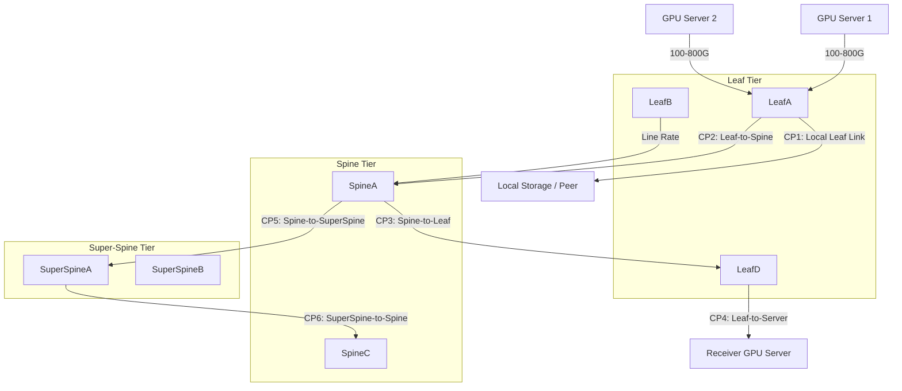
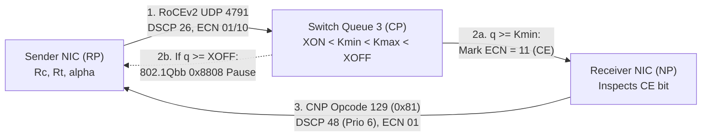
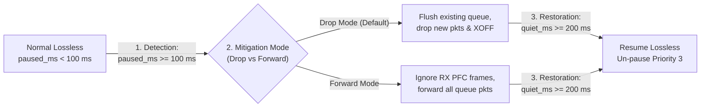

# 12.4 PFC, ECN and DCQCN in depth

| | |
|---|---|
| Level | Advanced |
| Priority tier | 1 |
| Lab venue | Nebius GPU |
| Part | Part 12: Complete AI networking |
| Sources | `ai-data-center-network-design-and-technologies` Ch. 7; `nvidia-devops` V9 Ch. 4–5 & Labs 01–04 |
| Code | `code/part12/pfc_ecn_dcqcn.py`, `code/part12/pfc_ecn_dcqcn_lab.py` |
| Coverage file | `planning/coverage/chapters/12-04.md` |

## Why this matters for AI infrastructure

An all-to-all or `AllReduce` collective across an Ethernet GPU fabric can stall even when every physical optical link is healthy and every packet-drop counter reads zero. One receiver-facing leaf egress port fills its queue and emits IEEE `802.1Qbb` Priority Flow Control (`PFC`) pause frames continuously. Within microseconds, upstream switch ingress buffers fill and propagate pause frames hop by hop, freezing unrelated GPU workers that happen to share the same traffic class. Conversely, if PFC is absent or misconfigured when microbursts converge on a single egress, RoCEv2 packets drop and trigger hardware `Go-Back-N` retransmission storms across `400 Gbps` or `800 Gbps` rails.

Preventing both failure modes requires coordinating two distinct mechanisms across every NIC and switch hop:

1. **Explicit Congestion Notification (`ECN`, `RFC 3168`) and Data Center Quantized Congestion Notification (`DCQCN`):** An early, end-to-end closed control loop in which a congested switch marks the `2`-bit IP ECN field to `11` (`Congestion Experienced`, `CE`), the destination NIC returns a RoCEv2 Congestion Notification Packet (`CNP`, InfiniBand Base Transport Header opcode `129` / `0x81`), and the sender NIC's hardware Reaction Point (`RP`) throttles injection rate for that specific Queue Pair (`QP`) before buffers fill.
2. **Priority Flow Control (`PFC`, `IEEE 802.1Qbb`):** A link-local, hop-by-hop Layer 2 circuit breaker (`EtherType 0x8808`, opcode `0x0101`, destination MAC `01:80:C2:00:00:01`) that pauses transmission for a single `802.1p` priority class (`0..7`) for `0..65,535` quanta (`512` bit-times per quantum) while reserving enough headroom buffer to absorb bytes already in flight along the cable and transceiver pipeline.

This chapter builds on the foundational QoS concepts in Chapter 2.19 and the RoCEv2 transport architecture in Chapter 12.3. We derive the exact frame formats, quanta timing equations, cable + transceiver + ASIC flight-time headroom math, Weighted Random Early Detection (`WRED`) marking curves, DCQCN Reaction Point (`RP`) rate-cut and recovery equations, threshold ordering rules (`XON < K_min < K_max < XOFF`), PFC Watchdog 3-stage state machines, next-generation Source Flow Control (`SFC`, `IEEE 802.1Qdw`) and Congestion Signaling (`CSIG`, `draft-ravi-ippm-csig-01`), and the production `ethtool -S`, `mlnx_qos`, and `mlx5_cnp_stats` diagnostic workflows.

## Prerequisites and outcomes

**Prerequisites:** Chapter 2.19 (queuing, QoS, ECN, PFC, and DCB basics), Chapter 12.2 (RDMA fundamentals), and Chapter 12.3 (RoCEv2 transport and congestion management).

**Outcomes:** After completing this chapter, you will be able to:
- Identify all six Clos fabric congestion points (local leaf south-facing link, leaf-to-spine uplink, spine-to-leaf downlink, leaf-to-server egress, spine-to-super-spine uplink, and super-spine-to-spine downlink) and explain why RoCEv2 over UDP port `4791` requires coordinated congestion management.
- Decode every field of an IEEE `802.1Qbb` PFC pause (`XOFF`) and un-pause (`XON`) frame (`64` bytes on wire, destination `01:80:C2:00:00:01`, source e.g. `10:0e:7e:b7:a7:1b`, `EtherType 0x8808`, opcode `0x0101`, class-enable vector `0x0008` for Class `3`, and `16`-octet pause-time array) and compute exact pause durations across `100 Gbps`, `200 Gbps`, `400 Gbps`, and `800 Gbps` links.
- Size per-priority lossless buffers (`XOFF`, `XON`, flight-time headroom, and hysteresis) from cable length, speed of light in glass (`5 ns/m`), transceiver/ASIC delay (`600 ns`), and MTU (`9,000` bytes), and audit `mlnx_qos` outputs (`262,144` B port buffer, `65,536` B Priority `3` buffer, `49,152` B `XOFF` at `75%`, `32,768` B `XON` at `50%`).
- Trace the ECN + DCQCN closed loop across the IP ToS byte (`6`-bit DSCP + `2`-bit ECN `00`/`01`/`10`/`11`), WRED `K_min`/`K_max` probability zones, CNP generation (`opcode 129` / `0x81`, ECN `01`, DSCP `48`), and the 3-stage RP recovery state machine (Fast Recovery, Additive Increase, Hyper-Additive Increase).
- Configure and validate the 3-stage PFC Watchdog (Detection, Drop/Forward Mitigation, Restoration), compare hop-by-hop PFC with Source Flow Control (`SFC`, `IEEE 802.1Qdw`) and Congestion Signaling (`CSIG`, `draft-ravi-ippm-csig-01`), and isolate production pause trees and broken feedback loops using `ethtool -S` and `mlx5_cnp_stats`.

---

## 1. The six Clos congestion points and why RoCEv2 needs two loops

RoCEv2 encapsulates InfiniBand transport headers inside connectionless UDP packets (UDP destination port `4791`) so RDMA verbs can execute directly between GPU and NIC memories without involving the host OS kernel or CPU. Because standard Ethernet is best-effort and UDP provides no windowing or retransmission, even a non-oversubscribed Clos fabric experiences microbursts and hash collisions when servers transmit at `100 Gbps` to `800 Gbps` line rate. Across two-tier (leaf-spine) and three-tier (leaf-spine-super-spine) AI data center topologies, congestion materializes at six distinct points:



| Congestion point | Topology path | How congestion arises | Immediate symptom on queue |
|---|---|---|---|
| **1. Local leaf link congestion (`CP1`)** | Two servers on `LeafA` -> south-facing storage/compute link on `LeafA` | Local switching bypasses spine load balancing; two line-rate flows converge on `1` south-facing port | South-facing egress queue on `LeafA` fills rapidly (`N:1` local incast) |
| **2. Leaf-to-spine link congestion (`CP2`)** | Two servers on `LeafA` -> same uplink from `LeafA` to `SpineA` | ECMP hash collision places multiple high-entropy elephant flows onto the same `LeafA -> SpineA` uplink | Northbound uplink queue on `LeafA` builds occupancy while parallel uplinks to `SpineB` sit idle |
| **3. Spine-to-leaf link congestion (`CP3`)** | Server on `LeafA` + Server on `LeafB` -> `SpineA` -> single downlink to `LeafD` | Flows arrive on separate spine ingress ports without contention, then collide on the single `SpineA -> LeafD` downlink | Southbound transit spine queue (`SpineA -> LeafD`) crosses ECN and PFC thresholds |
| **4. Leaf-to-server link congestion (`CP4`)** | Server on `LeafA` (via `SpineA`) + Server on `LeafB` (via `SpineB`) -> `LeafD` -> receiver server | Perfect spine load balancing delivers `2x` line rate cleanly to `LeafD`, exceeding the single receiver NIC link capacity | Final egress leaf queue (`LeafD -> Server`) saturates (classic destination incast) |
| **5. Spine-to-super-spine link congestion (`CP5`)** | Servers on `LeafA` and `LeafB` -> `SpineA` -> single uplink to `SuperSpineA` | Multi-pod traffic in a 3-tier fabric hashes onto the same `SpineA -> SuperSpineA` link while `SuperSpineB` is underutilized | Northbound spine-to-super-spine queue builds backpressure toward the lower pod |
| **6. Super-spine-to-spine link congestion (`CP6`)** | Servers across `LeafA`, `LeafB`, `LeafE` -> `SpineA`/`SpineB` -> `SuperSpineA` -> `SpineC` | Traffic spreads cleanly upward to `SuperSpineA`, then converges onto a single `SuperSpineA -> SpineC` downlink | Core-to-pod downlink queue on `SuperSpineA` becomes the fabric bottleneck |

### Why neither ECN alone nor PFC alone suffices

A common architectural question is why AI Ethernet fabrics run both ECN and PFC rather than picking one:

- **Why ECN alone is a lossy queue:** ECN is an end-to-end control loop. When `SpineA` marks a packet on the congested `SpineA -> LeafD` link, that packet must first finish traversing the forward path through `LeafD` to the destination server, the destination NIC must generate a `CNP`, and the `CNP` must traverse the reverse path (`Server -> LeafD -> SpineA/SpineB -> LeafA -> Sender`) before the sender NIC cuts its transmission rate. During that round-trip delay, if a sudden `N:1` incast burst fills the remaining switch buffer, packets drop. Because a queue with only ECN enabled can still drop packets during fast transients, an ECN-only queue is classified as a **lossy queue**.
- **Why PFC alone causes unfairness and pause storms:** PFC acts immediately across a single link (`hop-by-hop`), pausing transmission before a queue overflows (`lossless queue`). However, PFC has no concept of an individual flow or `QP`; it stops **all** traffic mapped to the congested `802.1p` priority class (`0..7`) on that link. If one congested flow triggers PFC on Priority `3`, every innocent flow sharing Priority `3` on that link is blocked (**head-of-line blocking**), and sustained pauses propagate backward into a fabric-wide **PFC pause tree**.

DCQCN resolves this tension by combining both mechanisms over DSCP: **ECN** acts first at a lower buffer threshold to throttle only the offending sender `QP`s end to end, while **PFC** sits higher in the buffer as a last-resort safety net to absorb microbursts before any packet drop occurs.

---

## 2. Priority Flow Control (`IEEE 802.1Qbb`) frame format, quanta math, and buffer headroom

### 2.1 From Global Pause (`IEEE 802.3x`) to Per-Priority Pause (`IEEE 802.1Qbb`)

Original Ethernet flow control (`IEEE 802.3x` Global Pause) acted like a single red traffic light across the entire physical link: when a receiver buffer filled, it halted all traffic on that wire—freezing SSH management, BGP keepalives, storage I/O, and RDMA alike. **IEEE `802.1Qbb` Priority Flow Control (`PFC`)** replaces link-wide pause with eight independent virtual lanes corresponding to the `3`-bit IEEE `802.1p` Priority Code Point (`PCP` `0..7`) or mapped DSCP classes. When Queue `3` (conventionally RoCEv2 data) crosses its `XOFF` threshold on a receiving switch port, the receiver sends a Layer 2 MAC Control frame upstream instructing its link partner to pause **only Priority `3`**, while Priorities `0, 1, 2, 4, 5, 6, 7` continue transmitting at full line rate.

### 2.2 Wire-level anatomy of an `802.1Qbb` PFC `XOFF` and `XON` frame

A PFC frame is a `64`-byte Layer 2 Ethernet MAC Control frame transmitted directly to the link-local peer (never forwarded across Layer 2 bridges or Layer 3 routers).

| Field | Size | Wire value (Hex / Binary) | Operational meaning |
|---|---|---|---|
| **Destination MAC** | `6` octets | `01:80:C2:00:00:01` | IEEE `802.1` reserved non-forwardable link-local MAC control multicast address |
| **Source MAC** | `6` octets | e.g., `10:0e:7e:b7:a7:1b` | MAC address of the congested port generating the pause frame |
| **EtherType** | `2` octets | `0x8808` | Identifies an Ethernet MAC Control frame |
| **Control Opcode** | `2` octets | `0x0101` | Identifies Class-Based Flow Control (`CBFC` / `PFC`, `IEEE 802.1Qbb`) |
| **Priority Control Vector (Class Enable Vector)** | `2` octets | `0x0008` (`C3 = True`, `C0..C2, C4..C7 = False`) | `16`-bit field (`8` upper reserved bits = `0`, `8` lower bits = `e[7]..e[0]`); `1 << 3 = 0x0008` enables Class `3` |
| **Time (`time[0]..time[7]`)** | `16` octets (`8 x 2` octets) | `C3 = 65535` (`0xFFFF`) for `XOFF`; `C3 = 0` (`0x0000`) for `XON` | Pause duration in `512`-bit quanta (`0..65,535`) for each of the `8` classes (`C0..C7`) |
| **Padding + FCS (`CRC-32`)** | `26 + 4` octets | Zero-padded to `60` B + `4` B CRC | Brings total wire frame length to `64` bytes |

Two packet-capture states define the PFC lifecycle for Class `3`:
1. **`XOFF` (Transmit Off / Pause) frame:** When the receiver's Priority `3` ingress buffer crosses the `XOFF` threshold, it transmits a `64`-byte frame with `EtherType 0x8808`, opcode `0x0101`, Class Enable Vector `0x0008` (`C3 = true`), and Class `3` pause time set to `65535` (`0xFFFF`, while `C0, C1, C2, C4, C5, C6, C7 = 0`). If congestion persists, each subsequent packet crossing `XOFF` triggers a fresh `XOFF` frame that resets the upstream pause timer.
2. **`XON` (Transmit On / Un-pause) frame:** Once the congested queue drains below the `XON` threshold before the `65,535`-quanta timer expires, the receiver immediately transmits an identical `64`-byte frame (`EtherType 0x8808`, opcode `0x0101`, Class Enable Vector `0x0008`) with Class `3` pause time set to **`0`** (`0x0000`), explicitly instructing the upstream neighbor to resume Priority `3` transmission immediately.

### 2.3 Exact PFC pause duration math across `100G`, `200G`, `400G`, and `800G`

In IEEE `802.1Qbb`, each pause quantum equals **`512` bit-times** at the negotiated link speed (`R`, in bits per second). Because `1 Gbps = 1 bit/ns`, the pause duration for a `16`-bit quanta value $Q \in [0, 65535]$ is:

$$\text{Total Bit-Times} = Q \times 512$$

$$\text{Pause Duration (ns)} = \frac{Q \times 512}{R_{\text{Gbps}}}, \qquad \text{Pause Duration (}\mu\text{s)} = \frac{Q \times 512}{R_{\text{Gbps}} \times 1000}$$

For the maximum pause value $Q = 65,535$ quanta ($\text{Total Bit-Times} = 65,535 \times 512 = 33,553,920\text{ bit-times}$):

| Link speed ($R_{\text{Gbps}}$) | Quanta ($Q$) | Total bit-times ($Q \times 512$) | Pause duration (`ns`) | Pause duration (`µs`) | Operational note |
|---|---|---|---|---|---|
| **`100 Gbps`** | `65,535` | `33,553,920` | `335,539.2 ns` | **`335.5392 µs`** | Legacy `100G` RoCEv2 leaf-server link |
| **`200 Gbps`** | `65,535` | `33,553,920` | `167,769.6 ns` | **`167.7696 µs`** | ConnectX-6 / HDR-era Ethernet rail |
| **`400 Gbps`** | `65,535` | `33,553,920` | `83,884.8 ns` | **`83.8848 µs`** | ConnectX-7 / Spectrum-4 `400G` rail |
| **`800 Gbps`** | `65,535` | `33,553,920` | `41,942.4 ns` | **`41.9424 µs`** | ConnectX-8 / Spectrum-X `800G` rail |
| **Any rate (`XON`)** | `0` | `0` | `0.0 ns` | **`0.0 µs`** | Explicit `XON` un-pause frame resumes TX immediately |

Notice that because a quantum is defined in **bit-times** (`512` bits) rather than wall-clock microseconds, doubling the link speed from `400 Gbps` (`83.8848 µs`) to `800 Gbps` (`41.9424 µs`) cuts the maximum pause duration of a single `XOFF` frame in half.

### 2.4 Cable flight-time headroom math and `mlnx_qos` buffer thresholds

When a receiving switch port crosses `XOFF` and emits a pause frame, bytes already in flight on the wire continue arriving until the pause frame reaches the upstream sender and the sender's MAC stops transmitting. To prevent lossless drops during this reaction window, the priority buffer above `XOFF`—called the **headroom buffer**—must absorb:
1. **Round-trip cable propagation delay:** Light travels through optical fiber at roughly $2 \times 10^8\text{ m/s}$, or **`5 ns/m`** one way (`10 ns/m` round-trip: $t_{\text{cable,RTT}} = 2 \times L_{\text{m}} \times 5\text{ ns/m}$).
2. **Transceiver + PHY + MAC/ASIC reaction pipeline delay:** Typically **`600 ns`** ($t_{\text{pipeline}}$).
3. **In-flight serialization allowance:** Up to **`2` jumbo MTU packets** ($2 \times 9,000 = 18,000\text{ B}$) plus the **`64`-byte** PFC control frame ($18,064\text{ B}$ total): one jumbo frame that just began serializing at the sender when the `XOFF` arrived, and one frame finishing at the receiver when `XOFF` triggered.

$$\text{Headroom}_{\text{min (bytes)}} = \frac{(2 \times L_{\text{m}} \times 5\text{ ns/m} + t_{\text{pipeline,ns}}) \times R_{\text{Gbps}}}{8} + 2 \times \text{MTU} + 64$$

Comparing a `2 m` in-rack DAC cable against a `500 m` campus optical fiber at `400 Gbps` (`50 bytes/ns`) with a `9,000`-byte MTU and `600 ns` transceiver/ASIC delay illustrates why long optical links require drastically larger headroom buffers:

| Link scenario (`400 Gbps`, `MTU = 9,000 B`) | Cable RTT (`2 * L * 5 ns/m`) | Total reaction time (`RTT + 600 ns`) | In-flight wire bytes (`t * 400 / 8`) | Serialization bytes (`2 * 9,000 + 64`) | Required flight headroom (`B`) |
|---|---|---|---|---|---|
| **Short in-rack DAC (`L = 2 m`)** | `20 ns` | `620 ns` | `31,000 B` | `18,064 B` | **`49,064 B`** |
| **Long optical fiber (`L = 500 m`)** | `5,000 ns` | `5,600 ns` | `280,000 B` | `18,064 B` | **`298,064 B`** (`+249,000 B` delta) |

On a switch or host interface, `mlnx_qos -i swp12` exposes the deployed buffer partitioning, `XOFF`, `XON`, headroom, and hysteresis:

```text
# (untested here)
$ mlnx_qos -i swp12
Priority trust state: pcp
Receive buffer size (bytes): 262144, 262144, 262144, ...
PFC configuration:
        priority    0   1   2   3   4   5   6   7
        enabled     0   0   0   1   0   0   0   0
        buffer      0   0   0   1   0   0   0   0

Buffer size assigned to priority 3: 65536 bytes
Xoff threshold: 49152 bytes   (75% of buffer)
Xon threshold:  32768 bytes   (50% of buffer)
```

Every number in this `mlnx_qos -i swp12` output enforces a specific hardware invariant:
- **Narrow lossless scope (`enabled: 0 0 0 1 0 0 0 0`):** Only Priority `3` (`buffer 1`) is lossless. Priorities `0..2` and `4..7` remain lossy so management (`prio0`) and storage never enter a pause domain.
- **Headroom (`65,536 - 49,152 = 16,384 bytes`, or `25.0%` of the `65,536`-byte Priority `3` buffer out of the `262,144`-byte port receive buffer):** Setting `XOFF` at `49,152` bytes (`75.0%`) reserves `16,384` bytes (`25.0%`) above `XOFF` to absorb in-flight packets after the pause frame is sent. Setting `XOFF` equal to `65,536` bytes (`0` headroom) causes tail-drop packet loss before the upstream sender can halt; setting `XOFF` too low wastes usable queue capacity and pauses traffic prematurely.
- **Hysteresis (`49,152 - 32,768 = 16,384 bytes`, or `25.0%` gap between `75.0%` `XOFF` and `50.0%` `XON`):** The queue must drain from `49,152` bytes down to `32,768` bytes (`50.0%`) before `XON` lifts the pause. If `XON` were set equal to `XOFF` (`0` hysteresis), a single packet draining would trigger `XON` and the very next arriving packet would trigger `XOFF`, causing `tx_pfc_prio3` to spike with thousands of micro-oscillations per second. Conversely, setting `XON` to the minimum buffer (`0` B) starves the link by delaying resumption until the queue is completely empty.

---

## 3. Explicit Congestion Notification (`ECN`) and `DCQCN` closed-loop rate control

### 3.1 IP header `DSCP` + `ECN` bits and `CNP` packet format

In the IPv4 Type of Service (`ToS`) byte or IPv6 Traffic Class (`TC`) byte (`8` bits total), the upper **`6` bits** hold the Differentiated Services Code Point (**`DSCP`**, `0..63`) used for QoS queue classification, and the lower **`2` bits** hold the **ECN** field (`RFC 3168`):

| `ECT` bit (Bit 6) | `CE` bit (Bit 7) | `2`-bit ECN codepoint | Standard name | Switch & endpoint behavior under congestion |
|---|---|---|---|---|
| `0` | `0` | **`00`** | `Not-ECT` (Not ECN-Capable Transport) | Transport does not support ECN; congested switches **drop** the packet instead of marking it |
| `0` | `1` | **`01`** | `ECT(1)` (ECN-Capable Transport 1) | Marks packet as ECN-capable; set by sender on RoCEv2 data packets and by receiver on returning `CNP` frames (`01` and `10` are treated identically by transit switches) |
| `1` | `0` | **`10`** | `ECT(0)` (ECN-Capable Transport 0) | Marks packet as ECN-capable; congested switches rewrite `10` (or `01`) to `11` (`CE`) instead of dropping |
| `1` | `1` | **`11`** | `CE` (Congestion Experienced) | Set by a congested transit switch when queue occupancy crosses its WRED ECN threshold; triggers the receiver NIC to generate a `CNP` |

When an ECN-marked RoCEv2 packet (`UDP` destination port `4791`, `ECN = 11`) reaches the destination server, the receiving NIC's **Notification Point (`NP`)** hardware generates a **Congestion Notification Packet (`CNP`)** back toward the source IP:
- **Transport header:** A RoCEv2 frame (`UDP 4791`) whose InfiniBand Base Transport Header (`BTH`) carries **opcode `129`** (`0x81`, binary `10000001`).
- **Payload & addressing:** Contains the **destination Queue Pair (`QP`)** identifier of the congested flow so the sender throttles only that specific `QP`, not the entire priority class.
- **IP QoS & ECN bits on the `CNP`:** The receiver sets the `CNP`'s ECN bits to **`01`** (`ECT(1)`) and maps the `CNP` to a high-priority control DSCP—conventionally **DSCP `48`** (`CS6`, mapped to strict-priority Queue `6`), while RoCEv2 data uses **DSCP `26`** (`AF31`, mapped to lossless Queue `3`) and Expedited Forwarding uses **DSCP `46`** (`EF`, appearing in `tcpdump -vv` as `tos 0xb8` since `0xb8 >> 2 = 46`). Carrying `CNP`s on Priority `6` ensures that backward congestion notifications are never delayed behind or paused by Priority `3` data congestion.

### 3.2 WRED `K_min` / `K_max` probabilistic marking curve and `XON < K_min < K_max < XOFF`

Rather than waiting for a single static cutoff, production AI switches apply **Weighted Random Early Detection (`WRED`)** to mark ECN bits probabilistically as queue occupancy ($q$) grows between a minimum threshold ($K_{\min}$) and a maximum threshold ($K_{\max}$) with maximum marking probability $P_{\max}$:

$$P_{\text{mark}}(q) = \begin{cases} 0, & q < K_{\min} \quad (\text{Green Zone: Free Flow}) \\ P_{\max} \cdot \dfrac{q - K_{\min}}{K_{\max} - K_{\min}}, & K_{\min} \le q < K_{\max} \quad (\text{Yellow Zone: Linear WRED Ramp}) \\ 1.0, & q \ge K_{\max} \quad (\text{Red Zone: } 100\% \text{ ECN Marking}) \end{cases}$$

Using a standard high-speed switch profile with $K_{\min} = 150\text{ KB}$ (`150,000` B), $K_{\max} = 1,500\text{ KB}$ (`1,500,000` B), $P_{\max} = 1.0$, and `PFC XOFF` at `2,000,000` B (`2,500,000` B buffer limit):

| Queue occupancy ($q$) | Queue zone | WRED calculation | Marking probability ($P_{\text{mark}}$) | Switch action |
|---|---|---|---|---|
| **`100 KB`** (`< 150 KB`) | **Green Zone** | $q < K_{\min}$ | **`0.0` (`0%`)** | Forward packets unmarked at full line rate |
| **`487.5 KB`** (`25%` of span) | **Yellow Zone** | $(487.5 - 150) / (1500 - 150) = 337.5 / 1350$ | **`0.25` (`25%`)** | Mark `1` in `4` packets with `ECN = 11` (`CE`) |
| **`825 KB`** (midpoint) | **Yellow Zone** | $(825 - 150) / (1500 - 150) = 675 / 1350$ | **`0.50` (`50%`)** | Mark `1` in `2` packets with `ECN = 11` (`CE`) |
| **`1,600 KB`** (`>= 1,500 KB`) | **Red Zone** | $q \ge K_{\max}$ | **`1.0` (`100%`)** | Mark `100%` of packets with `CE` (`< XOFF`, no PFC yet) |
| **`>= 2,000 KB`** (`>= XOFF`) | **PFC Safety Net** | $q \ge \text{XOFF}$ | **`1.0` + `PFC XOFF`** | Emit `802.1Qbb` pause frame to upstream hop |

For DCQCN to prevent PFC storms, the thresholds on every lossless queue must strictly satisfy:

$$0 < \text{XON} < K_{\min} < K_{\max} < \text{XOFF} < \text{BufferMax}$$

If $K_{\max} \ge \text{XOFF}$ (for example, setting $K_{\max} = 55,000\text{ B}$ above $\text{XOFF} = 49,152\text{ B}$), the switch fires hop-by-hop PFC pauses **before** ECN marking ever reaches `100%`, turning PFC into the primary congestion mechanism and starving innocent flows.

### 3.3 The `DCQCN` three-actor state machine (`CP`, `NP`, `RP`)

DCQCN coordinates three hardware state machines across the fabric:
1. **Congestion Point (`CP` — the transit switch egress queue):** Monitors queue depth $q$ against $K_{\min}$ and $K_{\max}$ and rewrites `ECT(0)`/`ECT(1)` to `CE` (`11`).
2. **Notification Point (`NP` — the receiver NIC):** Inspects arriving RoCEv2 packets; when `CE = 11` is present, generates at most one `CNP` (`opcode 129` / `0x81`, `ECN = 01`) per coalesce timer window (typically `50 µs`) back to the sender.
3. **Reaction Point (`RP` — the sender NIC hardware rate limiter):** Maintains three state variables per active `QP`: current transmission rate $R_c$, target rate $R_t$ (saved before a cut), and congestion estimate $\alpha \in [0, 1]$ updated via an exponential weighted moving average (`EWMA`) with weight $g$ (for example, $g = \frac{1}{16} = 0.0625$):

- **On `CNP` arrival (Multiplicative Rate Cut):**
  $$R_t \leftarrow R_c, \qquad R_c \leftarrow R_c \cdot \left(1 - \frac{\alpha}{2}\right), \qquad \alpha \leftarrow (1 - g)\alpha + g \cdot 1.0$$
  Because $\alpha \le 1.0$, a single rate cut reduces $R_c$ by **at most `50%`** (for example, a `400.0 Gbps` sender with $\alpha = 1.0$ cuts immediately to $R_c = 200.0\text{ Gbps}$ while saving $R_t = 400.0\text{ Gbps}$; at $\alpha = 0.5$ and $g = 0.0625$, $R_c$ cuts to $300.0\text{ Gbps}$ and $\alpha$ rises to $0.53125$).
- **When no `CNP` arrives (Three-Stage Rate Recovery + $\alpha$ Decay):**
  As each rate-increase timer or byte counter expires without a `CNP`, $\alpha$ decays toward zero via $\alpha \leftarrow (1 - g)\alpha$, and the sender recovers across three stages parameterized by the Fast Recovery threshold $F$ (typically $F = 5$), Additive Increase step $R_{\text{AI}}$, and Hyper-Additive Increase step $R_{\text{HAI}}$:
  1. **Fast Recovery ($\text{step} \le F$):** Keeps $R_t$ unchanged and binary-searches halfway back toward the pre-congestion rate: $R_c \leftarrow (R_c + R_t) / 2$ (for example, from $R_c = 200.0\text{ Gbps}$ and $R_t = 300.0\text{ Gbps}$, step `1` raises $R_c$ to **`250.0 Gbps`**).
  2. **Additive Increase ($\text{step} > F$, single counter exceeded):** Increments target rate by $R_{\text{AI}}$ and averages: $R_t \leftarrow \min(\text{LineRate}, R_t + R_{\text{AI}})$, $R_c \leftarrow (R_c + R_t) / 2$ (for example, with $R_{\text{AI}} = 10.0\text{ Gbps}$ from $R_c = 250.0, R_t = 300.0$, $R_t$ becomes `310.0 Gbps` and $R_c$ rises to **`280.0 Gbps`**).
  3. **Hyper-Additive Increase (both timer and byte counter exceeded $> F$):** Increments target rate by $i \cdot R_{\text{HAI}}$: $R_t \leftarrow \min(\text{LineRate}, R_t + i \cdot R_{\text{HAI}})$, $R_c \leftarrow (R_c + R_t) / 2$ (for example, with $i = 2$ and $R_{\text{HAI}} = 40.0\text{ Gbps}$, $R_t$ jumps from `310.0` to `390.0 Gbps` and $R_c$ reaches **`335.0 Gbps`**).



| Loop component | Actor & hardware location | Trigger condition | Action taken | Key verification counter |
|---|---|---|---|---|
| **1. Forward data** | Sender NIC (`RP`) | Application posts RDMA verb | Emits UDP `4791` packet with `DSCP 26` (`Prio 3`) and `ECN = 01` or `10` | `tx_prio3_packets` |
| **2a. ECN marking** | Switch egress queue (`CP`) | Queue depth $q \ge K_{\min}$ (`WRED`) | Rewrites IP ECN bits to `11` (`CE`) and forwards packet normally | `rx_ecn_marked_prio3` |
| **2b. PFC backstop** | Switch ingress/egress (`CP`) | Ingress buffer crosses `XOFF` (`49,152` B) | Sends `64` B `0x8808` `XOFF` (`65,535` quanta) to link partner | `tx_pfc_prio3` / `rx_pfc_prio3` |
| **3. CNP feedback** | Receiver NIC (`NP`) | Receives RoCEv2 packet with `ECN = 11` | Sends `CNP` (`BTH opcode 129` / `0x81`, `ECN 01`, `DSCP 48`) to sender | `np_ecn_marked_roce_packets` |
| **4. Rate cut & recovery** | Sender NIC (`RP`) | Receives `CNP` or recovery timer fires | Cuts $R_c \leftarrow R_c(1 - \alpha/2)$, then runs Fast / `AI` / `HAI` recovery | `np_cnp_handled`, `rp_current_rate`, `rp_byte_reset` |

---

## 4. Hop-by-hop PFC propagation, pause trees, and the PFC Watchdog

### 4.1 The 5-step hop-by-hop PFC propagation chain

When `DCQCN` cannot drain a congested downstream link fast enough (or when a receiver NIC hangs), PFC propagates backward across the fabric through a strict five-step hardware chain:
1. **Egress receives pause:** A switch (`SpineA`) receives a PFC `XOFF` frame on its egress interface facing `LeafC` (or `LeafD`).
2. **Egress scheduler halts:** `SpineA` immediately pauses transmission on the corresponding egress queue (`Queue 3`) for the requested quanta duration.
3. **Ingress lossless buffer builds up:** Because packets from upstream leaves (`LeafA`, `LeafB`) continue arriving at `SpineA` destined for that paused egress queue, `SpineA`'s own ingress buffer for Priority `3` fills and breaches its `XOFF` threshold.
4. **Ingress port emits upstream pause:** `SpineA`'s ingress port generates a new PFC `XOFF` frame and transmits it upstream toward `LeafA` (and `LeafB`).
5. **Cascade reaches sender NICs:** The chain repeats hop by hop until `LeafA` pauses the source GPU server (`GPU101`), freezing all Priority `3` traffic across the affected branch of the Clos tree—including innocent flows from `GPU103` on `LeafB` that share `SpineA` (`head-of-line blocking`).

### 4.2 The 3-stage PFC Watchdog (`Detection`, `Mitigation`, `Restoration`)

If a broken NIC driver or credit loop causes a downstream node (`GPU102` on `LeafC`) to emit continuous `XOFF` frames indefinitely, the resulting **PFC storm** can lock up the entire fabric. The **PFC Watchdog** on each switch monitors per-port pause duration and breaks the storm across three stages:



| Watchdog stage | Trigger condition | Switch hardware actions | Impact on upstream fabric (`LeafA`, `LeafB`, `GPU101`, `GPU103`) |
|---|---|---|---|
| **1. Detection** | Port/queue remains paused by incoming `XOFF` frames for $\ge T_{\text{detect}}$ (e.g., `100 ms`) | Marks the port (`SpineA` facing `LeafC`) as experiencing an abnormal PFC storm and increments watchdog storm counters | Identifies the stuck branch before upstream ingress buffers lock the entire spine tier |
| **2a. Mitigation (`Drop` mode — most common)** | Watchdog storm state active on queue | **(1)** Discards all packets already queued in the output queue; **(2)** discards new packets arriving for that output queue; **(3)** discards incoming pause frames from the same priority group | **Stops upstream pause propagation:** `SpineA` clears its buffer and never sends `XOFF` to `LeafA` or `LeafB`, isolating the blast radius to the broken `LeafC -> GPU102` sink |
| **2b. Mitigation (`Forward` mode)** | Watchdog storm state active (when configured for forward) | Ignores received `PFC` frames on the port and forcefully forwards both queued and newly arriving packets downstream | Drains `SpineA`'s buffer without pausing upstream hops, pushing packets toward `LeafC` |
| **3. Restoration** | Received PFC pause frames remain below threshold for $\ge T_{\text{restore}}$ (e.g., `200 ms` quiet window) | Lifts mitigation drops, un-pauses the queue, and restores normal IEEE `802.1Qbb` lossless behavior | Fabric seamlessly returns to lossless RoCEv2 operation once the downstream fault clears |

---

## 5. Next-generation congestion signaling: Source Flow Control (`SFC`, `IEEE 802.1Qdw`) and `CSIG`

Because ECN suffers from forward-plus-return signaling latency (`Switch -> Receiver -> Sender`) and PFC suffers from class-wide head-of-line blocking (`hop-by-hop` per-priority pause), two newer standards target direct, low-latency, flow-aware feedback:

### 5.1 Source Flow Control (`SFC`, `IEEE 802.1Qdw` / Source PFC)

**Source Flow Control (`SFC`, specified in `IEEE 802.1Qdw`)**—also called **Source PFC**—eliminates both the forward-trip delay of ECN and the class-wide blast radius of hop-by-hop PFC:
1. **Detection at transit bottleneck:** A server on `LeafA` transmits a flow through `SpineA` toward `LeafD`. When the `SpineA -> LeafD` queue crosses its **SFC threshold**, `SpineA` acts immediately instead of waiting for the packet to reach the destination server.
2. **Packet trimming and header reversal:** `SpineA` trims the data packet's payload, reverses the source and destination IP addresses in the header, and sends a flow-specific **SFC congestion signal** directly back toward the source (`SpineA -> LeafA -> Sender`).
3. **Leaf interception or translation:** When `LeafA` receives the SFC signal, it can pause the specific queue locally, forward the SFC signal directly to an SFC-capable server NIC, or **translate the SFC signal into a standard `802.1Qbb` PFC pause frame** for legacy NICs. Because SFC is triggered at the congested switch (`half-RTT` feedback) and identifies the specific flow, it prevents both ECN's forward-path delay and PFC's class-wide unfairness.

### 5.2 Congestion Signaling (`CSIG`, `draft-ravi-ippm-csig-01`)

**Congestion Signaling (`CSIG`, `draft-ravi-ippm-csig-01`)** uses In-Band Network Telemetry (`INT`) to embed fixed-length, multi-bit bottleneck summaries directly inside live data packets:
- **Header placement (`L2.5`):** The `CSIG` tag sits **between the Layer 2 (`Ethernet`) header and Layer 3 (`IP`) header** (`Ethernet -> CSIG Tag -> IP -> UDP`), requiring an IEEE-allocated Ethernet tag.
- **End-to-end tag accumulation and reflection:** As `GPU1` (sender) transmits packets across hops `CSIG1 -> CSIG2 -> CSIG3/CSIG4 -> CSIG5 -> CSIG6 -> GPU2` (receiver), each switch updates the `CSIG` tag with its local bottleneck state. `GPU2` reflects the accumulated `CSIG` summary back to `GPU1` via **CSIG reflection headers**, allowing the sender to adjust both its injection rate and its multipath selection (`ECMP` / `PLB`) in real time.
- **Three `CSIG` tag sections and four locator metadata fields:**
  1. **Signal Type:** Selects the congestion metric requested by the server (`minimum ABW / C`, `minimum ABW` [available bandwidth], or `maximum PD` [packet delay]).
  2. **Signal Value:** Carries the quantized multi-bit congestion measurement along the path.
  3. **Locator Metadata:** A static per-port identifier encoding **four fields** that pinpoint the exact bottleneck: **(1) Capacity** of the bottleneck link, **(2) Stage** of the bottleneck in the Clos topology, **(3) Device ID**, and **(4) Link identification** (`uplink` or `downlink`).

| Mechanism | Standard / Draft | Granularity | Feedback path | Lossless guarantee | Primary advantage & trade-off |
|---|---|---|---|---|---|
| **ECN** | `RFC 3168` | Per-flow (`QP`) | `Switch -> Receiver -> CNP -> Sender` (`full RTT`) | No (**lossy queue** if used alone) | Zero pause unfairness, but forward+reverse RTT is too slow for microbursts |
| **PFC** | `IEEE 802.1Qbb` | Per-priority class (`0..7`) | `Congested Port -> Upstream Neighbor` (`1 hop`) | Yes (**lossless queue**) | Immediate microburst protection, but causes head-of-line blocking & pause trees |
| **DCQCN** | `SIGCOMM 2015` / RoCEv2 | ECN per-`QP` + PFC per-class | `CNP` end-to-end (`XON < ECN < XOFF`) | Yes (when `PFC` backstop enabled) | Production standard: ECN handles steady contention; PFC catches bursts |
| **SFC** | `IEEE 802.1Qdw` | Per-flow | `Congested Switch -> Leaf / Source` (`direct reverse`) | Yes (with leaf PFC translation) | Avoids ECN forward-path delay and avoids class-wide PFC blocking |
| **CSIG** | `draft-ravi-ippm-csig-01` | Per-packet / Per-flow `INT` | `L2.5` tag -> `Receiver CSIG Reflection -> Sender` | Complements rate & path control | Exposes exact bottleneck (`capacity`, `stage`, `device ID`, `uplink/downlink`) |

---

## Commands and configurations that matter

All operational commands below are marked `(untested here)` and reproduce the exact verification sequence from our production runbooks.

### 1. Inspecting PFC enablement, buffer allocation, `XOFF`, `XON`, and DSCP trust (`mlnx_qos`)

```bash
# (untested here) Inspect per-priority PFC, buffer sizes, XOFF, and XON on switch port swp12
mlnx_qos -i swp12

# (untested here) Verify PFC is enabled ONLY on Priority 3 (0 0 0 1 0 0 0 0), never on Priority 0 (management)
mlnx_qos -i swp12 | grep -A3 "PFC configuration"
```

### 2. Walking a PFC pause tree and correlating ECN marks (`ethtool -S`)

```bash
# (untested here) Check downstream receiver-facing leaf port (swp7) vs upstream relay port (swp3)
ethtool -S swp7 | egrep "tx_pfc_prio3|rx_pfc_prio3|rx_ecn_marked_prio3"
ethtool -S swp3 | egrep "tx_pfc_prio3|rx_pfc_prio3|rx_ecn_marked_prio3|queue3_occupancy"

# (untested here) Capture two consecutive 5-second windows on swp9 to measure active ECN marking delta
ethtool -S swp9 | grep rx_ecn_marked_prio3 && sleep 5 && ethtool -S swp9 | grep rx_ecn_marked_prio3
```

### 3. Auditing NIC DCQCN Notification Point (`NP`) and Reaction Point (`RP`) counters (`mlx5_cnp_stats`)

```bash
# (untested here) Verify sender RP is receiving CNPs and adjusting rate in response to switch ECN marks
mlx5_cnp_stats -d mlx5_0

# (untested here) Sample RP current rate and CNP count at 1-second intervals to detect synchronized oscillation
mlx5_cnp_stats -d mlx5_0 --interval 1
```

### 4. End-to-end 4-lab RoCEv2 path inventory, contention test, and GID evidence ladder

```bash
# (untested here) Lab 01 & 02: Verify route, MTU 9000, 400G link speed, RDMA netdev mapping, and zero uncorrected FEC
ip route get 10.20.8.5
ip link show dev ens1f0
ethtool ens1f0 | egrep "Speed|Duplex|Link"
rdma link show
date -u && ethtool -S ens1f0 | egrep "ecn_marked|pfc_prio|rx_prio3_packets|tx_prio3_packets|fec_uncorrected"

# (untested here) Lab 04: Compare healthy rail (mlx5_0, 392 Gbps in 2.1s) vs misaligned rail (mlx5_1, 156 Gbps in 8.2s)
ibv_devinfo -d mlx5_0 -i 1 | grep GID
ibv_devinfo -d mlx5_1 -i 1 | grep GID
ib_write_bw -d mlx5_0 -i 1 10.20.8.5
```

---

## How it fails

| Failure mode | Observable symptoms & counter signature | Root cause | Diagnostic commands & remediation |
|---|---|---|---|
| **1. Upstream PFC pause tree from a downstream receiver bottleneck (`swp3` vs `swp7`)** | Collective latency spikes with `0` link errors and `0` drops. Upstream port `swp3` shows `rx_pfc_prio3: 41823`, `tx_pfc_prio3: 41810`, `rx_ecn_marked_prio3: 190`, and `queue3_occupancy: 98%`, while downstream receiver port `swp7` shows `tx_pfc_prio3: 0` and `rx_ecn_marked_prio3: 2200`. | `swp3` is a **relay hop** caught in the middle of a pause chain (`rx_pfc > 0` and `tx_pfc > 0`), whereas `swp7` (`rx_ecn_marked = 2,200`, `11.58x` higher than `swp3`'s `190`) is marking heavily at the receiver edge. | Walk in the `rx_pfc` direction until `tx_pfc == 0` (`trace_pause_tree_origin`). Relieve the destination bottleneck via job placement, adaptive routing, or validated ECN tuning; never blindly disable PFC. |
| **2. Management SSH freeze from accidental `prio0` PFC leak** | SSH sessions and Kubernetes heartbeats stall specifically during `AllReduce` bursts. `mlnx_qos -i swp12` shows `enabled: 1 0 0 1 0 0 0 0`. | PFC was accidentally enabled on **Priority `0`** (default/management class) alongside Priority `3` (RoCE), allowing congestion or shared buffer pressure to pause management traffic. | Reconfigure `mlnx_qos` so `enabled` is set strictly to `0 0 0 1 0 0 0 0` (Priority `3` only) and verify `rx_pfc_prio0 == 0` under load. |
| **3. Heavy ECN marking + heavy PFC with weak RP throttling (`98 Gbps` on `100G`)** | Switch `swp9` shows `rx_ecn_marked_prio3: 412880` and `rx_pfc_prio3: 93100`; sender `mlx5_0` shows `np_cnp_handled: 409500` (`99.18%` of marks), yet `rp_current_rate: 98 Gbps` on a `100 Gbps` link. | The ECN/CNP feedback loop is intact (`409,500 / 412,880 = 99.18%` delivered), but the endpoint `RP` rate-cut profile is too weak (or the destination cut is structurally oversubscribed) to drain the queue before `XOFF`. | Apply the vendor-qualified DCQCN RP profile and fix destination oversubscription or job placement before altering switch thresholds. |
| **4. Synchronized sender rate oscillation (`100 -> 12 -> 95 -> 11 -> 96 Gbps`)** | Fabric utilization pulses in `1`-second waves: `t=0s` (`np_cnp_handled: 40`, `100 Gbps`) -> `t=1s` (`380` CNPs, `12 Gbps`) -> `t=2s` (`2` CNPs, `95 Gbps`) -> `t=3s` (`410` CNPs, `11 Gbps`) -> `t=4s` (`3` CNPs, `96 Gbps`). | DCQCN rate-decrease factor is overly aggressive (`88 Gbps` collapse in `1 s`) and recovery (`R_AI`/`R_HAI`) is too fast, causing all synchronized senders sharing the bottleneck to cut and overshoot in lockstep. | Restore the qualified DCQCN endpoint profile so `rp_current_rate` converges into a stable band (`70–90%` of line rate) instead of swinging `11%..96%`. |
| **5. Broken CNP return path or asymmetric sender response (`np_cnp_handled == 0`)** | Switch `rx_ecn_marked_prio3` climbs by `15,000+` and `rx_pfc_prio3` climbs by `4,200+`, but sender `np_cnp_handled` stays at `0` and `rp_current_rate` stays pinned at `100 Gbps`. | Reverse-path ACL/routing drops `CNP` frames (`UDP 4791`, `opcode 129`), `CNP`s on Priority `6` are misclassified into a congested queue, or ECN/DCQCN is disabled on the receiver/sender NIC. | Audit bidirectional `CNP` reachability (`DSCP 48` -> Queue `6`) and verify `np_ecn_marked_roce_packets` on the receiver and `np_cnp_handled` on the sender track switch `rx_ecn_marked_prio3` (e.g., `312` switch marks vs `305` NP packets vs `298` RP CNPs). |
| **6. Misaligned RDMA device / GID selection masquerading as fabric congestion (`mlx5_1` vs `mlx5_0`)** | `ib_write_bw -d mlx5_1 -i 1 10.20.8.5` degrades from **`392 Gbps` (`2.1 s`, `0` retries)** on `mlx5_0` to **`156 Gbps` (`8.2 s`, `2.51x` slower, `3.90x` longer)** with **`24` `RETRY_EXC_ERR`** completions and `rx_ecn_marked_prio3: 142` on `ens1f1`. | Process bound to the wrong RDMA device/rail (`mlx5_1` / `ens1f1`, `GID[3] fe80::0c42:a1ff:fec8:d79d/64` instead of `mlx5_0` / `ens1f0`, `GID[3] fe80::0c42:a1ff:fec8:d79b/64`), forcing cross-rail routing and ECN marks. | Walk the 4-layer evidence ladder (`1. Physical rdma link show` -> `2. Route/MTU 9000` -> `3. RoCE GID/device` -> `4. QoS counters`). Fix the process `-d mlx5_0` binding; never tune switch PFC/ECN for an endpoint selection bug. |

---

## Hands-on lab

**Venue:** Local workstation or Nebius GPU node (self-checking Python simulator; no live switch hardware required). Commands for live switches/NICs in `Commands and configurations that matter` are marked `(untested here)`.

Run the Chapter 12.4 verification lab (`code/part12/pfc_ecn_dcqcn_lab.py`), which executes `28` deterministic checks across our protocol model (`code/part12/pfc_ecn_dcqcn.py`):

```bash
python3 code/part12/pfc_ecn_dcqcn_lab.py
```

Expected output (`28 passed, 0 failed`):

```text
=== Chapter 12.4 Lab: PFC, ECN and DCQCN in Depth ===
  [PASS] ADC Ch 7 Table 7-1 IP Header & ECN bits: 8-bit ToS = 6-bit DSCP + 2-bit ECN (00 Not-ECT drop, 01 ECT(1), 10 ECT(0), 11 CE)
  [PASS] ADC Ch 7 RoCEv2 & CNP frame: UDP destination port 4791; CNP carries IB BTH opcode 129 (0x81, binary 10000001) and ECN 01
  [PASS] V9 Ch 4/6 & Handbook 2.19 DSCP markings: RoCE data DSCP 26 -> Prio 3, CNP DSCP 48 -> Prio 6, and tcpdump tos 0xb8 >> 2 == DSCP 46 (EF)
  [PASS] ADC Ch 7 Fig 7-10..7-12 IEEE 802.1Qbb PFC frame: 64B wire frame, Dst MAC 01:80:C2:00:00:01, Src 10:0e:7e:b7:a7:1b, EtherType 0x8808, Opcode 0x0101, Class 3 enable vector 0x0008, 16-octet Time field
  [PASS] IEEE 802.1Qbb Quanta math (100 Gbps): 65,535 quanta * 512 bit-times = 33,553,920 bit-times = 335,539.2 ns (335.5392 us)
  [PASS] IEEE 802.1Qbb Quanta math (200 Gbps & 400 Gbps): 200G max pause = 167.7696 us; 400G max pause = 83,884.8 ns (83.8848 us)
  [PASS] IEEE 802.1Qbb Quanta math (800 Gbps & XON=0): 800G max pause = 41,942.4 ns (41.9424 us); quanta=0 is explicit XON un-pause (0.0 us)
  [PASS] V9 Ch 4 mlnx_qos -i swp12 buffer profile: port rx buffer = 262,144 B, prio3 buffer = 65,536 B, XOFF = 49,152 B (75.0%), XON = 32,768 B (50.0%)
  [PASS] V9 Ch 4 mlnx_qos -i swp12 headroom & hysteresis: headroom = 65,536 - 49,152 = 16,384 B (25.0%); hysteresis = 49,152 - 32,768 = 16,384 B (25.0%)
  [PASS] Flight-time headroom sizing (400 Gbps, MTU 9000): 2m DAC needs 49,064 B (31,000 B wire + 18,064 B serialization); 500m fiber (5,000 ns RTT) needs 298,064 B (280,000 B wire + 18,064 B serialization)
  [PASS] WRED ECN Green & Red Zones (K_min=150 KB, K_max=1,500 KB from V6 Ch 1): 100 KB -> 0.0 (GREEN_ZONE_FREE_FLOW); 1,600 KB -> 1.0 (RED_ZONE_100PCT_ECN_MARKING)
  [PASS] WRED ECN Yellow Zone linear ramp: at 487.5 KB (25% of [150, 1500]), p = 0.25; at midpoint 825 KB, p = 0.50 (YELLOW_ZONE_PROBABILISTIC_ECN)
  [PASS] ADC Ch 7 Fig 7-16 DCQCN threshold ordering: valid ordering satisfies XON (32,768) < K_min (150,000) < K_max (1,500,000) < XOFF (2,000,000) < BufferMax (2,500,000)
  [PASS] ADC Ch 7 Fig 7-14 & 7-16 invalid threshold ordering detection: catches K_min >= K_max, K_max >= XOFF (PFC fires before ECN saturates), and XOFF == BufferMax (zero headroom)
  [PASS] DCQCN RP Rate Cut (V9 Ch 5 sequence diagram 400 -> 200 Gbps): at alpha=1.0, R_c = 400 * (1 - 1.0/2) = 200.0 Gbps (max 50% cut, R_t=400.0 Gbps); at alpha=0.5, R_c = 300.0 Gbps
  [PASS] DCQCN RP 3-Stage Recovery: Fast Recovery step 1 raises 200 -> 250.0 Gbps (R_t=300); Additive Increase step 6 raises R_t to 310 -> R_c=280.0 Gbps; Hyper-Increase step 9 raises R_t to 390 -> R_c=335.0 Gbps while alpha decays
  [PASS] ADC Ch 7 Fig 7-15 PFC Watchdog Stage 1 (Detection) & Stage 2 (Drop Mitigation): at 150 ms >= 100 ms threshold, Drop mode flushes existing queue packets, drops new packets, and discards incoming pause frames to stop upstream propagation
  [PASS] ADC Ch 7 Fig 7-15 PFC Watchdog Forward Mode & Stage 3 (Restoration): Forward mode ignores PFC and forwards queue packets; after 250 ms >= 200 ms quiet interval, Restoration resumes lossless Ethernet
  [PASS] V9 Ch 4 Scenario 1 Pause Tree Walk: swp3 (rx_pfc=41,823, tx_pfc=41,810, rx_ecn_marked=190, queue3_occupancy=98%) is a middle relay hop; swp7 (tx_pfc=0, rx_ecn_marked=2,200) is the downstream receiver-facing port
  [PASS] V9 Ch 4 Scenario 2 Management Priority Leak: mlnx_qos enabled=[1,0,0,1,0,0,0,0] enables PFC on prio0 (management) alongside prio3 (RoCE), stalling SSH during training bursts; fix sets enabled=[0,0,0,1,0,0,0,0]
  [PASS] V9 Ch 5 Healthy ECN/CNP Tracking (swp9): rx_ecn_marked_prio3 climbs 84,200 -> 84,512 (delta 312), mlx5_0 np_ecn_marked_roce_packets=305, np_cnp_handled=298, rp_byte_reset=1 -> HEALTHY_CLOSED_LOOP_CONTAINED
  [PASS] V9 Ch 5 Scenario 1 (Weak RP Response / Capacity Bottleneck): rx_ecn_marked_prio3=412,880, rx_pfc_prio3=93,100, np_cnp_handled=409,500 (99.18% of marks), but rp_current_rate=98 Gbps on 100G link
  [PASS] V9 Ch 5 Scenario 2 (Synchronized Rate Oscillation) & Scenario 3 (Broken Return Path): rp_current_rate swinging 100 -> 12 -> 95 -> 11 -> 96 Gbps (88 Gbps drop) diagnoses oscillation; np_cnp_handled=0 diagnoses broken reverse path
  [PASS] V9 Lab 03 Bounded Contention (60s, 2 senders on 400G uplink): rx_ecn_marked_prio3=47,829, rx_pfc_prio3=412, tx_pfc_prio3=14, rx_prio3_packets delta=51,132,578, tx_prio3_packets delta=48,811,613; Sender A (89.2 Gbps) + Sender B (87.1 Gbps) = 176.3 Gbps
  [PASS] V9 Lab 01/02/04 Evidence Ladder: Lab 01 clean baseline fec_corrected_blocks=412, fec_uncorrected_blocks=0; Lab 04 healthy mlx5_0 (392 Gbps in 2.1s, 0 retries) vs misaligned mlx5_1 (156 Gbps in 8.2s, 2.51x slower, 24 RETRY_EXC_ERR, rx_ecn_marked_prio3=142)
  [PASS] Edge-case validation: compute_pfc_pause_duration rejects quanta > 65,535; evaluate_pfc_buffer_profile enforces 0 < XON < XOFF < PriorityBuffer
  [PASS] Hysteresis validation: XON == XOFF (49,152 B) is rejected as XON_GE_XOFF_NO_HYSTERESIS to prevent rapid pause/unpause oscillation
  [PASS] ADC Ch 7 Source Flow Control (SFC, IEEE 802.1Qdw) & Congestion Signaling (CSIG, draft-ravi-ippm-csig-01): CSIG locator metadata has 4 fields (capacity, stage, device ID, link direction)

Summary: 28 passed, 0 failed (total 28)
```

---

## Common first mistakes

1. **Treating rising PFC pause counters as proof that the fabric is healthy:** PFC is a reactive last-resort safety net. Sustained `rx_pfc_prio3` / `tx_pfc_prio3` activity proves that the ECN/DCQCN closed loop, routing, or destination capacity failed to drain the queue before `XOFF`.
2. **Enabling PFC across multiple priorities (or on Priority `0`):** Enabling PFC on `prio0` (`enabled: 1 0 0 1 0 0 0 0`) places SSH, BGP, and Kubernetes control traffic inside a pause domain. Keep PFC restricted to the dedicated lossless RoCE priority (`Priority 3`).
3. **Setting `K_max >= XOFF` or `XOFF == BufferMax`:** If `K_max` is at or above `XOFF`, PFC pauses fire before WRED ECN marking reaches `100%`. If `XOFF` equals the priority buffer size (`0` headroom), in-flight cable bytes overflow the queue after `XOFF` is sent.
4. **Assuming switch ECN marks prove senders are slowing down:** A switch incrementing `rx_ecn_marked_prio3` only proves the `CP` marked the packet. You must verify `np_ecn_marked_roce_packets` on the receiver and `np_cnp_handled` + `rp_current_rate` on the sender to confirm the reverse `CNP` loop is intact.
5. **Tuning switch ECN/PFC thresholds after an unexpected drop to zero ECN marks or a single-job slowdown:** A drop in ECN marks to `0` often means a QoS classification bug silently moved RoCEv2 traffic into a lossy best-effort queue (`Priority 0`), and a `392 -> 156 Gbps` single-process regression (`24` `RETRY_EXC_ERR`s) is frequently a wrong local RDMA device/GID binding (`mlx5_1` vs `mlx5_0`).

---

## Exercises

1. **IEEE `802.1Qbb` PFC Frame & Quanta Timing Calculation:**
   A congested switch port (`MAC 10:0e:7e:b7:a7:1b`) sends an `802.1Qbb` `XOFF` frame for Priority `3` with the maximum pause value (`65,535` quanta).
   - (a) State the exact wire frame size, destination MAC, `EtherType`, control opcode, `16`-bit Class Enable Vector (in hex), and `Time` field size (in octets).
   - (b) Calculate the total bit-times (`65,535 * 512`) and exact pause duration in microseconds (`µs`) at `100 Gbps`, `200 Gbps`, `400 Gbps`, and `800 Gbps`, plus the pause time value sent in an explicit `XON` frame.

2. **Flight-Time Headroom & `mlnx_qos` Buffer Audit:**
   - (a) Using `calculate_flight_headroom_bytes`, compute the minimum flight-time headroom buffer (in bytes) at `400 Gbps` (`50 bytes/ns`) with a `9,000`-byte MTU (`2` in-flight MTU packets + `64`-byte PFC frame = `18,064` B serialization) and `600 ns` transceiver/ASIC delay for a **`2 m` DAC cable** (`20 ns` cable RTT) versus a **`500 m` optical fiber** (`5,000 ns` cable RTT at `5 ns/m`).
   - (b) In `mlnx_qos -i swp12` (`262,144` B port buffer, `65,536` B Priority `3` buffer, `XOFF = 49,152` B, `XON = 32,768` B), calculate the exact headroom and hysteresis in bytes and percentages, and explain what fails if `XOFF = 65,536` B or `XON = 49,152` B.

3. **WRED ECN Probability Curve & Threshold Ordering (`XON < K_min < K_max < XOFF`):**
   A switch queue is configured with `XON = 32,768` B, `K_min = 150 KB` (`150,000` B), `K_max = 1,500 KB` (`1,500,000` B), `P_max = 1.0`, `XOFF = 2,000,000` B, and `BufferMax = 2,500,000` B.
   - (a) Calculate the exact WRED marking probability $P_{\text{mark}}(q)$ and zone classification at $q = 100\text{ KB}$, $q = 487.5\text{ KB}$, $q = 825\text{ KB}$, and $q = 1,600\text{ KB}$.
   - (b) Explain why changing `K_max` to `55,000` B on a queue where `XOFF = 49,152` B breaks DCQCN.

4. **DCQCN Reaction Point (`RP`) Rate Cut & Three-Stage Recovery:**
   A `400.0 Gbps` RoCEv2 sender (`RP`) receives a `CNP` (`UDP 4791`, `IB BTH opcode 129` / `0x81`, `ECN = 01`, `DSCP 48`).
   - (a) Compute the new current rate $R_c$, target rate $R_t$, and updated $\alpha$ ($g = 0.0625$) when initial $\alpha = 1.0$ versus $\alpha = 0.5$.
   - (b) Starting from $R_c = 200.0\text{ Gbps}$, $R_t = 300.0\text{ Gbps}$, $\alpha = 0.8$, $R_{\text{AI}} = 10.0\text{ Gbps}$, $R_{\text{HAI}} = 40.0\text{ Gbps}$, and $F = 5$, compute $R_t$ and $R_c$ at Fast Recovery (`step 1`), Additive Increase (`step 6`), and Hyper-Additive Increase (`step 9`, $i = 2$).

5. **PFC Watchdog State Machine, `SFC` (`IEEE 802.1Qdw`), and `CSIG` (`draft-ravi-ippm-csig-01`):**
   - (a) Trace the 3-stage PFC Watchdog (`Detection` at `100 ms`, `Mitigation` at `150 ms`, `Restoration` after `200 ms` quiet window) on `SpineA` when `LeafC -> GPU102` floods `XOFF` frames, contrasting the three `Drop`-mode actions against `Forward` mode.
   - (b) Compare how `SFC` (`802.1Qdw`) and `CSIG` (`draft-ravi-ippm-csig-01`, including its `3` tag sections and `4` locator metadata fields) improve upon ECN and hop-by-hop PFC.

6. **Production Telemetry Diagnosis (`swp3`/`swp7`, `swp9`, `Lab 03`, and `Lab 04`):**
   Diagnose the following four production telemetry snapshots:
   - (a) `swp3` (`rx_pfc_prio3 = 41,823`, `tx_pfc_prio3 = 41,810`, `rx_ecn_marked_prio3 = 190`, `queue3_occupancy = 98%`) vs `swp7` (`tx_pfc_prio3 = 0`, `rx_ecn_marked_prio3 = 2,200`).
   - (b) `swp9` (`rx_ecn_marked_prio3 = 412,880`, `rx_pfc_prio3 = 93,100`) with `mlx5_0` (`np_cnp_handled = 409,500`, `rp_current_rate = 98 Gbps` on `100G`) vs `rp_current_rate` swinging `100 -> 12 -> 95 -> 11 -> 96 Gbps`.
   - (c) `Lab 03` (`60 s` contention: `rx_ecn_marked_prio3 = 47,829`, `rx_pfc_prio3 = 412`, `tx_pfc_prio3 = 14`, `rx_prio3_packets` `102,314 -> 51,234,892`, `tx_prio3_packets` `89,621 -> 48,901,234`, Sender A `89.2 Gbps` + Sender B `87.1 Gbps` = `176.3 Gbps`) vs `Lab 04` (`mlx5_0` `392 Gbps` in `2.1 s` vs `mlx5_1` `156 Gbps` in `8.2 s`, `24` `RETRY_EXC_ERR`, `rx_ecn_marked_prio3 = 142`).

---

## Interview angles

1. **"What does PFC pause: an application, a flow, a priority, or an entire link?"**
   - **Trap to avoid:** Saying PFC pauses a congested RoCE flow or pauses the entire physical link (that is `IEEE 802.3x` Global Pause).
   - **Strong answer:** PFC (`IEEE 802.1Qbb`) pauses **one `802.1p` priority class (`0..7`), on one link, in one direction**. It has zero visibility into individual flows or Queue Pairs (`QP`s). Every flow mapped to Priority `3` on that link halts together (`head-of-line blocking`), which is why strict QoS classification hygiene—keeping `prio0` management (`rx_pfc_prio0 = 0`) and storage out of Priority `3`—is mandatory.
2. **"How do you find the root of a PFC pause tree using switch counters?"**
   - **Strong answer:** Inspect per-port `rx_pfc_prio3`, `tx_pfc_prio3`, `queue3_occupancy`, and `rx_ecn_marked_prio3` across every hop. A port where **both `rx_pfc` and `tx_pfc` increment** (such as `swp3` with `rx_pfc_prio3 = 41,823` and `tx_pfc_prio3 = 41,810` at `98%` occupancy) is a **middle relay hop** propagating backpressure upstream. Walk downstream in the direction of `rx_pfc` until you reach the egress port where `tx_pfc == 0` (or the first hop generating `tx_pfc` with `rx_pfc == 0` and heavy `rx_ecn_marked_prio3 = 2,200`, such as `swp7`)—that downstream bottleneck is the root of the pause tree.
3. **"Draw the end-to-end DCQCN feedback loop and identify the four places it can fail."**
   - **Strong answer:** (1) Forward RoCEv2 packet (`UDP 4791`, `DSCP 26`, `ECN 01`/`10`) must be classified into lossless Queue `3` and marked `CE` (`11`) by the switch (`CP`) when $q \ge K_{\min}$; (2) the `CE`-marked packet must reach the receiver NIC (`NP`); (3) the receiver NIC must generate a `CNP` (`BTH opcode 129` / `0x81`, `ECN 01`, `DSCP 48` -> Queue `6`) that survives the reverse network path; and (4) the sender NIC (`RP`) must process the `CNP` (`np_cnp_handled`) and apply a properly tuned rate cut $R_c(1 - \alpha/2)$. If any of the four stages breaks, the switch marks endlessly until the queue hits `XOFF` and triggers PFC.
4. **"After a configuration change, switch ECN marks drop to zero. Why is that not automatically a win?"**
   - **Strong answer:** Zero ECN marks is ambiguous until you prove two things: **(1)** that traffic is still landing in Queue `3` (`tx_prio3_packets` / `rx_prio3_packets` growing at the expected rate—a DSCP/PCP trust bug often dumps RoCEv2 into best-effort Queue `0` where ECN is disabled), and **(2)** that packet drops and RDMA completion errors (`RETRY_EXC_ERR`) remain zero while job completion time improved.

---

## Checkpoint questions (20)

<details><summary><strong>1. What are the six congestion points in a 2-tier or 3-tier Clos AI Ethernet fabric?</strong></summary>

1. **Local leaf link (`CP1`):** Two servers on `LeafA` sending line-rate traffic to a single south-facing storage/compute port on `LeafA`.
2. **Leaf-to-spine link (`CP2`):** Two servers on `LeafA` hashing onto the same northbound uplink from `LeafA` to `SpineA`.
3. **Spine-to-leaf link (`CP3`):** Servers on `LeafA` and `LeafB` converging at `SpineA` onto a single southbound downlink to `LeafD`.
4. **Leaf-to-server link (`CP4`):** Traffic distributed across `SpineA` and `SpineB` converging at `LeafD` onto a single receiver server link.
5. **Spine-to-super-spine link (`CP5`):** Flows at `SpineA` hashing onto a single northbound uplink to `SuperSpineA`.
6. **Super-spine-to-spine link (`CP6`):** Multi-pod flows at `SuperSpineA` converging onto a single southbound downlink to `SpineC`.
</details>

<details><summary><strong>2. Why is a switch queue with only ECN enabled called a "lossy queue", whereas a queue with PFC enabled is called a "lossless queue"?</strong></summary>

ECN signals congestion **end to end**: the marked packet (`ECN = 11`) must travel forward to the receiver, and the receiver must send a `CNP` back to the sender before the sender slows down. If traffic bursts faster than that round-trip delay, the buffer overflows and drops packets (**lossy queue**). PFC sends an `802.1Qbb` `XOFF` frame directly to the immediate upstream neighbor (`1` hop) when `XOFF` is crossed, halting transmission before the headroom buffer overflows (**lossless queue**).
</details>

<details><summary><strong>3. How are the 8 bits of the IP ToS / Traffic Class byte partitioned between DSCP and ECN, and what do the four 2-bit ECN codepoints (`00`, `01`, `10`, `11`) mean?</strong></summary>

- **Bits `0..5` (`6` bits):** `DSCP` (`0..63`) for QoS class marking.
- **Bits `6..7` (`2` bits):** `ECN` (`ECT` bit + `CE` bit):
  - **`00` (`Not-ECT`):** Transport is not ECN-capable; congested switches **drop** the packet.
  - **`01` (`ECT(1)`)** and **`10` (`ECT(0)`):** ECN-capable transport (treated identically by switches; `01` is also set on returning `CNP` frames).
  - **`11` (`CE` — Congestion Experienced):** Set by a congested switch when queue depth crosses the ECN threshold.
</details>

<details><summary><strong>4. What UDP port, InfiniBand BTH opcode, ECN codepoint, and DSCP value identify a RoCEv2 Congestion Notification Packet (`CNP`)?</strong></summary>

A `CNP` is a RoCEv2 packet (`UDP` destination port **`4791`**) generated by the destination NIC with InfiniBand Base Transport Header (`BTH`) **opcode `129`** (`0x81`, binary **`10000001`**), IP **ECN bits set to `01`**, and typically **DSCP `48`** (mapped to high-priority control Queue `6` so `CNP`s are never stuck behind congested Priority `3` data). It carries the congested destination `QP` number.
</details>

<details><summary><strong>5. What are the exact Layer 2 header fields of an IEEE `802.1Qbb` PFC `XOFF` frame for Priority `3`?</strong></summary>

- **Wire size:** `64` bytes.
- **Destination MAC:** `01:80:C2:00:00:01` (link-local MAC control multicast).
- **Source MAC:** Sending switch port MAC (e.g., `10:0e:7e:b7:a7:1b`).
- **EtherType:** `0x8808`.
- **Control Opcode:** `0x0101` (Class-Based Flow Control).
- **Class Enable Vector:** `0x0008` (`1 << 3`, enabling Class `3` while `C0..C2, C4..C7` are `0`).
- **Time field:** `16` octets (`8` classes $\times$ `2` octets), with Class `3` set to `65535` (`0xFFFF`) for maximum `XOFF` pause or **`0`** (`0x0000`) for an explicit **`XON`** un-pause frame.
</details>

<details><summary><strong>6. How many bit-times are in one IEEE `802.1Qbb` pause quantum, and what is the maximum pause duration (`65,535` quanta) at `100 Gbps`, `200 Gbps`, `400 Gbps`, and `800 Gbps`?</strong></summary>

One quantum equals **`512` bit-times**, so `65,535` quanta equals $65,535 \times 512 = \mathbf{33,553,920\text{ bit-times}}$:
- **`100 Gbps`:** $33,553,920 / 100 = 335,539.2\text{ ns} = \mathbf{335.5392\ \mu\text{s}}$.
- **`200 Gbps`:** $33,553,920 / 200 = 167,769.6\text{ ns} = \mathbf{167.7696\ \mu\text{s}}$.
- **`400 Gbps`:** $33,553,920 / 400 = 83,884.8\text{ ns} = \mathbf{83.8848\ \mu\text{s}}$.
- **`800 Gbps`:** $33,553,920 / 800 = 41,942.4\text{ ns} = \mathbf{41.9424\ \mu\text{s}}$.
</details>

<details><summary><strong>7. How do you calculate the minimum PFC headroom buffer for a `2 m` DAC cable versus a `500 m` optical fiber at `400 Gbps` with `MTU = 9,000` bytes and `600 ns` transceiver/ASIC delay?</strong></summary>

Using $\text{Headroom} = \frac{(2 \cdot L \cdot 5\text{ ns/m} + 600\text{ ns}) \times 400\text{ Gbps}}{8} + 2 \times 9000 + 64$:
- **`2 m` DAC:** $\text{RTT}_{\text{cable}} = 20\text{ ns}$, total delay $= 620\text{ ns}$, wire bytes $= 620 \times 50 = 31,000\text{ B}$, plus $18,064\text{ B}$ serialization $= \mathbf{49,064\text{ bytes}}$.
- **`500 m` fiber:** $\text{RTT}_{\text{cable}} = 5,000\text{ ns}$, total delay $= 5,600\text{ ns}$, wire bytes $= 5,600 \times 50 = 280,000\text{ B}$, plus $18,064\text{ B}$ serialization $= \mathbf{298,064\text{ bytes}}$ (`249,000` B more than the `2 m` DAC).
</details>

<details><summary><strong>8. In `mlnx_qos -i swp12`, Priority `3` has a `65,536`-byte buffer (out of a `262,144`-byte port buffer), `XOFF = 49,152` bytes, and `XON = 32,768` bytes. What are the headroom and hysteresis, and why are both required?</strong></summary>

- **Headroom:** $65,536 - 49,152 = \mathbf{16,384\text{ bytes}}$ (**`25.0%`** above `XOFF` at **`75.0%`**), reserved to absorb in-flight packets arriving after `XOFF` is sent.
- **Hysteresis:** $49,152 - 32,768 = \mathbf{16,384\text{ bytes}}$ (**`25.0%`** gap between `75.0%` `XOFF` and **`50.0%`** `XON`), preventing rapid `XOFF`/`XON` oscillation around a single queue fill level.
</details>

<details><summary><strong>9. How does WRED compute ECN marking probability across the Green, Yellow, and Red zones (`K_min = 150 KB`, `K_max = 1,500 KB`, `P_max = 1.0`)?</strong></summary>

- **Green Zone ($q < 150\text{ KB}$, e.g. `100 KB`):** $P_{\text{mark}} = \mathbf{0.0}$ (`0%`, free flow).
- **Yellow Zone ($150\text{ KB} \le q < 1,500\text{ KB}$):** Linear ramp $P_{\text{mark}} = (q - 150) / (1500 - 150)$; at $q = 487.5\text{ KB}$, $P_{\text{mark}} = \mathbf{0.25}$ (`25%`); at midpoint $q = 825\text{ KB}$, $P_{\text{mark}} = \mathbf{0.50}$ (`50%`).
- **Red Zone ($q \ge 1,500\text{ KB}$, e.g. `1,600 KB`):** $P_{\text{mark}} = \mathbf{1.0}$ (`100%` of packets marked with `CE`).
</details>

<details><summary><strong>10. Why must DCQCN thresholds strictly obey `XON < K_min < K_max < XOFF < BufferMax`?</strong></summary>

`K_min < K_max < XOFF` ensures that WRED ECN marking starts early and reaches `100%` (`K_max`) **before** the buffer reaches `XOFF`, giving the DCQCN loop time to throttle offending sender `QP`s without firing class-wide PFC pauses. `XOFF < BufferMax` preserves lossless flight-time headroom, and `XON < XOFF` provides hysteresis.
</details>

<details><summary><strong>11. How does a DCQCN Reaction Point (`RP`) cut its transmission rate upon receiving a `CNP`, and what is the maximum single-step cut?</strong></summary>

On `CNP` arrival, the sender saves $R_t \leftarrow R_c$, cuts current rate via $R_c \leftarrow R_c \cdot (1 - \alpha / 2)$, and updates $\alpha \leftarrow (1 - g)\alpha + g \cdot 1.0$. Because $\alpha \in [0, 1]$, the maximum single-step rate cut (at $\alpha = 1.0$) is **`50%`** (e.g., `400.0 Gbps -> 200.0 Gbps`).
</details>

<details><summary><strong>12. How do the three stages of DCQCN rate recovery (`Fast Recovery`, `Additive Increase`, `Hyper-Additive Increase`) work when `CNP`s stop arriving?</strong></summary>

While $\alpha$ decays via $\alpha \leftarrow (1 - g)\alpha$:
1. **Fast Recovery ($\text{step} \le F$):** Keeps $R_t$ fixed and sets $R_c \leftarrow (R_c + R_t) / 2$ (e.g., `200.0` and `300.0` -> **`250.0 Gbps`**).
2. **Additive Increase ($\text{step} > F$, one counter exceeded):** Sets $R_t \leftarrow \min(\text{LineRate}, R_t + R_{\text{AI}})$ and $R_c \leftarrow (R_c + R_t) / 2$ (e.g., $R_t = 310.0 \Rightarrow R_c = \mathbf{280.0\text{ Gbps}}$).
3. **Hyper-Additive Increase (both timer and byte counter $> F$):** Sets $R_t \leftarrow \min(\text{LineRate}, R_t + i \cdot R_{\text{HAI}})$ and $R_c \leftarrow (R_c + R_t) / 2$ (e.g., $R_t = 390.0 \Rightarrow R_c = \mathbf{335.0\text{ Gbps}}$).
</details>

<details><summary><strong>13. List the five steps by which a PFC pause frame propagates hop by hop from an egress port to an upstream switch.</strong></summary>

1. The PFC `XOFF` frame is received on an **egress interface**.
2. The switch pauses transmission on the corresponding **egress queue**.
3. Incoming packets destined for that paused egress queue accumulate in the switch's **ingress lossless buffer**, breaching the ingress `XOFF` threshold.
4. The **ingress port** generates a new PFC `XOFF` frame toward its upstream neighbor.
5. The cycle repeats **hop by hop** back to the sender NICs.
</details>

<details><summary><strong>14. What are the three stages of the PFC Watchdog, and what three actions does `Drop` mitigation perform?</strong></summary>

1. **Detection:** Monitors received PFC pause duration per port; if paused for $\ge T_{\text{detect}}$ (`100 ms`), flags a PFC storm.
2. **Mitigation:** In **`Drop` mode** (most common), the switch **(a)** discards all packets already in the output queue, **(b)** discards new packets arriving for that output queue, and **(c)** discards incoming pause frames for that priority group so pauses do not propagate upstream (e.g., `Spine1` never pauses `LeafA`). In **`Forward` mode**, it ignores received PFC frames and forwards packets.
3. **Restoration:** Once received PFC frames remain below threshold for $\ge T_{\text{restore}}$ (`200 ms`), un-pauses the queue and resumes lossless Ethernet.
</details>

<details><summary><strong>15. How does Source Flow Control (`SFC`, `IEEE 802.1Qdw`) differ from both ECN and traditional hop-by-hop PFC?</strong></summary>

When a switch queue (`SpineA -> LeafD`) crosses its **SFC threshold**, `SpineA` trims the packet payload, reverses the source and destination IP headers, and sends a **flow-specific SFC signal directly back to the source (`LeafA`)**. Unlike ECN, it avoids the forward trip to the destination and back; unlike PFC, it targets the **specific flow** rather than pausing the entire traffic class (`LeafA` can forward the SFC signal or translate it to PFC for the server).
</details>

<details><summary><strong>16. Where is a Congestion Signaling (`CSIG`, `draft-ravi-ippm-csig-01`) tag placed in a packet, what are its three sections, and what four fields are in its locator metadata?</strong></summary>

- **Placement:** Inserted **between the Layer 2 (`Ethernet`) and Layer 3 (`IP`) headers** (`Ethernet -> CSIG -> IP -> UDP`).
- **Three tag sections:** **(1) Signal Type** (`min ABW/C`, `min ABW`, `max PD`), **(2) Signal Value** (quantized congestion metric), and **(3) Locator Metadata**.
- **Four Locator Metadata fields:** **(1) Capacity** of the bottleneck, **(2) Stage** of the bottleneck, **(3) Device ID**, and **(4) Link identification** (`uplink` or `downlink`).
</details>

<details><summary><strong>17. On a leaf switch, `swp3` shows `rx_pfc_prio3 = 41,823`, `tx_pfc_prio3 = 41,810`, `rx_ecn_marked_prio3 = 190`, and `queue3_occupancy = 98%`, while `swp7` shows `tx_pfc_prio3 = 0` and `rx_ecn_marked_prio3 = 2,200`. Which port is the relay hop and where does the fix belong?</strong></summary>

**`swp3`** is a middle **relay hop** receiving pause from downstream (`rx_pfc_prio3 = 41,823`) and propagating it upstream (`tx_pfc_prio3 = 41,810`). **`swp7`** (closest to the receiver, with `2,200` ECN marks and `tx_pfc_prio3 = 0`) shows heavy receiver-edge congestion. The fix belongs at the **downstream destination bottleneck**, not the middle relay hops.
</details>

<details><summary><strong>18. Why did SSH management sessions stall during training bursts when `mlnx_qos -i swp12` showed `enabled: 1 0 0 1 0 0 0 0`, and how do you verify the fix?</strong></summary>

`enabled: 1 0 0 1 0 0 0 0` enabled PFC on **Priority `0`** (default/management traffic) in addition to Priority `3` (RoCE), allowing training backpressure to pause management traffic. Set `enabled: 0 0 0 1 0 0 0 0` and verify under a repeat congestion test that `rx_pfc_prio0` stays at `0` while SSH latency remains flat.
</details>

<details><summary><strong>19. Contrast the counter signatures of a healthy DCQCN loop (`swp9` delta `312`), a weak RP response (`412,880` marks, `98 Gbps`), and synchronized oscillation (`100 -> 12 -> 95 -> 11 -> 96 Gbps`).</strong></summary>

- **Healthy contained loop (`swp9`):** Switch `rx_ecn_marked_prio3` climbs `84,200 -> 84,512` (`delta = 312`), closely matched by endpoint `np_ecn_marked_roce_packets = 305`, `np_cnp_handled = 298`, and `rp_byte_reset = 1` with `0` PFC.
- **Weak RP response / capacity bottleneck:** `rx_ecn_marked_prio3 = 412,880` and `np_cnp_handled = 409,500` (`99.18%`), but `rp_current_rate = 98 Gbps` on a `100G` link, forcing `rx_pfc_prio3 = 93,100`.
- **Synchronized oscillation:** `rp_current_rate` swings `100 -> 12 -> 95 -> 11 -> 96 Gbps` every second as `np_cnp_handled` pulses `40 -> 380 -> 2 -> 410 -> 3` due to overly aggressive rate cuts and fast recovery.
</details>

<details><summary><strong>20. In `Lab 04`, why did `ib_write_bw -d mlx5_1 -i 1 10.20.8.5` drop from `392 Gbps` (`2.1 s`, `0` retries) to `156 Gbps` (`8.2 s`, `24` `RETRY_EXC_ERR`s, `rx_ecn_marked_prio3 = 142`), and which layer of the evidence ladder caught it?</strong></summary>

Layer 1 (`rdma link show`, both `mlx5_0`/`ens1f0` and `mlx5_1`/`ens1f1` `ACTIVE`/`LINK_UP`) and Layer 2 (`ip route get`, `mtu 9000`) were clean. **Layer 3 (RoCE device/GID selection)** caught the first divergence: selecting `-d mlx5_1` forced traffic onto the nonpreferred rail (`ens1f1`, `GID[3] fe80::0c42:a1ff:fec8:d79d/64` instead of `mlx5_0`'s `fe80::0c42:a1ff:fec8:d79b/64`). Restoring `-d mlx5_0` returned throughput to `392 Gbps` in `2.1 s` without touching switch QoS.
</details>

---

## Sources and review notes

### Primary sources read in full for this chapter
- Book sources from the local TOON-RAG corpus (mapped in `brief.py 12.4` as `ADC 7`):
  - *AI Data Center Network Design and Technologies* (`ai-data-center-network-design-and-technologies`), Chapter 7 (*7. RoCEv2 Transport and Congestion Management*, `/var/folders/5k/hkmswyf95w5b0y7_xc87ddf80000gn/T/opencode/adc7.txt` — read in full: all `6` Clos congestion points in Figures 7-1..7-6, Table 7-1 `ECN` bits `00`/`01`/`10`/`11`, RoCEv2 UDP port `4791`, `CNP` frame with `ECN 01` and IB BTH opcode `129` / `10000001` / `0x81` in Figures 7-7..7-9, IEEE `802.1Qbb` `PFC` frame format `64` B on wire / destination `01:80:c2:00:00:01` / source `10:0e:7e:b7:a7:1b` / `EtherType 0x8808` / opcode `0x0101` / Class `3` vector `0x0008` / `65535` `XOFF` vs `0` `XON` in Figures 7-10..7-14, 3-stage `PFC Watchdog` `Detection`/`Mitigation`/`Restoration` in Figure 7-15, `DCQCN` threshold ordering `XON < ECN < XOFF` and 5-step hop-by-hop PFC propagation in Figures 7-16..7-17, Source Flow Control `SFC` `802.1Qdw` in Figure 7-18, and Congestion Signaling `CSIG` `draft-ravi-ippm-csig-01` in Figures 7-19..7-21).
- Author's Volume 09 notes and labs (`nvidia-devops`):
  - `nvidia-zero-to-hero/volume-09/chapter-04-priority-flow-control.md` (mapped to `12.4`: per-priority pause vs `802.3x` global pause, `mlnx_qos -i swp12` `262,144` B port buffer / `65,536` B Priority `3` buffer / `49,152` B `XOFF` `75%` / `32,768` B `XON` `50%` / `16,384` B headroom & hysteresis, Scenario 1 `swp7` `tx_pfc_prio3=0`, `rx_ecn_marked_prio3=2200` vs `swp3` `rx_pfc_prio3=41823`, `tx_pfc_prio3=41810`, `rx_ecn_marked_prio3=190`, `queue3_occupancy=98%`, and Scenario 2 `enabled: 1 0 0 1 0 0 0 0` `prio0` leak).
  - `nvidia-zero-to-hero/volume-09/chapter-05-ecn-and-dcqcn.md` (mapped to `12.4`: ECN mark-to-CNP-to-RP rate response, `swp9` `rx_ecn_marked_prio3` `84,200 -> 84,512` delta `312` vs `mlx5_0` `np_cnp_handled=298`, `np_ecn_marked_roce_packets=305`, `rp_byte_reset=1`, Scenario 1 `rx_ecn_marked_prio3=412880` / `rx_pfc_prio3=93100` / `np_cnp_handled=409500` / `rp_current_rate=98Gbps`, Scenario 2 oscillation `100 -> 12 -> 95 -> 11 -> 96 Gbps` with `np_cnp_handled` `40 -> 380 -> 2 -> 410 -> 3`, Scenario 3 broken feedback path, and Scenario 4 silent misclassification).
  - `nvidia-zero-to-hero/volume-09/labs/lab-01-inventory-an-ai-ethernet-path.md`, `lab-02-validate-roce-addressing-and-mtu.md`, `lab-03-observe-pfc-and-ecn-under-load.md` (`60 s` contention: `rx_ecn_marked_prio3=47829`, `rx_pfc_prio3=412`, `tx_pfc_prio3=14`, `rx_prio3_packets` `102,314 -> 51,234,892`, `tx_prio3_packets` `89,621 -> 48,901,234`, Sender A `89.2 Gbps` + Sender B `87.1 Gbps` = `176.3 Gbps`), and `lab-04-troubleshoot-a-roce-path.md` (`mlx5_0` `392 Gbps` in `2.1 s` vs `mlx5_1` `156 Gbps` in `8.2 s`, `24` `RETRY_EXC_ERR`, `rx_ecn_marked_prio3=142`; also indexed in `MIGRATION_MAP.md` and `01-rocev2-and-infiniband-architecture.md` / `lab-01-inspect-and-validate-roce-interfaces.md`, `lab-02-validate-pfc-ecn-and-qos-queues.md`, `lab-03-benchmark-rocev2-and-compare-to-tcp.md`, `lab-04-troubleshoot-a-congested-roce-path.md`).
  - Cross-checked `bcm11-admin` and `computer-networking-problems-and-solutions` (Chapter 8 QoS/WRED, covered in Chapter 2.19).

### Run here
- `python3 code/part12/pfc_ecn_dcqcn_lab.py` (`28 passed, 0 failed out of 28 checks`).

### Explicitly labelled inferences
- The flight-time headroom comparison (`49,064` B for a `2 m` DAC vs `298,064` B for a `500 m` fiber at `400 Gbps`, `MTU 9,000`, `600 ns` pipeline delay) applies the standard IEEE `802.1Qbb` propagation formula from Chapter 2.19 §6 and `code/part12/pfc_ecn_dcqcn.py` (`calculate_flight_headroom_bytes`).
- The WRED `K_min = 150 KB` and `K_max = 1,500 KB` numerical example uses the Spectrum-X / ConnectX threshold pair from `nvidia-devops` Volume 06 Chapter 1 to make the Green/Yellow/Red zones in `volume-09/chapter-05-ecn-and-dcqcn.md` concrete.

### Not verified on live hardware
- All `mlnx_qos`, `ethtool -S`, `mlx5_cnp_stats`, `rdma link`, `ibv_devinfo`, and `ib_write_bw` commands are marked `(untested here)` and were not executed on live switch or ConnectX hardware in this environment.

