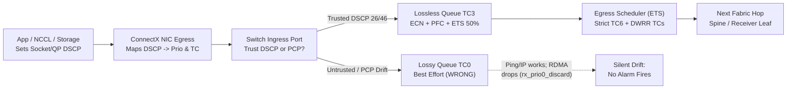
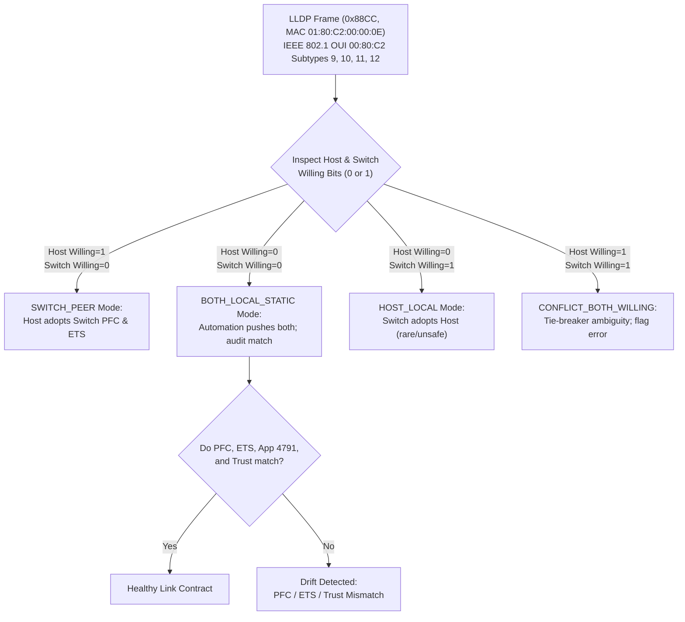
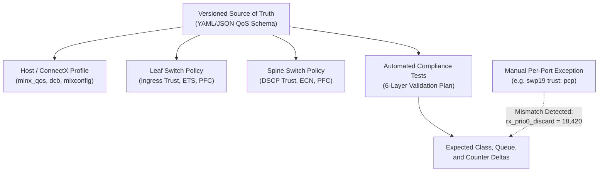

# 12.5 Data center bridging and QoS for AI

| | |
|---|---|
| Level | Advanced |
| Priority tier | 1 |
| Lab venue | Nebius GPU |
| Part | Part 12: Complete AI networking |
| Sources | `nvidia-devops` V9 Ch. 6 & Labs 01–04; `ai-data-center-network-design-and-technologies` Ch. 7 & Ch. 9; `computer-networking-problems-and-solutions` Ch. 8 & Ch. 17; `bcm11-admin` Ch. 3 |
| Code | `code/part12/dcb_qos_ai.py`, `code/part12/dcb_qos_ai_lab.py` |
| Coverage file | `planning/coverage/chapters/12-05.md` |

## Why this matters for AI infrastructure

An AI Ethernet fabric rarely carries pure RoCEv2 collective traffic in isolation. GPU `AllReduce` and `AllToAll` collectives (UDP port `4791`), NVMe-over-TCP (`NVMe-o-TCP`, TCP port `8009`) or NVMe-over-RDMA (`NVMe-o-RDMA`) checkpoint writes and dataset reads, RoCEv2 Congestion Notification Packets (`CNP`, InfiniBand Base Transport Header opcode `129` / `0x81`), BGP routing keepalives, Kubernetes control-plane RPCs, Prometheus telemetry scrapes, container image pulls, and operator SSH sessions all traverse physical NIC and switch interfaces. If the fabric treats all of those streams as one undifferentiated queue, a checkpoint burst or container image pull can delay `CNP` feedback or trigger Priority Flow Control (`PFC`) pauses that stall synchronous GPU training steps across the cluster. Conversely, if an operator creates too many lossless traffic classes, switch buffer pools fragment so severely that ordinary TCP and control-plane packets drop under modest load.

**Data Center Bridging (`DCB`)** and **Quality of Service (`QoS`)** provide the architectural contract that makes link sharing deterministic and observable:
1. **Classification and marking (`DSCP` and `802.1p PCP`):** Express workload intent in the packet header (`6`-bit Differentiated Services Code Point in the `8`-bit IP ToS / Traffic Class byte, or `3`-bit Priority Code Point in the `802.1Q` VLAN tag) and enforce **trust boundaries** so untrusted or misconfigured endpoints cannot inject traffic into protected lossless queues or silently fall into lossy best-effort queues.
2. **Queueing and Enhanced Transmission Selection (`ETS`, `IEEE 802.1Qaz`):** Map internal priorities (`0..7`) to hardware Traffic Classes (`TC0..TC7`), schedule latency-critical feedback (`CNP`s on `TC6`) with rate-capped **Strict Priority** (`TSA 0` / Low-Latency Queueing), and share remaining link bandwidth work-conservingly across RoCE compute (`TC3`), storage (`TC4`), control (`TC2`), and best-effort (`TC0`) queues using **Deficit Weighted Round Robin** (`DWRR`, `TSA 2` / Class-Based Weighted Fair Queueing).
3. **Data Center Bridging Exchange (`DCBX`, `IEEE 802.1Qaz` over `LLDP` `EtherType 0x88CC`):** Advertise or audit `ETS` weights, `PFC` lossless bitmasks, and Application Priority TLVs (`UDP 4791 -> Priority 3`) across the NIC-to-leaf link using Organizationally Specific TLVs (`OUI 00:80:C2`, subtypes `9`, `10`, `11`, and `12`), or lock both sides into non-willing (`Willing = 0`) static automation mode verified against a versioned source of truth.
4. **Buffer pool carving:** Partition finite switch port and shared-buffer memory (`262,144` bytes per port in our reference `mlnx_qos` profile, or multi-megabyte shared ASIC pools) between dedicated lossless `PFC` reservations (`XON`, `K_min`, `K_max`, `XOFF`, and cable flight-time headroom) and the shared lossy pool without starving TCP, storage, or control traffic.

Whereas Chapter 2.19 introduced general QoS primitives and Chapter 12.4 derived the wire-level mechanics of `PFC` (`IEEE 802.1Qbb`), `ECN` (`RFC 3168`), and `DCQCN`, this chapter focuses on **end-to-end QoS architecture, `IEEE 802.1Qaz` `ETS` and `DCBX` state machines, buffer pool carving math, hop-by-hop trust-boundary drift detection, and production validation** on AI Ethernet fabrics.

## Prerequisites and outcomes

**Prerequisites:** Chapter 2.19 (queuing, QoS, ECN, PFC, and DCB basics), Chapter 12.3 (RoCEv2 transport), and Chapter 12.4 (`PFC`, `ECN`, and `DCQCN` in depth).

**Outcomes:** After completing this chapter, you will be able to:
- Trace a packet from application socket or RDMA Queue Pair (`QP`) marking (`DSCP` / `802.1p PCP`) through ConnectX egress traffic classes, switch ingress trust/rewrite boundaries, internal priority queues, `ETS` schedulers, and `ECN`/`PFC` engines.
- Design a small, explainable 4-intent + `CNP` QoS class model (`TC0` Best Effort `10%`, `TC2` Infrastructure/Control `10%`, `TC3` Lossless RoCEv2 Compute `50%`, `TC4` Storage/Checkpointing `30%`, and `TC6` Strict-Priority `CNP` capped at `20 Gbps` on `400 Gbps`), and encode/decode `8`-bit IP ToS bytes (`tos 0xb8 -> DSCP 46`, `tos 0x6a -> DSCP 26 + ECT(0)`, `tos 0xc1 -> DSCP 48 + ECT(1)`).
- Compute `IEEE 802.1Qaz` `ETS` (`DWRR` / `CBWFQ`) work-conserving bandwidth shares, `LLQ` / Strict-Priority policing caps (`1,024 Kbps` WAN baseline and `400 Gbps` AI rail), and serialization jitter (`64` B vs `1,500` B vs `9,000` B frames at `100 Mbps` and `400 Gbps`), and explain why scheduling `TC1`/`TC3` (RoCE) as `strict` starves `TC0` (`dwrr`, weight `5`).
- Decode `IEEE 802.1Qaz` `DCBX` `LLDP` frames (`EtherType 0x88CC`, destination MAC `01:80:C2:00:00:0E`, `OUI 00:80:C2`, subtypes `9`, `10`, `11`, `12`), evaluate `Willing` bit state machines (`SWITCH_PEER`, `HOST_LOCAL`, `BOTH_LOCAL_STATIC`, `CONFLICT_BOTH_WILLING`), and carve switch port buffer pools (`262,144` B total, `65,536` B `25%` per lossless priority vs `196,608` B `75%` lossy pool).
- Diagnose silent hop-by-hop trust-mode drift (`swp4` `trust: dscp` vs `swp19` `trust: pcp` causing `rx_prio0_discard = 18,420` and `rx_pfc_prio3 = 0`) and execute a 6-layer production QoS validation plan across host NICs and leaf/spine switches.

---

## 1. End-to-end QoS architecture and the small class model for AI fabrics

### 1.1 The highway lanes mental model and why every control has a single job

In a converged AI Ethernet fabric, physical links carry traffic types with fundamentally incompatible loss and latency requirements. A helpful mental model compares an `8`-priority Ethernet link (`Priorities 0..7`) to a multi-lane highway:
- **Priority `0` (`TC0`, Best Effort):** The general public lane carrying bulk transfers, container image pulls, and operator traffic. Under congestion, packets wait in a lossy queue or drop so TCP can back off.
- **Priority `2` (`TC2`, Infrastructure and Control):** The dedicated municipal service lane for BGP routing updates, Kubernetes API/kubelet heartbeats, and cluster monitoring. It requires a guaranteed minimum bandwidth share so control-plane sessions never time out during a training burst.
- **Priority `4` (`TC4`, Storage and Checkpointing):** The commercial trucking lane carrying massive payloads (`NVMe-o-TCP` on port `8009` or parallel file systems such as Lustre, GPFS, BeeGFS, and WekaFS). It demands high sustained throughput (`30%` minimum share under contention), and while `ECN` marking (`AF21 = DSCP 18`) helps smooth TCP bursts, an occasional packet drop is recovered cleanly by TCP without halting the fabric.
- **Priority `3` (`TC3`, RoCEv2 AI Compute):** The emergency convoy express lane (`AF31 = DSCP 26` or `EF = DSCP 46`, UDP destination port `4791`). Because RDMA hardware `Go-Back-N` retransmission on a `400 Gbps` or `800 Gbps` link severely degrades collective completion time, this lane uses `ECN` (`DCQCN`) for early rate control and narrowly scoped `PFC` (`IEEE 802.1Qbb`) so it never drops a packet due to buffer overflow.
- **Priority `6` (`TC6`, `CNP` Feedback and Critical Link Control):** The motorcycle courier lane (`CS6 = DSCP 48`, `CNP` BTH opcode `129` / `0x81`). If `CNP` frames returning from a congested receiver are queued behind `9,000`-byte data frames, the `DCQCN` control loop stalls; `TC6` is therefore served with rate-capped **Strict Priority** (`TSA 0`).

If a storage flow (`Priority 4`) or an untrusted bulk transfer (`Priority 0`) is accidentally classified into `Priority 3`, a massive checkpoint write wanders into the lossless RoCE lane—filling the `Priority 3` buffer, triggering `PFC` pause frames (`0x8808` / `0x0101`), and freezing GPU collectives across the switch. Conversely, if a RoCEv2 packet is silently reclassified into `Priority 0` at a downstream switch hop, ping and TCP connectivity continue to pass while RDMA collectives suffer unexplained tail drops and `RETRY_EXC_ERR` completions.



| Control mechanism | Layer / Header / Hardware block | Primary question it answers | What it does NOT provide |
|---|---|---|---|
| **`DSCP` / `802.1p PCP` marking** | L3 IP ToS byte (`6`-bit `DSCP`) / L2 `802.1Q` tag (`3`-bit `PCP`) | Which service class *should* this packet use? | Guaranteed end-to-end treatment if a downstream hop rewrites or ignores the tag |
| **Ingress classification & trust** | Switch ingress pipeline (`mlnx_qos --trust dscp` vs `pcp`) | Which internal priority (`0..7`) and egress queue (`TC0..TC7`) receives the frame? | Additional link bandwidth or workload authentication |
| **Queue scheduling (`Strict` vs `DWRR`)** | Egress port scheduler (`TSA 0` Strict Priority vs `TSA 2` `DWRR`) | Which non-empty egress queue is transmitted next on the wire? | Fairness across classes unless weights and strict-priority policers are configured |
| **Enhanced Transmission Selection (`ETS`)** | `IEEE 802.1Qaz` bandwidth-sharing controller | What minimum bandwidth share does each Traffic Class receive *under contention*? | A hard, walled-off bandwidth reservation when a class is idle, or a hard ceiling when other classes are idle |
| **Explicit Congestion Notification (`ECN`)** | `RFC 3168` (`2`-bit IP ECN field `10 -> 11` via WRED `K_min`/`K_max`) | Should the sending RDMA Queue Pair (`QP`) or TCP socket reduce its injection rate? | Immediate link-local loss protection during a sub-RTT microburst |
| **Priority Flow Control (`PFC`)** | `IEEE 802.1Qbb` L2 MAC Control (`0x8808`, opcode `0x0101`) | Can a loss-sensitive queue (`Priority 3`) pause its immediate upstream link peer before overflowing? | Flow-level isolation (it pauses the entire priority class) or extra fabric capacity |

### 1.2 Designing a small, explainable QoS class model

A common architectural mistake is starting from the hardware maximum (`8` priorities and `8` traffic classes) and inventing eight distinct policies. Every additional class partitions buffer memory, multiplies `DCBX` / `mlnx_qos` configuration lines across thousands of ports, and complicates incident triage. Start instead from **operational workload intents and failure domains**, adding a class only when it has a distinct congestion behavior, owner, failure policy, and validation test.

| Workload intent | Typical protocols & ports | Recommended `DSCP` (Hex ToS with `ECT(0)` / `00`) | `mlnx_qos` `8`-value bucket | `802.1p` Priority (`PCP`) | Hardware Traffic Class (`TC`) | Loss control (`PFC` / `ECN`) | `IEEE 802.1Qaz` `TSA` & `ETS` share |
|---|---|---|---|---|---|---|---|
| **Best Effort** | Bulk TCP, image pulls, general traffic | `DSCP 0` (`CS0`/`DF`, `0x00`) or `DSCP 10` (`AF11`, `0x28`) | `0-7`, `8-15` | `Priority 0` | `TC0` | Lossy (tail drop / WRED) | `dwrr` (`TSA 2`), `10%` |
| **Infrastructure & Control** | BGP, Kubernetes API, Prometheus, SSH | `DSCP 24` (`CS3`, `0x60`) or `DSCP 34` (`AF41`, `0x88`) | `24-31`, `32-39` | `Priority 2` | `TC2` | Lossy (protected minimum share) | `dwrr` (`TSA 2`), `10%` |
| **RoCEv2 AI Compute** | NCCL collectives, GPUDirect RDMA (`UDP 4791`) | `DSCP 26` (`AF31`, `0x6a` w/ `ECT(0)`) or `DSCP 46` (`EF`, `0xb8` w/ `00`) | `24-31` or `40-47` | `Priority 3` | `TC3` | **Lossless (`PFC` ON + `ECN` ON)** | `dwrr` (`TSA 2`), `50%` |
| **Storage & Checkpointing** | `NVMe-o-TCP` (`TCP 8009`), parallel FS (`NFS`, Lustre, WekaFS) | `DSCP 18` (`AF21`, `0x4a` w/ `ECT(0)`) | `16-23` | `Priority 4` | `TC4` | Lossy (`PFC` OFF, TCP `ECN` ON) | `dwrr` (`TSA 2`), `30%` |
| **CNP & Critical Control** | RoCEv2 `CNP` (`BTH opcode 0x81`), LACP/LLDP | `DSCP 48` (`CS6`, `0xc1` w/ `ECT(1)`) or `DSCP 56` (`CS7`, `0xe0`) | `48-55`, `56-63` | `Priority 6` | `TC6` | Lossy (never paused, low occupancy) | `strict` (`TSA 0`), policed cap `20 Gbps` (`5%` of `400G`) |

Notice three design invariants in this table:
1. **The `DWRR` (`TSA 2`) percentages sum to exactly `100%` (`10% + 10% + 50% + 30% = 100%`):** As required by `IEEE 802.1Qaz`, all Traffic Classes using Enhanced Transmission Selection (`ETS` / `dwrr`) must have bandwidth weights totaling `100%`.
2. **Only one Traffic Class (`TC3`, `Priority 3`) has `PFC` enabled (`is_lossless_pfc = True`):** If storage uses `NVMe-o-TCP` (TCP port `8009`) or parallel NFS—which does not require a lossless fabric—keeping `TC4` (`Priority 4`) lossy with TCP `ECN` preserves `75%` of the port buffer for shared burst absorption and prevents storage congestion from generating `PFC` pause frames. (Only if a deployment runs `NVMe-o-RDMA` over the same physical switches would a second lossless class on `Priority 4` with separate `DCQCN`/`ECN`/`PFC` thresholds be considered, and dedicated backend storage fabrics are generally preferred at scale.)
3. **Why QoS is not tenant security or capacity planning:** An endpoint can mark any `DSCP` value it chooses unless the ingress switch port enforces a trust or ACL policy. QoS classification decides *which queue a packet enters and how contention is arbitrated*; it does not authenticate a tenant, prevent lateral movement, or manufacture bandwidth when aggregate demand exceeds link capacity.

---

## 2. Packet markings, IP ToS byte math, and QoS trust boundaries

### 2.1 Encoding and decoding the `8`-bit IP ToS / Traffic Class byte vs `802.1p PCP`

A packet can carry class-of-service markings at Layer 2, Layer 3, or both:
- **Layer 2 (`IEEE 802.1Q` VLAN tag):** A `4`-byte header inserted after the Source MAC (`TPID 0x8100`) containing a `3`-bit **Priority Code Point (`PCP`, `802.1p`, values `0..7`)**, a `1`-bit **Drop Eligible Indicator (`DEI`)**, and a `12`-bit **VLAN ID (`0..4095`)**. Importantly, **pure routed Layer 3 Ethernet links (untagged frames) have no `802.1Q` header and therefore carry no `PCP` bits on the wire**.
- **Layer 3 (`IPv4` ToS byte or `IPv6` Traffic Class byte):** An `8`-bit field present in every IP packet, split into the upper `6` bits for **DSCP (`0..63`)** and the lower `2` bits for **ECN (`00` Not-ECT, `01` `ECT(1)`, `10` `ECT(0)`, `11` `CE`)**:

$$\text{ToS}_{\text{byte}} = (\text{DSCP} \ll 2) \mid \text{ECN}, \qquad \text{DSCP} = \text{ToS}_{\text{byte}} \gg 2, \qquad \text{ECN} = \text{ToS}_{\text{byte}} \mathbin{\&} \text{0x03}$$

When inspecting packet captures with `tcpdump -v`, `tcpdump` prints the entire `8`-bit `tos` byte in hexadecimal (`0x00..0xff`), **not** the `6`-bit `DSCP` integer directly. Misreading the hex `tos` byte as `DSCP` (or vice versa) is a classic operational mistake.

| Traffic type | `6`-bit `DSCP` (decimal & binary) | `2`-bit `ECN` state | `8`-bit `ToS` calculation `(DSCP << 2) \| ECN` | `tcpdump -v` hex output | `mlnx_qos` `8`-value DSCP bucket | Mapped `802.1p` Priority |
|---|---|---|---|---|---|---|
| **Best Effort (`CS0`/`DF`)** | `0` (`000000`) | `00` (`0`, Not-ECT) | `(0 << 2) \| 0 = 0` | `tos 0x0` (`0x00`) | `0-7` | `Priority 0` |
| **Storage (`AF21`) w/ `ECT(0)`** | `18` (`010010`) | `10` (`2`, `ECT(0)`) | `(18 << 2) \| 2 = 74` | `tos 0x4a` (`74`) | `16-23` | `Priority 4` |
| **Control (`CS3`)** | `24` (`011000`) | `00` (`0`, Not-ECT) | `(24 << 2) \| 0 = 96` | `tos 0x60` (`96`) | `24-31` | `Priority 2` |
| **RoCEv2 Data (`AF31`) w/ `ECT(0)`** | `26` (`011010`) | `10` (`2`, `ECT(0)`) | `(26 << 2) \| 2 = 106` | `tos 0x6a` (`106`) | `24-31` | `Priority 3` |
| **RoCEv2 Data (`AF31`) w/ `CE`** | `26` (`011010`) | `11` (`3`, `CE` marked) | `(26 << 2) \| 3 = 107` | `tos 0x6b` (`107`) | `24-31` | `Priority 3` |
| **RoCEv2 Data (`EF`) w/ `00`** | `46` (`101110`) | `00` (`0`, Not-ECT) | `(46 << 2) \| 0 = 184` | `tos 0xb8` (`184`) | `40-47` | `Priority 3` |
| **RoCEv2 `CNP` (`CS6`) w/ `ECT(1)`** | `48` (`110000`) | `01` (`1`, `ECT(1)`) | `(48 << 2) \| 1 = 193` | `tos 0xc1` (`193`) | `48-55` | `Priority 6` |
| **Network Control (`CS7`)** | `56` (`111000`) | `00` (`0`, Not-ECT) | `(56 << 2) \| 0 = 224` | `tos 0xe0` (`224`) | `56-63` | `Priority 6` |

In NVIDIA `mlnx_qos` output, the `64` DSCP values (`0..63`) are displayed in `8` buckets of `8` consecutive codepoints (`0-7`, `8-15`, `16-23`, `24-31`, `32-39`, `40-47`, `48-55`, `56-63`). Thus `DSCP 26` sits in bucket `24-31`, `DSCP 46` (`tos 0xb8 >> 2 = 46`) sits in bucket `40-47`, and `DSCP 48` sits in bucket `48-55`.

### 2.2 Trust boundaries, untrusted ingress rewrites, and `PCP` vs `DSCP` across L2/L3 hops

Every switch ingress port and NIC interface operates in one of three classification trust states:
1. **`trust: dscp` (Layer 3 trust — recommended for routed AI fabrics):** The ingress port inspects the `6`-bit IP `DSCP` field (`0..63`) and maps it through the `64`-entry DSCP-to-Priority table to select the internal priority (`0..7`). Because IP headers survive Layer 3 routing across leaf, spine, and super-spine switches (unless explicitly rewritten), `trust: dscp` preserves classification end to end across routed Clos fabrics without requiring VLAN tags.
2. **`trust: pcp` (Layer 2 `802.1p` trust):** The ingress port ignores the IP `DSCP` field and inspects only the `3`-bit `PCP` field inside an `802.1Q` VLAN header. **Critical failure trap:** If a port is left in `trust: pcp` (often the factory default on enterprise switches or unconfigured ports) and receives an **untagged routed IP packet**, there is no `802.1Q` header (`PCP = None`). The switch defaults the frame to **Priority `0` (Best Effort)**—silently stripping lossless `PFC` and `ECN` protection even though the IP header still carries `DSCP 26` or `DSCP 46` (`tos 0xb8`).
3. **Untrusted / Rewrite boundary (`untrusted_rewrite_zero`):** At the boundary facing untrusted tenant VMs, external networks, or shared business-unit links, the ingress switch port does not trust host-supplied markings (`EF` or `AF31`) and either rewrites `DSCP` to `0` (`DF`) or classifies via an explicit ACL policy. Similarly, when traffic traverses VXLAN, GRE, or IPsec overlays, the encapsulating VTEP or DPU must copy the inner `DSCP` and `ECN` bits to the outer IP header (`uniform` / `tos inherit` mode) so transit spine switches can classify and `ECN`-mark packets properly.

In multi-tenant or bare-metal cloud environments using **NVIDIA BlueField DPUs** in DPU mode (`Embedded CPU Function Ownership`, `ECPF`), the embedded Arm subsystem and hardware embedded switch sit directly in front of the host PCIe function. The platform administrator can enforce `DSCP` marking and ACL normalization inside the DPU's embedded switch before frames ever reach the leaf switch port (`swpX`), preventing an untrusted host OS from spoofing `DSCP 26` or `DSCP 48`. However, as we examine in our troubleshooting section, this introduces a three-layer operational boundary (host interface, DPU Arm policy service, and external leaf switch port) that must be verified after every boot.

---

## 3. IEEE `802.1Qaz` Enhanced Transmission Selection (`ETS`), Strict Priority (`LLQ`), and `CBWFQ` scheduling math

### 3.1 How `IEEE 802.1Qaz` `ETS` combines Strict Priority (`TSA 0`) and `DWRR` (`TSA 2`)

Once an ingress packet is mapped to an internal priority (`0..7`) and placed into its egress Traffic Class queue (`TC0..TC7`), the egress port scheduler must decide which non-empty queue transmits next. **IEEE `802.1Qaz` Enhanced Transmission Selection (`ETS`)** standardizes a two-tier hierarchical scheduler across up to `8` Traffic Classes, assigning each Traffic Class a **Transmission Selection Algorithm (`TSA`)** identifier:
- **`TSA 0` — Strict Priority (`strict` / Low-Latency Queueing `LLQ`):** Serviced ahead of all `DWRR` (`TSA 2`) queues whenever a packet is present. Used for ultra-low-latency control and `CNP` traffic (`TC6`).
- **`TSA 1` — Credit-Based Shaper (`cbs`):** Used in audio/video bridging (`AVB` / `TSN`), not standard AI RoCE fabrics.
- **`TSA 2` — Enhanced Transmission Selection (`ets` / `dwrr` / `CBWFQ`):** Shares all bandwidth remaining after `TSA 0` Strict Priority queues in proportion to configured percentage weights $w_i$ ($\sum_{i \in \text{ETS}} w_i = 100\%$).
- **`TSA 255` — Vendor-Specific:** Hardware-specific scheduling extensions.

### 3.2 Work-conserving `CBWFQ` / `DWRR` math: minimum guarantees under contention, not hard reservations

Engineers new to `ETS` often misread a configured weight—such as `30%` for Storage (`TC4`) and `50%` for RoCE (`TC3`)—as either a hard static partition (where `30%` of the link sits idle if Storage is quiet) or a hard rate ceiling (where Storage can never exceed `30%`). In reality, `ETS` (`DWRR` / `CBWFQ`) is **work-conserving**:
1. **When all classes are backlogged (full contention):** After deducting bandwidth consumed by `strict` (`TSA 0`) classes ($R_{\text{strict}}$), each backlogged `dwrr` class $i$ with weight $w_i$ receives:

$$B_i = (R_{\text{link}} - R_{\text{strict}}) \times \frac{w_i}{\sum_{j \in \text{active}} w_j}$$

2. **When some classes are idle or use less than their share:** Any unused bandwidth is dynamically redistributed across the remaining backlogged `dwrr` classes in exact proportion to their relative weights $w_i / \sum_{j \in \text{backlogged}} w_j$.

Consider first the foundational `1,024 Kbps` link example, where `AF41` is guaranteed `256 Kbps`, `AF31` is guaranteed `128 Kbps`, `AF21` is guaranteed `128 Kbps`, and `512 Kbps` is left for unmarked/default traffic:
- The bandwidth ratio is $256 : 128 : 128 : 512$, which reduces to **$2 : 1 : 1 : 4$** across **$8$ clock cycles**:
  - **All four classes backlogged:** Cycles `1–2` send `AF41` (`2` packets), Cycle `3` sends `AF31` (`1` packet), Cycle `4` sends `AF21` (`1` packet), and Cycles `5–8` send default/unclassified traffic (`4` packets).
  - **Unused bandwidth redistribution:** If `AF41` has only `1` packet (Cycle `1`) and `AF21` has `0` packets, Cycle `2` immediately serves `AF31` (`AF31` gets Cycles `2` and `3`), Cycle `4` serves an unclassified packet (Cycles `4–7`), and if unclassified traffic runs out at Cycle `8`, Cycle `8` serves yet another `AF31` packet.

Now apply the exact same work-conserving `ETS` formula (`simulate_ets_scheduling` in `code/part12/dcb_qos_ai.py`) to a **`400.0 Gbps` AI Ethernet link** running our 5-class model (`TC0 = 10%`, `TC2 = 10%`, `TC3 = 50%`, `TC4 = 30%` on `dwrr`; `TC6 = strict` capped at `20.0 Gbps`):

| Contention scenario on a `400.0 Gbps` link | Offered load per TC (`Gbps`) | `TC6` (`strict`, `CNP`) allocated | `TC0` (`10%` `dwrr`, Best Effort) | `TC2` (`10%` `dwrr`, Control) | `TC3` (`50%` `dwrr`, RoCEv2) | `TC4` (`30%` `dwrr`, Storage) | Operational lesson |
|---|---|---|---|---|---|---|---|
| **1. All 5 classes contending** | `TC6=10`, `TC0=100`, `TC2=50`, `TC3=400`, `TC4=200` | **`10.0 Gbps`** | **`39.0 Gbps`** (`10%` of `390G`) | **`39.0 Gbps`** (`10%` of `390G`) | **`195.0 Gbps`** (`50%` of `390G`) | **`117.0 Gbps`** (`30%` of `390G`) | `TC6` takes `10G` first; remaining `390G` splits `10:10:50:30`; `0` classes starved |
| **2. Only RoCE (`TC3`) + Storage (`TC4`) active** | `TC3=400`, `TC4=400` (`TC0=TC2=TC6=0`) | `0.0 Gbps` | `0.0 Gbps` | `0.0 Gbps` | **`250.0 Gbps`** ($\frac{50}{50+30} \times 400$) | **`150.0 Gbps`** ($\frac{30}{50+30} \times 400$) | Unused `20%` (`TC0+TC2`) is shared in a $50:30 = 5:3$ ratio (`250G` vs `150G`) |
| **3. Only Storage (`TC4`, `30%`) active** | `TC4=400` (`TC0=TC2=TC3=TC6=0`) | `0.0 Gbps` | `0.0 Gbps` | `0.0 Gbps` | `0.0 Gbps` | **`400.0 Gbps`** (`100%` of link) | `30%` `ETS` is a minimum share under contention, **not** a ceiling when the link is idle |
| **4. Misconfigured `strict` RoCE** | `TC1 (Prio 3 RoCE) = 400` (`strict`), `TC0 (Mgmt) = 10` (`dwrr` weight `5`) | N/A (`TC1 strict` takes **`400.0 Gbps`**) | **`0.0 Gbps` (STARVED)** | N/A | **`400.0 Gbps`** (`TC1 strict`) | N/A | Setting RoCE (`TC1`) to `strict` without a cap completely starves `dwrr` management (`TC0`) during a sustained burst |

### 3.3 Strict Priority (`LLQ`) policing math and serialization jitter (`9,000` B vs `64` B)

Why must a `strict` priority queue (`TSA 0` / `LLQ`) always have a strict rate cap or bounded offered load? If a strict-priority queue is allowed to consume `100%` of the link (as in Row 4 above, where RoCE was mistakenly set to `tsa: strict`), every `dwrr` queue is starved. Conversely, when a strict-priority queue **is** rate-capped by a policer (to protect the rest of the link), exceeding that cap during congestion drops traffic across the entire strict-priority class:
- In the classic `1,024 Kbps` WAN `LLQ` model (`512 Kbps` `LLQ` cap for `64 Kbps` VoIP calls, leaving `512 Kbps` for other classes):
  - Up to `8` calls ($8 \times 64 = 512\text{ Kbps}$) fit inside the cap.
  - When a **`9`th call** joins during link congestion ($9 \times 64 = 576\text{ Kbps}$), the policer drops $576 - 512 = \mathbf{64\text{ Kbps}}$ from the `LLQ` class as a whole (degrading all `9` calls, because the queue does not track individual calls). When **`12` calls** join ($12 \times 64 = 768\text{ Kbps}$), $768 - 512 = \mathbf{256\text{ Kbps}}$ ($4 \times 64\text{ Kbps}$) is dropped. Switching to a `16 Kbps` codec allows **$32$ calls** ($32 \times 16 = 512\text{ Kbps}$) with **`0 Kbps` dropped**.
  - **Crucial uncongested exception:** If the link is **not congested**—for example, `10` calls at `64 Kbps` (`640 Kbps`) while all other traffic stays below the remaining $1,024 - 640 = \mathbf{384\text{ Kbps}}$—all `640 Kbps` passes through without drops because scheduling policies only arbitrate when an interface is congested.

Finally, why do AI fabrics place `64`-byte `CNP`s and control frames into a separate queue from `9,000`-byte jumbo RoCE/storage frames? Because of **serialization delay and inter-packet jitter** ($T_{\text{ser}} = \text{Bits} / R_{\text{link}}$):
- On a **`100 Mbps`** link, a `64`-byte frame takes $512 / 10^8 = 0.00512\text{ ms}$ (often approximated with framing/inter-packet overhead as `.05 ms` in textbook models), a `1,500`-byte frame takes **$0.12\text{ ms}$**, and a `9,000`-byte jumbo frame takes **$0.72\text{ ms}$**—over **$14\times$** longer (`0.72 / 0.05 = 14.4`). In a mixed elephant-and-mouse queue (`7` elephant frames and `4` mouse frames), mouse packet spacing varies between `.05 ms` and `.288 ms` while elephant spacing varies between `.05 ms` and `.15 ms`, injecting end-to-end jitter.
- On a **`400 Gbps`** AI link, a `9,000`-byte jumbo frame occupies the wire for $72,000\text{ bits} / 400\text{ bits/ns} = \mathbf{180.0\text{ ns}}$, whereas a `64`-byte `CNP` or `PFC` frame takes only $512 / 400 = \mathbf{1.28\text{ ns}}$ ($140.625\times$ smaller). Giving `CNP`s (`TC6`) a dedicated strict-priority queue ensures a `CNP` waits at most one in-flight `180 ns` jumbo frame serialization rather than sitting behind megabytes of queued `9,000`-byte RoCE data payloads.

---

## 4. IEEE `802.1Qaz` `DCBX` TLV negotiation and switch buffer pool carving

### 4.1 `DCBX` over `LLDP` (`EtherType 0x88CC`, `OUI 00:80:C2`, Subtypes `9..12`) and the `Willing` bit

Configuring `PFC` on Priority `3` and `ETS` weights on a switch port is useless if the attached ConnectX NIC transmits RoCEv2 traffic on Priority `0` or enables `PFC` on Priority `4`. **Data Center Bridging Exchange (`DCBX`, standardized in `IEEE 802.1Qaz`)** is a link-local discovery and capability-exchange protocol carried inside **Link Layer Discovery Protocol (`LLDP`)** frames (`EtherType 0x88CC`, destination multicast MAC `01:80:C2:00:00:0E`) using Organizationally Specific TLVs with the **IEEE `802.1` OUI (`00:80:C2`)**:

| `DCBX` TLV name | IEEE `802.1` OUI | Subtype | Symmetric vs Asymmetric | Key fields carried on the wire | Purpose on a GPU Host $\leftrightarrow$ Leaf Switch link |
|---|---|---|---|---|---|
| **ETS Configuration TLV** | `00:80:C2` | **`9` (`0x09`)** | Asymmetric (uses ETS Recommendation TLV `10`) | `Willing` (`1` bit), `CBS` (`1` bit), `Max TCs` (`3` bits), Priority Assignment Table (`8 x 4` bits: `Prio 0..7 -> TC`), TC Bandwidth Table (`8 x 8` bits: `%` weights), `TSA` Assignment Table (`8 x 8` bits: `0=Strict, 2=ETS`) | Advertises operational `Prio -> TC` map, `ETS` percentage weights, and `strict`/`dwrr` `TSA` assignments |
| **ETS Recommendation TLV** | `00:80:C2` | **`10` (`0x0A`)** | Asymmetric recommendation from switch to host | Priority Assignment Table (`8 x 4` bits), TC Bandwidth Table (`8 x 8` bits), `TSA` Assignment Table (`8 x 8` bits) | Recommends the egress `ETS` scheduling profile that a `Willing=1` peer should adopt |
| **PFC Configuration TLV** | `00:80:C2` | **`11` (`0x0B`)** | **Symmetric** (both ends of the link must use the identical `PFC` bitmask) | `Willing` (`1` bit), `MBC` (`1` bit, MACsec Bypass Capability), `PFC Cap` (`4` bits: max simultaneous lossless classes), **`PFC Enable` bitmask (`8` bits: e.g., `00001000` = `0x08` for Priority `3`)** | Ensures both the NIC and leaf switch port enable `PFC` pause (`XOFF`/`XON`) on the exact same priority (`Priority 3`) |
| **Application Priority TLV** | `00:80:C2` | **`12` (`0x0C`)** | Symmetric application-to-priority binding | List of `3`-octet entries: `Priority` (`3` bits), `Selector` (`3` bits: `1`=EtherType, `2`=TCP/UDP port, `3`=UDP/DCCP), `Protocol ID` (`16` bits: **`4791`** for RoCEv2) | Tells the endpoint to tag RoCEv2 (`UDP port 4791`) packets with **Priority `3`** |

How does the **`Willing` bit** (`0` or `1`) determine which side wins during `DCBX` negotiation (`evaluate_dcbx_negotiation` in `code/part12/dcb_qos_ai.py`)?



| Host `Willing` | Switch `Willing` | Operational state source | Production behavior and AI fabric recommendation |
|---|---|---|---|
| **`1` (`True`)** | **`0` (`False`)** | **`SWITCH_PEER`** | **Classic plug-and-play DCBX:** The leaf switch is authoritative (`Willing=0`) and the host NIC (`lldpad` / firmware DCBX agent, `Willing=1`) dynamically adopts the switch's `PFC` bitmask (`Priority 3`), `ETS` weights, and `UDP 4791 -> Priority 3` Application Priority TLV. |
| **`0` (`False`)** | **`0` (`False`)** | **`BOTH_LOCAL_STATIC`** | **Explicit automation mode (common in large AI clusters):** Neither side accepts dynamic `LLDP` overrides; Ansible/NetQ/BCM pushes identical profiles from a single versioned source of truth to both `mlnx_qos` on the host and the switch NOS, while `LLDP` TLVs are used purely to audit that zero mismatches exist. |
| **`0` (`False`)** | **`1` (`True`)** | **`HOST_LOCAL`** | Switch accepts whatever the host advertises. **Avoid in production:** a misconfigured or compromised host can alter switch port `PFC`/`ETS` behavior. |
| **`1` (`True`)** | **`1` (`True`)** | **`CONFLICT_BOTH_WILLING`** | Both sides claim willingness to be overridden; symmetric tie-breakers (e.g., MAC address comparison) vary across implementations and cause unpredictable flips on reboot. **Flag as a configuration error.** |

### 4.2 Switch buffer pool carving across lossless (`TC3`) and lossy (`TC0`, `TC2`, `TC4`, `TC6`) classes

Why do NVIDIA Spectrum switches use a **Fully Shared Buffer** architecture rather than fixed per-port sliced buffers, and why must operators still restrict `PFC` to **one** (or at most two) priorities?

In a switch with a sliced or statically partitioned buffer, each port can access only its tiny dedicated slice of memory; if an `800 Gbps` incast microburst hits Port `1`, Port `1` overflows or triggers `PFC` even while `95%` of the switch's total memory sits empty on idle ports. A shared-buffer ASIC pools internal memory dynamically so a congested port can borrow burst absorption space. However, **every lossless (`PFC`-enabled) priority on every port still requires a dedicated minimum reservation and `XOFF`->`BufferMax` flight-time headroom** that cannot be borrowed by lossy queues, because once `XOFF` fires, the switch *must* guarantee space for the bytes already in flight on the cable (`49,064` B for a `2 m` DAC or `298,064` B for a `500 m` optical fiber at `400 Gbps`, `MTU 9,000`, as derived in Chapter 12.4).

Using the `262,144`-byte (`256 KiB`) port receive buffer profile from our `mlnx_qos -i swp12` baseline (`65,536` B reserved per lossless priority, with `XON = 32,768` B [`50%`], `XOFF = 49,152` B [`75%`], and `headroom = 16,384` B [`25%`]), `evaluate_buffer_pool_carving` in `code/part12/dcb_qos_ai.py` demonstrates what happens as an operator enables `PFC` on more classes:

| Number of lossless (`PFC`) priorities enabled | Lossless priorities | Reserved per lossless priority (`XON` / `XOFF` / `Headroom`) | Total port buffer locked in lossless reservations | Remaining shared buffer for lossy `TC0`, `TC2`, `TC4`, `TC6` | Lossless % vs Lossy % | Operational verdict |
|---|---|---|---|---|---|---|
| **`1` lossless class (Recommended)** | `Priority 3` (RoCEv2 Compute) | `65,536` B (`32,768` / `49,152` / `16,384` B) | **`65,536` B** (`64 KiB`) | **`196,608` B** (`192 KiB`) | **`25.0%` vs `75.0%`** | **`HEALTHY_BUFFER_CARVING`:** RoCEv2 has full lossless headroom; `75%` of buffer remains for storage (`TC4`), control (`TC2`), `CNP` (`TC6`), and best effort (`TC0`). |
| **`2` lossless classes (Maximum practical)** | `Priority 3` (RoCE) + `Priority 4` (`NVMe-o-RDMA`) | `65,536` B each | **`131,072` B** (`128 KiB`) | **`131,072` B** (`128 KiB`) | **`50.0%` vs `50.0%`** | **`HEALTHY_BUFFER_CARVING` (Tight):** Acceptable only when `NVMe-o-RDMA` shares the fabric and requires lossless transport alongside RoCE compute. |
| **`4` lossless classes (Anti-pattern)** | `Priorities 1, 2, 3, 4` | `65,536` B each | **`262,144` B** (`256 KiB`) | **`0` B** (`0 KiB`) | **`100.0%` vs `0.0%`** | **`BUFFER_EXHAUSTED_TOO_MANY_LOSSLESS_CLASSES`:** `100%` of port buffer is locked in lossless reservations; lossy TCP, BGP, Kubernetes, and `CNP` queues have `0` B and drop immediately. |

### 4.3 Comparing Ethernet `DCB` (`PFC` + `ETS` + `DCQCN`) with InfiniBand Virtual Lanes (`VL`s) and Storage Fabrics

When architects evaluate AI compute and storage fabrics, they frequently compare how Ethernet `DCB` and native InfiniBand implement QoS and lossless transport:
- **Native InfiniBand (`VL`s and `CBFC`):** InfiniBand implements QoS via up to **`16` Virtual Lanes (`VL`s)** (typically `8` to `12` data queues configured for storage or AI workloads) and link-level **Credit-Based Flow Control (`CBFC`)** exchanged in the Link Layer Header (`LLH`), where `1` credit typically represents the right to transmit **`64` bytes** of data and a `16`-bit Local Identifier (`LID`) supports up to **`48,000` end nodes** per subnet. Because a sender switch or HCA never transmits on `VL1` unless the downstream port has explicitly returned buffer credits for `VL1`, InfiniBand is natively lossless without reactive `XOFF` pause frames (`~300 ns` switch latency vs **`~800 ns`** [`700–900 ns` port-to-port] on Ethernet switches, and **`~100 ns`** on local **PCIe Gen5 `32 GT/s` `x16`** buses delivering **`~63 GB/s`** in one direction to drive `400 Gbps` NICs at line rate).
- **Ethernet with `DCB` (`RoCEv2` and `NVMe-oF`):** Over Ethernet/IP, **NVMe-over-TCP (`NVMe-o-TCP`, TCP port `8009`, `IC Req PDU`, `CapsuleCmd` opcode `0x01`, `CapsuleResp`, `H2CData` `0x03`, `C2HData` `0x04` with `0x01` write and `0x02` read opcodes)** and **Parallel NFS (`(P)NFS`)** run cleanly on **lossy** queues (`TC4`, `Priority 4`) without `PFC`. By contrast, **RoCEv2 AI training (`UDP 4791`)** and **NVMe-over-RDMA (`NVMe-o-RDMA`)** require a lossless queue (`TC3`, `Priority 3`) with carefully tuned `PFC`, `ECN`, and `DCQCN` thresholds—and when both AI training and `NVMe-o-RDMA` run on Ethernet, their queue depths and `DCQCN`/`ECN`/`PFC` thresholds often differ based on payload profiles.

---

## 5. End-to-end consistency, configuration drift detection, and the 6-layer production validation plan

### 5.1 Hop-by-hop drift analysis: how a single `trust: pcp` port breaks RoCE silently

The fastest way to trigger a multi-hour AI training incident is to allow a single port along a multi-hop path to drift from the approved QoS mapping. Consider the exact three-step diagnostic trace from our production case study (`trace_end_to_end_qos_path` in `code/part12/dcb_qos_ai.py`):

1. **Step 1 — Verify what the source GPU host actually puts on the wire (`ens1f0`, `10.20.4.15 -> 10.20.8.5`):**
   ```text
   # (untested here)
   $ tcpdump -i eth0 -c1 -v host 10.20.8.5 and udp port 4791
   IP (tos 0xb8, ttl 64, ...) 10.20.4.15.51422 > 10.20.8.5.4791: UDP, length 1200
   ```
   Here `tos 0xb8` (`184` decimal) decodes via `0xb8 >> 2 = 46` (`DSCP 46`, Expedited Forwarding, or `tos 0x6a` for `DSCP 26` with `ECT(0)`). The source NIC is marking packets as intended.

2. **Step 2 — Verify what the source leaf switch (`swp4`) believes about this marking:**
   ```text
   # (untested here)
   $ mlnx_qos -i swp4
   Priority trust state: dscp
   DSCP to priority mapping:
           dscp    0-7  8-15  ...  40-47  48-55  56-63
           prio     0     0   ...    3      0      0
   ```
   `swp4` is in `Priority trust state: dscp` and maps bucket `40-47` (`DSCP 46`, or bucket `24-31` for `DSCP 26`) to **Priority `3`** (the lossless RoCE class).

3. **Step 3 — Inspect the far-side destination leaf switch (`swp19`) where drift occurred:**
   ```text
   # (untested here)
   $ mlnx_qos -i swp19
   Priority trust state: pcp        <- DRIFT: ignores IP DSCP entirely
   PCP to priority mapping:
           pcp      0   1   2   3   4   5   6   7
           prio     0   0   0   0   0   0   0   0    <- untagged L3 frames default to priority 0
   ```
   Because `swp19` is configured with `Priority trust state: pcp` and the routed IP packet has no `802.1Q` VLAN tag (`PCP = None`), `swp19` classifies every arriving RoCEv2 frame into **Priority `0` (Best Effort)**. The frame is still forwarded—`ping` and basic TCP checks succeed—so no link-down or routing alarm fires. Only when we inspect per-priority queue drop and pause counters on `swp19` does the smoking gun appear:
   ```text
   # (untested here)
   $ ethtool -S swp19 | egrep "rx_prio0_discard|rx_pfc_prio3"
        rx_prio0_discard:        18420     <- 18,420 RoCE packets dropped in lossy priority 0
        rx_pfc_prio3:            0         <- lossless priority 3 never even sees the traffic
   ```



| Hop / Role in Source-of-Truth Schema | Ingress Trust State | Expected `DSCP` -> Priority | Expected Egress `TC` & `TSA` | Expected `PFC` / `ECN` State | Primary Verification Counter |
|---|---|---|---|---|---|
| **GPU Host NIC (`ens1f0` / `mlx5_0`)** | `dscp` | `DSCP 26/46 -> Prio 3`; `DSCP 48 -> Prio 6` | `TC3` (`dwrr 50%`), `TC6` (`strict`) | `PFC` ON (`Prio 3`), `DCQCN` ON | `tx_prio3_packets`, `np_cnp_sent`, `rp_cnp_handled` |
| **Source Leaf (`leafA_swp4`)** | `dscp` | `24-31` / `40-47 -> Prio 3` | `TC3` (`dwrr 50%`), `TC0` (`dwrr 10%`) | `PFC` ON (`Prio 3`), `ECN` ON | `rx_prio3_packets`, `tx_pfc_prio3`, `rx_ecn_marked_prio3` |
| **Transit Spine (`spine1_swp1`)** | `dscp` | `24-31` / `40-47 -> Prio 3` | `TC3` (`dwrr 50%`), `TC6` (`strict`) | `ECN` ON (`PFC` per design) | `rx_ecn_marked_prio3`, `tx_prio3_packets` |
| **Destination Leaf (`leafB_swp19`)** | `dscp` (Drifted: `pcp`) | Expected `Prio 3` (Drifted: `Prio 0`) | Expected `TC3` (Drifted: `TC0`) | Expected `PFC` ON (Drifted: Lossy) | **`rx_prio0_discard` (`18,420` drops) vs `rx_pfc_prio3` (`0`)** |

### 5.2 The 6-layer production QoS validation plan

A QoS configuration that compiles in a switch template but has never been tested under simultaneous multi-class contention is not a production policy. Validate every AI fabric release across six layers before admitting training jobs:
1. **Layer 1 — Classification verification:** Inject known marked test traffic (`DSCP 26`/`46` RoCE, `DSCP 18` storage, `DSCP 48` `CNP`, `DSCP 0` best effort) and assert that per-priority packet counters (`rx_prio3_packets`, `tx_prio3_packets`) increment on the exact intended queue at every ingress and egress hop.
2. **Layer 2 — Control-plane isolation under RoCE saturation:** Drive bounded RoCEv2 contention on `Priority 3` sufficient to trigger `ECN` marking (`rx_ecn_marked_prio3 = 47,829`) and `PFC` pauses (`rx_pfc_prio3 = 412`), and prove that management/control traffic (`Priority 0` / `Priority 2`) experiences `0` pause frames (`rx_pfc_prio0 = 0`) and flat SSH/BGP latency.
3. **Layer 3 — Simultaneous multi-class `ETS` service behavior:** Run concurrent RoCE (`TC3`), storage (`TC4`), and best-effort (`TC0`) generators through a shared bottleneck uplink to verify that `DWRR` weights (`50%` / `30%` / `10%`) deliver expected minimum shares under contention without strict-priority starvation.
4. **Layer 4 — Closed-loop congestion feedback:** Confirm that `ECN` marks on `TC3` generate `CNP`s on `TC6` (`opcode 0x81`, `DSCP 48`), that `CNP`s are never dropped or delayed behind data queues, and that sender NICs (`mlx5_0`) throttle cleanly (e.g., two senders converging to `89.2 Gbps` and `87.1 Gbps`, total `176.3 Gbps` on a constrained path).
5. **Layer 5 — Failure and reroute persistence:** Simulate a planned uplink drain or route failover and verify that alternate paths preserve identical `trust: dscp`, `ETS`, `ECN`, and `PFC` profiles.
6. **Layer 6 — Application-level correlation & host topology audit:** Correlate switch queue counters with `nccl-tests` or `ib_write_bw`, and verify host-side PCIe/NUMA locality (`nvidia-smi topo -m` showing `PIX`, `lspci -vv` confirming PCIe Gen5 `32 GT/s` `x16` rather than a downgraded Gen4 `16 GT/s` `x8` slot that caps throughput at `16 GB/s` below `200 GbE`'s `25 GB/s` requirement) and cluster manager interface priorities (`Bridge = 80`, `Bond = 70`, `Physical = 60`, `VLAN = 50`, `Alias = 40`, `Tunnel = 30`, `Netmap = 20`, `BMC = 10` in NVIDIA Base Command Manager `cmsh`).

---

## Commands and configurations that matter

### 1. Host NIC (`ConnectX`) QoS, `iproute2 dcb`, `lldptool`, and `mlxconfig` commands

```bash
# (untested here) Inspect and configure DSCP trust, PFC on Priority 3, and ETS weights via mlnx_qos
mlnx_qos -i ens1f0
sudo mlnx_qos -i ens1f0 --trust dscp --pfc 0,0,0,1,0,0,0,0 \
  --tsa dwrr,dwrr,dwrr,dwrr,dwrr,dwrr,strict,dwrr \
  --tcbw 10,0,10,50,30,0,0,0

# (untested here) Set default RoCEv2 ToS/DSCP marking (106 = 0x6a -> DSCP 26 + ECT(0)) via sysfs / cma_roce_tos
cma_roce_tos -d mlx5_0 -t 106
cat /sys/class/infiniband/mlx5_0/tc/1/traffic_class

# (untested here) Standard Linux iproute2 dcb tool: inspect PFC, ETS, and Application Priority TLVs
dcb pfc show dev ens1f0
dcb ets show dev ens1f0
dcb app show dev ens1f0
sudo dcb app add dev ens1f0 dgram-port-prio 4791:3

# (untested here) Inspect IEEE 802.1Qaz DCBX TLVs advertised/received over LLDP (EtherType 0x88CC)
lldptool -t -i ens1f0 -V ETS-CFG
lldptool -t -i ens1f0 -V ETS-REC
lldptool -t -i ens1f0 -V PFC
lldptool -t -i ens1f0 -V APP

# (untested here) Verify PCIe link speed/width (Gen5 32GT/s x16 vs downgraded Gen4 16GT/s x8) & GPU locality
lspci -s 41:00.0 -vv | egrep "LnkCap|LnkSta"
nvidia-smi topo -m
rdma link show
ibv_devinfo -d mlx5_0 -i 1

# (untested here) NVIDIA Base Command Manager (BCM 11) persistent ConnectX policy via cmsh
cmsh -c "device; mlxconfig node001 --adapters"
cmsh -c "category use gpu; set -e MLX_link_type_p1 ETH; commit"
cmsh -c "device; mlxconfig node001 --desired"
```

### 2. Switch port (`Cumulus Linux` / `Spectrum` / `SONiC`) and packet-capture verification commands

```bash
# (untested here) Verify wire DSCP marking (tos 0xb8 -> DSCP 46; tos 0x6a -> DSCP 26 + ECT(0))
sudo tcpdump -i ens1f0 -c 5 -v host 10.20.8.5 and udp port 4791

# (untested here) Check switch port trust state, DSCP-to-priority map, TSA scheduler, and PFC counters
mlnx_qos -i swp4
mlnx_qos -i swp19
mlnx_qos -i swp4 | grep -A5 "tsa"

# (untested here) Capture timestamped per-priority packet, drop, ECN, and PFC deltas (never reset shared counters)
date -u && ethtool -S ens1f0 | egrep "rx_bytes|tx_bytes|fec_corrected|fec_uncorrected|ecn_marked|pfc_prio|prio3_packets|prio0_discard"
ethtool -S swp19 | egrep "rx_prio0_discard|rx_pfc_prio3|rx_ecn_marked_prio3"

# (untested here) SONiC / Cumulus CLI equivalents for queue, PFC, watermark, and watchdog inspection
show qos interface swp4
show pfc counters
show queue counters
show pfcwd stats
```

---

## How it fails

| # | Failure mode | Production symptom | Root cause & counter signature | Definitive fix & prevention |
|---|---|---|---|---|
| **1** | **Silent ingress trust-mode drift (`trust: pcp` on a routed port)** | `ping` and TCP work normally, `PFC` is enabled on Priority `3` everywhere, yet `nccl-tests` / RDMA jobs suffer high retries (`RETRY_EXC_ERR`) and low throughput. | Source (`ens1f0`, `tos 0xb8` / `DSCP 46`) and first-hop leaf (`swp4`, `trust: dscp`) map traffic to Priority `3`, but destination leaf (`swp19`) is set to `Priority trust state: pcp`. Untagged L3 packets have no `802.1Q` `PCP` and fall into Priority `0`: `rx_prio0_discard: 18420` while `rx_pfc_prio3: 0`. | Set `mlnx_qos -i swp19 --trust dscp`; enforce automated source-of-truth compliance checks (`trace_end_to_end_qos_path`) with marked test probes across every hop. |
| **2** | **Management and control-plane starvation by `strict` RoCE scheduling** | SSH hangs, Kubernetes node heartbeats fail, or BGP sessions flap whenever a large multi-node training burst runs, even with `rx_pfc_prio0 = 0`. | `mlnx_qos -i swp4` shows `tc: 1` (carrying Priority `3` RoCE) configured as `tsa: strict` (`ratelimit: unlimited`), while `tc: 0` (Priority `0` management) is `tsa: dwrr, weight: 5`. Sustained `400 Gbps` RoCE bursts keep `tc: 1` permanently non-empty, giving `tc: 0` `0.0 Gbps`. | Move RoCE (`TC3`) to `tsa: dwrr` (e.g., `50%` or `95%` `ETS` weight) and give Infrastructure/Control (`TC2` or `TC0`) a guaranteed `ETS` minimum share (`5%–10%`); reserve `strict` (`TSA 0`) only for rate-capped `CNP`/link control (`TC6`). |
| **3** | **Storage misses its expected bandwidth share under compute load** | Checkpoint writes (`NVMe-o-TCP` on port `8009` or parallel FS) collapse when GPU collectives start, despite `ETS` appearing configured. | Either (a) storage packets are unmarked (`DSCP 0`) and land in `TC0` (`10%`) instead of `TC4` (`30%`), (b) RoCE is scheduled `strict` ahead of `dwrr` storage, or (c) an architect mistakenly promised `30%` `ETS` on an oversubscribed spine cut as a hard application throughput guarantee without testing simultaneous load. | Verify storage `DSCP 18` (`tos 0x4a` -> `Priority 4` / `TC4`) end to end, ensure both `TC3` and `TC4` run under `dwrr` (`TSA 2`), and benchmark concurrent RoCE + storage flows under realistic contention. |
| **4** | **`DCBX` `Willing` bit conflict or static `PFC`/Application TLV mismatch** | After a host reboot or `lldpad` restart, the NIC either disables `PFC` on Priority `3` or moves RoCE (`UDP 4791`) to Priority `0` or `4`. | Both host and switch advertise `Willing = 1` (`CONFLICT_BOTH_WILLING`), or both use `Willing = 0` (`BOTH_LOCAL_STATIC`) with drifted local profiles (`host PFC=(4,)` vs `switch PFC=(3,)`). | Use either `Host Willing=1 / Switch Willing=0` (`SWITCH_PEER`) or `Host Willing=0 / Switch Willing=0` (`BOTH_LOCAL_STATIC`) generated from one versioned schema, and alert on any `lldptool` / `dcb` mismatch. |
| **5** | **Buffer pool exhaustion from enabling `PFC` on too many priorities** | TCP storage, Prometheus scrapes, and `CNP` packets suffer heavy tail drops even at moderate link utilization (`40–60%`). | Enabling `PFC` on `4` priorities (`4 x 65,536 B = 262,144 B`) locks `100.0%` of the port receive buffer in dedicated lossless headroom reservations, leaving `0 B` (`0.0%`) for shared lossy queues (`BUFFER_EXHAUSTED_TOO_MANY_LOSSLESS_CLASSES`). | Restrict `PFC` to **one** lossless class (`Priority 3` for RoCEv2 compute, `25.0%` = `65,536 B`), leaving `75.0%` (`196,608 B`) in the shared lossy pool (or at most two classes if `NVMe-o-RDMA` shares the fabric). |
| **6** | **BlueField DPU boot-policy race or ConnectX PCIe/rail misselection** | Switch port (`swp14`) reports `UP 100G/400G` with zero errors, yet host interface (`enp1s0f0np0`) stays `DOWN`/`DORMANT`, or `ib_write_bw` drops from `392 Gbps` (`2.1 s`) to `156 Gbps` (`8.2 s`, `24` `RETRY_EXC_ERR`s). | On a BlueField DPU in `ECPF` mode, `openvswitch-policy-load.service` on the Arm subsystem failed during boot, leaving the embedded switch without forwarding/QoS rules. Alternatively, on a dual-rail host (`Lab 04`), selecting `-d mlx5_1` (`ens1f1`, wrong NUMA/GID) or seating a NIC in a downgraded PCIe Gen4 `x8` slot (`16 GB/s < 25 GB/s` for `200 GbE`) bottlenecks the host path. | Audit all three DPU layers (switch uplink, Arm policy service, host representor) before admitting jobs, and run preflight checks for `lspci` (`LnkCap == LnkSta`), `nvidia-smi topo -m` (`PIX`), and `rdma link show`. |

---

## Hands-on lab

### Venue and scope
- **Venue:** Any Linux environment with Python `3.10+` (runs deterministically on a laptop, CPU VM, or **Nebius GPU** node using stdlib only; no switch hardware required for the simulator, while hardware CLI commands above are marked `(untested here)`).
- **Code files:** `code/part12/dcb_qos_ai.py` (core model) and `code/part12/dcb_qos_ai_lab.py` (`30` automated self-checks).

### Step 1 — Run the 30-check DCB and QoS verification suite

Execute `code/part12/dcb_qos_ai_lab.py` to validate IP ToS byte encoding/decoding (`tos 0xb8`, `0x6a`, `0x6b`, `0xc1`, `0x4a`), the 5-class AI fabric QoS model, `IEEE 802.1Qaz` `ETS` (`DWRR` and `strict`/`LLQ`) bandwidth allocation and starvation scenarios, `DCBX` TLV negotiation over `LLDP` (`0x88CC`, `OUI 00:80:C2`, subtypes `9..12`), switch port buffer pool carving (`262,144` B), and hop-by-hop trust-boundary drift detection (`swp4` vs `swp19`):

```bash
python3 -B code/part12/dcb_qos_ai_lab.py
```

**Expected output (tested here):**

```text
=== Chapter 12.5 Lab: Data Center Bridging and QoS for AI ===
  [PASS] V9 Ch 6 tcpdump decode: tos 0xb8 (184) -> DSCP 46 (EF, 0xb8 >> 2 == 46), ECN 00, mlnx_qos bucket 40-47
  [PASS] RoCEv2 DSCP 26 + ECT(0) (10): (26 << 2) | 2 == 106 (0x6a), decodes to DSCP 26 in bucket 24-31
  [PASS] RoCEv2 CE-marked ToS 0x6b (107) and CNP DSCP 48 + ECT(1) ToS 0xc1 (193) in bucket 48-55
  [PASS] Storage DSCP 18 (AF21) + ECT(0): (18 << 2) | 2 == 74 (0x4a), mlnx_qos bucket 16-23
  [PASS] AI fabric QoS class model: DWRR weights sum to 100% (10+10+50+30), exactly 1 lossless class (TC3), and 1 strict-priority CNP class (TC6 capped at 20 Gbps)
  [PASS] 64-entry DSCP-to-Priority table: DSCP 0/10 -> Prio 0, DSCP 18 -> Prio 4 (Storage), DSCP 24/34 -> Prio 2 (Control), DSCP 26/46 -> Prio 3 (RoCE), DSCP 48/56 -> Prio 6 (CNP)
  [PASS] IEEE 802.1Qaz Transmission Selection Algorithm (TSA) IDs: Strict=0, CBShaper=1, ETS/DWRR=2, Vendor=255
  [PASS] ETS 400G full contention (10G CNP strict + 390G DWRR split 10:10:50:30): TC6=10G, TC0=39G, TC2=39G, TC3=195G, TC4=117G, 0 starved
  [PASS] ETS work-conserving 2-class contention (TC3 50% vs TC4 30% on 400G): unused 20% redistributed in 5:3 ratio -> TC3=250.0 Gbps, TC4=150.0 Gbps
  [PASS] ETS work-conserving single-class burst: TC4 (30% ETS minimum) gets full 400.0 Gbps when other queues are empty
  [PASS] V9 Ch 6 Scenario 2 starvation: TC1 (Prio 3) on `strict` takes 400.0 Gbps and starves TC0 (`dwrr` weight 5 -> 0.0 Gbps); moving to ETS 95/5 guarantees TC0 20.0 Gbps
  [PASS] CNPS Ch 8 CBWFQ on 1,024 Kbps link (ratio 2:1:1:4 across 8 clock cycles): AF41=256 Kbps, AF31=128 Kbps, AF21=128 Kbps, Default=512 Kbps
  [PASS] CNPS Ch 8 LLQ under congestion (1,024 Kbps link, 512 Kbps LLQ cap): 9x64=576 Kbps drops 64 Kbps; 12x64=768 Kbps drops 256 Kbps; 32x16=512 Kbps drops 0 Kbps
  [PASS] CNPS Ch 8 LLQ uncongested link (640 Kbps LLQ + 300 Kbps other <= 1,024 Kbps, <= 384 Kbps remaining): all 640 Kbps passes without policing drops
  [PASS] CNPS Ch 8/17 & Handbook 2.19 serialization delay: on 100 Mbps, 64B=0.00512 ms (0.05 ms in CNPS), 1500B=0.12 ms, 9000B=0.72 ms (14x 0.05 ms); on 400 Gbps, 9000B=180.0 ns and 64B=1.28 ns
  [PASS] IEEE 802.1Qaz DCBX over LLDP constants: EtherType 0x88CC, MAC 01:80:C2:00:00:0E, OUI 00:80:C2, subtypes 9 (ETS Cfg), 10 (ETS Rec), 11 (PFC), 12 (App Prio), RoCE UDP 4791, NVMe/TCP 8009
  [PASS] DCBX Negotiation (Host Willing=1, Switch Willing=0): Host adopts Switch Priority 3 PFC, ETS weights (10/10/50/30), and UDP 4791 -> Prio 3 cleanly
  [PASS] DCBX Static Automation Mode (Host Willing=0, Switch Willing=0, matching source of truth): BOTH_LOCAL_STATIC healthy
  [PASS] DCBX Static Drift Detection: catches PFC mismatch (Prio 4 vs 3), ETS weight mismatch, App TLV 4791 mismatch, and Trust mode mismatch (pcp vs dscp)
  [PASS] DCBX Willing Conflict: when both Host and Switch set Willing=1, evaluator flags CONFLICT_BOTH_WILLING
  [PASS] Buffer Pool Carving (1 lossless class Prio 3 on 262,144B port): 65,536B (25.0%) lossless (XOFF=49,152B, XON=32,768B, headroom=16,384B), 196,608B (75.0%) lossy
  [PASS] Buffer Pool Carving (2 lossless classes Prio 3 + Prio 4): 131,072B (50.0%) lossless reserved, 131,072B (50.0%) remaining for lossy classes
  [PASS] Buffer Pool Carving Failure (4 lossless classes): 262,144B (100.0%) consumed, 0B (0.0%) left for lossy TCP/control/CNP queues -> BUFFER_EXHAUSTED_TOO_MANY_LOSSLESS_CLASSES
  [PASS] End-to-End QoS Contract Verified: DSCP 46 (tos 0xb8) untagged L3 frame stays in lossless Priority 3 across host_ens1f0, leafA_swp4, spine1_swp1, and leafB_swp19
  [PASS] V9 Ch 6 Scenario 1 Trust-Mode Drift on swp19 (`trust: pcp`): untagged L3 RoCE packet falls to Priority 0 at leafB_swp19 (`rx_prio0_discard=18,420`, `rx_pfc_prio3=0`)
  [PASS] CNPS Ch 8 Fig 8-3 & V9 Ch 6 Fig 9.6.1 Untrusted Ingress Rewrite: leafA_swp4 rewrites DSCP 26 -> 0, forcing all downstream hops into Priority 0
  [PASS] ADC Ch 9 Storage & QoS metrics: PCIe Gen5 32 GT/s x16 (~63 GB/s, 100 ns local SSD), IB ~300 ns (16 VLs, 64B credits, 48,000 LIDs), Ethernet ~800 ns (700-900 ns), NVMe/TCP port 8009
  [PASS] BCM11 Ch 3 interface priority ladder (Bridge=80, Bond=70, Physical=60, VLAN=50, Alias=40, Tunnel=30, Netmap=20, BMC=10) & V9 Ch 8 PCIe Gen4 x8 (16 GB/s < 25 GB/s for 200GbE)
  [PASS] V9 Labs 01-03 Baseline & 60s Contention: MTU 9000, 400000Mb/s, fec_corrected=412, fec_uncorrected=0, rx_prio3 delta=51,132,578, tx_prio3 delta=48,811,613, ECN=47,829, RX PFC=412, TX PFC=14, 89.2+87.1=176.3 Gbps
  [PASS] V9 Lab 04 Evidence Ladder: mlx5_0 (392 Gbps in 2.1s, 0 retries) vs mlx5_1 (156 Gbps in 8.2s, 2.51x slower, 24 RETRY_EXC_ERR, rx_ecn_marked_prio3=142)

Summary: 30 passed, 0 failed out of 30 checks.
```

---

## Common first mistakes

1. **Reading `tcpdump` hex `tos` values as decimal `DSCP` numbers:** Seeing `tos 0xb8` (`184`) or `tos 0x6a` (`106`) in `tcpdump -v` and forgetting to right-shift by `2` bits (`0xb8 >> 2 = 46`, `0x6a >> 2 = 26`). Always strip the lower `2` `ECN` bits before looking up the `mlnx_qos` DSCP bucket.
2. **Leaving switch ports in `Priority trust state: pcp` on a routed Layer 3 fabric:** Routed IP packets carry no `802.1Q` VLAN tag, so a `trust: pcp` switch port silently maps `DSCP 26` / `DSCP 46` RoCEv2 packets into lossy **Priority `0`**, causing `rx_prio0_discard` drops while `rx_pfc_prio3` remains `0`.
3. **Scheduling RoCEv2 data (`TC3` / `Priority 3`) as `tsa: strict` (`TSA 0`) instead of `tsa: dwrr` (`TSA 2`):** An unpoliced `strict` RoCE queue consumes `100%` of a `400 Gbps` link during collective bursts and completely starves `dwrr` management/control queues (`TC0`/`TC2`). Reserve `strict` priority for low-volume, rate-capped `CNP` feedback (`TC6`).
4. **Treating an `ETS` weight (`30%` or `50%`) as a hard static reservation or a hard bandwidth ceiling:** `ETS` (`DWRR` / `CBWFQ`) is work-conserving; an idle class reserves `0` bandwidth, and a single active class can legitimately burst to `100%` of the link (`400 Gbps`) when other queues are empty.
5. **Enabling `PFC` on three or four priorities "just in case":** Every lossless priority carves out dedicated port buffer and flight-time headroom (`65,536` B = `25%` per priority on a `262,144` B port buffer), starving lossy TCP, storage (`NVMe-o-TCP`), and control queues of shared burst buffer.
6. **Resetting live switch or NIC counters during an incident instead of computing timestamped deltas:** Clearing shared counters destroys historical evidence for other operators and monitoring collectors; always capture UTC timestamps (`2026-08-07T14:35:22Z` -> `14:36:30Z`) and subtract baseline snapshots (`51,234,892 - 102,314 = 51,132,578` packets).

---

## Exercises

1. **IP ToS byte encoding, decoding, and `mlnx_qos` bucket mapping:**
   (a) Using $\text{ToS} = (\text{DSCP} \ll 2) \mid \text{ECN}$, calculate the decimal and hexadecimal `ToS` byte for: (i) Storage `AF21` (`DSCP 18`) with `ECT(0)` (`10`), (ii) RoCEv2 data `AF31` (`DSCP 26`) with `ECT(0)` (`10`) and after a congested switch marks `CE` (`11`), (iii) RoCEv2 `EF` (`DSCP 46`) with `00`, and (iv) a RoCEv2 `CNP` (`CS6`, `DSCP 48`, BTH opcode `129` / `0x81`) with `ECT(1)` (`01`).
   (b) Which `mlnx_qos` `8`-value DSCP bucket (`0-7`, `8-15`, ..., `56-63`) and `802.1p` priority (`0..7`) does each of those four packets map to in our 5-class AI fabric model? Verify with `encode_ip_tos_byte` and `decode_ip_tos_byte` in `code/part12/dcb_qos_ai.py`.

2. **IEEE `802.1Qaz` `ETS` work-conserving bandwidth allocation and `strict` starvation:**
   Consider a `400.0 Gbps` switch egress port configured with `TC6` (`strict`, policed cap `20.0 Gbps`) and four `dwrr` (`TSA 2`) classes: `TC0 = 10%`, `TC2 = 10%`, `TC3 = 50%` (RoCE), and `TC4 = 30%` (Storage).
   (a) Compute the exact bandwidth (`Gbps`) allocated to each class under: (i) full contention (`TC6 = 10`, `TC0 = 100`, `TC2 = 50`, `TC3 = 400`, `TC4 = 200 Gbps`), (ii) two-class contention where only `TC3` (`400 Gbps`) and `TC4` (`400 Gbps`) are active, and (iii) single-class load where only `TC4` (`400 Gbps`) is active.
   (b) In the management-starvation scenario, an operator configures `tc: 1` (`Priority 3`, RoCE) as `tsa: strict` (`ratelimit: unlimited`) and `tc: 0` (`Priority 0`, Management) as `tsa: dwrr, weight: 5`. What happens to `tc: 0` when `tc: 1` offers `400.0 Gbps`, and how much bandwidth does `tc: 0` receive if `tc: 1` is changed to `tsa: dwrr, weight: 95` while `tc: 0` demands `50.0 Gbps`?

3. **`CBWFQ` clock-cycle scheduling, `LLQ` policing math, and serialization jitter:**
   (a) On a `1,024 Kbps` WAN link with `CBWFQ` minimums `AF41 = 256 Kbps`, `AF31 = 128 Kbps`, `AF21 = 128 Kbps`, and `512 Kbps` unallocated, reduce the bandwidth ratio to lowest terms across `8` clock cycles, and explain which classes transmit on Cycles `2`, `4`, and `8` when `AF41` has only `1` packet, `AF21` has `0` packets, and unclassified traffic has `3` packets.
   (b) On the same `1,024 Kbps` link with an `LLQ` cap of `512 Kbps` (`64 Kbps` per VoIP call), how much traffic (`Kbps`) is dropped when `9` calls (`576 Kbps`) or `12` calls (`768 Kbps`) arrive during congestion, how many `16 Kbps` calls fit without drops, and why do `10` calls at `64 Kbps` (`640 Kbps`) experience `0` drops when all other traffic is `300 Kbps` (`<= 384 Kbps`)?
   (c) Compute the exact wire serialization time of a `9,000`-byte frame vs a `64`-byte frame on both a `100 Mbps` link and a `400 Gbps` link.

4. **IEEE `802.1Qaz` `DCBX` TLV negotiation and `Willing` bit state machine:**
   (a) State the `LLDP` `EtherType`, destination multicast MAC address, IEEE `802.1` OUI, and the four `DCBX` TLV subtype numbers (`9..12`), and identify which TLVs are symmetric vs asymmetric.
   (b) Using `evaluate_dcbx_negotiation`, determine the operational state source and mismatch list when: (i) Host sets `Willing = 1` and Switch sets `Willing = 0`, (ii) both set `Willing = 0` with identical profiles, (iii) both set `Willing = 0` but the host enables `PFC` on Priority `4` (`trust: pcp`) while the switch enables `PFC` on Priority `3` (`trust: dscp`), and (iv) both Host and Switch set `Willing = 1`.

5. **Switch port buffer pool carving across lossless and lossy classes:**
   A leaf switch port (`swp12`) has `262,144` bytes (`256 KiB`) of port receive buffer. Each lossless (`PFC`-enabled) priority requires `65,536` bytes (`XON = 32,768` B [`50%`], `XOFF = 49,152` B [`75%`], and flight-time headroom = `16,384` B [`25%`]), and the port requires at least `20.0%` of total buffer to remain in the shared lossy pool. Compute the total lossless bytes reserved, remaining lossy bytes, percentage split, and `evaluate_buffer_pool_carving` verdict for `(a)` `1` lossless priority (`Priority 3`), `(b)` `2` lossless priorities (`Priorities 3, 4`), and `(c)` `4` lossless priorities (`Priorities 1, 2, 3, 4`).

6. **End-to-end hop-by-hop drift diagnosis and the evidence ladder:**
   (a) Trace an untagged routed RoCEv2 packet (`DSCP 46`, `tos 0xb8`, `initial_pcp = None`) across `[host_ens1f0, leafA_swp4, spine1_swp1, leafB_swp19]` when `leafB_swp19` is configured with `Priority trust state: pcp` instead of `dscp`. Which priority queue does the packet enter on `leafB_swp19`, and why do `ethtool -S swp19` counters show `rx_prio0_discard = 18,420` and `rx_pfc_prio3 = 0`?
   (b) Contrast the counter signatures of `Lab 03` (`60 s` bounded contention on `ens1f0`: `rx_prio3_packets` `102,314 -> 51,234,892`, `tx_prio3_packets` `89,621 -> 48,901,234`, `rx_ecn_marked_prio3 = 47,829`, `rx_pfc_prio3 = 412`, `tx_pfc_prio3 = 14`, Sender A `89.2 Gbps` + Sender B `87.1 Gbps` = `176.3 Gbps`) with `Lab 04` (`ib_write_bw -d mlx5_1 -i 1 10.20.8.5` dropping from `392 Gbps` in `2.1 s` to `156 Gbps` in `8.2 s` with `24` `RETRY_EXC_ERR`s and `rx_ecn_marked_prio3 = 142`).

---

## Interview angles

1. **"Why can a `DSCP` value be `100%` correct in `tcpdump` at the sending GPU host and still land in a lossy best-effort queue at the far-side leaf switch?"**
   - *Strong answer:* `tcpdump` at the sender (`tos 0xb8` -> `DSCP 46`, or `tos 0x6a` -> `DSCP 26`) only proves the source NIC marked the IP header. Classification is an **end-to-end hop-by-hop contract**: every switch ingress port independently decides whether to trust `DSCP`, trust `802.1p PCP`, or rewrite markings to `0`. If the destination leaf (`swp19`) drifted to `Priority trust state: pcp` on a routed L3 link (where frames carry no `802.1Q` VLAN tag and thus have no `PCP` value), `swp19` ignores `DSCP` and drops the packet into **Priority `0`** (lossy best effort). `ping` and TCP still succeed, `rx_pfc_prio3` stays `0`, and `rx_prio0_discard` climbs (`18,420` drops).

2. **"What is the exact operational difference between an `IEEE 802.1Qaz` `ETS` bandwidth percentage and a hard bandwidth reservation?"**
   - *Strong answer:* An `ETS` percentage (`TSA 2` / `DWRR` / `CBWFQ`) is a **work-conserving minimum share objective under contention**, not a static partition or rate cap. When multiple classes contend simultaneously, the scheduler divides bandwidth remaining after `strict` (`TSA 0`) queues in proportion to configured weights (e.g., `50%` RoCE `TC3` and `30%` storage `TC4` contend in a $5:3$ ratio, receiving `250 Gbps` and `150 Gbps` on a `400 Gbps` link). When other classes are idle, a `30%` storage class can burst to the full `400 Gbps` link rate.

3. **"How do you prove empirically—not just by reading config files—that `PFC` on the RoCE class will not stall cluster management or BGP during a collective burst?"**
   - *Strong answer:* Run a controlled contention test (`Layer 2` and `Layer 3` of the validation plan) that deliberately saturates `Priority 3` enough to generate sustained `ECN` marks (`rx_ecn_marked_prio3 = 47,829`) and `PFC` pauses (`rx_pfc_prio3 = 412`). While `rx_pfc_prio3` is incrementing, assert two pieces of evidence simultaneously: (1) `rx_pfc_prio0` (and `rx_pfc_prio2`) stay at exactly `0`, proving `PFC` is scoped only to `Priority 3`, and (2) management-plane RTT and throughput remain flat, proving that `Priority 3` is scheduled via `dwrr` (`ETS`) rather than `tsa: strict` (which would starve `dwrr` management even without `PFC` on `prio0`).

4. **"Why is QoS not a substitute for tenant security isolation or fabric capacity planning?"**
   - *Strong answer:* QoS answers *"which queue does this frame enter and how do queues share a congested link?"* Tenant isolation answers *"who is authorized to send traffic or reach a peer?"* (QoS cannot authenticate workloads, and an untrusted host can forge `DSCP 26` unless an ingress trust boundary or BlueField DPU embedded switch normalizes markings). Capacity planning answers *"is there enough bisection bandwidth for aggregate workload demand?"* (QoS cannot create bandwidth out of nothing on a structurally oversubscribed cut; it only chooses winners and losers during contention).

---

## Checkpoint questions (20)

<details><summary><strong>1. Why do AI Ethernet fabrics avoid creating eight separate lossless QoS classes even though `IEEE 802.1p` and `IEEE 802.1Qbb` support Priorities `0..7`?</strong></summary>

Every lossless (`PFC`-enabled) priority requires a dedicated per-port buffer reservation and `XOFF` flight-time headroom (e.g., `65,536` B = `25.0%` of a `262,144` B port buffer). Enabling `PFC` on `4` priorities consumes `100.0%` (`262,144` B) of the port buffer, leaving `0` B (`0.0%`) for lossy TCP, storage, control, and `CNP` queues, while multiplying configuration drift and head-of-line blocking risks.
</details>

<details><summary><strong>2. In `tcpdump -i eth0 -c1 -v`, an IP packet displays `tos 0xb8`. How do you decode the `6`-bit `DSCP` value and `2`-bit `ECN` codepoint, and which `mlnx_qos` bucket does it match?</strong></summary>

`0xb8` is `184` in decimal (`10111000` in binary). Right-shifting by `2` bits gives $\text{DSCP} = 184 \gg 2 = \mathbf{46}$ (`EF`, Expedited Forwarding), and masking the low `2` bits gives $\text{ECN} = 184 \mathbin{\&} \text{0x03} = \mathbf{0}$ (`00`, Not-ECT). In `mlnx_qos`, `DSCP 46` falls in the **`40-47`** bucket.
</details>

<details><summary><strong>3. What hexadecimal `ToS` byte values appear on the wire for a RoCEv2 data packet marked `DSCP 26` with `ECT(0)` (`10`), the same packet after a switch marks `CE` (`11`), and a `CNP` marked `DSCP 48` with `ECT(1)` (`01`)?</strong></summary>

- **RoCEv2 `DSCP 26` + `ECT(0)` (`2`):** $(26 \ll 2) \mid 2 = 104 + 2 = 106 = \mathbf{\text{0x6a}}$ (bucket `24-31`).
- **RoCEv2 `DSCP 26` + `CE` (`3`):** $(26 \ll 2) \mid 3 = 104 + 3 = 107 = \mathbf{\text{0x6b}}$ (bucket `24-31`).
- **RoCEv2 `CNP` `DSCP 48` + `ECT(1)` (`1`):** $(48 \ll 2) \mid 1 = 192 + 1 = 193 = \mathbf{\text{0xc1}}$ (bucket `48-55`).
</details>

<details><summary><strong>4. What are the five traffic classes in our standard AI Ethernet fabric QoS model, including their `DSCP` markings, `802.1p` priorities, `TSA` scheduling modes, and `ETS` weights?</strong></summary>

1. **`TC0` (Best Effort, `Priority 0`):** `DSCP 0` / `10`, lossy, `dwrr` (`TSA 2`), **`10%`**.
2. **`TC2` (Infrastructure & Control, `Priority 2`):** `DSCP 24` / `34`, lossy, `dwrr` (`TSA 2`), **`10%`**.
3. **`TC3` (RoCEv2 AI Compute, `Priority 3`):** `DSCP 26` / `46` (`UDP 4791`), **lossless (`PFC` + `ECN`)**, `dwrr` (`TSA 2`), **`50%`**.
4. **`TC4` (Storage & Checkpointing, `Priority 4`):** `DSCP 18` (`AF21`, `tos 0x4a` w/ `ECT(0)`, `NVMe-o-TCP` port `8009`), lossy (`ECN` ON), `dwrr` (`TSA 2`), **`30%`**.
5. **`TC6` (`CNP` Feedback & Critical Control, `Priority 6`):** `DSCP 48` / `56` (`CNP` opcode `0x81`), lossy, **`strict` (`TSA 0`)** policed at **`20.0 Gbps`** on `400 Gbps`.
</details>

<details><summary><strong>5. What are the four `IEEE 802.1Qaz` Transmission Selection Algorithm (`TSA`) identifiers?</strong></summary>

- **`0`:** Strict Priority (`strict` / `LLQ`).
- **`1`:** Credit-Based Shaper (`cbs`).
- **`2`:** Enhanced Transmission Selection (`ets` / `dwrr` / `CBWFQ`).
- **`255`:** Vendor-Specific.
</details>

<details><summary><strong>6. On a `400.0 Gbps` link with `TC6` (`strict`, `10.0 Gbps` offered) and `DWRR` weights `TC0 = 10%`, `TC2 = 10%`, `TC3 = 50%`, `TC4 = 30%` (all backlogged), how much bandwidth does each class receive? What if only `TC3` (`50%`) and `TC4` (`30%`) are active?</strong></summary>

- **All 5 classes contending:** `TC6` takes **`10.0 Gbps`** first; the remaining `390.0 Gbps` splits `10:10:50:30` -> **`TC0 = 39.0 Gbps`**, **`TC2 = 39.0 Gbps`**, **`TC3 = 195.0 Gbps`**, and **`TC4 = 117.0 Gbps`**.
- **Only `TC3` (`50%`) and `TC4` (`30%`) active:** The unused `20%` is redistributed work-conservingly in a $50:30 = 5:3$ ratio -> **`TC3 = 250.0 Gbps`** and **`TC4 = 150.0 Gbps`**.
</details>

<details><summary><strong>7. Why did cluster management (`tc: 0`, `Priority 0`) stall during training bursts when `mlnx_qos -i swp4` showed `tc: 1` (`Priority 3`, RoCE) set to `tsa: strict` and `tc: 0` set to `tsa: dwrr, weight: 5`?</strong></summary>

In strict-priority scheduling (`tsa: strict`, `ratelimit: unlimited`), the scheduler always services `tc: 1` before any `dwrr` queue. During a sustained `400.0 Gbps` RoCE burst, `tc: 1` never empties, starving `tc: 0` (`0.0 Gbps` delivered) regardless of its `dwrr` weight. Moving `tc: 1` to `dwrr` (`weight: 95`) guarantees `tc: 0` (`weight: 5`) at least **`20.0 Gbps`** ($5\%$ of `400 Gbps`) under contention.
</details>

<details><summary><strong>8. On a `1,024 Kbps` WAN link with an `LLQ` (`strict`) cap of `512 Kbps` (`8 x 64 Kbps` VoIP calls), what happens when a `9`th call (`576 Kbps`) or `12`th call (`768 Kbps`) joins under congestion, and when can `10` calls (`640 Kbps`) pass with zero drops?</strong></summary>

- **Under congestion:** The `LLQ` policer treats the entire class as one aggregate stream, dropping $576 - 512 = \mathbf{64\text{ Kbps}}$ for `9` calls and $768 - 512 = \mathbf{256\text{ Kbps}}$ for `12` calls across all active conversations (or `0 Kbps` if `32` calls use a `16 Kbps` codec = `512 Kbps`).
- **Uncongested link:** If all other traffic stays at or below the remaining $1,024 - 640 = \mathbf{384\text{ Kbps}}$, the link is uncongested, QoS policing does not engage, and all **`640 Kbps`** passes without loss.
</details>

<details><summary><strong>9. Compare the wire serialization delay of a `9,000`-byte jumbo frame and a `64`-byte control/`CNP` frame at `100 Mbps` versus `400 Gbps`.</strong></summary>

- **At `100 Mbps`:** A `9,000`-byte frame takes **$0.72\text{ ms}$** ($72,000 / 10^8$), a `1,500`-byte frame takes **$0.12\text{ ms}$**, and a `64`-byte frame takes **$0.00512\text{ ms}$** (`.05 ms` with framing overhead in textbook models, a **`14x`** delay ratio).
- **At `400 Gbps`:** A `9,000`-byte frame takes **$180.0\text{ ns}$**, whereas a `64`-byte `CNP` frame takes **$1.28\text{ ns}$** ($140.625\times$ shorter).
</details>

<details><summary><strong>10. What `EtherType`, destination MAC, IEEE OUI, and TLV subtypes does `IEEE 802.1Qaz` `DCBX` use over `LLDP`?</strong></summary>

- **`LLDP` `EtherType`:** **`0x88CC`**; **Destination MAC:** **`01:80:C2:00:00:0E`**.
- **IEEE `802.1` OUI:** **`00:80:C2`**.
- **Four `DCBX` TLV Subtypes:** **`9`** (`ETS Configuration`, asymmetric), **`10`** (`ETS Recommendation`, asymmetric), **`11`** (`PFC Configuration`, symmetric), and **`12`** (`Application Priority`, e.g., `UDP 4791 -> Priority 3`).
</details>

<details><summary><strong>11. How do the `Host Willing` and `Switch Willing` bits interact in `DCBX`, and which two combinations are valid in production AI fabrics?</strong></summary>

- **`Host Willing = 1, Switch Willing = 0` (`SWITCH_PEER`):** Valid plug-and-play mode; the host NIC adopts the authoritative switch port's `PFC`, `ETS`, and Application Priority (`UDP 4791 -> Prio 3`) settings.
- **`Host Willing = 0, Switch Willing = 0` (`BOTH_LOCAL_STATIC`):** Valid automation mode; both sides are configured identically from a versioned source of truth, and `LLDP` is used to audit zero drift.
- **`Host Willing = 0, Switch Willing = 1` (`HOST_LOCAL`)** and **`Host Willing = 1, Switch Willing = 1` (`CONFLICT_BOTH_WILLING`)** are unsafe/ambiguous in production.
</details>

<details><summary><strong>12. On `swp12` (`262,144` B total receive buffer, `65,536` B per lossless priority with `XOFF = 49,152` B and `XON = 32,768` B), compare the buffer split for `1`, `2`, and `4` lossless priorities.</strong></summary>

- **`1` lossless priority (`Priority 3`):** **`65,536` B (`25.0%`)** lossless (`16,384` B headroom), **`196,608` B (`75.0%`)** remaining for lossy queues (`HEALTHY_BUFFER_CARVING`).
- **`2` lossless priorities (`Priorities 3, 4`):** **`131,072` B (`50.0%`)** lossless, **`131,072` B (`50.0%`)** lossy (`HEALTHY_BUFFER_CARVING`).
- **`4` lossless priorities (`Priorities 1..4`):** **`262,144` B (`100.0%`)** lossless, **`0` B (`0.0%`)** lossy (`BUFFER_EXHAUSTED_TOO_MANY_LOSSLESS_CLASSES`).
</details>

<details><summary><strong>13. Why does a Spectrum switch with a Fully Shared Buffer outperform a sliced-buffer switch during AI incast microbursts, and why can't a buffer solve sustained link oversubscription?</strong></summary>

A **Fully Shared Buffer** pools internal switch memory dynamically so an overloaded port can borrow burst space from idle ports rather than dropping packets as soon as a fixed per-port slice fills. However, a buffer only absorbs **transient** arrival-rate vs service-rate mismatches (microbursts); if offered load structurally exceeds egress capacity over milliseconds or seconds, the buffer inevitably fills and triggers `ECN`/`PFC` or drops.
</details>

<details><summary><strong>14. Why did `ethtool -S swp19` show `rx_prio0_discard: 18420` and `rx_pfc_prio3: 0` even though `PFC` was enabled on Priority `3` on every switch?</strong></summary>

`mlnx_qos -i swp19` revealed `Priority trust state: pcp` while `swp4` used `Priority trust state: dscp`. Because the routed RoCEv2 IP packets had no `802.1Q` VLAN tag (`PCP` absent), `swp19` ignored `DSCP 46` (`tos 0xb8`) and classified every RoCEv2 frame into **Priority `0`**, where `PFC` was disabled and `18,420` packets were discarded.
</details>

<details><summary><strong>15. How do InfiniBand Virtual Lanes (`VL`s) and Credit-Based Flow Control (`CBFC`) differ from Ethernet `DCB` (`PFC` + `ETS` + `DCQCN`), and what are the typical switch and PCIe latencies?</strong></summary>

InfiniBand supports up to **`16` `VL`s** (`8–12` workload queues), **`48,000` `LID`s** (`16`-bit), and proactive link-level **`CBFC`** (`64` B per credit in the `LLH`) with **`~300 ns`** switch latency. Ethernet `DCB` uses **`8` priorities/TCs**, reactive **`PFC` (`802.1Qbb`) + `ETS` (`802.1Qaz`) + `DCQCN` (`ECN`)**, and **`~800 ns`** (`700–900 ns`) switch latency, fed by **`~100 ns`** local **PCIe Gen5 `32 GT/s` `x16`** buses (`~63 GB/s` one-way).
</details>

<details><summary><strong>16. Which AI storage protocols require a lossless Ethernet class (`PFC` + `DCQCN`) and which run over a lossy class (`TC4`)?</strong></summary>

**`NVMe-o-RDMA`** (over RoCEv2 `UDP 4791`) requires a **lossless** queue (`PFC` + `ECN`/`DCQCN`). **`NVMe-o-TCP`** (`TCP port 8009`, `IC Req PDU`, `CapsuleCmd` `0x01`, `H2CData` `0x03`, `C2HData` `0x04`) and **Parallel NFS (`(P)NFS`)** use TCP reliability and run over a **lossy** queue (`TC4`, `Priority 4`, `30%` `ETS` with TCP `ECN`).
</details>

<details><summary><strong>17. What are the six layers of a production AI fabric QoS validation plan?</strong></summary>

**(1) Classification** (verify marked packets hit intended queues hop by hop), **(2) Isolation** (prove RoCE congestion/PFC does not pause or delay management), **(3) Service behavior** (test concurrent classes to verify `ETS` shares), **(4) Feedback** (verify `ECN` marks -> `CNP`s -> sender rate cuts), **(5) Failure behavior** (verify policy survives link/route failover), and **(6) Application & host correlation** (join queue deltas with collective throughput and PCIe/NUMA topology).
</details>

<details><summary><strong>18. Why did a `200 GbE` ConnectX adapter fail to reach line rate even though the switch fabric had zero `ECN` marks and zero `PFC` pauses?</strong></summary>

`lspci -s 41:00.0 -vv` showed `LnkCap: Speed 32GT/s, Width x16` (PCIe Gen5 `x16`, `~63 GB/s`), but negotiated `LnkSta: Speed 16GT/s (downgraded), Width x8` (PCIe Gen4 `x8`, topping out around **`16 GB/s`**). Sustaining `200 GbE` requires **`25 GB/s`** of PCIe bandwidth, so the host PCIe slot bottlenecked the NIC before packets ever reached the switch.
</details>

<details><summary><strong>19. On a server equipped with a BlueField DPU in `ECPF` (DPU) mode, why did the host interface (`enp1s0f0np0`) remain `DOWN`/`DORMANT` while the leaf switch port (`swp14`) showed `up 100G full RoCE-compute`?</strong></summary>

A BlueField DPU introduces three independent layers: the external switch uplink (`swp14`), the DPU Arm control plane and embedded switch, and the host-facing function (`enp1s0f0np0`). During boot, `openvswitch-policy-load.service` on the BlueField Arm OS exited with `status=1/FAILURE` at `09:14:02 UTC`, leaving the embedded switch without rules to bring up the host representor despite a healthy physical uplink.
</details>

<details><summary><strong>20. In NVIDIA Base Command Manager (`cmsh`), what is the default `onnetworkpriority` resolution ladder across interface types, and what is the precedence order for persistent `MLX_` `mlxconfig` extra values?</strong></summary>

- **`onnetworkpriority` ladder (`0..4294967295`):** **`Bridge = 80`**, **`Bond = 70`**, **`Physical = 60`**, **`VLAN = 50`**, **`Alias = 40`**, **`Tunnel = 30`**, **`Netmap = 20`**, and **`BMC = 10`**.
- **Persistent `MLX_` `mlxconfig` precedence:** `category.extra_values < node.extra_values < interface.extra_values` (inspected via `cmsh -c "device; mlxconfig node001 --desired"`).
</details>

---

## Sources and review notes

### Primary sources read in full for this chapter
- Author's Volume 09 notes and labs (`nvidia-devops`):
  - `nvidia-zero-to-hero/volume-09/chapter-06-data-center-bridging-and-qos.md` (mapped to `12.5` in `brief.py 12.5`: highway lanes analogy for `Priority 0` Best Effort, `Priority 4` Storage, and `Priority 3` RoCE; end-to-end classification contract and untrusted/rewritten silent drift in Figure 9.6.1; control responsibility matrix across `DSCP`/`PCP`, classification, scheduling, `ETS`, `ECN`, and `PFC`; 4-intent class model; hop-by-hop drift capture `tcpdump` `10.20.4.15.51422 > 10.20.8.5.4791` `udp port 4791` `length 1200` `tos 0xb8` -> `0xb8 >> 2 = 46` `EF`, `swp4` `Priority trust state: dscp` bucket `40-47 -> prio 3` vs `swp19` `Priority trust state: pcp` `0..7 -> prio 0`; 6-layer production validation plan; Scenario 1 `ethtool -S swp19` `rx_prio0_discard: 18420` and `rx_pfc_prio3: 0`; Scenario 2 `mlnx_qos -i swp4` `tc: 0` `dwrr, weight: 5` `priority: 0` starved by `tc: 1` `strict` `priority: 3`; Scenario 3 storage `ETS` contention; and Figure 9.6.2 source-of-truth verification).
  - `nvidia-zero-to-hero/volume-09/labs/lab-01-inventory-an-ai-ethernet-path.md` (`ens1f0` `10.20.4.15` -> `10.20.8.5` via `10.20.0.1`, `mtu 9000`, `400000Mb/s`, `nvidia-smi topo -m` `GPU0-NIC0 PIX` / `GPU1-NIC1 PIX` / `GPU0-GPU1 NV18`, `rx_packets: 1024567`, `rx_bytes: 892481382400`, `fec_corrected_blocks: 412`, `fec_uncorrected_blocks: 0`), `nvidia-zero-to-hero/volume-09/labs/lab-02-validate-roce-addressing-and-mtu.md` (`2026-08-07T14:32:15Z`, `tx_bytes: 481029120384`), `nvidia-zero-to-hero/volume-09/labs/lab-03-observe-pfc-and-ecn-under-load.md` (`2026-08-07T14:35:22Z` -> `14:36:30Z` `60 s` contention: `rx_ecn_marked_prio3: 47829`, `rx_pfc_prio3: 412`, `tx_pfc_prio3: 14`, `rx_prio3_packets: 102314 -> 51234892`, `tx_prio3_packets: 89621 -> 48901234`, Sender A `89.2 Gbps` + Sender B `87.1 Gbps` = `176.3 Gbps`), and `nvidia-zero-to-hero/volume-09/labs/lab-04-troubleshoot-a-roce-path.md` (`mlx5_0` `392 Gbps` in `2.1 s` vs `mlx5_1` `156 Gbps` in `8.2 s`, `24` `RETRY_EXC_ERR`s, `GID[3]` `fe80::0c42:a1ff:fec8:d79b/64` vs `fe80::0c42:a1ff:fec8:d79d/64`, `rx_ecn_marked_prio3: 142`).
  - `nvidia-zero-to-hero/volume-09/chapter-04-priority-flow-control.md`, `nvidia-zero-to-hero/volume-09/chapter-07-spectrum-switches-for-ai.md`, `nvidia-zero-to-hero/volume-09/chapter-08-connectx-ethernet-adapters.md` (`lspci -s 41:00.0 -vv` `LnkCap 32GT/s x16` vs `LnkSta 16GT/s x8`, `16 GB/s < 25 GB/s` for `200 GbE`), and `nvidia-zero-to-hero/volume-09/chapter-09-bluefield-dpus-and-doca.md` (`swp14 up 100G` vs `openvswitch-policy-load.service` `status=1/FAILURE` at `09:14:02 UTC` leaving `enp1s0f0np0 DOWN/DORMANT`).
- Book sources from the local TOON-RAG corpus:
  - *AI Data Center Network Design and Technologies* (`ai-data-center-network-design-and-technologies`), Chapter 7 (*7. RoCEv2 Transport and Congestion Management*: `PFC-DSCP`, `ECN`, `DCQCN`, `UDP 4791`, `CNP` opcode `129` / `0x81`) and Chapter 9 (*9. Storage Network Design and Technologies*: PCIe Gen5 `32 GT/s` `x16` `~63 GB/s` and `~100 ns` local SSD latency, InfiniBand `~300 ns` switch latency with `16` `VL`s, `8–12` workload queues, `64` B `CBFC` credits, and `48,000` `LID`s, Ethernet `~800 ns` [`700–900 ns`] switch latency, and Table 9-2 comparison of `(P)NFS` and `NVMe-o-TCP` on port `8009` [lossy] vs `NVMe-o-RDMA` and InfiniBand [lossless]).
  - *Computer Networking Problems and Solutions* (`computer-networking-problems-and-solutions`), Chapter 8 (*Quality of Service*: Figure 8-3 QoS trust boundary with untrusted `EF` rewritten to unmarked vs trusted `AF41`, `LLQ` policing math on a `1,024 Kbps` link with `512 Kbps` cap and `8`, `9` [`576 Kbps`, `64 Kbps` dropped], `10` [`640 Kbps` uncongested pass-through when other traffic `<= 384 Kbps`], `12` [`768 Kbps`, `256 Kbps` dropped] `64 Kbps` calls or `32 x 16 Kbps` calls, and `CBWFQ` `256:128:128:512 = 2:1:1:4` across `8` clock cycles) and Chapter 17 (*Policy in the Control Plane*: serialization delay on `100 Mbps` for `64` B [`.05 ms`], `1,500` B [`.12 ms`], and `9,000` B [`.72 ms`] frames, and Figure 17-4 `7` elephant / `4` mouse flow jitter `.05 ms` to `.288 ms`).
  - *NVIDIA Base Command Manager 11 Administrator Manual* (`bcm11-admin`), Chapter 3 (*3.2 Network Settings* and *3.6 Configuring InfiniBand Interfaces*: `onnetworkpriority` resolution ladder `Bridge=80`, `Bond=70`, `Physical=60`, `VLAN=50`, `Alias=40`, `Tunnel=30`, `Netmap=20`, `BMC=10`, and persistent `mlxconfig` `MLX_` extra values precedence `category.extra_values < node.extra_values < interface.extra_values`).
  - Cross-checked *Network Programmability and Automation (2nd Edition)* (`network-programmability-and-automation-2nd-edition`, Chapter 3 Linux networking; recorded as read, nothing new for `IEEE 802.1Qaz` `ETS`/`DCBX`).

### Run here
- `python3 -B code/part12/dcb_qos_ai_lab.py` (`30 passed, 0 failed out of 30 checks`).

### Explicitly labelled inferences
- The `400.0 Gbps` `ETS` multi-class allocation numbers (`TC6 = 10.0 Gbps` strict capped at `20.0 Gbps`, and `390.0 Gbps` split `10:10:50:30` -> `39.0 / 39.0 / 195.0 / 117.0 Gbps`, or `250.0 / 150.0 Gbps` when only `TC3` and `TC4` contend) apply the standard `IEEE 802.1Qaz` work-conserving `ETS` formula (`simulate_ets_scheduling` in `code/part12/dcb_qos_ai.py`) to the class model in `volume-09/chapter-06-data-center-bridging-and-qos.md` and Chapter 2.19.
- The `4`-class buffer exhaustion calculation (`4 x 65,536 B = 262,144 B = 100.0%`, leaving `0 B` for lossy queues) extrapolates the single-class `mlnx_qos -i swp12` buffer profile (`262,144` B total, `65,536` B per lossless priority) from `volume-09/chapter-04-priority-flow-control.md`.

### Not verified on live hardware
- All `mlnx_qos`, `dcb`, `lldptool`, `cma_roce_tos`, `ethtool -S`, `tcpdump`, `lspci`, `nvidia-smi`, `rdma link`, `ibv_devinfo`, `cmsh`, and SONiC/Cumulus CLI commands are marked `(untested here)` and were not executed on live switch or ConnectX/BlueField hardware in this environment.

