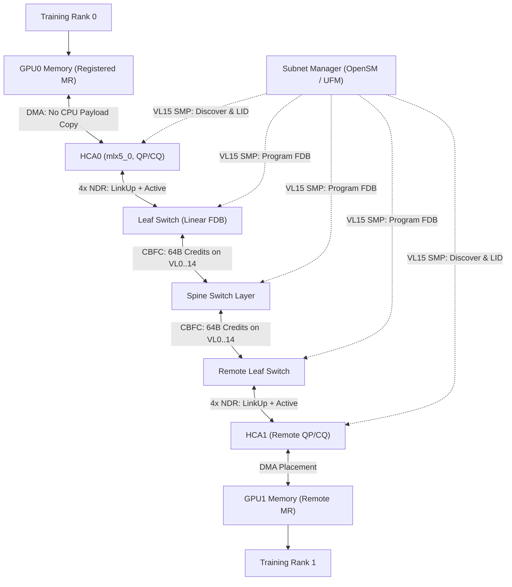
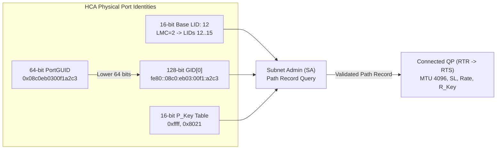
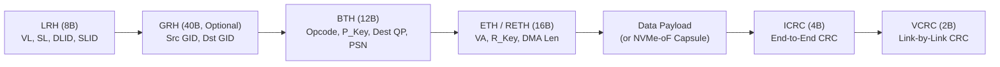

# 12.6 InfiniBand fundamentals and addressing

| | |
|---|---|
| Level | Intermediate |
| Priority tier | 1 |
| Lab venue | Nebius GPU |
| Part | Part 12: Complete AI networking |
| Sources | `supercomputers-for-linux-sysadmins` Ch. 5; `ai-data-center-network-design-and-technologies` Ch. 9; `bcm11-admin` §3.6.3–3.6.4 & §5.3.3; `nvidia-devops` V8 Ch. 1–4, Ch. 12, `index.md` & Labs 01–04 |
| Code | `code/part12/infiniband_fundamentals.py`, `code/part12/infiniband_fundamentals_lab.py` |
| Coverage file | `planning/coverage/chapters/12-06.md` |

## Why this matters for AI infrastructure

When a `256`-GPU or `128`-node distributed training job runs `AllReduce`, `AllGather`, `ReduceScatter`, or pipeline/tensor-parallel exchanges across node boundaries, the network ceases to be background plumbing and becomes part of the compute execution engine. Every rank advances through tightly coupled compute-and-communication barriers: a single straggler path holds back the entire collective, turning microsecond tail-latency jitter into job-wide GPU idle time.

A newly commissioned cluster can pass basic IP reachability tests, show green physical link LEDs on every switch cage, and hit `399.82 Gbps` peak bandwidth on a single isolated pair—yet suffer `20%` step-time oscillation or a `39.69%` average bandwidth collapse (`399.71 Gbps` peak dropping to `241.06 Gbps` average across `2,097,152`-byte messages) once concurrent collectives run. On an InfiniBand fabric, four failure modes routinely hide behind "all links up":

1. **Physical versus logical port state divergence:** A port negotiates electrical link (`Physical state: LinkUp` at `Rate: 400`), turning the transceiver LED green, while remaining in `State: Initializing` with `Base lid: 0` and `SM lid: 0` because the Subnet Manager (`SM`) has not admitted the port or programmed switch forwarding tables.
2. **Silent lane-width degradation:** A `4x` NDR (`400 Gbps`) cable with a contaminated optical lane or bent pin negotiates down to `1x` NDR (`Rate: 100`), passing `Active` state checks while capping every collective touching that rack at `25%` of design bandwidth.
3. **Credit backpressure and Virtual Lane contention:** Because InfiniBand uses link-by-link Credit-Based Flow Control (`CBFC`, `64`-byte credit units across `16` Virtual Lanes: `VL0`–`VL14` for data plus `VL15` for management), a slow receiver or shared storage Service Level (`SL`) stalls credit return (`PortXmitWait = 184,320` ticks with `0` symbol errors), propagating head-of-line blocking upstream without dropping a single packet.
4. **Identity and partition mismatches:** Scripts that treat mutable `16`-bit Local Identifiers (`LID`s) as permanent host identities break after an SM sweep, while mismatched `16`-bit Partition Keys (`P_Key` `0x8021` vs `0x8035`, or two limited members `0x0021` vs `0x0021`) or drifting `128`-bit Global Identifier (`GID`) table indices silently block Queue Pair (`QP`) connection setup.

This chapter builds the complete InfiniBand architecture from physical signaling and line encoding (`SDR` through `GDR`) to hardware and logical addressing (`GUID`, `LID`, `LMC`, `GID`, directed-route `SMP`s, and `P_Key` partitions), native frame headers (`LRH`, `GRH`, `BTH`, `RETH`, `ICRC`, `VCRC`), `VL0`–`VL15` credit flow control, IP over InfiniBand (`IPoIB` datagram vs connected modes), and the OFED / `rdma-core` diagnostic workflow.

## Prerequisites and outcomes

**Prerequisites:** Chapter 12.1 (AI collective traffic patterns and synchronization amplification), Chapter 12.2 (RDMA verbs, Queue Pairs, Completion Queues, and Memory Regions), and Chapter 12.3–12.5 (RoCEv2 and Ethernet lossless QoS for comparison).

**Outcomes:** After completing this chapter, you will be able to:
- Calculate raw signaling rate, line-encoding efficiency (`8b/10b` at `80.0%`, `64b/66b` at `96.97%`, `256b/257b` at `99.61%`), and effective `4x` and `12x` link bandwidth across every InfiniBand generation from `SDR` (`8 Gbps` `4x`) and `FDR` (`54.4 Gbps` / `56 Gbps` `4x`) through `HDR` (`200 Gbps`), `NDR` (`400 Gbps`), `XDR` (`800 Gbps`), and `GDR` (`1,600 Gbps`).
- Distinguish `64`-bit hardware `GUID`s (`NodeGUID`, `PortGUID`, `SystemImage GUID`), `16`-bit subnet `LID`s (`0x0000` reserved, `0x0001..0xBFFF` = `1..49,151` unicast, `0xC000..0xFFFE` = `49,152..65,534` multicast, `0xFFFF` = `65,535` permissive), `LMC` multipath ranges (`Base LID` to `Base LID + 2^LMC - 1`), `128`-bit `GID`s (`0xFE80::/64` link-local, `0xFEC0::/64` site-local, `0xFF00::/8` multicast + `64`-bit `PortGUID`), and pre-LID directed-route Subnet Management Packets (`SMP`s on `VL15`).
- Evaluate `16`-bit Partition Key (`P_Key`) interoperability (`15`-bit Partition ID + `1`-bit full/limited membership flag `0x8000`, default `0x7fff` vs `0xffff`, and asymmetric limited-to-limited drops).
- Decode the native InfiniBand packet frame (`8`-byte `LRH`, optional `40`-byte `GRH`, `12`-byte `BTH`, `16`-byte `RETH`, payload, `4`-byte `ICRC`, `2`-byte `VCRC`) and trace per-VL `64`-byte Credit-Based Flow Control (`CBFC`) across `VL0`–`VL14` and `VL15`.
- Configure and troubleshoot IP over InfiniBand (`IPoIB` `ib0`/`ib1`, `20`-byte link-layer hardware address, `4 KB` datagram vs `64 KB` connected mode, and NVIDIA Base Command Manager `ibnet` `10.149.0.0/16` provisioning) alongside OFED diagnostics (`ibstat`, `ibstatus`, `ibv_devinfo`, `perfquery`, `mlxlink`, `smpquery`, `saquery`, `ibnetdiscover`, and `ibdiagnet`).

---

## 1. Why InfiniBand exists and how the layered fabric works

### 1.1 Tightly coupled collectives and the separation of data and control planes

In loosely coupled enterprise services, independent requests tolerate average latency and kernel socket copies. In distributed AI training and HPC, ranks synchronize at every iteration barrier: the completion time of an `AllReduce` or `AllToAll` collective equals the completion time of its single slowest participant. Conventional OS socket networking introduces system calls, kernel buffer copies, CPU protocol processing, cache pollution, and interrupt/scheduler jitter on every message.

InfiniBand was standardized by the InfiniBand Trade Association (`IBTA`) and supported by the open-source OpenFabrics Enterprise Distribution (`OFED` / `MLNX_OFED` / `DOCA-OFED`) to solve this problem through a purpose-built, end-to-end fabric architecture that combines two distinct planes:



| Fabric component / plane | Primary responsibility | Operational evidence of health | What breaks if it fails |
|---|---|---|---|
| **Host Channel Adapter (`HCA`)** | Owns Queue Pairs (`QP`s) and Completion Queues (`CQ`s), enforces Protection Domains (`PD`s) and Memory Region (`MR`) keys (`L_Key`/`R_Key`), executes DMA directly to GPU/host memory, and packetizes payloads. (A simplified storage variant called Target Channel Adapter, `TCA`, was defined by IBTA but never became widespread.) | `ibv_devinfo -v` (`PORT_ACTIVE (4)`, `LINK_UP (5)`, `active_mtu: 4096 (5)`); local PCIe/NUMA affinity to paired GPU | Cross-socket UPI/QPI hairpinning if GPU and HCA sit on different NUMA nodes; `IBV_WC_LOC_PROT_ERR` / `REM_ACCESS_ERR` on key mismatch |
| **InfiniBand Switch & Virtual Port `0`** | Cut-through hardware forwarding (`~300 ns` switch latency) using deterministic Linear Forwarding Tables (`LFT`s) keyed by `16`-bit Destination LID (`D-LID`), plus `SL`-to-`VL` mapping and `64`-byte `CBFC` credit exchange. Every switch exposes a dedicated virtual `Port 0` for switch management. | `ibroute` valid egress port per `D-LID`; `perfquery` `SymbolErrorCounter = 0` and low `PortXmitWait` | Unlike Ethernet switches, IB switches **do not self-learn** MAC addresses or build spanning trees; unprogrammed switches drop or strand traffic |
| **Subnet Manager (`SM` / `OpenSM` / `UFM`)** | Central control plane running on a host HCA or switch: sweeps topology via directed-route `SMP`s on `VL15`, assigns `Base LID` and `LMC`, programs switch forwarding tables, enforces `P_Key` partitions, and configures `SHARP` in-network reductions (via NVIDIA Unified Fabric Manager, `UFM`). | `sminfo` shows `1` authoritative master (`SMINFO_MASTER`) and `1+` standbys; `ibstat` shows `State: Active` and non-zero `Base lid` / `SM lid` | Port stays stuck at `Physical state: LinkUp` + `State: Initializing` (`Base lid: 0`, `SM lid: 0`)—the "green LED, dead port" syndrome |
| **InfiniBand Routers** | Interconnect multiple InfiniBand subnets (`<= 49,151` unicast ports per subnet) using `128`-bit `GID`s in the `40`-byte Global Routing Header (`GRH`). | Valid site-local (`0xFEC0::/64`) or global `GID` prefixes and router path records | Intra-subnet link-local `0xFE80::/64` packets are never forwarded across routers |

### 1.2 Predictability versus peak speed: reading `ib_write_bw` under contention

Peak bandwidth on an idle link only proves that a single Queue Pair can serialize bytes across the wire for an instant. Synchronized AI collectives depend on **sustained average bandwidth and bounded tail latency** under concurrent load. Consider two runs of `ib_write_bw` (`2,097,152`-byte = `2 MiB` messages, `1` Reliable Connected `QP` on `mlx5_0`, `10` seconds) between local `LID 0x0c` (`12`, `QPN 0x012a`, `PSN 0x3a1f2e`, `RKey 0x1c0a00`) and remote `LID 0x51` (`81`, `QPN 0x00e3`, `PSN 0x0091ab`, `RKey 0x1c0b00`):

```text
# Uncongested 400 Gbps NDR path:
 #bytes  #iterations  BW peak[Gb/sec]  BW average[Gb/sec]  MsgRate[Mpps]
 2097152 237000       399.82           398.71              0.0238

# Same path under concurrent upstream switch contention:
 #bytes  #iterations  BW peak[Gb/sec]  BW average[Gb/sec]  MsgRate[Mpps]
 2097152 144000       399.71           241.06              0.0144
```

On the uncongested path, `BW average` (`398.71 Gbps`) tracks `BW peak` (`399.82 Gbps`) within **`0.28%`**. Under concurrent load sharing an upstream switch cut, `BW peak` still reads **`399.71 Gbps`**—so a naive peak check passes—while `BW average` collapses by **`39.69%`** to **`241.06 Gbps`** (`144,000` iterations vs `237,000`, `0.0144 Mpps` vs `0.0238 Mpps`) because intermittent `CBFC` credit stalls pause the sender's Queue Pair.

---

## 2. Physical layer generations, lane widths, encoding, and port state machines

### 2.1 Link generations (`SDR` to `GDR`), `4x` vs `12x` lanes, and line encoding (`8b/10b`, `64b/66b`, `256b/257b`)

An InfiniBand physical link consists of multiple serial bidirectional lanes operating in parallel—most commonly **`4x` links** (`4` parallel lanes) for HCA-to-switch and inter-switch cables, and **`12x` links** (`12` parallel lanes, or `2x`/`8x` breakouts in modern high-radix switch systems) for internal switch-chip interconnects and high-density trunks.

InfiniBand specifications distinguish between the **raw signaling rate** transmitted on the medium and the **effective user data bandwidth** after line encoding (which embeds clock recovery and DC balance to detect and recover from bit errors):
- **`SDR`, `DDR`, and `QDR`** use **`8b/10b` encoding**: every `8` bits of user data are encoded into `10` line bits, yielding an encoding efficiency of $8 / 10 = \mathbf{80.0\%}$ (`20.0%` encoding overhead).
- **`FDR10`, `FDR`, `EDR`, and `HDR`** use **`64b/66b` encoding**: every `64` bits of user data are encoded into `66` line bits, yielding an efficiency of $64 / 66 = \mathbf{96.9697\%}$ (`~3.03%` overhead). Note that in `FDR` (`Fourteen Data Rate`, `14.0625 Gbps` raw per lane), tools like `ibstat` and `ibstatus` report the raw nominal rate (`56` Gb/sec for `4x FDR`, since $4 \times 14.0625 = 56.25\text{ Gbps}$), whereas the theoretical effective communication bandwidth after `64b/66b` encoding and link framing is **`54.4 Gbps`** (`13.6 Gbps` per lane, or `163.2 Gbps` for `12x`).
- **`NDR`, `XDR`, and `GDR`** use **`256b/257b` encoding** (with PAM4 modulation and Forward Error Correction, `FEC`), yielding a block encoding efficiency of $256 / 257 = \mathbf{99.6109\%}$.

| Generation | Raw lane rate (Gbps) | Line encoding | Encoding efficiency | Effective `1x` lane (Gbps) | Raw `4x` rate (Gbps) | Effective `4x` bandwidth (Gbps) | Effective `12x` bandwidth (Gbps) |
|---|---:|---|---:|---:|---:|---:|---:|
| **`SDR`** (Single Data Rate) | `2.5` | `8b/10b` | `80.00%` | `2.0` | `10.0` | **`8.0`** | **`24.0`** |
| **`DDR`** (Double Data Rate) | `5.0` | `8b/10b` | `80.00%` | `4.0` | `20.0` | **`16.0`** | **`48.0`** |
| **`QDR`** (Quad Data Rate) | `10.0` | `8b/10b` | `80.00%` | `8.0` | `40.0` | **`32.0`** | **`96.0`** |
| **`FDR10`** (Fourteen-10) | `10.3125` | `64b/66b` | `96.97%` | `10.0` | `41.25` | **`40.0`** | **`120.0`** |
| **`FDR`** (Fourteen Data Rate) | `14.0625` | `64b/66b` | `96.97%` | `13.6` | `56.25` (`56` in `ibstat`) | **`54.4`** | **`163.2`** |
| **`EDR`** (Enhanced Data Rate) | `25.78125` | `64b/66b` | `96.97%` | `25.0` | `103.125` | **`100.0`** | **`300.0`** |
| **`HDR`** (High Data Rate) | `53.125` | `64b/66b` | `96.97%` | `50.0` | `212.5` | **`200.0`** | **`600.0`** |
| **`NDR`** (Next Data Rate) | `106.25` | `256b/257b` | `99.61%` | `100.0` | `425.0` | **`400.0`** | **`1,200.0`** |
| **`XDR`** (eXtended Data Rate) | `200.0` (nominal) | `256b/257b` | `99.61%` | `200.0` | `800.0+` | **`800.0`** | **`2,400.0`** |
| **`GDR`** (Giga Data Rate) | `400.0` (nominal) | `256b/257b` | `99.61%` | `400.0` | `1,600.0+` | **`1,600.0`** | **`4,800.0`** |

### 2.2 Physical state versus logical link-layer port state machine

An InfiniBand port maintains two separate state machines that operators must inspect together in `ibstat` and `ibstatus`:

1. **Physical state (`phys state`):** Tracks electrical/optical lane training on the wire.
   - `Disabled`: Port is administratively disabled.
   - `Polling`: Initial state after power-on; port transmits training sequences to detect a remote link partner.
   - `Configuration`: Link partner detected; ports negotiate operating speed and lane width (`1x`, `2x`, `4x`, `12x`).
   - `LinkUp` (`5: LinkUp` in `ibstatus`): Physical layer is up and symbols can cross the wire.
   - `Recovery`: Link lost synchronization and is attempting hardware recovery (`Link Error Recovery Counter` increments).
2. **Logical link-layer state (`State`):** Tracks Subnet Manager admission and forwarding readiness.
   - `Down` (`1`): Physical layer is not yet `LinkUp`; no packets can be sent.
   - `Initialize` / `Initializing` (`2`): Entered **immediately** when the physical layer reaches `LinkUp`. In this state, **only Subnet Management Packets (`SMP`s on `VL15`) can be received and transmitted**. Application Queue Pairs cannot send data.
   - `Armed` (`3`): The Subnet Manager has discovered the port and assigned its `Base LID` and `P_Key` tables, but full forwarding is not yet enabled.
   - `Active` (`4: ACTIVE` in `ibstatus`): The SM has finished programming switch Linear Forwarding Tables and transitioned the port to normal operation; all RDMA verbs and `IPoIB` traffic can flow.

---

## 3. Component identification, addressing, and partitioning (`GUID`, `LID`, `LMC`, `GID`, `SMP`, `P_Key`)

InfiniBand separates **hardware object identity** (`GUID`), **intra-subnet switch forwarding** (`LID` and `LMC`), **inter-subnet / global endpoint addressing** (`GID`), **pre-initialization bootstrap routing** (`Directed Route SMP`), and **logical fabric isolation** (`P_Key`).



| Identifier / attribute | Bit width | Assigned by | Mutability & scope | Operational role in AI fabrics |
|---|---:|---|---|---|
| **`NodeGUID` / `PortGUID` / `SystemImage GUID`** | `64` bits | Hardware manufacturer (firmware) | **Persistent** across reboots and SM sweeps; global hardware identity | Anchor your CMDB/inventory on `PortGUID`. Every HCA has `1` `NodeGUID` and `1` `PortGUID` per port; a switch has `1` `NodeGUID` and uses the **same `PortGUID` across all switch ports**. `SystemImage GUID` groups elementary switch chips inside one modular chassis (whereas multiple HCAs in one server have distinct `SystemImage GUID`s because each runs independent firmware). |
| **Local Identifier (`LID`)** | `16` bits (`0..65,535`) | Subnet Manager (`SM`) at sweep time | **Mutable** runtime state; unique within **one subnet** | Used in the `8`-byte Local Route Header (`LRH` `S-LID` and `D-LID`) as the lookup key in switch forwarding tables. Each HCA end port and each switch as a whole (`Port 0`) receives at least one LID. |
| **LID Mask Control (`LMC`)** | `3` bits (`LMC` `0..7`; `2^LMC` LIDs) | Subnet Manager (`SM`) | **Mutable** runtime policy; intra-subnet | Assigns $2^{\text{LMC}}$ consecutive LIDs (`Base LID` to `Base LID + 2^LMC - 1`, where the lower `LMC` bits of `Base LID` must be `0`) to one port so switches can spread traffic across $2^{\text{LMC}}$ parallel paths. |
| **Global Identifier (`GID`)** | `128` bits (`IPv6` format) | `64`-bit prefix (`SM`) + `64`-bit `PortGUID` | **Context-dependent** (`show_gids` index `0..N`); intra- and inter-subnet | Placed in the `40`-byte Global Routing Header (`GRH`) for inter-subnet routing or RoCEv2/container contexts. Default prefix `0xFE80::/64` is link-local; `0xFEC0::/64` is site-local; `0xFF00::/8` is multicast. |
| **Directed Route (`SMP`)** | Hop list (`hop_count`, `hop_pointer`, `D` bit) | Subnet Manager (`SM`) on `VL15` | **Bootstrap / diagnostic** (`LID = 0xFFFF` permissive) | Lists exact switch egress port numbers before LIDs or forwarding tables exist (`D=0` outbound records `return_path`; `D=1` returns response). |
| **Partition Key (`P_Key`)** | `16` bits (`15`-bit ID + `1`-bit membership) | Subnet / Partition Manager (`SM`) | **Policy-driven** logical isolation across shared fabric | Enforces tenant/job partition membership in hardware (`BTH`). Bit `15` (`0x8000`) is `1` for **Full** members (`0xffff`, `0x8021`) and `0` for **Limited** members (`0x7fff`, `0x0021`). |

### 3.1 `16`-bit LID address space (`49,151` unicast limit) and `LMC` multipath math

Because the `LID` field in the Local Route Header (`LRH`) is **`16` bits** wide ($2^{16} = 65,536$ values), the IBTA specification partitions the `LID` space into four strict ranges:

1. **`LID = 0x0000` (`0`):** Reserved and never assigned to any port.
2. **`LID = 0x0001` to `0xBFFF` (`1` to `49,151`):** Unicast LIDs used for point-to-point forwarding. This defines the hard architectural ceiling of a single InfiniBand subnet:
   $$\text{Max Unicast LIDs per Subnet} = 2^{15} + 2^{14} - 1 = 32,768 + 16,383 = \mathbf{49,151\text{ end ports and switches}}$$
   (Often rounded in data-center design guides to roughly **`48,000` end nodes** once switch management LIDs are subtracted; scaling beyond `49,151` unicast LIDs requires either InfiniBand routers using `GRH` `GID`s or multi-rail independent subnets.)
3. **`LID = 0xC000` to `0xFFFE` (`49,152` to `65,534`):** Multicast LIDs (`16,383` multicast groups).
4. **`LID = 0xFFFF` (`65,535`):** **Permissive LID**. A management packet addressed to `0xFFFF` is processed directly by the first port that receives it regardless of LID assignment.

**LID Mask Control (`LMC`):** When a subnet has multiple parallel routes between endpoints, the SM can assign multiple LIDs to each HCA port using a `Base LID` and an `LMC` value:
- The lower `LMC` bits of `Base LID` must be zero: $(\text{Base LID} \mathbin{\&} (2^{\text{LMC}} - 1)) = 0$.
- The port responds to **$2^{\text{LMC}}$ consecutive LIDs**:
  $$\text{Assigned LID Range} = \left[\text{Base LID},\ \text{Base LID} + 2^{\text{LMC}} - 1\right]$$
- Typically, at most two `LMC` values exist in a subnet: `LMC = 0` ($2^0 = 1$ LID) for switches, and `LMC = 0, 1, 2, ...` for HCA ports. For example, if an HCA port receives `Base LID = 12` (`0b00001100`, whose lower `2` bits are `00`) with `LMC = 2`, it owns $2^2 = \mathbf{4\text{ LIDs}}$: **`12, 13, 14, and 15`**, allowing the SM to program four distinct spine paths in switch forwarding tables. Note that when `LMC > 0`, each port consumes $2^{\text{LMC}}$ unicast LIDs out of the `49,151` subnet pool.

### 3.2 `128`-bit Global Identifiers (`GID`s) and why hardcoded `GID` indices fail

A `GID` is a **`128`-bit IPv6 address** assigned to every end port:
- **Lower `64` bits (Interface Identifier):** Equal to the port's `64`-bit `PortGUID` (e.g., `PortGUID 0x08c0eb0300f1a2c3` becomes `:08c0:eb03:00f1:a2c3`).
- **Upper `64` bits (`GID Prefix`):**
  - **`0xFE80::/64` (Default link-local scope):** Mandatory on every port (`GID[0]`). Packets with a `0xFE80::/64` destination GID are strictly scoped to the local subnet and are **never forwarded by InfiniBand routers**.
  - **`0xFEC0::/64` (Site-local scope):** Routable across InfiniBand routers from subnet to subnet within a site, but must not leave the site.
  - **Global unicast prefix:** Standard routable IPv6 prefix assigned by the SM during initialization.
  - **`0xFF00::/8` (High byte `0xFF`, Multicast GID):** Used for IB multicast groups (per `RFC 2373` and `RFC 2375`).

On dual-mode ConnectX adapters or hosts running `IPoIB`, virtual functions, or container namespaces, `show_gids` exposes multiple entries per port (`INDEX 0, 1, 2, 3...`, such as `fe80::` link-local `v1`/`v2` and IPv4-mapped `0000:0000:0000:0000:0000:ffff:0a01:0203` for `10.1.2.3`). Because boot order, driver version, or container interfaces can shift table ordering across nominally identical servers, **never hardcode `-g 3` (`NCCL_IB_GID_INDEX=3`) without verifying that the GID index resolves to the same semantic address family and subnet on every node**.

### 3.3 Directed-route Subnet Management Packets (`SMP`s)

When an InfiniBand cluster first powers on—or right after a switch or HCA reboots—ports have `Base LID = 0` and switch Linear Forwarding Tables are empty. To discover and configure the fabric before LID routing works, the Subnet Manager uses **directed-route addressing** (exclusively for Subnet Management Packets, `SMP`s, using `LID = 0xFFFF` on `VL15`).

A directed-route `SMP` carries:
- **`hop_count`:** Total number of switch hops in the route list.
- **`hop_pointer`:** Index (`1..hop_count`) of the current hop being traversed.
- **`D` (Direction bit):** `0` when traveling outbound from the SM toward the target (`Request`); `1` when returning from the target back to the SM (`Response`).
- **`initial_path` array:** The exact sequence of switch egress port numbers the packet must exit at each hop.
- **`return_path` array:** Populated dynamically by switches on the outbound journey so the reply can find its way back without forwarding tables.

**Step-by-step traversal:**
1. **Outbound (`D = 0`):** Upon receiving an `SMP` with `D = 0`, a switch inspects `initial_path[hop_pointer]` to choose the outgoing port, **writes the ingress port number on which the packet arrived into `return_path[hop_pointer]`**, and increments `hop_pointer` by `1`.
2. **At the target (`hop_pointer == hop_count`):** The target port's Subnet Management Agent (`SMA`) processes the request, generates a reply, flips the direction bit to **`D = 1`**, and transmits the reply back.
3. **Return (`D = 1`):** Each switch along the reverse path sees `D = 1`, forwards the packet out `return_path[hop_pointer]` without modifying `return_path`, and decrements `hop_pointer` by `1` until it reaches the SM (`hop_pointer == 0`). (InfiniBand also supports *combined* directed routing, where a packet uses normal `LID` forwarding up to an initialized switch LID, traverses a directed-route hop list across an uninitialized link, and optionally resumes `LID` forwarding afterward.)

### 3.4 `16`-bit Partition Keys (`P_Key`s): full (`0x8000`) versus limited membership

InfiniBand enforces logical multi-tenant isolation in HCA and switch hardware using **`16`-bit Partition Keys (`P_Key`s)** distributed by the SM into each port's `P_Key` table (e.g., `partition_cap = 0x80 = 128` entries per port):
- **Bits `0..14` (`15` bits, `P_Key & 0x7FFF`):** The **Partition ID** (`0x0001` to `0x7FFF`; `0x0000` is unused). The default management partition has Partition ID **`0x7FFF`**.
- **Bit `15` (`1` bit, `P_Key & 0x8000`):** The **Membership Bit**:
  - **`1` (Full Member):** e.g., `0xFFFF` (`0x8000 | 0x7FFF`, default full partition) or `0x8021` (full member of partition `0x0021`).
  - **`0` (Limited Member):** e.g., `0x7FFF` (`0x0000 | 0x7FFF`, default limited partition) or `0x0021` (limited member of partition `0x0021`).

**The Hardware Interoperability Rule:** Two ports can communicate over a partition **if and only if**:
1. Their `15`-bit Partition IDs match (`(PKey_A & 0x7FFF) == (PKey_B & 0x7FFF) != 0`), **AND**
2. **At least one of the two ports is a Full Member** (`(PKey_A & 0x8000) != 0` or `(PKey_B & 0x8000) != 0`).

Consequently:
- **Full $\leftrightarrow$ Full (`0x8021` $\leftrightarrow$ `0x8021`):** Allowed.
- **Full $\leftrightarrow$ Limited (`0x8021` $\leftrightarrow$ `0x0021`, or `0xFFFF` $\leftrightarrow$ `0x7FFF`):** Allowed (for example, a shared storage target or management server configured as a Full Member talking to compute nodes configured as Limited Members).
- **Limited $\leftrightarrow$ Limited (`0x0021` $\leftrightarrow$ `0x0021`, or `0x7FFF` $\leftrightarrow$ `0x7FFF`):** **Silently dropped by the fabric**. If a partition policy update accidentally leaves compute nodes as `0x0021` (limited) instead of `0x8021` (full), every compute node can still reach the full-member head/storage node, but all peer-to-peer GPU collectives between compute nodes silently time out.

---

## 4. InfiniBand frame format, Virtual Lanes (`VL0`–`VL15`), and Credit-Based Flow Control (`CBFC`)

### 4.1 Native InfiniBand data frame headers (`LRH`, `GRH`, `BTH`, `RETH`, `ICRC`, `VCRC`)

Unlike RoCEv2—which wraps InfiniBand transport headers inside Ethernet (`14`/`18` B), IPv4/IPv6 (`20`/`40` B), and UDP (`8` B, port `4791`)—native InfiniBand uses a lightweight wire encapsulation processed in ~`300 ns` by InfiniBand switches:



| Frame header / trailer | Size | Mandatory? | Key fields and hardware function |
|---|---:|---|---|
| **Local Route Header (`LRH`)** | **`8` bytes** | **Yes** (every native IB packet) | Carries `4`-bit Virtual Lane (`VL`), `4`-bit Service Level (`SL`), `16`-bit Destination LID (`D-LID`), `11`-bit Packet Length (in `4`-byte dwords, up to `4,096` B MTU payload), and `16`-bit Source LID (`S-LID`). Comparable to Layer 2 Ethernet header; switches forward purely on `D-LID`. |
| **Global Routing Header (`GRH`)** | **`40` bytes** | **Optional** (inter-subnet or `GID`-addressed) | Uses standard `40`-byte IPv6 header layout carrying `128`-bit Source `GID` and Destination `GID`. Omitted for pure intra-subnet `LID` traffic; ignored by intra-subnet switches when destination `LID` is local. Comparable to Layer 3 IP header. |
| **Base Transport Header (`BTH`)** | **`12` bytes** | **Yes** (all verbs / data frames) | Carries `8`-bit RDMA Opcode, Solicited Event (`SE`), `16`-bit `P_Key`, **`24`-bit Destination Queue Pair (`Dest QP`)**, Acknowledge Request bit (`A`), and **`24`-bit Packet Sequence Number (`PSN`)**. Receiving HCA uses `Dest QP` to place data into registered memory. |
| **Extended Transport Header (`ETH` / `RETH` / `DETH`)** | **`0..28` bytes** (`16` B for `RETH`) | Operation-dependent | In `RDMA_WRITE` / `RDMA_READ`, `RETH` (`16` B) carries the `64`-bit Remote Virtual Address (`VA`), `32`-bit Remote Key (`R_Key`), and `32`-bit DMA Length. In datagram (`UD`), `DETH` carries the `24`-bit Source `QP` and `32`-bit `Q_Key`. |
| **Data Payload** | Up to **`4,096` bytes** (`active_mtu`) | Payload packets | Raw tensor gradient chunk, MPI message, or NVMe-o-RDMA command/response capsule (`SQE`/`CQE` + `SGL` descriptors). |
| **Invariant CRC (`ICRC`)** | **`4` bytes** (`32` bits) | **Yes** | End-to-end CRC covering all fields that **do not change** from source HCA to destination HCA (masks out mutable `LRH` `VL` and `GRH` hop limit). Proves end-to-end payload integrity. |
| **Variant CRC (`VCRC`)** | **`2` bytes** (`16` bits) | **Yes** (native IB link layer) | Link-by-link CRC covering the **entire packet** including mutable `LRH` fields; recomputed at every switch hop to detect single-link bit errors immediately. |

For a `4,096`-byte MTU payload within a single subnet (no `GRH`), a standard `SEND` packet adds only $8 + 12 + 4 + 2 = \mathbf{26\text{ bytes}}$ of framing (`4,122` bytes on wire, **`99.37%` payload efficiency**), or **`42` bytes** with a `16`-byte `RETH` (`4,138` bytes on wire, **`98.99%` efficiency**). Adding a `40`-byte `GRH` brings total framing to `82` bytes (`4,178` bytes on wire, `98.04%` efficiency).

### 4.2 Virtual Lanes (`VL0`–`VL15`), Service Levels (`SL`), and `64`-byte Credit-Based Flow Control (`CBFC`)

Where Ethernet RoCEv2 relies on reactive IEEE `802.1Qbb` Priority Flow Control (`PFC`) pause frames (`XOFF`/`XON`) and requires deep switch headroom buffers to absorb in-flight cable bytes after a pause is sent, InfiniBand is **proactively lossless at the link layer** through **Virtual Lanes (`VL`s)** and **Credit-Based Flow Control (`CBFC`)**:

1. **Service Levels (`SL0`–`SL15`) and Virtual Lanes (`VL0`–`VL15`):**
   - Every packet carries a `4`-bit **Service Level (`SL` `0..15`)** in its `LRH` declaring its QoS traffic class (for example, `SL0` for AI training collectives, `SL1` for storage `NVMe-o-RDMA` / `GPUDirect Storage`, `SL2` for `IPoIB`).
   - At each switch hop, an SM-programmed **`SL`-to-`VL` mapping table** maps the packet's `SL` into one of up to **`16` Virtual Lanes (`VL0` through `VL15`)** sharing the physical link.
   - **`VL0` through `VL14` (`15` data VLs, typically `8` to `12` active queues per port in hardware):** Provide independent receive buffers and independent flow-control credit domains for user, storage, and AI workloads.
   - **`VL15` (Dedicated Management VL):** Strictly reserved for Subnet Management Packets (`SMP`s). `VL15` bypasses normal data-plane credit starvation so the Subnet Manager can always query and reconfigure switches even when data Virtual Lanes (`VL0`–`VL14`) are `100%` congested.
2. **Per-VL `64`-byte Credit-Based Flow Control (`CBFC`):**
   - Flow control operates continuously across every single hop (`HCA <-> Switch 1 <-> Switch 2 <-> Receiver HCA`) and **individually per Virtual Lane (`VL`)**.
   - Each downstream receiver port tracks its available per-VL buffer space in **`64`-byte credit units** (`1 credit = 64 bytes`) and advertises its receive credit limit to the immediate upstream transmitter via link-layer Flow Control Packets (`FCP`s / Link Layer Header `LLH` credit exchange).
   - **Zero-drop invariant:** An upstream port (`Switch 1`) **never transmits** a packet on `VL1` to `Switch 2` unless `Switch 2` has already granted enough `64`-byte credits on `VL1` to hold the entire frame. For example, a `4,122`-byte intra-subnet packet requires $\lceil 4,122 / 64 \rceil = \mathbf{65\text{ credits}}$ (`4,160` bytes of reserved buffer). Once `Switch 2` forwards the packet and frees its buffer, it returns those `65` credits upstream to `Switch 1`.
   - **Why lossless does not mean congestion-free:** Because InfiniBand switches are cut-through, shallow-buffer ASICs, if an `N:1` incast or slow receiver stops draining `VL0`, downstream credits run dry. Upstream ports halt transmission on `VL0` and increment **`PortXmitWait`** (ticks spent waiting for downstream credits while data is queued to send), propagating credit backpressure upstream into a congestion tree while `SymbolErrorCounter` and packet drops remain `0`. (Notably, the Ultra Ethernet Consortium, `UEC`, later adopted InfiniBand's link-level `CBFC` credit model into its link layer.)

---

## 5. Verbs execution model, IP over InfiniBand (`IPoIB`), storage transports, and alternatives

### 5.1 Verbs resource hierarchy (`PD`, `MR`, `QP` states `RESET`–`RTS`, `CQ`) and `ibv_devinfo -v`

As established in Chapter 12.2, RDMA applications bypass the OS kernel in the payload path by interacting directly with HCA hardware queues through the **verbs** interface (`libibverbs` / `rdma-core`). Before writing or debugging a single line of verbs or NCCL code on an InfiniBand node, inspect the adapter's hardware limits via `ibv_devinfo -v -d mlx5_0` `(untested here)`:

```text
$ ibv_devinfo -v -d mlx5_0
hca_id: mlx5_0
    transport:                  InfiniBand (0)
    fw_ver:                     28.39.2048
    node_guid:                  08c0:eb03:00f1:a2c3
    sys_image_guid:             08c0:eb03:00f1:a2c3
    vendor_id:                  0x02c9
    vendor_part_id:             4129
    max_mr_size:                0xffffffffffffffff
    max_qp:                     262144
    max_qp_wr:                  32768
    max_sge:                    30
    max_cq:                     16777216
    max_cqe:                    4194303
    max_mr:                     16777216
    atomic_cap:                 ATOMIC_HCA (1)
        port:   1
            state:              PORT_ACTIVE (4)
            max_mtu:            4096 (5)
            active_mtu:         4096 (5)
            phys_state:         LINK_UP (5)
            link_layer:         InfiniBand
```

Every field governs a production design boundary on this `MT4129` (`ConnectX-7`, `vendor_id: 0x02c9 = 713`, `fw_ver: 28.39.2048`) HCA:
- **Queue Pair (`QP`) and Completion Queue (`CQ`) scaling:** `max_qp: 262144` ($2^{18}$), `max_qp_wr: 32768` ($2^{15}$ outstanding Work Requests per QP), `max_cq: 16777216` ($2^{24}$), and `max_cqe: 4194303` ($2^{22} - 1$). A naive full-mesh `1`-QP-per-peer design across thousands of GPUs multiplies QPs by `processes * peers * rails`; production libraries share Completion Queues across QPs, use hierarchical/rail topologies, or leverage Dynamically Connected (`DC`) transports.
- **Scatter-Gather Entries (`SGE`s) and Atomics:** `max_sge: 30` bounds how many discontiguous local buffer segments (`Header`, `Tensor Chunk`, `Metadata`) a single Work Request (`WR`) can link into one HCA Work Queue Element (`WQE`). `atomic_cap: ATOMIC_HCA (1)` confirms hardware support for `64`-bit atomic fetch-and-add / compare-and-swap.
- **Protection Domains (`PD`s) and Memory Regions (`MR`s):** `max_mr: 16777216`. A `QP` in `PD_A` cannot access an `MR` registered in `PD_B`. Registration pins physical/GPU pages (`cudaMalloc` + `cuFileBufRegister` / `nvidia-peermem`) and returns a local `L_Key` and remote `R_Key`. Deregistering an `MR` before draining in-flight `WQE`s triggers `IBV_WC_LOC_PROT_ERR` or `IBV_WC_REM_ACCESS_ERR`.
- **Queue Pair state machine (`RESET -> INIT -> RTR -> RTS -> SQD / ERR`):**
  - `RESET -> INIT`: Configures local port number, `P_Key` index, and access flags.
  - `INIT -> RTR` (`Ready to Receive`): Configures remote `LID`/`GID`, remote `QPN`, starting receive Packet Sequence Number (`PSN`), Service Level (`SL`), and **path MTU**. If one endpoint requests a `4,096`-byte path MTU while a peer port's `active_mtu` is `2,048`, the kernel verbs call rejects the `INIT -> RTR` transition with `EINVAL` (`Failed to modify QP to RTR`, e.g., local `LID 0x000c`, `QPN 0x00012a`, `PSN 0x3a1f2e` to remote `LID 0x0051`, `QPN 0x0000e3`, `PSN 0x0091ab`).
  - `RTR -> RTS` (`Ready to Send`): Configures starting send `PSN`, retry count, and Receiver-Not-Ready (`RNR`) retry timer.

### 5.2 IP over InfiniBand (`IPoIB`): `20`-byte hardware address, datagram (`4 KB`) vs connected (`64 KB`) modes, and BCM `ibnet` provisioning

Running TCP/IP over an InfiniBand fabric (`IPoIB`) is defined by IETF RFCs (`RFC 4391`, `RFC 4392`, `RFC 4755`) rather than the core IBTA specification. While native RDMA applications communicate directly via verbs without TCP/IP, most MPI launchers, NCCL bootstrap rendezvous sockets, Lustre/BeeGFS/WekaFS mounts, and cluster management daemons use **`IPoIB` interfaces (`ib0`, `ib1`, ...)** to exchange initial Queue Pair metadata (`LID`s, `GID`s, `QPN`s, `PSN`s, and `R_Key`s) before switching to raw RDMA verbs.

Three operational specifics distinguish `IPoIB` from Ethernet:
1. **`20`-byte Link-Layer Hardware Address (why `ifconfig` breaks and `ip addr` works):**
   - Standard Ethernet MAC addresses are `6` bytes (`48` bits). Legacy tools like `ifconfig` hardcode a `6`-byte hardware address buffer and truncate or corrupt `IPoIB` addresses; always use **`ip addr show ib0`** or `ip link`.
   - An `IPoIB` link-layer address is **`20` bytes (`160` bits)** long, structured as:
     $$\underbrace{\text{Flags}}_{\text{1 byte}} \mathbin{\Vert} \underbrace{\text{Queue Pair Number (QPN)}}_{\text{3 bytes (24 bits)}} \mathbin{\Vert} \underbrace{\text{Port GID (Prefix + PortGUID)}}_{\text{16 bytes (128 bits)}}$$
     For example, `80:00:01:2a:fe:80:00:00:00:00:00:00:08:c0:eb:03:00:f1:a2:c3` encodes flags `0x80` (connected-mode capability flag), `QPN 0x00012a` (`298`), and `GID fe80::08c0:eb03:00f1:a2c3`.
2. **Datagram Mode (`UD`, up to `4 KB` MTU) versus Connected Mode (`RC`/`UC`, up to `64 KB` MTU):**
   - **Datagram Mode (default):** Uses Unreliable Datagram (`UD`) Queue Pairs so a single `QP` can send and receive packets with any number of peers (`O(1)` QP state per node). Its IP MTU is bounded by the `4,096`-byte InfiniBand link MTU (`up to 4k`, specifically `4,092` bytes after the `4`-byte `IPoIB` encapsulation header). Because it scales cleanly across thousands of nodes without multiplying connected QPs, **datagram mode is the default in NVIDIA Base Command Manager (`BCM`) and modern `mlx5` drivers** (which also support Enhanced `IPoIB` hardware offloads).
   - **Connected Mode:** Opens a dedicated Reliable/Unreliable Connected (`RC`/`UC`) Queue Pair for each peer IP destination, allowing the `IPoIB` MTU to exceed the physical IB frame MTU up to **`64 KB` (`65,520` bytes)**. Connected mode increases single-stream TCP throughput on older adapters (`mlx4_ib`) at the cost of $O(N^2)$ Queue Pair memory overhead across large clusters.
3. **Static Addressing, Kernel Modules, and Provisioning in NVIDIA Base Command Manager (`BCM`):**
   - Because `DHCP` over `IPoIB` relies on `20`-byte client identifiers and requires an already-active Subnet Manager (`State: Active`), production HPC/AI clusters assign `ib0` addresses statically or via cluster management records.
   - In NVIDIA Base Command Manager (`bcm11-admin`), the default InfiniBand network object is named **`ibnet`** (domain `ib.cluster`, type `internal`, base address **`10.149.0.0`**, netmask **`16` bits** = `10.149.0.0/16`, with the head node `basecm11` typically at `10.149.255.254` and compute nodes `node001..node150` starting at `10.149.0.1`).
   - By default, BCM boots and provisions nodes over Ethernet (`eth0`) and starts the `rdma` service (`rdma-load-modules@rdma` on RHEL / `openibd` on SLES) during normal post-boot `init`, loading `ib_ipoib`, `rdma_ucm`, `ib_ucm`, `ib_uverbs`, `ib_umad`, `rdma_cm`, `ib_cm`, `iw_cm`, `ib_addr`, `ib_sa`, `ib_mad`, and `ib_core`.
   - If high-speed OS provisioning or iPXE booting over InfiniBand (`ib0`) is required, the administrator must **(a)** enable node booting on `ibnet` (`cmsh -c "network; set ibnet nodebooting yes; commit"`), **(b)** inject the HCA and `IPoIB` drivers (`mlx4_ib`/`mlx5_ib`, `ib_ipoib`, `ib_umad`) into the software image's initial ramdisk (`initrd`) and set `/cm/node-installer/scripts/ipoib_mode` (`echo datagram > /cm/node-installer/scripts/ipoib_mode`), and **(c)** avoid `BOOTIF=ib0` conflicts in `CMDaemon` (if a node PXE-boots from `BOOTIF=ib0`, `ib0` must not already be statically pre-claimed in a conflicting way, or `BOOTIF` should remain `eth0` while `provisioninginterface` is set to `ib0`).

### 5.3 InfiniBand for AI storage (`NVMe-o-RDMA`, `GPUDirect Storage`) and fabric alternatives (`RoCEv2`, `Slingshot`, `UEC`)

Beyond GPU-to-GPU collective communication, InfiniBand serves as a primary transport for high-performance AI storage (`NVMe-o-RDMA`, Lustre, IBM Storage Scale / GPFS, BeeGFS, WekaFS, and VAST):
- **NVMe-o-RDMA and GPUDirect Storage (`GDS`):** During NVMe-Fabrics discovery over default **TCP port `8009`**, the target advertises `RDMA_PRTYPE = 02` for native **InfiniBand** (versus `04` for **RoCEv2** and `05` for **iWARP**). In RoCEv2, RDMA Connection Management (`CM`) negotiates over **UDP port `4420`** and transfers NVMe capsules (`SQE`/`CQE` + `SGL` memory descriptors mapped `1:1` to RDMA `QP`s) over **UDP port `4791`**, achieving up to `66%` lower write latency than `NVMe-o-TCP`. On native InfiniBand, NVMe capsules sit directly inside the InfiniBand `BTH`/`RETH` payload without IP/UDP headers. With **NVIDIA GPUDirect Storage (`GDS`)**, the CUDA API (`cudaMalloc` + `cuFileBufRegister`) pins GPU HBM memory and lets the storage NIC/HCA DMA checkpoints and training shards directly between NVMe arrays and GPU memory without bouncing through host CPU bounce buffers.
- **Architectural trade-offs across storage and compute fabrics:**

| Characteristic | `(P)NFS` | `NVMe-o-TCP` | `NVMe-o-RDMA` (`RoCEv2`) | Native `InfiniBand` | `HPE Slingshot` |
|---|---|---|---|---|---|
| **Switch cut-through latency** | Microseconds | Microseconds | `~500–800 ns` | **`~300 ns`** | Low-latency HPC |
| **Lossless mechanism** | TCP retransmit | TCP (`SYN/ACK`) | Reactive `PFC` (`802.1Qbb`) + `ECN`/`DCQCN` | Proactive link `CBFC` (`64B` credits, `16 VLs`) | Fabric Manager + credit/QoS |
| **Control plane & routing** | Standard IP IGP/BGP | Standard IP IGP/BGP | Distributed BGP / ECMP / DLB | Centralized Subnet Manager (`OpenSM`/`UFM`) + `SHARP` | Centralized `FabricManager` |
| **Max single-subnet scale** | Unlimited IP | Unlimited IP | Unlimited IP | **`49,151` unicast LIDs** (`~48,000` nodes; routers above) | High-radix dragonfly |
| **400G / 800G / 1.6T support** | Yes | Yes | Yes | Yes (`NDR` `400G`, `XDR` `800G`, `GDR` `1.6T`) | `200G` / `400G` Cassini |
| **Vendor ecosystem & API** | Multi-vendor POSIX | Multi-vendor Ethernet | Multi-vendor Ethernet (`rdma-core` verbs) | Single-vendor (`NVIDIA`) native IB verbs | Ethernet-compatible; uses **`libfabric`** (`OFI` wrapper overhead vs raw IB verbs) |

---

## Commands and configurations that matter

All commands below are marked `(untested here)` and represent the canonical production CLI workflow on Linux hosts with `rdma-core`, `infiniband-diags`, `mlNX_OFED` / `DOCA-OFED`, `mft` (`mlxlink`), and NVIDIA Base Command Manager (`cmsh`).

### 1. Local HCA and port state inspection: `ibstat`, `ibstatus`, and `ibdev2netdev` `(untested here)`

Compare `ibstat` (which prints `Base lid` and `SM lid` in **decimal**) against `ibstatus` (which prints `base lid` and `sm lid` in **hexadecimal** and includes the `128`-bit `default gid`). Note how `913 == 0x391`, `43 == 0x2b`, `1361 == 0x551`, and `698 == 0x2ba` on a dual-port `MT4113` (`Connect-IB`, `56` Gb/sec `4x FDR`) adapter:

```text
# (untested here)
$ ibstat
CA 'mlx5_0'
    CA type: MT4113
    Number of ports: 2
    Firmware version: 10.12.1100
    Hardware version: 0
    Node GUID: 0x00123456000073f0
    System image GUID: 0x00123456000073f0
    Port 1:
        State: Active
        Physical state: LinkUp
        Rate: 56
        Base lid: 913
        LMC: 0
        SM lid: 43
        Capability mask: 0x26516848
        Port GUID: 0x00123456000073f0
        Link layer: InfiniBand
    Port 2:
        State: Active
        Physical state: LinkUp
        Rate: 56
        Base lid: 1361
        LMC: 0
        SM lid: 698
        Capability mask: 0x26516848
        Port GUID: 0x00265802000073f8
        Link layer: InfiniBand

$ ibstatus
InfiniBand device 'mlx5_0' port 1 status:
    default gid:     fe90:0000:0000:0000:0000:0026:5802:0000:73f0
    base lid:        0x391
    sm lid:          0x2b
    state:           4: ACTIVE
    phys state:      5: LinkUp
    rate:            56 Gb/sec (4X FDR)
    link_layer:      InfiniBand

InfiniBand device 'mlx5_0' port 2 status:
    default gid:     fea0:0000:0000:0000:0000:0012:3456:0000:73f8
    base lid:        0x551
    sm lid:          0x2ba
    state:           4: ACTIVE
    phys state:      5: LinkUp
    rate:            56 Gb/sec (4X FDR)
    link_layer:      InfiniBand

$ ibdev2netdev
mlx5_0 port 1 ==> eth0 (Up)
mlx5_1 port 1 ==> ib0 (Up)
```

`ibdev2netdev` immediately shows which RDMA device (`mlx5_0`, `mlx5_1`) maps to which Linux network interface (`eth0` in RoCE mode vs `ib0` in native InfiniBand `IPoIB` mode), while `ofed_info -s` prints the installed OFED version.

### 2. Node and Subnet Administration queries: `smpquery`, `saquery`, `ibping`, `ibnetdiscover`, and `ibdiagnet` `(untested here)`

When an error alert reports a `LID` (e.g., `LID 914`), use **`smpquery`** (which sends a direct `VL15` Subnet Management Packet to the node itself) and **`saquery`** (which queries the Subnet Manager's cached Subnet Administration database) to map the mutable `LID` back to its hostname (`n51001 HCA-1`) and persistent `GUID` (`0x0012345600003740`). **Crucial diagnostic rule:** If `smpquery` and `saquery` return different data—or if `saquery` fails while `smpquery` succeeds—the Subnet Manager is out of sync or stalled:

```text
# (untested here) — Use -C <ca_name> -P <port_num> (ports start at 1) to select local HCA port
$ smpquery nodedesc 914
Node Description:....................n51001 HCA-1

$ saquery 914
NodeRecord dump:
    lid.....................914
    reserved................0x0
    base_version............0x1
    class_version...........0x1
    node_type...............Channel Adapter
    num_ports...............2
    sys_guid................0x0012345600003740
    node_guid...............0x0012345600003740
    port_guid...............0x0012345600003740
    partition_cap...........0x80
    device_id...............0x1011
    revision................0x0
    port_num................1
    vendor_id...............0x2C9
    NodeDescription.........n51001 HCA-1

# Test IB management-layer connectivity between two ports (requires server on remote LID 123):
$ ibping -S                 # Run on target node (LID 123)
$ ibping -C mlx5_0 -P 1 123 # Run on source node

# Full-fabric topology discovery, inventory, and health audit:
$ ibswitches
$ ibnodes
$ iblinkinfo
$ ibnetdiscover > /tmp/ibnetdiscover.topology
$ ibdiagnet -o /tmp/ibdiagnet_out
```

### 3. Physical counters, `PortXmitWait`, and optical transceiver DOM: `perfquery`, `ibqueryerrors`, and `mlxlink` `(untested here)`

`perfquery` reads hardware performance and error counters from **any LID or GUID (`-G`) across the entire InfiniBand subnet** from a single management host (`-a` for all basic counters, `-x` for extended `64`-bit counters; **never pass `-R` or `ibqueryerrors -k`/`-K` during an incident, or you will wipe the baseline counters**):

```text
# (untested here)
$ perfquery -a 123
$ perfquery -x -G 0x00123456000073f0
$ ibqueryerrors

# Inspect physical BER counters (-c) and optical transceiver module DOM (-m) with mlxlink:
$ mlxlink -d mlx5_1 -c -m
Operational Info
----------------
State                           : Active
Physical state                  : LinkUp
Speed                           : IB-EDR
Width                           : 4x
FEC                             : No FEC
Loopback Mode                   : No Loopback
Auto Negotiation                : ON

Supported Info
--------------
Enabled Link Speed              : 0x0000003f (EDR,FDR,FDR10,QDR,DDR,SDR)
Supported Cable Speed           : 0x0000003f (EDR,FDR,FDR10,QDR,DDR,SDR)

Troubleshooting Info
--------------------
Status Opcode                   : 0
Group Opcode                    : N/A
Recommendation                  : No issue was observed.

Physical Counters and BER Info
------------------------------
Time Since Last Clear [Min]     : 12824.8
Effective Physical Errors       : 0
Effective Physical BER          : 15E-255
Raw Physical BER                : 15E-255
Raw Physical Errors Per Lane    : 0,0,0,0
Link Down Counter               : 0
Link Error Recovery Counter     : 0

Module Info
-----------
Identifier                      : QSFP+
Cable Technology                : 850 nm VCSEL
Cable Type                      : Active cable (active copper / optics)
Vendor Name                     : Mellanox
Vendor Part Number              : MFXXXXX-EXXX
Vendor Serial Number            : MT2135FT12345
Rev                             : B2
Wavelength [nm]                 : 850
Transfer Distance [m]           : 10
Digital Diagnostic Monitoring   : Yes
Power Class                     : 2.5 W max
CDR RX                          : ON,ON,ON,ON
CDR TX                          : ON,ON,ON,ON
Temperature [C]                 : 38 [-10..80]
Voltage [mV]                    : 3255.2 [3100..3500]
Bias Current [mA]               : 6.750,6.750,6.750,6.750 [5.492..8.5]
Rx Power Current [dBm]          : 0,0,0,0 [-14..6]
Tx Power Current [dBm]          : 0,0,0,0 [-12..6]
```

Pass `--json` to `mlxlink` (`mlxlink -d mlx5_1 -c -m --json`) to parse per-lane Bit Error Rate (`BER`), `CDR RX/TX`, temperature (`38 C`), voltage (`3255.2 mV`), laser bias (`6.750 mA`), and optical Rx/Tx power (`dBm`) directly in fleet monitoring scripts.

### 4. NVIDIA Base Command Manager (`cmsh`) `mlxconfig`, Subnet Manager, and `ib0` (`ibnet`) setup `(untested here)`

```text
# (untested here) — Inspect and declare persistent mlxconfig policy in BCM cmsh:
[basecm11->device]% mlxconfig node001 --interface ib0
[basecm11->device]% mlxconfig node001 --pci-address 0000:03:00.0 --port 1 --set link_type=IB
[basecm11->device[node001]]% set -e MLX_num_vfs 16
[basecm11->device]% mlxconfig node001 --desired

# Assign redundant Subnet Manager roles (recommended: 2 SMs per subnet, 1 active + 1 passive):
[root@basecm11 ~]# cmsh -c "device roles basecm11; assign subnetmanager; commit"
[root@basecm11 ~]# cmsh -c "device roles node001; assign subnetmanager; commit"

# Create ib0 interfaces on ibnet (10.149.0.0/16) across node001..node150 and head node:
[root@basecm11 ~]# echo "device
addinterface -n node001..node150 physical ib0 ibnet 10.149.0.1
commit" | cmsh -x
[basecm11->device[basecm11]->interfaces]% add physical ib0; set network ibnet; set ip 10.149.255.254; commit

# Optional: switch ib0 from default datagram mode (4 KB MTU) to connected mode (64 KB MTU):
[basecm11->device[node001]->interfaces[ib0]]% set connectedmode yes; commit
```

---

## How it fails

Use the bottom-up **7-layer InfiniBand diagnostic ladder** (`Inventory -> Physical State/Rate/Width -> SM & LID -> P_Key & GID/Route -> Host RDMA Verbs -> GPU RDMA Locality -> Collective/Application`) and stop at the **first** layer that diverges from baseline:

| Failure mode | Exact CLI symptom & telemetry signature | Root cause | Production resolution |
|---|---|---|---|
| **1. "Green LED, Dead Port" (`LinkUp` + `Initializing`, `Base lid: 0`)** | `ibstat mlx5_2` shows `Physical state: LinkUp` and `Rate: 400`, LEDs are green, yet `State: Initializing`, `Base lid: 0`, and `SM lid: 0`. Jobs hang at init. | Physical lane training succeeded, but the Subnet Manager (`OpenSM`/`UFM`) is down, unreachable on `VL15`, stuck in a slow sweep due to a bad fabric cable, or rejecting the port via topology policy. | Run `sminfo` to verify exactly `1` active Master SM (`SMINFO_MASTER`), inspect SM sweep logs and `ibdiagnet`, and confirm the port transitions to `State: Active` with a non-zero `Base lid`. |
| **2. Silent Lane-Width Degradation (`Active` at `1/4` Rate)** | `ibstat mlx5_0` reports `State: Active` and `Physical state: LinkUp`, passing basic up/down checks, but `Rate: 100` instead of `Rate: 400` on an NDR port. Collectives touching that rack run at `25%` speed. | Only `1` of the `4` parallel lanes (`1x` instead of `4x`) passed link training due to a dirty optical ferrule, bent QSFP/OSFP pin, or marginal transceiver. | Run `iblinkinfo` and `mlxlink -d mlx5_0 -c -m` (`Raw Physical Errors Per Lane`, `Rx Power Current [dBm]`) to identify the dead lane; clean or reseat/replace the cable one end at a time. |
| **3. Lossless Credit Backpressure (`PortXmitWait` Spike with `0` Drops)** | All ports show `Active` at `400G` and `SymbolErrorCounter = 0`, `LinkDownedCounter = 0`, yet `ib_write_bw` average drops `39.69%` (`398.71 -> 241.06 Gbps`) and `perfquery <sw-lid> 3` shows **`PortXmitWait: 184320`** (vs `41` on port `7`). | Downstream receiver slow-drain, `N:1` collective incast, or storage traffic sharing the same `SL -> VL` mapping exhausted downstream `64`-byte `CBFC` credits, creating a head-of-line blocking tree. | Trace high `PortXmitWait` downstream in the direction of egress traffic to find the root bottleneck where `PortXmitWait` is low (`0`); separate storage and training onto distinct `SL`s/`VL`s and verify routing balance. |
| **4. `P_Key` Partition or Limited-Membership Mismatch** | Both ports are `Active` (`LID 12` and `LID 87`), `ibping` / management queries work on `PKey[0]: 0xffff`, but application QPs time out silently. `smpquery pkeys` shows `0x8021` vs `0x8035`—or both nodes have `0x0021`. | Either the `15`-bit Partition IDs differ (`0x0021 != 0x0035`), or both nodes lack the `0x8000` full-membership bit (`0x0021` limited-to-limited is dropped by hardware while full-member head nodes still reach both). | Diff `smpquery pkeys -C mlx5_0 -P 1 <lid>` against intended `partitions.conf` policy; ensure peer compute nodes have the `0x8000` full-member bit (`0x8021`) and trigger an SM resweep. |
| **5. `GID` Index Drift & Mutable `LID` Inventory Corruption** | After a reboot or firmware update, an operations script maps `LID 12` to the wrong server, or a workload hardcoded with `-g 3` (`GID index 3`) works on half the cluster and fails with path/RTR errors on the rest. | `LID`s are mutable runtime addresses reassigned by the SM; `show_gids` table ordering (`v1`/`v2`, `fe80::` vs IPv4-mapped `::ffff:0a01:0203`) shifts with `IPoIB`, VFs, or boot order. | Key CMDB inventory strictly on persistent `64`-bit `PortGUID` (enriching `LID` dynamically via `saquery`/`smpquery`), and select `GID`s by semantic value/subnet policy rather than a blind index. |
| **6. Queue Pair `RTR` Rejection & `IBV_WC_WR_FLUSH_ERR` Cascades** | Application logs hundreds of `IBV_WC_WR_FLUSH_ERR` completions (`wr_id=1044..1046`) or fails startup with `Failed to modify QP to RTR`. | `Failed to modify QP to RTR` occurs when requested path MTU (`4096`) exceeds a port's `active_mtu` (`2048`) or PSN/QPN/SL mismatch. Flush errors are secondary noise caused by **one** primary error (`wr_id=1043` `IBV_WC_RETRY_EXC_ERR`, `vendor_err=0x81`) transitioning the QP to `ERR`. | Always find and diagnose the **first non-SUCCESS CQE** (`wr_id=1043`: remote process crash, empty receive queue `RNR`, or broken path) and ignore subsequent `WR_FLUSH_ERR` entries. |

---

## Hands-on lab

This chapter includes a deterministic, self-checking Python simulation (`code/part12/infiniband_fundamentals.py` and `code/part12/infiniband_fundamentals_lab.py`) that models every InfiniBand link generation (`SDR`–`GDR`), `LID`/`LMC` address range, `128`-bit `GID`, directed-route `SMP`, `P_Key` membership matrix, `20`-byte `IPoIB` address, native `LRH`/`GRH`/`BTH`/`RETH`/`ICRC`/`VCRC` frame overhead, `64`-byte `CBFC` Virtual Lane credit calculator, and the Volume 08 diagnostic decision tree.

### Run the lab (tested here)

```bash
python3 -B code/part12/infiniband_fundamentals_lab.py
```

```text
=== Chapter 12.6 Lab: InfiniBand Fundamentals and Addressing ===
  [PASS] SCL Ch 5 Table 5-1 8b/10b generations (80.0% eff): SDR 2.5G raw -> 8G (4x)/24G (12x); DDR 5G raw -> 16G (4x)/48G (12x); QDR 10G raw -> 32G (4x)/96G (12x)
  [PASS] SCL Ch 5 Table 5-1 64b/66b generations (96.9697% eff): FDR10 40G (4x); FDR 14.0625G raw -> 54.4G (4x)/163.2G (12x); EDR 25.78125G raw -> 100G (4x); HDR 53.125G raw -> 200G (4x)/600G (12x)
  [PASS] SCL Ch 5 Table 5-1 modern generations (256b/257b, 99.6109% eff): NDR 106.25G raw -> 400G (4x)/1200G (12x); XDR -> 800G (4x)/2400G (12x); GDR -> 1600G (4x)/4800G (12x)
  [PASS] SCL Ch 5 & ADC Ch 9 16-bit LID space: 0x0000 reserved, 0x0001..0xBFFF (1..49,151 = 2^15 + 2^14 - 1, ~48,000 nodes) unicast, 0xC000..0xFFFE (49,152..65,534) multicast, 0xFFFF (65,535) permissive
  [PASS] SCL Ch 5 LMC math: LMC=0 at Base LID 913 (0x391) -> 1 LID (913); LMC=2 at Base LID 12 -> 4 LIDs (12..15, aligned); LMC=3 at Base LID 16 -> 8 LIDs (16..23)
  [PASS] SCL Ch 5 & V8 Ch 4 64-bit GUID & 128-bit GID: fe80::/64 link-local (fe80:0000:0000:0000:08c0:eb03:00f1:a2c3), fec0::/64 site-local, 0xff multicast
  [PASS] SCL Ch 5 Directed-Route SMP (3 hops): forward D=0 increments hop_pointer 0->3 and records return_path (0, 1, 7, 3); reply D=1 decrements hop_pointer 3->0
  [PASS] V8 Ch 4 P_Key rules (15-bit ID + 0x8000 full-member bit): 0xffff<->0x7fff ALLOWED; 0x8021<->0x8035 PARTITION_ID_MISMATCH; 0x8021<->0x0021 ALLOWED; 0x0021<->0x0021 LIMITED_TO_LIMITED_DENIED
  [PASS] SCL Ch 5 & BCM11 §3.6.4 IPoIB: 20-byte hardware address (1B flags + 3B QPN + 16B GID vs 6B Ethernet MAC), datagram max MTU 4 KB (4096) vs connected max MTU 64 KB (65536), ibnet 10.149.0.0/16
  [PASS] ADC Ch 9 Fig 9-21 IB Frame Format: LRH(8B)+BTH(12B)+ICRC(4B)+VCRC(2B) = 26B base overhead (99.3692% eff at 4096B); +RETH(16B)=42B (98.985% eff); +GRH(40B)=82B (98.0373% eff)
  [PASS] ADC Ch 9 Fig 9-22 IB QoS & CBFC: 16 VLs (VL0..VL14 data + VL15 SMP), 64B credit unit; 4,122B frame needs ceil(4122/64)=65 credits (100 credits -> TX OK, 35 rem; 50 credits -> stall)
  [PASS] ADC Ch 9 NVMe-oF & IB storage constants: RDMA_PRTYPE 02 (IB), 04 (RoCEv2), 05 (iWARP); TCP 8009 discovery, UDP 4420 CM, UDP 4791 RoCEv2; ~300 ns IB switch latency
  [PASS] V8 Ch 3 & Lab 01 ibv_devinfo -v capabilities (MT4129, FW 28.39.2048, vendor 0x02c9): max_qp=262,144, max_qp_wr=32,768, max_sge=30, max_cq=16,777,216, max_cqe=4,194,303, active_mtu=4096
  [PASS] V8 Ch 1/2 Scenario 1 (mlx5_2 LinkUp + Initializing + Base lid 0 + SM lid 0): diagnoses SM_CONTROL_PLANE_UNINITIALIZED_NO_LID
  [PASS] V8 Ch 1/2 Scenario 2 (Active at Rate 100 vs 400 design): 1x NDR = 100.0 Gbps (25% of 4x 400G) -> DEGRADED_LANE_WIDTH_OR_SPEED
  [PASS] V8 Ch 1 ib_write_bw (2,097,152 B = 2 MiB): uncongested 399.82 peak / 398.71 avg (0.28% spread, 237,000 iters, 0.0238 Mpps) vs congested 399.71 peak / 241.06 avg (39.69% drop, 144,000 iters, 0.0144 Mpps)
  [PASS] V8 Ch 2 Scenario 3 perfquery PortXmitWait: port 3 (184,320 ticks, 0 symbol errors) -> CREDIT_BACKPRESSURE_CONGESTION_TREE vs port 7 (41 ticks) -> HEALTHY_ACTIVE_PATH
  [PASS] V8 Ch 3 Scenario 4 CQE cascade: wr_id=1042 SUCCESS -> wr_id=1043 IBV_WC_RETRY_EXC_ERR (0x81) -> wr_id=1044..1046 IBV_WC_WR_FLUSH_ERR diagnoses VERBS_TRANSPORT_ERROR_IBV_WC_RETRY_EXC_ERR
  [PASS] V8 Ch 4 Scenario 1 diagnostic ladder: Active port with P_Key mismatch (0x8021 vs 0x8035) -> PKEY_PARTITION_OR_MEMBERSHIP_MISMATCH
  [PASS] SCL Ch 5 smpquery/saquery LID 914 (n51001 HCA-1): partition_cap 0x80 = 128 P_Keys, device_id 0x1011 = 4113 (MT4113 Connect-IB), vendor_id 0x2C9
  [PASS] SCL Ch 5 mlxlink -d mlx5_1 telemetry: Speed mask 0x0000003f (6 speeds: SDR,DDR,QDR,FDR10,FDR,EDR), 850 nm VCSEL, 10 m, 2.5 W, 38 C in [-10..80], 3255.2 mV in [3100..3500], 6.750 mA in [5.492..8.5]
  [PASS] Edge-case validation: classify_lid rejects LID > 65535 and compute_lmc_lid_range rejects reserved LID 0
  [PASS] Edge-case validation: P_Key with zero 15-bit Partition ID (0x0000 or 0x8000) is rejected as INVALID_ZERO_PARTITION_ID
  [PASS] V8 Ch 4 show_gids IPv4-mapped GID: 10.1.2.3 encodes as 0x0a010203 -> 0000:0000:0000:0000:0000:ffff:0a01:0203
  [PASS] NDR lane-width scaling (1x, 2x, 4x, 8x, 12x): effective bandwidth scales 100.0, 200.0, 400.0, 800.0, 1200.0 Gbps
  [PASS] SCL Ch 5 ibstat vs ibstatus LID conversion: Port 1 Base lid 913 (0x391), SM lid 43 (0x2b); Port 2 Base lid 1361 (0x551), SM lid 698 (0x2ba), Rate 56 Gb/s (4X FDR)
  [PASS] V8 Ch 3 Scenario 1 rc_pingpong QP RTR transition: local LID 0x000c (12), QPN 0x00012a (298), PSN 0x3a1f2e vs remote LID 0x0051 (81), QPN 0x0000e3 (227), PSN 0x0091ab; MTU 4096 > 2048 fails RTR
  [PASS] BCM11 §3.6.2-3.6.4 & §5.3.3 provisioning: 150 nodes (node001..node150) on ibnet 10.149.0.0/16 (head node 10.149.255.254, node001 10.149.0.1), MLX_num_vfs=16

Summary: 28 passed, 0 failed (total 28)
```

### Live cluster workflow (Labs 01–04 on Nebius GPU / InfiniBand hosts, `untested here`)

When executing the four Volume 08 operational labs on a live multi-node InfiniBand testbed:
1. **Lab 01 — Inventory the Fabric (`volume08-lab01`):** Capture `ibv_devices`, `ibv_devinfo -v`, `ibstat`, `show_gids`, `lspci -nn | grep -i -E 'infiniband|network'`, `numactl --hardware`, `iblinkinfo`, and active `sminfo` state into a timestamped evidence bundle (`tar -czf volume08-lab01-evidence.tar.gz volume08-lab01`) keyed by `PortGUID`.
2. **Lab 02 — Benchmark Bandwidth and Latency (`volume08-lab02`):** Pin the benchmark process to the HCA's local NUMA domain (`numactl --cpunodebind=<node> --membind=<node> ib_write_lat -d mlx5_0 -i 1 -a` and `ib_write_bw -d mlx5_0 -i 1 --report_gbits -F --duration 10 <server>`), testing same-leaf, cross-leaf, and bidirectional runs while capturing `perfquery` counter deltas before and after. Clean up with `pkill -f 'ib_.*_(lat|bw)' || true`.
3. **Lab 03 — Inspect Subnet Routing and Counters (`volume08-lab03`):** Record `ibroute <switch-lid-or-guid>` forwarding entries and compare `ibqueryerrors` / `perfquery` before and after a controlled load window to correlate `PortXmitWait` with spine path utilization.
4. **Lab 04 — Troubleshoot a Degraded Path (`volume08-lab04`):** Inject a safe, process-scoped reversible fault—such as remote NUMA binding (`numactl --cpunodebind=<remote-node> --membind=<remote-node>`) or selecting a nonpreferred rail—prove which layer of the 7-layer decision tree diverges from baseline first, restore the binding, and verify that median bandwidth and latency return to baseline.

---

## Common first mistakes

1. **Treating `State: Active` or a green cable LED as proof that the link is healthy:** `Physical state: LinkUp` only proves electrical symbol lock (the port can still sit at `State: Initializing` with `Base lid: 0`), and `State: Active` passes even when a `4x` NDR (`400 Gbps`) port silently trains down to `1x` (`Rate: 100`). Always check `Physical state`, `State`, negotiated `Rate`, lane `Width`, and error-counter trends together.
2. **Keying inventory or monitoring alerts on `LID`s instead of `PortGUID`s:** `LID`s are runtime forwarding addresses owned by the Subnet Manager. An SM restart, cable swap, or `LMC` change can renumber `LID`s across the subnet; always anchor inventory on the `64`-bit `PortGUID`.
3. **Hardcoding a `GID` table index (`-g 3`) across heterogeneous or containerized nodes:** `GID` table indices depend on `IPoIB`, SR-IOV virtual functions, and interface bring-up order. Select `GID`s by verified address context or subnet prefix rather than a blind integer index.
4. **Forgetting the high membership bit (`0x8000`) in `16`-bit `P_Key`s:** Configuring two compute nodes with `0x0021` (limited member) instead of `0x8021` (full member) lets both nodes talk to a full-member management/storage node (`0x8021`), masking the bug during health checks while blocking all compute-to-compute RDMA collectives.
5. **Clearing fabric counters (`perfquery -R` or `ibqueryerrors -k`) during an active incident:** Resetting counters destroys the baseline needed to compute rate-of-change deltas and blinds other engineers or monitoring collectors investigating the same outage.
6. **Chasing hundreds of `IBV_WC_WR_FLUSH_ERR` completions instead of the first failing `CQE`:** Once a Queue Pair encounters a single transport failure (such as `wr_id=1043` `IBV_WC_RETRY_EXC_ERR`), it transitions to `ERR` and flushes all subsequent queued Work Requests with `IBV_WC_WR_FLUSH_ERR`. Only the first non-success CQE indicates the root cause.

---

## Exercises

1. **InfiniBand Signaling Generations & Encoding Overhead (`SDR` to `GDR`):**
   Using `compute_ib_link_bandwidth` and Table 5-1:
   - (a) State the raw lane rate, line encoding scheme (`8b/10b`, `64b/66b`, or `256b/257b`), exact encoding efficiency percentage, and effective `4x` and `12x` bandwidths for **`QDR`**, **`FDR`**, **`EDR`**, **`HDR`**, **`NDR`**, **`XDR`**, and **`GDR`**.
   - (b) Explain why `ibstat` and `ibstatus` display `Rate: 56` (`56 Gb/sec (4X FDR)`) on an `FDR` port when its effective user data rate is `54.4 Gbps`, and calculate the effective bandwidth of a `4x NDR` port that degrades to `1x` width (`Rate: 100`).

2. **`16`-bit `LID` Address Space & `LMC` Multipath Range Calculation:**
   - (a) State the exact hexadecimal and decimal boundaries of the four `16`-bit `LID` regions (`Reserved`, `Unicast`, `Multicast`, and `Permissive`), and derive why a single InfiniBand subnet is limited to $2^{15} + 2^{14} - 1 = 49,151$ unicast ports and switches (`~48,000` end nodes).
   - (b) Using `compute_lmc_lid_range`, calculate the number of assigned LIDs, the exact LID list, and whether low-bit alignment (`(base_lid & ((1 << lmc) - 1)) == 0`) holds for: (i) `Base LID = 913` (`0x391`), `LMC = 0`; (ii) `Base LID = 12`, `LMC = 2`; (iii) `Base LID = 16`, `LMC = 3`; and (iv) `Base LID = 13`, `LMC = 2`.

3. **`128`-bit `GID` Formatting & Directed-Route `SMP` Traversal:**
   - (a) Construct the full `128`-bit `GID` string and state the routing scope for `PortGUID = 0x08c0eb0300f1a2c3` with prefix `0xFE80::/64` versus `PortGUID = 0x00123456000073f0` with prefix `0xFEC0::/64`, and explain how `0xFF00::/8` and IPv4-mapped `0000:0000:0000:0000:0000:ffff:0a01:0203` (`10.1.2.3`) are used.
   - (b) Trace `simulate_directed_route_smp(egress_ports=[4, 11, 2], ingress_ports_on_switches=[1, 7, 3])` across `3` uninitialized switches on `VL15` (`LID = 0xFFFF`), giving `d_bit`, `hop_count`, `hop_pointer`, `initial_path`, and `return_path` when the request arrives at the target (`D = 0`) and when the reply returns to the SM (`D = 1`).

4. **`16`-bit `P_Key` Membership Matrix & `20`-Byte `IPoIB` Addressing:**
   - (a) Using `evaluate_pkey_communication`, determine whether communication is allowed and state the exact hardware reason for: (i) `0xffff` $\leftrightarrow$ `0x7fff`, (ii) `0x8021` $\leftrightarrow$ `0x8035`, (iii) `0x8021` $\leftrightarrow$ `0x0021`, (iv) `0x0021` $\leftrightarrow$ `0x0021`, and (v) `0x0000` $\leftrightarrow$ `0x8000`.
   - (b) Explain why `ifconfig` fails on `ib0` while `ip addr` succeeds, decode the `20`-byte `IPoIB` hardware address generated for `flags = 0x80`, `QPN = 0x00012a`, and `GID = fe80::08c0:eb03:00f1:a2c3`, and compare `IPoIB` **datagram mode** (`4 KB` max MTU) with **connected mode** (`64 KB` max MTU) in BCM (`ibnet` `10.149.0.0/16`).

5. **Native InfiniBand Frame Overhead & `64`-Byte `CBFC` Virtual Lane Credit Math:**
   - (a) Using `compute_ib_frame_overhead` for a `4,096`-byte payload, compute the exact framing overhead (in bytes), total wire bytes, and payload efficiency percentage for: (i) an intra-subnet `SEND` (`LRH 8B + BTH 12B + ICRC 4B + VCRC 2B`), (ii) an intra-subnet `RDMA_WRITE` (`+ RETH 16B`), and (iii) an inter-subnet routed `RDMA_WRITE` (`+ GRH 40B`).
   - (b) Using `evaluate_cbfc_vl_transmission`, calculate how many `64`-byte `CBFC` credits on `VL1` are required to transmit a `4,122`-byte frame, how many buffer bytes `100` credits represent, and what happens when `advertised_credits` is `100` versus `50` (and why `VL15` is exempt).

6. **Production Telemetry Triage (`ibstat`, `perfquery`, `smpquery`/`saquery`, `ibv_poll_cq`):**
   Diagnose the exact root cause and next command for each of these four production observations:
   - (a) `mlx5_2` shows `Physical state: LinkUp`, `Rate: 400`, `State: Initializing`, `Base lid: 0`, `SM lid: 0`.
   - (b) `ib_write_bw` (`2 MiB` messages) shows `BW peak = 399.71 Gb/sec` but `BW average = 241.06 Gb/sec` (`MsgRate = 0.0144 Mpps`), while `perfquery <sw-lid> 3` shows `SymbolErrorCounter: 0`, `LinkDownedCounter: 0`, and `PortXmitWait: 184320` (vs `41` on port `7`).
   - (c) `smpquery nodedesc 914` returns `n51001 HCA-1`, whereas `saquery 914` returns a stale hostname or times out.
   - (d) `./rc_pingpong -d mlx5_0 -g 0` prints `Failed to modify QP to RTR`, while another node pair logs `wr_id=1042 IBV_WC_SUCCESS`, `wr_id=1043 IBV_WC_RETRY_EXC_ERR (vendor_err=0x81)`, and `wr_id=1044..1046 IBV_WC_WR_FLUSH_ERR`.

---

## Interview angles

1. **"A port's physical LED is solid green and `ibstat` shows `Physical state: LinkUp` at `Rate: 400`, yet no RDMA or `IPoIB` traffic can use it. Why?"**
   - **Strong answer:** InfiniBand separates electrical lane negotiation (`Physical state: LinkUp`) from Subnet Manager admission (`State: Active`). Immediately after `LinkUp`, the port enters `State: Initializing` with `Base lid: 0` and `SM lid: 0`, where **only `VL15` Subnet Management Packets (`SMP`s)** are permitted. Until an active Master Subnet Manager (`OpenSM` or `UFM`) discovers the port, assigns a `LID` (`1..49,151`), programs switch Linear Forwarding Tables, and transitions `State` to `Active`, application Queue Pairs cannot transmit.
2. **"Why should cluster inventories anchor on `GUID`s instead of `LID`s, and why can two nodes with the same `P_Key` partition number still fail to communicate?"**
   - **Strong answer:** `64`-bit `PortGUID`s are hardware-assigned persistent identities, whereas `16`-bit `LID`s are mutable forwarding addresses that the SM can reassign after a sweep, cable change, or `LMC` policy update. For `16`-bit `P_Key`s, the lower `15` bits (`0x7FFF`) specify the Partition ID, while bit `15` (`0x8000`) is the **Full/Limited membership bit**. Two nodes configured as limited members of the same partition (e.g., `0x0021` and `0x0021`) can both talk to a full member (`0x8021`), but the fabric silently drops all packets directly between the two limited members.
3. **"How does InfiniBand's lossless flow control (`CBFC`) differ from Ethernet's `PFC` (`IEEE 802.1Qbb`), and how do you prove congestion on a lossless InfiniBand link when packet drops and symbol errors are zero?"**
   - **Strong answer:** Ethernet `PFC` is a reactive circuit breaker (`XOFF`/`XON` frames sent after a queue crosses a threshold, requiring cable flight-time headroom). InfiniBand `CBFC` is a **proactive, link-by-link credit grant system** across `15` data Virtual Lanes (`VL0`–`VL14`, plus uncredited `VL15` for `SMP`s) where `1 credit = 64 bytes` of downstream receive buffer: a sender never transmits a packet unless the next hop has already advertised enough credits (`ceil(bytes / 64)`). Because packets are never dropped on buffer full, congestion manifests as queuing delay and rising **`PortXmitWait`** ticks in `perfquery` alongside a gap between `BW peak` (`399.71 Gbps`) and `BW average` (`241.06 Gbps`) in `ib_write_bw`.
4. **"How does the Subnet Manager configure a brand-new switch fabric when no switch has a forwarding table and every port has `LID = 0`?"**
   - **Strong answer:** Using **directed-route Subnet Management Packets (`SMP`s)** addressed to the **Permissive LID (`0xFFFF`)** on **`VL15`**. Outbound requests (`D = 0`) carry an explicit array of switch egress port numbers (`initial_path`) and a `hop_pointer` that increments at each hop while switches record the arrival port into `return_path`. The target flips `D = 1` and sends the response back along `return_path` as each switch decrements `hop_pointer` down to `0`.

---

## Checkpoint questions (20)

<details><summary><strong>1. Why does network tail latency and jitter matter more for distributed AI training than average throughput?</strong></summary>

Distributed AI collectives (`AllReduce`, `AllGather`, `ReduceScatter`) synchronize all participating ranks at every step barrier. Because no rank can proceed until the slowest transfer finishes, a single delayed path or microsecond credit stall stalls the entire GPU group (`synchronization amplification`).
</details>

<details><summary><strong>2. What are the raw lane rates, line encodings, and effective 4x/12x bandwidths for SDR, DDR, QDR, FDR10, FDR, EDR, HDR, NDR, XDR, and GDR?</strong></summary>

- **`8b/10b` (`80.0%` eff):** `SDR` (`2.5G` raw -> `8G` `4x`, `24G` `12x`), `DDR` (`5.0G` raw -> `16G` `4x`, `48G` `12x`), `QDR` (`10.0G` raw -> `32G` `4x`, `96G` `12x`).
- **`64b/66b` (`96.97%` eff):** `FDR10` (`10.3125G` raw -> `40G` `4x`, `120G` `12x`), `FDR` (`14.0625G` raw, `56G` raw `4x` -> `54.4G` `4x`, `163.2G` `12x`), `EDR` (`25.78125G` raw -> `100G` `4x`, `300G` `12x`), `HDR` (`53.125G` raw -> `200G` `4x`, `600G` `12x`).
- **`256b/257b` (`99.61%` eff):** `NDR` (`106.25G` raw -> `400G` `4x`, `1,200G` `12x`), `XDR` (`200G` eff lane -> `800G` `4x`, `2,400G` `12x`), `GDR` (`400G` eff lane -> `1,600G` `4x`, `4,800G` `12x`).
</details>

<details><summary><strong>3. What is the difference between `Physical state: LinkUp` and logical `State: Active` in `ibstat`?</strong></summary>

`Physical state: LinkUp` (`5`) means the physical lanes completed electrical/optical training (`Polling -> Configuration -> LinkUp`). Logical `State: Active` (`4`) means the Subnet Manager has discovered the port, assigned a `Base LID`, programmed switch forwarding tables, and enabled application data traffic (`Down -> Initialize -> Armed -> Active`). In `Initialize`, only `VL15` `SMP`s can pass.
</details>

<details><summary><strong>4. How do `NodeGUID`, `PortGUID`, and `SystemImage GUID` differ across HCAs and switches?</strong></summary>

All three are `64`-bit manufacturer-assigned hardware identifiers:
- Every HCA has `1` `NodeGUID` and a distinct `PortGUID` for each physical port (Port 1's `PortGUID` may equal `NodeGUID`), plus a `SystemImage GUID` per independent adapter firmware instance.
- An InfiniBand switch has `1` `NodeGUID` and uses the **same `PortGUID` across all switch ports** (managed via virtual `Port 0`); in a multi-chip modular director switch, all elementary switch chips share a single `SystemImage GUID`.
</details>

<details><summary><strong>5. How is the 16-bit `LID` space (`0x0000`–`0xFFFF`) partitioned, and why is a single InfiniBand subnet limited to `49,151` unicast devices?</strong></summary>

- **`0x0000` (`0`):** Reserved.
- **`0x0001..0xBFFF` (`1..49,151`):** Unicast LIDs ($2^{15} + 2^{14} - 1 = 32,768 + 16,383 = \mathbf{49,151}$ end ports and switches, often approximated as `~48,000` end nodes).
- **`0xC000..0xFFFE` (`49,152..65,534`):** Multicast LIDs (`16,383` groups).
- **`0xFFFF` (`65,535`):** Permissive LID (processed by the first receiving port for directed-route `SMP`s).
</details>

<details><summary><strong>6. How does LID Mask Control (`LMC`) assign multiple LIDs to a single port, and what alignment rule applies to `Base LID`?</strong></summary>

With `LMC` ($0..7$), the lower `LMC` bits of `Base LID` must be `0` (`(base_lid & ((1 << lmc) - 1)) == 0`), and the port is assigned **$2^{\text{LMC}}$ consecutive LIDs** from `Base LID` through $\text{Base LID} + 2^{\text{LMC}} - 1$ (e.g., `Base LID = 12`, `LMC = 2` assigns `4` LIDs: `12, 13, 14, 15`), enabling multipath routing across parallel switch paths.
</details>

<details><summary><strong>7. How is a 128-bit `GID` structured, and what are the scopes of `0xFE80::/64`, `0xFEC0::/64`, and `0xFF00::/8`?</strong></summary>

A `128`-bit `GID` is formatted as an IPv6 address whose lower `64` bits are the `PortGUID` and upper `64` bits are the `GID Prefix`:
- **`0xFE80::/64`:** Default link-local scope (never forwarded by InfiniBand routers across subnets).
- **`0xFEC0::/64`:** Site-local scope (routable across IB routers within a site).
- **`0xFF00::/8` (high byte `0xFF`):** Multicast GID prefix (`RFC 2373` / `RFC 2375`).
</details>

<details><summary><strong>8. How does a directed-route Subnet Management Packet (`SMP`) traverse switches before LIDs and forwarding tables exist?</strong></summary>

Sent on `VL15` with Permissive `LID = 0xFFFF`, an outbound `SMP` (`D = 0`) carries an `initial_path` array of switch egress port numbers, a `hop_count`, and a `hop_pointer`. At each hop, the switch routes out `initial_path[hop_pointer]`, records the arrival port into `return_path[hop_pointer]`, and increments `hop_pointer`. The target sets `D = 1` (reverse), and switches route the reply back along `return_path[hop_pointer]` while decrementing `hop_pointer` to `0`.
</details>

<details><summary><strong>9. How is a 16-bit Partition Key (`P_Key`) encoded, and why can `0x8021` talk to `0x0021` while two `0x0021` ports cannot communicate?</strong></summary>

Bits `0..14` (`P_Key & 0x7FFF`) hold the `15`-bit Partition ID (`0x7FFF` for the default partition), and Bit `15` (`0x8000`) is the membership bit (`1` = Full Member, `0` = Limited Member). Hardware requires matching Partition IDs **and at least one Full Member**. Thus `0x8021` (Full) $\leftrightarrow$ `0x0021` (Limited) is permitted, whereas `0x0021` (Limited) $\leftrightarrow$ `0x0021` (Limited) is silently dropped.
</details>

<details><summary><strong>10. What are the sections and byte lengths of a native InfiniBand data frame (`LRH`, `GRH`, `BTH`, `RETH`, `ICRC`, `VCRC`)?</strong></summary>

- **`LRH` (`8` B, mandatory):** `VL`, `SL`, `D-LID`, `S-LID`, packet length.
- **`GRH` (`40` B, optional):** IPv6-format `Src GID` and `Dst GID` for inter-subnet routing.
- **`BTH` (`12` B, mandatory):** RDMA Opcode, `P_Key`, `24`-bit `Dest QP`, `24`-bit `PSN`.
- **`ETH`/`RETH` (`16` B for `RETH`):** `64`-bit `VA`, `32`-bit `R_Key`, `32`-bit `DMA Length`.
- **Payload:** Up to `4,096` B (`active_mtu`).
- **`ICRC` (`4` B, end-to-end invariant CRC) + `VCRC` (`2` B, link-by-link variant CRC):** `26` B total base framing overhead (`42` B with `RETH`, `82` B with `GRH + RETH`).
</details>

<details><summary><strong>11. How many Virtual Lanes (`VL`s) does InfiniBand support, what is `VL15`, and how big is one Credit-Based Flow Control (`CBFC`) credit?</strong></summary>

InfiniBand supports **`16` Virtual Lanes (`VL0`–`VL15`)**: `VL0`–`VL14` (`15` data VLs, typically `8`–`12` active queues per port) carry user/storage/AI traffic mapped from Service Levels (`SL`s), while **`VL15`** is dedicated exclusively to Subnet Management Packets (`SMP`s). Each `CBFC` credit represents **`64` bytes** of downstream per-VL receive buffer space.
</details>

<details><summary><strong>12. How many `64`-byte `CBFC` credits are required to transmit a `4,122`-byte intra-subnet InfiniBand packet on `VL1`?</strong></summary>

$$\text{Credits Required} = \lceil 4,122 / 64 \rceil = \mathbf{65\text{ credits}} \quad (65 \times 64 = 4,160\text{ bytes reserved})$$
With `100` advertised credits (`6,400` B), the packet transmits immediately leaving `35` credits; with `50` credits (`3,200` B), transmission stalls and increments `PortXmitWait`.
</details>

<details><summary><strong>13. Why is an `IPoIB` (`ib0`) link-layer hardware address `20` bytes long, what are its three fields, and why does `ifconfig` fail on it?</strong></summary>

An `IPoIB` hardware address is **`20` bytes** (`1` byte capability flags + `3` bytes `24`-bit Queue Pair Number `QPN` + `16` bytes `128`-bit Port `GID`). Legacy `ifconfig` assumes a fixed `6`-byte Ethernet MAC address and truncates the `20`-byte `IPoIB` address; `ip addr` / `ip link` handles all `20` bytes properly.
</details>

<details><summary><strong>14. How do `IPoIB` Datagram Mode and Connected Mode differ in transport type, maximum MTU, and cluster scalability?</strong></summary>

- **Datagram Mode (default):** Uses Unreliable Datagram (`UD`) QPs, supports an MTU **up to `4 KB`** (`4,092` B), and scales `O(1)` across thousands of nodes because one UD QP communicates with all peers.
- **Connected Mode (`set connectedmode yes`):** Uses Reliable/Unreliable Connected (`RC`/`UC`) QPs per peer, supports an MTU **up to `64 KB`** (`65,520` B), and increases single-stream TCP throughput at the expense of $O(N^2)$ Queue Pair state across large clusters.
</details>

<details><summary><strong>15. What are the states in the RDMA Queue Pair (`QP`) state machine, and what causes `Failed to modify QP to RTR`?</strong></summary>

The states are **`RESET -> INIT -> RTR (Ready to Receive) -> RTS (Ready to Send) -> SQD / ERR`**. `INIT -> RTR` binds remote path attributes (`LID`/`GID`, `QPN`, starting `PSN`, `SL`, and path `MTU`). Requesting a `4,096`-byte path MTU when a port's `active_mtu` in `ibv_devinfo -v` is `2,048` (or supplying mismatched `P_Key`/`GID` attributes) causes the kernel verbs provider to fail the `RTR` transition.
</details>

<details><summary><strong>16. In a Completion Queue poll showing `wr_id=1042 IBV_WC_SUCCESS`, `wr_id=1043 IBV_WC_RETRY_EXC_ERR (0x81)`, and `wr_id=1044..1046 IBV_WC_WR_FLUSH_ERR`, which entry is the root cause?</strong></summary>

**`wr_id=1043` (`IBV_WC_RETRY_EXC_ERR`)** is the root cause (the HCA exhausted its transport retry limit waiting for an ACK from the remote peer). Once `1043` fails, the QP transitions to `ERR` and automatically drains every subsequent queued Work Request (`1044..1046`) with `IBV_WC_WR_FLUSH_ERR`.
</details>

<details><summary><strong>17. What is the difference between `smpquery` and `saquery`, and what does a discrepancy between them prove?</strong></summary>

`smpquery` (e.g., `smpquery nodedesc 914`) sends a direct `VL15` Subnet Management Packet to the target node (`LID 914`) and reads the live answer from the node's own HCA. `saquery` (e.g., `saquery 914`) queries the Subnet Manager's Subnet Administration (`SA`) database. If `smpquery` succeeds while `saquery` fails or returns different node records, the **Subnet Manager is stalled, unreachable, or holding stale sweep data**.
</details>

<details><summary><strong>18. How do you distinguish a physical layer / cable error from lossless credit backpressure using `perfquery` and `mlxlink`?</strong></summary>

- **Physical/cable fault:** `perfquery` shows rising `SymbolErrorCounter`, `LinkDownedCounter`, or `LinkErrorRecoveryCounter`, and `mlxlink -d mlx5_1 -c -m` shows high `Raw Physical BER`, per-lane errors (`Raw Physical Errors Per Lane`), or out-of-spec optical `Rx Power Current [dBm]`.
- **Lossless credit backpressure:** Physical error counters are **`0`**, but `perfquery` shows a large **`PortXmitWait`** delta (e.g., `184,320` ticks on switch port `3` vs `41` on port `7`), indicating the port had packets ready to send but waited for downstream `64`-byte `CBFC` credits.
</details>

<details><summary><strong>19. In `ibstat` vs `ibstatus`, why does Port 1 show `Base lid: 913` and `SM lid: 43` in `ibstat` but `base lid: 0x391` and `sm lid: 0x2b` in `ibstatus`?</strong></summary>

They are the exact same numbers printed in different bases: `ibstat` formats `Base lid` (`913`) and `SM lid` (`43`, and Port 2 `1361` / `698`) in **decimal**, whereas `ibstatus` formats them in **hexadecimal** ($913 = \text{0x391}$, $43 = \text{0x2b}$, $1361 = \text{0x551}$, and $698 = \text{0x2ba}$).
</details>

<details><summary><strong>20. How does NVMe-o-RDMA discovery identify InfiniBand versus RoCEv2 and iWARP, and how does HPE Slingshot differ from InfiniBand?</strong></summary>

During NVMe-oF discovery over **TCP port `8009`**, the controller exchanges `RDMA_PRTYPE`: **`02` for InfiniBand**, **`04` for RoCEv2** (which then uses **UDP `4420`** for RDMA CM and **UDP `4791`** for data), and **`05` for iWARP**. HPE **Slingshot** is an HPC interconnect with a centralized `FabricManager` (analogous to IB's `SubnetManager`), dragonfly topologies, and Ethernet compatibility, but computational software accesses it via the **`libfabric` (`OFI`)** abstraction layer rather than raw InfiniBand verbs.
</details>

---

## Sources and review notes

### Primary sources read in full for this chapter
- Book sources from the local TOON-RAG corpus (mapped in `brief.py 12.6` as `SCL 5`, plus `ADC 9` and `bcm11-admin`):
  - *Supercomputers for Linux SysAdmins* (`supercomputers-for-linux-sysadmins-managing-modern-hpc-clusters-and-supercomputers-from-software-to`), Chapter 5 (*5. InfiniBand*, `/var/folders/5k/hkmswyf95w5b0y7_xc87ddf80000gn/T/opencode/scl5.txt` — read in full: IBTA and OFED stack, `4x` vs `12x` parallel lanes, Table 5-1 `SDR`/`DDR`/`QDR` `8b/10b` `80%` encoding, `FDR10`/`FDR`/`EDR`/`HDR` `64b/66b` encoding with `54.4 Gbps` `4x FDR` and `163.2 Gbps` `12x FDR`, `NDR`/`XDR`/`GDR` `256b/257b` encoding up to `1,600 Gbps` `4x` and `4,800 Gbps` `12x`, HCA vs TCA, switch virtual `Port 0`, subnet limit $2^{15} + 2^{14} - 1 = 49,151$ end ports and switches, `64`-bit `NodeGUID`/`PortGUID`/`SystemImage GUID`, `16`-bit `LID` ranges `0x0000` reserved / `0x0001..0xBFFF` unicast / `0xC000..0xFFFE` multicast / `0xFFFF` permissive, `LMC` $2^{\text{LMC}}$ consecutive LIDs from `Base LID`, `128`-bit `GID` prefixes `0xFE80::/64` link-local / `0xFEC0::/64` site-local / `0xFF` multicast per `RFC 2373` and `RFC 2375`, directed-route `SMP`s with `D=0`/`D=1`, `hop_count`, `hop_pointer`, and `return_path`, Master/Standby Subnet Manager sweeps and NVIDIA `UFM` + `SHARP`, `IPoIB` `ib0`/`ib1` and `20`-byte link-layer hardware address `GID + QPN + flags` in `ip` vs `6`-byte `ifconfig`, OFED utilities `ibstat` `MT4113` `LID 913`/`1361` `SM lid 43`/`698` `Rate 56` vs `ibstatus` `0x391`/`0x551` `0x2b`/`0x2ba`, `ibdev2netdev`, `perfquery -a/-x/-G`, `ibqueryerrors`, `mlxlink -d mlx5_1 -c -m --json` `IB-EDR` `0x0000003f` `850 nm` VCSEL `38 C` `3255.2 mV` `6.750 mA` `12824.8 min`, `ibping -S`, `smpquery nodedesc 914` vs `saquery 914` on `n51001 HCA-1`, `ibnetdiscover`, `ibdiagnet`, `ibswitches`, `ibnodes`, `ofed_info`, connected vs datagram QPs, and `RoCE` vs `Slingshot` / `libfabric` alternatives).
  - *AI Data Center Network Design and Technologies* (`ai-data-center-network-design-and-technologies`), Chapter 9 (*9. Storage* — *InfiniBand for Storage*, read in full: `NVMe-o-RDMA` discovery on `TCP 8009` with `RDMA_PRTYPE 02` IB / `04` RoCEv2 / `05` iWARP, RoCEv2 CM on `UDP 4420` and data on `UDP 4791`, `66%` lower write latency, GPUDirect Storage `cudaMalloc` + `cuFileBufRegister`, `~300 ns` IB switch latency, `16`-bit `LID` up to `~48,000` end nodes, Figure 9-21 native IB frame format `LRH` + `GRH` + `BTH` + `ETH` + `Payload` + `ICRC` + `VCRC`, Figure 9-22 `16` Virtual Lanes `VL0`–`VL15` and `64`-byte `CBFC` credit units exchanged at `LLH` and adopted by `UEC`, and Table 9-2 storage network comparison).
  - *NVIDIA Base Command Manager 11 Administrator Manual* (`bcm11-admin`), Sections `3.6.1`–`3.6.5`, `5.1.3`, and `5.3.3` (read in full: `mlxconfig` and `MLX_num_vfs 16`, `opensm` / `subnetmanager` role, `ibnet` `ib.cluster` `10.149.0.0/16` default settings, `IPoIB` datagram mode up to `4 KB` MTU vs `connectedmode yes` up to `64 KB` MTU, `/cm/node-installer/scripts/ipoib_mode`, and `initrd` kernel modules `mlx4_ib`/`mlx5_ib`, `ib_ipoib`, `ib_umad`, `ib_uverbs`, `rdma_cm`, `ib_core`).
- Author's Volume 08 notes and labs (`nvidia-devops`):
  - `nvidia-zero-to-hero/volume-08/index.md` (`128`-node `20%` step-time variation production story and Volume 08 architecture).
  - `nvidia-zero-to-hero/volume-08/chapter-01-why-infiniband-exists.md` (`256`-GPU story, synchronization amplification, `ib_write_bw` `2,097,152` B `399.82`/`398.71 Gbps` uncongested vs `399.71`/`241.06 Gbps` under contention, Scenario 1 `mlx5_2` `LinkUp` + `Initializing` + `Base lid: 0`, Scenario 2 `Rate: 100` vs `400`).
  - `nvidia-zero-to-hero/volume-08/chapter-02-infiniband-architecture-and-link-layers.md` (physical vs link vs network vs transport vs verbs layers, `Down -> Initializing -> Armed -> Active` state model, `SL -> VL` mapping, `CBFC` credit backpressure, and `perfquery` `PortXmitWait: 184320` on port `3` vs `41` on port `7` with `SymbolErrorCounter: 0`).
  - `nvidia-zero-to-hero/volume-08/chapter-03-verbs-queue-pairs-and-completion-queues.md` (`PD`, `MR`, `QP`, `CQ`, `WR`/`WQE`/`SGE`, `ibv_devinfo -v -d mlx5_0` on `MT4129` `fw_ver 28.39.2048` `max_qp 262144` `max_qp_wr 32768` `max_sge 30` `active_mtu 4096`, `RESET -> INIT -> RTR -> RTS` state machine, `rc_pingpong` `Failed to modify QP to RTR`, and `wr_id=1043` `IBV_WC_RETRY_EXC_ERR` `0x81` flushing `wr_id=1044..1046` `IBV_WC_WR_FLUSH_ERR`).
  - `nvidia-zero-to-hero/volume-08/chapter-04-lids-gids-pkeys-and-addressing.md` (`GUID` vs `LID` vs `GID` vs `P_Key` vs Path Record, `show_gids` `v1`/`v2` `10.1.2.3` -> `::ffff:0a01:0203`, `smpquery pkeys` `0xffff` + `0x8021` on `LID 12` vs `0x8035` on `LID 87`, and `0x8021` full vs `0x0021` limited membership diff).
  - `nvidia-zero-to-hero/volume-08/chapter-12-volume-08-summary.md` (8-layer architecture summary table and 7-step bottom-up troubleshooting sequence).
  - `nvidia-zero-to-hero/volume-08/labs/lab-01-inventory-an-infiniband-fabric.md`, `nvidia-zero-to-hero/volume-08/labs/lab-02-benchmark-infiniband-bandwidth-and-latency.md`, `nvidia-zero-to-hero/volume-08/labs/lab-03-inspect-subnet-routing-and-counters.md`, and `nvidia-zero-to-hero/volume-08/labs/lab-04-troubleshoot-an-infiniband-path.md`.
  - Cross-checked `computer-networking-problems-and-solutions`, `generative-ai-on-kubernetes`, and `hands-on-llm-serving-and-optimization` for general transport and cluster context.

### Run here
- `python3 -B code/part12/infiniband_fundamentals_lab.py` (`28 passed, 0 failed out of 28 checks`).

### Explicitly labelled inferences
- The exact header byte counts in `compute_ib_frame_overhead` (`LRH = 8 B`, `GRH = 40 B`, `BTH = 12 B`, `RETH = 16 B`, `ICRC = 4 B`, `VCRC = 2 B`, yielding `26 B`, `42 B`, and `82 B` total framing overhead) and the `0x7FFF` / `0xFFFF` default `P_Key` bit-15 (`0x8000`) formula combine the frame diagram in *AI Data Center Network Design and Technologies* Figure 9-21 and the `P_Key` membership examples (`0x8021` vs `0x0021`, `0xffff`) in `nvidia-devops` Volume 08 Chapter 4 with standard IBTA Volume 1 specification header sizes.

### Not verified on live hardware
- All `ibstat`, `ibstatus`, `ibdev2netdev`, `ibv_devices`, `ibv_devinfo`, `show_gids`, `smpquery`, `saquery`, `ibping`, `ibnetdiscover`, `ibdiagnet`, `perfquery`, `ibqueryerrors`, `mlxlink`, `ib_write_bw`, `ib_write_lat`, and `cmsh` commands are marked `(untested here)` and were not executed on live InfiniBand switches or ConnectX HCAs in this environment.

