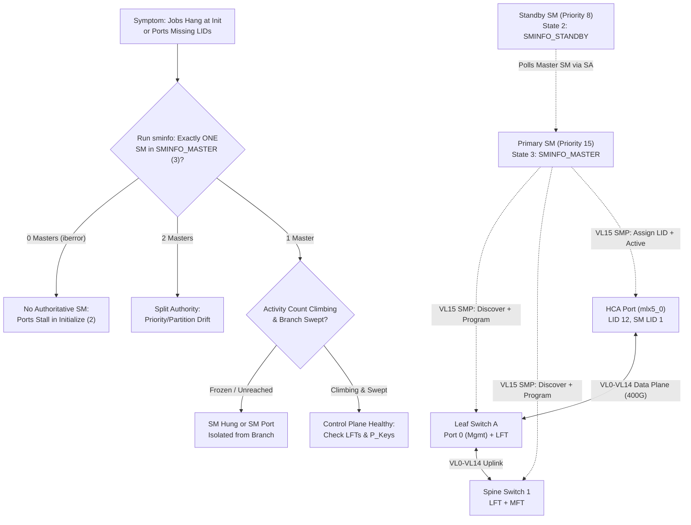
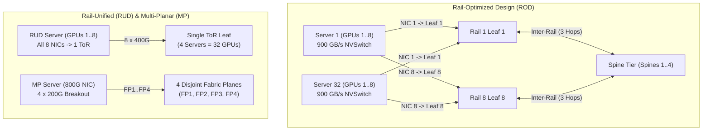

# 12.7 InfiniBand subnet manager, routing, topologies and rails

| | |
|---|---|
| Level | Advanced |
| Priority tier | 1 |
| Lab venue | Nebius GPU |
| Part | Part 12: Complete AI networking |
| Sources | `nvidia-devops` V8 Ch. 5–6, Ch. 12, Index & Labs 01–04; `supercomputers-for-linux-sysadmins-managing-modern-hpc-clusters-and-supercomputers-from-software-to` Ch. 5; `ai-data-center-network-design-and-technologies` Ch. 3 & Ch. 8; `bcm11-admin` §3.6.3 & §7.5 |
| Code | `code/part12/infiniband_sm_routing.py`, `code/part12/infiniband_sm_routing_lab.py` |
| Coverage file | `planning/coverage/chapters/12-07.md` |

## Why this matters for AI infrastructure

An InfiniBand optical cable can be seated cleanly, every switch transceiver LED can glow green, and `ibstat` can report `Physical state: LinkUp` at `400 Gbps` (`4X NDR`), yet distributed PyTorch and NCCL jobs across a `1,024`-GPU cluster cannot exchange a single byte. Even when every port reaches `State: Active`, a `256`-GPU training run can suffer a `2x` slowdown in `AllReduce` step time (`80 ms` instead of `40 ms` for a `2 GB` gradient payload) because static forwarding tables concentrate `20 GB` of traffic onto two leaf uplinks while leaving adjacent equal-speed uplinks carrying only `1 GB`.

Unlike Ethernet switches—which run distributed control-plane protocols such as eBGP, RIFT, or IS-IS on every switch CPU to build local routing tables—InfiniBand switches are pure hardware execution engines for a centralized control plane: the **Subnet Manager (`SM`)**, implemented by **OpenSM** or **NVIDIA Unified Fabric Manager (`UFM`)**. Until an authoritative Master SM traverses the fabric using Directed Route Subnet Management Packets (`SMP`s on Virtual Lane `VL15`, permissive `DLID 0xFFFF`), assigns `16`-bit Local Identifiers (`LID`s `1..0xBFFF`, up to `49,151` unicast endpoints), programs every switch's Linear Forwarding Table (`LFT`) and Multicast Forwarding Table (`MFT`), distributes Partition Keys (`P_Key`s) and Service Levels (`SL`-to-`VL` maps), and transitions each port from `Initialize` (`2`) through `Armed` (`3`) to `Active` (`4`), the physical fabric is logically dark.

Once the subnet is active, delivered collective bandwidth depends on the alignment of three architectural layers:
1. **The Subnet Manager and routing engine (`minhop`, `updn`, `ftree`, `dor`, `dfsssp`):** How the SM elects a single master (`priority` `0..15` with lowest-`GUID` tie-breaking), sweeps topology changes (`Trap 128`), avoids credit loops across virtual lanes, and spreads destination `LID`s (and `2^LMC` multipath LID blocks) across spine uplinks.
2. **Switch topology, radix, and oversubscription:** How three-stage (leaf-spine) and five-stage (leaf-spine-super-spine) folded Clos / Fat-Tree fabrics, Dragonfly groups, and `1D`/`2D`/`3D` Torus rings scale from `256` GPUs (`1` row of `8` leaves and `4` spines at `64 x 400 Gbps`) to `2,048` GPUs (`8` rows) and `32,768` GPUs (`32` blocks of `1,024` GPUs), and how `2:1` to `7:1` oversubscription or a single spine failure reshapes bisection capacity.
3. **Rail-optimized server-to-leaf geometry (`ROD`, `Rail-Only`, `RUD`, and `Multi-Planar`) and IP fabric routing counterparts:** How mapping `8` GPUs (`NIC 1..8`) across `8` independent rail switches (`Rail-Optimized Design`, `ROD`) compares with connecting all `8` GPUs to one Top-of-Rack leaf (`Rail-Unified Design`, `RUD`) or breaking out `800G` NICs into `4 x 200G` planes (`FP1..FP4`), and how AI IP fabrics solve the same path-diversity, multi-tenancy, and traffic-engineering problems using `eBGP` unnumbered (`RFC 5549`), `BGP Deterministic Path Forwarding` (`BGP DPF`), `RIFT` (`RFC 9692`), `IS-IS` `Flex Algo` (`RFC 9350`/`RFC 9502`), and `SRv6` micro-SIDs (`uSID`).

## Prerequisites and outcomes

**Prerequisites:** Chapter 12.2 (RDMA fundamentals, Queue Pairs, and Completion Queues) and Chapter 12.6 (InfiniBand physical/link layers, `GUID`/`LID`/`GID` addressing, `P_Key` partitions, and credit-based `VL` flow control).

**Outcomes:** After completing this chapter, you will be able to:
- Explain the 10-stage Subnet Manager lifecycle, decode `sminfo` outputs (`state 3 SMINFO_MASTER`, `priority 0..15`, climbing vs frozen `activity count`), apply the OpenSM master election and lowest-`GUID` tie-breaker rules, and configure HA OpenSM instances in standalone Linux and NVIDIA Base Command Manager (`BCM` `cmsh`).
- Trace the InfiniBand port state machine (`Down -> Initialize -> Armed -> Active`) alongside Directed Route `SMP` hop-pointer traversal (`DLID 0xFFFF`, `D=0` forward path discovery and `D=1` reverse return path) and `LMC` (`2^LMC`) multipath LID blocks.
- Inspect and verify switch Linear Forwarding Tables (`LFT`s) and Multicast Forwarding Tables (`MFT`s) with `ibroute`, `ibtracert`, `smpquery`, `saquery`, and `perfquery` (`PortXmitData` `4`-octet words), and choose the right OpenSM routing engine (`minhop`, `updn`, `ftree`, `dor`, `dfsssp`, or adaptive `ar_ftree`/`ar_updn`/`ar_dor`).
- Size non-blocking (`1:1`) and oversubscribed (`2:1` to `7:1`) three-stage and five-stage Fat-Tree / Clos fabrics from `256` to `32,768` GPUs using `64 x 400 Gbps` and `256 x 400 Gbps` switches, and compare `ROD`, `Rail-Only`, `RUD`, `ToR`/`MoR`/`EoR` rack layouts, `Multi-Planar` (`4 x 200G`), `Scheduled Fabric` (`VOQ` cells), `Dragonfly`, and `Torus` topologies.
- Compare InfiniBand OpenSM centralized routing with AI data center IP routing options (`eBGP` unnumbered `RFC 5549`, `ASN` loop prevention, `BGP ADD-PATH`, `Link Bandwidth Extended Community`, `BGP DPF`, `RIFT` `RFC 9692`, `IS-IS` `Flex Algo`, `EVPN-VXLAN` `MAC-VRF`/`RT5` + `MIG` `VLAN 1..7` multi-tenancy, and `SRv6` `uSID`), and integrate topology discovery with Slurm via BCM `Topograph`.

---

## 1. Centralized subnet management, port states, and the OpenSM lifecycle

### 1.1 Why InfiniBand requires a Subnet Manager (`SM`)

In an InfiniBand subnet—capable of addressing up to $2^{15} + 2^{14} - 1 = 49,151$ unicast end ports and switches (`LID`s `1` through `0xBFFF`, with `LID 0` reserved, `0xC000..0xFFFE` [`49,152..65,534`] reserved for multicast, and `0xFFFF` [`65,535`] reserved as the permissive `LID`)—switches do not run Spanning Tree, OSPF, or BGP to learn forwarding tables autonomously. Instead, InfiniBand places topology discovery, `LID` assignment, deadlock-free path calculation, switch forwarding-table programming, Partition Key (`P_Key`) distribution, and Service Level to Virtual Lane (`SL2VL`) QoS mapping in a centralized control-plane daemon called the **Subnet Manager (`SM`)**.

Data-plane RDMA packets never pass through the Subnet Manager during normal operation; HCAs and switches forward packets in ASIC hardware at full line rate (`200 Gbps` HDR, `400 Gbps` NDR, `800 Gbps` XDR) using the tables the SM has programmed. However, if the SM is absent, unreachable, or split between two conflicting configurations, affected ports cannot complete initialization or route traffic across the subnet.



| Control-plane entity or check | Identifier / wire mechanism | Healthy production state | Failure symptom when broken |
|---|---|---|---|
| **Master Subnet Manager (`SM1`)** | `sminfo` `state 3` (`SMINFO_MASTER`), `priority 15` | Exactly `1` master instance across the subnet; `activity count` increments on every sweep/query | `0` masters (`sminfo: iberror: failed: query`) leaves new/rebooted ports stuck in `Initialize` (`Base lid: 0`) |
| **Standby Subnet Manager (`SM2`)** | `sminfo` `state 2` (`SMINFO_STANDBY`), `priority 8` | `1` or more standbys in separate power/rack failure domains polling master and ready for takeover | Unmanaged host/switch SM with higher priority hijacks master role or applies drifted `opensm.conf` after failover |
| **Management Virtual Lane (`VL15`)** | Dedicated SMP lane (`IB_SMP_VL = 15`), `DLID 0xFFFF` | Carries Directed Route and LID-routed `SMP`s even before `VL0..VL14` data lanes are `Active` | Bad cable or hung node port slows `VL15` SMP responses, stretching SM sweep duration and delaying convergence |
| **Switch Management Port (`Port 0`)** | Virtual switch port `0` (`SwitchGUID` / switch `LID`) | Every switch is assigned `1` switch-wide `LID` (`LMC = 0`) on virtual `Port 0` for `SMP` management | Unreachable `Port 0` prevents OpenSM from writing `LinearFDBTop` and `LFT` blocks to that switch |
| **HCA End Port (`mlx5_0` Port `1`)** | `PortGUID` (`64`-bit), `Base lid` (`16`-bit), `SM lid` | `Physical state: LinkUp (5)`, `State: Active (4)`, `Base lid >= 1`, `SM lid` matching Master SM | `Physical state: LinkUp` with `State: Initialize (2)` or `Armed (3)` blocks all `VL0..VL14` user Queue Pairs |

### 1.2 The 10-stage Subnet-Management lifecycle and the port state machine

When OpenSM or UFM starts on a management host or switch, it executes a continuous 10-stage control-plane lifecycle:
1. **Bind to a local management port:** Attach to a local HCA port (`-g <port_guid>`), assign the SM's own `LID`, and initialize the Subnet Administration (`SA`) database.
2. **Discover the topology (Heavy Sweep):** Traverse every reachable switch and end port across the fabric using Directed Route `SMP`s (`SubnGet(NodeInfo)`, `SubnGet(NodeDescription)`, `SubnGet(SwitchInfo)`, `SubnGet(PortInfo)`).
3. **Identify nodes, ports, switches, and links:** Build the in-memory fabric graph of `NodeGUID`s, `PortGUID`s, `SystemImageGUID`s (which group multi-ASIC chassis switches under a single composite system identity), negotiated link widths (`4x`, `12x`), and speeds (`FDR 56 Gbps`, `EDR 100 Gbps`, `HDR 200 Gbps`, `NDR 400 Gbps`, `XDR 800 Gbps`).
4. **Assign or confirm `LID`s:** Allocate unique `16`-bit `Base LID`s (`1..49,151`) and `LMC` (`LID Mask Control`) ranges (`2^LMC` consecutive `LID`s per port), preserving existing assignments via the `/var/cache/opensm/guid2lid` persistence file when possible.
5. **Calculate routes:** Invoke the configured routing engine (`ftree`, `updn`, `minhop`, `dor`, `dfsssp`, or adaptive `ar_ftree`) to compute deadlock-free unicast paths and multicast spanning trees.
6. **Program switch forwarding tables:** Push `LinearFDBTable` (`LFT`) and `MulticastFDBTable` (`MFT`) blocks into every switch's `Port 0` via `SubnSet` `SMP`s.
7. **Apply partition (`P_Key`) and QoS (`SL2VL` / `VLArb`) policy:** Program `P_KeyTable` entries (`full` membership bit `15 = 1`, e.g., default `0xFFFF`; `limited` membership bit `15 = 0`, e.g., `0x7FFF`), `SLtoVLMappingTable`, and Virtual Lane Arbitration tables across ports.
8. **Move eligible ports into operational (`Active`) state:** Send `SubnSet(PortInfo)` transitions moving ports from `Initialize` (`2`) to `Armed` (`3`) and finally `Active` (`4`).
9. **Monitor for traps, changes, and periodic sweep conditions:** Listen for asynchronous InfiniBand Traps—such as **`Trap 128` (link state change)** when a switch port drops or comes up—and run periodic light/heavy sweeps (`sweep_interval`, default `10 s`).
10. **Recalculate affected state when topology changes:** Re-run discovery and route programming upon receiving a `Trap 128` or `SIGHUP`, updating `LFT`s and `P_Key` tables so surviving paths absorb traffic.

Crucially, an InfiniBand port's **physical layer** and **logical link layer** advance through separate state machines:

| Layer | State code & name in `ibstat` / `ibstatus` | Allowed traffic | What drives the transition to the next state |
|---|---|---|---|
| **Physical layer** | `2: Polling` -> `Configuration` -> **`5: LinkUp`** (or `3: Disabled`, `Recovery`) | Symbol lock and lane training (`8b/10b`, `64b/66b`, `256b/257b`) | Electrical/optical SERDES handshake between directly connected transceivers |
| **Logical link layer** | **`1: Down`** | None (`Physical state` is not yet `LinkUp`) | Physical layer reaches `5: LinkUp`, automatically advancing logical state to `2: Initialize` |
| **Logical link layer** | **`2: Initialize`** (`Init`) | **`VL15` `SMP`s only** (`Base lid: 0`, `SM lid: 0`); all user RDMA (`VL0..VL14`) blocked | Master SM discovers the port via Directed Route `SMP`, assigns `Base LID`, `SM LID`, and `P_Key`s (`SubnSet(PortInfo)` -> `Armed`) |
| **Logical link layer** | **`3: Armed`** | **`VL15` `SMP`s** + link-local readiness; user RDMA (`VL0..VL14`) still blocked | Master SM finishes programming switch `LFT`s along the path and sends `SubnSet(PortInfo)` setting `PortState = 4 (Active)` |
| **Logical link layer** | **`4: Active`** | **All traffic (`VL0..VL14` user RDMA + `VL15` `SMP`s)** | Port remains `Active` unless physical link drops (`-> Down`) or SM re-initializes the port |

### 1.3 Directed Route `SMP`s (`DLID = 0xFFFF`): how OpenSM discovers an unaddressed fabric

A classic interview and systems-engineering question is: *How does the Subnet Manager discover switches and assign `LID`s during cold boot when no port has a `LID` yet and every switch's forwarding table is empty?*

InfiniBand solves this bootstrap paradox with **Directed Route (`DR`) addressing**, used exclusively by Subnet Management Packets (`SMP`s, management class `0x81`) on `VL15` with permissive destination `LID` **`0xFFFF`** (`65,535`) and permissive source `LID` **`0xFFFF`**. Instead of relying on switch `LFT` lookups by `DLID`, a Directed Route `SMP` embeds an explicit vector of switch egress port numbers (`Initial Path`) alongside four header fields:
- **`Hop Count` (`hop_count`):** Total number of switch hops in the directed path (`0` for the local port, `N` for a target `N` switch hops away).
- **`Hop Pointer` (`hop_pointer`):** `1`-based index pointing to the current element in `Initial Path` (during forward travel) or `Return Path` (during reply travel).
- **`Direction Bit` (`D`):** `0` when the request packet travels forward from the SM toward the target (`source -> destination`); `1` when the response packet travels backward toward the SM (`destination -> source`).
- **`Initial Path` and `Return Path` (`64`-byte port arrays):** `Initial Path[1..N]` lists the sequence of switch egress ports to exit at each hop; `Return Path[1..N]` is populated dynamically by each transit switch with the **ingress port number** on which the request arrived.

When the SM probes a node `3` switch hops away via egress ports `[1, 7, 14]` (where the switches receive the packet on ingress ports `[18, 4, 2]`), the hardware executes the following deterministic state machine:
1. **Forward request (`D = 0`):** The SM transmits the `SMP` with `D = 0`, `hop_count = 3`, `hop_pointer = 1`, `Initial Path = [0, 1, 7, 14]`, and `Return Path = [0, 0, 0, 0]`. At Hop `1`, the first switch sees `D = 0` and `hop_pointer = 1`: it records its receiving port (`18`) into `Return Path[1]`, increments `hop_pointer` to `2`, and forwards the packet out `Initial Path[1] = Port 1`. Hop `2` records `Return Path[2] = 4`, increments `hop_pointer` to `3`, and forwards out `Port 7`. Hop `3` records `Return Path[3] = 2`, increments `hop_pointer` to `4`, and forwards out `Port 14` to the target HCA.
2. **Target processing and turnaround (`D: 0 -> 1`):** The target HCA sees `hop_pointer > hop_count`, processes the `SubnGet`/`SubnSet` attribute, writes the response payload, flips the Direction bit to **`D = 1`**, sets `hop_pointer = hop_count = 3`, and sends the reply back into the link.
3. **Reverse reply (`D = 1`):** Each switch seeing `D = 1` does **not** touch `Initial Path` or overwrite `Return Path`; instead, it forwards the packet out **`Return Path[hop_pointer]`** (`Port 2`, then `Port 4`, then `Port 18`) and decrements `hop_pointer` by `1` at each step (`3 -> 2 -> 1 -> 0`) until the reply arrives back at the SM. InfiniBand also supports *combined* directed routing (`DrSLID` / `DrDLID` != `0xFFFF`), where a packet uses normal `LID` forwarding across an already-configured core up to an unconfigured switch, traverses the new branch via `Initial Path`, and returns.

### 1.4 Master and Standby election (`priority 0..15`), split authority, and HA architecture

A production subnet should always run **at least two Subnet Manager instances** (typically `2` or `3`) for high availability, but **exactly one** instance may act as Master (`state 3: SMINFO_MASTER`) at any moment while the others remain in Standby (`state 2: SMINFO_STANDBY`).

OpenSM resolves mastership through a strict two-part election rule exchanged via `SMP` `SMInfo` queries:
1. **Highest `sm_priority` wins (`0..15`):** Each SM is configured with an integer priority between `0` (lowest) and `15` (highest). An SM with `priority 15` always defeats an SM with `priority 8` or `priority 0`.
2. **Lowest `GUID` breaks ties:** If two or more active SMs are configured with the **exact same `sm_priority`** (for example, both set to `priority 14`), the SM whose bound port has the **numerically lowest `64`-bit `GUID`** (`0x0002c903004a1b20 < 0x08c0eb0300f1a2c3`) wins election and transitions to `SMINFO_MASTER`, while the higher-`GUID` peer transitions to `SMINFO_STANDBY`.

Standby SMs periodically poll the Master SM (`polling_retry_number`, poll interval `sminfo_polling_timeout`). If the Master SM stops responding—or explicitly hands over authority during a clean shutdown—the highest-priority standby takes over, increments the subnet's management state, and runs a sweep to point every port's `SM lid` to the new master's `LID`.

```text
# Querying the authoritative Subnet Manager (untested here)
$ sminfo
sminfo: sm lid 1 sm guid 0x0002c903004a1b20, activity count 184223 priority 15 state 3 SMINFO_MASTER
```

Every field in `sminfo` carries diagnostic meaning:
- **`sm lid 1` and `sm guid 0x0002c903004a1b20`:** Must match the `SM lid: 1` field reported by `ibstat` on every compute node's HCA port and the expected primary SM host in the cluster inventory.
- **`priority 15` and `state 3 SMINFO_MASTER`:** State codes are `0` (`SMINFO_NOTACTIVE`), `1` (`SMINFO_DISCOVERING`), `2` (`SMINFO_STANDBY`), and `3` (`SMINFO_MASTER`).
- **`activity count 184223`:** Increments whenever the SM performs management work. If two consecutive `sminfo` queries separated by a sweep interval return an **unchanged (frozen) `activity count`** on a self-declared master, the SM daemon is wedged (for example, blocked on a deadlocks/hang or I/O stall) while still holding mastership.

Four operational rules govern production SM High Availability:
1. **Separate failure domains and out-of-band reachability:** Place the primary SM (`priority 15`) and standby SM (`priority 8`) on physically independent management servers or UFM appliances with separate power feeds and out-of-band Ethernet SSH/BMC access. Never make the SM host reachable *only* over the InfiniBand `ib0` (`IPoIB`) interface of the fabric it manages, or a fabric failure will lock operators out of the SM host needed to fix it.
2. **Identical, version-controlled configuration (`opensm.conf` & `partitions.conf`):** If the primary SM runs `routing_engine ftree` with tenant `P_Key`s in `/etc/opensm/partitions.conf`, the standby SM must have the exact same checksummed files. Otherwise, a standby takeover will keep `ibping` alive while silently switching routing to `minhop` or dropping tenant partitions.
3. **Prevent rogue compute-node or switch-embedded SMs:** Never leave `opensm.service` enabled on compute node OS images or unmanaged switch OS instances with high priority. A compute node booted with `sm_priority 15` and a lower `GUID` can hijack `SMINFO_MASTER` mid-training run.
4. **Cluster Manager (`BCM`) integration:** On NVIDIA Base Command Manager (`BCM 11`) clusters, administrators configure and monitor OpenSM across redundant head or management nodes via `CMDaemon` (`cmsh -c "device roles <node>; assign subnetmanager; commit"` or `device services <node>; add opensm; set autostart yes; set monitored yes; commit`) or manage fabric-wide telemetry and `SHARP` in-network reductions through **NVIDIA UFM** (`ufmsettings`).

---

## 2. Linear Forwarding Tables (`LFT`s), `LMC` multipathing, and OpenSM routing engines

### 2.1 Destination-based `LID` lookup, `LFT`s, `MFT`s, and `LMC` (`2^LMC`)

Once `LID`s are assigned, every InfiniBand switch forwards unicast packets using a flat hardware lookup table called the **Linear Forwarding Table (`LFT`)**. Unlike an Ethernet IP router that performs Longest Prefix Match (`LPM`) + `5`-tuple ECMP hashing on every packet, a classical deterministic InfiniBand switch extracts the `16`-bit Destination `LID` (`DLID`) from the Local Route Header (`LRH`), indexes directly into `LFT[DLID]`, and transmits the packet out the single `8`-bit egress port number (`1..254`, with `0` for the switch's own management port and `0xFF` / `255` indicating an unrouted `LID`). Multicast packets (`DLID 0xC000..0xFFFE`) index into the **Multicast Forwarding Table (`MFT`)**, which stores a bitmask of egress ports per multicast `LID` so collective broadcasts and `IPoIB` ARP/ND groups replicate across a loop-free spanning tree.

Because a single `LFT[DLID]` entry maps one `DLID` to exactly one egress port, how can a single HCA port spread traffic across multiple parallel spine paths without Adaptive Routing? InfiniBand provides **LID Mask Control (`LMC`)**:
- When the SM assigns a `Base LID` and an `LMC` value ($0 \le \text{LMC} \le 7$) to an HCA port, the lower $\text{LMC}$ bits of `Base LID` are zero-aligned, and the port owns **`2^LMC` consecutive `LID`s**:
  $$\text{LID Range} = \left[\text{Base LID},\; \text{Base LID} + 2^{\text{LMC}} - 1\right]$$
- For `LMC = 0` (the default on switches and many single-path ports), the port has $2^0 = 1$ `LID` (e.g., `Base lid: 913` or `Base lid: 12`). For `LMC = 2`, a port with `Base lid: 16` owns $2^2 = 4$ `LID`s (`16, 17, 18, 19`); for `LMC = 3`, `Base lid: 64` owns $2^3 = 8$ `LID`s (`64..71`).
- The Subnet Manager programs each of those $2^{\text{LMC}}$ `LID`s onto a **different switch uplink port** in the `LFT` (`LFT[16] -> Port 5`, `LFT[17] -> Port 6`, `LFT[18] -> Port 7`, `LFT[19] -> Port 8`), allowing MPI or NCCL to open multiple Queue Pairs bound to different path `LID`s across the same physical HCA port.

### 2.2 Comparing OpenSM routing engines: `minhop`, `updn`, `ftree`, `dor`, and `dfsssp`

Because InfiniBand uses lossless link-level credit flow control (`VL0..VL14`), a cyclic buffer dependency across switches (`Switch A -> Switch B -> Switch C -> Switch A`) can lock up every port in the cycle indefinitely—a **credit loop (routing deadlock)**. OpenSM therefore provides topology-aware routing engines configured via `routing_engine` in `/etc/opensm/opensm.conf` (which accepts a comma-separated fallback chain, such as `routing_engine ftree,updn,minhop`):

| OpenSM routing engine | Target topology | How paths and `LFT`s are computed | Credit-loop (deadlock) avoidance mechanism | Minimum data `VL`s & Adaptive Routing (`AR`) variant |
|---|---|---|---|---|
| **`minhop`** (Minimum Hop) | Single switch or simple small trees without cyclic shortcuts | Computes shortest hop count from every switch to every `LID` and balances destinations per switch | **None** on cyclic topologies; if cable errors or meshes create cycles, shortest paths can form credit loops | `1` VL (`None`) |
| **`updn`** (Up/Down) | Irregular trees, degraded Clos fabrics, or clusters with non-uniform cabling | Identifies root (spine) switches (via `root_guid_file` or auto-detection) and ranks switches by distance from roots | Enforces the **Up/Down turn rule**: a packet may traverse `0` or more `UP` hops followed by `0` or more `DOWN` hops; **`DOWN -> UP` turns are strictly forbidden** | `1` VL (`ar_updn`) |
| **`ftree`** (Fat-Tree) | Symmetric or bounded-asymmetric 2-tier and 3-tier Fat-Tree / Folded Clos AI clusters | Indexes switches by rank tier and deterministically spreads downward destination `LID`s across upward spine links | Structural Up/Down hierarchy (`upward` phase to lowest common ancestor spine, then `downward` phase) guarantees zero credit loops | `1` VL (`ar_ftree`) |
| **`dor`** (Dimension-Ordered Routing) | `1D`, `2D`, or `3D` Torus and Mesh fabrics (`X`, `Y`, `Z` coordinates) | Routes packets completely along Dimension `X` first, then `Y`, then `Z` (`X -> Y -> Z`) | Dimension ordering prevents cross-dimension cycles; **wrap-around torus links** split across `>= 2` Virtual Lanes (`VL0`/`VL1`) at a dateline to break intra-ring loops | `>= 2` VLs for torus (`ar_dor` / `torus-2QoS`) |
| **`dfsssp`** (Deadlock-Free Single-Source Shortest-Path) | Arbitrary / irregular graphs and Dragonfly-style topologies | Computes Dijkstra shortest paths across any topology graph and builds a channel dependency graph (`CDG`) | Breaks cycles in the `CDG` by assigning `SL`-to-`VL` transitions across multiple Virtual Lanes | `>= 2` VLs (`None`) |

Why does `updn` forbid `DOWN -> UP` turns? Suppose `Spine 1` and `Spine 2` sit above `Leaf A` and `Leaf B`. Every cycle in a tree-derived graph must contain at least one `UP -> DOWN` peak (at a spine) and one `DOWN -> UP` valley (beneath a leaf). By allowing `UP -> DOWN` transitions (so any leaf can reach any other leaf through a spine) while prohibiting `DOWN -> UP` transitions (so traffic descending into `Leaf B` can never bounce back up into `Spine 2` to transit to `Leaf C`), `updn` breaks every possible cycle in the channel dependency graph using only a single Virtual Lane (`VL0`). However, if `root_guid_file` is misconfigured so a leaf switch is accidentally marked as a root, `updn` will route transit traffic through that leaf and create severe bottlenecks.

On symmetric AI GPU clusters, **`ftree`** (and its adaptive counterpart **`ar_ftree`**, covered in depth in Chapter 12.8) is preferred over generic `updn` because `ftree` explicitly balances destination `LID`s across all available uplinks so that no two destinations under the same leaf collide on the same spine uplink unnecessarily.

---

## 3. Topologies, oversubscription math, and 3-stage vs 5-stage scale

### 3.1 Leaf oversubscription (`1:1` vs `2:1`) and its exact cost on `AllReduce`

The **oversubscription ratio** of a switch tier compares total southbound capacity facing endpoints (`downlinks`) against total northbound capacity leaving that tier (`uplinks`):

$$\text{Oversubscription Ratio} = \frac{\text{Total Downlink Bandwidth}}{\text{Total Uplink Bandwidth}} = \frac{N_{\text{down}} \times R_{\text{down}}}{N_{\text{up}} \times R_{\text{up}}}$$

Consider the production leaf switch from our Volume 08 fabric analysis with `16` endpoint-facing `400 Gbps` downlinks (`16 x 400 = 6,400 Gbps`) and `8` spine-facing `400 Gbps` uplinks (`8 x 400 = 3,200 Gbps`):
1. **Nominal oversubscription (`2:1`):** $\frac{6,400\text{ Gbps}}{3,200\text{ Gbps}} = 2.0$ (`2:1`). When two nodes under the *same* leaf run a pairwise `ib_write_bw` test (`2,097,152` B = `2 MiB` message size), traffic switches locally inside the leaf ASIC and achieves **`397.62 Gbps`** (near-full `400 Gbps` line rate).
2. **Synchronized cross-rack `AllReduce` (`80 ms` vs `40 ms`):** When all `16` nodes under that leaf simultaneously transmit gradients across the spine to peers in other racks, `6,400 Gbps` of demand competes for `3,200 Gbps` of uplink capacity. Each node's effective cross-leaf bandwidth collapses to $\frac{3,200\text{ Gbps}}{16} = 200\text{ Gbps} = 25\text{ GB/s}$ (confirmed by paired cross-rack `ib_write_bw` dropping to **`201.18 Gbps`**). For a ring `AllReduce` moving **`2 GB`** of gradient data per node per step, communication time doubles from $\frac{2\text{ GB}}{50\text{ GB/s}} = \mathbf{40\text{ ms}}$ on a `1:1` non-blocking leaf (`16` down : `16` up) to $\frac{2\text{ GB}}{25\text{ GB/s}} = \mathbf{80\text{ ms}}$ on the `2:1` leaf.
3. **Single-spine failure blast radius (`2:1 -> 4:1`):** If those `8` uplinks are split `4` and `4` across two spine switches (`Spine 1` and `Spine 2`) and `Spine 1` fails, each leaf drops from `8` active uplinks (`3,200 Gbps`) to `4` active uplinks (`1,600 Gbps`). Reachability survives (`100%` of nodes can still ping each other), but the leaf's oversubscription ratio **doubles from `2:1` to `4:1`**, slashing per-node cross-rack bandwidth to `100 Gbps` (`12.5 GB/s`, `160 ms` per `2 GB` step).

### 3.2 Scaling 3-stage and 5-stage folded Clos / Fat-Tree fabrics (`256` to `32,768` GPUs)

In modern AI clusters built with `8`-GPU servers (such as NVIDIA DGX/HGX H100/H200 or B200 nodes) and `64 x 400 Gbps` switches (`32` server-facing downlinks + `32` spine-facing uplinks at `1:1` non-blocking ratio), fabrics scale in modular units called **rows (stripes)** and **blocks (bricks)**:

- **One Rail Row (`1 x Row` = `32` servers = `256` GPUs):** Each server has `8` GPUs (`GPU 1..8`) and `8` dedicated `400 Gbps` HCAs/NICs (`NIC 1..8`). A single row deploys **`8` leaf switches** (`Leaf 1..8`, each `64 x 400 Gbps`). Each leaf connects `32` downlinks to `32` servers (`1` port per server) and `32` uplinks to **`4` spine switches** (`Spine 1..4`, each `64 x 400 Gbps`, receiving `8` links from each of the `8` leaves = `64` ports). For a `256`-GPU cluster where traffic stays intra-rail (or up to `512` GPUs if all `64` leaf ports face `64` servers in a single-tier rail-only deployment), the `8` leaves can even operate without spines.
- **Maximum 3-stage Clos scale with `64 x 400 Gbps` switches (`8 x Row` = `2,048` GPUs):** Because each `64`-port spine switch must connect to every leaf switch in the fabric, and `8` rows contain $8 \times 8 = 64$ leaf switches, **`2,048` GPUs (`256` servers, `64` leaf switches, `32` spine switches)** is the maximum `1:1` non-blocking scale achievable in a three-stage (2-tier leaf-spine) Clos using fixed `64 x 400 Gbps` switches. Replacing the `64 x 400 Gbps` spines with **`256 x 400 Gbps` chassis spine switches** cuts the required spine count to one-fourth (**`8` chassis spines** instead of `32`).
- **Scaling to `32K–128K` GPUs with a 5-stage Clos (`Blocks` + `Super-Spines`):** Beyond `2,048` GPUs, rows are grouped into **Blocks (Bricks)** interconnected by a third switch tier (**Super-Spines**). A standard `5`-stage block combines **`4` rows (`1,024` GPUs, `128` servers)** using **`32` leaf switches** (`64 x 400 Gbps`) and **`32` spine switches** (`64 x 400 Gbps`, providing `1,024` leaf-facing ports and `1,024` super-spine-facing ports). Thirty-two such `1,024`-GPU blocks form a **`32,768`-GPU (`32K`)** cluster.

| Architecture & scale tier | Rows & blocks | Total servers / GPUs | Server- / spine- / super-spine-facing ports | Leaf switches (`64 x 400G`) | Spine switches | Super-spine switches (`64 x 400G`) | Super-spine oversubscription |
|---|---|---|---|---|---|---|---|
| **3-stage Clos (`1` row)** | `1` row | `32` servers / **`256` GPUs** | `256` / `256` / `0` | `8` | `4` (`64 x 400G`) | `0` | `1:1` (non-blocking) |
| **3-stage Clos (`2` rows)** | `2` rows | `64` servers / **`512` GPUs** | `512` / `512` / `0` | `16` | `8` (`64 x 400G`) | `0` | `1:1` (non-blocking) |
| **3-stage Clos (`8` rows, fixed spines)** | `8` rows | `256` servers / **`2,048` GPUs** | `2,048` / `2,048` / `0` | `64` | `32` (`64 x 400G`) | `0` | `1:1` (max 3-stage `64p`) |
| **3-stage Clos (`8` rows, chassis spines)** | `8` rows | `256` servers / **`2,048` GPUs** | `2,048` / `2,048` / `0` | `64` | **`8` (`256 x 400G`)** | `0` | `1:1` (`1/4` spine switches) |
| **5-stage Block unit (`1` block)** | `4` rows (`1` block) | `128` servers / **`1,024` GPUs** | `1,024` / `1,024` / `1,024` | `32` | `32` (`64 x 400G`) | Modular | `1:1` within block |
| **5-stage Clos (`2` blocks, `1:1`)** | `8` rows (`2` blocks) | `256` servers / **`2,048` GPUs** | `2,048` / `2,048` / `2,048` | `64` | `64` (`64 x 400G`) | `32` | **`1:1`** |
| **5-stage Clos (`4` blocks, `2:1`)** | `16` rows (`4` blocks) | `512` servers / **`4,096` GPUs** | `4,096` / `4,096` / `2,048` | `128` | `128` (`64 x 400G`) | `32` | **`2:1`** |
| **5-stage Clos (`6` blocks, `3:1`)** | `24` rows (`6` blocks) | `768` servers / **`6,144` GPUs** | `6,144` / `6,144` / `2,048` | `192` | `192` (`64 x 400G`) | `32` | **`3:1`** |
| **5-stage Clos (`8` blocks, `4:1`)** | `32` rows (`8` blocks) | `1,024` servers / **`8,192` GPUs** | `8,192` / `8,192` / `2,048` | `256` | `256` (`64 x 400G`) | `32` | **`4:1`** |
| **5-stage Clos (`10`..`14` blocks)** | `40..56` rows (`10..14` blocks) | `1,280..1,792` servers / **`10,240..14,336` GPUs** | `10,240..14,336` / `10,240..14,336` / `2,048` | `320..448` | `320..448` (`64 x 400G`) | `32` | **`5:1` to `7:1`** |
| **5-stage Clos (`16` blocks, chassis SS)** | `64` rows (`16` blocks) | `2,048` servers / **`16,384` GPUs** | `16,384` / `16,384` / `16,384` | `512` (`64/blk`) | `512` (`32/blk`) | Chassis SS | **`1:1`** |

### 3.3 Alternative topologies: Scheduled Fabric (`VOQ` cells), Dragonfly (`DF`/`DF+`), and `1D`/`2D`/`3D` Torus

When 5-stage Clos fabrics grow beyond `16,384` GPUs, the extra spine-to-super-spine optical hop adds latency, power, and transceiver cost. Three alternative fabric architectures address those constraints:
1. **Scheduled Fabric (`Virtual Output Queueing` + Cell Spraying, e.g., Broadcom Jericho3-AI / Ramon3, Cisco Silicon One):** Treats leaf switches as distributed chassis linecards and spine switches as a cell backplane. Arriving packets at the ingress leaf are segmented into fixed-size **`64`-, `128`-, or `256`-byte cells**, sprayed evenly across all spine links, and reassembled into packets at the egress leaf. Each ingress port maintains a separate **Virtual Output Queue (`VOQ`)** per destination egress port managed by a credit grant scheduler, eliminating head-of-line blocking and achieving near-`100%` link utilization without `DCQCN` rate oscillation, at the trade-off of proprietary pod/brick lock-in.
2. **Dragonfly (`DF` / `DF+` / `Dragonfly Sparse`):** Groups switches into modular blocks/pods (using either an internal full-graph mesh or a `2`-tier Clos / `Butterfly+` bipartite group) and interconnects the groups directly with a global full mesh between spine/router nodes. Dragonfly reduces network diameter and cuts long-haul optical links compared to a `5`-stage super-spine Clos, relying on global non-minimal adaptive routing (`UGAL`) or `RIFT` Dragonfly Sparse extensions (`draft-przygienda-rift-dragonfly`) when direct inter-group links congest.
3. **`1D`, `2D`, and `3D` Torus:** Connects switch or server nodes directly to their immediate neighbors with wrap-around edge links: a **`1D` torus** (ring) has **`2` connections** per node, a **`2D` torus** (grid with horizontal/vertical wrap-around) has **`4` connections** per node, and a **`3D` torus** (`X`, `Y`, `Z` cube with wrap-around) has **`6` connections** per node. Torus topologies slash switch and optics cost for nearest-neighbor (`stencil` / `3D` halo or `1D` torus inter-rail leaf rings) traffic, but have larger hop diameter for random all-to-all traffic and require OpenSM's `dor` (`Dimension-Ordered Routing`) with at least `2` Virtual Lanes to prevent deadlock on wrap-around rings.

---

## 4. Rail-optimized (`ROD`), Rail-Only, Rail-Unified (`RUD`), and Multi-Planar designs

### 4.1 `ROD` vs `Rail-Only` vs `RUD`: GPU-to-leaf cabling and failure blast radius

Inside an `8`-GPU training server (such as an NVIDIA DGX H100, which occupies `8U`, `19` in wide by `35.3` in deep, compared to `6U` for a DGX A100, with `4..5` servers per `42U` rack drawing `48 kW` to `60 kW` vs `20..25 kW` in legacy racks), all `8` GPUs communicate intra-node over an internal **`900 GB/s` NVSwitch** domain. Across nodes, each GPU (`GPU 1..8`) is paired `1:1` over a local PCIe switch with its own dedicated `400 Gbps` or `800 Gbps` HCA/NIC (`NIC 1..8`). How those `8` NICs connect to the leaf tier defines three distinct architectures:



| Design pattern | Server-to-leaf connectivity | Intra-rail vs inter-rail switch hops | Single leaf switch failure blast radius | Cabling & operational trade-off |
|---|---|---|---|---|
| **Rail-Optimized Design (`ROD`)** | `NIC k` (`k = 1..8`) connects to `Leaf k` (`8` leaves per server across a `32`-server row) | **Intra-rail (`GPU k <-> GPU k`):** `1` leaf switch hop; **Inter-rail (`GPU j <-> GPU k`):** `3` switch hops (`Leaf j -> Spine -> Leaf k`, `2x` fabric latency) | **`0` servers completely isolated**; all `32` servers lose `1/8` (`12.5%`) of their network rails and continue via `7` healthy rails + internal NVSwitch | Requires cross-rack cabling from every server to `8` leaf switches (`ToR` spans `8` racks, `MoR` `6` racks, `EoR` `10` racks) |
| **Rail-Only Design** | Same `NIC k -> Leaf k` mapping as `ROD`, but **spines only connect same-index rails** across stripes (no inter-rail fabric links) | **Intra-rail:** `1` switch hop (same stripe) or `3` hops (across stripes via rail-dedicated spines); **Inter-rail:** `0` fabric hops (relies on intra-node NVSwitch) | Faults in `Rail k` are `100%` isolated from `Rail j`; `0` cross-rail congestion | Lowest switch count and simpler per-rail OpenSM/BGP domains, but requires every cross-rail transfer to transit the server's internal NVSwitch |
| **Rail-Unified Design (`RUD`)** | All `8` NICs (`NIC 1..8`) of a server connect to **`1` single ToR leaf** (or `4` NICs to `2` leaves); `4` servers (`32` GPUs) share `1` `32`-downlink leaf | **`1` switch hop** for both intra-rail and inter-rail among the `4` servers on the same ToR; **`3` switch hops** via spine to all other servers | **High blast radius:** losing `1` ToR leaf completely isolates **`4` entire servers (`32` GPUs)** from the cluster | Simplest intra-rack cabling (short low-cost copper `DAC` or `AEC` cables within `1` rack); requires `BGP DPF` or `P_Key` coloring to segregate rails on the shared leaf |
| **Multi-Planar Architecture (`FP1..FP4`)** | Each `800 Gbps` NIC breaks out into **`4 x 200 Gbps`** links connecting to `4` independent 2-tier Fabric Planes (`FP1..FP4`) via shuffle cables | `1` or `2` tier hops inside each independent plane (`64 x 800G` leaf provides `128 x 200G` server downlinks + `32 x 800G` / `64 x 400G` spine uplinks) | Losing an entire switch or plane reduces bandwidth by `25%` (`600 Gbps` survives across the other `3` planes) with **zero control-plane coupling** | NIC hardware sprays packets across `FP1..FP4` and reorders/coalesces out-of-order completions in firmware before delivering in-order RDMA to the GPU |

### 4.2 Rack placement trade-offs (`ToR`, `MoR`, `EoR`) for `256`-GPU rail rows

Because a Rail-Optimized (`ROD`) server must fan its `8` NICs out to `8` separate leaf switches across a `32`-server (`256`-GPU, `8`-rack) row, physical switch placement directly governs cable length and per-rack power:
- **Top-of-Rack (`ToR`):** Places `1` leaf switch at the top of each of the `8` server racks (`4` servers + `1` leaf per rack). Uses the least floor space, but adds switch power/cooling load to the already dense `48..60 kW` GPU rack and requires horizontal inter-rack cables spanning up to **`8` racks**.
- **Middle-of-Row (`MoR`):** Places `4` server racks on the left, `2` network switch racks in the center (hosting all `8` leaf switches and spines), and `4` server racks on the right (`10` racks total). Removes switch power/heat from the server racks and caps maximum server-to-leaf cable span at **`6` racks**.
- **End-of-Row (`EoR`):** Places all `8` server racks together followed by `2` dedicated switch racks at the end of the row (`10` racks total). Keeps switch power out of server racks, but increases maximum server-to-leaf cable span to **`10` racks**, requiring optical transceivers (or Linear Pluggable Optics `LPO` / Linear Receive Optics `LRO` that remove `2` or `1` power-hungry DSPs from the optical link).

---

## 5. AI fabric IP routing counterparts, multi-tenancy, and topology-aware scheduling

While InfiniBand centralizes route computation in OpenSM/UFM, Ethernet AI fabrics (covered further in Chapter 12.14) must solve the exact same Clos multipathing, rail segregation, multi-tenancy, and controller-based traffic-engineering challenges using dynamic IP routing protocols:

### 5.1 Dynamic IP routing options (`eBGP` unnumbered, ASN allocation, BGP advanced capabilities, `RIFT`, `IS-IS` `Flex Algo`, and `SRv6`)

| Routing protocol / mechanism | Standard / RFC & scale | Underlay peering, BGP ASN allocation & loop prevention | BGP advanced capabilities, path diversity, UCMP, and AI traffic engineering |
|---|---|---|---|
| **eBGP Underlay + BGP Unnumbered** | `RFC 7938` (DC BGP), `RFC 5549` (Extended Next Hop Encoding, Cap Code `5`, Len `6`, IPv4 AFI `1`, SAFI `1`, IPv6 NH AFI `2`), TCP port `179`, hold time `90 s` | Uses IPv6 link-local addresses (`fe80::/64`) via ICMPv6 RA/ND without point-to-point IPv4 link subnets. All spines share **one ASN** (`65001` from `16`-bit private range `64512..65535` or `32`-bit `4294967100` from `4200000000..4294967294`) while each leaf gets a unique ASN (`65101..65104`), preventing `Leaf1 -> Spine1 -> Leaf2 -> Spine1 -> Leaf3` path hunting on multi-link failures | Supports **`BGP ADD-PATH`** (advertising multiple paths from `65501`/`65502` border leaves), **AS-PATH strip-and-replace** ingress normalization, **Minimum BGP peers per prefix** auto-withdrawal, and **`BGP Link Bandwidth Extended Community`** Weighted ECMP / Weighted Packet Spraying (`WPS`, e.g., `400G/800G/100G/400G` links weighted `20% / 45% / 15% / 20%`) |
| **BGP Deterministic Path Forwarding (`BGP DPF`)** | `draft-wang-idr-dpf` | Colors underlay eBGP sessions and prefixes (`black` active vs `gray` backup fabric IDs) and prunes unmatched colors on advertisement | Maps GPU IDs, RoCEv2 UDP source ports, or BTH Queue Pairs (`QPair`s) to dedicated logical fabrics (e.g., `128 x GPU 0` pinned to `1.2 Tbps` = `3 x 400G` uplinks per leaf) via **Filter-Based Forwarding (`FBF`)**, **on-box agents**, **central `CPCE` controllers**, or **`EVPN-VXLAN` `MAC-VRF`/`RT5` color correlation** |
| **RIFT (`Routing in Fat Trees`)** | `RFC 9692` (`>= 1,000` switch nodes) + `draft-przygienda-rift-dragonfly` | Hybrid IGP using **link-state flooding northbound** and **distance-vector routing southbound** over UDP `hello` + IPv6 ND (`Zero-Touch Provisioning`, minimal leaf FIB) | Automatic disaggregation on link failure, wide ECMP/UCMP, K-store link/queue metadata advertisements, and native **Dragonfly Sparse** horizontal Top-of-Fabric (`ToF`) routing |
| **IS-IS (`Flood Reduction` + `Flex Algo`)** | `RFC 9350`, `RFC 9502`, `draft-ietf-lsr-distoptflood`, `draft-ietf-lsr-flex-algo-bw-con` (up to `2,500` switches) | Elects a single spine neighbor to flood LSP fragments (`Optimal Distributed Flooding`), slashing control-plane replication across `32..64` spines | **`Flex Algo` (`FAD`s `128`, `129`, `130` + `MTID`)** computes constrained SPF planes (e.g., `min-bandwidth` or `max-link-delay`) for storage, inference, and training on a pure IP fabric without MPLS |
| **Segment Routing (`SR-MPLS` & `SRv6` `uSID`)** | `RFC 8754` (`SRH`), `RFC 8986` (`SRv6`), `draft-filsfils-spring-net-pgm-extension-srv6-usid-16`, `draft-filsfils-srv6ops-srv6-ai-backend` | Central controller learns topology via `BGP-LS`/IGP and pushes explicit segment lists (`Node SID`s + `Adjacency SID`s, e.g., `SID 5 -> SID 1`) to ingress leaves via `PCEP` | `SRv6` encodes `[Locator : Function : Argument]` in `128`-bit IPv6 addresses; **Compressed `SRv6 uSID` (`micro-SID`)** shrinks each hop instruction from `128` bits to **`16` bits** to eliminate MTU overhead while steering GPU collectives around congested links |

### 5.2 Network-level multi-tenancy, server-level multi-tenancy (`P_Key`s vs `EVPN-VXLAN` + `MIG` `VLAN 1..7`), and Slurm `Topograph`

Multi-tenant AI clouds (`GPU as a Service`, `GPUaaS`) isolate tenants through both network-level multi-tenancy and server-level multi-tenancy:
- **InfiniBand partition isolation (`P_Key`s):** OpenSM distributes `16`-bit `P_Key` tables (`/etc/opensm/partitions.conf`) to HCA ports and switches. The high-order bit (`bit 15`) controls membership type: **full members** (`bit 15 = 1`, e.g., default partition `0xFFFF` or tenant `0x8001`) can communicate with both full and limited members of the same `15`-bit base partition, whereas **limited members** (`bit 15 = 0`, e.g., `0x7FFF` or `0x0001`) cannot communicate with other limited members.
- **Ethernet network + server multi-tenancy (`EVPN-VXLAN` `MAC-VRF`/`RT5` + `MIG` `VLAN 1..7` + `VXLAN GBP`):** On a `64 x 800 Gbps` rail (`64` server ports via `2 x 400 Gbps` breakouts across `32` ports + `32 x 800 Gbps` spine ports = `512` GPUs per rail), bare-metal tenants (`4` tenants x `128` GPUs) are isolated using **EVPN Route Type 5 (`RT5` IP-VRF)** and **`MAC-VRF` (`RT2`)** VXLAN tunnels. When a single `8`-GPU H100 node is sliced at the server level into **`7` NVIDIA Multi-Instance GPU (`MIG`) instances**, each MIG instance (`GPU Instance 1..7`) maps to **`VLAN 1..7`**, which the ToR leaf maps `1:1` into `7` `MAC-VRF` and `7` `RT5 IP-VRF` instances (and optional `BGP DPF` fabric colors or **VXLAN Group-Based Policy `GBP` tag IDs** for microsegmentation within a shared subnet). Server-to-ToR routing can also extend onto the host using `FRR` (`eBGP` with `32`-bit server ASNs `4200000001..4200000004` advertising anycast `192.168.10.10/32`, or `iBGP` via a virtual Route Reflector appliance).
- **Slurm topology integration via BCM `Topograph`:** Whether the fabric runs InfiniBand OpenSM or Ethernet Clos/cloud APIs, the job scheduler must place communicating ranks inside the same leaf or block before crossing spines. In NVIDIA Base Command Manager (`BCM 11`), the **`topograph`** service (listening on HTTPS TCP port **`49021`**, config `/etc/topograph/topograph-config.yaml`, `Fetch timeout = 20 s`, `Fetch attempts = 12`, `Fetch wait time = 15 s`, `RequestAggregationDelay = 15 s`, `PageSize = 100`, exporting **`26` Prometheus measurables** at `https://localhost:49021/metrics`) discovers switch or cloud instance topology (`AWS p5.48xlarge` `ec2:DescribeInstanceTopology`, `OCI` `compute-hpc-islands`, `GCP` compact placement) and autogenerates `/cm/shared/apps/slurm/etc/<cluster>/topology.conf` for Slurm's **`topology/tree`** (`SwitchName=... Switches=... Nodes=...`) or **`topology/block`** (`BlockName=... Nodes=...`, `Block sizes = 2 4`) plugins, automatically triggering `scontrol reconfigure`.

---

## Commands and configurations that matter

### 1. Inspecting HCA readiness, `LID`s, and OpenSM master state (`ibv_devinfo`, `ibstat`, `ibstatus`, `sminfo`)

```bash
# 1. Enumerate local RDMA HCAs and verify QP/WR limits (untested here)
ibv_devices
ibv_devinfo -v -d mlx5_0 | head -20
```

```text
hca_id: mlx5_0
    transport:                  InfiniBand (0)
    fw_ver:                     28.39.2048
    node_guid:                  08c0:eb03:00f1:a2c3
    vendor_id:                  0x02c9
    vendor_part_id:             4129
    max_mr_size:                0xffffffffffffffff
    max_qp:                     262144
    max_qp_wr:                  32768
    max_sge:                    30
```

```bash
# 2. Verify physical (LinkUp) vs logical (Active) state, Base LID, LMC, and SM LID (untested here)
ibstat
ibstatus
sminfo
```

```text
CA 'mlx5_0'
    CA type: MT4129
    Number of ports: 1
    Port 1:
        State: Active
        Physical state: LinkUp
        Rate: 400
        Base lid: 12
        LMC: 0
        SM lid: 1
        Capability mask: 0x2651e848
        Port GUID: 0x08c0eb0300f1a2c3
        Link layer: InfiniBand

sminfo: sm lid 1 sm guid 0x0002c903004a1b20, activity count 184223 priority 15 state 3 SMINFO_MASTER
```

### 2. Comparing direct node `SMP` queries (`smpquery`) vs Subnet Administration database (`saquery`)

A powerful diagnostic technique is comparing what a node reports directly over `VL15` (`smpquery`) against what the Subnet Manager's cached database believes (`saquery`):

```bash
# Query node description directly from LID 914 via SMP vs from the SM's SA database (untested here)
smpquery nodedesc 914
saquery 914
```

```text
Node Description:....................n51001 HCA-1

NodeRecord dump:
    lid.....................914
    node_type...............Channel Adapter
    num_ports...............2
    sys_guid................0x0012345600003740
    node_guid...............0x0012345600003740
    port_guid...............0x0012345600003740
    partition_cap...........0x80
    device_id...............0x1011
    vendor_id...............0x2C9
    NodeDescription.........n51001 HCA-1
```

If `smpquery` succeeds but `saquery` returns an error or a stale `NodeRecord`, the Subnet Manager's `SA` database is out of sync or wedged.

### 3. Inspecting switch `LFT`s (`ibroute`), path traces (`ibtracert`), and uplink balance (`perfquery`)

```bash
# 1. Dump the Linear Forwarding Table (LFT) of switch LID 4 and trace path from LID 12 to LID 914 (untested here)
ibroute 4
ibtracert 12 914

# 2. Sample PortXmitData (in 4-octet words) across leaf uplinks 5..8 without resetting counters (untested here)
for p in 5 6 7 8; do
  echo -n "port $p: "
  perfquery 4 $p | awk '/PortXmitData/ {print $NF}'
done
```

Never run `perfquery -R` on a shared production switch without change approval because `-R` zeroes the hardware counters for all monitoring collectors.

### 4. Configuring OpenSM (`/etc/opensm/opensm.conf`), BCM `opensm`, and BCM `Topograph`

```ini
# /etc/opensm/opensm.conf — Production Primary SM configuration (untested here)
guid 0x0002c903004a1b20
sm_priority 15
routing_engine ftree,updn,minhop
lmc 0
sweep_interval 10
reassign_lids FALSE
part_config_file /etc/opensm/partitions.conf
root_guid_file /etc/opensm/root_guids.conf
```

```bash
# Configure OpenSM and Slurm Topograph in NVIDIA Base Command Manager (BCM 11 cmsh) (untested here)
cmsh -c "device roles node001; assign subnetmanager; commit"
cmsh -c "device services node001; add opensm; set autostart yes; set monitored yes; commit"
cmsh -c "wlm use slurm; topologysettings; set topologyplugin tree; set topologysource topograph; commit"
cmsh -c "wlm use slurm; topology update; topology print"
```

---

## How it fails

| Failure mode | Symptoms on hosts and jobs | Exact diagnostic evidence (`sminfo`, `ibstat`, `perfquery`, logs) | Root cause & production fix |
|---|---|---|---|
| **1. Missing or unreachable Master SM (`Ports Stuck in Initialize`)** | Physical links are up (`LED` green), but distributed jobs fail immediately; `ibv_rc_pingpong` and `IPoIB` cannot transmit | `ibstat` shows `Physical state: LinkUp (5)`, `State: Initializing (2)`, `Base lid: 0`, `SM lid: 0`; `sminfo` fails with `sminfo: iberror: failed: query` | No active SM on the subnet, SM bound to the wrong HCA port GUID, or SM management link disconnected. Start/restore the primary OpenSM/UFM instance and verify `sminfo` reports `state 3 SMINFO_MASTER` |
| **2. Standby SM failover configuration drift (`Silent Route Degradation`)** | `ibping` reachability survives after an SM host reboot, but collective bandwidth drops or tenant jobs fail authorization | `sminfo` shows the standby SM (`priority 8`) is now `SMINFO_MASTER`, but `diff /etc/opensm/opensm.conf` between primary and standby shows `routing_engine minhop` instead of `ftree` or a stale `partitions.conf` | Standby SM configuration was not version-controlled alongside the primary. Synchronize `/etc/opensm/opensm.conf` and `partitions.conf` from Git, run a controlled sweep (`kill -HUP $(pidof opensm)`), and verify `ibroute` |
| **3. `Trap 128` heavy-sweep storm (`Flapping Link Churn`)** | Training jobs experience periodic `100–500 ms` latency spikes, route changes, and high OpenSM CPU usage | `/var/log/opensm.log` repeats `Received a heavy sweep flag` paired with `Trap 128 (link state change) received: LID 44 port 3` every few seconds (`mlxlink -d mlx5_1 -c` shows rising `Link Down Counter`) | A marginal optical transceiver or unseated cable on `LID 44 port 3` flaps repeatedly, forcing full-fabric heavy sweeps. Disable/quarantine `LID 44 port 3` (`ibportstate 44 3 disable`), replace the cable, and confirm sweep rate stabilizes |
| **4. Static `LFT` / `LID` uplink concentration (`20:1 Hot Uplink Imbalance`)** | Point-to-point `ib_write_bw` between two nodes passes at `397.62 Gbps`, but `256`-GPU `AllReduce` runs at a fraction of expected busbw | Sampling `perfquery <leaf-lid> <port>` across uplinks `5..8` shows ports `5` and `6` transmitting **`21,474,836,480` B** and **`21,489,234,432` B** (`~20 GB`) while ports `7` and `8` transmit only **`1,073,741,824` B** and **`1,081,654,272` B** (`~1 GB`) — a **`20:1` imbalance** | Static destination `LID` assignment or naive routing engine pins communicating rank pairs onto two of four uplinks. Switch to `ftree` / `ar_ftree` (or enable `LMC > 0` / rail-aligned rank placement) and re-verify `PortXmitData` balance |
| **5. Inter-rack `2:1` oversubscription or spine loss (`2:1 -> 4:1` collapse)** | Same-rack `8`-node jobs achieve full speed, but `2`-rack `16`-node jobs run `2x` slower (`4x` slower after a spine maintenance event) | Paired `ib_write_bw` (`2,097,152` B) drops from **`397.62 Gbps`** (same leaf) to **`201.18 Gbps`** (cross-rack); leaf has `16 x 400G` downlinks (`6,400 Gbps`) and `8 x 400G` uplinks (`3,200 Gbps`, dropping to `4` uplinks = `1,600 Gbps` when `1` of `2` spines is down) | Structural `2:1` leaf oversubscription (compounded to `4:1` by losing `1` of `2` spines). Restore the failed spine, configure Slurm `topology/tree` or `topology/block` via `Topograph` to pack jobs within leaves/blocks, or add spine uplinks |
| **6. Multi-rail collapse or remote NUMA binding (`One Rail Hot, Others Idle`)** | `8`-GPU nodes have `8` `Active` `400G` HCAs, yet multi-node collectives bottleneck at single-HCA throughput | Per-HCA `perfquery` shows `mlx5_0` saturated while `mlx5_1..mlx5_7` sit near zero, or `numactl --hardware` + `lspci` shows the process bound to NUMA node `1` while driving `mlx5_0` on NUMA node `0` | Process or NCCL environment variables (`NCCL_IB_HCA`) restricted traffic to one HCA or crossed the CPU socket interconnect. Restore full multi-rail `NCCL_IB_HCA` visibility and pin each rank to its local GPU/HCA NUMA node |

---

## Hands-on lab

This chapter's companion Python simulator (`code/part12/infiniband_sm_routing.py` and `code/part12/infiniband_sm_routing_lab.py`) runs anywhere with Python 3 standard library (`Nebius GPU` VM or local laptop; live `sminfo`/`ibroute`/`ibtracert` commands require InfiniBand hardware and are marked `(untested here)` above).

Run the 27-check self-verifying lab:

```bash
python3 -B code/part12/infiniband_sm_routing_lab.py
```

```text
=== Chapter 12.7 Lab: InfiniBand Subnet Manager, Routing, Topologies and Rails ===
  [PASS] SCL Ch 5 LID address space: 0 reserved, 1..0xBFFF (2^15 + 2^14 - 1 = 49,151) unicast, 0xC000..0xFFFE (49,152..65,534) multicast, 0xFFFF (65,535) permissive
  [PASS] SCL Ch 5 & V8 Ch 5 GID & SMP constants: default GID prefix 0xfe80::/64, site-local 0xfec0::/64, VL15 for SMPs, Trap 128 link state change
  [PASS] V8 Ch 5 & SCL Ch 5 OpenSM priority (0..15) and sminfo states (0=NOTACTIVE, 1=DISCOVERING, 2=STANDBY, 3=MASTER)
  [PASS] V8 Ch 5 OpenSM election by priority: priority 15 (0x0002c903004a1b20, lid 1, activity 184223) wins MASTER over priority 8 and 0 despite higher GUID
  [PASS] OpenSM equal-priority tie-breaker: when both SMs have priority 14, lowest GUID (0x0002c903004a1b20 < 0x08c0eb0300f1a2c3) wins SMINFO_MASTER
  [PASS] V8 Ch 5 Fig 8.5.1 SM authority audit: distinguishes 0 masters, 2 masters (split authority), frozen activity count, and healthy climbing master
  [PASS] Port state machine (Down -> Initialize): Physical Polling -> Logical Down (1); Physical LinkUp (5) without SM -> Logical Initialize (2, Base LID=0, SM LID=0, VL15 SMP only)
  [PASS] Port state machine (Armed -> Active): Armed (3) has LID=12 & SM LID=1 but user RDMA blocked; Active (4) requires SM LFT programming + PortInfo activation
  [PASS] SCL Ch 5 Directed Route SMP (DLID 0xFFFF): 3-hop path [0, 1, 7, 14] increments hop_pointer 1->2->3 (D=0), records return_path [0, 18, 4, 2], and decrements 3->2->1 (D=1)
  [PASS] SCL Ch 5 LMC multipath LID math: LMC=0 -> 1 LID (913), LMC=2 -> 2^2=4 LIDs (16..19), LMC=3 -> 2^3=8 LIDs (64..71)
  [PASS] LFT programming (`ftree_round_robin`): 84 remote LIDs spread evenly across uplinks 5..8 (21 LIDs/uplink, 1.0:1 ratio)
  [PASS] LFT programming (`static_naive` vs `ftree`): naive static LFT concentrates 40 LIDs on ports 5-6 vs 2 LIDs on ports 7-8 (20.0:1 ratio)
  [PASS] V8 Ch 6 Scenario 1 `perfquery` PortXmitData audit: ports 5-6 (~21.47 GB / 5,368,709,120 words) vs ports 7-8 (~1.07 GB / 268,435,456 words) = 20.01:1 imbalance
  [PASS] OpenSM routing engines (`minhop`, `updn`, `ftree`, `dor`, `dfsssp`): `ftree` -> `ar_ftree`, `updn` -> `ar_updn`, `dor` -> `ar_dor` (requires >=2 VLs), `dfsssp` (requires >=2 VLs)
  [PASS] Up/Down (`updn`) credit-loop turn validator: UP->UP->DOWN->DOWN is valid, whereas UP->DOWN->UP violates the Down->Up turn prohibition
  [PASS] V8 Ch 6 Non-blocking (1:1) vs 2:1 oversubscribed leaf: 16x400G=6,400 Gbps down vs 8x400G=3,200 Gbps up -> 2:1 oversubscription, 200 Gbps (25 GB/s) per node
  [PASS] V8 Ch 6 AllReduce step time & spine failure blast radius: 2 GB gradient takes 40.0 ms at 1:1 (50 GB/s) vs 80.0 ms at 2:1 (25 GB/s); losing 1 of 2 spines doubles oversubscription from 2:1 to 4:1
  [PASS] V8 Ch 6 Scenario 3 paired `ib_write_bw` (2,097,152 B): same-leaf 397.62 Gbps vs cross-rack 201.18 Gbps (1.98x ratio matching 2:1 leaf design)
  [PASS] ADC Ch 3 Fig 3-9 3-stage Clos scale (64x400G switches): 1 row = 256 GPUs (32 servers, 8 leaves, 4 spines); 2 rows = 512 GPUs (64 servers, 16 leaves, 8 spines)
  [PASS] ADC Ch 3 Fig 3-9 & 3-10 3-stage max scale (8 rows = 2,048 GPUs, 64 leaves): requires 32 fixed 64x400G spines or 8 chassis 256x400G spines (1/4 spine count)
  [PASS] ADC Ch 3 Fig 3-11 5-stage Clos block (brick): 1 block = 4 rows = 1,024 GPUs (128 servers), 32 leaves (64x400G), 32 spines (64x400G)
  [PASS] ADC Ch 3 Fig 3-12 5-stage Clos super-spine oversubscription (32 super-spines = 2,048 ports): 2 blocks (2,048 GPUs)=1:1, 4 blocks (4,096)=2:1, 8 blocks (8,192)=4:1, 14 blocks (14,336)=7:1, 32 blocks=32,768 GPUs
  [PASS] ADC Ch 3 & Ch 8 ROD vs RUD blast radius: ROD connects 8 NICs to 8 leaves (0 servers isolated on 1 leaf failure, 32 degraded by 1/8); RUD connects 8 NICs to 1 leaf (4 servers / 32 GPUs completely isolated on 1 leaf failure)
  [PASS] ADC Ch 3 Fig 3-36 Multi-Planar & Rack Layout: 800G NIC breaks out into 4x200G across FP1..FP4 (64x800G leaf -> 128x200G downlinks + 32x800G / 64x400G uplinks); rack span ToR=8, MoR=6, EoR=10 racks
  [PASS] ADC Ch 8 eBGP unnumbered (RFC 5549, TCP 179, Hold 90s): Extended Next Hop cap code 5, len 6 (AFI 1 IPv4, SAFI 1, NH AFI 2 IPv6); 16-bit private ASN 64512..65535 (Spine 65001, Leaves 65101..65104); 32-bit ASN 4200000000..4294967294
  [PASS] ADC Ch 8 RIFT (RFC 9692 >=1,000 switches), IS-IS Flex Algo (RFC 9350/9502 algos 128, 129, 130, 2,500 switches), and SRv6 (128-bit SID vs 16-bit uSID)
  [PASS] BCM 11 (§3.6.3 OpenSM / §7.5 Topograph port 49021, timeout 20s, attempts 12, wait 15s, 26 measurables) & V8 Lab 01 (MT4129 vendor 0x02c9, max_qp 262,144, max_qp_wr 32,768, max_sge 30)

Summary: 27 passed, 0 failed
```

---

## Common first mistakes

1. **Replacing cables when `ibstat` shows `Physical state: LinkUp` and `State: Initializing`:** `LinkUp` proves the transceiver, fiber, and SERDES lanes have already negotiated cleanly. A port stuck in `Initializing` with `Base lid: 0` is a Subnet Manager control-plane problem (`0` active masters, wrong SM port binding, or an isolated fabric branch), not a bad cable.
2. **Keying cluster inventory on `LID`s instead of `GUID`s:** `LID`s (`1..49,151`) are mutable forwarding addresses that can change after an SM resweep or failover (`reassign_lids`). Always anchor inventory databases on `64`-bit `NodeGUID` and `PortGUID`, treating `Base lid` as runtime observed state.
3. **Running `perfquery -R` during live incident triage:** Passing `-R` resets cumulative hardware counters on the queried switch port, destroying historical evidence for other engineers and Prometheus/UFM collectors. Instead, sample `perfquery <lid> <port>` at $t_0$ and $t_1$, subtract the deltas, and multiply `PortXmitData` / `PortRcvData` by **`4` bytes**.
4. **Assuming `2` running `opensm` processes guarantee safe High Availability:** If the standby SM has a drifted `/etc/opensm/opensm.conf` (for example, `minhop` instead of `ftree`) or an outdated `partitions.conf`, failover will keep the subnet up while silently degrading collective routing or breaking tenant isolation.
5. **Deploying distinct eBGP ASNs on every spine switch in an AI Ethernet Clos:** Assigning `65001..65004` to `Spine 1..4` allows BGP to route around multi-link failures via a `Leaf 1 -> Spine 1 -> Leaf 2 -> Spine 2 -> Leaf 3` valley (`DOWN -> UP` turn), saturating `Leaf 2`'s server-facing pod. Assigning the **same ASN (`65001`) to all spines** enforces BGP `AS-PATH` loop prevention so traffic never bounces through a transit leaf.

---

## Exercises

1. **OpenSM Master Election and Tie-Breaker Verification:** Three Subnet Manager instances start on the same subnet: `sm-a` (`GUID 0x08c0eb0300f1a2c3`, `priority 14`), `sm-b` (`GUID 0x0002c903004a1b20`, `priority 14`), and `sm-c` (`GUID 0x00123456000073f0`, `priority 8`). (a) Which instance wins `SMINFO_MASTER` (`state 3`), which become `SMINFO_STANDBY` (`state 2`), and why? (b) If `sm-c`'s priority is raised to `15`, how does the election outcome change? Verify with `elect_master_sm` in `code/part12/infiniband_sm_routing.py`.
2. **Port State Machine and Directed Route `SMP` Traversal:** (a) Trace the four logical port states (`1..4`) and explain why a port in `Initialize` (`2`) can answer `smpquery` on `VL15` (`DLID 0xFFFF`) while blocking `ib_write_bw` on `VL0`. (b) For a Directed Route `SMP` traversing switch egress ports `[1, 7, 14]` and arriving on switch ingress ports `[18, 4, 2]`, write the exact `Initial Path`, `Return Path`, `hop_pointer` sequence for `D = 0`, and `hop_pointer` sequence for `D = 1`.
3. **`LID` Address Space, `LMC` Multipathing, and `LFT` Balance:** (a) Derive the maximum number of unicast `LID`s (`2^15 + 2^14 - 1 = 49,151`, `0x0001..0xBFFF`) and compute the consecutive `LID` ranges for `Base LID = 16, LMC = 2` and `Base LID = 64, LMC = 3`. (b) Given `perfquery` `PortXmitData` deltas on leaf uplinks `5..8` of `5,368,709,120`, `5,372,308,608`, `268,435,456`, and `270,413,568` words, convert each to bytes (`x 4`), calculate the max-to-min imbalance ratio (`20.01:1`), and identify the hot vs idle uplinks.
4. **Leaf Oversubscription, `AllReduce` Step Time, and Spine Failure Math:** A leaf switch has `16 x 400 Gbps` server downlinks and `8 x 400 Gbps` uplinks split evenly (`4` and `4`) across `2` spine switches. (a) Calculate the oversubscription ratio, per-node cross-leaf bandwidth (`Gbps` and `GB/s`), and communication time for a `2 GB` per-node `AllReduce` step, comparing it against a `1:1` non-blocking leaf (`16` uplinks). (b) If `1` of the `2` spine switches fails, what is the new oversubscription ratio and new `2 GB` `AllReduce` step time?
5. **3-Stage and 5-Stage Rail-Optimized Clos Sizing (`256` to `14,336` GPUs):** Using `64 x 400 Gbps` switches (`32` downlinks + `32` uplinks) and `8`-GPU servers: (a) Calculate the number of servers, leaf switches, and spine switches for `1` row (`256` GPUs), `2` rows (`512` GPUs), and `8` rows (`2,048` GPUs) with fixed `64`-port spines vs `256`-port chassis spines. (b) In a `5`-stage Clos built from `1,024`-GPU blocks (`32` leaves + `32` spines per block) and `32` fixed `64 x 400 Gbps` super-spine switches (`2,048` ports), compute the super-spine oversubscription ratio for `2`, `4`, `8`, and `14` blocks (`2,048` to `14,336` GPUs).
6. **`ROD` vs `RUD` Blast Radius and AI IP Fabric Routing:** (a) Compare the single-leaf-failure blast radius of Rail-Optimized Design (`ROD`, `8` leaves per `32`-server row) vs Rail-Unified Design (`RUD`, all `8` NICs of `4` servers on `1` leaf), and explain how Multi-Planar (`800G -> 4 x 200G` across `FP1..FP4`) changes fault isolation. (b) Compare how `eBGP` unnumbered (`RFC 5549` Cap `5` Len `6`, Spine ASN `65001`), `BGP DPF`, `RIFT` (`RFC 9692`), `IS-IS` `Flex Algo` (`128..130`), and `SRv6` `uSID` (`16`-bit vs `128`-bit) provide loop-free multipathing and tenant isolation alongside `EVPN-VXLAN` `MAC-VRF`/`RT5` + `MIG` `VLAN 1..7`.

---

## Interview angles

1. **"All switch and HCA ports show `Physical state: LinkUp`, but half the cluster has `Base lid: 0` and `State: Initializing`. Where do you look first?"**
   - *Strong answer:* Do not touch cables or transceivers—`LinkUp` already proves Layer 1 lane training succeeded. Go straight to the Subnet Manager control plane and run `sminfo` (and `ibstat` to inspect `SM lid`). Either `0` SMs are responding (`sminfo: iberror: failed: query`), the active Master SM's `activity count` is frozen, or the physical link connecting the SM host/branch to the rest of the topology is down so Directed Route `SMP` sweeps on `VL15` (`DLID 0xFFFF`) cannot reach those ports to assign `LID`s and transition them through `Armed` (`3`) to `Active` (`4`).
2. **"Why does OpenSM's `updn` routing engine forbid `DOWN -> UP` turns, and when should you use `ftree` or `dor` instead?"**
   - *Strong answer:* Because InfiniBand uses lossless link-level credit flow control, any cycle in the channel dependency graph can create a permanent credit deadlock across switches. In a tree topology rooted at spine switches, allowing `UP -> DOWN` transitions provides full connectivity while forbidding `DOWN -> UP` transitions breaks every cycle without requiring extra Virtual Lanes (and prevents transit traffic from bouncing through a leaf switch). On symmetric folded Clos AI fabrics, `ftree` (or `ar_ftree`) outperforms generic `updn` because it deterministically spreads destination `LID`s evenly across all spine uplinks. On `1D`/`2D`/`3D` Torus topologies, neither `minhop` nor `updn` suffices; you must use `dor` (`Dimension-Ordered Routing` `X -> Y -> Z`) with at least `2` Virtual Lanes split across a wrap-around dateline.
3. **"Compare Rail-Optimized Design (`ROD`) and Rail-Unified Design (`RUD`) for a `256`-GPU (`32`-server) cluster."**
   - *Strong answer:* In `ROD`, `NIC k` (`k = 1..8`) on all `32` servers connects to `Leaf k` (`8` leaves total). Same-index GPUs across all `32` servers (`GPU k <-> GPU k`) communicate in `1` leaf hop (`intra-rail`), and losing `1` leaf switch degrades each server's bandwidth by only `1/8` (`12.5%`) while `0` servers are completely isolated (`7` rails + intra-node `900 GB/s` NVSwitch survive). In `RUD`, all `8` NICs of `4` servers connect to a single ToR leaf using short intra-rack `DAC`/`AEC` cables; cabling is simpler, but losing `1` leaf switch completely isolates `4` entire servers (`32` GPUs), and shared leaves require `BGP DPF` or `P_Key` coloring to prevent rail contention.

---

## Checkpoint questions (20)

<details>
<summary><strong>1. Why can an InfiniBand port report <code>Physical state: LinkUp</code> while remaining logically <code>Initializing</code> and unable to pass RDMA traffic?</strong></summary>

`Physical state: LinkUp` (`5`) only proves that the two directly connected transceivers completed electrical/optical lane negotiation and symbol lock. In the logical link state `Initialize` (`2`), only Subnet Management Packets (`SMP`s) on Virtual Lane `VL15` are permitted; user RDMA Queue Pairs on `VL0..VL14` are blocked until an authoritative Master Subnet Manager discovers the port, assigns a `Base LID` and `P_Key` table (`-> Armed`, state `3`), programs switch `LFT`s, and issues `SubnSet(PortInfo)` to transition the port to `Active` (`4`).
</details>

<details>
<summary><strong>2. What is the maximum number of unicast devices/ports in a single InfiniBand subnet, and how is the 16-bit <code>LID</code> range partitioned?</strong></summary>

A `16`-bit `LID` (`0..65,535`) partitions into: `LID 0` (reserved), **`1..0xBFFF` (`1..49,151`, or $2^{15} + 2^{14} - 1 = 49,151$)** for unicast end ports and switches, **`0xC000..0xFFFE` (`49,152..65,534`)** for multicast groups, and **`0xFFFF` (`65,535`)** as the permissive `LID` used by Directed Route `SMP`s.
</details>

<details>
<summary><strong>3. How does OpenSM elect a single Master Subnet Manager when multiple SMs run on the same subnet?</strong></summary>

Each SM advertises a `priority` from `0` (lowest) to `15` (highest) in its `SMInfo` structure. The SM with the **highest priority** wins election (`state 3: SMINFO_MASTER`). If two or more SMs share the exact same highest priority, the SM with the **numerically lowest `64`-bit Port/SM `GUID`** wins the tie-breaker, and all other instances enter `state 2: SMINFO_STANDBY`.
</details>

<details>
<summary><strong>4. How do you interpret <code>sminfo: sm lid 1 sm guid 0x0002c903004a1b20, activity count 184223 priority 15 state 3 SMINFO_MASTER</code>, and what does a frozen <code>activity count</code> indicate?</strong></summary>

`sm lid 1` and `sm guid 0x0002c903004a1b20` identify the port hosting the Master SM (`state 3 = SMINFO_MASTER`) running at maximum election priority (`15`). The `activity count` (`184,223`) increments on every sweep and management action; if repeated `sminfo` queries show `state 3` with a **frozen `activity count`**, the SM process is hung/wedged while still holding mastership and failing to process topology events.
</details>

<details>
<summary><strong>5. How does a Directed Route <code>SMP</code> (<code>DLID = 0xFFFF</code>) traverse switches before any <code>LID</code>s or <code>LFT</code>s exist?</strong></summary>

A Directed Route `SMP` travels on `VL15` carrying `hop_count`, `hop_pointer`, a Direction bit (`D`), an `Initial Path` array of egress ports, and a `Return Path` array. On the forward request (`D = 0`), each switch forwards out `Initial Path[hop_pointer]`, records its receiving ingress port into `Return Path[hop_pointer]`, and increments `hop_pointer`. The target flips `D = 1`, and on the reverse reply each switch forwards out `Return Path[hop_pointer]` while decrementing `hop_pointer` back to `0`.
</details>

<details>
<summary><strong>6. What is the difference between <code>smpquery</code> and <code>saquery</code> when diagnosing a suspect InfiniBand node?</strong></summary>

`smpquery` (for example, `smpquery nodedesc 914`) sends a Subnet Management Packet directly to the target node (`LID 914`) and returns the node's live hardware response. `saquery` (`saquery 914`) queries the Subnet Manager's cached Subnet Administration (`SA`) database. If `smpquery` succeeds while `saquery` fails or disagrees, the SM's database is stale or out of sync.
</details>

<details>
<summary><strong>7. How does <code>LMC</code> (<code>LID Mask Control</code>) enable multipath forwarding across a deterministic Linear Forwarding Table (<code>LFT</code>)?</strong></summary>

When an HCA port is assigned `Base LID` and `LMC` ($0 \le \text{LMC} \le 7$), it owns $2^{\text{LMC}}$ consecutive `LID`s from $\text{Base LID}$ to $\text{Base LID} + 2^{\text{LMC}} - 1$ (e.g., `LMC = 2` assigns `4` `LID`s; `LMC = 3` assigns `8` `LID`s). Because a switch `LFT` maps each individual `DLID` to one egress port (`LFT[DLID] = port`), OpenSM can map each of the port's $2^{\text{LMC}}$ `LID`s to a different spine uplink so multiple QPs spread traffic across parallel paths.
</details>

<details>
<summary><strong>8. What causes OpenSM to log repeated <code>Trap 128</code> events and heavy sweeps, and how should operators respond?</strong></summary>

`Trap 128` signals a physical link-state change on a switch port (for example, `Trap 128 (link state change) received: LID 44 port 3`). When a marginal cable or optic flaps repeatedly, each `Trap 128` triggers a full-fabric heavy sweep (`Received a heavy sweep flag`), causing route churn and collective stalls. Operators should rank `Trap 128` counts by `LID`/port in `/var/log/opensm.log` and quarantine/replace the flapping link rather than increasing `sweep_interval` to hide the fault.
</details>

<details>
<summary><strong>9. Compare OpenSM's <code>minhop</code>, <code>updn</code>, <code>ftree</code>, <code>dor</code>, and <code>dfsssp</code> routing engines.</strong></summary>

`minhop` computes shortest paths without cycle protection. `updn` prevents credit loops on trees by forbidding `DOWN -> UP` turns below root spines. `ftree` optimizes Up/Down routing for Fat-Tree/Clos fabrics by deterministically spreading destination `LID`s across all spine uplinks. `dor` routes `1D`/`2D`/`3D` Torus/Mesh fabrics along `X -> Y -> Z` dimensions using `>= 2` Virtual Lanes across wrap-around links. `dfsssp` computes deadlock-free shortest paths on arbitrary/Dragonfly graphs using `>= 2` Virtual Lanes.
</details>

<details>
<summary><strong>10. Why must you multiply <code>perfquery</code> <code>PortXmitData</code> and <code>PortRcvData</code> deltas by <code>4</code>, and how do they reveal route imbalance?</strong></summary>

InfiniBand `PortXmitData` and `PortRcvData` counters increment in **`4`-octet (`32`-bit) words**, so multiplying the word delta by `4` yields bytes. In Volume 08 Scenario 1, sampling uplinks `5..8` showed ports `5` and `6` moving `~21.47 GB` (`5,368,709,120` words) while ports `7` and `8` moved `~1.07 GB` (`268,435,456` words)—a **`20:1` imbalance** proving static `LFT` or rank-placement concentration.
</details>

<details>
<summary><strong>11. How does a <code>2:1</code> oversubscribed leaf switch (`16 x 400G` downlinks, `8 x 400G` uplinks) affect a synchronized <code>2 GB</code> <code>AllReduce</code> step and a single-spine failure?</strong></summary>

With `6,400 Gbps` of downlinks and `3,200 Gbps` of uplinks (`2:1`), `16` concurrently transmitting nodes receive `3,200 / 16 = 200 Gbps` (`25 GB/s`) each instead of `400 Gbps` (`50 GB/s`), increasing a `2 GB` `AllReduce` transfer from **`40 ms` to `80 ms`**. If the `8` uplinks are split across `2` spines and `1` spine fails, surviving uplink capacity drops to `1,600 Gbps` (`4` uplinks), doubling oversubscription from **`2:1` to `4:1`** (`100 Gbps` = `12.5 GB/s` per node, `160 ms` per step).
</details>

<details>
<summary><strong>12. How many GPUs, leaf switches, and spine switches fit in a `1:1` non-blocking 3-stage Clos built from `64 x 400 Gbps` switches (`1`, `2`, and `8` rows)?</strong></summary>

Each rail row serves **`32` servers (`256` GPUs)** using **`8` leaf switches** (`32` downlinks + `32` uplinks) and **`4` spine switches** (`64 x 400G`). Two rows serve **`512` GPUs** (`64` servers, `16` leaves, `8` spines). The maximum `3`-stage scale with `64`-port switches is **`8` rows = `2,048` GPUs** (`256` servers, `64` leaves, and **`32` fixed `64 x 400G` spines**—or **`8` chassis `256 x 400G` spines**).
</details>

<details>
<summary><strong>13. How is a 5-stage Clos block (`brick`) structured for `1,024` to `32,768` GPUs, and how does super-spine oversubscription scale from `1:1` to `7:1`?</strong></summary>

One `5`-stage block combines **`4` rows = `1,024` GPUs (`128` servers)** with **`32` leaf switches** and **`32` spine switches** (`64 x 400G`, providing `1,024` super-spine-facing ports per block). With a fixed layer of **`32` `64 x 400G` super-spine switches** (`2,048` ports), `2` blocks (`2,048` GPUs) run at **`1:1`**, `4` blocks (`4,096` GPUs) at **`2:1`**, `6` blocks (`6,144` GPUs) at **`3:1`**, `8` blocks (`8,192` GPUs) at **`4:1`**, and `14` blocks (`14,336` GPUs, `448` leaves, `448` spines) at **`7:1`**, while `32` blocks scale to **`32,768` GPUs**.
</details>

<details>
<summary><strong>14. Compare Rail-Optimized Design (`ROD`), Rail-Only Design, and Rail-Unified Design (`RUD`).</strong></summary>

`ROD` connects each of a server's `8` NICs to a separate leaf switch (`NIC k -> Leaf k`), giving `1`-hop intra-rail switching, `3`-hop inter-rail switching via spines, and `0` completely isolated servers if `1` leaf fails (`32` servers lose `1/8` capacity). `Rail-Only` omits inter-rail spine links altogether, relying on the server's internal `900 GB/s` NVSwitch for cross-rail traffic. `RUD` connects all `8` NICs of `4` servers to `1` ToR leaf, simplifying intra-rack `DAC`/`AEC` cabling but isolating all **`4` servers (`32` GPUs)** if that single leaf fails.
</details>

<details>
<summary><strong>15. How do Top-of-Rack (`ToR`), Middle-of-Row (`MoR`), and End-of-Row (`EoR`) leaf placements compare for a `32`-server (`8`-rack) rail row?</strong></summary>

`ToR` places `1` leaf switch inside each of the `8` server racks (least floor space, highest per-rack power/cooling load on `48..60 kW` DGX H100 racks, max cable span **`8` racks**). `MoR` places `2` switch racks in the center between `4` left and `4` right server racks (`10` racks total, lower server-rack power, max cable span **`6` racks**). `EoR` places `2` switch racks at the end of `8` server racks (`10` racks total, max cable span **`10` racks**).
</details>

<details>
<summary><strong>16. How does a Multi-Planar scale-out architecture (`FP1..FP4`) work with `800 Gbps` NICs and `64 x 800 Gbps` switches?</strong></summary>

Each server's `800 Gbps` NIC breaks out into **`4 x 200 Gbps`** links connected via shuffle cables to `4` independent 2-tier Fabric Planes (`FP1..FP4`). A `64 x 800 Gbps` leaf switch provides **`128 x 200 Gbps`** server downlinks and `32 x 800 Gbps` (or `64 x 400 Gbps`) spine uplinks. The NIC sprays packets across all `4` planes and reorders/coalesces out-of-order completions in hardware/firmware so a full plane failure only reduces bandwidth by `25%` without control-plane blast radius.
</details>

<details>
<summary><strong>17. How does `eBGP` unnumbered (`RFC 5549`) establish peerings in an AI IP Clos, and why should all spines share the same BGP ASN?</strong></summary>

`eBGP` unnumbered (`RFC 5549`) uses IPv6 link-local addresses (`fe80::/64`) discovered via ICMPv6 RA/ND and negotiates **Extended Next Hop Encoding** (`Capability Code 5`, `Length 6`, `AFI 1` IPv4, `SAFI 1` Unicast, `Next-Hop AFI 2` IPv6) over TCP port `179` so IPv4 server prefixes (`/32` or `/24`) are advertised with an IPv6 link-local next hop without configuring point-to-point IPv4 link subnets. Assigning the **same ASN (`65001`) to all spines** and unique ASNs (`65101..65104`) to leaves prevents BGP from routing a failed spine's traffic down into a transit leaf and back up to another spine (`AS-PATH` loop prevention).
</details>

<details>
<summary><strong>18. How do `BGP Link Bandwidth Extended Community` and `BGP Deterministic Path Forwarding` (`BGP DPF`) improve AI fabric utilization?</strong></summary>

`BGP Link Bandwidth Extended Community` encodes path capacity so leaves perform **Weighted ECMP / Weighted Packet Spraying (`WPS`)** proportional to link speed (for example, distributing **`20% / 45% / 15% / 20%`** across `400G / 800G / 100G / 400G` spine paths or reducing weight when a spine-to-super-spine link fails). `BGP DPF` (`draft-wang-idr-dpf`) colors eBGP sessions and routes (`black` vs `gray` logical fabrics), pruning unmatched colors so specific GPU rails, QPairs, or high-priority LLM tenants receive deterministic, isolated spine paths.
</details>

<details>
<summary><strong>19. When are `RIFT` (`RFC 9692`), `IS-IS` `Flex Algo` (`RFC 9350`/`RFC 9502`), and `SRv6` `uSID` preferred over eBGP in AI backends?</strong></summary>

`RIFT` (`RFC 9692`, scaling to `>= 1,000` switches) combines northbound link-state flooding with southbound distance-vector routing, automatic disaggregation on failure, minimal leaf FIBs, and native **Dragonfly Sparse** horizontal routing (`draft-przygienda-rift-dragonfly`). `IS-IS` (up to `2,500` switches) offers **Optimal Distributed Flooding** (`draft-ietf-lsr-distoptflood`) and **`Flex Algo` (`128, 129, 130`)** to compute separate constrained SPF planes (`min-bandwidth`, `max-link-delay`) for storage, inference, and training without MPLS. `SRv6` with **`16`-bit Compressed Micro-SIDs (`uSID`s)** (vs `128`-bit standard SIDs) enables a central controller (`PCEP`/`BGP-LS`) to pin explicit congestion-free segment lists at the ingress leaf with minimal header overhead.
</details>

<details>
<summary><strong>20. How does NVIDIA Base Command Manager (`BCM 11`) configure OpenSM and synchronize physical/cloud fabric topology with Slurm via `Topograph`?</strong></summary>

In `BCM 11`, administrators enable OpenSM on redundant management nodes via `cmsh` (`device roles <node>; assign subnetmanager` or `device services <node>; add opensm; set autostart yes; set monitored yes`). For Slurm topology-aware scheduling (`topology/tree` or `topology/block`), BCM's **`topograph`** service (HTTPS port **`49021`**, `/etc/topograph/topograph-config.yaml`, `Fetch timeout 20 s`, `12` attempts, `15 s` wait, `26` Prometheus measurables) discovers switch or cloud (`AWS p5.48xlarge`, `OCI`, `GCP`) topology and updates `/cm/shared/apps/slurm/etc/<cluster>/topology.conf`, automatically running `scontrol reconfigure`.
</details>

---

## Sources and review notes

### Primary sources cited
1. **`nvidia-devops` Volume 08 (`InfiniBand`) mapped chapters and labs:**
   - `nvidia-zero-to-hero/volume-08/chapter-05-subnet-management-and-opensm.md` (`V8 Ch 5` — 10-stage SM lifecycle, `sminfo` `sm lid 1 sm guid 0x0002c903004a1b20, activity count 184223 priority 15 state 3 SMINFO_MASTER`, `Trap 128` link state change on `LID 44 port 3`, HA failure domains, and Scenarios 1–4).
   - `nvidia-zero-to-hero/volume-08/chapter-06-routing-topologies-and-oversubscription.md` (`V8 Ch 6` — destination-based forwarding, `16 x 400G = 6,400 Gbps` downlinks vs `8 x 400G = 3,200 Gbps` uplinks `2:1` oversubscription, `2 GB` `AllReduce` `40 ms` at `50 GB/s` vs `80 ms` at `25 GB/s`, single-spine failure `2:1 -> 4:1`, Scenario 1 `perfquery` `PortXmitData` `21,474,836,480` B / `21,489,234,432` B vs `1,073,741,824` B / `1,081,654,272` B `20:1` imbalance, and Scenario 3 `ib_write_bw` `2,097,152` B `397.62 Gbps` same-leaf vs `201.18 Gbps` cross-rack).
   - `nvidia-zero-to-hero/volume-08/chapter-12-volume-08-summary.md` (`V8 Ch 12` — 8-layer InfiniBand architecture summary table and 9-step bottom-up troubleshooting sequence).
   - `nvidia-zero-to-hero/volume-08/index.md` (`V8 Index` — 128-node 20% step-time variance story and volume learning path).
   - `nvidia-zero-to-hero/volume-08/labs/lab-01-inventory-an-infiniband-fabric.md` (`V8 Lab 01` — `ibv_devinfo` `MT4129`, `fw_ver 28.39.2048`, `node_guid 08c0:eb03:00f1:a2c3`, `vendor_id 0x02c9`, `max_qp 262144`, `max_qp_wr 32768`, `max_sge 30`, and `ibstat` `Base lid: 12`, `SM lid: 1`, `Rate: 400`), `nvidia-zero-to-hero/volume-08/labs/lab-02-benchmark-infiniband-bandwidth-and-latency.md` (`V8 Lab 02`), `nvidia-zero-to-hero/volume-08/labs/lab-03-inspect-subnet-routing-and-counters.md` (`V8 Lab 03`), and `nvidia-zero-to-hero/volume-08/labs/lab-04-troubleshoot-an-infiniband-path.md` (`V8 Lab 04`).
2. **Book sources:**
   - Sergey Zhumatiy, *Supercomputers for Linux SysAdmins* (`supercomputers-for-linux-sysadmins-managing-modern-hpc-clusters-and-supercomputers-from-software-to`, Chapter 5: *5. InfiniBand* — max subnet size `2^15 + 2^14 - 1 = 49,151`, unicast `LID`s `1..0xBFFF`, multicast `0xC000..0xFFFE`, permissive `0xFFFF`, `LMC` `2^LMC` consecutive `LID`s, `GID` prefixes `0xFE80::/64` and `0xFEC0::/64`, Directed Route `SMP` `D=0`/`D=1` hop pointer & reverse path, `ibstat` `MT4113` `LID 913`/`1361`, `smpquery nodedesc 914` vs `saquery 914` on `n51001 HCA-1`, `mlxlink`, `perfquery`, `ibnetdiscover`, and `ibdiagnet`).
   - Rajasekar Krishnamurthy et al., *AI Data Center Network Design and Technologies* (`ai-data-center-network-design-and-technologies`, Chapter 3: *3. Network Design Considerations* and Chapter 8: *8. IP Routing for AI/ML Fabrics* — `ROD` vs `Rail-Only` vs `RUD`, `3`-stage `256`/`512`/`2,048` GPU scale with `64 x 400G` and `256 x 400G` switches, `5`-stage `1,024`-GPU blocks scaling to `2,048..14,336` GPUs at `1:1..7:1` and `32K` GPUs, `ToR`/`MoR`/`EoR` `8`/`6`/`10`-rack cable spans, `48..60 kW` DGX H100 racks, `Scheduled Fabric` `64`/`128`/`256`-byte cells and `VOQ`, `Dragonfly` and `1D`/`2D`/`3D` Torus `2`/`4`/`6` connections, `Multi-Planar` `800G -> 4 x 200G` `FP1..FP4` breakout, `eBGP` unnumbered `RFC 5549`/`RFC 7938`, `BGP ADD-PATH`, `Link Bandwidth Extended Community` `20/45/15/20%`, `BGP DPF` `draft-wang-idr-dpf`, `RIFT` `RFC 9692` & `draft-przygienda-rift-dragonfly`, `IS-IS` `Flex Algo` `RFC 9350`/`RFC 9502` `128..130` & `draft-ietf-lsr-distoptflood`, `EVPN-VXLAN` `MAC-VRF`/`RT5` + `MIG` `VLAN 1..7` + `VXLAN GBP`, and `SRv6` `128`-bit SID vs `16`-bit `uSID`).
   - *NVIDIA Base Command Manager 11 Administrator Manual* (`bcm11-admin`, §3.6.3 *Subnet Managers* and §7.5 *Configuring And Running Individual Workload Managers / Topograph* — `subnetmanager` role, `opensm` service, `IPoIB` `10.149.0.0/16` `4k` datagram / `64k` connected MTU, and `topograph` / `topograph4` on port `49021` with `26` Prometheus measurables generating Slurm `topology.conf` for `topology/tree` and `topology/block`).
   - Russ White & Ethan Banks, *Computer Networking Problems and Solutions* (`computer-networking-problems-and-solutions`, Chapters 3, 7, 8, and 12 — Clos/Fat-Tree control-plane fundamentals and link-state/path-vector routing theory).

### Verification and unverified notes
- All calculations, state transitions, and counter audits in this chapter are verified by `code/part12/infiniband_sm_routing.py` and `code/part12/infiniband_sm_routing_lab.py` (`27 passed, 0 failed`).
- Live InfiniBand CLI invocations (`sminfo`, `ibstat`, `ibstatus`, `smpquery`, `saquery`, `ibroute`, `ibtracert`, `perfquery`, and `cmsh`) require physical HCA hardware and a running OpenSM/UFM fabric and have not been executed on live hardware in this build environment (marked `(untested here)`).

