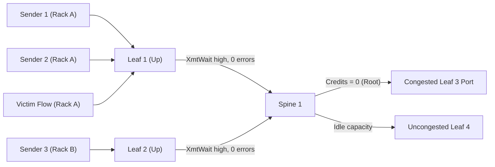
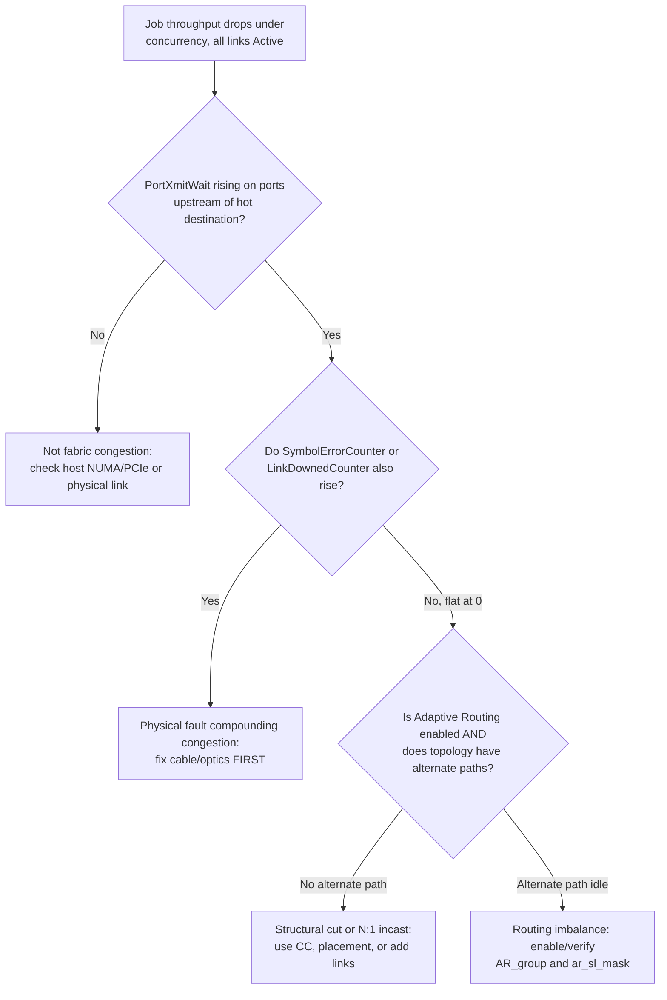
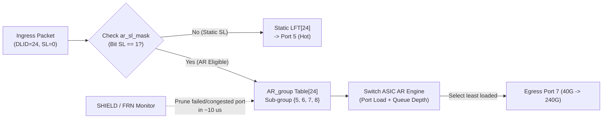
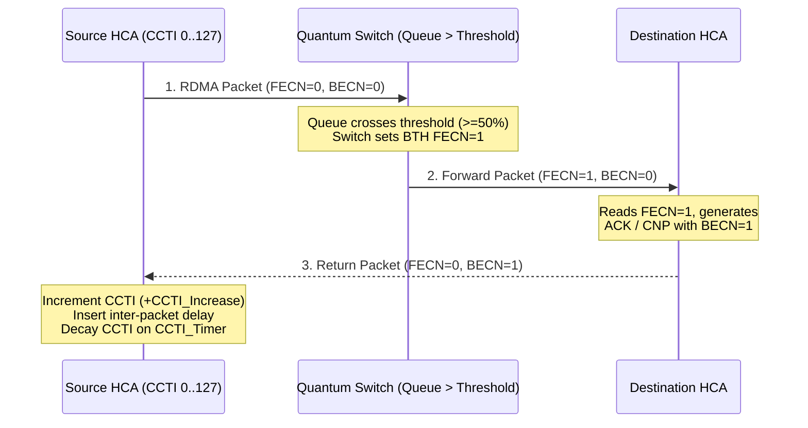

# 12.8 InfiniBand adaptive routing and congestion control

| | |
|---|---|
| Level | Advanced |
| Priority tier | 1 |
| Lab venue | Nebius GPU |
| Part | Part 12: Complete AI networking |
| Sources | `nvidia-devops` V8 Ch. 7, Ch. 12, Index & Labs 01–04; `superpod-gb300-ra`; `superpod-b200-dc`; `ai-data-center-network-design-and-technologies` Ch. 2, 6, 9 |
| Code | `code/part12/infiniband_ar_cc.py`, `code/part12/infiniband_ar_cc_lab.py` |
| Coverage file | `planning/coverage/chapters/12-08.md` |

## Why this matters for AI infrastructure

A lossless InfiniBand fabric can still bring a multi-thousand-GPU training run to its knees. Link-level Credit-Based Flow Control (`CBFC`) guarantees that normal buffer exhaustion never drops packets, because a sender transmits only when its downstream link partner advertises available `64`-byte buffer credits for the target Virtual Lane (`VL`). However, losslessness does not create infinite link bandwidth or buffer depth. When synchronized `AllReduce` rings, Mixture-of-Experts (`MoE`) `AllToAll` exchanges, or parallel storage checkpoint bursts converge on the same switch egress ports, downstream receive buffers fill, credits stop returning, upstream switch ports stall (`PortXmitWait`), and backpressure propagates backward across multiple switch tiers as a **congestion tree**. Unrelated jobs that merely share a spine uplink or Virtual Lane behind the congested path suffer **Head-of-Line (`HoL`) blocking** and `p99` tail-latency spikes—all while every port reports `State: Active`, `Physical state: LinkUp`, and zero `SymbolErrorCounter` or packet-drop events.

Modern NVIDIA Quantum-2 (`400 Gbps` NDR, `64` ports) and Quantum-X800 (`800 Gbps` XDR, `144` ports on `Q3400-RD` switches scaling up to `16` Scalable Units and `9,216` GPUs in a two-layer fat-tree) fabrics attack this problem with three hardware mechanisms coordinated by OpenSM or Unified Fabric Manager (`UFM`):

1. **Adaptive Routing (`AR`) and Out-of-Order (`OOO`) Hardware Reordering:** Instead of pinning every flow targeting a `16`-bit Destination Local Identifier (`DLID`) to a single static Linear Forwarding Table (`LFT`) port, the switch maps the `DLID` to an Adaptive Routing group (`AR_group`) of eligible equal-cost egress ports and dynamically selects the least-loaded link using real-time port load and queue depth, while ConnectX Host Channel Adapters (`HCAs`) reorder out-of-order Packet Sequence Numbers (`PSNs`) in hardware before delivering completions.
2. **Fast Notification (`FRN` / `RN`) and Self-Healing Interconnect (`SHIELD`):** Switches detect remote congestion and link failures in hardware and autonomously prune failed or saturated ports from `AR_group` tables in microseconds (`~10 µs`), rather than waiting hundreds of milliseconds (`~500 ms`) for an OpenSM `Trap 128` control-plane heavy sweep.
3. **InfiniBand Congestion Control (`FECN` -> `BECN` -> `CCTI`):** When a true destination incast or oversubscribed cut cannot be routed around, the congested switch sets the `1`-bit Forward Explicit Congestion Notification (`FECN`) flag in the Base Transport Header (`BTH`), the destination HCA reflects a Backward Explicit Congestion Notification (`BECN`) packet to the source HCA, and the source HCA advances its Congestion Control Table Index (`CCTI`, `0..127` across a `128`-entry Congestion Control Table `CCT`) to pace injection rate until its `CCTI_Timer` restores full line rate.

This chapter builds on the InfiniBand addressing and link-layer foundations in Chapter 12.6 and the Subnet Manager and topology architectures in Chapter 12.7. We derive the credit-based flow-control equations, Virtual Lane victim-buffer isolation, static `LFT` vs dynamic `AR_group` port selection, `SHIELD` autonomous failover math, ConnectX `OOO` reordering windows, the `FECN`/`BECN`/`CCTI` state machine, and the production `perfquery`, `ibqueryerrors`, `ibroute`, and `ibdiagnet` diagnostic workflows.

## Prerequisites and outcomes

**Prerequisites:** Chapter 12.2 (RDMA fundamentals, Queue Pairs, and completions), Chapter 12.6 (InfiniBand link layers, `16`-bit LIDs, GIDs, `P_Key`s, Service Levels, and Virtual Lanes), and Chapter 12.7 (OpenSM, routing engines, fat-tree and rail-optimized topologies).

**Outcomes:** After completing this chapter, you will be able to:
- Calculate InfiniBand per-Virtual-Lane credit availability (`64` bytes per credit unit across `16` VLs: `VL0..VL14` data VLs and `VL15` subnet management), trace how downstream credit exhaustion propagates into a multi-tier congestion tree, and isolate victim traffic classes using end-to-end Service Level (`SL`) to Virtual Lane (`VL`) mappings and deadlock-free credit graphs.
- Distinguish pure fabric congestion (`PortXmitWait` climbing, `SymbolErrorCounter = 0`, `LinkDownedCounter = 0`) from physical link faults (`SymbolErrorCounter` and `LinkDownedCounter` climbing) and locate the root port of a congestion tree by sampling `PortXmitWait` deltas across switch tiers without resetting counters.
- Explain how OpenSM and UFM program static Linear Forwarding Tables (`LFT`) alongside Adaptive Routing Group tables (`AR_group` and `ar_sl_mask` `0xFFFF`), why static LID routing can leave sibling uplinks at a `20:1` `PortXmitData` imbalance (`21.48 GB` vs `1.08 GB`), and how ConnectX hardware packet reordering prevents `PSN`-gap `NAK` storms and `p99`/`max` tail-latency regressions (`7.2 µs -> 38.6 µs` `p99`, `9.1 µs -> 112.4 µs` `max`).
- Compare autonomous hardware link-failure recovery via `SHIELD` and Fast Notification (`FRN`, `~10 µs` reroute, `500,000` B in flight at `400 Gbps`) against OpenSM `Trap 128` heavy-sweep reconvergence (`~500 ms` / `500,000 µs`, `25,000,000,000` B in flight).
- Trace the closed-loop InfiniBand Congestion Control state machine (`FECN` marking at switch queues -> `BECN` notification from destination HCA -> `CCTI` index `0..127` rate pacing and `CCTI_Timer` recovery at source HCA) and contrast the roles of Adaptive Routing, Congestion Control, workload placement, and physical capacity expansion.

---

## 1. Credit-based flow control, congestion trees, and Virtual Lane isolation

### 1.1 Link-level Credit-Based Flow Control (`CBFC`) and `64`-byte credit blocks

Unlike standard Ethernet, where a switch transmits frames blindly and relies on reactive IEEE `802.1Qbb` Priority Flow Control (`PFC`) pause frames when a downstream ingress buffer nears overflow, InfiniBand enforces proactive, link-level **Credit-Based Flow Control (`CBFC`)** on every hop (`HCA <-> Leaf Switch`, `Leaf Switch <-> Spine Switch`). An InfiniBand physical link is multiplexed into up to `16` logical **Virtual Lanes (`VLs`)**:
- **`VL0` through `VL14` (`15` data VLs):** Carry application RDMA and storage traffic mapped from the packet's `4`-bit Service Level (`SL`, `0..15`) via each switch's `SL2VL` mapping table (`8` to `12` queues are commonly active in combined AI/storage profiles).
- **`VL15` (`1` management VL):** Dedicated exclusively to unrouted, link-local Subnet Management Packets (`SMPs`). `VL15` uses independent dedicated buffer resources and is exempted from data-VL credit stalls so that OpenSM or UFM can always query and reprogram switches even when every data Virtual Lane (`VL0..VL14`) is completely stalled by congestion.

In the InfiniBand Link Layer Header (`LLH`) and flow-control Link Packets (`LPs`), buffer availability is advertised per Virtual Lane in **Flow Control Credit Units (`FCCL`)**, where **one credit equals `64` bytes** of receive buffer space. Before an upstream port (`Port A`) transmits a packet of length $B_{\text{pkt}}$ bytes on Virtual Lane $v$ to its downstream link partner (`Port B`), hardware verifies that the available credit balance $C_{\text{avail}}(v)$ satisfies:

$$
C_{\text{avail}}(v) = \left\lfloor \frac{B_{\text{buf}}(v) - B_{\text{occ}}(v)}{64} \right\rfloor \ge \left\lceil \frac{B_{\text{pkt}}}{64} \right\rceil
$$

For a standard `4,096`-byte (`4 KB`) InfiniBand Maximum Transmission Unit (`MTU`), a single packet requires $\lceil 4096 / 64 \rceil = 64\text{ credits}$. If a switch port allocates $B_{\text{buf}}(0) = 65,536\text{ bytes}$ (`1,024` total credits) to `VL0`:
- When half the buffer is occupied ($B_{\text{occ}}(0) = 32,768\text{ bytes}$), $C_{\text{avail}}(0) = 512\text{ credits} \ge 64$, so `Port A` transmits immediately at full `400 Gbps` or `800 Gbps` line rate (`~300 ns` port-to-port InfiniBand switch latency versus `~800 ns` on typical Ethernet storage switches).
- When downstream drain slows and $B_{\text{occ}}(0)$ reaches $63,488\text{ bytes}$, only $2,048\text{ bytes}$ (`32` credits) remain free. Because $32 < 64$, `Port A` cannot transmit the next `4,096`-byte packet on `VL0`, and hardware increments the port's **`PortXmitWait`** counter on every clock tick that `VL0` has packets queued but insufficient downstream credits.

### 1.2 Backpressure propagation, congestion trees, and Head-of-Line (`HoL`) blocking

Because `CBFC` never drops packets when buffers fill, any sustained mismatch between offered load and drain rate converts excess traffic into upstream queue occupancy:



| Hop / Element | Credit & Buffer State | Operational Effect on Traffic | Telemetry Signature (`perfquery`) |
|---|---|---|---|
| **Congested Destination Port (`Leaf 3` egress)** | Many-to-one incast (`S1 + S2 + S3`) exceeds `1x` port drain rate; buffer fills (`Credits -> 0`) | Root of the congestion tree; stops returning `VL0` credits to `Spine 1` | Highest `PortXmitWait` on `Spine 1` downlink facing `Leaf 3`; `SymbolErrorCounter = 0` |
| **Transit Switch (`Spine 1` ingress from `Leaf 1` & `Leaf 2`)** | Cannot drain packets toward `Leaf 3`; ingress `VL0` buffers fill and stop returning credits to `Leaf 1` & `Leaf 2` | Backpressure spreads one tier upstream away from the actual bottleneck | Elevated `PortXmitWait` on `Leaf 1` and `Leaf 2` uplinks feeding `Spine 1` |
| **Victim Flow (`Rack A -> Leaf 4` via `Spine 1` on `VL0`)** | Shares `Leaf 1 -> Spine 1` uplink and `VL0` buffer with congested flows `S1` & `S2` | **Head-of-Line (`HoL`) blocking:** delayed behind stalled `VL0` packets even though `Leaf 4` is completely idle | Victim job latency spikes (`p99` `1.8 ms -> 14.2 ms`) with zero packet loss |

This chain reaction follows five deterministic steps:
1. **Root saturation:** Downstream `Port C` (such as a destination-facing leaf port or oversubscribed spine link) receives traffic faster than its wire rate and exhausts its available receive buffer credits.
2. **First-hop credit stall:** Upstream `Switch Port B` runs out of downstream credits for `Port C`, pauses transmission on that Virtual Lane, and increments `PortXmitWait`.
3. **Upstream queue growth:** Incoming packets destined for `Port C` accumulate inside `Switch B`'s ingress buffers.
4. **Hop-by-hop credit exhaustion:** `Switch B` stops returning credits to `Upstream Port A`, forcing `Port A` to pause and accumulate its own queue.
5. **Victim collateral damage (`HoL` blocking):** Unrelated flows traversing `Port A -> Switch B` on the same Virtual Lane toward an uncongested destination (`Leaf 4`) sit queued behind the blocked packets targeting `Port C`.

### 1.3 Isolating victim flows with Virtual Lanes and preventing credit loops

Separating competing traffic classes onto distinct Service Levels (`SLs`) and Virtual Lanes (`VLs`)—for example, mapping latency-sensitive inference or storage metadata to `SL1 -> VL1` while bulk training collectives run on `SL0 -> VL0`—gives each class an independent `64`-byte credit counter and dedicated buffer partition on every physical link. When a synchronized training burst saturates `VL0` and drives `VL0` available credits to zero, `VL1` retains its own credits (`512+` credits free) and continues forwarding across the exact same physical cable. In production validation comparing an inference service sharing a fabric with a saturated training job:
- **Isolated inference baseline (no training active):** `p99` latency = **`1.8 ms`**.
- **Shared Virtual Lane (`SL0 -> VL0` for both training and inference):** Training backpressure stalls inference packets via HoL blocking, inflating `p99` latency by **`7.89x` to `14.2 ms`**.
- **Separated Virtual Lanes (`SL0 -> VL0` training, `SL1 -> VL1` inference):** Separate per-VL credit accounting eliminates buffer head-of-line blocking and recovers **`89.52%`** of the latency regression, bringing `p99` latency down to **`3.1 ms`** (the remaining `1.3 ms` gap above `1.8 ms` reflects shared physical wire serialization arbitration across active VLs, proving that VLs isolate buffers and credits but do not create extra physical link bandwidth).

However, Virtual Lane mappings must be **identical and deadlock-free across every hop**. Because `CBFC` holds upstream buffers while waiting for downstream credits, a cyclic buffer dependency (`SW1_VL0 -> SW2_VL0 -> SW3_VL0 -> SW1_VL0`) in a mesh, torus, or misrouted Clos topology creates a permanent **credit loop (deadlock)** in which every switch waits indefinitely for the next switch in the ring to free `64`-byte credits. Routing engines (such as `updn`, `ftree`, `dfsssp`, and `dor`) prevent credit loops either by restricting turns (Up\*/Down\* rule) or by splitting upward and downward hops onto separate Virtual Lanes (`SW1_VL0 -> SW2_VL0 -> SW3_VL1 -> SW1_VL1`) so the channel dependency graph remains a Directed Acyclic Graph (`DAG`).

---

## 2. Congestion versus physical link faults: reading `perfquery` evidence

The single most expensive operational mistake on an InfiniBand cluster is confusing **credit backpressure** with a **damaged cable or optical transceiver**—replacing optics because utilization is high, or tuning congestion control while a degraded lane is actively corrupting symbols.



| Diagnostic Dimension | Pure Fabric Congestion (`CBFC` Backpressure) | Physical / Link Layer Fault |
|---|---|---|
| **Logical & Physical Port State (`ibstat`)** | `State: Active`, `Physical state: LinkUp` at design rate (`400` or `800` Gbps) | May flap, retrain, or negotiate reduced width (`1x`/`2x` instead of `4x`) or speed |
| **Physical Error Counters (`perfquery`)** | `SymbolErrorCounter = 0`, `LinkDownedCounter = 0`, `PortRcvErrors = 0` (deltas flat) | `SymbolErrorCounter`, `LinkErrorRecoveryCounter`, or `LinkDownedCounter` increasing |
| **Credit Stall Counter (`PortXmitWait`)** | **High and climbing rapidly** during concurrent collective windows | Low or secondary to link recovery events |
| **Scope & Reproducibility** | Appears under concurrent multi-node collectives or specific rank placements | Tied to a specific physical cable, transceiver cage, switch port, or HCA port even in 2-node tests |
| **Correct Remediation** | Trace congestion-tree gradient; enable/tune `AR` and `CC`; fix rank placement or oversubscription | Reseat or replace cable/transceiver; isolate faulty port before touching routing or `CC` |

### 2.1 Distinguishing congestion from hardware faults on the same switch

When sampling counters with `perfquery <switch-lid> <port>`, always capture two snapshots across an active workload window and compute the **delta** (never run `perfquery -R` or `ibqueryerrors -k`/`-K` during triage, as clearing hardware counters destroys incident evidence). Compare two sibling ports on the same switch:

```text
switch port 3: PortXmitWait=998432  SymbolErrorCounter=0   LinkDownedCounter=0
switch port 4: PortXmitWait=2109    SymbolErrorCounter=41  LinkDownedCounter=2
```

- **`switch port 3` (`PortXmitWait = 998,432`, `SymbolErrorCounter = 0`, `LinkDownedCounter = 0`):** Pure fabric congestion. The physical link is completely clean, but `port 3` spent `998,432` ticks waiting for downstream `64`-byte buffer credits. Similarly, in a leaf-switch comparison where `port 3` records `PortXmitWait = 184,320` against sibling `port 7` at `PortXmitWait = 41` (both with `SymbolErrorCounter = 0` and `LinkDownedCounter = 0`), `port 3`'s downstream path is proven to be a credit bottleneck without a single dropped packet.
- **`switch port 4` (`PortXmitWait = 2,109`, `SymbolErrorCounter = 41`, `LinkDownedCounter = 2`):** Physical link fault. The link has suffered `41` symbol errors and `2` forced link-down recovery events (`LinkDownedCounter = 2`). Replacing `port 3`'s cable would waste a maintenance window, whereas ignoring `port 4`'s `41` symbol errors because its `PortXmitWait` (`2,109`) looks small would leave a failing optical link in production.

### 2.2 Tracing a congestion tree to its root via the `PortXmitWait` gradient

Because backpressure decays as it fans out upstream, the port closest to the true bottleneck exhibits the largest `PortXmitWait` delta. Sampling `PortXmitWait` deltas across ports `1..8` of a leaf switch during a slow concurrent collective reveals the exact root:

```text
port 1: delta 340
port 2: delta 298
port 3: delta 51204
port 4: delta 47890
port 5: delta 312
```

Ports `1`, `2`, and `5` sit at a baseline of `298..340` ticks, whereas **ports `3` (`51,204`) and `4` (`47,890`)** are more than two orders of magnitude (`~150x`) higher. Cross-referencing ports `3` and `4` against the `iblinkinfo` topology map immediately identifies which downstream rack or destination node pair is the root of the congestion tree.

---

## 3. Adaptive Routing (`AR`), `SHIELD` self-healing, and ConnectX `OOO` reordering

### 3.1 Why static Linear Forwarding Tables (`LFT`) create `20:1` uplink hot spots

In classic InfiniBand routing, OpenSM computes a deterministic **Linear Forwarding Table (`LFT`)** for every switch. The `LFT` is a flat array indexed by the `16`-bit Destination LID (`DLID`, supporting up to `48,000` unicast end nodes per subnet) that maps each `DLID` to exactly **one** static egress port:

$$
\text{EgressPort} = \text{LFT}[\text{DLID}]
$$

Even when a folded Clos or fat-tree provides `4`, `8`, or `16` equal-cost spine uplinks from `Leaf 1` to `Leaf 2`, static `LFT` forwarding pins all traffic headed to a specific destination `DLID` onto a single pre-assigned uplink. When active ranks in an `AllReduce` or `AllToAll` collective happen to target `DLID`s whose static `LFT` entries map to the same spine ports, massive path imbalance occurs while parallel uplinks sit idle.

Measuring `PortXmitData` deltas across four equal-speed (`400 Gbps`) leaf uplinks (`ports 5..8`) during a collective demonstrates this failure mode (`PortXmitData` increments in `4`-octet words, so multiplying the raw counter delta by `4` yields bytes):

```text
port 5 (uplink to S1): delta 21474836480 bytes
port 6 (uplink to S2): delta 21489234432 bytes
port 7 (uplink to S3): delta 1073741824 bytes
port 8 (uplink to S4): delta 1081654272 bytes
```

Uplinks `5` (`21,474,836,480` B $\approx 20.0\text{ GiB}$) and `6` (`21,489,234,432` B $\approx 20.01\text{ GiB}$) carry **`20.01x`** more traffic than identical uplinks `7` (`1,073,741,824` B $= 1.0\text{ GiB}$) and `8` (`1,081,654,272` B $\approx 1.01\text{ GiB}$). If two `380 Gbps` and `200 Gbps` elephant flows collide on `port 5` (`580 Gbps` offered load against a `400 Gbps` link, leaving `180 Gbps` queued in backpressure) while `port 7` carries only `40 Gbps`, static `LFT` routing cuts collective throughput in half despite ample spare spine capacity.

### 3.2 Adaptive Routing (`AR_group`), Private LFTs (`PLFT`), and `ar_sl_mask`

**Adaptive Routing (`AR`)** replaces single-port static `LFT` lookups on Quantum and Quantum-2 / Quantum-X800 switches with a two-stage hardware lookup programmed by OpenSM or UFM:



| Hardware Table / Control | Programmed By | Granularity & Width | Role in Packet Forwarding |
|---|---|---|---|
| **`ar_sl_mask`** | OpenSM / UFM (`opensm.conf`) | `16`-bit bitmask (`0x0000..0xFFFF`, default `0xFFFF`) | Enables (`1`) or disables (`0`) Adaptive Routing per Service Level (`SL0..SL15`); cleared bits fall back to deterministic static `LFT` |
| **Private LFT (`PLFT`) / `LFT` entry** | OpenSM `ar_updn`, `ar_ftree`, `ar_dfsssp`, `ar_torus` | Indexed by `16`-bit `DLID` (`1..48,000`) | Points either to a single deterministic fallback port or to an `AR_group` ID |
| **Adaptive Routing Group (`AR_group`)** | OpenSM / UFM + Switch ASIC | Group of equal-cost egress ports (e.g., `{5, 6, 7, 8}`) | Lists all topologically valid, loop-free shortest-path ports reaching `DLID` |
| **Switch ASIC AR Selector** | Quantum-2 / Quantum-X800 hardware | Sub-microsecond per-packet or per-flowlet evaluation | Evaluates local egress port utilization, `VL` queue depth, and downstream `FRN` notifications to pick the least-congested port (e.g., `Port 7` at `40 Gbps` instead of `Port 5` at `380 Gbps`) |

In the `400 Gbps` leaf uplink scenario above (`existing_port_load_gbps = {5: 380, 6: 360, 7: 40, 8: 60}`), when a new `200 Gbps` flow arrives for `DLID 24` on `SL 0` with `ar_sl_mask = 0xFFFF`:
- **Static `LFT`** blindly sends the `200 Gbps` flow out `Port 5`, driving `Port 5` offered load to **`580.0 Gbps`** (`180.0 Gbps` excess queued into `PortXmitWait`).
- **Adaptive Routing (`AR_group {5, 6, 7, 8}`)** inspects real-time port load and transmit queue depth, selects **`Port 7`** (`40.0 + 200.0 = 240.0 Gbps`), keeps the maximum uplink load across the leaf at **`380.0 Gbps`** (`<= 400.0 Gbps`), and reduces excess queued bandwidth to **`0.0 Gbps`**.
- **Selective SL masking (`ar_sl_mask = 0xFFF7`):** Clearing bit `3` (`0xFFF7`) forces `SL 3` traffic onto deterministic static `LFT` (`Port 5`) while keeping `SL 0..2, 4..15` adaptive—used when legacy upper-layer protocols or strict deterministic test harnesses require in-order single-path delivery on a dedicated Service Level.

### 3.3 Fast Notification (`FRN`) and Self-Healing Interconnect (`SHIELD`)

Local port-load sensing (`AR`) solves leaf-to-spine collisions (`CP2`), but what if a link fails on the far side of a spine switch (`Spine 1 -> Leaf 3`) or a remote spine downlink saturates (`CP3`)?
1. **Control-plane recovery (`OpenSM Trap 128` heavy sweep):** Without autonomous switch healing, a link failure generates an InfiniBand `Trap 128` (`link state change`, e.g., `LID 44 port 3`), which travels to the master Subnet Manager. OpenSM schedules a heavy sweep, rediscovers the topology, recomputes `LFT`s, and pushes updated forwarding blocks via SMPs. In a large cluster, this control-plane loop takes **`~500 ms` (`500,000 µs`)**. At `400 Gbps` (`50,000` bytes/µs), **`25,000,000,000` bytes (`25 GB`)** of line-rate traffic can pile up behind a dead port during a `500 ms` sweep window.
2. **Hardware self-healing (`SHIELD` and `FRN`):** On NVIDIA Quantum-2 (`400 Gbps`) and Quantum-X800 (`800 Gbps`, `144`-port `Q3400-RD`) switches, **SHIELD (Self-Healing Interconnect Enhancement for Large-Scale Deployments)** and **Fast Routing Notification (`FRN` / `RN`)** operate directly in switch silicon. When a switch detects a local link failure or severe downstream congestion toward a destination group, it immediately removes the failed port from its local `AR_group` and transmits hardware `FRN` notification packets to neighboring switches. Upstream switches prune the affected path from their `AR_group` sub-tables in **`~10 µs`**—a **`50,000x` speedup** over a `500 ms` control-plane sweep, reducing in-flight bytes at risk on a `400 Gbps` link from `25,000,000,000` B to just **`500,000` B (`500 KB`)**.

### 3.4 Out-of-Order (`OOO`) packet delivery and ConnectX HCA hardware reordering

When Adaptive Routing dynamically spreads packets of a single Queue Pair (`QP`) across multiple spine switches (`Port 5 -> Spine 1` and `Port 7 -> Spine 3`), different spine queue depths cause packets to arrive at the destination HCA with **Out-of-Order (`OOO`)** Packet Sequence Numbers (`PSNs`), such as `(100, 102, 103, 101, 104, 106, 105)`.

In strict traditional IB Reliable Connection (`RC`) transport without hardware reordering, receiving `PSN 102` when expecting `PSN 101` triggers a `PSN`-gap Negative Acknowledgment (`NAK`) and forces a `Go-Back-N` retransmission (`3` gap events on the `7`-packet burst above). Modern NVIDIA ConnectX-6, ConnectX-7 (`MT4129`), ConnectX-8, and BlueField-3 adapters eliminate this penalty through **hardware OOO packet reordering**:
- During `QP` connection establishment or via Subnet Manager / firmware capability advertisement, the HCA enables an on-chip reorder buffer window (e.g., `64` packets) and supports native `RDMA Write` / `Send` OOO placement.
- When `PSN 102` and `PSN 103` arrive ahead of `PSN 101` (`max_reorder_distance = 2 <= 64`), the ConnectX HCA places payloads directly into target memory and holds completion signaling until `PSN 101` arrives, delivering the clean in-order sequence `(100, 101, 102, 103, 104, 105, 106)` to the Completion Queue (`CQ`) with **`0` `PSN`-gap `NAK`s**.

If Adaptive Routing or aggressive congestion parameters are enabled on an HCA or transport mode where OOO reordering is disabled or the reorder window is exceeded, **average bandwidth can improve while tail latency degrades severely**:

```text
                   p50      p95      p99      max
Before tuning:    3.1us    4.8us    7.2us    9.1us
After tuning:     2.4us    5.9us   38.6us   112.4us
```

Here, median (`p50`) latency improved from **`3.1 µs` to `2.4 µs`** because traffic spread across idle links, but **`p99` jumped `5.36x` (`7.2 µs -> 38.6 µs`)** and **`max` jumped `12.35x` (`9.1 µs -> 112.4 µs`)** due to packet reordering stalls and reaction-timing jitter. In synchronized AI collectives where every rank waits for the slowest rank (`tail latency`), a `5.36x` `p99` regression slows overall training step time even when `p50` bandwidth looks faster.

---

## 4. InfiniBand Congestion Control (`FECN` -> `BECN` -> `CCTI`)

### 4.1 Why Adaptive Routing needs Congestion Control

Adaptive Routing (`AR`) redistributes traffic across alternate paths, which solves **path imbalance** (`CP2` and `CP5`). However, `AR` cannot solve two structural conditions:
1. **Destination incast (`CP1` and `CP4`):** When `8` or `64` senders simultaneously transmit RDMA writes to a single target HCA port (e.g., checkpoint aggregation or parameter-server gather), every alternate spine path eventually converges onto that **single destination leaf egress port**. No alternate path exists for the final hop.
2. **Oversubscribed topology cuts:** If a leaf switch has `16 x 400 Gbps` downlinks (`6,400 Gbps`) and `8 x 400 Gbps` uplinks (`3,200 Gbps`, a `2:1` oversubscription ratio), and all `16` nodes run a cross-rack `AllReduce` simultaneously, aggregate offered load (`6,400 Gbps`) exceeds total uplink capacity (`3,200 Gbps`) even when `AR` balances all `8` uplinks perfectly (`200 Gbps` per node effective bandwidth, doubling a `2 GB` `AllReduce` communication step from **`40.0 ms` to `80.0 ms`**, and cutting paired `ib_write_bw` from **`397.62 Gbps`** same-leaf to **`201.18 Gbps`** cross-rack).

Without source rate regulation, both conditions fill the bottleneck egress buffer, exhaust downstream `64`-byte credits, and grow a congestion tree across the fabric. **InfiniBand Congestion Control (`IB CC`)** prevents congestion trees from spreading by throttling only the offending source Queue Pairs (`QPs`).

### 4.2 The 3-stage `FECN` -> `BECN` -> `CCTI` hardware control loop

InfiniBand Congestion Control (standardized in the IBTA specification and enhanced in NVIDIA Quantum switches and ConnectX HCAs via PPCC / hardware telemetry) operates as a three-stage closed loop:



| Stage & Actor | Packet Header Bit / Register | Trigger Condition | Hardware Action |
|---|---|---|---|
| **1. Detection & Marking (Switch)** | `BTH` `FECN` (`1` bit, Forward Explicit Congestion Notification) | Switch egress port queue occupancy crosses configured `Threshold` (e.g., `>= 50%`) and port is the root of congestion (not merely credit-stalled from downstream) | Switch sets `FECN = 1` in the Base Transport Header (`BTH`) of packets traversing the congested queue |
| **2. Notification / Reflection (Destination HCA)** | `BTH` `BECN` (`1` bit, Backward Explicit Congestion Notification) | Destination HCA receives a packet with `FECN == 1` | Destination HCA increments its Marked Packet counter and transmits an `ACK` or explicit Congestion Notification Packet (`CNP`) back to the source `LID`/`QP` with `BECN = 1` |
| **3. Source Reaction & Recovery (Source HCA)** | Congestion Control Table (`CCT`, `128` entries `0..127`) & `CCTI` | Source HCA receives `BECN == 1` or its periodic `CCTI_Timer` expires without `BECN` | On `BECN = 1`: `CCTI = min(CCTI_Limit, CCTI + CCTI_Increase)`, increasing inter-packet injection delay. On `CCTI_Timer` expiry: `CCTI = max(CCTI_Min, CCTI - 1)`, smoothly restoring full line rate |

### 4.3 Worked numerical trace of the `CCTI` (`0..127`) rate-throttling state machine

The Congestion Manager (`CM` / UFM / OpenSM CC plugin) programs each HCA with a **`128`-entry Congestion Control Table (`CCT`, indices `0..127`)** and four per-Service-Level control registers: `CCTI_Min` (`0`), `CCTI_Limit` (`127`), `CCTI_Increase` (e.g., `16`), and `CCTI_Timer` (e.g., `15..50 µs`). Using the standard inter-packet delay scaling model where effective injection rate on a `400.0 Gbps` NDR port follows:

$$
R_{\text{inj}}(\text{CCTI}) = \frac{R_{\text{line}}}{1 + \frac{\text{CCTI}}{32}}
$$

we can trace five exact transitions verified in `code/part12/infiniband_ar_cc.py`:
1. **Uncongested baseline (`switch_queue = 25% < 50%`, `CCTI = 0`):** Switch sets `FECN = 0`, destination sends `BECN = 0`, delay multiplier is $1 + 0/32 = 1.0\times$, and the source HCA injects at full **`400.0 Gbps`**.
2. **First congestion wave (`switch_queue = 65% >= 50%`, `CCTI: 0 -> 16`):** Switch marks `FECN = 1`, destination reflects `BECN = 1`, and the source HCA jumps `CCTI` by `CCTI_Increase = 16` (`0 -> 16`). The delay multiplier becomes $1 + 16/32 = 1.5\times$, cutting source injection rate to **`266.67 Gbps`** before downstream `64`-byte credits are exhausted.
3. **Second congestion wave (`switch_queue = 75% >= 50%`, `CCTI: 16 -> 32`):** A second `BECN = 1` advances `CCTI` from `16` to `32`, raising the delay multiplier to $1 + 32/32 = 2.0\times$ and throttling the offending `QP` to **`200.0 Gbps`** (`50%` of line rate).
4. **Severe persistent incast ceiling (`switch_queue = 90% >= 50%`, `CCTI: 120 -> 127`):** Adding `16` to `CCTI = 120` clamps at `CCTI_Limit = 127` (`CCT_MAX_INDEX`), producing a $1 + 127/32 = 4.9688\times$ delay multiplier and clamping the sender to **`80.5 Gbps`**.
5. **Timer-driven recovery (`switch_queue = 20% < 50%`, `BECN = 0`, `CCTI_Timer` expires):** Each time `CCTI_Timer` expires without an incoming `BECN`, the HCA decrements `CCTI` by `1` (`32 -> 31 -> ... -> 1 -> 0`). When `CCTI` steps from `1` back to `0`, the delay multiplier returns to `1.0x` and the HCA resumes full **`400.0 Gbps`** injection.

### 4.4 Architectural comparison: Adaptive Routing vs Congestion Control vs Placement vs Capacity

| Mechanism | Primary Hardware / Software Action | Best Suited For | What It Cannot Solve |
|---|---|---|---|
| **Adaptive Routing (`AR` + `SHIELD`)** | Switch selects least-loaded eligible port in `AR_group` and prunes failed ports in `~10 µs` | Path imbalance (`20:1` uplink skew) when alternate spine paths exist | True `N:1` destination incast (`CP4`) or an oversubscribed topology cut (`2:1` leaf) |
| **Congestion Control (`FECN`/`BECN`/`CCTI`)** | Switch marks `FECN`, receiver returns `BECN`, source HCA paces `QP` injection via `CCTI` (`0..127`) | Persistent destination contention or incast that would otherwise build a congestion tree | Broken physical cables (`SymbolErrorCounter > 0`) or missing bisection bandwidth |
| **Workload / Rank Placement** | Scheduler co-locates communicating ranks under the same leaf or aligns rails | Avoidable cross-rack traffic concentration and multi-tenant uplink sharing | Full-cluster synchronous `AllToAll` or `AllReduce` spanning every rack simultaneously |
| **Physical Capacity Expansion** | Add spine switches, leaf uplinks (`8 -> 16`), or upgrade NDR (`400G`) to XDR (`800G`) | Structural oversubscription (`2:1 -> 1:1`) when all uplinks are already balanced and saturated | Static routing hash collisions or faulty transceivers |

---

## 5. Multi-tenancy, SuperPOD scale, and operational observability

### 5.1 Multi-tenant isolation: why `P_Key`s do not prevent congestion interference

In a shared multi-tenant InfiniBand cluster—or a cluster running both training collectives and latency-sensitive inference or GPUDirect Storage (`GDS`, `NVMe-o-RDMA` over `UDP 4420` CM / `TCP 8009` discovery or native IB)—architects frequently assume that InfiniBand **Partition Keys (`P_Key`s)** isolate tenant performance. That assumption is false:
- **`P_Key`s enforce logical addressability and membership**, preventing an unauthorized Queue Pair in Tenant A's partition from sending packets to or reading memory from a Queue Pair in Tenant B's partition.
- **`P_Key`s do not partition physical link bandwidth or switch buffer credits.** If Tenant A and Tenant B are scheduled onto nodes under the same leaf switches and mapped to the same default Service Level (`SL0 -> VL0`), Tenant A's synchronized `AllToAll` burst can exhaust `VL0` credits on shared spine links and stall Tenant B's traffic via a congestion tree.

True multi-tenant and mixed-workload isolation requires layering four controls:
1. **Topology-aware scheduler placement:** Allocate entire leaf switches or Scalable Units (`SUs`) to a single large training job whenever possible so intra-job collectives do not share leaf uplinks with other tenants.
2. **Service Level (`SL`) to Virtual Lane (`VL`) separation:** Map latency-sensitive traffic (`SL1 -> VL1`) and storage traffic (`SL2 -> VL2`) onto dedicated Virtual Lanes with weighted round-robin (`VLArbitration`) bandwidth guarantees and independent `64`-byte credit pools.
3. **Adaptive Routing (`AR`) + Congestion Control (`CC`):** Prevent any single tenant flow from pinning a spine uplink (`AR`) or monopolizing downstream switch buffers (`FECN`/`BECN`/`CCTI`).
4. **Per-tenant telemetry and admission control:** Join per-port `PortXmitWait`, `PortXmitData`, and `FECN`/`BECN` counters with job-scheduler placement metadata and `GUID` inventory.

### 5.2 Scale-out reference points: DGX B200 NDR and DGX GB300 Quantum-X800 SuperPODs

To ground Adaptive Routing and Congestion Control in production cluster geometry, compare two reference SuperPOD fabric designs:
- **DGX B200 NDR (`400 Gbps`) SuperPOD (`1..4` Scalable Units, `458 kW` per `32`-node SU, with `1` UFM appliance displacing `1` DGX B200 server per full deployment):**
  - `1` SU: `31` compute nodes (`248` GPUs), `8` leaf switches, `4` spine switches, `252` compute + UFM cables, `256` spine-leaf Inter-Switch Link (`ISL`) cables.
  - `2` SUs: `63` compute nodes (`504` GPUs), `16` leaf switches, `8` spine switches, `508` node cables, `512` `ISL` cables.
  - `3` SUs: `95` compute nodes (`760` GPUs), `24` leaf switches, `16` spine switches, `764` node cables, `768` `ISL` cables.
  - `4` SUs: `127` compute nodes (`1,016` GPUs), `32` leaf switches, `16` spine switches, `1,020` node cables, `1,024` `ISL` cables (passive copper `DAC` up to `5 m` at `100G` or `3 m` at `400G`; Active Optical Cables `AOC` up to `30 m`, kept under `90%` of maximum standard distance without patch panels).
- **DGX GB300 Quantum-X800 (`800 Gbps`) SuperPOD (`Q3400-RD` `144`-port switches, `8` DGX GB300 systems / `576` GPUs per SU across `8` leaf switches in `4` rails of `2` leaves each):**
  - `2` SUs (`1,152` GPUs): `16` leaf switches, `8` spine switches.
  - `4` SUs (`2,304` GPUs): `32` leaf switches, `18` spine switches.
  - `8` SUs (`4,608` GPUs): `64` leaf switches, `36` spine switches.
  - `16` SUs (`9,216` GPUs): `128` leaf switches, `72` spine switches in a two-layer rail-aligned fat-tree with Adaptive Routing (`AR`), `SHARP` in-network reductions, and `SHIELD` dynamic self-healing enabled across all rails.

### 5.3 Rate-of-change alerting versus cumulative counter scar tissue

Hardware counters exposed by `perfquery` and UFM are **cumulative** since the last counter reset or switch reboot. Alerting naively on `SymbolErrorCounter > 0` or a single static snapshot produces both false positives and missed slow failures:
- **False positive (historical scar tissue):** Polling `perfquery <lid> 9` twice across a `300`-second (`5`-minute) window during active traffic returns `SymbolErrorCounter = 12,034` at $t = 0$ and `SymbolErrorCounter = 12,034` at $t = 300\text{ s}$. The delta is **`0`** (`0.0` errors/day), proving the `12,034` count is old history from an earlier cable seating event rather than an active fault.
- **Missed slow failure (error-rate acceleration):** On a slowly failing optical transceiver (`switch port 12`), snapshots show:
  - **Day 1:** `SymbolErrorCounter = 4`, `LinkDownedCounter = 0`
  - **Day 4 (`+3` days):** `SymbolErrorCounter = 890` (`delta = +886`, or **`295.33` errors/day**), `LinkDownedCounter = 3`
  - **Day 7 (`+3` days):** `SymbolErrorCounter = 41,200` (`delta = +40,310`, or **`13,436.67` errors/day**), `LinkDownedCounter = 11`

Computing the ratio of the two `3`-day rates reveals a **`45.5x` acceleration** in symbol error rate accompanied by `11` forced link-down recoveries—catching the degrading optic on Day 4 before it triggers continuous `Trap 128` sweeps and congestion-tree stalls across adjacent ports.

---

## Commands and configurations that matter

All fabric diagnostic commands below are read-only unless noted and are marked `(untested here)` because no live InfiniBand HCA or Quantum switch is attached to this build environment.

### 1. Endpoint HCA, port state, and SM authority baseline (`Lab 01`)

Before investigating routing or congestion, verify that every local HCA (`MT4129` ConnectX-7, vendor ID `0x02c9`, firmware `28.39.2048`, `max_qp = 262,144`, `max_qp_wr = 32,768`, `max_sge = 30`) is `Active`, `LinkUp`, at design `Rate: 400` (or `800`), with a valid `Base lid` (`12`) and `SM lid` (`1`), and that `sminfo` reports a single `SMINFO_MASTER` (`state 3`, `priority 15`) with an incrementing `activity count` (`184,223`):

```bash
# (untested here) Enumerate local RDMA HCAs, firmware, and QP limits
ibv_devices
ibv_devinfo -v -d mlx5_0 | head -20

# (untested here) Verify Physical state (LinkUp), logical State (Active), Rate (400), Base lid (12), SM lid (1)
ibstat mlx5_0

# (untested here) Confirm exactly one authoritative Master SM (state 3 SMINFO_MASTER, priority 15)
sminfo
```

### 2. Inspecting OpenSM Adaptive Routing, `SHIELD`, and `SL2VL` configuration

In OpenSM (`/etc/opensm/opensm.conf`), verify that an AR-capable routing engine (`ar_updn`, `ar_ftree`, `ar_dfsssp`, or `ar_torus`) is active, `ar_sl_mask` enables the intended Service Levels (`0xFFFF`), and `ibdiagnet` confirms zero credit loops and valid `AR_group` programming:

```ini
# (untested here) /etc/opensm/opensm.conf excerpt for Adaptive Routing + SHIELD + QoS
routing_engine ar_ftree,ar_updn

# Enable Adaptive Routing across all 16 Service Levels (SL0..SL15)
ar_sl_mask 0xffff

# Enable QoS and consistent SL-to-VL mapping across all switches
qos TRUE
qos_sl2vl 0,1,2,3,4,5,6,7,8,9,10,11,12,13,14,15
```

```bash
# (untested here) Dump switch Linear Forwarding Table (LFT) and Adaptive Routing state
ibroute <switch-lid>

# (untested here) Run fabric-wide diagnostic check including AR tables, credit loops, and BER
ibdiagnet --routing
```

### 3. Sampling `PortXmitData`, `PortXmitWait`, and physical errors without clearing counters (`Lab 03`)

Never pass `-R` to `perfquery` or `-k`/`-K` to `ibqueryerrors` during live incident triage, because resetting counters erases the historical gradient needed to locate the root port. Instead, sample before and after a fixed window (`60` or `300` seconds) and compute deltas:

```bash
# (untested here) Compare PortXmitWait, SymbolErrorCounter, and LinkDownedCounter on a switch
for p in 1 2 3 4 5 6 7 8; do
  echo "=== Port $p ==="
  perfquery <switch-lid> $p | grep -E 'PortXmitData|PortRcvData|PortXmitWait|SymbolErrorCounter|LinkDownedCounter'
done

# (untested here) Capture fabric-wide error counters before and after a controlled benchmark
ibqueryerrors > counters_before.txt
sleep 60
ibqueryerrors > counters_after.txt
```

### 4. Benchmarking NUMA-pinned pairwise bandwidth and tail latency (`Lab 02` & `Lab 04`)

Always bind benchmarks to the HCA's local NUMA node (`numactl`) and request latency percentiles (`99%` and `99.9%`) so reordering or congestion tail spikes (`2.90 µs` `p99` and `5.77 µs` `p99.9` vs `1.71 µs` and `1.98 µs` baseline, even when `t_typical` sits at `1.58 µs` vs `1.55 µs`) are never hidden behind averages:

```bash
# (untested here) NUMA-pinned RDMA Write bandwidth test (compare same-leaf 397.62 Gbps vs cross-rack 201.18 Gbps)
numactl --cpunodebind=0 --membind=0 ib_write_bw -d mlx5_0 -i 1 --report_gbits <server-ip>

# (untested here) RDMA Write latency test with 99% and 99.9% tail percentiles across 1000 iterations
numactl --cpunodebind=0 --membind=0 ib_write_lat -d mlx5_0 -i 1 -F <server-ip>
```

---

## How it fails

| Failure Mode | Observable Symptom | Root Cause & Diagnostic Evidence | Remediation |
|---|---|---|---|
| **1. Congestion tree from `N:1` destination incast (`V8` Ch. 7 Scenario 1)** | Step time doubles under concurrent jobs; zero packet drops; `SymbolErrorCounter = 0` across all links | Downstream leaf ports `3` and `4` saturate and exhaust `64`-byte credits; `PortXmitWait` deltas on ports `3` (`51,204`) and `4` (`47,890`) are `~150x` higher than sibling ports `1` (`340`), `2` (`298`), and `5` (`312`) | Enable/verify IB Congestion Control (`FECN`/`BECN`/`CCTI`) so source `QP`s pace injection before credits exhaust; spread rank/storage targets across leaves |
| **2. Static `LFT` hash collision / disabled `AR` (`V8` Ch. 6 Scenario 1 & Ch. 7 Scenario 2)** | Cross-rack collectives run at half speed even though the fat-tree is `1:1` nonblocking | Routing engine is static (`updn`/`ftree` without `ar_*`) or `ar_sl_mask` excludes the active `SL`; `PortXmitData` deltas on uplinks `5` (`21,474,836,480` B) and `6` (`21,489,234,432` B) are `20.01x` higher than uplinks `7` (`1,073,741,824` B) and `8` (`1,081,654,272` B) | Enable supported Adaptive Routing (`ar_ftree`/`ar_updn`) and verify `ar_sl_mask = 0xFFFF` across all switches and HCA firmware |
| **3. `OOO` reordering / reaction-timing tail latency spike (`V8` Ch. 7 Scenario 3)** | Average bandwidth and `p50` latency improve (`3.1 µs -> 2.4 µs`) after tuning, but collective step time worsens | `OOO` packet delivery exceeds HCA reorder capability or overly aggressive `CC` parameters cause rate oscillation; `p99` latency jumps `5.36x` (`7.2 µs -> 38.6 µs`) and `max` jumps `12.35x` (`9.1 µs -> 112.4 µs`) | Roll back immediately to the last validated policy; verify ConnectX HCA hardware `OOO` reordering support and retune one parameter at a time against `p99`/`p99.9` baselines |
| **4. Physical link degradation misdiagnosed as congestion (`V8` Ch. 7 & Ch. 9)** | Jobs spanning one rack stall; engineers attempt to tune `AR`/`CC` without effect | `perfquery` shows `switch port 4` has `SymbolErrorCounter = 41` and `LinkDownedCounter = 2` (or `port 12` `SymbolErrorCounter` accelerating `45.5x` from `4 -> 890 -> 41,200` over `6` days with `LinkDownedCounter` `0 -> 3 -> 11`), triggering `Trap 128` heavy sweeps (`LID 44 port 3`) | Fix physical layer first: reseat/replace the failing cable or optical transceiver and confirm `SymbolErrorCounter` delta returns to `0` before evaluating congestion |
| **5. Multi-tenant / mixed-workload `VL` starvation (`V8` Ch. 2 Scenario 4 & Ch. 11 Scenario 3)** | Training bursts or checkpoint writes cause inference `p99` latency to spike `7.89x` (`1.8 ms -> 14.2 ms`) despite separate `P_Key` partitions | `P_Key`s only control membership; both workloads map to the same Virtual Lane (`VL0`), suffering shared `CBFC` credit exhaustion and HoL blocking | Map latency-sensitive traffic to a dedicated `SL -> VL` end to end across every switch hop (`14.2 ms -> 3.1 ms`, `89.52%` recovery) and verify deadlock-free `SL2VL` tables |
| **6. Remote NUMA / wrong rail binding (`V8` Lab 04)** | Pairwise and collective large-message throughput drops on one host while `ibstat`, `sminfo`, `ibroute`, and `perfquery` counters remain completely clean | Benchmark or rank process on `NUMA node 1` is bound to `mlx5_0` on `NUMA node 0` (cross-socket PCIe/UPI traversal) or collapsed onto a single nonpreferred rail | Enforce `numactl --cpunodebind=<local> --membind=<local>` and verify symmetric multi-rail GPU-to-HCA affinity (`nvidia-smi topo -m`) |

---

## Hands-on lab

### Venue and scope

This self-checking Python simulation lab runs locally on any workstation or Nebius GPU instance using only the Python 3 standard library (`code/part12/infiniband_ar_cc.py` and `code/part12/infiniband_ar_cc_lab.py`). It models per-VL `64`-byte credit accounting, `HoL` victim-buffer isolation, credit-loop cycle detection, `PortXmitData` `20:1` uplink skew, static `LFT` vs dynamic `AR_group` selection, `SHIELD` (`10 µs`) vs OpenSM `Trap 128` (`500 ms`) link-failure recovery, ConnectX `OOO` PSN reordering, the `FECN -> BECN -> CCTI` (`0..127`) rate-control loop, and `perfquery` counter classification across `28` automated assertions.

### Run the lab (tested here)

```bash
python3 -B code/part12/infiniband_ar_cc_lab.py
```

### Expected output (`28 passed, 0 failed`)

```text
=== Chapter 12.8 Lab: InfiniBand Adaptive Routing and Congestion Control ===
  [PASS] ADC Ch 9 IB QoS & Addressing: 16 VLs (VL0..VL14 data, VL15 SMP), 64B credit unit, 16-bit LID (48,000 unicast nodes), 300ns IB vs 800ns Ethernet switch latency
  [PASS] superpod-gb300-ra Quantum-2 & Quantum-X800 specs: NDR 400G/64-port, XDR 800G/144-port Q3400-RD scaling to 16 SUs (9,216 GPUs, 128 leaf, 72 spine switches)
  [PASS] CBFC healthy VL0 state: 65,536 B buffer = 1,024 credits (64 B each); 32,768 B occupied leaves 512 credits (>= 64 credits needed for 4,096 B MTU)
  [PASS] CBFC stalled VL0 state: 63,488 B occupied in 65,536 B buffer leaves 2,048 B = 32 credits (< 64 credits for 4,096 B MTU -> link-level credit stall)
  [PASS] V8 Ch 11 Scenario 3 Victim Buffer & VL HoL Isolation: shared VL stalls victim (p99 1.8 ms -> 14.2 ms, 7.89x); separated VL keeps victim flowing (p99 3.1 ms, 89.52% recovery)
  [PASS] Credit loop detector: cyclic VL dependency (SW1_VL0 -> SW2_VL0 -> SW3_VL0 -> SW1_VL0) deadlocks; splitting onto VL1 breaks the cycle
  [PASS] V8 Ch 6 Scenario 1 Uplink Imbalance: PortXmitData (4-octet words) on ports 5-6 (~21.48 GB each) vs ports 7-8 (~1.08 GB each) -> 20.01:1 max/min imbalance
  [PASS] Static LFT vs AR_group selection: static LFT pins 200G flow onto port 5 (580G -> 180G excess); AR_group dynamically selects least-loaded port 7 (240G, 0G excess)
  [PASS] ar_sl_mask bitmask filtering: mask 0xFFF7 clears bit 3 (SL3), forcing SL3 onto static LFT port 5 while keeping other SLs adaptive
  [PASS] SHIELD / FRN autonomous failover vs OpenSM Trap 128 sweep: removes port 6 in 10 us (500,000 B at risk at 400G) vs 500,000 us OpenSM sweep (25,000,000,000 B at risk, 50,000x faster)
  [PASS] ConnectX HCA OOO hardware packet reordering ON: PSN sequence (100,102,103,101,104,106,105) reordered to (100..106) with 0 PSN-gap NAKs
  [PASS] V8 Ch 7 Scenario 3 OOO / Reaction tail latency regression: p50 improves 3.1 -> 2.4 us, but p99 inflates 7.2 -> 38.6 us (5.36x) and max inflates 9.1 -> 112.4 us (12.35x); 3 PSN-gap NAKs when OOO buffer is off
  [PASS] IB CC uncongested baseline (25% queue < 50% FECN threshold): FECN=False, BECN=False, CCTI=0 (of 128-entry table 0..127), full 400.0 Gbps injection
  [PASS] IB CC FECN -> BECN rate cut (step 1): 65% queue >= 50% marks FECN=1 -> BECN=1 increments CCTI 0 -> 16 (delay multiplier 1.5x, rate 400.0 -> 266.67 Gbps)
  [PASS] IB CC sustained BECN (step 2): CCTI 16 -> 32 raises inter-packet delay multiplier to 2.0x and throttles source HCA to 200.0 Gbps
  [PASS] IB CC CCTI_Limit ceiling: CCTI 120 + 16 clamps at CCT_MAX_INDEX = 127 (delay multiplier 4.9688x, rate 80.5 Gbps)
  [PASS] IB CC CCTI_Timer recovery: when BECN=0 and CCTI_Timer expires, CCTI decrements 1 -> 0 and restores full 400.0 Gbps line rate
  [PASS] V8 Ch 7 Port 3 telemetry (`PortXmitWait=998,432`, `SymbolErrorCounter=0`, `LinkDownedCounter=0`): classified as PURE_FABRIC_CONGESTION
  [PASS] V8 Ch 7 Port 4 telemetry (`PortXmitWait=2,109`, `SymbolErrorCounter=41`, `LinkDownedCounter=2`): classified as PHYSICAL_LINK_FAULT
  [PASS] V8 Ch 2 Scenario 3 telemetry: Port 3 (`PortXmitWait=184,320`, 0 errors) is PURE_FABRIC_CONGESTION while sibling Port 7 (`PortXmitWait=41`, 0 errors) is HEALTHY_PORT
  [PASS] V8 Ch 7 Scenario 1 Congestion Tree Gradient: deltas {1:340, 2:298, 3:51204, 4:47890, 5:312} isolate ports (3, 4) as the congestion tree root
  [PASS] V8 Ch 9 Error Rate Acceleration: Day 1 (4) -> Day 4 (890, +886 = 295.33/day) -> Day 7 (41,200, +40,310 = 13,436.67/day) = 45.5x acceleration
  [PASS] V8 Ch 9 Scenario 1 Cumulative Scar Tissue: `SymbolErrorCounter` 12,034 -> 12,034 has 0 delta and is_active_degradation=False
  [PASS] V8 Ch 6 2:1 Leaf Oversubscription math: 6,400 Gbps down / 3,200 Gbps up = 2.0:1 ratio, 200.0 Gbps/node effective, 2 GB AllReduce step doubles from 40.0 ms to 80.0 ms
  [PASS] V8 Ch 6 Scenario 3 Paired ib_write_bw: 397.62 Gbps same-leaf vs 201.18 Gbps cross-rack (1.98:1 ratio matching 2:1 leaf oversubscription)
  [PASS] V8 Ch 10 Step 6 ib_write_lat percentile check: typical 1.58 vs 1.55 us (+1.9%), but 99% is 2.90 vs 1.71 us (1.70x) and 99.9% is 5.77 vs 1.98 us (2.91x)
  [PASS] V8 Lab 01 HCA & Port Inventory (`MT4129` ConnectX-7): vendor 0x02c9, max_qp=262,144, max_qp_wr=32,768, max_sge=30, Rate=400, Base lid=12, SM lid=1
  [PASS] superpod-b200-dc Cabling & SU scale (1..4 SUs, 458 kW/SU, UFM appliance displacing 1 node): 4 SUs = 127 nodes, 1,016 GPUs, 32 leaf, 16 spine, 1,020 node cables, 1,024 ISL cables

Summary: 28 passed, 0 failed out of 28 checks.
```

---

## Common first mistakes

1. **Clearing hardware counters during an active incident (`perfquery -R` or `ibqueryerrors -k`/`-K`):** Resetting counters destroys the accumulated `PortXmitWait` gradient and `SymbolErrorCounter` acceleration history required to distinguish a multi-day optical degradation from a transient burst. Always sample two read-only snapshots and subtract.
2. **Replacing optical cables on ports with high `PortXmitWait` and zero `SymbolErrorCounter`:** `PortXmitWait` (`998,432` on `port 3` with `SymbolErrorCounter = 0` and `LinkDownedCounter = 0`) measures time waiting for downstream flow-control credits, not physical media errors. Conversely, ignoring `SymbolErrorCounter = 41` and `LinkDownedCounter = 2` on `port 4` because its `PortXmitWait` (`2,109`) is small leaves a broken link in the fabric.
3. **Assuming Adaptive Routing fixes a `2:1` oversubscribed leaf or an `N:1` destination incast:** Adaptive Routing can only shift traffic onto alternate paths that exist and have spare bandwidth. If `16` downlinks at `400 Gbps` (`6,400 Gbps`) feed `8` uplinks at `400 Gbps` (`3,200 Gbps`), or if `16` senders write simultaneously to `1` storage target port, every path is saturated and only Congestion Control (`FECN`/`BECN`/`CCTI`), placement, or added links can help.
4. **Validating Adaptive Routing or Congestion Control tuning using only mean or `p50` latency:** Enabling aggressive dynamic routing or congestion parameters can improve `p50` latency (`3.1 µs -> 2.4 µs`) while inflating `p99` (`7.2 µs -> 38.6 µs`, `5.36x`) and `max` (`9.1 µs -> 112.4 µs`, `12.35x`). Synchronized collectives pace on the slowest rank (`p99`/`max`), so every benchmark gate must inspect tail percentiles.
5. **Treating `P_Key` partitions as bandwidth or congestion isolation:** Two tenants in completely separate `P_Key` partitions still contend for the same physical switch uplinks and `VL0` buffer credits unless isolated by scheduler placement or end-to-end `SL2VL` Virtual Lane policies.

---

## Exercises

1. **Per-VL Credit Accounting and Victim Buffer Isolation (`evaluate_vl_credit_state` & `simulate_vl_hol_isolation`):**
   (a) How many Virtual Lanes (`VLs`) does InfiniBand support per physical link, which `VL` is reserved for Subnet Management Packets (`SMPs`), and how many bytes does `1` flow-control credit represent?
   (b) For a switch port with a `65,536`-byte `VL0` buffer and a `4,096`-byte (`4 KB`) MTU, compute total credits, available credits, and whether a `4,096`-byte packet can transmit when `32,768` bytes vs `63,488` bytes are occupied.
   (c) Using the shared training + inference scenario (`1.8 ms` isolated `p99` baseline), quantify the `p99` latency inflation when both share `VL0` (`14.2 ms`) and the percentage of regression recovered when inference moves to `VL1` (`3.1 ms`).
2. **Static `LFT` Uplink Imbalance vs Adaptive Routing (`AR_group`) and `ar_sl_mask` (`analyze_uplink_port_xmit_data` & `simulate_lft_vs_ar_group_selection`):**
   (a) Given `perfquery` `PortXmitData` `4`-octet word deltas on four `400 Gbps` leaf uplinks (`port 5 = 5,368,709,120`, `port 6 = 5,372,308,608`, `port 7 = 268,435,456`, `port 8 = 270,413,568`), compute the byte delta per port and the max-to-min imbalance ratio.
   (b) With existing uplink loads `{5: 380.0, 6: 360.0, 7: 40.0, 8: 60.0}` Gbps and queue depths `{5: 120.0, 6: 90.0, 7: 0.0, 8: 5.0}` KB, compare the selected port, peak uplink load, and excess queued bandwidth for a new `200.0 Gbps` flow to `DLID 24` under static `LFT` (`port 5`), Adaptive Routing (`ar_sl_mask = 0xFFFF`, `SL 0`), and selective masking (`ar_sl_mask = 0xFFF7`, `SL 3`).
3. **Autonomous `SHIELD` / `FRN` Self-Healing vs OpenSM `Trap 128` Heavy Sweep (`evaluate_shield_frn_vs_opensm_failover`):**
   When uplink `port 6` in `AR_group {5, 6, 7, 8}` fails on a `400.0 Gbps` (`50,000` B/µs) link, compare the surviving `AR_group` ports, failover latency in microseconds, speedup factor, and in-flight bytes at risk between hardware `SHIELD`/`FRN` (`10.0 µs`) and an OpenSM `Trap 128` heavy sweep (`500.0 ms`).
4. **ConnectX `OOO` Packet Reordering and Tail-Latency Percentiles (`evaluate_ar_ooo_reordering`):**
   (a) Trace the arrival PSN stream `(100, 102, 103, 101, 104, 106, 105)` with ConnectX hardware reordering enabled (`window = 64` packets) vs disabled: what is the maximum reorder distance, delivered sequence, and `PSN`-gap `NAK` count in each mode?
   (b) Why did the tuning change (`p50: 3.1 -> 2.4 µs`, `p95: 4.8 -> 5.9 µs`, `p99: 7.2 -> 38.6 µs`, `max: 9.1 -> 112.4 µs`) degrade distributed training step time, and what are the exact `p99` and `max` inflation factors?
5. **InfiniBand Congestion Control State Machine (`FECN` -> `BECN` -> `CCTI`, `step_ib_cc_state_machine`):**
   For a `400.0 Gbps` HCA with a `128`-entry Congestion Control Table (`CCT`, indices `0..127`), `CCTI_Increase = 16`, `CCTI_Min = 0`, `CCTI_Limit = 127`, and switch `FECN` threshold `50.0%`, compute `FECN`, `BECN`, `new_ccti`, inter-packet delay multiplier $1 + \text{CCTI}/32$, and injected rate (`Gbps`) across: (i) `25%` occupancy from `CCTI = 0`, (ii) `65%` occupancy from `CCTI = 0`, (iii) `75%` occupancy from `CCTI = 16`, (iv) `90%` occupancy from `CCTI = 120`, and (v) `20%` occupancy from `CCTI = 1` on `CCTI_Timer` expiry.
6. **Production Telemetry Triage (`classify_ib_port_telemetry`, `locate_congestion_tree_root_ports`, & `evaluate_symbol_error_acceleration`):**
   (a) Classify `switch port 3` (`PortXmitWait = 998,432`, `SymbolErrorCounter = 0`, `LinkDownedCounter = 0`) vs `switch port 4` (`PortXmitWait = 2,109`, `SymbolErrorCounter = 41`, `LinkDownedCounter = 2`), and locate the root ports from leaf `PortXmitWait` deltas `{1: 340, 2: 298, 3: 51204, 4: 47890, 5: 312}`.
   (b) Contrast the `SymbolErrorCounter` trend on `port 12` (`Day 1: 4 -> Day 4: 890 -> Day 7: 41,200`) with `port 9` (`12,034 -> 12,034` over `300 s`), and compute the `AllReduce` step-time penalty of a `2:1` leaf (`16 x 400G` down, `8 x 400G` up) moving `2 GB` per node (`397.62 Gbps` same-leaf vs `201.18 Gbps` cross-rack).

---

## Interview angles

1. **"Our InfiniBand fabric is lossless and `ibqueryerrors` shows zero physical symbol errors or drops, yet step time doubles whenever three training jobs run concurrently. Walk me through what is happening and how you isolate it."**
   - *Strong answer:* Losslessness comes from `64`-byte per-VL Credit-Based Flow Control (`CBFC`), which prevents buffer-overrun drops by stalling the upstream transmitter (`PortXmitWait`) whenever downstream receive credits run out. Under concurrent jobs, static `LFT` route concentration or destination incast exhausts credits on a bottleneck port and propagates backpressure upstream across switch tiers as a **congestion tree**, causing Head-of-Line (`HoL`) blocking for unrelated flows sharing the same Virtual Lane (`VL0`). To isolate it, sample `PortXmitWait` deltas across the suspect switch tiers during the concurrent window (without resetting counters via `-R`), follow the magnitude gradient to the highest-wait downstream ports (e.g., ports `3` and `4` at `51,204` and `47,890` vs `~300` on sibling ports), map those ports to their destination rack via `iblinkinfo`, and remediate with Adaptive Routing (`AR_group` for path skew), Congestion Control (`FECN`/`BECN`/`CCTI` for destination incast), or job placement.
2. **"What is the difference between Adaptive Routing (`AR`), `SHIELD`, and Congestion Control (`FECN`/`BECN`) in NVIDIA Quantum InfiniBand fabrics, and what problem can each one NOT solve?"**
   - *Strong answer:* **Adaptive Routing (`AR`)** dynamically selects the least-loaded egress port within an `AR_group` of equal-cost paths based on local port load and queue depth, solving static `LFT` hash collisions (`20:1` uplink imbalance), while **`SHIELD` and `FRN`** autonomously prune failed or remotely congested links from `AR_group` tables in hardware (`~10 µs` vs `~500 ms` OpenSM `Trap 128` heavy sweep). Neither `AR` nor `SHIELD` can solve a true **`N:1` destination incast** on the final leaf-to-HCA port (`CP4`) or a structurally **oversubscribed cut** (`2:1` leaf uplink ratio), because no alternate uncongested path exists. **Congestion Control (`FECN` -> `BECN` -> `CCTI` `0..127`)** solves persistent destination contention by pacing the offending source `QP`s before credits exhaust, so innocent flows on the spine are not caught in a congestion tree—but `CC` cannot fix a damaged optical cable (`SymbolErrorCounter > 0`) or add missing bisection capacity.
3. **"A customer enabled Adaptive Routing and tuned congestion settings. Average `ib_write_bw` rose by `15%` and `p50` latency dropped from `3.1 µs` to `2.4 µs`, but distributed training got slower. Why?"**
   - *Strong answer:* Distributed collectives (`AllReduce`, `AllToAll`) synchronize across all ranks at every step and are governed by **`p99`/`max` tail latency**, not `p50` average bandwidth. Dynamically spraying packets across multiple spines introduces Out-of-Order (`OOO`) `PSN` arrival at the destination HCA, and overly aggressive `CC` timers can induce rate oscillation. If hardware `OOO` reordering on the ConnectX HCA is disabled, misconfigured, or exceeded, `p99` latency can jump `5.36x` (`7.2 µs -> 38.6 µs`) and `max` can jump `12.35x` (`9.1 µs -> 112.4 µs`) even while `p50` improves. The immediate production response is to roll back to the last validated policy, capture `p50`/`p95`/`p99`/`p99.9`/`max` baselines, verify HCA `OOO` reordering support, and retune one parameter at a time.

---

## Checkpoint questions (20)

<details><summary><strong>1. Why can a lossless InfiniBand fabric experience severe latency spikes and job slowdowns with zero packet loss and zero physical symbol errors?</strong></summary>

InfiniBand prevents buffer-overrun packet drops through link-level Credit-Based Flow Control (`CBFC`), where an upstream port transmits only when the downstream receiver advertises available `64`-byte buffer credits for that Virtual Lane (`VL`). When offered load exceeds a port's drain rate, credits run out, upstream transmitters pause (`PortXmitWait`), queues fill hop by hop into a **congestion tree**, and unrelated flows sharing the same Virtual Lane suffer **Head-of-Line (`HoL`) blocking**—expressing contention as queuing delay rather than packet loss.
</details>

<details><summary><strong>2. How many Virtual Lanes (`VLs`) does an InfiniBand link support, how is `VL15` special, and how many credits are required to transmit a `4,096`-byte (`4 KB`) MTU packet?</strong></summary>

An InfiniBand link supports up to **`16` Virtual Lanes (`VL0..VL15`)**: **`VL0..VL14` (`15` VLs)** carry data traffic mapped from the `4`-bit Service Level (`SL`), while **`VL15`** is reserved exclusively for unrouted link-local Subnet Management Packets (`SMPs`) and is exempt from data-VL credit stalls. Because `1` flow-control credit equals **`64` bytes**, a `4,096`-byte packet requires $4096 / 64 = \mathbf{64\text{ credits}}$.
</details>

<details><summary><strong>3. In a `65,536`-byte `VL0` buffer, why can a `4,096`-byte packet transmit when `32,768` bytes are occupied (`512` credits) but stalls when `63,488` bytes are occupied (`32` credits)?</strong></summary>

Total buffer capacity is $65,536 / 64 = 1,024\text{ credits}$. At `32,768` bytes occupied, $32,768 / 64 = 512\text{ credits}$ remain available ($512 \ge 64$), allowing transmission. At `63,488` bytes occupied, only $2,048\text{ bytes} = 32\text{ credits}$ remain free ($32 < 64$), so the upstream transmitter pauses on `VL0` and increments `PortXmitWait`.
</details>

<details><summary><strong>4. How do Service Levels (`SLs`) and Virtual Lanes (`VLs`) reduce Head-of-Line (`HoL`) blocking between training and inference, and what did the `1.8 ms -> 14.2 ms -> 3.1 ms` `p99` measurement prove?</strong></summary>

Mapping training (`SL0 -> VL0`) and inference (`SL1 -> VL1`) onto separate Virtual Lanes gives each class an independent `64`-byte credit counter and buffer pool on every link. Sharing `VL0` caused training backpressure to inflate inference `p99` latency by **`7.89x` (`1.8 ms -> 14.2 ms`)**, whereas separating them onto `VL1` lowered `p99` to **`3.1 ms`** (**`89.52%`** recovery). The remaining `3.1 ms` vs `1.8 ms` gap proves that VLs isolate buffers and credits but still share physical wire bandwidth.
</details>

<details><summary><strong>5. What is a credit loop in InfiniBand, and how do routing engines and Virtual Lanes prevent it?</strong></summary>

A credit loop is a cyclic buffer dependency (`SW1_VL0 -> SW2_VL0 -> SW3_VL0 -> SW1_VL0`) in which every switch in a cycle holds occupied `VL0` buffers while waiting for the next switch in the cycle to return `64`-byte credits, causing permanent deadlock. Routing engines (`updn`, `ftree`, `dfsssp`, `dor`) prevent credit loops by forbidding cyclic turns (Up\*/Down\* rule) or by splitting transitions across distinct Virtual Lanes (`VL0 -> VL1`) so the channel dependency graph remains acyclic (`DAG`).
</details>

<details><summary><strong>6. On a switch, `port 3` shows `PortXmitWait = 998,432`, `SymbolErrorCounter = 0`, `LinkDownedCounter = 0`, while `port 4` shows `PortXmitWait = 2,109`, `SymbolErrorCounter = 41`, `LinkDownedCounter = 2`. Diagnose each port and state the correct fix.</strong></summary>

- **`port 3`:** Pure fabric congestion (`CBFC` credit stall with a clean physical link). Fix by tracing the downstream congestion tree root, checking `AR`/`CC`, or adjusting placement—do **not** replace `port 3`'s cable.
- **`port 4`:** Physical link fault (`41` symbol errors and `2` link-down recovery events). Fix by reseating or replacing `port 4`'s cable/transceiver before tuning any routing or congestion parameters.
</details>

<details><summary><strong>7. Why must you never run `perfquery -R` or `ibqueryerrors -k`/`-K` during initial incident triage, and how do you locate the root of a congestion tree from `PortXmitWait` deltas `{1: 340, 2: 298, 3: 51204, 4: 47890, 5: 312}`?</strong></summary>

`-R` and `-k`/`-K` clear cumulative hardware counters, destroying the historical evidence and gradient needed to trace the incident. By taking two read-only snapshots and subtracting, the `PortXmitWait` deltas show that **ports `3` (`51,204`) and `4` (`47,890`)** are `~150x` above sibling ports `1, 2, 5` (`298..340`), pinpointing the downstream rack/endpoints behind ports `3` and `4` as the root of the congestion tree.
</details>

<details><summary><strong>8. How does `PortXmitData` report bytes in `perfquery`, and what does the uplink delta profile `port 5 = 21,474,836,480` B, `port 6 = 21,489,234,432` B, `port 7 = 1,073,741,824` B, `port 8 = 1,081,654,272` B prove?</strong></summary>

`PortXmitData` counts in **`4`-octet (`32`-bit) words**, so multiplying the raw counter delta by `4` yields bytes. Moving `~21.48 GB` on ports `5` and `6` versus `~1.08 GB` on equal-speed ports `7` and `8` proves a **`20.01:1` uplink load imbalance** caused by static `LFT` destination concentration rather than insufficient aggregate spine capacity.
</details>

<details><summary><strong>9. How does Adaptive Routing (`AR_group`) differ from a static Linear Forwarding Table (`LFT`), and what role does `ar_sl_mask` (`0xFFFF` vs `0xFFF7`) play?</strong></summary>

A static `LFT` maps each `16`-bit `DLID` (`up to 48,000` unicast nodes) to a single fixed egress port (`LFT[DLID]`), whereas Adaptive Routing maps `DLID` to an **`AR_group`** of equal-cost egress ports (e.g., `{5, 6, 7, 8}`) and lets the switch ASIC dynamically pick the least-loaded port using real-time port load and queue depth. The `16`-bit `ar_sl_mask` controls which Service Levels (`SL0..SL15`) use `AR`: `0xFFFF` enables `AR` on all `16` SLs, while `0xFFF7` clears bit `3` to force `SL3` onto deterministic static `LFT`.
</details>

<details><summary><strong>10. Compare link-failure recovery under autonomous hardware `SHIELD` / Fast Notification (`FRN`) versus an OpenSM `Trap 128` heavy sweep on a `400 Gbps` link.</strong></summary>

When a port fails, **`SHIELD` and `FRN`** prune the failed port from local and neighboring switch `AR_group` tables in hardware in **`~10 µs`** (`500,000` B in flight at `400 Gbps`), whereas waiting for an **OpenSM `Trap 128` (`link state change`) heavy sweep** takes **`~500 ms` (`500,000 µs`)**—a **`50,000x` speedup** that prevents `25,000,000,000` B (`25 GB`) of line-rate traffic from stalling behind a dead link.
</details>

<details><summary><strong>11. How does Adaptive Routing cause Out-of-Order (`OOO`) packet arrival, and how do ConnectX-6/7/8 HCAs handle the PSN sequence `(100, 102, 103, 101, 104, 106, 105)`?</strong></summary>

When `AR` spreads packets of a single Queue Pair across multiple spines with different queue depths, packets arrive out of PSN order (`max_reorder_distance = 2`). Without hardware reordering, receiving `102` before `101` triggers **`3` `PSN`-gap `NAK`s** and `Go-Back-N` retransmissions. With ConnectX hardware `OOO` packet reordering enabled (`window = 64`), the HCA buffers and reorders the stream in hardware to `(100, 101, 102, 103, 104, 105, 106)` with **`0` `NAK`s**.
</details>

<details><summary><strong>12. Why did a congestion/routing tuning change that improved `p50` latency from `3.1 µs` to `2.4 µs` cause distributed training jobs to slow down (`p99 = 38.6 µs`, `max = 112.4 µs`), and what is the correct operational response?</strong></summary>

Although `p50` improved (`3.1 -> 2.4 µs`), **`p99` degraded `5.36x` (`7.2 -> 38.6 µs`)** and **`max` degraded `12.35x` (`9.1 -> 112.4 µs`)** due to reordering stalls or reaction-timing jitter. Because synchronized collectives wait for the slowest rank at every barrier, tail latency dominates step time. Roll back immediately to the last validated policy, then retune one parameter at a time against `p50`/`p95`/`p99`/`max` percentile benchmarks.
</details>

<details><summary><strong>13. Trace the three stages of the InfiniBand Congestion Control loop (`FECN` -> `BECN` -> `CCTI`).</strong></summary>

1. **Switch Detection & Marking (`FECN`):** When a switch egress queue crosses its congestion threshold (`>= 50%`), the switch sets the `1`-bit **Forward Explicit Congestion Notification (`FECN = 1`)** flag in the packet's Base Transport Header (`BTH`).
2. **Destination Reflection (`BECN`):** The receiving HCA detects `FECN = 1` and returns an acknowledgment or Congestion Notification Packet (`CNP`) to the source HCA with **Backward Explicit Congestion Notification (`BECN = 1`)**.
3. **Source Reaction (`CCTI` `0..127`):** On receiving `BECN = 1`, the source HCA increments its **Congestion Control Table Index (`CCTI`)** by `CCTI_Increase` (clamped at `CCTI_Limit = 127` in the `128`-entry `CCT`) to insert inter-packet delay, and decrements `CCTI` by `1` on each `CCTI_Timer` expiry without `BECN` down to `CCTI_Min = 0`.
</details>

<details><summary><strong>14. On a `400.0 Gbps` port where injection rate is $400 / (1 + \text{CCTI}/32)$ and `CCTI_Increase = 16`, what is the source injection rate at `CCTI = 0`, `16`, `32`, and `127`?</strong></summary>

- **`CCTI = 0`:** Delay multiplier = $1.0\times \rightarrow \mathbf{400.0\text{ Gbps}}$
- **`CCTI = 16`:** Delay multiplier = $1.5\times \rightarrow \mathbf{266.67\text{ Gbps}}$
- **`CCTI = 32`:** Delay multiplier = $2.0\times \rightarrow \mathbf{200.0\text{ Gbps}}$
- **`CCTI = 127` (`CCT_MAX_INDEX`):** Delay multiplier = $4.9688\times \rightarrow \mathbf{80.5\text{ Gbps}}$
</details>

<details><summary><strong>15. Why does enabling Adaptive Routing sometimes leave link imbalance or job slowdowns unchanged (`V8` Ch. 7 Scenario 2)?</strong></summary>

Six common reasons: (1) the topology has no alternate uncongested paths across the cut (e.g., `2:1` oversubscription or single-spine link), (2) `AR` is not enabled consistently across all switches or HCA firmware, (3) `ar_sl_mask` or routing policy restricts the active Service Level to static `LFT`, (4) switch congestion thresholds for dynamic re-selection were not reached, (5) the workload has too few active flows, or (6) a single destination port (`N:1` incast) is the true bottleneck.
</details>

<details><summary><strong>16. Calculate the oversubscription ratio, per-node cross-leaf bandwidth, and `2 GB` `AllReduce` communication time on a leaf switch with `16 x 400 Gbps` downlinks and `8 x 400 Gbps` uplinks, and explain how paired `ib_write_bw` (`397.62` vs `201.18 Gbps`) verifies it.</strong></summary>

Downlink capacity is $16 \times 400 = 6,400\text{ Gbps}$ and uplink capacity is $8 \times 400 = 3,200\text{ Gbps}$, giving a **`2.0:1` oversubscription ratio**. Under simultaneous all-node cross-leaf communication, each node gets $3,200 / 16 = \mathbf{200.0\text{ Gbps}}$ (`25 GB/s` instead of `50 GB/s`), doubling a `2 GB` `AllReduce` transfer from **`40.0 ms` to `80.0 ms`**. Running paired `ib_write_bw` confirms `397.62 Gbps` same-leaf versus `201.18 Gbps` cross-rack (`1.98:1` ratio).
</details>

<details><summary><strong>17. Why are `P_Key` partitions insufficient for multi-tenant performance isolation, and what four controls are required?</strong></summary>

`P_Key`s enforce logical partition membership (who may communicate with whom) but share the same physical switch links and Virtual Lane buffers. True multi-tenant fairness requires: (1) topology-aware job placement (isolating tenants to dedicated leaves/SUs), (2) `SL`-to-`VL` traffic-class separation with `VLArbitration` weights, (3) Adaptive Routing and Congestion Control (`FECN`/`BECN`/`CCTI`), and (4) per-tenant telemetry and admission control.
</details>

<details><summary><strong>18. Contrast the `SymbolErrorCounter` histories on `switch port 9` (`12,034 -> 12,034` over `300 s`) and `switch port 12` (`Day 1: 4 -> Day 4: 890 -> Day 7: 41,200`, `LinkDownedCounter: 0 -> 3 -> 11`).</strong></summary>

`port 9` has a delta of **`0`** across `300 s` of active traffic, proving `12,034` is historical scar tissue requiring no cable replacement. `port 12` climbs by `+886` (`295.33`/day) in Days 1–4 and `+40,310` (`13,436.67`/day) in Days 4–7—a **`45.5x` acceleration** in error rate with `11` link-down events—proving active physical degradation that must be replaced immediately.
</details>

<details><summary><strong>19. How does NVIDIA Unified Fabric Manager (`UFM`) relate to OpenSM, `perfquery`, `iblinkinfo`, and `ibdiagnet`, and how do the DGX B200 (`400G`) and DGX GB300 (`800G` `Q3400-RD`) SuperPODs scale?</strong></summary>

`UFM` is the centralized operational platform built on top of OpenSM and fabric telemetry: it runs/manages the Subnet Manager, continuously collects per-port error/wait/congestion counter deltas, maps them onto rack/rail topology views, and automates `AR`, `SHIELD`, and `CC` policy. In a **DGX B200 NDR (`400G`) SuperPOD**, `1..4` SUs (`458 kW`/SU, `1` UFM appliance displacing `1` node) scale across `31, 63, 95, 127` compute nodes (`248, 504, 760, 1,016` GPUs) with `8..32` leaves and `4..16` spines (`1,020` node cables and `1,024` ISL cables at `4` SUs). In a **DGX GB300 Quantum-X800 (`800G`) SuperPOD**, `144`-port `Q3400-RD` switches scale a two-layer fat-tree up to **`16` SUs (`9,216` GPUs, `128` leaf switches, `72` spine switches)**.
</details>

<details><summary><strong>20. In `V8` Ch. 10 Step 6, `ib_write_lat` reports `t_typical = 1.58 µs` (vs `1.55 µs` baseline), `99% percentile = 2.90 µs` (vs `1.71 µs`), and `99.9% percentile = 5.77 µs` (vs `1.98 µs`). Why is this path unhealthy despite a normal average, and what is the 7-gate bottom-up triage order?</strong></summary>

Although `t_typical` (`1.58` vs `1.55 µs`, `+1.9%`) looks normal, `99%` latency is **`1.70x`** baseline and `99.9%` latency is **`2.91x`** baseline (`5.77` vs `1.98 µs`), proving intermittent tail stalls that will bottleneck synchronized collectives. Always triage in the strict 7-gate bottom-up order and stop at the first failing gate: (1) Inventory & recent change -> (2) Physical state, rate & width (`ibstat`/`iblinkinfo`) -> (3) SM master & LID state (`sminfo`) -> (4) `P_Key` & route balance (`ibroute`) -> (5) Host-memory RDMA (`ib_write_bw`/`ib_write_lat` percentiles) -> (6) GPU-memory RDMA & NUMA/rail locality (`numactl`/`nvidia-smi topo -m`) -> (7) Application/collective (`NCCL`).
</details>

---

## Sources and review notes

### Primary sources read in full for this chapter
- Author's Volume 08 notes and labs (`nvidia-devops`, mapped in `brief.py 12.8`):
  - `nvidia-zero-to-hero/volume-08/chapter-07-adaptive-routing-and-congestion-control.md` (mapped to `12.8`: `CBFC` credit flow control, backpressure & congestion trees, `perfquery` `switch port 3` `PortXmitWait=998432`, `SymbolErrorCounter=0`, `LinkDownedCounter=0` vs `switch port 4` `PortXmitWait=2109`, `SymbolErrorCounter=41`, `LinkDownedCounter=2`, HoL blocking, Adaptive Routing vs Congestion Control vs Placement vs Capacity, Scenario 1 leaf `PortXmitWait` gradient `340, 298, 51204, 47890, 312`, Scenario 2 AR imbalance causes, Scenario 3 tail-latency regression `p50 3.1->2.4us`, `p95 4.8->5.9us`, `p99 7.2->38.6us`, `max 9.1->112.4us`, and Scenario 4 multi-tenant contention).
  - `nvidia-zero-to-hero/volume-08/chapter-12-volume-08-summary.md` (mapped to `12.8`: 8-layer InfiniBand architecture summary table, 10 production design principles, bottom-up troubleshooting sequence, and `512`-GPU `16`-down / `16`-up at `400 Gbps` nonblocking leaf sizing).
  - `nvidia-zero-to-hero/volume-08/index.md` (mapped to `12.8`: `128`-node / `20%` step-time variance production story across reduced link width, adaptive routing behavior, and cross-NUMA HCA pairing).
  - `nvidia-zero-to-hero/volume-08/labs/lab-01-inventory-an-infiniband-fabric.md` (`ibv_devices`, `ibv_devinfo -v -d mlx5_0` `MT4129` `fw_ver 28.39.2048` `vendor_id 0x02c9` `max_qp 262144` `max_qp_wr 32768` `max_sge 30`, `ibstat` `Rate: 400` `Base lid: 12` `SM lid: 1` `Capability mask: 0x2651e848` `Port GUID: 0x08c0eb0300f1a2c3`, `show_gids`, `iblinkinfo`), `lab-02-benchmark-infiniband-bandwidth-and-latency.md` (`numactl`, `ib_write_lat`, `ib_write_bw`), `lab-03-inspect-subnet-routing-and-counters.md` (`ibroute`, `ibqueryerrors` before/after deltas), and `lab-04-troubleshoot-an-infiniband-path.md` (7-step bottom-up decision tree and NUMA node `1` vs `0` fault injection).
  - Also cross-referenced `nvidia-zero-to-hero/volume-08/chapter-02-infiniband-architecture-and-link-layers.md` (`PortXmitWait` `184,320` on `port 3` vs `41` on `port 7`), `chapter-05-subnet-management-and-opensm.md` (`sminfo` `activity count 184223` `priority 15` `state 3 SMINFO_MASTER`, `Trap 128` on `LID 44 port 3`), `chapter-06-routing-topologies-and-oversubscription.md` (`2:1` leaf oversubscription `6,400` vs `3,200 Gbps`, `200 Gbps`/node, `2 GB` AllReduce `40 ms -> 80 ms`, `PortXmitData` `4`-octet deltas `21,474,836,480` B & `21,489,234,432` B vs `1,073,741,824` B & `1,081,654,272` B, `ib_write_bw` `397.62` vs `201.18 Gbps`), `chapter-09-fabric-monitoring-and-telemetry.md` (`Day 1: 4 -> Day 4: 890 -> Day 7: 41,200` `SymbolErrorCounter` & `0 -> 3 -> 11` `LinkDownedCounter`, `12,034 -> 12,034` over `300 s`, and `UFM` architecture), `chapter-10-production-troubleshooting.md` (`ib_write_lat` `1.58` vs `1.55 µs` typical, `2.90` vs `1.71 µs` `99%`, `5.77` vs `1.98 µs` `99.9%`), and `chapter-11-production-design-scenarios.md` (`p99` inference latency `1.8 ms -> 14.2 ms -> 3.1 ms` across shared vs separated VLs).
- Book sources from the local TOON-RAG corpus:
  - *NVIDIA DGX SuperPOD: Next Generation Scalable Infrastructure for AI Factories Reference Architecture Featuring NVIDIA DGX GB300 Systems* (`superpod-gb300-ra`, pages 12, 20–21: Quantum-X800 `800 Gbps` per direction, Adaptive Routing `AR`, `SHARP`, `SHIELD` dynamic network healing, fat-tree/Dragonfly/Torus support, and `144`-port `Q3400-RD` switches scaling across `2, 4, 8, 16` SUs / `1,152, 2,304, 4,608, 9,216` GPUs / `16, 32, 64, 128` leaf switches / `8, 18, 36, 72` spine switches).
  - *DGX SuperPOD Data Center Infrastructure (DGX B200)* (`superpod-b200-dc`, pages 5, 19–23: `32` DGX B200 systems at `458 kW` per SU, `1` UFM appliance displacing `1` compute node for `31, 63, 95, 127` nodes / `248, 504, 760, 1,016` GPUs across `1..4` SUs, `8..32` leaves, `4..16` spines, `252..1,020` node cables, `256..1,024` ISL cables, passive DAC `<= 5 m` at `100G` / `<= 3 m` at `400G`, AOC `<= 30 m`, `< 90%` max distance rule, and no patch panels).
  - *AI Data Center Network Design and Technologies* (`ai-data-center-network-design-and-technologies`, Chapters 2, 6, and 9: proactive vs reactive congestion management, SLB/DLB/GLB/per-packet spraying and ConnectX-6/7 `Write` opcode hardware packet reordering in Ch. 6; `16`-bit LID up to `48,000` end nodes, `LRH`/`GRH`/`BTH`/`ICRC`/`VCRC` frame format, `16` Virtual Lanes with `8..12` active queues, `64`-byte `CBFC` credit unit in the `LLH`, and `300 ns` InfiniBand vs `800 ns` Ethernet storage switch latency in Ch. 9).
  - Cross-checked `bcm11-admin`, `supercomputers-for-linux-sysadmins-managing-mode`, `ai-systems-performance-engineering`, and `computer-networking-problems-and-solutions`.

### Run here
- `python3 -B code/part12/infiniband_ar_cc_lab.py` (`28 passed, 0 failed out of 28 checks`).

### Explicitly labelled inferences
- The `SHIELD` / `FRN` (`10.0 µs`, `500,000` B in flight at `400 Gbps`) vs OpenSM `Trap 128` heavy-sweep (`500.0 ms`, `25,000,000,000` B in flight) failover calculation and the `CCTI` (`0..127`) injection-rate curve $R_{\text{inj}} = R_{\text{line}} / (1 + \text{CCTI}/32)$ in `code/part12/infiniband_ar_cc.py` are deterministic pedagogical models illustrating the IBTA Congestion Control Table (`128` entries `0..127`) and Quantum `SHIELD` autonomous failover mechanisms described in `superpod-gb300-ra` and `nvidia-devops` Volume 08 Chapter 7.

### Not verified on live hardware
- All `ibv_devices`, `ibv_devinfo`, `ibstat`, `sminfo`, `iblinkinfo`, `ibroute`, `ibdiagnet`, `perfquery`, `ibqueryerrors`, `numactl`, `ib_write_bw`, and `ib_write_lat` commands and `/etc/opensm/opensm.conf` snippets are marked `(untested here)` and were not executed on live InfiniBand switches or ConnectX HCAs in this environment.

