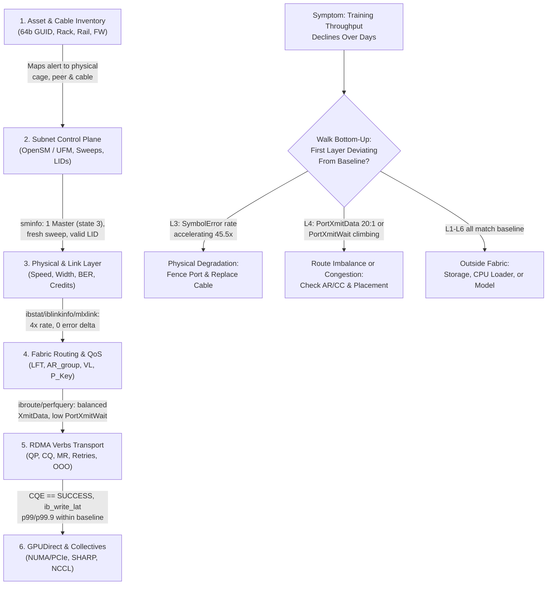
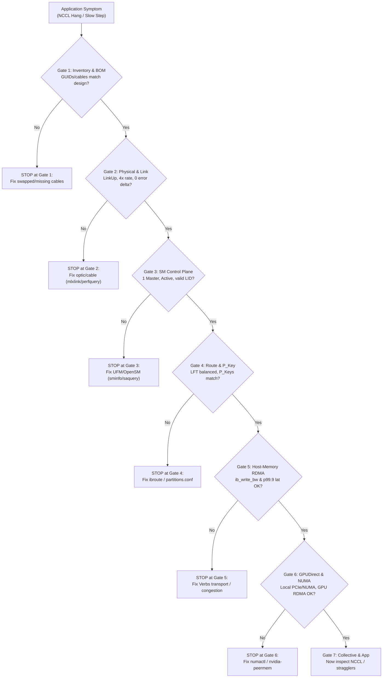

# 12.9 InfiniBand diagnostics, UFM and operations

| | |
|---|---|
| Level | Advanced |
| Priority tier | 1 |
| Lab venue | Nebius GPU |
| Part | Part 12: Complete AI networking |
| Sources | `nvidia-devops` V8 Ch. 9, Ch. 10, Ch. 12, `index.md` & Labs 01–04; `supercomputers-for-linux-sysadmins-managing-modern-hpc-clusters-and-supercomputers-from-software-to` Ch. 5; `bcm11-admin` §3.6.3 & §7.5; `superpod-b200-dc`; `superpod-gb300-ra`; `ai-data-center-network-design-and-technologies` Ch. 3, 8, 9 |
| Code | `code/part12/infiniband_diagnostics_ufm.py`, `code/part12/infiniband_diagnostics_ufm_lab.py` |
| Coverage file | `planning/coverage/chapters/12-09.md` |

## Why this matters for AI infrastructure

An InfiniBand fabric can pass every green "up/down" reachability dashboard and still quietly erode distributed training throughput over days or stall a thousand-GPU collective at a barrier. In one production incident across a `128`-node GPU cluster, every port reported `State: Active` and `Physical state: LinkUp`, yet distributed training step times varied by more than `20%` across racks because a replacement cable had negotiated down from `4x` to `1x` width, Adaptive Routing was misconfigured on the active Service Level, and several ranks were bound to remote Host Channel Adapters (`HCAs`) across NUMA sockets. In a second incident ("The Fabric Failed Slowly"), multi-day training throughput degraded while every link stayed `Active`; inspecting switch port `12` with `perfquery` showed `SymbolErrorCounter` climbing from `4` on Day `1` to `890` on Day `4` (`+886`, or `295.33` errors/day) and `41,200` on Day `7` (`+40,310`, or `13,436.67` errors/day—a **`45.5x` acceleration** in physical error rate) while `LinkDownedCounter` climbed from `0` to `3` to `11`. In a third incident ("The NCCL Timeout That Was Not an NCCL Problem"), engineers spent hours increasing `NCCL` timeout environment variables while an underlying `Active` port running at reduced lane width with rising physical errors corrupted RDMA retries underneath.

Operating production AI fabrics at scale requires two complementary capabilities:
1. **Mastery of the low-level OFED, `rdma-core`, and Mellanox Firmware Tools (`MFT`) diagnostic suite:** Knowing which utility inspects local HCA state (`ibstat`, `ibstatus`, `ibdev2netdev`, `ibv_devices`, `ibv_devinfo`, `show_gids`, `ofed_info`), which crawls subnet topology (`ibhosts`, `ibswitches`, `ibnodes`, `ibnetdiscover`, `iblinkinfo`), which traces paths and forwarding tables (`ibaddr`, `ibping`, `ibsysstat`, `ibtracert`, `ibroute`), which separates live node Subnet Management Packets (`smpquery` on `VL15`) from cached Subnet Administration database records (`saquery`), and which reads hardware Performance Management Agent (`PMA`) counters (`perfquery`, `ibqueryerrors`), SERDES Bit Error Rates and optical Digital Diagnostic Monitoring (`mlxlink`, `mst`), and multi-stage fabric health (`ibdiagnet`, `ibportstate`).
2. **Centralized fabric operations with NVIDIA Unified Fabric Manager (`UFM`) and disciplined 7-gate bottom-up triage:** Deploying UFM Enterprise (alongside UFM Telemetry and UFM Cyber-AI) in High Availability (`HA`) appliance pairs to manage OpenSM (`priority 15` master vs standby handover), `P_Key` partitions, and `SHARP` in-network reductions across DGX B200 (`400 Gbps` NDR, `1..4` SUs) and DGX GB300 (`800 Gbps` Quantum-X800 `Q3400-RD` `144`-port switches, `2..16` SUs / `9,216` GPUs) SuperPODs—while enforcing a strict 7-gate bottom-up troubleshooting workflow that stops at the lowest unproven layer and preserves counter evidence before any port reset.

## Prerequisites and outcomes

**Prerequisites:** Chapter 12.2 (RDMA verbs, Queue Pairs, and Completion Queues), Chapter 12.6 (InfiniBand link generations `SDR`–`GDR`, `GUID`/`LID`/`LMC`/`GID` addressing, `P_Key` partitions, `IPoIB`, and `VL0..VL15` `64`-byte credits), Chapter 12.7 (OpenSM master election, Directed Route `SMP`s, `LFT`/`MFT` routing engines, and rail-optimized topologies), and Chapter 12.8 (Adaptive Routing, `SHIELD`, and `FECN`/`BECN`/`CCTI` congestion control).

**Outcomes:** After completing this chapter, you will be able to:
- Classify and run all `27` core InfiniBand utilities across local HCA inspection, subnet inventory, path/forwarding verification, `VL15` control-plane auditing, and physical/optical counter diagnostics, while reconciling `SCL` Chapter 5 component identification (`49,151` unicast `LID`s `0x0001..0xBFFF`, multicast `0xC000..0xFFFE`, permissive `0xFFFF`, `0xFE80::/64` & `0xFEC0::/64` `GID`s, `20`-byte `IPoIB` hardware addresses, and `SDR`–`GDR` `4x`/`12x` bandwidths).
- Distinguish **state** from **cumulative counters** and **rates/deltas** in `perfquery` and `ibqueryerrors`, separate historical scar tissue (`SymbolErrorCounter` `12,034 -> 12,034` over `300 s`, delta `0`) from active degradation (`4 -> 890 -> 41,200`, `45.5x` acceleration) and pure credit congestion (`PortXmitWait = 998,432` with `0` symbol errors), and convert `PortXmitData`/`PortRcvData` `4`-octet words into bytes and Gbps.
- Diagnose physical SERDES and optical transceiver faults using `mst` and `mlxlink -d <dev> -c -m --json` (`Raw Physical BER` vs `Effective Physical BER` `15E-255`, per-lane errors, `850 nm` VCSEL module metadata, temperature `38 C` `[-10..80]`, voltage `3255.2 mV` `[3100..3500]`, laser bias `6.750 mA` `[5.492..8.5]`, `Rx Power [-14..6 dBm]`, and `Tx Power [-12..6 dBm]`).
- Audit Subnet Manager control-plane consistency by comparing live node `smpquery nodedesc 914` (`VL15` `SMP`) against cached SM `saquery 914` (`n51001 HCA-1`, `0x0012345600003740`), interpret `ibdiagnet` multi-stage reports, and safely fence or reset degraded ports with `ibportstate`.
- Architect and operate **NVIDIA UFM Enterprise**, **UFM Telemetry**, and **UFM Cyber-AI** (including HA failover, `SM` priority handover, REST API `P_Key` provisioning, `SHARP` Aggregation Manager, Base Command Manager `cmsh` `subnetmanager` / `Topograph` port `49021` integration, and DGX B200 / GB300 SuperPOD UFM appliance sizing), and execute the **7-gate bottom-up troubleshooting sequence** with `ib_write_bw` and `ib_write_lat` (`p99` / `p99.9` percentile) verification.

---

## 1. InfiniBand observability layers: state, counters, rates, and inventory context

### 1.1 The six-layer observability stack and why "port Active" is never enough

A single binary "port up/down" check cannot detect the failure modes that dominate production AI clusters: a `4x` NDR (`400 Gbps`) cable that trains down to `1x` width (`100 Gbps`), a transceiver whose pre-FEC Bit Error Rate (`BER`) is accelerating toward link recovery, a static forwarding table that pins `20x` more traffic onto two spine uplinks than their siblings, or a credit-starved destination port whose `PortXmitWait` backpressure spreads upstream across innocent jobs. Production observability must connect six layers from physical inventory up to distributed collectives, where each layer has an explicit baseline check that proves it is not the source of drift:



| Observability layer | Primary identifiers & objects | Baseline health verification | What divergence proves |
|---|---|---|---|
| **1. Asset & Topology Inventory** | `64`-bit `NodeGUID`, `PortGUID`, `SystemImage GUID`, cable serial (`MT2135FT12345`), rack/U, rail index (`0..7`), HCA/switch firmware (`28.39.2048`) | Discovered `ibnetdiscover` / `iblinkinfo` graph matches source-of-truth bill of materials (`BOM`) | Missing device, swapped rail cable after maintenance, or unapproved firmware drift |
| **2. Subnet Control Plane** | Master/Standby SM (`OpenSM` / `UFM`), `Base LID` (`1..49,151`), `LMC` (`2^LMC`), `GID` (`0xFE80::/64`, `0xFEC0::/64`), `P_Key` tables, `Trap 128` sweeps | `sminfo` reports `1` authoritative `SMINFO_MASTER` (`state 3`, `priority 15`) with climbing `activity count`; `smpquery` matches `saquery` | Port stuck in `State: Initializing` (`Base lid: 0`), split SM authority, stale SA database, or heavy-sweep storm |
| **3. Physical & Link Layer** | SERDES lanes (`4x`, `12x`), line coding (`8b/10b`, `64b/66b`, `256b/257b`), optical `Rx`/`Tx` dBm, `SymbolErrorCounter`, `LinkDownedCounter`, `64`-byte `CBFC` credits (`VL0..VL15`) | Negotiated speed (`SDR` `8G` to `NDR` `400G`, `XDR` `800G`, `GDR` `1600G` `4x`) and width (`4x`) match design; error counter **deltas** = `0` | Degraded fiber/transceiver (`45.5x` error rate acceleration), `1x` width fallback (`25%` bandwidth), or link flaps |
| **4. Fabric Routing & Congestion** | Switch virtual `Port 0`, `LFT` (`ibroute`), `AR_group`, `PortXmitData`/`PortRcvData` (`4`-octet words), `PortXmitWait`, `PortXmitDiscards`, `FECN`/`BECN` | Equal traffic distribution across sibling spine uplinks; low `PortXmitWait` gradient; `PortXmitDiscards` delta = `0` | Static `LFT` `20:1` uplink collision, `2:1` leaf oversubscription cut, or `N:1` destination congestion tree |
| **5. RDMA Transport (`Verbs`)** | Protection Domains (`PD`), Memory Regions (`MR`), Queue Pairs (`QP`, `max_qp: 262144`), Completion Queues (`CQ`), `RNR` NAK / timeout retries | `ib_write_bw` average tracks peak; `ib_write_lat` `99%` (`1.71 µs`) and `99.9%` (`1.98 µs`) percentiles match baseline; `CQE == IBV_WC_SUCCESS` | `Failed to modify QP to RTR` (`MTU`/`P_Key`/`GID` mismatch), `IBV_WC_RETRY_EXC_ERR` (`0x81`), or `2.91x` `p99.9` tail stall (`5.77 µs`) |
| **6. GPUDirect & Collectives** | PCIe root complex, NUMA affinity (`numactl`), `nvidia-peermem` / `DMA-BUF`, `IPoIB` (`ib0`, `20`-byte MAC, `4 KB` datagram vs `64 KB` connected), `SHARP`, `NCCL` | `nvidia-smi topo -m` shows `PIX`/`NODE` GPU-to-HCA affinity; multi-node `AllReduce` bus bandwidth scales within baseline | Cross-socket NUMA hairpin (`NUMA 1` vs `NUMA 0`), silent host-staged buffer copy, or single-rank compute straggler |

### 1.2 State versus cumulative counters versus rates of change

A foundational operational discipline in `nvidia-devops` Volume 08 Chapter 9 is distinguishing three telemetry primitives that engineers frequently conflate:

1. **State (current condition at an instant):** Port `Physical state` (`LinkUp`, `Polling`, `Disabled`, `Recovery`), logical `State` (`Active`, `Initialize`, `Armed`, `Down`), negotiated `Rate` (`56` Gb/sec `4x FDR`, `100` Gb/sec `4x EDR`, `200` Gb/sec `4x HDR`, `400` Gb/sec `4x NDR`, `800` Gb/sec `4x XDR`, `1600` Gb/sec `4x GDR`) and width (`4x` vs `1x`), assigned `Base lid` (`1..49,151`) and `LMC`, `SM lid`, and `P_Key` / route table entries.
2. **Cumulative counters (monotonically increasing totals since last reset or reboot):** Hardware registers maintained by each port's Performance Management Agent (`PMA`)—such as `SymbolErrorCounter`, `LinkErrorRecoveryCounter`, `LinkDownedCounter`, `PortRcvErrors`, `PortXmitDiscards`, `PortXmitWait`, `PortXmitData`, and `PortRcvData`. Because these registers accumulate over weeks or months of uptime (`Time Since Last Clear [Min]: 12824.8` in `mlxlink`), **a non-zero raw value alone only proves that an event occurred at some point in the past, not that a fault is active right now**.
3. **Rates and deltas (change across a defined observation window $\Delta t = t_1 - t_0$):** The difference $\Delta C = C(t_1) - C(t_0)$ and its first and second time derivatives ($\Delta C / \Delta t$ and acceleration across consecutive windows).

Consider two real production counter scenarios from Volume 08 Chapter 9 that look identical to a naive "alert if `SymbolErrorCounter > 0`" rule but require opposite operational actions:

```text
# Scenario A: High cumulative counter, zero delta ("Historical Scar Tissue", untested here)
$ perfquery <lid> 9 | grep SymbolErrorCounter; sleep 300; perfquery <lid> 9 | grep SymbolErrorCounter
SymbolErrorCounter:.............12034
SymbolErrorCounter:.............12034

# Scenario B: Low initial counter, 45.5x rate acceleration ("The Fabric Failed Slowly", untested here)
# Day 1:
$ perfquery <switch-lid> 12 | grep -E 'SymbolErrorCounter|LinkDownedCounter'
SymbolErrorCounter:.............4
LinkDownedCounter:..............0
# Day 4 (3 days later):
SymbolErrorCounter:.............890
LinkDownedCounter:..............3
# Day 7 (3 days later):
SymbolErrorCounter:.............41200
LinkDownedCounter:..............11
```

- **In Scenario A (`port 9`):** Although `SymbolErrorCounter` reads `12,034`, two snapshots separated by `300` seconds (`5` minutes) of active workload traffic show $\Delta \text{SymbolErrorCounter} = 12,034 - 12,034 = \mathbf{0}$. Those `12,034` errors are **historical scar tissue** (for example, from a cable reseat during last month's maintenance window). Replacing the cable on `port 9` wastes a maintenance window and risks introducing a real fault.
- **In Scenario B (`port 12`):** On Day `1`, `SymbolErrorCounter = 4` looks harmless compared to `12,034`. However, from Day `1` to Day `4` (`3` days), errors increase by $\Delta_{1\to 4} = 890 - 4 = \mathbf{886}$ (**`295.33` errors/day**) and `LinkDownedCounter` rises from `0` to `3`. From Day `4` to Day `7` (`3` days), errors jump by $\Delta_{4\to 7} = 41,200 - 890 = \mathbf{40,310}$ (**`13,436.67` errors/day**) while `LinkDownedCounter` reaches `11`. The error rate accelerated by:

$$
\text{Acceleration Factor} = \frac{40,310 / 3\text{ days}}{886 / 3\text{ days}} = \frac{13,436.67}{295.33} = \mathbf{45.5\times}
$$

Alerting on **error-rate delta and acceleration** catches `port 12` on Day `4`—days before the degrading transceiver forces repeated link recoveries and collapses cluster-wide training throughput—while ignoring the benign static `12,034` count on `port 9`.

### 1.3 Why inventory context and immutable GUIDs anchor every metric

An alert that fires with `"Switch LID 44 port 17 SymbolErrorCounter rising"` is operationally useless if an on-call engineer must spend `45` minutes manually tracing cables to discover which rack, which server, and which job own that link. As established in `SCL` Chapter 5 and Volume 08 Lab 01, InfiniBand networks use three distinct address families:
- **`64`-bit Hardware `GUID`s (`NodeGUID`, `PortGUID`, `SystemImage GUID`):** Burned in by the manufacturer. Each HCA has a `NodeGUID` and a per-port `PortGUID` (where Port 1's `PortGUID` may equal `NodeGUID`, e.g., `0x00123456000073f0` on Port 1 and `0x00265802000073f8` on Port 2 of a dual-port `MT4113` FDR HCA, or `0x08c0eb0300f1a2c3` on a single-port `MT4129` ConnectX-7 NDR HCA), while a switch uses the same `PortGUID` across all switch ports and a shared `SystemImage GUID` across all elementary switch chips in a modular chassis.
- **`16`-bit Subnet `LID`s (`Local ID`):** Assigned dynamically by the Subnet Manager during sweeping (`0x0000` reserved, `0x0001..0xBFFF` = `1..49,151` unicast limit via $2^{15} + 2^{14} - 1 = 49,151$, `0xC000..0xFFFE` = `49,152..65,534` multicast, and `0xFFFF` = `65,535` permissive LID for directed-route `SMP`s on `VL15`). When LID Mask Control (`LMC`, `0..7`) is non-zero, a port receives $2^{\text{LMC}}$ consecutive LIDs from `Base LID` to $\text{Base LID} + 2^{\text{LMC}} - 1$. Because `LID`s can change after an SM resweep or failover, **inventory databases and monitoring time series must always be keyed by `64`-bit `PortGUID`**, joining runtime `LID`, rack/U location, cable serial number, rail number, firmware version, and Slurm/Kubernetes job placement as metadata tags.
- **`128`-bit `GID`s (`Global ID`) and `20`-byte `IPoIB` Link Addresses:** Formatted as IPv6 addresses combining a `64`-bit prefix (`0xFE80::/64` link-localintra-subnet default, `0xFEC0::/64` site-local routable across IB routers, or `0xFF00::/8` multicast per `RFC 2373` / `RFC 2375`) with the `64`-bit `PortGUID`. When running TCP/IP over InfiniBand (`IPoIB` on interfaces `ib0`, `ib1`, such as NVIDIA Base Command Manager's `ibnet` `10.149.0.0/16` in `4 KB` datagram or `64 KB` connected mode), the link-layer hardware address is **`20` bytes long** (`1` byte flags + `3` bytes `QPN` + `16` bytes `GID`). Legacy `ifconfig` assumes a `6`-byte Ethernet MAC and truncates `IPoIB` addresses, so operational scripts must always use `ip addr` / `ip link` and static IP assignment rather than DHCP.

---

## 2. The complete InfiniBand diagnostic toolkit (`OFED`, `rdma-core`, and `MFT`)

### 2.1 Functional taxonomy of the 27 InfiniBand utilities

OpenFabrics Enterprise Distribution (`OFED` / `MLNX_OFED` / `DOCA-OFED`), `infiniband-diags`, `rdma-core`, and NVIDIA Mellanox Firmware Tools (`MFT`) provide `27` specialized utilities. Knowing which tool queries local kernel sysfs versus sending `VL15` Subnet Management Packets (`SMP`s), querying the Subnet Administration (`SA`) database, or reading Performance Management Agent (`PMA`) hardware registers prevents operators from running slow or state-mutating commands during an incident:

| Category | Utility | Target / mechanism | Mutates state? | Primary operational use and key flags |
|---|---|---|---|---|
| **1. Local Host & Verbs** | `ibstat` | Local HCA sysfs | No | Prints HCA type (`MT4113`, `MT4129`), FW (`10.12.1100`, `28.39.2048`), `Node GUID`, `System image GUID`, and per-port `State`, `Physical state`, `Rate`, **decimal** `Base lid` & `SM lid`, `LMC`, `Capability mask`, `Port GUID`, and `Link layer` |
| **1. Local Host & Verbs** | `ibstatus` | Local HCA sysfs script | No | Prints compact port status with `default gid`, **hexadecimal** `base lid` (`0x391`) & `sm lid` (`0x2b`), numeric state (`4: ACTIVE`, `5: LinkUp`), and explicit width/mode (`56 Gb/sec (4X FDR)`) |
| **1. Local Host & Verbs** | `ibdev2netdev` | Local kernel netdev map | No | Maps RDMA verbs devices and ports to OS network interfaces (`mlx5_0 port 1 ==> eth0 (Up)`, `mlx5_1 port 1 ==> ib0 (Up)`) |
| **1. Local Host & Verbs** | `ibv_devices` | Userspace verbs | No | Lists RDMA devices visible to userspace (`mlx5_0`, `mlx5_1`); first check when containers/VMs cannot see HCAs |
| **1. Local Host & Verbs** | `ibv_devinfo` | Userspace verbs (`-v -d`) | No | Detailed HCA capabilities: `fw_ver`, `vendor_id` (`0x02c9`), `vendor_part_id` (`4129`), `max_qp` (`262144`), `max_qp_wr` (`32768`), `max_sge` (`30`), `active_mtu` (`4096`) |
| **1. Local Host & Verbs** | `show_gids` | Local GID table | No | Displays per-port `GID` indices, IPv4-mapped GIDs, and RoCEv1/v2 or IB protocol versions |
| **1. Local Host & Verbs** | `ofed_info` | Package metadata (`-s`) | No | Prints installed `MLNX_OFED` / `DOCA-OFED` release version and driver component stack |
| **2. Subnet Inventory** | `ibhosts` | Subnet crawl / cache | No | Lists all Channel Adapter (compute/storage host) nodes discovered in the subnet with `PortGUID`, `LID`, and `NodeDescription` |
| **2. Subnet Inventory** | `ibswitches` | Subnet crawl / cache | No | Lists all InfiniBand switch ASICs in the subnet with `SwitchGUID`, `LID` (`Port 0`), port count, and switch name |
| **2. Subnet Inventory** | `ibnodes` | Subnet crawl / cache | No | Combined inventory of all discovered `ibhosts` and `ibswitches` in the subnet |
| **2. Subnet Inventory** | `ibnetdiscover` | `VL15` `SMP` crawl | No | Crawls the entire subnet topology (switches, HCAs, routers, and port-to-port links); supports `-p` (ports report) andtopology cache export |
| **2. Subnet Inventory** | `iblinkinfo` | `VL15` `SMP` + link query | No | Reports every switch port's state, negotiated speed (`400.0 Gbps`), lane width (`4x` vs `1x`), and connected peer GUID/LID/description |
| **3. Path & Forwarding** | `ibaddr` | Local/remote MAD query | No | Resolves the `GID` and `LID` range (`start_lid..end_lid` from `LMC`) of a local or specified port (`-C <ca> -P <port> <lid>`) |
| **3. Path & Forwarding** | `ibping` | GSI Vendor MAD ping | No | Tests IB management-datagram connectivity between two ports; requires running server **`ibping -S`** on target first, then client `ibping <lid>` (`-c 10`) |
| **3. Path & Forwarding** | `ibsysstat` | GSI sysstat MAD | No | Queries remote node hostname, CPU count, and memory info over InfiniBand management datagrams (`ibsysstat -S` server, `ibsysstat <lid> cpu`) |
| **3. Path & Forwarding** | `ibtracert` | Switch `LFT`/`MFT` trace | No | Traces the exact hop-by-hop switch ingress/egress path between source and destination `LID`s (`ibtracert <src-lid> <dst-lid>` or `-m <mlid>`) |
| **3. Path & Forwarding** | `ibroute` | `VL15` `SMP` `LFT`/`MFT` | No | Dumps a switch's programmed Linear Forwarding Table (`ibroute <sw-lid>`) or Multicast Forwarding Table (`-M`), showing `DLID -> Egress Port` |
| **4. SM & Control Plane** | `sminfo` | `VL15` `SMP` (`SMInfo`) | No | Queries the authoritative Subnet Manager (`sm lid 1`, `sm guid`, `activity count 184223`, `priority 15`, `state 3 SMINFO_MASTER`) |
| **4. SM & Control Plane** | `smpquery` | Direct `VL15` `SMP` to node | No | Queries hardware attributes directly from a target node (`smpquery nodedesc 914`, `portinfo`, `switchinfo`, `pkeys`, `sl2vl`, `vlarb`) |
| **4. SM & Control Plane** | `saquery` | GSI query to SM `SA` DB | No | Queries the Subnet Manager's cached Subnet Administration database (`saquery 914` `NodeRecord`, `PathRecord`, `MCMemberRecord`) |
| **5. Counters & PHY** | `perfquery` | GSI `PMA` port counters | **Only with `-R`** | Reads hardware error, wait, and throughput counters from any `LID`/port (`-a` all ports, `-x` extended `64`-bit counters, `-G` by GUID; **avoid `-R` reset during triage**) |
| **5. Counters & PHY** | `ibqueryerrors` | Subnet-wide `PMA` sweep | **Only with `-k`/`-K`** | Sweeps all switches in the subnet and prints only ports with non-zero error/wait counters (supports `--counters`, `--data`; **avoid `-k`/`-K` clear**) |
| **5. Counters & PHY** | `ibdiagnet` | Full multi-stage fabric audit | No | Comprehensive fabric diagnostic tool checking duplicate GUIDs, SM state, link speed/width, `PMA` counters, BER, routing loops, and `SHARP`; writes `/var/tmp/ibdiagnet2/` |
| **5. Counters & PHY** | `mlxlink` | Firmware register access | **Only with `-a`** | Reads SERDES BER (`-c`), optical module DDM (`-m`: temp, voltage, bias mA, Rx/Tx dBm), eye opening (`-e`), and JSON (`--json`) on `mlx5_0` or switch ports (`-p`) |
| **5. Counters & PHY** | `mst` | MFT PCI device manager | No | Starts/inspects Mellanox Software Tools `/dev/mst/*` device nodes (`mst start`, `mst status -v`) required by legacy MFT tools |
| **6. State Mutation** | `mlxconfig` | Non-volatile HCA NVM | **Yes (`set`)** | Queries (`mlxconfig -d <dev> q`) or modifies (`set`) HCA firmware parameters (`LINK_TYPE_P1=1` IB vs `2` ETH, `SRIOV_EN`, `NUM_OF_VFS`) |
| **6. State Mutation** | `ibportstate` | `VL15` `SMP` `SubnSet` | **Yes** | Queries or changes port state (`ibportstate <sw-lid> <port> disable`, `enable`, `reset`, `speed`, `width`) to isolate a flapping link |

:::tip Selecting the Adapter (`-C`) and Port (`-P`) on Multi-Rail Hosts
On multi-HCA GPU nodes (such as an `8`-rail DGX server with `mlx5_0..mlx5_7` or a dual-port HCA where Port 1 and Port 2 connect to different subnets), remember that the same `16`-bit `LID` (`e.g., LID 914`) can refer to completely different devices in different rails/subnets. Nearly all `infiniband-diags` utilities accept **`-C <ca_name>`** (for example, `-C mlx5_0`) and **`-P <port_num>`** (`1`-indexed, e.g., `-P 1`) to bind the query to a specific rail.
:::

### 2.2 Local HCA inspection: `ibstat` versus `ibstatus`, `ibdev2netdev`, and `ibv_devinfo`

As shown in `SCL` Chapter 5, `ibstat` and `ibstatus` query the same local HCA ports through `/sys/class/infiniband/` but format their output differently—a frequent source of confusion when cross-referencing decimal and hexadecimal `LID`s:

```text
# 1. `ibstat` output on a dual-port MT4113 FDR HCA (decimal LIDs, from SCL Ch. 5; untested here):
$ ibstat
CA 'mlx5_0'
    CA type: MT4113
    Number of ports: 2
    Firmware version: 10.12.1100
    Hardware version: 0
    Node GUID: 0x00123456000073f0
    System image GUID: 0x00123456000073f0
    Port 1:
        State: Active
        Physical state: LinkUp
        Rate: 56
        Base lid: 913
        LMC: 0
        SM lid: 43
        Capability mask: 0x26516848
        Port GUID: 0x00123456000073f0
        Link layer: InfiniBand
    Port 2:
        State: Active
        Physical state: LinkUp
        Rate: 56
        Base lid: 1361
        LMC: 0
        SM lid: 698
        Capability mask: 0x26516848
        Port GUID: 0x00265802000073f8
        Link layer: InfiniBand

# 2. `ibstatus` output on the exact same HCA (hexadecimal LIDs and explicit width/mode; untested here):
$ ibstatus
InfiniBand device 'mlx5_0' port 1 status:
    default gid:     fe90:0000:0000:0000:0000:0026:5802:0000:73f0
    base lid:        0x391
    sm lid:          0x2b
    state:           4: ACTIVE
    phys state:      5: LinkUp
    rate:            56 Gb/sec (4X FDR)
    link_layer:      InfiniBand

InfiniBand device 'mlx5_0' port 2 status:
    default gid:     fea0:0000:0000:0000:0000:0012:3456:0000:73f8
    base lid:        0x551
    sm lid:          0x2ba
    state:           4: ACTIVE
    phys state:      5: LinkUp
    rate:            56 Gb/sec (4X FDR)
    link_layer:      InfiniBand
```

Three diagnostic details stand out in this side-by-side comparison:
1. **Decimal vs Hexadecimal `LID`s:** On Port 1, `ibstat` prints `Base lid: 913` and `SM lid: 43` in decimal, whereas `ibstatus` prints `base lid: 0x391` ($3 \times 256 + 9 \times 16 + 1 = 913$) and `sm lid: 0x2b` ($2 \times 16 + 11 = 43$). On Port 2, `Base lid: 1361` equals `0x551` and `SM lid: 698` equals `0x2ba`. Notice also that Port 1 (`SM lid: 43`) and Port 2 (`SM lid: 698`) are managed by **two different Subnet Managers**, proving the two ports are cabled into two separate InfiniBand subnets/rails.
2. **Explicit Width and Mode in `ibstatus`:** While `ibstat` prints only the nominal rate integer (`Rate: 56` on FDR or `Rate: 400` on NDR), `ibstatus` prints **`56 Gb/sec (4X FDR)`** (or `400 Gb/sec (4X NDR)`), immediately exposing whether a `100 Gb/sec` link is a healthy `4X EDR` port or a degraded `1X NDR` port.
3. **Mapping RDMA Devices to OS Network Interfaces (`ibdev2netdev`):** On nodes with both Ethernet/RoCE and InfiniBand ports, `ibdev2netdev` maps each verbs device to its kernel netdev:

```text
# Mapping RDMA devices to Linux network interfaces (from SCL Ch. 5; untested here)
$ ibdev2netdev
mlx5_0 port 1 ==> eth0 (Up)
mlx5_1 port 1 ==> ib0 (Up)
```

Here `mlx5_0` runs in Ethernet/RoCE mode (`eth0`, where low-level counters are read via `ethtool -S eth0`), while `mlx5_1` runs in native InfiniBand mode (`ib0`, where counters across the entire fabric are read via `perfquery` and `ibqueryerrors`).

### 2.3 Comparing `smpquery` versus `saquery` to detect Subnet Manager database drift

When an operator needs to resolve which physical compute node owns `LID 914`—or verify whether the Subnet Manager's in-memory database matches physical reality—`SCL` Chapter 5 pairs `smpquery` with `saquery`:

```text
# 1. Direct VL15 SMP query to the node itself (bypasses SM database, from SCL Ch. 5; untested here):
$ smpquery nodedesc 914
Node Description:....................n51001 HCA-1

# 2. Subnet Administration (SA) query to the Subnet Manager's cached database (untested here):
$ saquery 914
NodeRecord dump:
        lid.....................914
        reserved................0x0
        base_version............0x1
        class_version...........0x1
        node_type...............Channel Adapter
        num_ports...............2
        sys_guid................0x0012345600003740
        node_guid...............0x0012345600003740
        port_guid...............0x0012345600003740
        partition_cap...........0x80
        device_id...............0x1011
        revision................0x0
        port_num................1
        vendor_id...............0x2C9
        NodeDescription.........n51001 HCA-1
```

**Why you must run both:** `smpquery nodedesc 914` sends a Subnet Management Packet (`SMP`) directly to `LID 914` on `VL15`, and the HCA on compute node `n51001` generates the reply itself. By contrast, `saquery 914` sends a General Services Interface (`GSI`) query to the **Subnet Manager**, which returns its cached `NodeRecord` (`sys_guid 0x0012345600003740`, `partition_cap 0x80` = `128` P_Keys, `device_id 0x1011` = `4113` `MT4113`, `vendor_id 0x2C9` = Mellanox).
- If `smpquery 914` succeeds (`n51001 HCA-1`) while `saquery 914` times out or returns an error, the physical path to `LID 914` is up, but **the Subnet Manager / SA daemon is down, wedged, or unreachable**.
- If `smpquery 914` returns `n51001 HCA-1` while `saquery 914` returns a different hostname or GUID, **the Subnet Manager's SA database is stale** (for example, a heavy sweep is blocked or failed after a cable swap).

---

## 3. Deep counter semantics (`perfquery`, `ibqueryerrors`) and optical/SERDES telemetry (`mlxlink`, `ibdiagnet`)

### 3.1 `perfquery` and `ibqueryerrors`: counter families, units, and diagnostic matrix

Because `perfquery` reads Performance Management Agent (`PMA`) registers over the InfiniBand fabric, an engineer logged into a single authorized management node (`UFM` node or head node) can query the hardware counters of **any remote switch port or compute HCA port in the subnet** without SSHing into the remote host (`perfquery -x <lid> <port>` or `perfquery -G <guid> <port>`).

| `perfquery` Counter Name | Hardware Semantics & Unit | Primary Root Cause When Delta > 0 | Operational Action |
|---|---|---|---|
| **`SymbolErrorCounter`** | Minor link coding violations (`8b/10b`, `64b/66b`, `256b/257b`) detected on physical lanes | Contaminated fiber end-face, marginal optical transceiver (`Rx dBm` low), bent DAC pin, or excessive cable bend radius | Check rate of change; run `mlxlink -c -m`; clean or replace cable/optic during maintenance before FEC saturates |
| **`LinkErrorRecoveryCounter`** | Times the physical link state machine entered `Recovery` and successfully retrained without dropping logical link | Severe transient bit error burst exceeding FEC recovery window | High-priority physical warning: inspect `mlxlink` per-lane errors and reseat/replace transceiver |
| **`LinkDownedCounter`** | Times link recovery **failed** and the physical port dropped to `Down` / `Polling` (generating OpenSM `Trap 128`) | Flapping cable, failing laser (`Bias Current` / `Tx Power`), or peer reboot/reset | **Critical:** Every increment triggers an SM heavy sweep (`Trap 128`). Fence port with `ibportstate disable` and replace hardware |
| **`PortRcvErrors`** | Total packets received with bad `VCRC`, `ICRC`, malformed length, or physical local link error | Corrupted frames arriving from the remote peer or transit cable | Inspect the **peer** transmitter (`Tx`) and the connecting cable with `iblinkinfo` and `mlxlink` |
| **`PortRcvRemotePhysicalErrors`** | Packets received marked with an End-of-Packet (`EBP`) delimiter indicating corruption occurred upstream before this link | Upstream link corruption propagated through cut-through switching | Trace backward along `ibtracert` to find the upstream port whose `SymbolErrorCounter` / `PortRcvErrors` is rising |
| **`PortXmitDiscards`** | Packets discarded by the transmitter before leaving the port | Invalid `DLID` / unprogrammed `LFT` entry (`ibroute`), `P_Key` violation, neighbor MTU exceeded, or **Switch Head-of-Queue (`HoQ`) lifetime timeout** | Verify `sminfo` sweep status, `ibroute` `LFT` coverage, `smpquery pkeys`, or severe downstream credit stall |
| **`PortXmitWait`** | Clock ticks where the port had packets ready to transmit but **zero downstream `64`-byte `CBFC` credits** on that Virtual Lane | **Lossless fabric congestion** (downstream N:1 incast, `2:1` oversubscription cut, or `LFT` route collision) | If `SymbolErrorCounter == 0` and `LinkDownedCounter == 0`, **do NOT replace cables**. Trace the `PortXmitWait` gradient to the congestion root |
| **`PortXmitData` / `PortRcvData`** | Total payload/framing data transmitted or received, measured in **`4`-octet (`32`-bit) words** (use `perfquery -x` for `64`-bit extended counters so counters do not wrap at `4 GiB`) | Normal traffic flow; **`20:1` ratio across equal-cost uplinks** (`21,474,836,480` B vs `1,073,741,824` B) proves static routing concentration | Multiply raw counter delta by **`4`** to get bytes: $\text{Bytes} = \Delta\text{Words} \times 4$; check `AR_group` and `LFT` balance |

### 3.2 `mlxlink` and `mst`: SERDES Bit Error Rate (`BER`) and optical DDM link budgets

Sometimes a link degrades at the physical SERDES or optical layer **before** `perfquery` increments `SymbolErrorCounter` or `LinkDownedCounter`—because Forward Error Correction (`FEC`) is silently correcting a rising storm of raw bit errors on one of the `4` parallel lanes. On NVIDIA ConnectX HCAs and Quantum switches, `mlxlink` (part of `mft` / `mstflint`) reads the low-level SERDES eye/BER counters (`-c`) and the optical transceiver's I2C Digital Diagnostic Monitoring (`DDM` / `DOM`) EEPROM (`-m`):

```text
# 1. Reading physical SERDES counters and BER with `mlxlink -c` (from SCL Ch. 5; untested here):
# mlxlink -d mlx5_1 -c
Operational Info
----------------
State                           : Active
Physical state                  : LinkUp
Speed                           : IB-EDR
Width                           : 4x
FEC                             : No FEC
Loopback Mode                   : No Loopback
Auto Negotiation                : ON
Supported Info
--------------
Enabled Link Speed              : 0x0000003f (EDR,FDR,FDR10,QDR,DDR,SDR)
Supported Cable Speed           : 0x0000003f (EDR,FDR,FDR10,QDR,DDR,SDR)
Troubleshooting Info
--------------------
Status Opcode                   : 0
Group Opcode                    : N/A
Recommendation                  : No issue was observed.
Physical Counters and BER Info
------------------------------
Time Since Last Clear [Min]     : 12824.8
Effective Physical Errors       : 0
Effective Physical BER          : 15E-255
Raw Physical BER                : 15E-255
Raw Physical Errors Per Lane    : 0,0,0,0
Link Down Counter               : 0
Link Error Recovery Counter     : 0

# 2. Reading optical module DDM telemetry with `mlxlink -m` (from SCL Ch. 5; untested here):
# mlxlink -d mlx5_1 -m
...
Module Info
-----------
Identifier                      : QSFP+
Compliance                      : N/A
Cable Technology                : 850 nm VCSEL
Cable Type                      : Active cable (active copper / optics)
OUI                             : Mellanox
Vendor Name                     : Mellanox
Vendor Part Number              : MFXXXXX-EXXX
Vendor Serial Number            : MT2135FT12345
Rev                             : B2
Attenuation (5g,7g,12g) [dB]    : N/A
FW Version                      : XX.XX.XXX
Wavelength [nm]                 : 850
Transfer Distance [m]           : 10
Digital Diagnostic Monitoring   : Yes
Power Class                     : 2.5 W max
CDR RX                          : ON,ON,ON,ON
CDR TX                          : ON,ON,ON,ON
LOS Alarm                       : N/A
Temperature [C]                 : 38 [-10..80]
Voltage [mV]                    : 3255.2 [3100..3500]
Bias Current [mA]               : 6.750,6.750,6.750,6.750 [5.492..8.5]
Rx Power Current [dBm]          : 0,0,0,0 [-14..6]
Tx Power Current [dBm]          : 0,0,0,0 [-12..6]
```

How to read `mlxlink -c -m` (and `mlxlink --json` for automated fleet scraping) like a senior fabric engineer:
1. **`Raw Physical BER` vs `Effective Physical BER` and `Raw Physical Errors Per Lane`:** `Raw Physical BER` measures the pre-FEC bit error rate coming off the SERDES receiver across all `4` lanes (`Raw Physical Errors Per Lane: 0,0,0,0`), whereas `Effective Physical BER` measures post-FEC residual errors delivered to the link layer. In the healthy output above, both read `15E-255` (`0` errors over `12,824.8` minutes). If `Raw Physical Errors Per Lane` shows `18,420` errors on Lane 2 (`0` on Lanes 0, 1, and 3) with `Raw Physical BER: 2E-5` while `Effective Physical BER` is `1E-13`, **Lane 2 is physically failing** (dirty MPO/MMC ferrule or dying VCSEL laser) and FEC is barely masking it.
2. **Optical DDM Threshold Brackets (`[min..max]`):** Every optical parameter in `Module Info` prints the live per-lane reading followed by the transceiver's hardware alarm range in brackets:
   - **`Temperature [C]: 38 [-10..80]`:** Transceiver case temperature (`38 C` is well below the `80 C` ceiling; high-power `400G`/`800G` OSFP/QSFP112 optics approaching `70..80 C` suffer laser wavelength drift and accelerated BER).
   - **`Voltage [mV]: 3255.2 [3100..3500]`:** `3255.2 mV` cage supply rail (`3100..3500 mV` allowed range).
   - **`Bias Current [mA]: 6.750,6.750,6.750,6.750 [5.492..8.5]`:** Laser diode drive current on Lanes `0..3`.
   - **`Rx Power Current [dBm]: 0,0,0,0 [-14..6]` and `Tx Power Current [dBm]: 0,0,0,0 [-12..6]`:** Optical power per lane in decibel-milliwatts (`0 dBm = 1.0 mW`). If `Rx Power Current` on Lane 2 drops to `-16.8 dBm` (outside `[-14..6 dBm]`) while the peer's `Tx Power Current` is normal (`0.4 dBm`), the fiber connector or patch cable on Lane 2 is attenuated or contaminated.
3. **Cable Inventory Provenance:** `mlxlink -m` extracts the exact `Vendor Part Number`, `Vendor Serial Number` (`MT2135FT12345`), `Wavelength [nm]: 850`, `Transfer Distance [m]: 10`, and `Power Class: 2.5 W max` electronically from the cable EEPROM—allowing operators to generate an RMA ticket with the exact serial number before a technician ever walks onto the data center floor.

### 3.3 `ibdiagnet`: multi-stage fabric-wide auditing

While `perfquery` and `mlxlink` inspect individual ports, **`ibdiagnet`** is NVIDIA's comprehensive fabric-wide validation suite. When invoked from a management or UFM host (`ibdiagnet -o /var/tmp/ibdiagnet2 --ber_test --pm_pause_time 30`), it executes a pipeline of automated checks across every reachable switch and HCA in the subnet and writes structured machine-readable files (`ibdiagnet2.log`, `ibdiagnet2.db_csv`, `ibdiagnet2.lst`, `ibdiagnet2.pm`, `ibdiagnet2.sm`, `ibdiagnet2.fdbs`, `ibdiagnet2.mlnx_cntrs`):
1. **Discovery & Duplicate GUID Check:** Crawls the subnet via SMPs and flags any duplicate `NodeGUID` or `PortGUID` entries.
2. **Links & Speed/Width Check:** Verifies that every link negotiates the highest mutually supported speed and width (`Enabled Link Speed` vs `Supported Cable Speed`).
3. **Subnet Manager Check (`ibdiagnet2.sm`):** Verifies that exactly one authoritative Master SM exists and all standbys respond.
4. **Performance Manager (`PM`) Counter Sweep (`ibdiagnet2.pm`):** Samples all port counters, sleeps for `--pm_pause_time` seconds, re-samples, and flags any port whose error counters incremented during the window.
5. **BER Validation (`--ber_test`):** Checks pre-FEC and effective BER against generation thresholds (`10^-12` / `10^-15`).
6. **Routing, Credit Loops, and `SHARP` Check (`ibdiagnet2.fdbs`):** Audits every switch's `LFT` and `MFT` for unreachable LIDs, routing loops, credit dependency cycles, and `SHARP` Aggregation Manager tree integrity.

---

## 4. NVIDIA Unified Fabric Manager (`UFM`) architecture and production operations

### 4.1 How UFM relates to OpenSM and the CLI tools: Enterprise, Telemetry, and Cyber-AI

A frequent misconception in technical interviews is that **NVIDIA Unified Fabric Manager (`UFM`)** replaces OpenSM, `ibstat`, `iblinkinfo`, or `ibdiagnet`. As detailed in `SCL` Chapter 5 and Volume 08 Chapter 9, UFM is **the centralized operational platform built on top of them**. It packages the Subnet Manager, high-frequency telemetry collectors, topology/routing engines, and REST/WebUI automation into three modular tiers:

1. **UFM Telemetry:** Low-overhead, high-frequency streaming telemetry engine (`clx` / `ibdiagnet`-based collectors) that polls hardware `PMA` counters, extended congestion counters (`PortXmitWait`, `FECN`/`BECN`), cable optical `DDM` sensors (temperature, `Rx`/`Tx` dBm), and BER across thousands of ports every few seconds without overloading `VL15`, exporting metrics to Prometheus, InfluxDB, or Grafana.
2. **UFM Enterprise:** The complete fabric management and control-plane suite. UFM Enterprise:
   - Runs and supervises the **OpenSM Subnet Manager** (`updn`, `ftree`, `ar_ftree`, `dor`, `dfsssp`) and the **SHARP Aggregation Manager (`AM`)** required for switch-offloaded in-network collective reductions (`AllReduce`, barriers).
   - Continuously joins real-time counter deltas with a physical topology source of truth (racks, rails, cable serial numbers, and Slurm/Kubernetes job placement) to render topology-aware heat maps and congestion trees.
   - Exposes a **REST API** (`/ufmRest/resources/systems`, `/ufmRest/resources/ports`, `/ufmRest/resources/pkeys`, `/ufmRest/app/events`, `/ufmRest/actions`) for automated `P_Key` partition provisioning, non-disruptive switch/HCA firmware rolling upgrades, and automatic unhealthy-port isolation (`Unhealthy Ports Policy`).
3. **UFM Cyber-AI:** An analytics and machine-learning appliance/engine that ingests historical UFM Telemetry and job logs to learn cluster baselines, predict impending optical cable failures from multi-day BER/temperature/power drift (catching the Day `1 -> 4 -> 7` curve automatically), detect abnormal tenant traffic or security anomalies, and correlate degraded jobs with specific fabric spine/leaf cuts.

### 4.2 UFM High Availability (`HA`), SM priority handover, and Base Command Manager (`BCM 11`) integration

Because the Subnet Manager and SHARP Aggregation Manager are critical control-plane dependencies, production clusters deploy UFM Enterprise on **two redundant UFM appliances (Master and Standby)** placed in independent rack and power failure domains:

- **UFM HA State Synchronization and Virtual IP:** The two UFM appliances form an active/passive HA cluster (using `DRBD` replicated storage and `Pacemaker`/`Corosync` with a floating Virtual IP) over the management network while both appliances connect to the InfiniBand fabric via dual HCA ports.
- **OpenSM Priority and Handover Rules (`priority 0..15`):** As covered in Chapter 12.7 and `nvidia-devops` Senior Deep Dive 4, OpenSM elects the instance with the **highest `sm_priority` (`0..15`)**, breaking ties by the **numerically lowest `64`-bit Port `GUID`**. In a UFM Enterprise HA pair, the active UFM Master runs OpenSM at a higher priority (e.g., `priority 15`, `state 3: SMINFO_MASTER`, `sm guid 0x0002c903004a1b20`, `activity count 184223`), while the standby UFM appliance runs its standby SM at a lower priority (e.g., `priority 8` or `14`, `state 2: SMINFO_STANDBY`). Importantly, both nodes **must share an identical, version-controlled `opensm.conf` and `partitions.conf` checksum**—otherwise an HA failover will keep the subnet reachable while silently changing the routing engine or dropping tenant `P_Key`s.
- **DGX B200 and DGX GB300 SuperPOD UFM Appliance Sizing:**
  - In the **NVIDIA DGX B200 SuperPOD** (`superpod-b200-dc`, `400 Gbps` NDR Quantum-2 switches, `458 kW` per Scalable Unit), **one physical UFM appliance is installed in the first Scalable Unit (`SU1`), displacing `1` of the `32` DGX B200 compute nodes**. Consequently, `1, 2, 3, and 4` SUs contain **`31, 63, 95, and 127` DGX B200 compute nodes** (**`248, 504, 760, and 1,016` GPUs**) connected across `8, 16, 24, and 32` leaf switches and `4, 8, 12, and 16` spine switches using `252, 508, 764, and 1,020` node cables (`248` compute links plus `4` UFM/management links in `SU1`) and `256, 512, 768, and 1,024` inter-switch links (`ISLs`), enforcing passive DAC `<= 5 m` (`100G`) / `<= 3 m` (`400G`), AOC `<= 30 m`, `< 90%` max cable distance margin, and zero patch panels.
  - In the **NVIDIA DGX GB300 SuperPOD** (`superpod-gb300-ra`, `800 Gbps` XDR Quantum-X800 `Q3400-RD` `144`-port switches with `SHARP`, `AR`, and `SHIELD`), a two-layer fat-tree scales across **`2, 4, 8, and 16` Scalable Units (`1,152, 2,304, 4,608, and 9,216` GPUs)** using **`16, 32, 64, and 128` leaf switches** and **`8, 18, 36, and 72` spine switches** under centralized UFM fabric management.
- **Base Command Manager (`BCM 11`) Integration (`cmsh` and `Topograph`):** In BCM-managed clusters (`bcm11-admin` §3.6.3 and §7.5), administrators configure redundant Subnet Managers via `cmsh` (`device roles <node>; assign subnetmanager` or `device services <node>; add opensm; set autostart yes; set monitored yes`) and run `IPoIB` on `ibnet` (`10.149.0.0/16`, `4 KB` datagram or `64 KB` connected mode). BCM's **`topograph`** (`topograph4`) service listens on HTTPS port **`49021`** (`/etc/topograph/topograph-config.yaml`, `Fetch timeout: 20 s`, `Fetch attempts: 12`, `Fetch wait time: 15 s`, exporting **`26` Prometheus measurables** at `https://localhost:49021/metrics`) to translate physical InfiniBand/UFM switch trees into `/cm/shared/apps/slurm/etc/<cluster>/topology.conf` for Slurm `topology/tree` and `topology/block` job placement.

---

## 5. The 7-gate bottom-up production troubleshooting methodology

### 5.1 Stopping at the first unproven layer (`V8` Ch. 10, Ch. 12, and Lab 04)

InfiniBand incidents almost always surface as vague application-level complaints: *"NCCL timed out after 30 minutes,"* *"Rank 42 is straggling,"* or *"AllReduce bandwidth dropped 35% after last night's switch maintenance."* As demonstrated in `nvidia-devops` Volume 08 Chapters 10 and 12 and Lab 04, the fastest way to resolve an incident is **never** to tweak application environment variables at random. Instead, operators walk a strict **7-gate bottom-up sequence** and **STOP at the first gate whose evidence diverges from a known-good baseline**:



| Gate | Layer & Verification Tools | Pass Criterion Against Baseline | What Failing This Gate Proves (`STOP` Rule) |
|---|---|---|---|
| **Gate 1: Inventory & Recent Change** | `ibnetdiscover`, `iblinkinfo`, `ibhosts`, `ibswitches`, `ibv_devinfo -v` (`MT4129`, `fw_ver: 28.39.2048`, `vendor_id: 0x02c9`, `max_qp: 262144`, `max_qp_wr: 32768`, `max_sge: 30`) | All expected HCAs, switches, firmware versions, and peer switch ports match the pre-maintenance snapshot | Post-maintenance topology drift (swapped rail cables or missing device); fix wiring before running any benchmarks |
| **Gate 2: Physical & Link State** | `ibstat`, `ibstatus`, `iblinkinfo`, `perfquery`, `ibqueryerrors`, `mlxlink -c -m` | `Physical state: LinkUp`, negotiated rate (`400` / `800` Gbps) and width (`4x`) match design, and `SymbolErrorCounter` / `LinkDownedCounter` **deltas = 0** | Degraded `1x` width (`V8` Ch. 10 Story), dirty fiber (`Rx Power` out of `[-14..6 dBm]`), or flapping link; **every layer above Gate 2 is unproven while Gate 2 fails** |
| **Gate 3: Subnet Management (`SM`)** | `sminfo`, `ibstat` (`State: Active`, `Base lid: 12`, `SM lid: 1`), `smpquery nodedesc 914` vs `saquery 914` | Exactly `1` `SMINFO_MASTER` (`state 3`, `priority 15`) with climbing `activity count` (`184,223`); `Base lid >= 1`; `smpquery` matches `saquery` | Port stuck in `State: Initializing` (`Base lid: 0`), split SM brains, or wedged SA database; do not touch QPs or NCCL |
| **Gate 4: Routing & Partitioning** | `ibroute`, `ibtracert`, `smpquery pkeys <lid> 1`, `perfquery` (`PortXmitData`, `PortXmitDiscards`) | Valid `LFT` entry on every hop; compatible `P_Key` (`0xffff` / `0x8021`) on both endpoints; balanced `PortXmitData` across spine uplinks | Missing route, `P_Key` partition rejection (`0x8021` vs `0x8035`), or `20:1` static `LFT` concentration (`21,474,836,480` B vs `1,073,741,824` B) |
| **Gate 5: Host-Memory RDMA** | `numactl`, `ib_write_bw --report_gbits`, `ib_write_lat` (`2` B, `1,000` iters with `99%` and `99.9%` percentiles), `perfquery` (`PortXmitWait`) | Host-to-host bandwidth (`397.62 Gbps` same-leaf) and `99.9%` tail latency (`1.98 µs`) match Lab 02 baseline; `CQE == IBV_WC_SUCCESS` | Fault is in RDMA verbs transport or fabric congestion (`PortXmitWait = 998,432`), **below** GPUDirect and NCCL |
| **Gate 6: GPUDirect RDMA & Locality** | `nvidia-smi topo -m`, `numactl --hardware`, `lspci -nn`, `perftest` with `--use_cuda` | Process/GPU bound to the NUMA node local to the selected HCA (`NUMA 0` ↔ `mlx5_0`); `nvidia-peermem` / `DMA-BUF` active without host bounce | Cross-socket NUMA hairpin (`NUMA node 1` bound to `NUMA node 0` HCA in Lab 04) or container missing `/dev/infiniband/*` |
| **Gate 7: Collective & Application** | `nccl-tests` (`all_reduce_perf`), `NCCL_DEBUG=INFO`, UFM job-to-port correlation, rank timelines | Multi-node collective bus bandwidth scales within baseline across `2..N` racks | Only when Gates 1–6 pass is the issue inside collective ring/tree scheduling, `2:1` multi-rack oversubscription (`397.62` vs `201.18 Gbps`), or a non-network rank straggler |

### 5.2 Reading `ib_write_lat` percentile tails against a baseline (`V8` Ch. 10 Step 6 & Lab 02)

A subtle trap at Gate 5 is looking only at `t_typical` or `t_avg` in `ib_write_lat` and declaring the RDMA path healthy. Compare the two `2`-byte, `1,000`-iteration Reliable Connected (`RC`) `ib_write_lat` runs from Volume 08 Chapter 10 Step 6:

```text
# Degraded path during incident investigation (untested here):
$ ib_write_lat -d mlx5_0 -i 1 -F <server>
---------------------------------------------------------------------------------------
                    RDMA_Write Latency Test
Connection type : RC          Using SRQ      : OFF
---------------------------------------------------------------------------------------
 #bytes #iterations    t_min[usec]    t_max[usec]  t_typical[usec]    t_avg[usec]    99% percentile[usec]   99.9% percentile[usec]
 2       1000           1.42           6.81         1.58              1.61            2.90                    5.77
---------------------------------------------------------------------------------------

# Known-good Lab 02 baseline on the exact same node pair and parameters:
 2       1000           1.41           2.03         1.55              1.56            1.71                    1.98
```

- **Why average latency misleads:** `t_typical` (`1.58 µs` vs `1.55 µs`, **`1.02x`**) and `t_avg` (`1.61 µs` vs `1.56 µs`) are within `2–3%` of baseline. An engineer who checks only average latency moves on to blame GPUDirect or NCCL.
- **Why tail percentiles expose the fault:** The **`99% percentile` (`2.90 µs` vs `1.71 µs`, `1.70x`)** and **`99.9% percentile` (`5.77 µs` vs `1.98 µs`, `2.91x`)**—along with `t_max` jumping from `2.03 µs` to `6.81 µs`—prove that `0.1%` to `1%` of operations are stalling nearly **`3x` longer** than baseline due to intermittent credit waits or physical lane recovery. Because every rank in a synchronized collective waits for the slowest transfer at every barrier, `p99` and `p99.9` tail latency directly govern training step time.

### 5.3 Incident evidence bundle and post-repair verification checklist

Before resetting any port (`ibportstate reset`), restarting OpenSM/UFM, or clearing any counter (`perfquery -R`), capture a timestamped, read-only **Incident Evidence Bundle** (`V8` Ch. 9, Ch. 10, and Labs 01–04):

```text
incident-id/
  timeline.txt          # UTC start time, symptom statement, maintenance correlation
  affected-nodes.txt    # Hostnames, GPUs, HCAs, rails, Slurm/K8s job IDs
  topology/             # ibnetdiscover, iblinkinfo, ibswitches, ibhosts snapshots
  port-state/           # ibstat, ibstatus, ibv_devinfo -v, show_gids, mlxlink -m
  counters-before/      # perfquery -x, ibqueryerrors, mlxlink -c at t0 (NO reset)
  counters-after/       # perfquery -x, ibqueryerrors, mlxlink -c at t1 + computed deltas
  sm-logs/              # sminfo, smpquery vs saquery, /var/log/opensm.log (Trap 128)
  routes/               # ibroute, ibtracert, smpquery pkeys / sl2vl
  host-rdma/            # numactl-pinned ib_write_lat (p99/p99.9) & ib_write_bw
  gpu-rdma/             # nvidia-smi topo -m, CUDA/GPUDirect bandwidth & latency
  collectives/          # nccl-tests / job collective logs
  versions/             # uname -a, ofed_info -s, HCA/switch FW, UFM version
  recent-changes/       # Diff against pre-maintenance topology/config snapshot
```

A repair is **complete** only when all nine verification gates are proven (`V8` Ch. 10): (1) intended topology is restored against BOM, (2) negotiated port speed and width (`4x`) match design, (3) physical error counter deltas remain `0` under load, (4) SM master/standby state is healthy, (5) route (`LFT`/`AR`) and `P_Key` state are valid, (6) host-memory RDMA (`ib_write_bw` and `ib_write_lat` `p99.9`) matches baseline, (7) GPU-memory RDMA matches baseline, (8) multi-node collective scaling matches baseline, and (9) alerts/runbooks are updated.

---

## Commands and configurations that matter

### 1. Host & Fabric Inventory Bundle (`V8` Lab 01 & `SCL` Ch. 5)

```bash
# Create a read-only timestamped inventory workspace (untested here)
mkdir -p volume08-lab01/{host,fabric,versions}
date --iso-8601=seconds | tee volume08-lab01/timestamp.txt
uname -a | tee volume08-lab01/versions/kernel.txt
ofed_info -s | tee volume08-lab01/versions/ofed.txt

# Enumerate local RDMA verbs devices, firmware, and queue-pair limits (untested here)
ibv_devices | tee volume08-lab01/host/ibv-devices.txt
ibv_devinfo -v -d mlx5_0 | tee volume08-lab01/host/ibv-devinfo-mlx5_0.txt

# Compare decimal (`ibstat`) and hex (`ibstatus`) port state + OS netdev mapping (untested here)
ibstat | tee volume08-lab01/host/ibstat.txt
ibstatus | tee volume08-lab01/host/ibstatus.txt
ibdev2netdev | tee volume08-lab01/host/ibdev2netdev.txt
show_gids 2>/dev/null | tee volume08-lab01/host/gids.txt || true
lspci -nn | grep -i -E 'infiniband|network' | tee volume08-lab01/host/pci-devices.txt
numactl --hardware | tee volume08-lab01/host/numa.txt

# Subnet-wide node, switch, and link discovery from an authorized management host (untested here)
ibhosts | tee volume08-lab01/fabric/ibhosts.txt
ibswitches | tee volume08-lab01/fabric/ibswitches.txt
ibnodes | tee volume08-lab01/fabric/ibnodes.txt
ibnetdiscover -p | tee volume08-lab01/fabric/ibnetdiscover-ports.txt
iblinkinfo | tee volume08-lab01/fabric/iblinkinfo.txt
```

### 2. Subnet Manager, Addressing, Path Tracing, and `smpquery` vs `saquery` (`SCL` Ch. 5 & `V8` Lab 03)

```bash
# Verify authoritative Master SM (`state 3 SMINFO_MASTER`, `priority 15`, climbing `activity count`; untested here)
sminfo

# Resolve port LID range / GID and test IB management-datagram reachability (untested here)
ibaddr -C mlx5_0 -P 1 914
# On target node (LID 914): ibping -S  |  ibsysstat -S
ibping -c 5 914
ibsysstat 914 host
ibsysstat 914 cpu

# Compare live node VL15 SMP response (`smpquery`) against SM cached SA database (`saquery`; untested here)
smpquery -C mlx5_0 -P 1 nodedesc 914
saquery -C mlx5_0 -P 1 914
smpquery -C mlx5_0 -P 1 pkeys 12 1

# Trace hop-by-hop path and inspect switch Linear Forwarding Table (`LFT`; untested here)
ibtracert 12 81
ibroute 44 | head -n 30
```

### 3. Hardware Counter Delta Collection, Optical DDM (`mlxlink`), `ibdiagnet`, and Safe Port Isolation

```bash
# Capture read-only before/after counter snapshots WITHOUT `-R` reset (untested here)
perfquery -x 44 12 > /tmp/port12_t0.txt
ibqueryerrors --counters > /tmp/fabric_errors_t0.txt
sleep 300
perfquery -x 44 12 > /tmp/port12_t1.txt
ibqueryerrors --counters > /tmp/fabric_errors_t1.txt
diff -u /tmp/port12_t0.txt /tmp/port12_t1.txt

# Inspect low-level SERDES BER (`-c`), optical transceiver DDM (`-m`), and JSON (`--json`; untested here)
mst start && mst status -v
mlxlink -d mlx5_1 -c -m
mlxlink -d mlx5_1 -c -m --json > /tmp/mlx5_1_mlxlink.json

# Run multi-stage fabric-wide `ibdiagnet` audit (untested here)
ibdiagnet -o /var/tmp/ibdiagnet2 --ber_test --pm_pause_time 30

# Safely fence (`disable`) a flapping switch port after capturing evidence, then re-enable after cable swap (untested here)
ibportstate 44 4
ibportstate 44 4 disable
# After physical optic/cable replacement and `mlxlink` verification:
ibportstate 44 4 enable
```

### 4. NUMA-Pinned Pairwise RDMA Baseline & UFM Enterprise REST API (`V8` Labs 02 & 04)

```bash
# Pin host-memory RDMA latency & bandwidth benchmarks to the HCA's local NUMA node (untested here)
# On server (NUMA 0): numactl --cpunodebind=0 --membind=0 ib_write_lat -d mlx5_0 -i 1 -F
# On client (NUMA 0):
numactl --cpunodebind=0 --membind=0 ib_write_lat -d mlx5_0 -i 1 -F <server-hostname>
numactl --cpunodebind=0 --membind=0 ib_write_bw -d mlx5_0 -i 1 --report_gbits -D 10 <server-hostname>

# Query UFM Enterprise REST API for fabric health, active alarms, and P_Key partitions (untested here)
curl -sk -u admin:<password> https://ufm-vip.cluster.local/ufmRest/app/ufm_version
curl -sk -u admin:<password> https://ufm-vip.cluster.local/ufmRest/app/events
curl -sk -u admin:<password> https://ufm-vip.cluster.local/ufmRest/resources/pkeys
```

---

## How it fails

| Failure Mode | Observable Symptom | Root-Cause Diagnosis (`Gate` & Tool Evidence) | Production Remediation |
|---|---|---|---|
| **1. "The Fabric Failed Slowly" (Accelerating Physical BER)** | Multi-day training throughput declines while every port reports `State: Active` and `LinkUp` on green dashboards | **Gate 2 (`perfquery` & `mlxlink`):** Switch `port 12` `SymbolErrorCounter` climbs `Day 1: 4 -> Day 4: 890 (+886, 295.33/day) -> Day 7: 41,200 (+40,310, 13,436.67/day)` (**`45.5x` acceleration**) with `LinkDownedCounter: 0 -> 3 -> 11` and `mlxlink -m` `Rx Power` below `-14 dBm` | Fence the port (`ibportstate <lid> 12 disable`), clean or replace the transceiver/cable using the serial number from `mlxlink -m`, and alert on counter **rate and acceleration** rather than static `Active` state |
| **2. Silent Lane-Width Degradation (`1x` vs `4x` NDR)** | Distributed training step time varies by `> 20%` or `NCCL` times out under load; `ibstat` still prints `State: Active` | **Gate 2 (`iblinkinfo` / `ibstatus` / `mlxlink`):** One lane fails training after a cable replacement, so the port negotiates `1x` width (`100 Gbps`) instead of `4x` (`400 Gbps`), bottlenecking every collective crossing that rail | Identify all `< 4x` ports with `iblinkinfo` or `ibdiagnet`, reseat/replace the damaged cable, verify `4x` width restoration, and alert whenever negotiated width `<` BOM design width |
| **3. Port Stuck in `State: Initializing` (`Base lid: 0`)** | Switch cage LED is solid green and `Physical state: LinkUp`, but the node cannot join `IPoIB` or `NCCL` collectives | **Gate 3 (`ibstat`, `sminfo`, `smpquery` vs `saquery`):** Physical layer succeeded, but `State: Initializing` and `Base lid: 0` prove the Subnet Manager has not programmed the port (`0` active masters in `sminfo`, frozen `activity count`, or broken `VL15` trunk) | Check `sminfo` and UFM/OpenSM logs; compare `smpquery nodedesc <lid>` against `saquery <lid>` to verify SM reachability and trigger a controlled sweep |
| **4. Pure Lossless Congestion Misdiagnosed as a Bad Cable** | Throughput drops under multi-job concurrency; engineers prepare to replace a clean optical cable | **Gate 4/5 (`perfquery`):** Switch `port 3` shows `PortXmitWait = 998,432` (or `184,320` vs `41` on sibling `port 7`) while `SymbolErrorCounter = 0` and `LinkDownedCounter = 0` | **Do NOT replace the cable.** Follow the `PortXmitWait` delta gradient downstream to the congestion tree root (`ports 3, 4` at `51,204` and `47,890`), verify `AR_group` / `ar_sl_mask`, or fix `2:1` oversubscribed job placement |
| **5. Host RDMA Passes (`ib_write_bw`), GPU RDMA / Collective Degrades** | Pairwise host-memory `ib_write_bw` hits `397.62 Gbps`, but GPU collectives run at half speed with high CPU system time | **Gate 6 (`numactl`, `nvidia-smi topo -m`, `V8` Lab 04):** Process/GPU is bound to `NUMA node 1` while `mlx5_0` is attached to `NUMA node 0` (or `nvidia-peermem` / container `/dev/infiniband` access is missing, forcing host-staged copies) | Pin rank CPU/memory/GPU affinity to the HCA's local NUMA domain (`numactl --cpunodebind=0 --membind=0`) and verify `PIX`/`NODE` GPUDirect DMA-BUF registration |
| **6. UFM / OpenSM Standby Failover Config Drift** | Fabric survives primary UFM appliance reboot, but cross-rack `AllReduce` slows down or tenant jobs lose connectivity after takeover | **Gate 3/4 (`evaluate_ufm_enterprise_ha`, `sminfo`, `ibroute`):** Standby SM (`priority 8` or `14`) took over `SMINFO_MASTER` with a drifted `opensm.conf` (`minhop` instead of `ar_ftree`) or stale `partitions.conf` checksum | Enforce identical SHA-256 checksums for `opensm.conf` and `partitions.conf` across UFM HA appliances via `DRBD`/BCM configuration overlays and run scheduled SM failover game days |

---

## Hands-on lab

This chapter's deterministic verification lab (`code/part12/infiniband_diagnostics_ufm.py` and `code/part12/infiniband_diagnostics_ufm_lab.py`) runs locally using the Python 3 standard library (`Nebius GPU` or any Linux/macOS workstation) and executes **28 self-checks** validating every diagnostic tool, counter equation, optical DDM threshold, `smpquery`/`saquery` comparison, UFM HA rule, and 7-gate troubleshooting scenario in this chapter:

```bash
python3 -B code/part12/infiniband_diagnostics_ufm_lab.py
```

```text
=== Chapter 12.9 Lab: InfiniBand Diagnostics, UFM and Operations ===
  [PASS] SCL Ch 5 Addressing & IPoIB: 49,151 unicast LIDs (0x0001..0xBFFF), multicast 0xC000..0xFFFE, permissive 0xFFFF, GID 0xFE80/0xFEC0/0xFF, 16 VLs (VL15 SMP, 64B credit), 20B IPoIB MAC (4KB datagram / 64KB connected)
  [PASS] SCL Ch 5 Table 5-1 Generation Bandwidths: SDR (8/24G), DDR (16/48G), QDR (32/96G), FDR (54.4/163.2G), EDR (100/300G), HDR (200/600G), NDR (400/1200G), XDR (800/2400G), GDR (1600/4800G)
  [PASS] SCL Ch 5 ibstat vs ibstatus formatting: Port 1 Base LID 913 == 0x391, SM LID 43 == 0x2b; Port 2 Base LID 1361 == 0x551, SM LID 698 == 0x2ba
  [PASS] OFED / MFT Utility Taxonomy: all 27 diagnostic utilities cataloged; only `mlxconfig` and `ibportstate` flagged as state-mutating
  [PASS] V8 Lab 01 HCA & Port Inventory (`MT4129` ConnectX-7): fw 28.39.2048, vendor 0x02c9, GUID 0x08c0eb0300f1a2c3, max_qp 262,144, max_qp_wr 32,768, max_sge 30, Base lid 12, SM lid 1, cap_mask 0x2651e848
  [PASS] V8 Ch 9 Scenario 1 Historical Scar Tissue (`perfquery <lid> 9` over 300 s): SymbolErrorCounter 12,034 -> 12,034 (delta=0) classified as HISTORICAL_SCAR_TISSUE
  [PASS] V8 Ch 7 / Ch 10 Pure Congestion (`switch port 3`): PortXmitWait delta=998,432 with SymbolErrorCounter=0 & LinkDownedCounter=0 classified as PURE_CONGESTION
  [PASS] V8 Ch 7 / Ch 10 Physical Link Fault (`switch port 4`): SymbolErrorCounter=41 & LinkDownedCounter=2 classified as FLAPPING_LINK_FAULT
  [PASS] perfquery PortXmitDiscards delta=250 classified as ROUTING_OR_POLICY_DISCARD (LFT, P_Key, MTU, or HoQ lifetime drop)
  [PASS] V8 Ch 6 PortXmitData 4-octet conversion: Port 5 (5,368,709,120 words = 21,474,836,480 B) vs Port 7 (268,435,456 words = 1,073,741,824 B) = 20.0:1 ratio
  [PASS] V8 Ch 9 'The Fabric Failed Slowly' (port 12): Day 1 (4) -> Day 4 (890, +886 = 295.33/day) -> Day 7 (41,200, +40,310 = 13,436.67/day) = 45.5x acceleration, LinkDowned 0->3->11
  [PASS] SCL Ch 5 mlxlink -d mlx5_1 -c -m healthy baseline: IB-EDR 4x, mask 0x3f, 12824.8 min, BER 15E-255, 850nm VCSEL 10m 2.5W, 38C [-10..80], 3255.2mV [3100..3500], 6.750mA [5.492..8.5], Rx/Tx 0 dBm -> HEALTHY
  [PASS] mlxlink degraded lane 2 Rx optical power (-16.8 dBm < -14.0 dBm floor): rx_power_in_spec=False -> OPTICAL_POWER_OUT_OF_SPEC
  [PASS] V8 Ch 10 Story width degradation: Active port negotiated at 1x instead of 4x classified as LANE_WIDTH_DEGRADED
  [PASS] SCL Ch 5 smpquery vs saquery on LID 914 (`n51001 HCA-1`, GUID 0x0012345600003740): detects consistent SA, stale SA record, and unreachable SM
  [PASS] ibdiagnet multi-stage parser: clean 8-stage run passes (0 errors), degraded run pinpoints first failing stage ('Links Check') and tallies 7 errors
  [PASS] Post-maintenance topology drift audit: detects 1 missing link, 2 swapped rail cables, and 1 width-downgraded (1x@400G) link
  [PASS] UFM Enterprise HA & sminfo election: priority 15 master (GUID 0x0002c903004a1b20, activity 184,223, state 3, Trap 128) is HA ready; tie-breaker selects lowest GUID and flags config drift
  [PASS] superpod-b200-dc UFM Appliance & Cabling: 458 kW/SU, 1 UFM appliance displaces 1 node (31, 63, 95, 127 nodes; 248, 504, 760, 1,016 GPUs; 1,020 node + 1,024 ISL cables at 4 SUs; DAC <=5m/3m, AOC <=30m, 90% margin)
  [PASS] superpod-gb300-ra Quantum-X800 scaling: 144-port Q3400-RD at 800 Gbps scales across 2, 4, 8, 16 SUs (1,152, 2,304, 4,608, 9,216 GPUs; 16..128 leaves; 8..72 spines)
  [PASS] BCM 11 (§3.6.3 & §7.5): ibnet 10.149.0.0/16, Topograph HTTPS port 49021, timeout 20s, 12 attempts, 15s wait, 26 Prometheus measurables
  [PASS] V8 Ch 10 Step 6 ib_write_lat percentile audit (2B, 1000 iters): typical 1.58 vs 1.55 us (1.02x, looks healthy), but p99 is 2.90 vs 1.71 us (1.70x) and p99.9 is 5.77 vs 1.98 us (2.91x -> tail_is_degraded)
  [PASS] 7-Gate Triage Gate 2 (V8 Ch 10 Story): stops at GATE_2_PHYSICAL when width/errors fail, even if higher layers also report timeouts
  [PASS] 7-Gate Triage Gate 3 (V8 Ch 10 Incident 2): stops at GATE_3_SM_CONTROL when port is LinkUp but stuck in Initializing (Base lid: 0)
  [PASS] 7-Gate Triage Gate 4 (V8 Ch 10 Incident 5): stops at GATE_4_ROUTING_PKEY when P_Key or LFT route is invalid
  [PASS] 7-Gate Triage Gate 5 (V8 Ch 10 Step 6): stops at GATE_5_HOST_RDMA when host-memory ib_write_bw/lat fails below GPUDirect
  [PASS] 7-Gate Triage Gate 6 (V8 Lab 04 & Ch 10 Incident 6): stops at GATE_6_GPUDIRECT_NUMA when host RDMA passes but GPU/NUMA locality is remote
  [PASS] 7-Gate Triage Gate 7 (V8 Ch 10 Step 7): reaches GATE_7_APPLICATION only after Gates 1-6 match baseline

Summary: 28 passed, 0 failed
```

---

## Common first mistakes

1. **Clearing counters with `perfquery -R` or `ibqueryerrors -k`/`-K` before capturing a delta:** Resetting hardware counters during an incident erases the cumulative error and wait history that proves which port degraded and when, blinding both peer engineers and UFM Telemetry collectors. Always take two read-only snapshots separated by a known window (`sleep 300`) and compute the delta.
2. **Replacing optical cables based on a single non-zero cumulative `SymbolErrorCounter`:** A counter value like `12,034` on a switch port that has been up for `12,824.8` minutes may have a current delta of **`0`** (`HISTORICAL_SCAR_TISSUE`). Conversely, a port with `SymbolErrorCounter = 890` whose rate accelerated **`45.5x`** (`295.33 -> 13,436.67` errors/day) is actively failing and must be replaced.
3. **Tuning `NCCL` timeouts while a physical port is negotiated at `1x` width or accumulating symbol errors:** In Volume 08 Chapter 10's opening incident, increasing `NCCL` retry/timeout parameters only made the job hang longer before failing because Gate 2 (`Physical & Link`) was already broken.
4. **Relying on `ibstat` alone to verify link width or on `t_typical` alone in `ib_write_lat`:** On many platforms `ibstat` prints `State: Active` and `Rate: 100` without highlighting that the port is a `4x NDR` (`400G`) link degraded to `1x` width; always cross-check width with `iblinkinfo`, `ibstatus`, or `mlxlink`. Similarly, in `ib_write_lat`, a `1.58 µs` typical latency (`vs 1.55 µs` baseline) can hide a **`2.91x` regression in `99.9%` tail latency (`5.77 µs` vs `1.98 µs`)**.
5. **Running `ibping <lid>` without starting `ibping -S` on the target, or using `ifconfig` on `ib0`:** Unlike ICMP `ping`, `ibping` (and `ibsysstat`) requires a user-space MAD server daemon (`ibping -S`) running on the destination node. And because `IPoIB` hardware addresses are **`20` bytes** (`flags + QPN + GID`), legacy `ifconfig` truncates them (`6`-byte Ethernet MAC limit); always use `ip addr`.

---

## Exercises

1. **OFED Utility Selection and `ibstat` vs `ibstatus` / `smpquery` vs `saquery` Analysis (`SCL` Ch. 5):**
   - (a) On a dual-port `MT4113` FDR HCA (`FW 10.12.1100`), `ibstat` reports Port 1 `Base lid: 913`, `SM lid: 43`, `Rate: 56` and Port 2 `Base lid: 1361`, `SM lid: 698`, `Rate: 56`. Convert all four `LID` values to hexadecimal as displayed by `ibstatus`, explain why the effective `4x FDR` user bandwidth is `54.4 Gbps` (`163.2 Gbps` `12x`) despite `Rate: 56` (`14.0625 Gbps` raw `64b/66b`), and state what the two different `SM lid` values prove about the cabling.
   - (b) Using `compare_smpquery_and_saquery` on `LID 914` (`n51001 HCA-1`, `GUID 0x0012345600003740`), state the exact operational diagnosis when: (i) both return `n51001 HCA-1`, (ii) `smpquery` returns `n51001 HCA-1` while `saquery` returns `n50999 HCA-1`, and (iii) `smpquery` succeeds while `saquery` times out.

2. **`perfquery` Counter Delta Classification and Rate-of-Change Acceleration (`V8` Ch. 6, 7, 9, 10):**
   - (a) Using `audit_perfquery_counter_deltas`, classify the root cause and state the correct remediation for four switch ports: (i) `port 9` over `300 s`: `SymbolErrorCounter` `12,034 -> 12,034`, `PortXmitData` `0 -> 5,368,709,120` words (`21,474,836,480` B); (ii) `port 3` over `60 s`: `PortXmitWait` `0 -> 998,432`, `SymbolErrorCounter = 0`, `LinkDownedCounter = 0`; (iii) `port 4` over `60 s`: `PortXmitWait` `0 -> 2,109`, `SymbolErrorCounter` `0 -> 41`, `LinkDownedCounter` `0 -> 2`; and (iv) `port 11` over `60 s`: `PortXmitDiscards` `10 -> 260`.
   - (b) Using `evaluate_error_rate_acceleration` on switch `port 12` (`Day 1: 4`, `Day 4: 890`, `Day 7: 41,200` `SymbolErrorCounter`; `LinkDownedCounter` `0 -> 3 -> 11`), compute the `3`-day deltas, daily error rates (`errors/day`), and exact acceleration factor.

3. **`mlxlink` SERDES BER and Optical DDM Link-Budget Audit (`SCL` Ch. 5):**
   - (a) For the `mlxlink -d mlx5_1 -c -m` output in Section 3.2 (`IB-EDR`, `4x`, speed mask `0x0000003f`, `12,824.8 min`, `BER = 15E-255`, `850 nm` VCSEL, `10 m`, `2.5 W`, `38 C` `[-10..80]`, `3255.2 mV` `[3100..3500]`, `6.750 mA` `[5.492..8.5]`, `Rx 0 dBm` `[-14..6]`, `Tx 0 dBm` `[-12..6]`), verify why `evaluate_mlxlink_module_health` returns `HEALTHY`.
   - (b) Re-evaluate the module when Lane 2 reports `Rx Power Current = -16.8 dBm` (`rx_power_dbm_per_lane = (-1.2, -1.4, -16.8, -1.3)`) and `18,420` raw physical errors on Lane 2, or when an `IB-NDR` port trains at `1x` width instead of `4x`.

4. **`ibdiagnet` Stage Parsing and Post-Maintenance Topology Drift (`V8` Ch. 10 & Lab 01):**
   - (a) Run `evaluate_ibdiagnet_stages` on a 6-stage `ibdiagnet` output where `Discovery` (`0, 0`) and `Duplicated GUIDs` (`0, 0`) pass, `Links Check` reports `(1 warning, 2 errors)`, `Subnet Manager` reports `(0, 0)`, `Port Counters` reports `(3, 4)`, and `BER Test` reports `(0, 1)`. State `fabric_healthy`, `first_failing_stage`, and total error count.
   - (b) Using `audit_topology_against_source_of_truth`, compare the `4`-link expected `400G` `4x` rail map (`n01`/`n02` to `leaf01`/`leaf02`) against the post-maintenance `iblinkinfo` snapshot where `n01:mlx5_0:p1` and `n01:mlx5_1:p1` swapped leaves, `n02:mlx5_0:p1` trained at `1x@400G`, and `n02:mlx5_1:p1` is missing.

5. **UFM Enterprise HA Election, BCM `Topograph`, and DGX B200 / GB300 SuperPOD Scaling:**
   - (a) Using `evaluate_ufm_enterprise_ha`, determine which appliance wins `SMINFO_MASTER` (`state 3`) and whether HA is ready when: (i) `ufm-appliance-01` (`GUID 0x0002c903004a1b20`, `priority 15`, hash `sha256:9f86d08`) pairs with `ufm-appliance-02` (`GUID 0x08c0eb0300f1a2c3`, `priority 8`, same hash), vs (ii) both run at `priority 14` with mismatched configuration hashes.
   - (b) Explain why a `1..4` SU DGX B200 SuperPOD (`458 kW`/SU) has `31, 63, 95, 127` compute nodes (`248, 504, 760, 1,016` GPUs; `1,020` node cables and `1,024` ISLs at `4` SUs), how a `2..16` SU DGX GB300 SuperPOD scales with `144`-port `800G` `Q3400-RD` switches (`1,152..9,216` GPUs, `16..128` leaves, `8..72` spines), and how BCM `Topograph` (port `49021`, `26` measurables) updates Slurm `topology.conf`.

6. **7-Gate Bottom-Up Incident Triage and `ib_write_lat` Percentile Analysis (`V8` Ch. 10 & Lab 04):**
   - (a) Using `evaluate_ib_write_lat_percentiles` on a `2`-byte, `1,000`-iteration test (`t_typical = 1.58 µs` vs `1.55 µs` baseline; `99% = 2.90 µs` vs `1.71 µs`; `99.9% = 5.77 µs` vs `1.98 µs`), compute `typical_ratio`, `p99_ratio`, and `p999_ratio`, and explain why `average_looks_healthy = True` while `tail_is_degraded = True`.
   - (b) Using `run_seven_gate_bottom_up_triage`, identify the exact stopping gate (`GATE_1..GATE_7`) and stop layer number (`1..7`) for: (i) a `1x` width cable causing NCCL timeouts, (ii) a port with `LinkUp` + `State: Initializing` (`Base lid: 0`), (iii) a `P_Key` mismatch (`0x8021` vs `0x8035`), (iv) a host RDMA `p99.9` tail regression, and (v) a benchmark bound to `NUMA node 1` while `mlx5_0` is on `NUMA node 0`.

---

## Interview angles

1. **"Why are cumulative InfiniBand port counters (`perfquery`) easy to misinterpret during an outage, and how do you distinguish historical scar tissue, active physical degradation, and lossless congestion?"**
   - **Strong answer:** Hardware `PMA` counters (`SymbolErrorCounter`, `LinkDownedCounter`, `PortXmitWait`) accumulate since the last reboot or counter clear (`12,824.8` minutes in `mlxlink`). A high value like `SymbolErrorCounter = 12,034` with **zero delta** over a `300`-second active workload window is historical scar tissue—do not replace the cable. If `SymbolErrorCounter` and `LinkDownedCounter` deltas are actively climbing and accelerating (e.g., `4 -> 890 -> 41,200` over `6` days, a `45.5x` rate acceleration), the physical cable or transceiver is degrading; confirm with `mlxlink -c -m` (`Raw Physical BER` per lane and `Rx/Tx Power [dBm]`). Conversely, if `PortXmitWait` climbs rapidly (`998,432`) while `SymbolErrorCounter` and `LinkDownedCounter` stay flat at `0`, the physical link is completely healthy and the port is stalling for downstream `64`-byte `CBFC` credits (`PURE_CONGESTION`). Never run `perfquery -R` during triage because clearing counters destroys the evidence trail.

2. **"How does NVIDIA UFM (Unified Fabric Manager) fit alongside `opensm`, `ibstat`, `iblinkinfo`, `perfquery`, and `ibdiagnet`?"**
   - **Strong answer:** UFM does not replace the Subnet Manager or the low-level CLI diagnostic mechanisms; it is the centralized operational platform built on top of them. **UFM Enterprise** runs and supervises the authoritative `OpenSM` (`priority 15` master with standby HA handover) and the `SHARP` Aggregation Manager (`AM`), **UFM Telemetry** continuously streams `PMA` counters, congestion metrics, and optical `DDM` parameters into time-series storage without overloading `VL15`, and **UFM Cyber-AI** correlates multi-day BER/thermal drift with job placement to predict cable failures before links drop. Engineers still rely on `ibstat`, `sminfo`, `smpquery`/`saquery`, `perfquery`, `mlxlink`, and `ibdiagnet` for targeted verification, host-side checks, and any incident where the management plane itself is under investigation.

3. **"An AI training team pages you because a 128-node NCCL job is timing out, and they want to increase `NCCL_IB_TIMEOUT`. Walk through your exact troubleshooting sequence."**
   - **Strong answer:** Increasing `NCCL` timeouts masks physical or transport faults and makes failed jobs hang longer (`V8` Ch. 10 Story). Walk the **7-gate bottom-up workflow** and stop at the first failing gate: (1) **Inventory:** diff `ibnetdiscover`/`iblinkinfo` against the BOM for swapped or missing cables; (2) **Physical/Link:** check `ibstat`, `iblinkinfo`, `mlxlink -c -m`, and `perfquery` deltas to verify `LinkUp`, `4x` width (`400G`/`800G`), and `0` new symbol/recovery errors; (3) **Control Plane:** check `sminfo` (`1` `SMINFO_MASTER`, climbing `activity count`), `State: Active`, `Base lid >= 1`, and `smpquery` vs `saquery`; (4) **Routing & `P_Key`:** verify `ibroute` `LFT` balance (`PortXmitData` `x 4` bytes) and `smpquery pkeys`; (5) **Host-Memory RDMA:** run NUMA-pinned `ib_write_bw` and `ib_write_lat` checking `99%` and `99.9%` percentiles (`5.77 µs` vs `1.98 µs` baseline); (6) **GPUDirect & Locality:** verify `nvidia-smi topo -m`, `numactl` (`NUMA 0` vs `NUMA 1`), and `nvidia-peermem`/`DMA-BUF`; (7) **Collective/App:** only after Gates 1–6 pass do you inspect `NCCL` collective rings/trees or rank stragglers.

---

## Checkpoint questions (20)

<details><summary><strong>1. Why is a green "port Active" dashboard insufficient for operating an AI InfiniBand fabric?</strong></summary>

`State: Active` only proves that physical lane training (`LinkUp`) and initial Subnet Manager admission succeeded. A port can remain `Active` while negotiated at `1x` width (`25%` of `4x` bandwidth), accumulating accelerating `SymbolErrorCounter` and `LinkErrorRecoveryCounter` events (`45.5x` rate growth), suffering `20:1` static `LFT` route imbalance, or stalling on `PortXmitWait` credit backpressure.
</details>

<details><summary><strong>2. What is the difference between state, cumulative counters, and rates/deltas in InfiniBand telemetry?</strong></summary>

- **State** describes the current instantaneous configuration (`Physical state: LinkUp`, `State: Active`, `Rate: 400`, `Width: 4x`, `Base lid: 12`, `SM lid: 1`).
- **Cumulative counters** (`SymbolErrorCounter`, `LinkDownedCounter`, `PortXmitWait`) accumulate events monotonically since the last reset or reboot.
- **Rates and deltas** ($\Delta C = C(t_1) - C(t_0)$ over window $\Delta t$) measure whether errors or stalls are actively occurring and accelerating right now.
</details>

<details><summary><strong>3. Contrast the `perfquery` evidence on switch `port 9` (`SymbolErrorCounter: 12,034 -> 12,034` over `300 s`) with switch `port 12` (`Day 1: 4 -> Day 4: 890 -> Day 7: 41,200`, `LinkDownedCounter: 0 -> 3 -> 11`).</strong></summary>

On `port 9`, the `300`-second delta during active traffic is **`0`**, proving `12,034` is **historical scar tissue** that requires no hardware replacement. On `port 12`, the 3-day delta jumps from `+886` (`295.33` errors/day) to `+40,310` (`13,436.67` errors/day)—a **`45.5x` acceleration** accompanied by `11` link-down events—proving active physical degradation that requires immediate port isolation and cable/transceiver replacement.
</details>

<details><summary><strong>4. Why must monitoring systems anchor InfiniBand metrics on `64`-bit `GUID`s rather than `16`-bit `LID`s, and what are the four `16`-bit `LID` ranges?</strong></summary>

`64`-bit `NodeGUID` and `PortGUID` are persistent hardware identifiers, whereas `16`-bit `LID`s are runtime forwarding addresses assigned by the Subnet Manager that can change after sweeps or failovers. The `16`-bit `LID` space partitions into: `0x0000` (`0`, reserved), **`0x0001..0xBFFF` (`1..49,151`, $2^{15} + 2^{14} - 1$ unicast limit)**, **`0xC000..0xFFFE` (`49,152..65,534`, multicast)**, and **`0xFFFF` (`65,535`, permissive LID for directed-route `SMP`s on `VL15`)**.
</details>

<details><summary><strong>5. How do `ibstat` and `ibstatus` differ when reporting `Base lid`, `SM lid`, and link speed on the dual-port `MT4113` FDR HCA in `SCL` Chapter 5?</strong></summary>

`ibstat` prints `Base lid` and `SM lid` in **decimal** (`Port 1: Base lid 913, SM lid 43`; `Port 2: Base lid 1361, SM lid 698`) and rate as `Rate: 56`. `ibstatus` prints the exact same `LID`s in **hexadecimal** (`Port 1: base lid 0x391, sm lid 0x2b`; `Port 2: base lid 0x551, sm lid 0x2ba`), includes the `128`-bit `default gid`, and prints `rate: 56 Gb/sec (4X FDR)` (`54.4 Gbps` effective after `64b/66b` encoding).
</details>

<details><summary><strong>6. What is the difference between `ibhosts`, `ibswitches`, `ibnodes`, `ibnetdiscover`, and `iblinkinfo`?</strong></summary>

- `ibhosts` lists all Channel Adapter (compute/storage host) nodes in the subnet.
- `ibswitches` lists all switch nodes in the subnet.
- `ibnodes` lists both hosts and switches (`ibhosts + ibswitches`).
- `ibnetdiscover` crawls the entire subnet via `VL15` `SMP`s to produce the full port-to-port topology file.
- `iblinkinfo` prints one line per switch port showing negotiated link state, speed, width (`4x` vs `1x`), and connected peer description.
</details>

<details><summary><strong>7. How do `ibping` and `ibsysstat` work, and why does `ibping <lid>` fail if you treat it like ICMP `ping`?</strong></summary>

Both `ibping` and `ibsysstat` exchange user-space InfiniBand management datagrams (`GSI` MADs) rather than kernel ICMP packets. You must first start a server process on the target host (**`ibping -S`** or **`ibsysstat -S`**) before running the client (`ibping <lid>` or `ibsysstat <lid> cpu`).
</details>

<details><summary><strong>8. What is the difference between `smpquery nodedesc 914` and `saquery 914`, and what does a mismatch between them prove?</strong></summary>

`smpquery nodedesc 914` sends a direct `VL15` Subnet Management Packet (`SMP`) to `LID 914` and reads the live response (`n51001 HCA-1`) directly from the node's HCA. `saquery 914` queries the Subnet Manager's cached Subnet Administration (`SA`) database (`NodeRecord`, `sys_guid 0x0012345600003740`). If `smpquery` succeeds while `saquery` fails or returns a different node record, the **Subnet Manager / SA database is down, wedged, or out of sync**.
</details>

<details><summary><strong>9. How do you distinguish `SymbolErrorCounter`, `LinkErrorRecoveryCounter`, `LinkDownedCounter`, `PortRcvErrors`, `PortXmitDiscards`, and `PortXmitWait` in `perfquery`?</strong></summary>

- `SymbolErrorCounter`: Physical lane coding errors (marginal cable/optic).
- `LinkErrorRecoveryCounter`: Link entered hardware `Recovery` and retrained without dropping.
- `LinkDownedCounter`: Link recovery failed and physical link dropped to `Down` (triggers OpenSM `Trap 128`).
- `PortRcvErrors`: Frames received with bad CRC or physical errors.
- `PortXmitDiscards`: Packets dropped by transmitter due to invalid `DLID`/`LFT`, `P_Key`/MTU violation, or switch `HoQ` lifetime timeout.
- `PortXmitWait`: Ticks spent waiting for downstream `64`-byte `CBFC` credits (`PURE_CONGESTION` when physical error deltas are `0`).
</details>

<details><summary><strong>10. Why must you multiply `perfquery` `PortXmitData` and `PortRcvData` deltas by `4`, and why should you pass `-x` on `400G`/`800G` links?</strong></summary>

Per the IBTA specification, `PortXmitData` and `PortRcvData` count **`4`-octet (`32`-bit) words**, so $\text{Bytes} = \Delta\text{Words} \times 4$ (for example, `5,368,709,120` words $\times 4 = 21,474,836,480$ bytes). Without `-x` (`64`-bit extended counters), standard `32`-bit data counters saturate and clamp at $2^{32}-1$ words (`16 GiB`), which takes less than `0.35` seconds on a `400 Gbps` NDR link.
</details>

<details><summary><strong>11. In `mlxlink -d mlx5_1 -c -m`, what is the difference between `Raw Physical BER` and `Effective Physical BER`, and what are the healthy DDM ranges in the `SCL` Chapter 5 output?</strong></summary>

`Raw Physical BER` measures pre-FEC bit error rate across the physical SERDES lanes (`Raw Physical Errors Per Lane`), whereas `Effective Physical BER` measures post-FEC residual errors after Forward Error Correction. In the `SCL` Chapter 5 `850 nm` VCSEL module (`10 m`, `2.5 W`), healthy readings and hardware brackets are: **`Temperature: 38 C [-10..80]`**, **`Voltage: 3255.2 mV [3100..3500]`**, **`Bias Current: 6.750 mA [5.492..8.5]`**, **`Rx Power: 0 dBm [-14..6]`**, and **`Tx Power: 0 dBm [-12..6]`**.
</details>

<details><summary><strong>12. What stages does `ibdiagnet` execute across a subnet, and which output files does it generate in `/var/tmp/ibdiagnet2/`?</strong></summary>

`ibdiagnet` runs topology discovery, duplicate `GUID` verification, link speed/width checks, Subnet Manager verification, a two-sample `PM` counter delta sweep (`--pm_pause_time`), `BER` threshold testing (`--ber_test`), unicast/multicast `LFT`/`MFT` loop and credit-cycle checks, and `SHARP` tree validation—writing `ibdiagnet2.log`, `ibdiagnet2.db_csv`, `ibdiagnet2.lst`, `ibdiagnet2.pm`, `ibdiagnet2.sm`, `ibdiagnet2.fdbs`, and `ibdiagnet2.mlnx_cntrs`.
</details>

<details><summary><strong>13. How do `ibportstate` and `mlxconfig` differ from the other 25 diagnostic utilities, and how do you safely isolate a flapping switch port?</strong></summary>

Unlike read-only inspection utilities, **`ibportstate`** (`disable`, `enable`, `reset`, `speed`, `width`) and **`mlxconfig`** (`set`) **mutate live port or non-volatile HCA firmware state**. After capturing a read-only evidence bundle (`perfquery`, `mlxlink -c -m`, `iblinkinfo`), an operator isolates a flapping switch port by running `ibportstate <switch-lid> <port> disable` so it stops generating `Trap 128` heavy sweeps across the fabric until the cable is replaced.
</details>

<details><summary><strong>14. Compare NVIDIA UFM Telemetry, UFM Enterprise, and UFM Cyber-AI.</strong></summary>

- **UFM Telemetry:** High-frequency streaming collector for hardware `PMA` counters, congestion metrics, optical `DDM` sensors, and BER exported to Prometheus/Grafana.
- **UFM Enterprise:** Complete control-plane and fabric management platform hosting `OpenSM`, the `SHARP` Aggregation Manager (`AM`), topology-aware congestion/error dashboards, `Unhealthy Ports` isolation policies, and a REST API (`/ufmRest/*`) for `P_Key` and firmware management.
- **UFM Cyber-AI:** Machine-learning analytics platform that learns cluster baselines, predicts impending cable/transceiver failures from multi-day BER/DDM drift, and correlates job slowdowns with fabric anomalies.
</details>

<details><summary><strong>15. How does UFM Enterprise High Availability (`HA`) handle OpenSM election (`priority 0..15`), and why is configuration checksum parity mandatory?</strong></summary>

UFM Enterprise HA runs across two redundant appliances with `DRBD` state replication and a floating Virtual IP. OpenSM elects the instance with the **highest `sm_priority` (`0..15`)** (e.g., Master at `priority 15`, Standby at `priority 8` or `14`), breaking equal-priority ties by the **lowest numerical `64`-bit Port `GUID`**. Both appliances must share identical `opensm.conf` and `partitions.conf` checksums so a failover does not switch routing engines or drop tenant `P_Key` partitions.
</details>

<details><summary><strong>16. How are UFM appliances and cables sized in the DGX B200 (`400G` NDR) and DGX GB300 (`800G` XDR `Q3400-RD`) SuperPOD reference architectures?</strong></summary>

In a **DGX B200 SuperPOD** (`458 kW`/SU), `1` UFM appliance in `SU1` displaces `1` compute node, yielding **`31, 63, 95, and 127` compute nodes (`248, 504, 760, and 1,016` GPUs)** across `1..4` SUs with `8..32` leaves, `4..16` spines, `252..1,020` node cables, and `256..1,024` ISLs (`DAC <= 5 m` at `100G` / `<= 3 m` at `400G`, `AOC <= 30 m`, `< 90%` max distance rule). In a **DGX GB300 SuperPOD**, `144`-port `800 Gbps` `Q3400-RD` switches scale a two-layer fat-tree across **`2, 4, 8, and 16` SUs (`1,152, 2,304, 4,608, and 9,216` GPUs)** with **`16..128` leaves** and **`8..72` spines**.
</details>

<details><summary><strong>17. How does NVIDIA Base Command Manager (`BCM 11`) integrate InfiniBand (`ibnet`) and fabric topology (`Topograph`) with Slurm?</strong></summary>

BCM provisions `IPoIB` on `ibnet` (`10.149.0.0/16`, `20`-byte hardware address, `4 KB` datagram or `64 KB` connected mode), manages `opensm` via the `subnetmanager` role in `cmsh`, and runs the **`topograph` (`topograph4`)** service on HTTPS port **`49021`** (`Fetch timeout: 20 s`, `12` attempts, `15 s` wait, **`26` Prometheus measurables**) to auto-generate `/cm/shared/apps/slurm/etc/<cluster>/topology.conf` and trigger `scontrol reconfigure` for Slurm `topology/tree` and `topology/block`.
</details>

<details><summary><strong>18. State the 7 gates of the bottom-up InfiniBand troubleshooting workflow in exact order.</strong></summary>

1. **Gate 1:** Inventory and recent change (`ibnetdiscover`/`iblinkinfo` vs BOM).
2. **Gate 2:** Physical and link state (`ibstat`, `iblinkinfo`, `mlxlink -c -m`, `perfquery` error deltas = `0`, `4x` width).
3. **Gate 3:** Subnet Management (`sminfo` `1` Master `state 3`, `State: Active`, `Base lid >= 1`, `smpquery` == `saquery`).
4. **Gate 4:** Routing and `P_Key` partitioning (`ibroute`, `ibtracert`, `smpquery pkeys`, `PortXmitData` balance).
5. **Gate 5:** Host-memory RDMA (`numactl`-pinned `ib_write_bw` and `ib_write_lat` `p99`/`p99.9` percentiles).
6. **Gate 6:** GPUDirect RDMA and PCIe/NUMA locality (`nvidia-smi topo -m`, `numactl`, `nvidia-peermem`/`DMA-BUF`).
7. **Gate 7:** Collective and application layer (`NCCL`, rank stragglers, multi-rack oversubscription).
</details>

<details><summary><strong>19. In `V8` Ch. 10 Step 6, `ib_write_lat` (`2` B, `1,000` iterations) reports `t_typical = 1.58 µs` (vs `1.55 µs` baseline), `99% = 2.90 µs` (vs `1.71 µs`), and `99.9% = 5.77 µs` (vs `1.98 µs`). Why does this fail Gate 5?</strong></summary>

Although `t_typical` (`1.58` vs `1.55 µs`, `1.02x`) looks normal, the **`99%` percentile is `1.70x` baseline** and the **`99.9%` percentile is `2.91x` baseline (`5.77 µs` vs `1.98 µs`)**. Because synchronized collectives wait for the slowest rank at every barrier, tail latency stalls in host-memory RDMA prove a transport/fabric issue below GPUDirect and NCCL.
</details>

<details><summary><strong>20. In `V8` Lab 04, how do you inject a safe, reversible process-scoped fault to validate the troubleshooting runbook on a shared cluster without touching switch ports?</strong></summary>

Bind the `ib_write_bw` or `ib_write_lat` process to a remote CPU and memory NUMA node (`numactl --cpunodebind=1 --membind=1` when `mlx5_0` is attached to `NUMA node 0`) or select a non-preferred rail. Gates 1–4 (`Inventory`, `Physical`, `SM`, `Routing/P_Key`) remain completely healthy, isolating the regression at **Gate 6 (`Host/NUMA Locality`)**, and restoring `--cpunodebind=0 --membind=0` immediately returns performance to the healthy baseline.
</details>

---

## Sources and review notes

### Primary sources read in full for this chapter
- **Migrated from `nvidia-devops` (`brief.py 12.9`):**
  - `nvidia-zero-to-hero/volume-08/chapter-09-fabric-monitoring-and-telemetry.md` (migrated in full: "The Fabric Failed Slowly" story, 6-layer observability model, state vs cumulative counters vs rates/deltas, `perfquery <switch-lid> 12` `SymbolErrorCounter` `Day 1: 4 -> Day 4: 890 (+886, 295.33/day) -> Day 7: 41,200 (+40,310, 13,436.67/day, 45.5x acceleration)` and `LinkDownedCounter: 0 -> 3 -> 11`, Scenario 1 `perfquery <lid> 9` `12,034 -> 12,034` over `300 s`, inventory context, topology-aware dashboards, alert philosophy, NVIDIA `UFM` operational architecture, incident evidence bundle, and 5 interview Q&As).
  - `nvidia-zero-to-hero/volume-08/chapter-10-production-troubleshooting.md` (migrated in full: "The NCCL Timeout That Was Not an NCCL Problem" story, 7-gate bottom-up layered troubleshooting method and `STOP` conditions, Step 6 `ib_write_lat -d mlx5_0 -i 1 -F` `2` B `1000` iterations `t_min 1.42/1.41`, `t_max 6.81/2.03`, `t_typical 1.58/1.55`, `t_avg 1.61/1.56`, `99% 2.90/1.71`, `99.9% 5.77/1.98 µs`, Common Incidents 1–10, safe command practice, evidence directory tree, 9-point post-repair verification checklist, and 5 interview Q&As).
  - `nvidia-zero-to-hero/volume-08/chapter-12-volume-08-summary.md` (migrated in full: 8-layer InfiniBand architecture summary table, 10 production design principles, bottom-up troubleshooting sequence, `512`-GPU `16`-down/`16`-up `400G` nonblocking leaf sizing, customer conversation guide, quick revision sheet, and 15 master interview questions across Conceptual, Architecture, and Troubleshooting).
  - `nvidia-zero-to-hero/volume-08/index.md` (migrated in full: `128`-node / `20%` step-time variance production story combining reduced link width, adaptive routing behavior, and remote NUMA HCA pairing, plus Volume 08 architecture and completion criteria).
  - `nvidia-zero-to-hero/volume-08/labs/lab-01-inventory-an-infiniband-fabric.md` (migrated in full: `ibv_devices`, `ibv_devinfo -v -d mlx5_0` `MT4129` `fw_ver: 28.39.2048` `node_guid: 08c0:eb03:00f1:a2c3` `vendor_id: 0x02c9` `vendor_part_id: 4129` `max_qp: 262144` `max_qp_wr: 32768` `max_sge: 30`, `ibstat` `State: Active` `Physical state: LinkUp` `Rate: 400` `Base lid: 12` `LMC: 0` `SM lid: 1` `Capability mask: 0x2651e848` `Port GUID: 0x08c0eb0300f1a2c3`, `show_gids`, `lspci`, `numactl --hardware`, `iblinkinfo`, and logical failure injection).
  - `nvidia-zero-to-hero/volume-08/labs/lab-02-benchmark-infiniband-bandwidth-and-latency.md` (migrated in full: `numactl --cpunodebind=<node> --membind=<node>`, `ib_write_lat -d <device> -i <port> -a`, `ib_write_bw -d <device> -i <port> --report_gbits`, same-leaf vs cross-rack matrix, and process-level failure injection).
  - `nvidia-zero-to-hero/volume-08/labs/lab-03-inspect-subnet-routing-and-counters.md` (migrated in full: `sminfo`, `iblinkinfo`, `ibstat`, `ibroute <switch-lid-or-guid>`, `ibqueryerrors` before/after workload counter deltas, and hop-by-hop path verification table).
  - `nvidia-zero-to-hero/volume-08/labs/lab-04-troubleshoot-an-infiniband-path.md` (migrated in full: 7-layer decision tree, `NUMA node 1` vs `NUMA node 0` reversible fault injection, Healthy/Broken/Repaired verification table, and cleanup procedure).
  - Supporting Volume 08 chapters cross-referenced: `chapter-02-infiniband-architecture-and-link-layers.md` (`PortXmitWait: 184320` on `port 3` vs `41` on `port 7`), `chapter-05-subnet-management-and-opensm.md` (`sminfo` `sm lid 1 sm guid 0x0002c903004a1b20, activity count 184223 priority 15 state 3 SMINFO_MASTER`, `Trap 128` on `LID 44 port 3`), `chapter-06-routing-topologies-and-oversubscription.md` (`PortXmitData` `4`-octet deltas `21,474,836,480` B & `21,489,234,432` B vs `1,073,741,824` B & `1,081,654,272` B, `397.62` vs `201.18 Gbps` `ib_write_bw`), and `chapter-07-adaptive-routing-and-congestion-control.md` (`port 3` `PortXmitWait=998432` vs `port 4` `PortXmitWait=2109, SymbolErrorCounter=41, LinkDownedCounter=2`, and congestion-tree gradient `340, 298, 51204, 47890, 312`).
- **Book sources from the local TOON-RAG corpus:**
  - Sergey Zhumatiy, *Supercomputers for Linux SysAdmins* (`supercomputers-for-linux-sysadmins-managing-modern-hpc-clusters-and-supercomputers-from-software-to`), Chapter 5 (*5. InfiniBand*, `/var/folders/5k/hkmswyf95w5b0y7_xc87ddf80000gn/T/opencode/scl5.txt`, required input from `planning/gem_books/DEFERRED.md` — read in full: Table 5-1 `SDR`–`GDR` `4x`/`12x` speeds and `8b/10b`, `64b/66b`, `256b/257b` encodings, `49,151` unicast `LID`s `0x0001..0xBFFF`, multicast `0xC000..0xFFFE`, permissive `0xFFFF`, `LMC` $2^{\text{LMC}}$, `GID` `0xFE80::/64` & `0xFEC0::/64` & `0xFF` per `RFC 2373`/`2375`, directed-route `SMP`s, OpenSM master/standby sweeping, `UFM` and `SHARP`, `IPoIB` `ib0`/`ib1` `20`-byte hardware address in `ip` vs `6`-byte `ifconfig`, `ibstat` `MT4113` `FW 10.12.1100` `LID 913`/`1361` `SM lid 43`/`698` `Rate 56` vs `ibstatus` `0x391`/`0x551` `0x2b`/`0x2ba`, `ibdev2netdev`, `perfquery -a/-x/-G`, `ibqueryerrors`, `mlxlink -d mlx5_1 -c -m --json` `IB-EDR` `0x0000003f` `12824.8 min` `15E-255` BER `QSFP+` `850 nm` VCSEL `10 m` `2.5 W` `38 C` `3255.2 mV` `6.750 mA` `Rx [-14..6 dBm]` `Tx [-12..6 dBm]`, `ibping -S`, `smpquery nodedesc 914` vs `saquery 914` on `n51001 HCA-1` `0x0012345600003740`, `ibnetdiscover`, `ibdiagnet`, `ibswitches`, `ibnodes`, `ofed_info`, and `RoCE` vs `Slingshot` / `libfabric`).
  - *NVIDIA Base Command Manager 11 Administrator Manual* (`bcm11-admin`, §3.6.1–3.6.5, §5.3.3, and §7.5 — `mlxconfig`, `subnetmanager` role and `opensm` service, `ibnet` `10.149.0.0/16` `4 KB` datagram / `64 KB` connected mode, and `topograph` / `topograph4` on HTTPS port `49021` with `20 s` timeout, `12` attempts, `15 s` wait, and `26` Prometheus measurables generating Slurm `topology.conf`).
  - *DGX SuperPOD Data Center Infrastructure (DGX B200)* (`superpod-b200-dc`, pages 5, 19–23 — `458 kW`/SU, `1` UFM appliance displacing `1` compute node for `31, 63, 95, 127` nodes / `248, 504, 760, 1,016` GPUs across `1..4` SUs, `8..32` leaves, `4..16` spines, `252..1,020` node cables, `256..1,024` ISLs, `DAC <= 5 m`/`3 m`, `AOC <= 30 m`, `< 90%` distance rule).
  - *NVIDIA DGX SuperPOD: Next Generation Scalable Infrastructure for AI Factories Reference Architecture Featuring NVIDIA DGX GB300 Systems* (`superpod-gb300-ra`, pages 12, 20–21 — `800 Gbps` Quantum-X800 `Q3400-RD` `144`-port switches with `AR`, `SHARP`, and `SHIELD` scaling across `2, 4, 8, 16` SUs / `1,152, 2,304, 4,608, 9,216` GPUs / `16, 32, 64, 128` leaves / `8, 18, 36, 72` spines).
  - *AI Data Center Network Design and Technologies* (`ai-data-center-network-design-and-technologies`, Chapters 3, 8, and 9 — rail-optimized topologies, `16` Virtual Lanes `VL0..VL15`, `64`-byte `CBFC` credit units, and InfiniBand storage/compute telemetry).
  - Cross-checked `computer-networking-problems-and-solutions` and `ai-systems-performance-engineering`.

### Run here
- `python3 -B code/part12/infiniband_diagnostics_ufm_lab.py` (`28 passed, 0 failed`).

### Explicitly labelled inferences
- The synthetic degraded `mlxlink` Lane 2 optical scenario (`Rx Power = -16.8 dBm` outside the `SCL` Chapter 5 `[-14..6 dBm]` threshold bracket, with `18,420` raw lane errors and `2E-5` pre-FEC BER) and the `ibdiagnet` stage summary tuple in `code/part12/infiniband_diagnostics_ufm_lab.py` are deterministic pedagogical examples built on the exact hardware alarm ranges (`[-14..6 dBm]`, `[-12..6 dBm]`, `[-10..80 C]`, `[3100..3500 mV]`, `[5.492..8.5 mA]`) from `SCL` Chapter 5.

### Not verified on live hardware
- All `ibstat`, `ibstatus`, `ibdev2netdev`, `ibv_devices`, `ibv_devinfo`, `show_gids`, `ofed_info`, `ibhosts`, `ibswitches`, `ibnodes`, `ibnetdiscover`, `iblinkinfo`, `ibaddr`, `ibping`, `ibsysstat`, `ibtracert`, `ibroute`, `sminfo`, `smpquery`, `saquery`, `perfquery`, `ibqueryerrors`, `ibdiagnet`, `mst`, `mlxlink`, `mlxconfig`, `ibportstate`, `numactl`, `ib_write_lat`, `ib_write_bw`, `cmsh`, and UFM REST `curl` commands are marked `(untested here)` and were not executed on live InfiniBand switches, ConnectX HCAs, or UFM Enterprise appliances in this environment.
