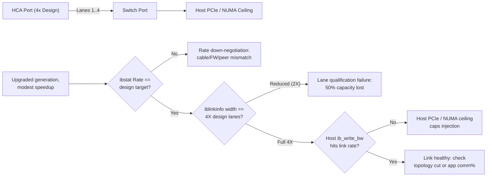
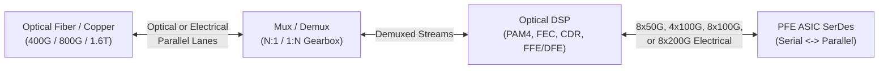
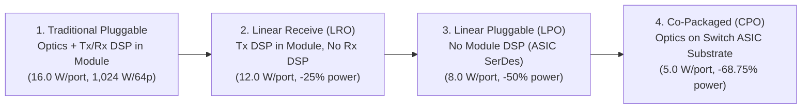

# 12.10 HDR, NDR, XDR, optics and cabling

| | |
|---|---|
| Level | Intermediate |
| Priority tier | 2 |
| Lab venue | Nebius GPU |
| Part | Part 12: Complete AI networking |
| Sources | `nvidia-devops` V8 Ch. 8, Ch. 12, Index & Labs 01–04; `ai-data-center-network-design-and-technologies` Ch. 4; `supercomputers-for-linux-sysadmins` Ch. 5; `superpod-b200-dc`; `superpod-gb300-ra` |
| Code | `code/part12/optics_cabling_hdr_ndr_xdr.py`, `code/part12/optics_cabling_hdr_ndr_xdr_lab.py` |
| Coverage file | `planning/coverage/chapters/12-10.md` |

## Why this matters for AI infrastructure

Fabric generations are routinely reduced to a single headline speed label: `200 Gbps` for High Data Rate (`HDR`), `400 Gbps` for Next Data Rate (`NDR`), `800 Gbps` for Extended Data Rate (`XDR`), and `1,600 Gbps` (`1.6 Tbps`) for Giga Data Rate (`GDR`). Treating those numbers as guaranteed application throughput is a recurring architectural failure mode. Consider a production upgrade story: an infrastructure team replaces `200 Gbps` `HDR` Host Channel Adapters (`HCAs`) and switches with `400 Gbps` `NDR` hardware. Every port reports `State: Active` and `Physical state: LinkUp`, yet distributed training throughput improves only modestly. A systematic audit uncovers three independent bottlenecks stacked in series:

1. **Host PCIe injection ceiling:** Several `400 Gbps` `NDR` HCAs were installed into `PCIe Gen4 x8` risers (`126.03 Gbps` payload ceiling after `128b/130b` encoding) rather than `PCIe Gen5 x16` slots (`504.12 Gbps`), capping host-to-fabric injection before packets ever reach the wire.
2. **Negotiated lane width collapse:** After recabling, several links negotiated `2X` width instead of `4X` because two physical optical lanes failed qualification. Even though the port rate string still printed `400 Gbps`, halving active lanes from `4` to `2` silently cut usable link bandwidth in half to `200 Gbps`.
3. **Unupgraded cross-rack topology cut:** The collective workload remained bottlenecked by a `2:1` oversubscribed spine cut (`16 x 400 Gbps = 6,400 Gbps` downlinks feeding `8 x 400 Gbps = 3,200 Gbps` uplinks, or `200.0 Gbps` per node) that had not been expanded.

In a second production incident on a `128`-node GPU cluster where `ibstat` showed every node `Active` and basic pairwise checks passed, distributed training step times varied by more than `20%` across racks because three subtler defects interacted: a subset of links down-shifted in lane width after a cable swap, Adaptive Routing (`AR`) was misconfigured under the workload's traffic pattern, and several GPU ranks were bound across a remote `NUMA` socket to their HCA.

At `400 Gbps`, `800 Gbps`, and `1.6 Tbps`, optics and cabling ceased to be passive plumbing. They represent a major fraction of cluster capital expenditure, switch thermal budget (`1,024 W` of optical transceiver power alone on a `64`-port `800 Gbps` switch at `16 W` per pluggable module, where the internal Digital Signal Processor `DSP` consumes `~50%` of transceiver power and `20%` to `40%` of module bill-of-materials cost), and physical failure incidents. This chapter connects InfiniBand and AI Ethernet link generations (`SDR` through `GDR`), Serializer/Deserializer (`SerDes`) multiplexing, Non-Return-to-Zero (`NRZ`) versus `4`-level Pulse Amplitude Modulation (`PAM-4`) DSP pipelines, Multi-Mode (`OM1–OM5`) and Single-Mode (`SMF` / `DWDM`) fibers, transceiver reach classes (`VR, SR, DR, FR, LR, ZR, CR`), `LC` and `MPO-12/16/32` breakout cabling, the NVIDIA SuperPOD `< 90%` cable length derating rule, `QSFP-DD` versus `OSFP` form factors, and emerging Linear-drive Pluggable Optics (`LPO`), Linear Receive Optics (`LRO`), and Co-Packaged Optics (`CPO`).

## Prerequisites and outcomes

**Prerequisites:** Chapter 12.2 (RDMA Queue Pairs, Memory Regions, and PCIe DMA), Chapter 12.6 (InfiniBand link layers, `16`-bit LIDs, GIDs, and `ibstat`), Chapter 12.7 (Subnet Manager, fat-tree, and rail-optimized topologies), and Chapter 12.9 (InfiniBand diagnostics, `perfquery`, `ibdiagnet`, and UFM).

**Outcomes:** After completing this chapter, you will be able to:
- Compute per-lane baud rate, raw bit rate, line coding efficiency (`8b/10b`, `64b/66b`, `256b/257b`), and `4x`/`12x` effective bandwidth across `SDR, DDR, QDR, FDR, EDR, HDR, NDR, XDR`, and `GDR`, and diagnose rate down-negotiation (`Rate: 200` doubling a `2 MiB` RDMA write from `41.94 µs` to `83.89 µs`), lane-width collapse (`2X` versus `4X` in `iblinkinfo`), and `PCIe Gen4/Gen5/Gen6` host injection limits.
- Trace packet flow through the switch Packet Forwarding Engine (`PFE`) `ASIC` `SerDes` (`50 Gbps`, `100 Gbps`, `200 Gbps`), multiplexer/demultiplexer (`mux/demux`) gearboxes, and optical `DSP` stages (`NRZ` `1 bit/symbol` versus `PAM-4` `2 bits/symbol` with `3` eye openings and `9.54 dB` SNR penalty, `FFE`/`DFE` equalization, `CDR`, and `LDPC`/`BCH` `FEC`).
- Select the right fiber grade (`MMF` `OM1–OM5` at `62.5 µm`/`50 µm` and `850/953/1300 nm` versus `SMF` at `8–10 µm` and `1310/1550 nm` plus coherent `DWDM`) and transceiver reach class (`VR 50 m`, `SR 100 m`, `DR 500 m`, `FR 2 km`, `LR 10 km`, `ZR >80 km`, `CR 7 m/10 m`) for Top-of-Rack (`ToR`), Middle-of-Row (`MoR`), End-of-Row (`EoR`), and Data Center Interconnect (`DCI`) fabrics.
- Design and validate `LC` duplex and `MPO-12`/`MPO-16`/`MPO-32` (`2x16`) parallel and breakout cabling (including twin-port finned-top `800G` `OSFP` `2x400G` and `4x200G` fan-outs, `DAC`, `AEC`, and `AOC` assemblies) while enforcing the SuperPOD `< 90%` maximum cable distance rule (`27 m` on `30 m` `AOC`, `45 m` on `50 m` `AOC`, `2.7 m` on `3 m` `400G DAC`, and zero patch panels).
- Compare `QSFP28`, `QSFP56`, `QSFP-DD` (`Type 1, Type 2, Type 2A, Type 2B`), `OSFP`, and `CFP/CFP2/CFP4/CFP8` form factors (`36` versus `16` ports per rack unit) and quantify the power, BOM cost, and serviceability trade-offs of Pluggable Optics, `LRO` (`25%` power savings), `LPO` (`50%` power savings), and `CPO` (`68.75%` power savings).

---

## 1. InfiniBand link generations (`SDR` to `GDR`), lane width, and scaling optics for AI clusters

### 1.1 Scaling intra-server (`NVLink`) and inter-server (`InfiniBand` / `Ethernet`) bandwidth

Modern AI servers separate intra-server scale-up communication from inter-server scale-out communication. Inside an `8`-GPU node (`GPU1..GPU8`), GPUs communicate locally across an internal `NVSwitch` fabric over **NVLink**, while each GPU pairs `1:1` with a dedicated scale-out Network Interface Card (`NIC1..NIC8`, ConnectX HCA or SuperNIC) connected to external leaf switches (`Top-of-Rack` Ethernet or InfiniBand), alongside dedicated storage NICs (`NVMe-o-F`) and out-of-band management links attached via `PCIe Gen5` or newer:

- **Scale-up interconnect evolution:** Per-GPU NVLink bandwidth progressed from **`300 Gbps` (`300 GB/s`)** in the **Volta** generation, to **`600 Gbps` (`600 GB/s`)** in **Ampere** (`A100`), to **`900 Gbps` (`900 GB/s`)** in **Hopper** (`H100`/`H200`), and to **`1,800 Gbps` (`1,800 GB/s` or `1.8 TB/s`)** in **Blackwell** (`B200`/`B300` over `18` `NVLink 5` links per GPU). In a rack-scale **NVIDIA DGX GB300 NVL72** system (`18` compute trays and `9` NVLink switch trays housing `18` NVLink switch chips), all `72` `B300` GPUs form a single nonblocking `NVLink 5` domain (`1.8 TB/s` per GPU) via rear blind-mate cable cartridges, while each compute tray pairs two `GB300` Superchips (`4` `B300` GPUs and `2` Grace CPUs bridged by `900 GB/s` coherent `NVLink-C2C`) with **`4` ConnectX-8 (`800 Gbps` Quantum-X800 `XDR`)** front-panel compute ports (`3,200 Gbps` per tray) and **`1` BlueField-3 (`BF3240` dual-port `2x400 Gbps`)** card dedicating `400 Gbps` to `RoCEv2` high-performance storage and `200 Gbps` to in-band management. Competing accelerator ecosystems use analogous intra-node fabrics such as AMD Infinity Fabric and Intel `CXL` (Compute Express Link), `UCIe` (Universal Chiplet Interconnect Express), and `PCIe` switches.
- **Scale-out optics market adoption (2020–2029):** Industry port shipments for AI clusters shifted rapidly from `100 Gbps` and `200 Gbps` toward `400 Gbps`, `800 Gbps`, `1.6 Tbps` (`1,600 Gbps`), and `>= 3.2 Tbps` (`3,200 Gbps`), driving urgent innovation in small-form-factor pluggable thermal design, `PAM-4` modulation, and multi-fiber connectors:

| Year / Forecast Cohort | `<= 100 Gbps` Share | `200 Gbps` Share | `400 Gbps` Share | `800 Gbps` Share | `1,600 Gbps` (`1.6T`) Share | `>= 3,200 Gbps` (`3.2T`) Share | Dominant AI Cluster Generation |
|---|---|---|---|---|---|---|---|
| **`2020` (Historical)** | `55%` | `30%` | `15%` | `0%` | `0%` | `0%` | `100G EDR` / `100GbE` (`Volta` / early `A100`) |
| **`2021` (Historical)** | `40%` | `35%` | `25%` | `0%` | `0%` | `0%` | `200G HDR` (`DGX A100` `8x200G`) |
| **`2022` (Historical)** | `25%` | `40%` | `35%` | `0%` | `0%` | `0%` | `200G HDR` -> `400G NDR` transition |
| **`2023` (Estimated)** | `10%` | `30%` | `50%` | `10%` | `0%` | `0%` | `400G NDR` (`H100` ramp) |
| **`2024` (Estimated)** | `5%` | `10%` | `55%` | `30%` | `0%` | `0%` | `400G NDR` & `800G` twin-port `OSFP` |
| **`2025` (`2020–2027` study)** | `2%` | `5%` | `10%` | `70%` | `13%` | `0%` | `800G XDR` / `800GbE` (`B200`/`GB200`) |
| **`2026` (`2020–2027` study)** | `1%` | `3%` | `5%` | `45%` | `46%` | `0%` | `800G` + `1.6T` crossover |
| **`2027` (`2020–2027` study)** | `1%` | `2%` | `3%` | `30%` | `64%` | `0%` | `1.6T GDR` / `1.6TbE` majority |
| **`2025e` (`2025` update)** | `2%` | `3%` | `25%` | `70%` | `0%` | `0%` | `800G` at `70%` (`100%` total stack) |
| **`2027e` (`2025` update)** | `1%` | `2%` | `4%` | `43%` | `50%` | `0%` | `1.6T` at `50%`, `800G` at `43%` |
| **`2029e` (`2025` update)** | `1%` | `1%` | `2%` | `16%` | `50%` | `30%` | `1.6T` (`50%`) + `>= 3.2T` (`30%`) |

### 1.2 InfiniBand link generations from `SDR` to `GDR`: raw speed, line coding, and lane width

An InfiniBand physical link bundles multiple serial bidirectional lanes operating in parallel—most commonly **`4x` (`4` parallel lanes)** for HCA-to-switch and inter-switch cables, and **`12x` (`12` parallel lanes)** for internal switch-chip interconnects or ultra-dense trunk links. Before user data hits the wire, the physical coding sublayer (`PCS`) scrambles and encodes blocks of payload bits (`8b/10b` in `SDR–QDR`, `64b/66b` in `FDR–HDR`, and `256b/257b` in `NDR` and above, paired with Reed-Solomon Forward Error Correction `RS-FEC` on `PAM-4` links) to guarantee clock recovery transitions and correct bit errors:

| InfiniBand Generation | Raw Per-Lane Rate (`Gbps`) | Modulation & Symbol Rate (`GBd`) | Line Coding Method | Coding Efficiency | Effective `4x` Link Bandwidth (`Gbps`) | Effective `12x` Link Bandwidth (`Gbps`) | Typical Switch / HCA Era |
|---|---|---|---|---|---|---|---|
| **`SDR`** (Single) | `2.5` | `NRZ` (`2.5 GBd`) | `8/10` (`8b/10b`) | `80.00%` | `8.0` | `24.0` | Early HPC clusters |
| **`DDR`** (Double) | `5.0` | `NRZ` (`5.0 GBd`) | `8/10` (`8b/10b`) | `80.00%` | `16.0` | `48.0` | ConnectX / DDR switches |
| **`QDR`** (Quad) | `10.0` | `NRZ` (`10.0 GBd`) | `8/10` (`8b/10b`) | `80.00%` | `32.0` | `96.0` | ConnectX-2 / QDR (`32 Gbps`) |
| **`FDR`** (Fourteen) | `14.0625` | `NRZ` (`14.0625 GBd`) | `64/66` (`64b/66b`) | `96.97%` | `54.4` (`Rate: 56` raw) | `163.2` | `MT4113` ConnectX-3 (`56 Gb/s 4X FDR`) |
| **`EDR`** (Enhanced) | `25.78125` | `NRZ` (`25.78125 GBd`) | `64/66` (`64b/66b`) | `96.97%` | `100.0` | `300.0` | ConnectX-4/5, Switch-IB 2 |
| **`HDR`** (High) | `53.125` | `PAM4` (`26.5625 GBd`) | `64/66` (`64b/66b`) | `96.97%` | `200.0` | `600.0` | ConnectX-6, Quantum (`QM8700`, `40x200G`) |
| **`NDR`** (Next) | `106.25` | `PAM4` (`53.125 GBd`) | `256/257` (`256b/257b`) | `99.61%` | `400.0` | `1,200.0` | `MT4129` ConnectX-7, Quantum-2 (`QM9700`, `64x400G`) |
| **`XDR`** (Extended) | `200.0` (`~212.5` raw) | `PAM4` (`100.0 GBd`) | `256/257` (`256b/257b`) | `99.61%` | `800.0` | `2,400.0` | ConnectX-8, Quantum-X800 (`Q3400-RD`, `144x800G`) |
| **`GDR`** (Giga) | `400.0` (`~425.0` raw) | `PAM4` (`200.0 GBd`) | `256/257` (`256b/257b`) | `99.61%` | `1,600.0` (`1.6 Tbps`) | `4,800.0` (`4.8 Tbps`) | Next-gen `1.6 Tbps` AI fabrics |

### 1.3 Link rate, active lane width, and the four-ceiling performance model

Delivered application payload bandwidth is governed by a multiplicative relationship across four physical and architectural ceilings:

$$
B_{\text{payload}} \approx \min\Big(\underbrace{R_{\text{lane}} \times N_{\text{active\_lanes}} \times \eta_{\text{coding}} \times \eta_{\text{protocol}}}_{\text{Negotiated Physical & Transport Link Ceiling}},\; \underbrace{B_{\text{PCIe\_host}}}_{\text{Host Injection Ceiling}},\; \underbrace{B_{\text{cut}}}_{\text{Topology Cut Ceiling}}\Big)
$$



| Diagnostic Gate | Tool & Field Inspected | Healthy `400G NDR` Baseline | Degraded Observation | Quantitative Throughput / Latency Impact |
|---|---|---|---|---|
| **1. Negotiated Per-Lane Rate** | `ibstat` `Rate:` & `iblinkinfo` speed | `Rate: 400` (`106.25 Gbps` raw / `100 Gbps` effective per lane) | `Rate: 200` (down-negotiated to `HDR` rate due to cable/firmware/peer mismatch) | Halves bandwidth to `200.0 Gbps`; a `2 MiB` (`2,097,152` B) RDMA write doubles from **`41.94 µs` (`~42 µs`) to `83.89 µs` (`~84 µs`)** |
| **2. Negotiated Lane Width** | `iblinkinfo` width (`4X`, `2X`, `1X`) | `4X 400 Gbps Active/LinkUp` (`4` of `4` lanes active) | `2X 400 Gbps Active/LinkUp` (`2` lanes failed qualification after recabling) | Rate string still says `400 Gbps`, but active width (`2/4`) cuts effective bandwidth in half to **`200.0 Gbps`** |
| **3. Host PCIe & NUMA Injection** | `lspci -vv`, `numactl --hardware`, `ib_write_bw` | `PCIe Gen5 x16` (`32 GT/s x 16 x 128/130 = 504.12 Gbps`) on local NUMA node | `400G` HCA in `PCIe Gen4 x8` slot (`16 GT/s x 8 x 128/130 = 126.03 Gbps`) or `800G` HCA in single `Gen5 x16` (`504.12 Gbps` vs `968.0 Gbps` `Gen6 x16`) | Caps `400G` HCA at **`126.03 Gbps`** regardless of a `4X 400 Gbps` fabric negotiation |
| **4. Topology Cut & Radix** | `ibroute`, `perfquery` `PortXmitData` / `PortXmitWait` | `1:1` nonblocking leaf (`16 x 400G = 6,400 Gbps` down, `16 x 400G = 6,400 Gbps` up = `32`-port minimum radix for `512` GPUs) | `2:1` oversubscribed leaf (`16 x 400G` down, `8 x 400G = 3,200 Gbps` up) | Cross-rack `ib_write_bw` drops from `397.62 Gbps` to **`201.18 Gbps`** (`200.0 Gbps`/node); `2 GB` `AllReduce` doubles from `40.0 ms` to `80.0 ms` |

---

## 2. Packet flow, SerDes mux/demux, and DSP physics (`NRZ` versus `PAM-4`)

### 2.1 Four core challenges in high-speed optical innovation

While switch silicon density scales roughly with transistor lithography, optical physics faces four compounding physical walls as port speeds climb from `10 Gbps` and `100 Gbps` to `800 Gbps` and `1.6 Tbps`:
1. **Signal quality:** Higher baud rates suffer steeper high-frequency electrical trace attenuation, chromatic and modal optical dispersion, and lane-to-lane crosstalk noise, requiring multi-level modulation and strong Forward Error Correction (`FEC`).
2. **Signal conditioning:** High-speed waveforms arrive severely distorted at the receiver photodiode and ASIC pins, requiring continuous analog and digital equalization inside dedicated Digital Signal Processors (`DSPs`).
3. **Power consumption and rack cooling budget:** Pluggable transceivers at `400 Gbps` (`~10–12 W`), `800 Gbps` (`~14–16 W`), and `1.6 Tbps` (`~25–30 W`) generate concentrated heat at the switch faceplate, requiring finned heat sinks, high-airflow cages, or liquid-cooled switch trays.
4. **Availability, standardization, and cost:** High-speed optical sub-assemblies and `DSP` chips represent a major portion of cluster network cost and supply-chain lead time, motivating open multi-vendor standards across `IEEE`, `OIF`, and `ITU-T`.

### 2.2 Packet flow, demultiplexers and multiplexers, and PFE ASIC SerDes

When an optical or electrical signal enters or leaves a switch port, it traverses three hardware stages between the external cable and the switch **Packet Forwarding Engine (`PFE`) `ASIC`**:



| Hardware Stage | Ingress Function (Cable -> PFE ASIC) | Egress Function (PFE ASIC -> Cable) | Concrete `400G` / `800G` / `1.6T` Lane Mappings |
|---|---|---|---|
| **Demultiplexer / Multiplexer (`Demux` / `Mux`)** | Splits (`1:N`) incoming multi-wavelength or multi-lane signals into parallel streams | Combines (`N:1`) parallel electrical streams into the outgoing optical or copper lanes | Maps `8 x 50 Gbps` (`53.125 Gbps` PAM4) to `4 x 100 Gbps` (`2:1` gearbox) or `1:1` pass-through (`8 x 100G -> 800G`) |
| **Digital Signal Processor (`DSP`)** | Demodulates optical carrier (`PAM-4`), performs Clock Data Recovery (`CDR`), applies `FFE`/`DFE` equalization, and decodes `LDPC`/`BCH` `FEC` | Encodes `FEC` parity bits, shapes waveform via `FFE`, and modulates electrical/optical amplitude (`PAM-4`) | Consumes **`~50%` of transceiver power** (`8 W` of a `16 W` `800G` module) and **`20%–40%` of module BOM cost** |
| **PFE ASIC `SerDes`** | Serializes/deserializes parallel transceiver lanes into serial packet streams for the PFE pipeline | Parallelizes processed packets across `N` high-speed `SerDes` lanes toward the transceiver | `~50G` SerDes: `8 x 50G = 400G`; `~100G` SerDes: `4 x 100G = 400G` or `8 x 100G = 800G`; `~200G` SerDes: `8 x 200G = 1.6 Tbps` |

### 2.3 Inside the DSP: `NRZ` (`PAM-2`) versus `PAM-4`, `FEC`, `CDR`, and `FFE`/`DFE` equalization

The optical transceiver `DSP` executes four signal-processing functions that make `50 Gbps`, `100 Gbps`, and `200 Gbps` per lane physically possible:

1. **Modulation and Demodulation (`NRZ` vs `PAM-4` vs `PAM-8` / `Coherent DWDM`):**
   - **`NRZ` (Non-Return-to-Zero, also called `PAM-2`):** Uses **`2` voltage or optical intensity levels** to encode **`1` bit per symbol** (`0` or `1`) with **`1` vertical eye opening**. Commonly used at `28 GHz` (`25.78125 GBd` for `25GbE`/`100G EDR`) and some `56 GHz` channels.
   - **`PAM-4` (4-Level Pulse Amplitude Modulation):** Uses **`4` distinct amplitude levels** to encode **`2` bits per symbol** (`00`, `01`, `10`, and `11`), **doubling the bit rate at the same symbol (baud) rate** (`26.5625 GBd` yields `53.125 Gbps` per lane in `HDR`/`400G-SR8`; `53.125 GBd` yields `106.25 Gbps` per lane in `NDR`/`800G`; `100 GBd` yields `200 Gbps` per lane in `XDR`/`1.6T`). Used across `56 GHz` and all `112 GHz` channels. Because `4` levels partition the same peak-to-peak voltage swing into **`3` stacked vertical eye openings** each `1/3` the height of an `NRZ` eye, `PAM-4` incurs a theoretical **$20 \log_{10}(3) \approx \mathbf{9.54\text{ dB}}$ Signal-to-Noise Ratio (`SNR`) penalty** compared to `NRZ`.
   - **Higher-order modulation (`PAM-8` and `QAM`):** `PAM-8` uses **`8` signal levels** (`3` bits per symbol, `7` vertical eye openings, `$20 \log_{10}(7) \approx 16.90\text{ dB}$` SNR penalty), while **Coherent `DWDM` (`400G ZR`)** modulates amplitude, phase (`QAM`), and dual polarization of light on a single wavelength across distances up to **`80 km`** between data centers.
2. **Error Detection and Forward Error Correction (`FEC`):** Because `PAM-4`'s narrower `3`-eye spacing increases the raw pre-FEC Bit Error Rate (`BER`), `DSPs` at `400 Gbps` and above rely on **Forward Error Correction (`FEC`)**—specifically **Bose-Chaudhuri-Hocquenghem (`BCH`)**, Reed-Solomon (`RS-FEC`), and **Low-Density Parity-Check (`LDPC`)** codes—to detect and correct bit errors in hardware without transport-layer retransmissions, trading a small deterministic serialization/decoding latency (`~100–250 ns`) for orders-of-magnitude lower post-FEC `BER` (`< 10^{-15}`).
3. **Clock Data Recovery (`CDR`):** High-speed serial links do not carry a separate clock wire. The `DSP` extracts timing phase directly from symbol transitions in the incoming bit stream (`CDR RX: ON,ON,ON,ON` and `CDR TX: ON,ON,ON,ON` in `mlxlink -m`) so the receiver samples the exact center of each `PAM-4` eye.
4. **Equalization (`FFE` and `DFE`):** High-frequency channel attenuation smears each symbol pulse into adjacent symbol periods, causing Inter-Symbol Interference (`ISI`). The `DSP` restores the waveform eye using **Feed-Forward Equalization (`FFE`)** (a linear finite-impulse-response filter on the transmitter and receiver) and **Decision-Feedback Equalization (`DFE`)** (a nonlinear feedback filter that subtracts interference from already-decided prior symbols without amplifying high-frequency noise).

---

## 3. Transmission modes: Multi-Mode Fiber (`OM1–OM5`), Single-Mode Fiber (`SMF`), and `DWDM`

Two decades ago, copper cables carried most data center links, but passive copper at `100 Gbps` and `400 Gbps` is restricted to `3 m` to `7 m` inside a rack. Optical fiber transmits light pulses via **total internal reflection** through a glass core surrounded by lower-refractive-index cladding (`125 µm` outer cladding diameter), providing immunity to electromagnetic interference (`EMI`), resilience to temperature and pressure changes, and reach from `50 m` up to `80 km–120 km`.

| Fiber Grade / Type | Fiber Mode | Core Diameter (`µm`) | Wavelengths (`nm`) | Light Source | `1 Gbps` Max Reach | `10 Gbps` Max Reach | `40 Gbps` Max Reach | `100 Gbps – 400 Gbps` Max Reach | Primary Data Center Role |
|---|---|---|---|---|---|---|---|---|---|
| **`OM1`** | `MMF` | `62.5 µm` | `850 nm`, `1300 nm` | `LED` / `VCSEL` | `300 m` | `33 m` | Not supported | Not supported | Legacy campus / building closet |
| **`OM2`** | `MMF` | `50.0 µm` | `850 nm`, `1300 nm` | `LED` / `VCSEL` | `550 m` | `82 m` | Not supported | Not supported | Legacy `1G`/`10G` server racks |
| **`OM3`** | `MMF` | `50.0 µm` | `850 nm`, `1300 nm` | `850 nm VCSEL` | `1,000 m` | `300 m` | `240 m` | **`100 m`** | Short-reach intra-row `SR` (`<= 100 m`) |
| **`OM4`** | `MMF` | `50.0 µm` | `850 nm`, `1300 nm` | `850 nm VCSEL` | `1,000 m` | `400 m` | `300 m` | **`150 m`** (`100 m` at `400G/800G SR`) | Standard AI cluster `VR`/`SR` MMF |
| **`OM5`** | `MMF` | `50.0 µm` | **`850 nm` + `953 nm`** | `SWDM VCSEL` | `1,000 m` | `400 m` | `400 m` | **`150 m`** (`4` Tx/Rx pairs w/ `WDM`) | Wideband MMF (`400G` over `4` fiber pairs) |
| **`SMF` (`OS2`)** | `SMF` | **`8.0 – 10.0 µm`** | **`1310 nm`, `1550 nm`** | Solid-state Laser | `10 km+` | `10 km+` | `10 km+` | **`500 m` (`DR`) to `80–120 km` (`ZR`)** | AI cluster `DR` (`500 m`), spine/border `FR`/`LR`, `DWDM` DCI |

1. **Multi-Mode Fiber (`MMF`, `OM1–OM5`):** Uses a wide glass core (**`62.5 µm` on `OM1`** and **`50 µm` on `OM2, OM3, OM4, OM5`**) that allows multiple spatial rays (modes) of `850 nm` or `1300 nm` light from low-cost Vertical-Cavity Surface-Emitting Lasers (`VCSELs`) or `LEDs` to propagate simultaneously. Because different rays travel slightly different path lengths (**modal dispersion**) and experience higher attenuation, `MMF` reach is limited to **`50 m` (`VR`) to `150 m` (`OM4`/`OM5`)**. **`OM5`** adds Short-Wavelength Division Multiplexing (`SWDM`) across **`850 nm` through `953 nm`**, allowing `400 Gbps` transmission using only `4` transmit and `4` receive fibers (`MPO-8`/`MPO-12`) instead of `8` pairs (`MPO-16`).
2. **Single-Mode Fiber (`SMF`):** Narrows the glass core to **`8 µm` to `10 µm`**, permitting only a **single fundamental mode (ray) of light** at **`1310 nm` or `1550 nm`** driven by a precision solid-state laser. Eliminating modal dispersion allows `SMF` to span **`500 m` (`DR`)**, **`2 km` (`FR`)**, **`10 km` (`LR`)**, and **`80 km` to `120 km` (`ZR`)** without pulse-overlap distortion, making `SMF` (`DR4`/`2xDR4`) the dominant choice for large multi-row `400G`/`800G` AI training halls.
3. **Dense Wavelength Division Multiplexing (`DWDM`):** Multiplexes multiple distinct optical wavelengths (channels) onto a **single pair of `SMF` strands** via an optical `MUX` at the sender and splits them via an optical `DEMUX` at the receiver. Open, standards-based pluggable **`400G ZR`** coherent `DWDM` modules plug directly into switch ports (**IP-over-DWDM**), carrying `400 Gbps` per wavelength up to **`80 km`** for regional Data Center Interconnect (`DCI`) fabrics.

---

## 4. AI server connectivity options, transceiver reach classes, connectors, and the `< 90%` cable rule

### 4.1 AI server connectivity topologies (`A100`, `H100`, `GB300`) and `ToR` versus `MoR`/`EoR`

How a GPU server connects to leaf switches determines both transceiver selection and cable-length distribution:
- **NVIDIA DGX A100 connectivity:** Provides **`8` scale-out ports of `200 Gbps` (`HDR` / `200GbE`)**, each connecting `1:1` to one of `8` separate rail leaf switches (`1,600 Gbps` aggregate per server) in a **Rail-Optimized Design (`ROD`)**.
- **NVIDIA DGX H100 connectivity:** Provides **`4` twin-port `800 Gbps` `OSFP` cages (`3,200 Gbps` aggregate)** on the server. Depending on the switch generation, operators deploy either:
  1. **Direct `4 x 800 Gbps` links** from the server's `4` `OSFP` ports to `4` `800 Gbps` switches; or
  2. **Breakout `8 x 400 Gbps` links (`2 x 400 Gbps` per `800 Gbps` `OSFP` port)** feeding **`8` separate `400 Gbps` rail leaf switches** (`Switch 1..Switch 8`) so each of the `8` `H100` GPUs sits on its own dedicated `400 Gbps` rail switch.
- **Top-of-Rack (`ToR`) vs Middle-of-Row (`MoR`) / End-of-Row (`EoR`) cable distributions in Rail-Optimized Design:**
  - In a **`ToR` Rail-Optimized layout**, each rack houses local leaf/spine switches, and a server in `Rack 1` must fan its `8` GPU rails out to all `8` leaf switches spread across different racks. Consequently, intra-rack and cross-rack server-to-leaf cables have **varying lengths**, favoring `DAC`/`AEC` inside the home rack and `AOC`/`VR`/`SR`/`DR` across racks.
  - In an **`MoR` / `EoR` Rail-Optimized layout**, compute racks (`Rack 1` with `Server 1..Server 4`) contain only GPU servers, while all leaf switches (`Leaf 1..Leaf 4` in `Network Rack 1`, `Leaf 5..Leaf 8` in `Network Rack 2`) and spine switches (`Spine 1..Spine 8`) are centralized into dedicated network racks. All `8` rail cables leaving a given compute rack travel together in homogeneous overhead bundles of **similar length per rack** (`AOC`, `VR4`/`SR8` MMF, or `DR4` SMF), while leaf-to-spine Inter-Switch Links (`ISLs`) remain short and uniform inside the adjacent network racks.

### 4.2 Transceiver reach classes (`VR, SR, DR, FR, LR, ZR, CR`) and fabric tier mapping

Transceiver nomenclature combines data rate, reach code, and optical lane count—for example, **`400G-SR8`** denotes a `400 Gbps` **Short Reach (`100 m` MMF)** module with **`8` optical lanes of `53.125 Gbps` each**, whereas **`400G-DR4`** denotes a `400 Gbps` **Data Center Reach (`500 m` SMF)** module with **`4` parallel `SMF` lanes of `106.25 Gbps` each**:

| Transceiver Code | Full Form | Standard Max Reach | Fiber / Media Mode | Typical Connector | `100 Gbps` Fabric Role (`Rail-Opt` / `Inference`) | `400 Gbps` / `800 Gbps` Fabric Role (`Rail-Opt` / `Inference`) |
|---|---|---|---|---|---|---|
| **`CR`** | Copper | **`7 m`** (passive `DAC`, `< 0.15 W`); **`10 m`** (active `DAC`, `> 5 m`) | Twinax Copper (`DAC` / `AEC`) | Integrated `QSFP`/`OSFP` | In-rack `Server <-> ToR` (`DAC` in Inference) | In-rack `Server <-> ToR` (`<= 3 m` passive `DAC` at `400G`, `<= 7 m` `AEC` up to `800G`) |
| **`VR`** | Very short reach | **`50 m`** | `MMF` (`OM4`/`OM5`, `850 nm`) | `MPO-12` / `MPO-16` | Adjacent-rack `AOC` | `Server <-> Leaf` & `Leaf <-> Spine` (`VR4` / `VR8` in `Rail-Opt`) |
| **`SR`** | Short reach | **`100 m`** | `MMF` (`OM3`/`OM4`, `850 nm`) | `MPO-16` (`SR8`) / `MPO-12` (`SR4`) | `Server <-> Leaf` (`AOC`/`SR4`) & `Leaf <-> Spine` (`Inference`) | `Server <-> Leaf` & `Leaf <-> Spine` (`AOC`/`SR8` in `Inference`) |
| **`DR`** | Data center reach | **`500 m`** | `SMF` (`1310 nm` parallel) | `MPO-12` (`DR4`) / `MPO-16` (`DR8`) | `Leaf <-> Spine` (`PSM4` at `100G`) | Primary `Server <-> Leaf` & `Leaf <-> Spine` (`DR4` / `2xDR4` in `Rail-Opt`) |
| **`FR`** | Far reach | **`2 km`** (`2,000 m`) | `SMF` (`CWDM4` / `FR4` WDM) | Dual `LC` (Duplex `2`-fiber) | `Leaf <-> Spine` & `Spine <-> Border` (`CWDM4`) | `Spine <-> Border Gateway` (`FR4` and `DR4+`) |
| **`LR`** | Long reach | **`10 km`** (`10,000 m`) | `SMF` (`1310/1550 nm` WDM) | Dual `LC` (Duplex `2`-fiber) | `Spine <-> Border` & `Border <-> External` (`LR4`) | `Border Gateway <-> External / Campus` (`LR4`) |
| **`ZR`** | Extended reach | **`> 80 km`** (`80,000 m+`) | `DWDM` (`SMF` Coherent) | Dual `LC` (Coherent) | `Border <-> Metro DCI` (`ER4` / `DCO` / `ACO`) | `Border Gateway <-> Metro / Regional DCI` (`400G/800G ZR`) |

### 4.3 Connectors (`LC` versus `MPO-8/12/16/24/32`, `UPC`/`APC`), cables (`DAC`, `AEC`, `AOC`), and the `< 90%` SuperPOD derating rule

1. **Optical connectors (`LC` and `MPO`/`MTP`):**
   - **`LC` (Lucent Connector):** Compact `2`-fiber duplex connector (replacing legacy `SC, FC`, and `ST` connectors) used with single-mode fiber where an internal optical WDM mux/demux combines `4` lanes onto a single fiber pair—such as **`QSFP-DD-FR4` (`2 km` SMF)** and **`LR4` (`10 km` SMF)**.
   - **`MPO` (Multi-fiber Push On, where `MTP` is a high-precision brand of `MPO`):** High-density array connectors used for parallel optics and breakout fan-out assemblies, available in **`8`-, `12`-, and `24`-fiber** trunk variants as well as **single-row `16`-fiber (`MPO-16`)** and **two-row `2 x 16 = 32`-fiber (`MPO-32`)** high-density configurations:
     - **`QSFP-DD-DR4` (`500 m` SMF with `MPO-12`):** Uses a `12`-fiber ferrule where the **first `4` fibers (`1–4`) carry Transmit (`Tx`)**, the **middle `4` fibers (`5–8`) are unused (dark)**, and the **last `4` fibers (`9–12`) carry Receive (`Rx`)** (`4 Tx + 4 Rx = 8` active `SMF` lanes; angled physical contact `APC` `8°` polish is standard on `SMF` `MPO` to prevent back-reflection).
     - **`QSFP-DD-SR8` (`100 m` MMF with `MPO-16`):** Uses a single-row `16`-fiber ferrule with **`8` fibers for `Tx` and `8` fibers for `Rx`** (`0` dark fibers) over `100 m` `MMF`.
     - **Twin-port finned-top `OSFP` (`800 Gbps` `2x400G`) breakouts:** On `800 Gbps` Quantum-2 (`64` ports of `2x400G` = `128` logical `400G` ports) and Quantum-X800 switches, a single `8`-lane `800 Gbps` `OSFP` cage splits via an `MPO` Y-cable into **`2 x 400 Gbps` (`4` lanes each)** toward two ConnectX-7 HCAs, or via a `1:4` splitter into **`4 x 200 Gbps` (`2` lanes each)** toward four ConnectX-6 HCAs or storage nodes.
2. **Copper and bonded optical cable assemblies (`DAC`, `AEC`, `AOC`):**
   - **Passive `DAC` (Direct Attach Copper):** Twinaxial shielded copper assembly with no electronics inside the connector pods (`< 0.15 W` power, zero latency penalty, lowest cost). Rated up to **`7 m`** in general IEEE `CR` specs, and strictly capped in NVIDIA DGX SuperPOD deployments at **`<= 5 m` for `100 Gbps`** and **`<= 3 m` for `400 Gbps`**.
   - **Active `DAC` and `AEC` (Active Electrical Cable):** Active `DAC` adds signal-boosting amplifiers in the connector shells for copper runs `> 5 m` (up to `10 m`). **`AEC`** integrates full retimer/equalizer chips inside the copper connector heads to strip noise and regenerate the eye, reaching up to **`7 m` at `400 Gbps` and `800 Gbps`** with thinner gauge wire and lower cost/power than optical transceivers.
   - **`AOC` (Active Optical Cable):** Permanently bonds `MMF` (or `SMF`) fiber to integrated optical transceivers at both ends (`up to 100 m` in general data centers; **`30 m` or `50 m`** in standard InfiniBand SuperPOD BOMs). Because `AOCs` eliminate field-exposed fiber ferrules at the cage interface, they have a smaller bend radius, thinner jacket, and lower cost than discrete pluggables, though a damaged fiber requires replacing the entire bonded assembly.
3. **NVIDIA SuperPOD `< 90%` cable length derating rule and the ban on patch panels:**
   In DGX B200 (`1..4` SUs at `458 kW`/SU: `31, 63, 95, 127` compute nodes after `1` UFM appliance displaces `1` node, `248, 504, 760, 1,016` GPUs, `8..32` leaf switches, `4..16` spine switches, `252..1,020` compute+UFM cables, and `256..1,024` spine-leaf ISL cables in `48U+` EIA-310 cabinets at least `600 mm x 1100 mm`, recommended `700 mm x 1200 mm x 52U`) and DGX GB300 (`1.2 MW`/SU, up to `16` SUs / `128` racks / `9,216` GPUs) installations, **all planned cable runs—including vertical intra-rack routing, overhead tray vertical drops, and minimum bend-radius slack—must be kept under `90%` of the maximum distance specified for that media type**:
   - **`3 m` `400G` Passive `DAC`:** Maximum allowed routed length = $3.0 \times 0.90 = \mathbf{2.7\text{ m}}$.
   - **`5 m` `100G` Passive `DAC`:** Maximum allowed routed length = $5.0 \times 0.90 = \mathbf{4.5\text{ m}}$.
   - **`30 m` InfiniBand `AOC`:** Maximum allowed routed length = $30.0 \times 0.90 = \mathbf{27.0\text{ m}}$.
   - **`50 m` InfiniBand `AOC`:** Maximum allowed routed length = $50.0 \times 0.90 = \mathbf{45.0\text{ m}}$.
   - **`100 m` `SR` `MMF` / `AOC`:** Maximum allowed routed length = $100.0 \times 0.90 = \mathbf{90.0\text{ m}}$.
   - **`500 m` `DR` `SMF`:** Maximum allowed routed length = $500.0 \times 0.90 = \mathbf{450.0\text{ m}}$.
   - **No patch panels or intermediate ToR extenders on InfiniBand fabrics:** InfiniBand cable limits are governed by end-to-end signal attenuation and link latency. Inserting structured-cabling optical patch panels introduces connector insertion loss (`~0.3–0.5 dB` per mated pair) and optical return-loss reflections that push `53.125 GBd` (`NDR`) and `100 GBd` (`XDR`) `PAM-4` links past their pre-FEC `BER` cliff. Every InfiniBand cable must run **point-to-point** from HCA to leaf switch or leaf switch to spine switch, with pre-installed spare cables and color-coded endpoint labels at both ends.

---

## 5. Standards, high-bandwidth form factors (`QSFP-DD` versus `OSFP`), and `LPO` / `LRO` / `CPO`

### 5.1 Optical standards (`IEEE 802.3bm/bs`, `OIF-OSFP`, `ITU-T G.959.1`) and `QSFP28` / `QSFP56` / `QSFP-DD` / `OSFP`

To avoid vendor lock-in (such as legacy proprietary form factors like Cisco `CPAK`), AI data centers standardize pluggable transceiver cages across `IEEE`, `OIF`, and `ITU-T` specifications:

- **`ITU-T G.959.1` (`CFP`, `CFP2`, `CFP4`, and `CFP8`):** `CFP` was the original large `100 Gbps` form factor (`10 x 10 Gbps` `NRZ` lanes, `LR4` variant, high power draw). `CFP2` (`10` lanes `NRZ`, `LR4`) and compact `CFP4` (`4` lanes `NRZ`, `LR4`, lower power than `CFP2`) shrunk the footprint for long-haul `100G`, while `CFP8` expanded to `8` lanes of `PAM-4` for `200 Gbps` and `400 Gbps`. However, `CFP` family cages support only **`16` ports per rack unit (`1U`)**, compared to **`36` ports per `1U`** for `QSFP-DD` and `OSFP`.
- **`IEEE 802.3bm` (`QSFP28`) and `QSFP56`:** Evolved from `40 Gbps` `QSFP+`. **`QSFP28`** supports **`100 Gbps`** across **`4` channels of `25 Gbps` (`NRZ`)** in `SR4` and `LR4` variants, consuming **`3 W` to `4 W`** per module. **`QSFP56`** upgrades the `4` electrical/optical channels to **`50 Gbps` `PAM-4`** to deliver **`200 Gbps`** (`HDR` and `200GbE`), maintaining backward compatibility with `QSFP+` and `QSFP28`.
- **`IEEE 802.3bs` (`QSFP-DD` / `DD-QSFP` and `QSFP-DD800`):** **Quad Small Form-factor Pluggable Double Density (`QSFP-DD`)** adds a second row of `4` electrical contact pads behind the legacy `QSFP` row, doubling the electrical interface from `4` channels to **`8` channels** (supporting `200 Gbps` via `8 x 25G NRZ` in `QSFP-DD200`, `400 Gbps` via `8 x 50G PAM-4` in `QSFP-DD400`, and `800 Gbps` via `8 x 100G PAM-4` in `QSFP-DD800`, with `16`-lane evolutions under study). Because the front mechanical profile matches `QSFP28`, a `QSFP-DD` switch cage is natively **backward compatible with `QSFP+`, `QSFP28`, and `QSFP56`** plugs (`36` ports per `1U`). To handle increasing thermal loads, `QSFP-DD` defines **four mechanical/thermal module types**:
  - **`Type 1`:** Identical length and flush front profile to a standard `QSFP28` module.
  - **`Type 2`:** Extends the rear/external housing slightly outside the cage to provide extra internal PCB area for optical components and `DSP` layout.
  - **`Type 2A`:** Packages an **integrated heat sink on top of the external module nose** to dissipate `400G`/`800G` `DSP` heat into the rack airflow.
  - **`Type 2B`:** Uses a **taller external heat sink** to maximize thermal dissipation while leaving clearance for internal optical connectors and port separation.
- **`OIF-OSFP-01.0` (`OSFP` — Octal Small Form-factor Pluggable):** Designed from the ground up with **`8` high-speed electrical lanes** (`200 Gbps`, `400 Gbps`, `800 Gbps` via `8 x 100G PAM-4`, and `1.6 Tbps` via `8 x 200G PAM-4`) and a slightly wider/taller chassis that integrates a **built-in finned heat sink directly into the module body** (finned-top `OSFP` on switches; flat-top `OSFP` on liquid-cooled or conduction-cooled `DGX` compute trays/HCAs). `OSFP` achieves **`36` ports per `1U`** (or `64` ports of `2x400G = 128` logical `400G` ports in a `1U`/`2U` Quantum-2/Spectrum-4 chassis, and `144` ports of `800G` in a `Q3400-RD` Quantum-X800 switch) and is the standard transceiver cage across NVIDIA `DGX H100`, `B200`, `GB200`, `GB300`, Quantum-2, Quantum-X800, and Spectrum-4/X800 platforms (`QSFP28` modules require a passive mechanical adapter sleeve to plug into an `OSFP` cage).

| Feature / Specification | `QSFP28` (`IEEE 802.3bm`) | `QSFP56` (`IEEE 802.3cd`) | `QSFP-DD` (`IEEE 802.3bs`) | `OSFP` (`OIF-OSFP-01.0`) |
|---|---|---|---|---|
| **Aggregate Data Rate** | `100 Gbps` | `200 Gbps` (`HDR` / `200GbE`) | `200–400 Gbps` (`800G` in `QSFP-DD800`) | `200 Gbps, 400 Gbps, 800 Gbps, 1.6 Tbps` |
| **Electrical Channel Count** | `4` channels | `4` channels | `8` channels (or `16` in future revs) | `8` channels |
| **Per-Channel Data Rate** | `25 Gbps` | `50 Gbps` | `25 Gbps` (`NRZ`) / `50–100 Gbps` (`PAM4`) | `50 Gbps` / `100 Gbps` / `200 Gbps` (`PAM4`) |
| **Modulation** | `NRZ` (`PAM-2`) | `PAM-4` | `NRZ` (`DD200`) / `PAM-4` (`DD400/800`) | `PAM-4` |
| **Supported Connectors** | `MPO`, `LC` | `MPO`, `LC`, `CS` | `MPO`, `LC`, `CS` | `MPO` (`MPO-12/16/32`), `LC` |
| **Backward Compatibility** | `QSFP+` (`40G`) | `QSFP+`, `QSFP28` | `QSFP+`, `QSFP28`, `QSFP56` (native) | Requires passive adapter for `QSFP` |
| **Size & Thermal Design** | Compact (`3–4 W`) | Compact (`~5–7 W`) | Compact; riding cage heat sink (`Type 1/2/2A/2B`) | Larger; integrated finned-top or flat-top heat sink (`15–30 W+` thermal headroom) |
| **Max Switch Density (`1U`)** | `36` ports / `RU` | `36` ports / `RU` | `36` ports / `RU` (vs `16`/RU on `CFP8`) | `36` ports / `RU` (twin-port supports `2x400G` or `2x800G` per cage) |

### 5.2 Further innovations in optics: Pluggable versus `LRO` versus `LPO` versus `CPO`

In a traditional pluggable transceiver (`400G`, `800G`, or `1.6T`), the onboard **Digital Signal Processor (`DSP`) accounts for `20%` to `40%` of the module's Bill-of-Materials (`BOM`) cost and consumes approximately `50%` of the transceiver's electrical power** (for example, `8.0 W` of `DSP` power inside a `16.0 W` `800 Gbps` pluggable, or **`512.0 W` of `DSP` power alone across a `64`-port switch** whose optics draw **`1,024.0 W`** total). To bend this power and cost curve, the industry has developed three architectural alternatives:



| Optical Architecture | Module `Tx` `DSP` | Module `Rx` `DSP` | Field Pluggable? | Per-Port Power (`800G` Baseline) | `64`-Port Switch Optics Power | Power Savings vs Pluggable | Module `DSP` `BOM` Cost Share | Operational & Interoperability Trade-offs |
|---|---|---|---|---|---|---|---|---|
| **1. Traditional Pluggable** | Present | Present | Yes | **`16.0 W`** (`8.0 W` DSP + `8.0 W` optics) | **`1,024.0 W`** | `0.0%` (Baseline) | **`20% – 40%`** | Maximum multi-vendor interoperability, full retiming (`CDR` + `FEC`), easy field replacement; highest power and cost |
| **2. Linear Receive Optics (`LRO`)** | Present | **Removed** (Handled by `ASIC` `Rx` `SerDes`) | Yes | **`12.0 W`** (`4.0 W` DSP + `8.0 W` optics) | **`768.0 W`** | **`25.0%`** (`-256.0 W`) | **`10% – 20%`** | Keeps `Tx` `DSP` in module so optical output meets standard IEEE eye templates; balances interoperability and reliability with `25%` power reduction |
| **3. Linear-drive Pluggable (`LPO`)** | **Removed** | **Removed** | Yes | **`8.0 W`** (`0.0 W` DSP + `8.0 W` linear driver/TIA) | **`512.0 W`** | **`50.0%`** (`-512.0 W`) | **`0%`** (No module DSP) | Smaller/cooler module; `PFE ASIC` performs all equalization/DSP (cooled by ASIC heatsink) and reduces latency, but tighter electrical loss budget increases multi-vendor interoperability risk and qualification `opex` |
| **4. Co-Packaged Optics (`CPO`)** | **Removed** (Integrated) | **Removed** (Integrated) | **No** (On `ASIC` substrate) | **`5.0 W`** (Ultra-short substrate trace) | **`320.0 W`** | **`68.75%`** (`-704.0 W`) | **`0%`** (Integrated) | Co-locates optical engines and `PFE ASIC` on the **same package substrate**, maximizing port density and cutting power by `~69%`; higher initial switch cost and an optics failure requires servicing the switch assembly |

---

## 6. Mixed-generation fabrics, upgrade planning, and operational verification

### 6.1 Mixed-generation interoperability (`EDR` / `HDR` / `NDR` / `XDR`) and the 10-step upgrade plan

Production clusters rarely replace every switch, HCA, and cable in a single maintenance window. Storage clusters or legacy compute racks running `200 Gbps` `HDR` (`53.125 Gbps`/lane, `64b/66b`) are frequently connected to `400 Gbps` `NDR` (`106.25 Gbps`/lane, `256b/257b`) or `800 Gbps` `XDR` spine/leaf fabrics. When two endpoints of different generations are cabled together, auto-negotiation settles on the **highest mutually supported rate and width** (for example, an `NDR` `400G` switch port connected to an `HDR` `200G` HCA port—or via an `HDR`-rated cable—negotiates `Rate: 200` at `4X` width).

Uncontrolled mixed-generation fabrics introduce six operational hazards:
1. **Silent down-negotiation:** A `400 Gbps` `NDR` link silently falls back to `200 Gbps` `HDR` or `100 Gbps` `EDR` because an older cable, transceiver, or firmware image was left in the path.
2. **Reduced-width fallback:** A link negotiates the target generation speed (`100 Gbps`/lane `NDR`) on only `2X` or `1X` lanes (`200 Gbps` or `100 Gbps` effective) while reporting `State: Active`.
3. **Asymmetric endpoint capability:** Host PCIe slots (`Gen4` vs `Gen5` vs `Gen6`) or `NUMA` topologies differ between racks, skewing collective ring/tree step times.
4. **Inconsistent firmware and `FEC` modes:** Mismatched HCA and switch firmware revisions fail link training or oscillate in `LinkErrorRecoveryCounter`.
5. **Unexpected route preference:** Static or adaptive routing spreads traffic equally across `400 Gbps` and down-negotiated `200 Gbps` uplinks, creating an instant congestion tree behind the slower link.
6. **Confusing inventory:** Operators lack an explicit **expected negotiated state table** per link class (`Server-to-Leaf`, `Storage-to-Leaf`, `Leaf-to-Spine`) and therefore treat `State: Active` as healthy.

To prevent the "400-Gigabit upgrade that delivered half the expected gain," every fabric generation upgrade should follow a **10-step production upgrade plan**:
1. **Baseline current application and component performance** (host-memory `ib_write_bw`/`ib_write_lat` percentiles `p50/p99/p99.9`, GPU-memory `RDMA`, `nccl-tests`, and application step time).
2. **Verify hardware, transceiver, cable, and firmware compatibility matrices** across every HCA, switch, and optical module part/serial number.
3. **Model host (`PCIe` generation/width, `NUMA`) and topology (`bisection cut`, `oversubscription`) bottlenecks** before purchasing faster optics, using the communication fraction of step time to predict realistic speedup.
4. **Stage a representative pilot path** (`2` to `4` nodes across a leaf-spine cut) before touching the wider cluster.
5. **Test link negotiation (`Rate` and `Width` in `ibstat` and `iblinkinfo`) and physical error/BER counters (`mlxlink -c/-m`, `perfquery`, `ibqueryerrors`)**.
6. **Run host-memory (`numactl`-pinned) and GPU-memory pairwise RDMA benchmarks** to prove single-flow wire-rate efficiency.
7. **Test synchronized collectives (`AllReduce`, `AllToAll`) under multi-node concurrency** to verify cross-rack cuts and adaptive routing balance.
8. **Validate failure handling and rollback procedures** (including `SHIELD`/standby `SM` failover and firmware downgrade paths).
9. **Update the inventory source of truth (`GUID`, expected `Rate`, expected `Width`, cable serials) and telemetry alerting thresholds**.
10. **Expand rollout in controlled, rack-by-rack or SU-by-SU phases**.

---

## Commands and configurations that matter

All fabric and optical inspection commands below are read-only and marked `(untested here)` because live InfiniBand switches and ConnectX HCAs are not attached to the local build container.

### 1. Inspecting optical transceiver DDM telemetry, per-lane BER, and CDR lock with `mlxlink` `(untested here)`

While `ibstat` and `perfquery` expose link state and packet/symbol counters, NVIDIA's **`mlxlink`** utility queries the transceiver's internal Digital Diagnostic Monitoring (`DDM` / `SFF-8636` / `CMIS`) EEPROM and the `SerDes`/`DSP` physical layer directly.

Querying physical counters and pre-/post-FEC Bit Error Rate (`-c`):

```bash
# (untested here) Query physical BER and per-lane error counters on mlx5_1
mlxlink -d mlx5_1 -c
```

Annotated output from an `IB-EDR` (`4x` = `100 Gbps`) port:

```text
Operational Info
----------------
State                           : Active
Physical state                  : LinkUp
Speed                           : IB-EDR
Width                           : 4x
FEC                             : No FEC
Loopback Mode                   : No Loopback
Auto Negotiation                : ON
Supported Info
--------------
Enabled Link Speed              : 0x0000003f (EDR,FDR,FDR10,QDR,DDR,SDR)
Supported Cable Speed           : 0x0000003f (EDR,FDR,FDR10,QDR,DDR,SDR)
Troubleshooting Info
--------------------
Status Opcode                   : 0
Group Opcode                    : N/A
Recommendation                  : No issue was observed.
Physical Counters and BER Info
------------------------------
Time Since Last Clear [Min]     : 12824.8
Effective Physical Errors       : 0
Effective Physical BER          : 15E-255
Raw Physical BER                : 15E-255
Raw Physical Errors Per Lane    : 0,0,0,0
Link Down Counter               : 0
Link Error Recovery Counter     : 0
```

Querying optical module identification, laser bias, `Rx`/`Tx` optical power (`dBm`), temperature, voltage, and `CDR` status (`-m`, or `--json` for automated scripts):

```bash
# (untested here) Query optical transceiver EEPROM & DDM health on mlx5_1
mlxlink -d mlx5_1 -m
```

```text
Module Info
-----------
Identifier                      : QSFP+
Compliance                      : N/A
Cable Technology                : 850 nm VCSEL
Cable Type                      : Active cable (active copper / optics)
OUI                             : Mellanox
Vendor Name                     : Mellanox
Vendor Part Number              : MFXXXXX-EXXX
Vendor Serial Number            : MT2135FT12345
Rev                             : B2
Attenuation (5g,7g,12g) [dB]    : N/A
FW Version                      : XX.XX.XXX
Wavelength [nm]                 : 850
Transfer Distance [m]           : 10
Digital Diagnostic Monitoring   : Yes
Power Class                     : 2.5 W max
CDR RX                          : ON,ON,ON,ON
CDR TX                          : ON,ON,ON,ON
LOS Alarm                       : N/A
Temperature [C]                 : 38 [-10..80]
Voltage [mV]                    : 3255.2 [3100..3500]
Bias Current [mA]               : 6.750,6.750,6.750,6.750 [5.492..8.5]
Rx Power Current [dBm]          : 0,0,0,0 [-14..6]
Tx Power Current [dBm]          : 0,0,0,0 [-12..6]
```

**How to read `mlxlink -c` and `-m`:**
- **`Raw Physical Errors Per Lane: 0,0,0,0` and `Effective Physical BER: 15E-255`:** Confirms every individual `SerDes` lane (`0..3`) is error-free. On a degraded `MPO` connector (such as dust on fiber #3), one lane will show a spike in `Raw Physical Errors Per Lane` and a drop in its corresponding `Rx Power Current [dBm]` entry below the `-14 dBm` floor (`[-14..6]`).
- **`CDR RX: ON,ON,ON,ON` and `CDR TX: ON,ON,ON,ON`:** Verifies that Clock Data Recovery is locked on all `4` Rx and Tx lanes.
- **`Temperature [C]: 38 [-10..80]` and `Voltage [mV]: 3255.2 [3100..3500]`:** Module thermal and supply rails are well within operating bounds (`< 70–80 °C`).

### 2. Auditing negotiated link rate, lane width, and HCA/PCIe topology (`ibstat`, `ibstatus`, `iblinkinfo`, `ibv_devinfo`) `(untested here)`

```bash
# (untested here) Build a complete Lab 01 host + fabric link-rate/width inventory
mkdir -p volume08-lab01/{host,fabric,versions}
ibv_devices | tee volume08-lab01/host/ibv-devices.txt
ibv_devinfo -v -d mlx5_0 | head -20 | tee volume08-lab01/host/ibv-devinfo.txt
ibstat | tee volume08-lab01/host/ibstat.txt
ibstatus | tee volume08-lab01/host/ibstatus.txt
lspci -nnvv | grep -i -E 'infiniband|network|lnksta' | tee volume08-lab01/host/pci-devices.txt
numactl --hardware | tee volume08-lab01/host/numa.txt
iblinkinfo | tee volume08-lab01/fabric/iblinkinfo.txt
```

Illustrative `ibv_devinfo -v -d mlx5_0` and `ibstat` output on a `400 Gbps` `NDR` (`MT4129` ConnectX-7) host:

```text
hca_id: mlx5_0
    transport:                  InfiniBand (0)
    fw_ver:                     28.39.2048
    node_guid:                  08c0:eb03:00f1:a2c3
    vendor_id:                  0x02c9
    vendor_part_id:             4129
    max_qp:                     262144
    max_qp_wr:                  32768
    max_sge:                    30

CA 'mlx5_0'
    CA type: MT4129
    Number of ports: 1
    Port 1:
        State: Active
        Physical state: LinkUp
        Rate: 400
        Base lid: 12
        LMC: 0
        SM lid: 1
        Capability mask: 0x2651e848
        Port GUID: 0x08c0eb0300f1a2c3
        Link layer: InfiniBand
```

And side-by-side `iblinkinfo -S <switch-guid>` output contrasting a healthy `4X` port (`Port 3`) against a width-degraded `2X` port (`Port 4`):

```text
$ iblinkinfo -S 0x506b4b0300a1c210
   Switch: 0x506b4b0300a1c210:
       3    1[  ] ==( 4X   400 Gbps Active/  LinkUp)==>       12    1[  ] "node-a hca" ( )
       4    1[  ] ==( 2X   400 Gbps Active/  LinkUp)==>       15    1[  ] "node-b hca" ( )
```

### 3. Validating delivered payload bandwidth and latency (`ib_write_bw`, `ib_write_lat`, `ibqueryerrors`) `(untested here)`

```bash
# (untested here) Lab 02 & Lab 03: NUMA-pinned RDMA bandwidth/latency + counter delta verification
ibqueryerrors | tee counters-before.txt
# On server (pinned to HCA local NUMA node 0):
numactl --cpunodebind=0 --membind=0 ib_write_bw -d mlx5_0 -i 1 --report_gbits
# On client:
numactl --cpunodebind=0 --membind=0 ib_write_bw -d mlx5_0 -i 1 --report_gbits <server-ip>
ibqueryerrors | tee counters-after.txt
```

---

## How it fails

| Failure Mode | Observable Symptom | Root Cause | Diagnostic Evidence (`ibstat`, `iblinkinfo`, `mlxlink`, `ib_write_bw`) | Remediation |
|---|---|---|---|---|
| **1. Silent Rate Down-Negotiation (`NDR 400G -> HDR 200G`)** | Port is `Active` and `LinkUp`, no job crashes, but collective communication step time doubles on paths traversing the port | Unqualified cable (e.g., `HDR`-only `AOC`/`DAC`), mismatched transceiver firmware, or mixed-generation peer port | `ibstat mlx5_1 \| grep -E 'State\|Rate'` prints `State: Active`, `Rate: 200` on a `400G` port; `2 MiB` RDMA write takes **`83.89 µs` (`~84 µs`) instead of `41.94 µs` (`~42 µs`)** | Compare `Supported Cable Speed` and `Enabled Link Speed` in `mlxlink -d mlx5_1 -m`; replace non-qualified cable or upgrade HCA/switch/transceiver firmware |
| **2. Negotiated Lane Width Collapse (`4X -> 2X` or `1X`)** | `State: Active` and rate label still reads `400 Gbps` (or `100 Gbps`/lane), yet pairwise `ib_write_bw` is capped at **`~200 Gbps`** (`50%` of design) | `1` or `2` of the `4` physical optical fibers or `SerDes` lanes failed link training due to a contaminated `MPO` ferrule, bent fiber, or dead `VCSEL`/photodiode channel | `iblinkinfo` shows `==( 2X 400 Gbps Active/ LinkUp)==>` on `Port 4` vs `4X` on `Port 3`; `mlxlink -c` shows nonzero `Raw Physical Errors Per Lane` or low `Rx Power` (`< -14 dBm`) on lanes `2,3` | Inspect `mlxlink -m` per-lane `Rx Power` and `Tx Bias`; clean `MPO-12`/`MPO-16` connectors with an optical click-cleaner or swap the degraded transceiver/breakout harness |
| **3. Host `PCIe` or `NUMA` Bottleneck Masking a Fabric Upgrade** | `ibstat` shows `Rate: 400` and `iblinkinfo` shows `4X`, yet `ib_write_bw` plateaus at **`~126 Gbps`** (or drops sharply when run without `numactl`) | `400G` HCA installed in a `PCIe Gen4 x8` slot (`126.03 Gbps` ceiling), `800G` HCA in a single `Gen5 x16` slot (`504.12 Gbps`), or benchmark/rank bound to `NUMA node 1` while HCA is on `NUMA node 0` | `lspci -vv` shows `LnkSta: Speed 16GT/s, Width x8` instead of `32GT/s, Width x16`; Lab 04 `numactl` comparison shows `NUMA node 0` restores full bandwidth | Seat `400G` HCAs in `PCIe Gen5 x16` slots (`504.12 Gbps`), `800G` HCAs in `PCIe Gen6 x16` (`968.0 Gbps`) or dual `Gen5 x16` / socket-direct slots, and enforce local `NUMA`/GPU affinity |
| **4. Exceeding the `< 90%` Cable Distance Rule or Using Patch Panels** | Intermittent `SymbolErrorCounter` acceleration, `LinkErrorRecoveryCounter` increments, `CDR` lock loss, or `LinkDownedCounter` flaps under thermal load | Routed cable length exceeds `90%` of media max (`> 27 m` on `30 m AOC`, `> 45 m` on `50 m AOC`, `> 2.7 m` on `3 m 400G DAC`) or passes through an optical patch panel | `mlxlink -c` shows elevated `Raw Physical BER`, `Effective Physical Errors > 0`, and reduced `Rx Power Current [dBm]` across all lanes | Reroute point-to-point without patch panels, account for intra-rack vertical routing and bend radius, and step up from `DAC` -> `AOC`/`VR` -> `SR` -> `DR` `SMF` when run exceeds `90%` |
| **5. Optical Transceiver Over-Temperature (`> 70–80 °C`)** | Links flap after several hours of heavy collective load; laser bias current climbs and post-FEC errors appear | Wrong `QSFP-DD`/`OSFP` thermal variant (`flat-top` module inserted into an air-cooled switch expecting `finned-top` / `Type 2A`/`2B`), blocked switch intake, or failed fan | `mlxlink -m` shows `Temperature [C]: 83 [-10..80]` exceeding the `80 °C` upper alarm threshold | Use finned-top `OSFP` / `QSFP-DD Type 2A/2B` modules in air-cooled switches, flat-top `OSFP` in conduction/liquid-cooled trays, and verify rack airflow (`2,145 CFM` per DGX B200 rack at `18–27 °C`) |

---

## Hands-on lab: verifying link generations, SerDes/PAM-4 DSP math, transceiver reach, MPO breakouts, and `< 90%` cable rules

This hands-on lab runs the pure-stdlib verification suite in `code/part12/optics_cabling_hdr_ndr_xdr.py` and `code/part12/optics_cabling_hdr_ndr_xdr_lab.py`. Every check executes deterministically on any workstation or Nebius GPU instance without requiring physical optical transceivers.

### Step 1: Run the 32-check optics and link-evolution verification suite

```bash
python3 -B code/part12/optics_cabling_hdr_ndr_xdr_lab.py
```

Expected output (verified here):

```text
Running Chapter 12.10 HDR, NDR, XDR, Optics & Cabling Lab Checks...

  [PASS] Supercomputers Ch. 5 Table 5-1 legacy IB rates: SDR 8G/24G, DDR 16G/48G, QDR 32G/96G (8/10), FDR 14.0625G lane -> 54.4G/163.2G, EDR 100G/300G (64/66)
  [PASS] Supercomputers Ch. 5 Table 5-1 modern IB rates: HDR 53.125G/lane (200G 4x, 600G 12x, 64/66), NDR 106.25G/lane (400G 4x, 1200G 12x, 256/257), XDR 200G/lane (800G 4x, 2400G 12x), GDR 400G/lane (1600G 4x, 4800G 12x)
  [PASS] V8 Ch. 8 `iblinkinfo` width collapse: `4X 400 Gbps` (port 3) delivers 400.0 Gbps while `2X 400 Gbps` (port 4) halves capacity to 200.0 Gbps despite the 400 Gbps rate label
  [PASS] V8 Ch. 8 Scenario 1 rate down-negotiation (`Rate: 200` on 400G port): 2 MiB (2,097,152 B) RDMA write latency doubles from 41.94 us (~42 us) to 83.89 us (~84 us)
  [PASS] V8 Ch. 8 Host PCIe injection ceiling: 400G NDR in PCIe Gen4 x8 capped at 126.03 Gbps; Gen5 x16 provides 504.12 Gbps; 800G XDR requires PCIe Gen6 x16 (968.0 Gbps) or dual Gen5 x16
  [PASS] ADC Ch. 4 NVLink progression (Volta 300G, Ampere 600G, Hopper 900G, Blackwell 1800G) and Dell'Oro 2020-2027 optics curve (2020: 55% 100G; 2025: 70% 800G; 2027: 64% 1.6T)
  [PASS] ADC Ch. 4 Figure 4-2.1 Dell'Oro 2025 update: 2025e = 70% 800G (25% 400G, 3% 200G, 2% <=100G); 2027e = 50% 1.6T + 43% 800G; 2029e = 50% 1.6T + 30% >=3.2T + 16% 800G
  [PASS] ADC Ch. 4 PFE ASIC SerDes demux/mux: 8x50G -> 400G, 4x100G -> 400G (2:1 gearbox from 8x50G), 8x100G -> 800G, and 8x200G -> 1.6T
  [PASS] ADC Ch. 4 NRZ vs PAM-4 DSP physics: NRZ = 2 levels (0, 1), 1 bit/symbol, 1 eye; PAM-4 = 4 levels (00, 01, 10, 11), 2 bits/symbol, 3 eye openings, 9.54 dB SNR penalty requiring FFE/DFE, CDR, and LDPC/BCH FEC
  [PASS] ADC Ch. 4 MMF & SMF grades: OM1 (62.5 um, 300 m @ 1G, 33 m @ 10G), OM2 (50 um, 550 m @ 1G, 82 m @ 10G), OM3 (240 m @ 40G, 100 m @ 100G-400G), OM4 (150 m @ 100G-400G), OM5 (850+953 nm WDM, 150 m), SMF (8-10 um core, 1310/1550 nm)
  [PASS] ADC Ch. 4 Table 4-1 transceiver reaches: VR=50 m (MMF), SR=100 m (MMF), DR=500 m (SMF), FR=2 km (SMF), LR=10 km (SMF), ZR=>80 km (DWDM), CR=7 m passive / 10 m active DAC
  [PASS] Distance-tier transceiver selection: 2 m -> CR_PASSIVE, 35 m -> VR (50 m MMF), 85 m -> SR (100 m MMF), 350 m -> DR (500 m SMF), 1.5 km -> FR (2 km SMF), 8 km -> LR (10 km SMF), 60 km -> ZR (80 km DWDM)
  [PASS] ADC Ch. 4 MPO connector mapping: QSFP-DD-DR4 on MPO-12 uses 4 Tx + 4 Rx + 4 center dark fibers; QSFP-DD-SR8 on MPO-16 uses 8 Tx + 8 Rx (0 dark); MPO-32 (2x16) supports 16 Tx + 16 Rx
  [PASS] Twin-port finned-top 800G OSFP breakout fan-out (ADC Fig 4-10): 1x800G (8 lanes) splits into 2x400G (4 lanes each) or 4x200G (2 lanes each)
  [PASS] SuperPOD <90% cable length rule: 30 m AOC -> 27.0 m max run (28.5 m fails); 50 m AOC -> 45.0 m max run (47.0 m fails)
  [PASS] SuperPOD DAC & patch-panel rules (superpod-b200-dc p. 20-23): 3 m 400G DAC -> 2.7 m max; 5 m 100G DAC -> 4.5 m max; patch panels are strictly rejected on InfiniBand links
  [PASS] ADC Ch. 4 Tables 4-2 & 4-3: QSFP28 (4x25G NRZ, 100G), QSFP56 (4x50G PAM4, 200G), QSFP-DD (8x50G PAM4, 200-400G, backward compatible w/ QSFP+/28/56, Type 1/2/2A/2B), OSFP (8x100G, 800G, 36 ports/RU vs CFP8 16 ports/RU)
  [PASS] ADC Ch. 4 Pluggable vs LRO vs LPO vs CPO (64-port 800G switch @ 16 W/port = 1,024 W): DSP is 20-40% of BOM & 50% of power (8 W); LRO saves 25% (12 W/port, 768 W); LPO saves 50% (8 W/port, 512 W); CPO saves 68.75% (5 W/port, 320 W)
  [PASS] Supercomputers Ch. 5 `mlxlink -d mlx5_1 -c/-m` healthy baseline: Active/LinkUp, IB-EDR 4x, BER 15E-255, lanes 0,0,0,0, Temp 38 C [-10..80], Voltage 3255.2 mV [3100..3500], Bias 6.750 mA [5.492..8.5], Rx/Tx 0 dBm, CDR ON
  [PASS] `mlxlink` degraded transceiver detection: catches BER 3.2e-7, lane 2 raw errors (18,450), Rx power -16.8 dBm (< -14 dBm floor), temp 83 C (> 80 C max), link flaps (2), and CDR lock loss
  [PASS] V8 Ch. 8 Mixed-generation fabric interoperability: NDR (400G) switch port cabled to HDR (200G) HCA port negotiates mutually supported 200.0 Gbps (`RATE_DOWN_NEGOTIATION`)
  [PASS] PAM4 baud-rate doubling: EDR (25.78125 GBd NRZ = 25.78125 Gbps/lane) -> HDR (26.5625 GBd PAM4 = 53.125 Gbps/lane) -> NDR (53.125 GBd PAM4 = 106.25 Gbps/lane) -> XDR (100 GBd PAM4 = 200 Gbps/lane) -> GDR (200 GBd PAM4 = 400 Gbps/lane)
  [PASS] InfiniBand line coding efficiency progression: SDR-QDR 8b/10b = 80.00% (20% overhead), FDR-HDR 64b/66b = 96.9697% (3.03% overhead), NDR+ 256b/257b = 99.6109% (0.39% overhead)
  [PASS] superpod-gb300-ra optics & rack architecture: 18 compute trays (72 B300 GPUs, 9 NVLink switch trays / 18 switch chips @ 1.8 TB/s NVL5 per GPU, 900 GB/s NVLink-C2C), 4x800G ConnectX-8 per tray into 144-port Q3400-RD switches scaling to 16 SUs / 9,216 GPUs (128 leaves, 72 spines)
  [PASS] superpod-b200-dc Table (p. 19) SU cabling math: 1..4 SUs (458 kW/SU) = 31, 63, 95, 127 DGX B200 nodes (248..1,016 GPUs), 8..32 leaves, 4..16 spines, 252..1,020 node cables (8*nodes + 4 UFM cables), 256..1,024 spine-leaf ISL cables
  [PASS] V8 Index 128-node production story (>20% step-time variance): reduced link width after cable replacement + adaptive routing behavior + remote NUMA HCA pairing
  [PASS] V8 Ch. 12 512-GPU 1:1 nonblocking leaf math: 16 downlinks @ 400G (6,400 Gbps) require 16 uplinks @ 400G (6,400 Gbps) = 32-port minimum leaf radix
  [PASS] V8 Lab 01 inventory verification (`ibv_devinfo -v` & `ibstat`): MT4129 ConnectX-7, fw_ver 28.39.2048, vendor 0x02c9, max_qp 262,144, max_qp_wr 32768, max_sge 30, Rate 400, Base lid 12, SM lid 1
  [PASS] Supercomputers Ch. 5 subnet & FDR math: 2^15 + 2^14 - 1 = 49,151 max subnet devices; MT4113 `Rate: 56` (`56 Gb/sec (4X FDR)`) = 4 x 14.0625 Gbps raw (54.4 Gbps effective)
  [PASS] ADC Ch. 4 higher-order PAM-8 modulation: 8 levels, 3 bits/symbol, 7 eye openings, and 16.90 dB SNR penalty vs NRZ
  [PASS] 90% cable derating on optical transceivers: 500 m DR SMF -> 450.0 m max run (440.0 m has 10.0 m margin); 100 m SR MMF -> 90.0 m max run
  [PASS] ADC Fig 4-10/4-11 & superpod-gb300-ra server scale-out bandwidth: A100 = 8x200G (1,600 Gbps); H100 = 4x800G OSFP or 8x400G breakout (3,200 Gbps); GB300 tray = 4x800G CX-8 compute (3,200 Gbps) + BlueField-3 400G storage & 200G in-band

Summary: 32 passed, 0 failed out of 32 checks.
```

---

## Common first mistakes

1. **Checking `State: Active` and `Rate: 400` without verifying negotiated lane width (`4X` versus `2X` or `1X`):** In `iblinkinfo`, a port whose rate string prints `400 Gbps` (or `100 Gbps` per lane) at `2X` width has lost two of its four physical lanes and delivers only `200 Gbps`—halving throughput for every collective ring crossing that link.
2. **Ordering `30 m` or `50 m` `AOC` cables for `29 m` or `48 m` physical point-to-point distances:** Neglecting vertical intra-rack routing, overhead tray drops, service loops, and the NVIDIA SuperPOD `< 90%` cable length derating rule (`<= 27.0 m` on `30 m AOC`, `<= 45.0 m` on `50 m AOC`, `<= 2.7 m` on `3 m 400G DAC`) leaves cables physically short or pushed into marginal attenuation budgets.
3. **Routing `400G` `NDR` or `800G` `XDR` InfiniBand links through structured optical patch panels:** Patch panels add connector insertion loss and optical reflections that degrade high-baud-rate `PAM-4` eyes (`53.125 GBd` and `100 GBd`). InfiniBand links must run point-to-point without intermediate patch panels.
4. **Mixing `MPO-12` (`DR4` SMF, `APC` angled polish) and `MPO-16` (`SR8` MMF, `UPC` flat polish) patch cords:** Mating an angled `APC` ferrule with a flat `UPC` ferrule—or plugging an `850 nm` `MMF` transceiver (`SR`/`VR`) into `9 µm` `SMF` plant—causes physical ferrule damage, severe insertion loss, or immediate link failure.
5. **Upgrading network links from `HDR` (`200G`) to `NDR` (`400G`) or `XDR` (`800G`) without auditing host `PCIe` generation/width and `NUMA` locality:** A `400G` HCA seated in a `PCIe Gen4 x8` slot (`126.03 Gbps` ceiling) or accessed across a remote CPU socket cannot saturate the upgraded fabric link.

---

## Exercises

1. **InfiniBand Generation Math (`SDR` to `GDR`) and Negotiated Link Width (`evaluate_ib_link_negotiation`):**
   (a) Using the generation table (`SDR, DDR, QDR, FDR, EDR, HDR, NDR, XDR, GDR`), state the per-lane raw bit rate, symbol rate (`GBd`), modulation (`NRZ` vs `PAM-4`), line coding (`8/10`, `64/66`, `256/257`) with percentage efficiency, and effective `4x` and `12x` bandwidths for `FDR`, `HDR`, `NDR`, `XDR`, and `GDR`.
   (b) On switch `0x506b4b0300a1c210`, `Port 3` reports `4X 400 Gbps Active/LinkUp` while `Port 4` reports `2X 400 Gbps Active/LinkUp`, and a third `NDR` port (`mlx5_1`) reports `Rate: 200` at `4X`. Compute the effective bandwidth (`Gbps`) and the transfer time (`µs`) for a `2 MiB` (`2,097,152` B) RDMA write on each port.
2. **Host `PCIe` Injection Ceilings vs Link Rate (`evaluate_ib_link_negotiation`):**
   Calculate the maximum `PCIe` payload bandwidth (`Gbps`) for `PCIe Gen4 x8` (`16 GT/s`, `128b/130b`), `PCIe Gen5 x16` (`32 GT/s`, `128b/130b`), and `PCIe Gen6 x16` (`64 GT/s`, `242B/256B` FLIT). Which ceiling limits a `400G` `NDR` HCA in `Gen4 x8` vs `Gen5 x16`, and which slot is required to sustain full `800G` `XDR` line rate?
3. **`PFE ASIC` `SerDes` `Mux/Demux` and `NRZ` vs `PAM-4` / `PAM-8` `DSP` Physics (`plan_serdes_mux_demux`):**
   (a) How many `PFE ASIC` `SerDes` lanes are required for a `400 Gbps` port using `50 Gbps` `SerDes` vs `100 Gbps` `SerDes`, for an `800 Gbps` port using `100 Gbps` `SerDes`, and for a `1,600 Gbps` (`1.6 Tbps`) port using `200 Gbps` `SerDes`? What is the gearbox mux ratio between an `8 x 50 Gbps` ASIC interface and a `4 x 100 Gbps` optical module (`400G-DR4`)?
   (b) Compare `NRZ` (`PAM-2`), `PAM-4`, and `PAM-8` in terms of voltage levels, bits per symbol, vertical eye openings, and theoretical `SNR` penalty (`dB`) relative to `NRZ`, and state the four core `DSP` functions that compensate for `PAM-4` signal impairments.
4. **Fiber Grades (`OM1–OM5` vs `SMF`) and Transceiver Selection (`VR, SR, DR, FR, LR, ZR, CR`) (`select_transceiver_and_fiber`):**
   (a) Contrast core diameter (`µm`), operating wavelengths (`nm`), light source, and maximum `100G–400G` reach across `OM1`, `OM2`, `OM3`, `OM4`, `OM5`, and `SMF`.
   (b) Select the appropriate transceiver code (`CR_PASSIVE`, `VR`, `SR`, `DR`, `FR`, `LR`, `ZR`), fiber/media mode, standard maximum reach, and connector type for point-to-point distances of `2 m`, `35 m`, `85 m`, `350 m`, `1,500 m`, `8,000 m`, and `60 km`.
5. **`MPO-12/16/32` Breakout Fan-Outs and the `< 90%` SuperPOD Cable Derating Rule (`evaluate_mpo_breakout` & `evaluate_superpod_cable_derating`):**
   (a) Determine the `Tx`, `Rx`, and unused (`dark`) fiber counts for `QSFP-DD-DR4` (`400G` over `MPO-12`), `QSFP-DD-SR8` (`400G` over `MPO-16`), and `OSFP-1600G-DR16` (`1.6T` over `MPO-32` `2x16`), and compute the per-endpoint speed and lane count when a twin-port `800G` `OSFP` (`8` lanes) breaks out `1:2` vs `1:4`.
   (b) Compute the maximum compliant routed length (`m`) under the `< 90%` SuperPOD rule for a `3 m` `400G DAC`, `5 m` `100G DAC`, `30 m` `AOC`, `50 m` `AOC`, `100 m` `SR` `MMF`, and `500 m` `DR` `SMF`, and explain why a `20 m` `AOC` run passing through a patch panel is rejected.
6. **Form Factors (`QSFP-DD` vs `OSFP`), `LPO` / `LRO` / `CPO` Power Budget, and `mlxlink` Triage (`compare_optics_packaging_power` & `evaluate_mlxlink_module_health`):**
   (a) For a `64`-port `800 Gbps` switch where traditional pluggable optics draw `16.0 W`/port (`50%` `DSP` power, `20%–40%` `DSP` `BOM` cost), compute per-port power, `64`-port total optical power (`W`), and percentage power savings for `Pluggable`, `LRO`, `LPO`, and `CPO`.
   (b) Contrast the healthy `mlxlink -d mlx5_1 -c/-m` baseline (`IB-EDR 4x`, `BER = 15E-255`, `Raw Physical Errors Per Lane = 0,0,0,0`, `Temp = 38 °C`, `Voltage = 3255.2 mV`, `Bias = 6.750 mA`, `Rx/Tx = 0 dBm`, `CDR = ON`) against a degraded module reporting `effective_ber = 3.2e-7`, `raw_errors_per_lane = (0, 0, 18450, 12)`, `link_down_counter = 2`, `temperature_c = 83.0`, `rx_power_dbm_per_lane = (-1.2, -1.4, -16.8, -1.5)`, and `cdr_rx_per_lane = ("ON", "ON", "OFF", "ON")`.

---

## Interview angles

1. **"We upgraded our cluster from `200G HDR` to `400G NDR`, every port shows `State: Active`, and yet distributed training throughput barely improved. Walk me through every layer that could be capping the upgrade."**
   - *Strong answer:* `State: Active` only proves physical link training and Subnet Manager (`SM`) LID admission; it does not prove rate, width, host injection, topology bisection, or workload communication sensitivity. First, check negotiated rate (`ibstat` `Rate: 400` vs `Rate: 200` down-negotiation from an `HDR`-rated cable or firmware mismatch, which doubles a `2 MiB` RDMA write from `41.94 µs` to `83.89 µs`). Second, check negotiated lane width in `iblinkinfo` (`4X` vs `2X`, where two failed lanes cut a `400 Gbps`-labeled port to `200 Gbps`). Third, check the host `PCIe` and `NUMA` path via `lspci -vv` and `numactl`-pinned `ib_write_bw` (a `400G` HCA in a `PCIe Gen4 x8` slot is capped at `126.03 Gbps`, whereas `Gen5 x16` provides `504.12 Gbps`). Fourth, check whether the cross-rack spine cut remained `2:1` oversubscribed (`200 Gbps`/node under full-bisection `AllReduce`) or if the job's communication fraction of step time is simply small relative to GPU compute.
2. **"Why did the industry move from `NRZ` to `PAM-4` at `50G`/`100G`/`200G` per lane, what physical penalty did that introduce, and how do `LPO`, `LRO`, and `CPO` address the resulting power problem?"**
   - *Strong answer:* Above `25–28 GBd`, doubling the symbol baud rate in `NRZ` (`1` bit/symbol, `2` levels) causes prohibitive high-frequency PCB trace and optical attenuation. `PAM-4` encodes **`2` bits per symbol across `4` amplitude levels** (`00, 01, 10, 11`), doubling throughput at the same baud rate (`53.125 GBd` -> `106.25 Gbps`/lane in `NDR`; `100 GBd` -> `200 Gbps`/lane in `XDR`). However, stacking `3` vertical eye openings into the same voltage swing shrinks each eye to `1/3` height, creating a **`9.54 dB` SNR penalty** that requires a power-hungry onboard `DSP` for `FFE`/`DFE` equalization, `CDR`, and `LDPC`/`BCH`/`RS` `FEC` (`~100–250 ns` latency). That `DSP` consumes **`~50%` of transceiver power** (`8 W` of a `16 W` `800G` module = `512 W` of `1,024 W` on a `64`-port switch) and **`20%–40%` of module BOM cost**. **`LPO`** removes both `Tx` and `Rx` `DSPs` from the pluggable (`-50%` power to `8 W`/port) at the cost of tighter interoperability margins; **`LRO`** removes only the `Rx` `DSP` while keeping the `Tx` `DSP` (`-25%` power to `12 W`/port with better standards compliance); and **`CPO`** integrates the optics onto the switch `ASIC` substrate (`-68.75%` power to `5 W`/port) at the cost of field pluggability.
3. **"How do you choose between `DAC`, `AEC`, `AOC`, `VR`/`SR` (`MMF`), and `DR`/`FR`/`LR`/`ZR` (`SMF`) when designing a multi-rack AI cluster, and what cabling rules prevent physical-layer failures during bring-up?"**
   - *Strong answer:* Match media to distance and topology layout (`ToR` vs `MoR`/`EoR` in Rail-Optimized Design): inside a rack, use passive `DAC` (`< 0.15 W`, `<= 3 m` at `400G`, `<= 5 m` at `100G`) or active retimed copper `AEC` (`<= 7 m` at `400G`/`800G`). Across adjacent racks (`<= 30–50 m` in InfiniBand or `<= 100 m` in Ethernet), use bonded `AOC` or pluggable `VR` (`50 m`) / `SR` (`100 m`) over `50 µm` `OM4`/`OM5` `MMF` (`850 nm` `VCSEL`, `MPO-12`/`MPO-16`). For multi-row AI halls up to `500 m`, use `DR4`/`2xDR4` (`1310 nm` parallel `SMF`, `8–10 µm` core, `MPO-12`/`MPO-16` with `APC` polish). For spine-to-border (`2 km` `FR4`, `10 km` `LR4` over duplex `LC` `SMF`) and metro DCI (`> 80 km` coherent `DWDM` `ZR`), use WDM `SMF`. During physical design, strictly enforce the NVIDIA SuperPOD **`< 90%` maximum cable distance rule** (`<= 27 m` on `30 m AOC`, `<= 45 m` on `50 m AOC`, `<= 2.7 m` on `3 m 400G DAC`, including bend radius and vertical drops) and **never route InfiniBand links through optical patch panels**.

---

## Checkpoint questions (20)

<details><summary><strong>1. How did per-GPU scale-up NVLink bandwidth progress across Volta, Ampere, Hopper, and Blackwell, and how is a DGX GB300 NVL72 rack cabled internally and externally?</strong></summary>

Per-GPU NVLink bandwidth doubled across generations: **`300 Gbps` (`300 GB/s`)** in Volta, **`600 Gbps` (`600 GB/s`)** in Ampere (`A100`), **`900 Gbps` (`900 GB/s`)** in Hopper (`H100`/`H200`), and **`1,800 Gbps` (`1.8 TB/s` over `18` `NVL5` links)** in Blackwell (`B200`/`B300`). A **DGX GB300 NVL72** rack houses **`18` compute trays (`72` `B300` GPUs)** and **`9` NVLink switch trays (`18` switch chips)** connected via rear blind-mate NVLink cable cartridges (`900 GB/s` `NVLink-C2C` between Grace and `B300`), while the front panel of each compute tray exposes **`4 x 800 Gbps` ConnectX-8** scale-out ports (`3,200 Gbps` compute into `144`-port `Q3400-RD` Quantum-X800 switches) plus **`1` BlueField-3 (`2x400G`)** card (`400 Gbps` `RoCEv2` storage + `200 Gbps` in-band management into `SN5600D` switches).
</details>

<details><summary><strong>2. According to the Dell'Oro market adoption studies (`2020–2027` and the `2025` update for `2025e/2027e/2029e`), how do AI cluster optical port speeds shift from `100G` to `3.2T`?</strong></summary>

In `2020`, `100 Gbps` led at **`55%`** (`200G` at `30%`, `400G` at `15%`). By `2024`, `400 Gbps` peaked at **`55%`** (`800G` at `30%`). In **`2025e`**, **`800 Gbps` dominates at `70%`** (`400G` `25%`, `200G` `3%`, `<=100G` `2%`). By **`2027e`**, **`1,600 Gbps` (`1.6T`) reaches `50%`** (`800G` `43%`, `<=400G` `7%`), and by **`2029e`**, **`1.6T` holds `50%`** while **`>= 3,200 Gbps` (`3.2T`) captures `30%`** (`800G` `16%`, `<=400G` `4%`).
</details>

<details><summary><strong>3. State the per-lane raw bit rate, line coding method, and `4x` / `12x` effective communication bandwidths for `SDR, DDR, QDR, FDR, EDR, HDR, NDR, XDR`, and `GDR`.</strong></summary>

- **`SDR`:** `2.5 Gbps`/lane, `8/10` coding -> **`8 Gbps` (`4x`)**, **`24 Gbps` (`12x`)**
- **`DDR`:** `5.0 Gbps`/lane, `8/10` coding -> **`16 Gbps` (`4x`)**, **`48 Gbps` (`12x`)**
- **`QDR`:** `10.0 Gbps`/lane, `8/10` coding -> **`32 Gbps` (`4x`)**, **`96 Gbps` (`12x`)**
- **`FDR`:** `14.0625 Gbps`/lane, `64/66` coding -> **`54.4 Gbps` (`4x`, `Rate: 56` raw)**, **`163.2 Gbps` (`12x`)**
- **`EDR`:** `25.78125 Gbps`/lane, `64/66` coding -> **`100 Gbps` (`4x`)**, **`300 Gbps` (`12x`)**
- **`HDR`:** `53.125 Gbps`/lane (`PAM-4`), `64/66` coding -> **`200 Gbps` (`4x`)**, **`600 Gbps` (`12x`)**
- **`NDR`:** `106.25 Gbps`/lane (`PAM-4`), `256/257` coding -> **`400 Gbps` (`4x`)**, **`1,200 Gbps` (`12x`)**
- **`XDR`:** `200 Gbps`/lane (`PAM-4`), `256/257` coding -> **`800 Gbps` (`4x`)**, **`2,400 Gbps` (`12x`)**
- **`GDR`:** `400 Gbps`/lane (`PAM-4`), `256/257` coding -> **`1,600 Gbps` (`4x`)**, **`4,800 Gbps` (`12x`)**
</details>

<details><summary><strong>4. In `iblinkinfo`, `Port 3` displays `4X 400 Gbps Active/LinkUp` while `Port 4` displays `2X 400 Gbps Active/LinkUp`. Why do they deliver different throughput despite identical `400 Gbps` rate strings, and what is the exact penalty on a `2 MiB` RDMA write when a port down-negotiates to `200 Gbps`?</strong></summary>

The rate string reflects per-lane-scaled speed capability, whereas effective bandwidth is proportional to `active_lanes / designed_lanes`. `Port 4` (`2X`) has lost `2` of its `4` physical lanes and delivers only $400 \times (2/4) = \mathbf{200.0\text{ Gbps}}$. At `200.0 Gbps` instead of `400.0 Gbps`, a `2 MiB` (`2,097,152` B = `16,777,216` bits) RDMA write doubles in transfer time from **`41.94 µs` (`~42 µs`) to `83.89 µs` (`~84 µs`)**.
</details>

<details><summary><strong>5. How can a host's `PCIe` slot cap a `400 Gbps` `NDR` or `800 Gbps` `XDR` link upgrade even when `ibstat` and `iblinkinfo` report full `4X` rate and width?</strong></summary>

The end-to-end path cannot exceed its narrowest segment. A `PCIe Gen4 x8` slot (`16.0 GT/s x 8 x 128/130`) caps host injection at **`126.03 Gbps`**, throttling a `400 Gbps` `NDR` HCA to less than one-third of wire rate. Sustaining `400 Gbps` requires **`PCIe Gen5 x16` (`504.12 Gbps`)**, and sustaining a single-port `800 Gbps` `XDR` HCA requires **`PCIe Gen6 x16` (`968.0 Gbps`)** or dual `PCIe Gen5 x16` interfaces.
</details>

<details><summary><strong>6. Trace the packet path between an external cable and a switch `PFE ASIC`, and state the `SerDes` demultiplexing ratios for `400 Gbps`, `800 Gbps`, and `1.6 Tbps` optics.</strong></summary>

On ingress, optical/electrical signals enter the transceiver **Demultiplexer (`Demux`)**, pass as parallel streams into the **Digital Signal Processor (`DSP`)** for demodulation/equalization/`FEC`, and cross the parallel electrical interface into the **`PFE ASIC` `SerDes`** (which serializes packets for the forwarding pipeline); egress reverses the sequence (`PFE ASIC SerDes -> DSP -> Multiplexer -> Cable`). A `~50 Gbps` `SerDes` demuxes `400G` as **`8 x 50 Gbps`**; a `~100 Gbps` `SerDes` demuxes `400G` as **`4 x 100 Gbps`** (`2:1` gearbox from `8 x 50G`) or `800G` as **`8 x 100 Gbps`**; and a `~200 Gbps` `SerDes` demuxes `1.6 Tbps` as **`8 x 200 Gbps`**.
</details>

<details><summary><strong>7. Compare `NRZ` (`PAM-2`), `PAM-4`, and `PAM-8` modulation, and explain why `PAM-4` requires `FEC`, `CDR`, and `FFE`/`DFE` inside the `DSP`.</strong></summary>

- **`NRZ` (`PAM-2`):** `2` voltage levels (`0, 1`), **`1` bit/symbol**, **`1` eye opening** (`0 dB` reference).
- **`PAM-4`:** `4` voltage levels (`00, 01, 10, 11`), **`2` bits/symbol** (doubling bandwidth at the same baud rate), **`3` vertical eye openings**, incurring a **`9.54 dB` SNR penalty** ($20 \log_{10}(3)$).
- **`PAM-8`:** `8` voltage levels, **`3` bits/symbol**, **`7` eye openings**, incurring a **`16.90 dB` SNR penalty** ($20 \log_{10}(7)$).
Because `PAM-4` eyes are `1/3` the height of `NRZ`, the `DSP` must apply **`FFE` and `DFE` equalization** to open the eye, **Clock Data Recovery (`CDR`)** to sample the exact symbol center, and **`LDPC`/`BCH`/`RS` Forward Error Correction (`FEC`)** to correct raw symbol errors (adding a small `~100–250 ns` latency cost).
</details>

<details><summary><strong>8. Compare Multi-Mode Fiber (`MMF` `OM1–OM5`) and Single-Mode Fiber (`SMF`) in terms of core diameter, wavelength, light source, dispersion, and maximum reach.</strong></summary>

- **`MMF` (`OM1–OM5`):** Wide glass core (**`62.5 µm` on `OM1`**; **`50.0 µm` on `OM2–OM5`**) carrying multiple light rays at **`850 nm` and `1300 nm`** (`+ 953 nm` WDM on `OM5`) from low-cost `LED` or `VCSEL` sources. Modal dispersion limits reach to **`33 m` (`OM1` at `10G`), `82 m` (`OM2` at `10G`), `100 m` (`OM3` at `100G–400G`), and `150 m` (`OM4`/`OM5` at `100G–400G`)**.
- **`SMF`:** Narrow **`8 µm` to `10 µm`** core carrying a **single ray of light** at **`1310 nm` or `1550 nm`** from a solid-state laser, eliminating modal dispersion and spanning **`500 m` (`DR`), `2 km` (`FR`), `10 km` (`LR`), and `80–120 km` (`ZR` coherent `DWDM`)**.
</details>

<details><summary><strong>9. State the full name, maximum reach, and fiber/media mode for each of the seven transceiver types (`VR, SR, DR, FR, LR, ZR, CR`).</strong></summary>

- **`VR` (Very short reach):** **`50 m`** over **`MMF`**
- **`SR` (Short reach):** **`100 m`** over **`MMF`**
- **`DR` (Data center reach):** **`500 m`** over **`SMF`**
- **`FR` (Far reach):** **`2 km` (`2,000 m`)** over **`SMF`**
- **`LR` (Long reach):** **`10 km` (`10,000 m`)** over **`SMF`**
- **`ZR` (Extended reach):** **`> 80 km`** over **`DWDM` (`SMF`)**
- **`CR` (Copper):** **`Up to 7 m`** for passive `DAC` (`< 0.15 W`) and **`up to 10 m`** for active `DAC` (`> 5 m`)
</details>

<details><summary><strong>10. How do `DGX A100` (`8x200G`) and `DGX H100` (`4x800G` `OSFP`) connect to leaf switches in a Rail-Optimized Design (`ROD`), and how does `ToR` vs `MoR`/`EoR` placement change cable lengths?</strong></summary>

A `DGX A100` has **`8` x `200 Gbps` ports** connecting directly to `8` separate rail leaf switches (`1,600 Gbps` total). A `DGX H100` has **`4` x `800 Gbps` `OSFP` ports** (`3,200 Gbps` total) that either connect directly to `4` `800 Gbps` switches or split via **`2 x 400 Gbps` breakout cables into `8` separate `400 Gbps` rail leaf switches**. In a **`ToR` `ROD`**, each server connects to leaf switches spread across `8` racks (requiring cables of **varying lengths**), whereas in an **`MoR`/`EoR` `ROD`**, compute racks cable to centralized network racks so all `8` rail cables from a given compute rack have **similar lengths**.
</details>

<details><summary><strong>11. Contrast `LC` and `MPO` (`MPO-12`, `MPO-16`, `MPO-32`) connectors, including the exact active and dark fiber assignments for `QSFP-DD-DR4` and `QSFP-DD-SR8`.</strong></summary>

- **`LC` (Lucent Connector):** Duplex `2`-fiber connector used with WDM `SMF` transceivers such as **`QSFP-DD-FR4` (`2 km` SMF)** and **`LR4` (`10 km` SMF)**.
- **`MPO` (`Multi-fiber Push On` / `MTP`):** Multi-fiber array connector (`8, 12, 16, 24`, or two-row `2x16 = 32` fibers) used for parallel optics and breakouts. **`QSFP-DD-DR4` (`500 m` SMF)** uses **`MPO-12`** with the **first `4` fibers for `Tx`, middle `4` fibers dark/unused, and last `4` fibers for `Rx`** (`8` active fibers). **`QSFP-DD-SR8` (`100 m` MMF)** uses single-row **`MPO-16`** with **`8` fibers for `Tx` and `8` fibers for `Rx`** (`0` dark fibers).
</details>

<details><summary><strong>12. Compare Passive `DAC`, Active `DAC`, `AEC`, and `AOC` cable assemblies.</strong></summary>

- **Passive `DAC`:** Copper twinax with no electronics (`< 0.15 W`, lowest cost, up to `7 m` IEEE `CR`; capped at `<= 5 m` for `100G` and `<= 3 m` for `400G` in SuperPOD).
- **Active `DAC`:** Copper twinax with signal-amplifying electronics in the connectors (`> 5 m` up to `10 m`).
- **`AEC` (Active Electrical Cable):** Copper cable with active retimer/DSP chips in the connector shells that remove noise and regenerate the eye up to **`7 m` at `400 Gbps` / `800 Gbps`**.
- **`AOC` (Active Optical Cable):** Multimode (or single-mode) fiber permanently bonded to optical transceivers at both ends (`up to 100 m` general DC; `30 m` or `50 m` in InfiniBand SuperPOD), offering smaller bend radius and thinner cables than copper.
</details>

<details><summary><strong>13. What is the NVIDIA SuperPOD `< 90%` cable length rule, what are the maximum allowed routed lengths for `3 m DAC`, `5 m DAC`, `30 m AOC`, and `50 m AOC`, and why are patch panels prohibited on InfiniBand fabrics?</strong></summary>

All planned InfiniBand cable runs (including bend-radius slack and vertical intra-rack routing) must remain **under `90%` of the maximum distance supported for that media type**:
- `3 m` `400G` passive `DAC` -> **`2.7 m`** max run
- `5 m` `100G` passive `DAC` -> **`4.5 m`** max run
- `30 m` `AOC` -> **`27.0 m`** max run
- `50 m` `AOC` -> **`45.0 m`** max run
Patch panels are prohibited on InfiniBand links because InfiniBand distance limits depend on end-to-end attenuation and latency; patch-panel mated connectors add insertion loss and reflection attenuation that degrade `PAM-4` signal integrity.
</details>

<details><summary><strong>14. Compare `QSFP28`, `QSFP56`, `QSFP-DD`, `OSFP`, and `CFP8` form factors, and explain the four `QSFP-DD` mechanical types (`Type 1, Type 2, Type 2A, Type 2B`).</strong></summary>

- **`QSFP28` (`IEEE 802.3bm`):** `100 Gbps` (`4 x 25G` `NRZ`), `3–4 W`, backward compatible with `QSFP+`.
- **`QSFP56`:** `200 Gbps` (`4 x 50G` `PAM-4`), backward compatible with `QSFP+` and `QSFP28`.
- **`QSFP-DD` (`IEEE 802.3bs`):** `200–400 Gbps` (`8 x 25G/50G`, and `800G` in `QSFP-DD800`), natively backward compatible with `QSFP+/QSFP28/QSFP56`, **`36` ports/RU** (vs **`16` ports/RU** on `CFP8`). Its four mechanical variants are: **`Type 1`** (same size as `QSFP28`), **`Type 2`** (longer external tail for design space), **`Type 2A`** (integrated heat sink on top of optics), and **`Type 2B`** (taller heat sink for internal connector/port clearance).
- **`OSFP` (`OIF-OSFP-01.0`):** `8` lanes (`200G/400G/800G/1.6T` `PAM-4`), slightly larger chassis with an integrated finned-top or flat-top heat sink for high thermal dissipation (`36` ports/RU).
</details>

<details><summary><strong>15. What share of a pluggable transceiver's BOM cost and power does the `DSP` represent, and how do `LRO`, `LPO`, and `CPO` compare on a `64`-port `800 Gbps` (`16 W`/port) switch?</strong></summary>

In a traditional pluggable (`16.0 W`/port, **`1,024.0 W`** across `64` ports), the **`DSP` accounts for `20%` to `40%` of the module BOM cost and `~50%` (`8.0 W`/port = `512.0 W`) of transceiver power**:
- **`LRO` (Linear Receive Optics):** Removes the `Rx` `DSP` only (`Tx` `DSP` retained) -> **`12.0 W`/port (`768.0 W` / `64` ports, `25.0%` power savings)** with strong interoperability.
- **`LPO` (Linear-drive Pluggable Optics):** Removes both `Tx` and `Rx` `DSPs` from the module -> **`8.0 W`/port (`512.0 W` / `64` ports, `50.0%` power savings)**, relying on the `PFE ASIC` `SerDes` at the cost of tighter link margins and interoperability challenges.
- **`CPO` (Co-Packaged Optics):** Co-locates the optics and `PFE ASIC` on the **same substrate** -> **`5.0 W`/port (`320.0 W` / `64` ports, `68.75%` power savings)**, trading away field pluggability.
</details>

<details><summary><strong>16. How do you use `mlxlink -d <dev> -c` and `mlxlink -d <dev> -m` to diagnose a degraded optical transceiver?</strong></summary>

`mlxlink -c` reports physical layer health: **`Effective Physical BER`** (`15E-255` healthy baseline), **`Raw Physical Errors Per Lane`** (`0,0,0,0`), **`Link Down Counter`**, and **`Link Error Recovery Counter`**. `mlxlink -m` reads the module `DDM` EEPROM: **`Temperature [C]`** (`38 [-10..80]`), **`Voltage [mV]`** (`3255.2 [3100..3500]`), per-lane **`Bias Current [mA]`** (`6.750 [5.492..8.5]`), per-lane **`Rx Power Current [dBm]`** (`0 [-14..6]`), **`Tx Power Current [dBm]`** (`0 [-12..6]`), and **`CDR RX` / `CDR TX`** (`ON,ON,ON,ON`). A dirty fiber or failing lane appears as a drop in `Rx Power` below `-14 dBm`, loss of `CDR` lock, or rising `Raw Physical Errors` on that specific lane.
</details>

<details><summary><strong>17. What is the maximum number of end ports and switches supported in a single InfiniBand subnet (`16`-bit LID), and how does `ibstatus` report a `4x` `FDR` link?</strong></summary>

A single InfiniBand subnet supports at most **$2^{15} + 2^{14} - 1 = \mathbf{49,151}$ end ports and switches** (within the `16`-bit unicast LID range `1..0xBFFF`, or `~48,000` end nodes in practice). On a `4x` `FDR` port (`4 x 14.0625 Gbps = 56.25 Gbps` raw, `54.4 Gbps` after `64/66` coding), `ibstat` prints `Rate: 56` and `ibstatus` prints `rate: 56 Gb/sec (4X FDR)`.
</details>

<details><summary><strong>18. How do the DGX B200 (`400G NDR`) and DGX GB300 (`800G XDR` `Q3400-RD`) SuperPODs scale in switch and cable counts?</strong></summary>

- **DGX B200 SuperPOD (`1..4` SUs at `458 kW`/SU, `1` UFM appliance displacing `1` node):** Scales across **`31, 63, 95, 127` nodes (`248, 504, 760, 1,016` GPUs)** with **`8, 16, 24, 32` leaf switches**, **`4, 8, 16, 16` spine switches**, **`252, 508, 764, 1,020` compute+UFM cables** (`8 x nodes + 4`), and **`256, 512, 768, 1,024` spine-leaf ISL cables**.
- **DGX GB300 SuperPOD (`1.2 MW`/SU, `144`-port `Q3400-RD` `800G` Quantum-X800 switches):** Scales in a `2`-layer fat-tree across **`2, 4, 8, 16` SUs (`1,152, 2,304, 4,608, 9,216` GPUs)** using **`16, 32, 64, 128` leaf switches** (`8` per SU across `4` rails) and **`8, 18, 36, 72` spine switches**.
</details>

<details><summary><strong>19. Using the `512`-GPU nonblocking fabric sizing rule (`8` GPUs/node at `400 Gbps`/port, `16` downlink ports per leaf), what is the minimum leaf switch radix required for a `1:1` nonblocking leaf?</strong></summary>

If `16` downlink ports per leaf inject $16 \times 400\text{ Gbps} = 6,400\text{ Gbps}$, a `1:1` nonblocking leaf requires **`16` uplink ports at `400 Gbps`** ($6,400\text{ Gbps}$ upstream capacity), giving a minimum leaf radix of $16 + 16 = \mathbf{32\text{ ports}}$ (or `64` ports when `32` downlinks match `32` uplinks).
</details>

<details><summary><strong>20. Outline the 10-step production upgrade plan for migrating an AI cluster from `HDR` (`200G`) to `NDR` (`400G`) or `XDR` (`800G`).</strong></summary>

(1) Baseline current application and RDMA microbenchmark performance; (2) verify hardware, cable, transceiver, and firmware compatibility matrices; (3) model host (`PCIe`/`NUMA`) and topology (`oversubscription`) bottlenecks; (4) stage a representative pilot path; (5) verify negotiated `Rate`, `Width`, and physical/BER counters (`ibstat`, `iblinkinfo`, `mlxlink`); (6) run `numactl`-pinned host-memory and GPU-memory pairwise benchmarks; (7) test collectives under concurrency; (8) validate failure injection and rollback; (9) update the GUID/expected-state inventory and telemetry thresholds; and (10) expand in controlled phases.
</details>

---

## Sources and review notes

### Primary sources read in full for this chapter
- **Book sources from the local TOON-RAG corpus:**
  - *AI Data Center Network Design and Technologies* (`ai-data-center-network-design-and-technologies`, Chapter 4: *"Optics and Cable Management"* — required deferred input from `planning/gem_books/DEFERRED.md`. Read in full and integrated all tables, figures, and concepts: scaling optics for AI clusters, Volta `300G` / Ampere `600G` / Hopper `900G` / Blackwell `1,800G` NVLink, Dell'Oro `2020–2027` and `2025e/2027e/2029e` `100G–3.2T` market adoption curves in Figures 4-2 and 4-2.1, optical innovation challenges, `PFE ASIC` `SerDes` `50G/100G/200G` `mux/demux` packet flow in Figures 4-3 to 4-5, `DSP` modulation `NRZ` vs `PAM-4` vs `PAM-8` vs `DWDM`, `LDPC`/`BCH` `FEC`, `CDR`, `FFE`/`DFE` equalization, `MMF` `OM1–OM5` `62.5/50 µm` `850/953/1300 nm` vs `SMF` `8–10 µm` `1310/1550 nm` and `DWDM`, `A100` `8x200G` and `H100` `4x800G`/`8x400G` `ROD` `ToR` vs `MoR`/`EoR` cabling in Figures 4-10 to 4-13, `Table 4-1` `VR/SR/DR/FR/LR/ZR/CR` transceiver types, `LC` vs `MPO-8/12/16/24/32` connectors, `DAC`/`AEC`/`AOC` cables, `IEEE 802.3bm`/`802.3bs` / `OIF-OSFP-01.0` / `ITU-T G.959.1` standards, `Tables 4-2 & 4-3` `QSFP28`/`QSFP56`/`QSFP-DD Type 1/2/2A/2B`/`OSFP`/`CFP/CFP2/CFP4/CFP8` form factors, and `Pluggable` vs `LPO` vs `LRO` vs `CPO` `DSP` `20%–40%` BOM / `50%` power trade-offs in Figures 4-14 to 4-17).
  - *Supercomputers for Linux SysAdmins* (`supercomputers-for-linux-sysadmins-managing-modern-hpc-clusters-and-supercomputers-from-software-to`, Chapter 5: *"InfiniBand"* — `Table 5-1` `SDR, DDR, QDR, FDR, EDR, HDR, NDR, XDR, GDR` per-lane raw rates, `8/10`, `64/66`, `256/257` coding, `4x` and `12x` bandwidths, $2^{15}+2^{14}-1 = 49,151$ max subnet devices, `MT4113` `ibstat`/`ibstatus` `Rate: 56` `4X FDR`, and `mlxlink -d mlx5_1 -c` / `-m` BER, lane error, `850 nm VCSEL`, `CDR`, `38 °C`, `3255.2 mV`, `6.750 mA`, `0 dBm` DDM telemetry).
  - *DGX SuperPOD Data Center Infrastructure (DGX B200)* (`superpod-b200-dc`, pages 5, 19–23: `1..4` SUs at `458 kW`/SU, `31, 63, 95, 127` nodes / `248..1,016` GPUs, `8..32` leaves, `4..16` spines, `252..1,020` node cables, `256..1,024` ISL cables, passive `DAC` `<= 5 m` at `100G` / `<= 3 m` at `400G`, `AOC` `<= 30 m`, `< 90%` maximum cable distance rule, `2,145 CFM` at `18–27 °C`, `600x1100 mm` `48U` min / `700x1200 mm` `52U` recommended racks, and no patch panels on InfiniBand links).
  - *NVIDIA DGX SuperPOD: Next Generation Scalable Infrastructure for AI Factories Reference Architecture Featuring NVIDIA DGX GB300 Systems* (`superpod-gb300-ra`, pages 5–25: `1.2 MW`/SU, `18` compute trays / `72` `B300` GPUs / `9` NVLink switch trays / `18` switch chips at `1.8 TB/s` `NVL5` and `900 GB/s` `NVLink-C2C`, `4x800G` ConnectX-8 + `1x` BlueField-3 `BF3240` `2x400G` per tray, `144`-port `Q3400-RD` Quantum-X800 switches scaling to `16` SUs / `9,216` GPUs / `128` leaves / `72` spines, and `64`-port `800G` `SN5600D` Ethernet storage switches).
  - Also inspected `computer-networking-problems-and-solutions` and `hands-on-llm-serving-and-optimization` from the corpus search.
- **Author's Volume 08 notes and labs (`nvidia-devops`, mapped in `brief.py 12.10`):**
  - `nvidia-zero-to-hero/volume-08/chapter-08-hdr-ndr-xdr-and-link-evolution.md` (mapped to `12.10`: "The 400-Gigabit Upgrade That Delivered Half the Expected Gain" story, 4-ceiling model, `iblinkinfo` `Port 3` `4X 400 Gbps` vs `Port 4` `2X 400 Gbps`, `Rate: 200` `2 MiB` RDMA write `~42 µs` vs `~84 µs`, `PCIe Gen4 x8` host injection limit, mixed-generation fabrics, 10-step upgrade plan, and Scenarios 1–4).
  - `nvidia-zero-to-hero/volume-08/chapter-12-volume-08-summary.md` (mapped to `12.10`: 8-layer InfiniBand architecture summary table, 10 production design principles, bottom-up troubleshooting sequence, and `512`-GPU `16` down / `16` up at `400 Gbps` = `32`-port minimum nonblocking leaf radix).
  - `nvidia-zero-to-hero/volume-08/index.md` (mapped to `12.10`: `128`-node / `> 20%` step-time variance production story across reduced link width, adaptive routing behavior, and remote NUMA HCA pairing).
  - `nvidia-zero-to-hero/volume-08/labs/lab-01-inventory-an-infiniband-fabric.md` (`ibv_devices`, `ibv_devinfo -v -d mlx5_0` `MT4129` `fw_ver 28.39.2048` `node_guid 08c0:eb03:00f1:a2c3` `vendor_id 0x02c9` `vendor_part_id 4129` `max_qp 262144` `max_qp_wr 32768` `max_sge 30`, `ibstat` `Rate: 400` `Base lid: 12` `SM lid: 1` `Capability mask: 0x2651e848`, `iblinkinfo`), `lab-02-benchmark-infiniband-bandwidth-and-latency.md` (`numactl`, `ib_write_lat`, `ib_write_bw`), `lab-03-inspect-subnet-routing-and-counters.md` (`ibroute`, `ibqueryerrors` before/after deltas), and `lab-04-troubleshoot-an-infiniband-path.md` (7-step bottom-up decision tree and `NUMA node 1` vs `0` process-scoped fault injection).

### Run here
- `python3 -B code/part12/optics_cabling_hdr_ndr_xdr_lab.py` (`32 passed, 0 failed out of 32 checks`).

### Explicitly labelled inferences
- The `64`-port `800 Gbps` switch optical power comparison (`16.0 W`/port = `1,024.0 W` for traditional pluggables with `50%` `DSP` power `8.0 W`/port; `12.0 W`/port = `768.0 W` for `LRO`; `8.0 W`/port = `512.0 W` for `LPO`; and `5.0 W`/port = `320.0 W` for `CPO`) in `code/part12/optics_cabling_hdr_ndr_xdr.py` is a deterministic parameterization of the `50%` `DSP` power share and `LRO`/`LPO`/`CPO` architectures described in `ai-data-center-network-design-and-technologies` Chapter 4.

### Not verified on live hardware
- All `mlxlink`, `ibv_devices`, `ibv_devinfo`, `ibstat`, `ibstatus`, `iblinkinfo`, `ibroute`, `ibqueryerrors`, `lspci`, `numactl`, `ib_write_bw`, and `ib_write_lat` commands are marked `(untested here)` and were not executed on physical InfiniBand switches or ConnectX HCAs in this environment.

