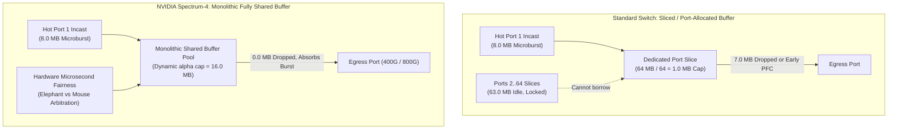
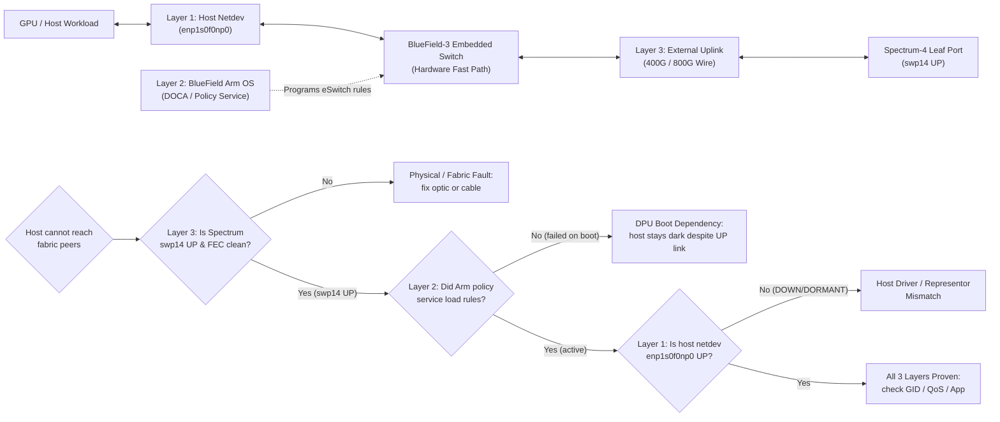
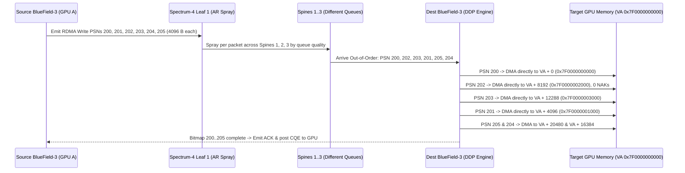
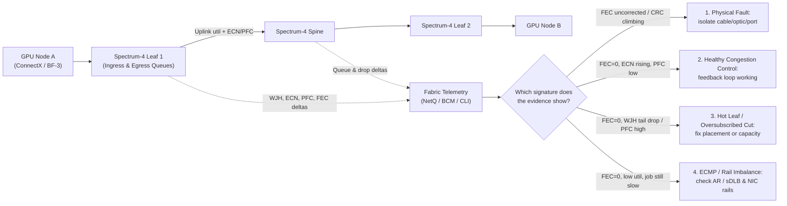

# 12.11 NVIDIA Spectrum-X and Spectrum switches

| | |
|---|---|
| Level | Advanced |
| Priority tier | 2 |
| Lab venue | Nebius GPU |
| Part | Part 12: Complete AI networking |
| Sources | `nvidia-devops` V9 Ch. 7, Ch. 8, Ch. 9, Ch. 10, Ch. 11, Ch. 12, Index & Labs 01–04; `superpod-gb300-ra`; `superpod-b200-dc`; `ai-data-center-network-design-and-technologies` Ch. 2 & Ch. 6; `bcm11-admin` Ch. 3 |
| Code | `code/part12/spectrum_x_switches.py`, `code/part12/spectrum_x_switches_lab.py` |
| Coverage file | `planning/coverage/chapters/12-11.md` |

## Why this matters for AI infrastructure

An AI Ethernet switch is not a passive box of high-speed ports. It is the active arbitration point where hundreds of `400 Gbps` and `800 Gbps` RDMA Queue Pairs (`QPs`) converge, frames are classified into lossless or lossy queues, microbursts are absorbed in shared silicon memory, and incipient congestion becomes either controlled at the microsecond timescale or amplified into a cluster-wide training stall. In a `256`-GPU or `9,216`-GPU cluster, every optical link can report `UP` with zero Forward Error Correction (`FEC`) uncorrectable blocks while a small subset of destination-facing leaf uplinks experiences static hash collisions or `N:1` incast, stretching the synchronous barrier time of an entire collective job.

Traditional enterprise Ethernet switches and standard 5-tuple Equal-Cost Multi-Path (`ECMP`) routing were engineered for thousands of short, high-entropy TCP flows—not a handful of synchronized `400 Gbps` or `800 Gbps` RoCEv2 (`UDP` port `4791`) elephant flows generated by `NCCL` `AllReduce` or `AllToAll` collectives. Under standard static 5-tuple hashing (`SLB`), two `100 Gbps` or `400 Gbps` elephant flows routinely hash to the same spine uplink while sibling links sit half-empty, capping effective cluster bisection bandwidth at roughly **`~60%`** of physical wire capacity. Worse, if a switch uses a **sliced (port-allocated) buffer architecture**, a single port hammered by an AI microburst can only draw from its tiny dedicated memory slice and drops packets even while the rest of the switch's memory sits completely idle.

**NVIDIA Spectrum-X** solves these limitations by co-designing the switching silicon, the server-edge network adapter, and the network operating system as a single end-to-end AI Ethernet platform:

1. **NVIDIA Spectrum-4 Switch ASIC (`SN5600` / `SN5600D`, `51.2 Tbps`) and Monolithic Fully Shared Buffer:** Built from `512` lanes of `100G PAM4` SerDes (`64 x 800GbE` OSFP ports or `128 x 400GbE` breakout ports, plus the `SN2201` `48 x 1GbE` + `4 x 100GbE` out-of-band management switch), Spectrum ASICs pool internal packet memory into a **monolithic fully shared buffer** with hardware microsecond fairness and What Just Happened (`WJH`) hardware drop-reason telemetry.
2. **End-to-End Platform Pairing with BlueField-3 SuperNICs / DPUs (`BF3240`) and ConnectX-7/8:** Spectrum-X pairs Spectrum-4 switches with **BlueField-3 SuperNICs** (`NIC` mode default on SuperNIC SKUs vs `DPU` / Embedded CPU Function Ownership `ECPF` mode default on DPU SKUs) or ConnectX-7/8 adapters, managed via **Cumulus Linux** (`NVUE` declarative `nv set` CLI and REST API on port `8765`), **DOCA**, **NetQ**, and **NVIDIA Base Command Manager (`BCM`)**.
3. **Spectrum-X Adaptive Routing and Selective Per-Packet RoCEv2 Spraying (`sDLB`):** Rather than pinning an elephant flow to a static `CRC32` 5-tuple hash bucket (`0x8BDA7C2D`), Spectrum-4 switches inspect real-time local port utilization and queue depth (and RoCEv2 Base Transport Header `BTH` `RDMA Write` opcodes via TCAM ACLs) to spray individual packets of a single RDMA flow across all available equal-cost spine links—raising effective AI fabric bandwidth from **`~60%` to `~95%`**.
4. **BlueField-3 Hardware Out-of-Order Direct Data Placement (`DDP`) and Telemetry-Driven Congestion Control:** Because per-packet spraying causes packets to arrive out of Packet Sequence Number (`PSN`) order at the destination server, BlueField-3 and ConnectX-7/8 hardware compute the exact target GPU memory offset (`VA + (PSN - base_PSN) * MTU`) from the RDMA Extended Transport Header (`RETH`) and place each payload directly into GPU memory (`GPUDirect RDMA`) with **zero `Go-Back-N` retransmission storms**, holding the completion event (`CQE`) until the hardware `PSN` bitmap is contiguous. Simultaneously, Spectrum-4 hardware telemetry feeds exact switch queue depth and drain rate back to the SuperNICs so senders pace injection rates in a single round-trip time before Priority Flow Control (`PFC`) pauses can cascade.

## Prerequisites and outcomes

**Prerequisites:** Chapter 12.2 (RDMA fundamentals and Queue Pairs), Chapter 12.3 (RoCEv2 transport over `UDP 4791`), Chapter 12.4 (`PFC`, `ECN`, and `DCQCN` in depth), and Chapter 12.5 (`IEEE 802.1Qaz` `ETS`, `DCBX`, and QoS trust boundaries).

**Outcomes:** After completing this chapter, you will be able to:
- Size **Spectrum-4 (`SN5600` / `SN5600D`, `51.2 Tbps`)** port radix and breakout topologies (`64x800G`, `128x400G`, `256x200G`, `512x100G`), contrast Spectrum's **monolithic fully shared buffer** against sliced port-allocated buffers (`1.0 MB` sliced cap dropping `7.0 MB` of an `8.0 MB` microburst vs `16.0 MB` dynamic shared cap with `0.0 MB` drops), and architect **DGX GB300 SuperPOD** Ethernet fabrics (`2..16` SUs, `1,152..9,216` GPUs, `SN5600D` compute/storage/management leafs and spines, and `SN2201` `48x1GbE` OOB switches).
- Distinguish **BlueField-3 DPU SKU** default operating mode (`DPU_MODE_ECPF`, where the Arm subsystem owns the embedded switch) from **BlueField-3 SuperNIC SKU** default mode (`NIC_MODE_SUPERNIC`), isolate faults across the three DPU layers (external switch uplink `swp14 up`, Arm control plane `openvswitch-policy-load.service`, and host netdev `enp1s0f0np0 DOWN`), and audit **ConnectX/BlueField PCIe & NUMA locality** (`LnkCap: 32GT/s x16` vs downgraded `LnkSta: 16GT/s x8`, `nvidia-smi topo -m` `PIX` vs `SYS`, and `60 s` per-rail byte deltas `+88.7 GB` vs `412,992` B).
- Quantify why 5-tuple Static Load Balancing (`SLB`, `CRC32` `0x8BDA7C2D` over `192.168.1.20 -> 192.168.2.10` `UDP 1024 -> 4791`, `mod 5 = 1`, `mod 8 = 5`, resilient hashing `512`/`1,024` buckets) limits AI fabrics to `~60%` effective bandwidth, and explain how **Spectrum-X Adaptive Routing** and **Selective Dynamic Load Balancing (`sDLB`)** (`BTH` `RDMA Write` opcode matching) achieve `~95%` effective bandwidth.
- Trace **BlueField-3 hardware out-of-order Direct Data Placement (`DDP`)** across out-of-order `PSN` arrivals `(200, 202, 203, 201, 205, 204)` (`0` `Go-Back-N` retransmissions vs `3` `PSN`-gap `NAK` events on legacy NICs) and **hardware telemetry-driven congestion control**.
- Configure and validate Cumulus Linux switches via declarative **NVUE (`nv set` / `nv config apply`)** and **Base Command Manager (`BCM` `cmsh`)**, and triage live fabric incidents using **What Just Happened (`WJH`)** (`Tail drop (queue full)` `18,402` and `52,100` vs `0`), multi-leaf `rx_pfc_prio3` pause-tree gradients (`leaf03: 210,500 -> leaf07: 198,200 -> leaf12: 41,100`), and the 4-branch Spectrum telemetry decision tree.

---

## 1. Spectrum-4 (`SN5600` / `SN5600D`) switch architecture, monolithic shared buffers, and SuperPOD topologies

### 1.1 Spectrum-4 `51.2 Tbps` ASIC, port radix, breakout modes, and `SN2201` OOB switches

In an AI Ethernet fabric, headline switching capacity is only as useful as the switch's **radix** (the number of independent ports available to fan out to servers and spines without adding extra hop tiers) and its **buffer architecture**. The **NVIDIA Spectrum-4** switch ASIC delivers **`51.2 Tbps`** of bidirectional switching capacity (`102.4 Tbps` aggregate full-duplex throughput) powered by **`512` lanes of `100G PAM4` SerDes** in a single monolithic chip:

| Switch Model & Role | Switching Capacity & SerDes | Native Port Configuration | Supported Breakout Modes & Logical Radix | Primary AI Data Center Role |
|---|---|---|---|---|
| **Spectrum-4 `SN5600` / `SN5600D`** (`2U` dense leaf/spine) | `51.2 Tbps` (`512 x 100G PAM4` SerDes lanes) | `64 x 800GbE` (`OSFP` / `QSFP-DD800`, `8` lanes/port) | `64 x 800GbE` (`8` lanes), `128 x 400GbE` (`4` lanes), `256 x 200GbE` (`2` lanes), `512 x 100GbE` (`1` lane) | AI compute backend leaf/spine (`Spectrum-X`), RoCEv2 high-performance storage fabric (`400GbE`/`800GbE`), and in-band management leaf/spine |
| **Spectrum `SN2201`** (`1U` out-of-band management ToR) | `48 x 1GbE` RJ45 copper + `4 x 100GbE` QSFP28 uplinks | `48 x 1 Gbps` downlinks + `4 x 100 Gbps` uplinks | `8,048,771,072` B (`7.496 GB`) RAM, `115,923,419,136` B (`115 GB`) NVMe, Intel Atom `C3338R` `2`-core `@ 1.80 GHz` | Physically isolated Out-of-Band (`OOB`) management for node BMCs, BlueField BMCs, NVLink switch `COMe`/BMC ports, rack PDUs, and ZTP |

Because each `800GbE` physical port on an `SN5600` or `SN5600D` exposes `8` lanes of `100G PAM4` SerDes, a single `2U` switch can operate as `64` ports of `800GbE` (`64 * 800 Gbps = 51.2 Tbps`), or break out via `2x` optical/DAC splitter cables into **`128` ports of `400GbE`** (`128 * 400 Gbps = 51.2 Tbps`), `256` ports of `200GbE` (`256 * 200 Gbps = 51.2 Tbps`), or `512` ports of `100GbE` (`512 * 100 Gbps = 51.2 Tbps`). High `128 x 400GbE` and `64 x 800GbE` radix lets architects build wide two-tier (leaf-spine) Clos fabrics without introducing a third super-spine tier until thousands of GPUs are deployed.

### 1.2 Monolithic fully shared buffer versus sliced port-allocated buffers

Why does switch silicon architecture matter so much for AI workloads when campus or standard enterprise data center switches advertise the same port speeds? When synchronized GPU workers execute a collective phase or storage checkpoint write, dozens of `400 Gbps` or `800 Gbps` ports burst simultaneously toward a single destination port (**many-to-one incast**). The switch must absorb that rate mismatch in on-chip SRAM packet memory while congestion signaling takes effect:



| Buffer Architecture | Memory Allocation Mechanism | Behavior Under `8.0 MB` Single-Port AI Microburst (`64 MB` Total Pool across `64` Ports) | Impact on RoCEv2 & Collective Tail Latency |
|---|---|---|---|
| **Standard Sliced / Multi-Core Buffer** | Memory is statically partitioned per port or per ingress/egress slice (`64 MB / 64 = 1.0 MB` per port) | Port `1` exhausts its `1.0 MB` slice immediately and **drops `7.0 MB`** (or fires immediate `PFC` `XOFF` pauses) even though `63.0 MB` sits unused on Ports `2..64` | Premature `PFC` pause trees or `Go-Back-N` retransmission storms (`250x` amplification on `400G` links) |
| **NVIDIA Spectrum Monolithic Fully Shared Buffer** | Single unified memory pool dynamically accessible by any port up to a dynamic threshold ($\alpha = 25\% \rightarrow 16.0\text{ MB}$) | Port `1` dynamically borrows `8.0 MB` from the shared pool (`<= 16.0 MB` cap), absorbing the entire microburst with **`0.0 MB` dropped** | Absorbs transient AI microbursts cleanly while `ECN`/telemetry-driven rate control paces senders |
| **Hardware Microsecond Fairness** | Per-queue hardware arbitration across competing elephant and mouse flows | Prevents a `400 Gbps`/`800 Gbps` RDMA elephant flow from starving small control/collective barrier frames | All GPU ranks in a synchronous collective progress evenly without straggler skew |

### 1.3 Spectrum-4 (`SN5600` / `SN5600D`) and `SN2201` in the DGX GB300 SuperPOD architecture

In the **NVIDIA DGX GB300 SuperPOD** reference architecture, each rack is a liquid-cooled **DGX GB300 NVL72** system containing **`18` compute trays** (`4` B300 GPUs and `2` Grace CPUs per tray = **`72` GPUs per rack** interconnected at `1.8 TB/s` per GPU over `9` NVLink 5 switch trays) and `8` power shelves (`6 x 5.5 kW` PSUs = `33 kW` per shelf). Eight DGX GB300 racks form **`1` Scalable Unit (`SU` = `576` GPUs, `144` compute trays, `1.2 MW` TDP)**. Every GB300 compute tray integrates two distinct network adapter families on its front cold-aisle panel:
- **`4 x ConnectX-8` (`800 Gbps` each):** Connected to the rail-aligned compute fabric (`Quantum-X800` `Q3400-RD` `144`-port switches or `Spectrum-X` `SN5600` `800G` compute rails).
- **`1 x BlueField-3 BF3240` dual-port DPU / SuperNIC (`2 x 400 Gbps`):** Connected to a two-layer **Spectrum-4 `SN5600` / `SN5600D`** Ethernet fabric (`4` `SN5600` compute leaf switches per SU). Rather than bonding both ports into a shared interface—which would allow unpredictable in-band TCP bursts to contend with RoCEv2 storage—the SuperPOD dedicates **Port 0 (`1 x 400 Gbps`) exclusively to the lossless RoCEv2 High-Performance Storage (`HPS`) network** and **Port 1 (`>= 200 Gbps`) to the In-Band Management and User Storage (`NFS`) network**.

Across the two-layer `SN5600D` leaf-spine Ethernet fabric:
- **Compute leaves (`4` `SN5600` switches per SU):** Each compute leaf connects to the spine tier via **`24` links at `400 Gbps`**, providing a deliberate **`1:3` (`3:1`) blocking ratio** tailored to per-tray storage demand.
- **Storage leaves (starting at `2` `SN5600D` switches):** Each storage leaf connects to the spine tier via **`72` nonblocking `400 Gbps` links** (`1:1` nonblocking) so storage arrays never bottleneck at the storage leaf-to-spine cut.
- **Management leaves (`2` `SN5600D` switches) and OOB spines (`2` switches):** Management leaves connect at **`24 x 400 Gbps`** to serve Base Command Manager (`BCM`), Slurm, Run:ai, NGC container registries, and persistent `NFS` user storage (with **`>= 2 x 100GbE DR1`** single-mode links to the customer corporate edge via eBGP), while a pair of OOB aggregation spines aggregates the **`SN2201` (`48 x 1GbE`)** out-of-band management switches into a dedicated VXLAN domain.

| Scale-Out Size (`# SUs`) | Total GPUs (`72`/rack, `576`/SU) | `SN5600D` Spine Switches | `SN5600D` Compute Leaf Switches (`4`/SU) | `SN5600D` Storage Leaf Switches | Max Supported Storage Bandwidth (`400GbE` Links / Aggregate `Tbps`) | Management Leafs + OOB Spines |
|---|---|---|---|---|---|---|
| **`2` SUs** (`16` racks) | **`1,152`** | `4` | `8` | `2` | **`64 x 400GbE`** (`25.6 Tbps`) | `2 + 2` |
| **`4` SUs** (`32` racks) | **`2,304`** | `8` | `16` | `2` | **`128 x 400GbE`** (`51.2 Tbps`) | `2 + 2` |
| **`8` SUs** (`64` racks) | **`4,608`** | `12` | `32` | `4` | **`256 x 400GbE`** (`102.4 Tbps`) | `2 + 2` |
| **`16` SUs** (`128` racks) | **`9,216`** | `24` | `64` | `8` | **`1024 x 400GbE`** (`409.6 Tbps`) | `2 + 2` |

This `SN5600D` RoCEv2 storage fabric is engineered to meet two explicit throughput tiers:
- **Standard storage tier** (single-modality datasets fitting largely in local node RAM/NVMe cache, where each compute tray has `4 x 3.84 TB` E1.S NVMe in RAID0 plus `1 x 1.92 TB` M.2 OS NVMe): **`90 GB/s` aggregate read** and **`45 GB/s` aggregate write** per SU (**`360 GB/s` read** and **`180 GB/s` write** across `4` SUs).
- **Enhanced storage tier** (multi-billion/trillion-parameter multimodal training and frequent checkpointing exceeding local cache): **`280 GB/s` aggregate read** and **`140 GB/s` aggregate write** per SU (**`1,120 GB/s` read** and **`560 GB/s` write** across `4` SUs).

### 1.4 Evaluating switch capacity at the bottleneck cut (normal and `N-1` degraded states)

When reviewing any Spectrum leaf-spine topology, distinguish five metrics that are often conflated in vendor quotes: **port speed** (rate on one negotiated link), **radix** (number of usable ports on a switch), **aggregate capacity** (sum of all port speeds), **buffer/queue design** (how transient microbursts are absorbed), and **usable bisection capacity at the relevant traffic cut**:

$$
\text{Effective Available Capacity} = \text{Capacity of the relevant path cut after topology, policy, and } N-1 \text{ failure constraints}
$$

Consider the worked capacity calculation from Volume 09 Chapter 10: a rack of **`16` GPU nodes**, each equipped with **`2 x 400 Gbps` RoCEv2 rails** (`800 Gbps` per-node injection capacity), connects to a Spectrum leaf switch that has **`8 x 400 Gbps` uplinks** to the spine tier:
- **Worst-case downlink demand (all `16` nodes injecting off-rack simultaneously):** $16 \times 800\text{ Gbps} = \mathbf{12,800\text{ Gbps}}$.
- **Normal-state uplink capacity (`8` active uplinks):** $8 \times 400\text{ Gbps} = \mathbf{3,200\text{ Gbps}}$, producing a **`4.0:1` (`4:1`) normal oversubscription ratio**.
- **Degraded `N-1` uplink capacity (`1` uplink drained for maintenance or failed = `7` active uplinks):** $7 \times 400\text{ Gbps} = \mathbf{2,800\text{ Gbps}}$, shifting the oversubscription ratio to **`4.57:1`** ($12,800 / 2,800 \approx 4.57$).

Similarly, if an entire spine switch is drained on a `2`-spine leaf-spine fabric (`nexthop-group 40` shrinking from **`2` active members to `1`**), every cross-rack flow concentrates onto half the surviving uplinks, driving `tx_ecn_marked_prio3` up by **`5.87x`** (from **`15,000` to `88,120`** marks per window while `rx_pfc_prio3` stays at `0`). Evaluating both normal (`4.0:1`) and degraded (`4.57:1` or single-spine) cuts before deployment prevents maintenance windows from turning into cluster-wide training outages.

---

## 2. End-to-end Spectrum-X platform: Spectrum-4 + BlueField-3 SuperNIC / DPU + ConnectX + DOCA

### 2.1 BlueField-3 operating modes (`DPU` / `ECPF` mode vs `SuperNIC` / `NIC` mode) and three-layer fault isolation

Spectrum-X is an end-to-end architecture: the switch (`Spectrum-4`) and the endpoint (`BlueField-3` or `ConnectX-7/8`) cooperate in hardware. On the server side, NVIDIA ships BlueField-3 silicon in two distinct hardware SKU families whose **default operating modes must never be conflated**:

1. **BlueField-3 DPU SKUs (e.g., `BF3240` dual-port `400GbE` DPU):** Default to **DPU mode**, also called **Embedded CPU Function Ownership (`ECPF`)**. In `DPU` (`ECPF`) mode, the embedded `16`-core Arm subsystem (running a dedicated DOCA Linux OS) owns the NIC hardware resources and the **embedded switch (`eSwitch`)**. Traffic between the host PCIe function and the external `400GbE`/`800GbE` wire passes through the DPU's embedded switch: the first packet without a flow rule traverses an Arm-side representor slow path so the Arm control plane can validate policy and program a hardware flow rule into the `eSwitch`, after which subsequent packets fly across the hardware-offloaded fast path.
2. **BlueField-3 SuperNIC SKUs (e.g., `BF3140` / SuperNIC mode):** Default to **NIC mode (`NIC_MODE_SUPERNIC`)**, operating as a purpose-built `400GbE` Spectrum-X RoCEv2 endpoint where the host driver directly manages RDMA Queue Pairs while hardware engines execute Spectrum-X Adaptive Routing packet reordering (`DDP`) and telemetry-driven congestion control without an intermediate Arm virtual-switch control dependency.



| Observable Layer | Diagnostic Command & Healthy Baseline | Failure Signature in the Production DPU Story (`V9` Ch. 9) | Operational Meaning |
|---|---|---|---|
| **Layer 3: External Fabric Uplink (Switch View)** | `(on leaf) show interface status swp14` -> `swp14 up 100G/400G full RoCE-compute` | `swp14` reports **`up`** with zero FEC/CRC errors | Proves physical cable and DPU-to-leaf link are up; **does not prove host reachability** |
| **Layer 2: BlueField Arm Control Plane (OOB View)** | `(on DPU Arm) systemctl status openvswitch-policy-load.service` -> `Active: active (exited)` | `Active: failed (Result: exit-code) since 09:14:02 UTC` (`Process: 812` `code=exited, status=1`) | Arm service failed to program `eSwitch` fast-path rules during boot |
| **Layer 1: Host Network Function (Host View)** | `(on host) ip -br link show` -> `enp1s0f0np0 UP` | `enp1s0f0np0 DOWN <state DORMANT>` | Host-facing representor never came up because Layer 2 policy load failed |
| **Fleet Image Reconciliation (`dpu-agent`)** | `node07` & `node08`: `dpu-image-24.10-prod-3` | `node09`: stuck on **`dpu-image-24.07-prod-1`** (`reconcile abandoned after 5 retries` from `03:12:04` to `03:45:11`) | Silent image drift across "identical" nodes causes asymmetric policy behavior |

When operating BlueField DPUs in `DPU` (`ECPF`) mode, treat the host, the DPU Arm subsystem, and the Spectrum switch as **three separate failure and administrative domains**. Always maintain an independent Out-of-Band (`OOB`) management path (via `SN2201` switches or BMC `rshim`) and gate node scheduler readiness on all three layers (`swp14 up`, Arm policy service active, and host `enp1s0f0np0 UP`), not just DPU boot completion. Similarly, when selecting **DOCA** software components, always prefer a **supported packaged DOCA service** over a custom DOCA application unless a differentiated requirement has a dedicated long-term engineering, security-patching, and on-call owner—and never deploy a DOCA SDK sample directly as production infrastructure.

### 2.2 ConnectX and BlueField-3 local I/O paths: PCIe downgrades, NUMA locality, and multi-rail selection

On the host side of a ConnectX-7, ConnectX-8, or BlueField-3 SuperNIC, an active `200GbE`, `400GbE`, or `800GbE` Ethernet link can only deliver line rate if the local PCIe root complex, NUMA topology, and collective communication library (`NCCL`) drive it properly:

1. **Negotiated PCIe link speed and width (`LnkCap` vs `LnkSta`):** Before blaming a Spectrum switch for low RoCEv2 bandwidth, compare the adapter's PCIe capability (`LnkCap`) against its negotiated state (`LnkSta`):
   ```text
   $ lspci -s 41:00.0 -vv | egrep "LnkCap|LnkSta"
   LnkCap: Port #0, Speed 32GT/s, Width x16      <- PCIe Gen5 x16 capable (~64.0 GB/s raw)
   LnkSta: Speed 16GT/s (downgraded), Width x8   <- Negotiated PCIe Gen4 x8 (~16.0 GB/s raw)
   ```
   A `200GbE` port requires **`25.0 GB/s`** ($200 / 8$) of unidirectional PCIe bandwidth (`50.0 GB/s` for `400GbE`). Because `41:00.0` negotiated at `16 GT/s` (`Gen4`) and `x8` width (`16.0 GB/s`, only one-quarter of its `64.0 GB/s` `Gen5 x16` capability), the host PCIe slot caps the adapter well below line rate—a bottleneck that no switch counter will ever see.
2. **GPU-to-NIC PCIe/NUMA locality (`nvidia-smi topo -m`):** Verify that each GPU is paired with the NIC on the same PCIe switch (`PIX`, NUMA node `0` cores `0-31` for `GPU0 <-> NIC0` and NUMA node `1` cores `32-63` for `GPU1 <-> NIC1`) rather than crossing the CPU socket interconnect (`SYS` for `GPU0 <-> NIC1`).
3. **Multi-rail process affinity (`rx_bytes_phy` `60 s` delta):** Installing dual-port adapters or multiple rails does not automatically double throughput. In Volume 09 Chapter 8 Scenario 1, both `ens1f0` (rail 0) and `ens1f1` (rail 1) reported `ACTIVE` / `LINK_UP`, yet a `60`-second `ethtool -S` byte-counter delta revealed:
   - **`ens1f0` (rail 0):** `rx_bytes_phy` rose from **`892,481,200,384`** to **`981,204,882,176`** bytes (**`+88,723,681,792` B = `+88.7 GB`** in `60 s`, `11.83 Gbps`).
   - **`ens1f1` (rail 1):** `rx_bytes_phy` stayed at **`412,992` B** (`~0 GB` delta—essentially idle).
   Inspecting `NCCL_DEBUG=INFO` showed why: both local GPU ranks (`node05:2201 [0]` and `[1]`) logged `NCCL INFO NET/IB : Using [0]mlx5_0:1/RoCE ; OOB ens1f0`, binding both ranks to rail 0 (`mlx5_0`) and leaving rail 1 (`mlx5_1`) unused. For AI data paths, avoid generic host LACP bonding (which hides physical rail topology from `NCCL`) and enforce explicit GPU-to-NIC-to-rail affinity.

---

## 3. Spectrum-X Adaptive Routing and selective per-packet RoCEv2 spraying (`sDLB`)

### 3.1 Why traditional 5-tuple Static Load Balancing (`SLB`) caps AI Ethernet fabrics at `~60%`

In a conventional IP leaf-spine Clos fabric, a leaf switch receives reachability to a remote GPU (`GPU2`) across all `N` spine switches via BGP Equal-Cost Multi-Path (`ECMP`, installed in the switch ASIC as an ECMP next-hop group such as `nh-id123` pointing to `Unicast_nh1—SpineA`, `Unicast_nh2—SpineB`, `Unicast_nh3—SpineC`). Under **Static Load Balancing (`SLB`)**, the switch Packet Forwarding Engine (`PFE`) computes a deterministic hash (typically `CRC32`) over the packet's 5-tuple:
- Source IP: `192.168.1.20` (`0xC0A80114`)
- Destination IP: `192.168.2.10` (`0xC0A8020A`)
- IP Protocol: `17` (`UDP` = `0x11`)
- Source UDP Port: `1024` (`0x0400`, hashed from the source `QP`)
- Destination UDP Port: **`4791`** (`0x12B7`, fixed for all RoCEv2 packets)

Feeding the concatenated hex string `C0A80114 C0A8020A 11040012 B7` into a `CRC32` generator produces the hash key **`0x8BDA7C2D`** (**`2,346,351,661`** in decimal):
- In a `5`-member ECMP group, `2,346,351,661 mod 5 = 1` (selecting interface index `1`).
- If the spine tier expands to `8` links, `2,346,351,661 mod 8 = 5` (selecting interface index `5`). To avoid rehashing every active flow when a single link flaps, switches use **resilient hashing** with a fixed bucket indirection table (**`512` or `1,024` buckets**, or an `8`-bucket pedagogical table where `hash mod 8 = 2 -> interface_2`, reassigning only buckets `2` and `7` if `interface_2` goes down).

However, neither `CRC32` modulo nor resilient/symmetric/weighted hashing solves the fundamental AI workload problem: **RoCEv2 traffic has very low flow entropy and massive per-flow bandwidth (elephant flows)**. Because `SLB` assigns links without inspecting real-time bandwidth utilization or queue depth, consider four flows arriving at `LeafA` with two `200 Gbps` uplinks (`SpineA` and `SpineB`):
- `Flow1` (`50 Gbps`) and `Flow3` (`50 Gbps`) hash to `LeafA -> SpineA`: total load = **`100 Gbps` (`50.0%` utilization)**.
- `Flow2` (`100 Gbps`) and `Flow4` (`100 Gbps`) hash to `LeafA -> SpineB`: total load = **`200 Gbps` (`100.0%` utilization — saturated)**.

Even though equal numbers of flows (`2` each) landed on each uplink and aggregate demand (`300 Gbps`) is only `75%` of the `400 Gbps` uplink cut, `SpineB` is pinned at **`100%` utilization** and triggers congestion while `SpineA` sits half-empty at `50%`. Across multi-rack AI collectives, static 5-tuple ECMP collisions leave effective cluster bisection bandwidth at roughly **`~60%`**.

### 3.2 Dynamic (`DLB`), Global (`GLB`), Selective (`sDLB`), and Spectrum-X per-packet RoCEv2 spraying

To eliminate hash-collision hotspots, modern AI switch ASICs progress up a four-tier load-balancing hierarchy:

| Load-Balancing Mode | Path Selection Inputs | Granularity & Rebalancing Behavior | RoCEv2 Reordering Impact & Effective Bandwidth |
|---|---|---|---|
| **Static Load Balancing (`SLB`)** | 5-tuple (`Src/Dst IP`, `UDP Src/Dst 4791`, `Proto 17`) + optional `BTH` `QP` field via `CRC32` | Per-flow static pin; blind to link utilization and buffer queue depth | In-order delivery, but severe elephant collisions (**`~60%` effective BW**) |
| **Dynamic Load Balancing (`DLB`)** | Local link bandwidth utilization + local egress buffer queue depth (`quality band` table updated in ASIC microkernel) | **Assigned-flow mode** (pins at flow start), **Flowlet mode** (rebalances across inter-burst idle gaps), or **Per-packet mode** | Flowlet mode balances `(50G+100G = 150G, 75%)` across both `200G` spines with low reordering |
| **Global Load Balancing (`GLB`)** | Local link utilization + local queue depth + **Next-to-Next-Hop (`NNH`)** remote spine-to-leaf link quality | Propagates downstream spine-to-leaf congestion state upstream so ingress leaves avoid remote bottlenecks | Prevents aggregation hot spots in 3-stage and 5-stage Clos fabrics |
| **Spectrum-X Adaptive Routing & Selective Spraying (`sDLB`)** | Real-time local/remote link load, queue size, and **TCAM ACL match on RoCEv2 (`UDP 4791`) `BTH` `RDMA Write` opcodes** | **Per-packet spraying (`PER_PACKET_SPRAY`)** across all healthy equal-cost spine links for `DDP`-capable endpoints | Nearly perfect link utilization (**`~95%` effective BW**); out-of-order packets reassembled in hardware by `BlueField-3` / `ConnectX-7/8` |

In **Spectrum-X Adaptive Routing (`AR`) with Selective Dynamic Load Balancing (`sDLB`)**, the Spectrum-4 ingress pipeline uses a Ternary Content-Addressable Memory (`TCAM`) Access Control List (`ACL`) to inspect the RoCEv2 (`UDP 4791`) **Base Transport Header (`BTH`) opcode**:
- **Non-matching / control flows (`Flow1`, e.g., `RDMA Send` or TCP):** Handled via flowlet or per-flow load balancing (`FLOWLET_OR_PER_FLOW`) to preserve strict in-order arrival for legacy or control sockets.
- **Matching elephant flows (`Flow2`, RoCEv2 `RDMA Write` opcodes from `ConnectX-6/7/8` or `BlueField-3`):** Switched into **quality-aware per-packet spraying (`PER_PACKET_SPRAY`)**. Every individual `4,096`-byte RDMA packet (`Datagram A`, `Datagram B`, `Datagram C`) is dynamically dispatched out the least-loaded spine link (`Port-1 -> Spine1`, `Port-2 -> Spine2`, `Port-3 -> Spine3`) based on real-time hardware queue quality tables, driving all spine links to uniform utilization (`~95%` effective bandwidth).

---

## 4. BlueField-3 hardware out-of-order Direct Data Placement (`DDP`) and telemetry-driven congestion control

### 4.1 Why per-packet spraying breaks standard RDMA NICs—and how hardware `DDP` solves it

Spraying individual packets of a single Queue Pair across multiple spines (`Spine1`, `Spine2`, `Spine3`) guarantees that packets traverse slightly different buffer depths and optical fiber lengths, arriving at the destination leaf and server **out of Packet Sequence Number (`PSN`) order** (for example, `Datagram B` arrives at `T1`, `Datagram C` at `T2`, and `Datagram A` at `T3`). On a standard RDMA NIC without hardware out-of-order Direct Data Placement, receiving `PSN 202` when expecting `PSN 201` immediately triggers a `PSN`-gap Negative Acknowledgment (`NAK`) and a hardware `Go-Back-N` retransmission burst—destroying throughput.



| Arriving Packet Order (`PSN`) | Legacy RDMA NIC Behavior (In-Order Required) | BlueField-3 / ConnectX-7/8 Hardware `DDP` Action (`base_va = 0x7F0000000000`, `MTU = 4,096` B) | Target GPU Memory Address Written (`GPUDirect RDMA`) |
|---|---|---|---|
| **1st arrival: `PSN 200`** | Expects `200` -> accepts `200`, advances expected to `201` | Computes offset $(200 - 200) \times 4096 = 0$; sets bitmap bit `0` | `0x7F0000000000` (`+0` B) |
| **2nd arrival: `PSN 202`** | Expects `201` -> **drops `202`, emits `PSN`-gap `NAK #1` (`Go-Back-N`)** | Computes offset $(202 - 200) \times 4096 = 8,192$; DMAs directly to GPU RAM (`0` NAKs) | `0x7F0000002000` (`+8,192` B) |
| **3rd arrival: `PSN 203`** | Still missing `201` -> **drops `203`, emits `NAK #2`** | Computes offset $(203 - 200) \times 4096 = 12,288$; DMAs directly to GPU RAM | `0x7F0000003000` (`+12,288` B) |
| **4th arrival: `PSN 201`** | Accepts `201`, but `202` & `203` were discarded and must be retransmitted | Computes offset $(201 - 200) \times 4096 = 4,096$; fills gap in GPU RAM (`200..203` contiguous) | `0x7F0000001000` (`+4,096` B) |
| **5th arrival: `PSN 205`** | Expects `204` -> **drops `205`, emits `NAK #3`** | Computes offset $(205 - 200) \times 4096 = 20,480$; DMAs directly to GPU RAM | `0x7F0000005000` (`+20,480` B) |
| **6th arrival: `PSN 204`** | Accepts `204`, waits for retransmitted `205` (`3` total NAK events) | Computes offset $(204 - 200) \times 4096 = 16,384$; bitmap `200..205` complete -> **posts `CQE`** | `0x7F0000004000` (`+16,384` B) |

How does **BlueField-3 / ConnectX-7/8 Direct Data Placement (`DDP`)** achieve zero-copy out-of-order reassembly without vast staging buffers on the NIC?
1. **Self-describing `RDMA Write` offsets:** In an `RDMA Write` transaction, the First/Only packet carries the **RDMA Extended Transport Header (`RETH`)** containing the base virtual memory address (`base_va = 0x7F0000000000`), Remote Key (`rkey`), and total DMA length, while every subsequent Middle/Last packet carries its `24`-bit `PSN` in the `BTH`.
2. **Direct arithmetic placement into GPU HBM:** Because the Path MTU (`4,096` bytes) and starting `PSN` (`200`) are stored in the hardware Queue Pair context, the receiving BlueField-3 SuperNIC does not need to hold out-of-order payloads inside on-NIC SRAM waiting for `PSN 201`. Instead, when `PSN 202` arrives early, the NIC hardware calculates:
   $$
   \text{Target Address}(\text{PSN}) = \text{VA}_{\text{base}} + (\text{PSN} - \text{PSN}_{\text{start}}) \times \text{MTU}
   $$
   and immediately DMAs the `4,096`-byte payload across PCIe/NVLink-C2C directly into its final slot (`0x7F0000002000`) inside GPU High-Bandwidth Memory.
3. **Hardware `PSN` bitmap and deferred `CQE` visibility:** The SuperNIC maintains a sliding hardware `PSN` arrival bitmap for the Queue Pair. Only when the delayed packets (`PSN 201` and `PSN 204`) arrive and every bit in `200..205` is set does the NIC emit the final acknowledgment and post the Completion Queue Element (`CQE`) to the application—making per-packet fabric spraying completely transparent to `NCCL` and PyTorch.

### 4.2 Spectrum-X hardware telemetry-driven congestion control

Even with perfect per-packet spraying across the spine tier, congestion can still occur at the **final destination leaf-to-server port (`CP4`)** when multiple GPUs intentionally write to a single receiver (`N:1` incast) or during parallel storage checkpointing. Classical `DCQCN` (Chapter 12.4) relies on `1`-bit/2-bit probabilistic `WRED`/`ECN` marks (`CE = 11`): the sender NIC does not know *how full* the switch queue is or *how many flows* are competing, so it applies a blind multiplicative rate cut (e.g., cutting a `400 Gbps` flow to `200.0 Gbps`) and then slowly probes upward via timer/byte counters, creating sawtooth bandwidth oscillations.

In **Spectrum-X Congestion Control**, the Spectrum-4 switch ASIC and BlueField-3 SuperNIC replace blind binary probing with **hardware telemetry-driven rate control**:
- When a Spectrum-4 egress queue crosses its target threshold (e.g., `160.0 KB` occupancy against a `64.0 KB` target and `256.0 KB` maximum threshold, an occupancy ratio of $(160 - 64) / (256 - 64) = \mathbf{0.5}$), the switch injects exact hardware telemetry—instantaneous queue depth, queue growth/drain rate, and active link utilization—into congestion feedback packets.
- Receiving that exact telemetry, two competing `400.0 Gbps` BlueField-3 senders compute their exact fair-share drain rate in a single round-trip time ($\frac{400.0}{2} \times (1 - 0.15 \times 0.5) = \mathbf{185.0\text{ Gbps}}$ each), draining the `96 KB` excess queue smoothly without under-utilizing the `400 Gbps` wire or triggering `PFC` pause storms.

---

## 5. Spectrum telemetry, What Just Happened (`WJH`), and the 4-branch fault decision tree

### 5.1 Separating physical faults, healthy congestion control, hot cuts, and ECMP imbalance

When a training run slows down on a Spectrum Ethernet fabric, treating "the switch" as a single opaque suspect wastes the first hour of incident response. As established in Volume 09 Chapter 7, joining host `ethtool -S` deltas with Spectrum switch queue, `ECN`, `PFC`, and **What Just Happened (`WJH`)** hardware drop-reason telemetry routes any incident into one of four distinct operational signatures:



| Telemetry Branch | Physical Counters (`fec_uncorrected_blocks`, `rx_crc_errors`) | Queue, `WJH`, `ECN`, and `PFC` Counter Deltas | Concrete Production Evidence (`V9` Ch. 7, 10, 11 & Lab 03) | Correct Engineering Action |
|---|---|---|---|---|
| **1. Physical Fault** | **Climbing** (`fec_uncorrected_blocks: 3` matching `rx_crc_errors: 3` on `swp17`; `fec_corrected_blocks: 41,200`) | `rx_ecn_marked_prio3` may rise secondarily due to RDMA retransmissions | `swp17` (`rack14-node07`, `mlx5_1`, `rail 1`, `DAC-2m` serial `ABC123`, `training-run-4471` ranks `48-55`) | Replace/reseat cable or optic (`ABC123`) first; never tune `ECN`/`PFC` on a corrupting link |
| **2. Healthy Congestion Control** | **Clean (`0` uncorrected, `0` CRC)** | `rx_ecn_marked_prio3` rises (`+47,829`); `rx_pfc_prio3` modest (`412`), `tx_pfc_prio3` (`14`); `0` `WJH` drops | `Lab 03` `60 s` bounded contention (`rx_prio3_packets` `102,314 -> 51,234,892`, `tx_prio3_packets` `89,621 -> 48,901,234`, `Sender A 89.2 Gbps + Sender B 87.1 Gbps = 176.3 Gbps`) | Not an incident; `DCQCN`/telemetry control loop is pacing senders as qualified |
| **3. Hot Leaf / Oversubscribed Cut** | **Clean (`0` uncorrected, `0` CRC)** | `WJH` **`Tail drop (queue full)`** climbing (`18,402` or `52,100` vs `0` on healthy rack) or sustained `rx_pfc_prio3` (`210,500`) | Slow rack uplink to `10.20.9.99` shows `52,100` tail drops (`1s ago`) vs `0` on healthy rack; or `leaf03` (`210,500`) -> `leaf07` (`198,200`) -> `leaf12` (`41,100`) pause tree | Fix workload placement, oversubscribed cut, or hop-by-hop QoS drift (`swp19` `trust pcp`) |
| **4. ECMP or Rail Imbalance** | **Clean (`0` uncorrected, `0` CRC)** | Low average link utilization (`< 40%`), flat `ECN`/`PFC`, yet collective step time is slow | Static 5-tuple hash collision (`~60%` effective BW) or `ens1f0` moving `+88.7 GB` while `ens1f1` moves `412,992` B (`~0 GB`) | Enable Spectrum-X Adaptive Routing (`sDLB`) and fix `NCCL` multi-rail device binding |

### 5.2 Hardware drop-reason sampling with What Just Happened (`WJH`) and tracing `PFC` pause trees

Standard interface `discard` counters only tell you *that* a packet was dropped, leaving operators guessing whether the cause was a corrupted frame, a VLAN miss, an ACL rule, a routing blackhole, or an exhausted egress queue. On NVIDIA Spectrum switches running Cumulus Linux, **What Just Happened (`WJH`)** captures the exact packet header (`SRC-IP`, `DST-IP`, ports) and the specific **ASIC hardware drop reason** in real time:

```text
# (untested here) Inspect hardware drop reasons via What Just Happened (WJH)
$ show what-just-happened drop-reason all
REASON                    SRC-IP        DST-IP        COUNT   LAST-SEEN
L2 table miss              -             -               0     -
Router ingress miss        10.20.4.15   10.20.9.99       0     -
Tail drop (queue full)     10.20.4.15   10.20.9.99    18402    2s ago
ACL deny                    -            -                0     -
```

In Volume 09 Chapter 7 Scenario 1, a `256`-GPU cluster met pairwise `ib_write_bw` targets (`392.11 Gbps`), yet one rack became a persistent straggler whenever two training jobs ran concurrently. Comparing `WJH` across the slow rack's leaf uplinks and a healthy rack's leaf uplinks during the exact same collective window isolated the root cause immediately:
- **Slow rack leaf uplinks:** `Tail drop (queue full)` from `10.20.5.20` toward `10.20.9.99` = **`52,100`** (`1s ago`).
- **Healthy rack leaf uplinks:** `Tail drop (queue full)` = **`0`**.
Similarly, in Volume 09 Chapter 10, a newly commissioned rack showed **`0`** `WJH` tail drops during its isolated acceptance test, but **`38,210`** `Tail drop (queue full)` events (`10.20.6.40 -> 10.20.9.12`, `3s ago`) one week later once shared production jobs contended for its leaf-to-spine cut.

When lossless `PFC` is active on Priority `3` and pause frames propagate across multiple leaves, walk the `rx_pfc_prio3` counter gradient across all suspect leaves in a single synchronized query:

```text
# (untested here) Walk rx_pfc_prio3 across leaves to locate the pause-tree origin
$ for sw in leaf03 leaf07 leaf12; do echo "== $sw =="; ssh $sw "ethtool -S swp1 | grep rx_pfc_prio3"; done
== leaf03 ==
     rx_pfc_prio3:            210500       <- most-downstream, highest count: pause-tree origin
== leaf07 ==
     rx_pfc_prio3:            198200       <- propagated upstream from leaf03's direction
== leaf12 ==
     rx_pfc_prio3:            41100        <- further upstream, smaller count
```

Because `leaf03` records the highest count (**`210,500`**) and counts decrease monotonically moving upstream (**`198,200`** on `leaf07` -> **`41,100`** on `leaf12`), `leaf03` is proven to be the downstream origin of a single congestion tree rather than three independent misconfigurations.

---

## 6. Cumulus Linux, declarative NVUE (`nv set`), NetQ, and Base Command Manager (`BCM`) operations

### 6.1 Declarative switch management with NVUE (`nv set`) and BCM (`cmsh`)

NVIDIA Spectrum switches run **Cumulus Linux**, a native Linux Network Operating System (`NOS`, e.g., Debian kernel `5.10.0-cl-1-amd64` / `#1 SMP Debian 5.10.162-1+cl5.4.0u1`, `Cumulus Linux 5.2.1` or `5.13.1`). Instead of editing scattered Linux text files by hand, modern Cumulus Linux exposes **NVUE (`NVIDIA User Experience`)**—a single declarative object model backed by the `nvued` daemon that can be driven identically via:
1. **The `nv` CLI (`nv set`, `nv unset`, `nv config diff`, `nv config apply`, `nv config save`, `nv config show`):** Renders the running configuration as a versioned `startup.yaml` artifact.
2. **The NVUE REST API (default HTTPS port `8765`):** Executes the exact same object tree over HTTP for configuration-as-code automation.
3. **NVIDIA Base Command Manager (`BCM` `cmsh` and `CMDaemon Lite`):** In DGX SuperPOD and BCM-managed clusters, Cumulus switches are added as `switch` devices (`set hasclientdaemon yes` for `cm-lite-daemon`, with default credentials configured in `accesssettings` using `Rest port 8765` and provisioned on Day-0 via Zero-Touch Provisioning `ZTP` over DHCP from `http://10.141.255.254:8080/switch/myswitch/cumulus-ztp.sh` and `/cm/local/apps/cmd/etc/htdocs/switch/<switch>/startup.yaml`).

Within `bcm11-admin`, `cmsh` supports three **`nvconfigurationmode`** operating modes on every Cumulus switch:
- **`auto` mode:** BCM automatically translates cluster device properties into `auto`-indexed `nv set` commands (`1: nv set system hostname myswitch`, `2: nv set system timezone Europe/Amsterdam`, `3..6: nv set service snmp-server ...`, `7: nv set service ntp mgmt pool 10.141.255.254`, `8: nv set service dns mgmt server 10.141.255.254`, `9..10: nv set service syslog mgmt server 10.141.255.254 port 514 / protocol udp`, `11: nv set bridge domain br_default type vlan-aware`), while allowing administrators to append `manual`-indexed overrides (`manual 1: nv set interface swp27 ip address 10.141.255.123`) and push them with `apply`.
- **`manual` mode:** Ignores `auto`-generated rules (or copies the `auto` stack into `manual` indices so specific lines such as `nv del 1-2` can be pruned before `commit` and `apply`).
- **`file` mode (used by DGX SuperPODs):** Points `nvconfigurationfile` directly to `startup.yaml` (accompanied by `cm-startup.yaml` imported via `cm-import-startup`), which is applied automatically via ZTP or Ansible on boot.

To prevent BCM's `CMDaemon` from misinterpreting transit MAC addresses on inter-switch links (`ISLs`) as directly attached compute nodes, all spine-facing switch ports must be declared as **`uplinks`** in `cmsh` (`set switch01 uplinks 15 16; set switch02 uplinks 01; commit`). Operators can then map and audit node-to-switch-port cabling across the fleet using `showport <mac>`, `finddevicebyswitchport switch01:1` (or breakout syntax `switch01:1s1`), `setmacviaswitchport --dry-run -t switch`, `switchoverview` (which reports per-port status such as `swp5 UP node001-dpu 100 Gb/s` and `swp7 UP node002-dpu 100 Gb/s`), and **NetQ** (`netqsettings` on port `443`) for continuous fleet-wide telemetry and drift detection alongside **NVIDIA Air** pre-deployment digital-twin simulation.

---

## Commands and configurations that matter

### 1. Declarative NVUE (`nv set`) configuration for a Spectrum-X lossless RoCEv2 + Adaptive Routing + BGP/EVPN leaf switch

```bash
# (untested here) 1. Configure 9216-byte jumbo MTU across all 64/128 server and spine ports
nv set interface swp1-64 link mtu 9216

# (untested here) 2. Enable lossless RoCEv2 QoS profile (DSCP trust, Priority 3 PFC, ECN marking, and PFC Watchdog)
nv set qos roce enable on
nv set qos roce mode lossless
nv set qos pfc default-profile prio 3
nv set qos ecn default-profile
nv set interface swp1-64 qos pfc-watchdog state enabled

# (untested here) 3. Enable Spectrum-X Adaptive Routing and selective RoCEv2 packet spraying
nv set system adaptive-routing enable on
nv set router adaptive-routing enable on

# (untested here) 4. Configure BGP numbered/unnumbered underlay and EVPN control plane
nv set router bgp autonomous-system 65101
nv set vrf default router bgp neighbor swp49-64 remote-as external
nv set vrf default router bgp address-family ipv4-unicast enable on
nv set vrf default router bgp address-family l2vpn-evpn enable on

# (untested here) 5. Review diff, apply atomically, and save to startup.yaml
nv config diff
nv config apply
nv config save
```

### 2. BCM `cmsh` Cumulus switch, ZTP, `nvconfiguration`, and NetQ integration (`bcm11-admin` Ch. 3)

```bash
# (untested here) Inspect SN2201 / SN5600 Cumulus switch inventory, ZTP status, and port overview in cmsh
cmsh -c "device use myswitch; sysinfo"
cmsh -c "device use cumulus01; switchoverview"
cmsh -c "device; finddevicebyswitchport switch01:1 switch01:2"

# (untested here) Inspect auto vs manual NVUE commands and apply via cmsh
cmsh -c "device use myswitch; nvconfiguration; show"
cmsh -c "device use myswitch; set nvconfigurationmode file; set nvconfigurationfile startup.yaml; commit"

# (untested here) Register uplink ports so CMDaemon ignores transit MACs on ISLs
cmsh -c "device; set switch01 uplinks 15 16; set switch02 uplinks 01; commit"
```

### 3. Spectrum switch `WJH` drop sampling, `PFC` pause-tree tracing, and hop-by-hop QoS trust verification (`V9` Ch. 6 & Ch. 7)

```bash
# (untested here) Query What Just Happened (WJH) hardware drop reasons on a Spectrum switch
show what-just-happened drop-reason all

# (untested here) Trace a Priority 3 PFC pause tree across multiple leaf switches
for sw in leaf03 leaf07 leaf12; do
  echo "== $sw =="
  ssh "$sw" "ethtool -S swp1 | grep rx_pfc_prio3"
done

# (untested here) Verify end-to-end DSCP marking (tos 0xb8 = DSCP 46 on UDP 4791) and switch trust state
tcpdump -i eth0 -c1 -v host 10.20.8.5 and udp port 4791
mlnx_qos -i swp4
mlnx_qos -i swp19
```

### 4. Host, ConnectX, and BlueField-3 5-layer evidence ladder (`V9` Ch. 8, Ch. 9 & Labs 01–04)

```bash
# (untested here) Layer 1: Verify negotiated PCIe speed/width (32GT/s x16 vs downgraded 16GT/s x8) and GPU-NIC locality (PIX vs SYS)
lspci -s 41:00.0 -vv | egrep "LnkCap|LnkSta"
nvidia-smi topo -m

# (untested here) Layer 2: Verify BlueField-3 DPU 3-layer health (Switch uplink -> Arm policy service -> Host netdev)
ssh leaf01 "show interface status swp14"
ssh dpu01-oob "systemctl status openvswitch-policy-load.service"
ip -br link show dev enp1s0f0np0

# (untested here) Layer 3: Capture non-destructive 60-second per-rail byte, ECN, PFC, and FEC deltas (Lab 01-03)
date -u && ethtool -S ens1f0 | egrep "rx_bytes|tx_bytes|fec_corrected|fec_uncorrected|ecn_marked|pfc_prio|prio3_packets"
sleep 60
date -u && ethtool -S ens1f0 | egrep "rx_bytes|tx_bytes|fec_corrected|fec_uncorrected|ecn_marked|pfc_prio|prio3_packets"

# (untested here) Layer 4: Validate RDMA device/GID mapping and run host-memory RoCEv2 bandwidth test (Lab 02 & Lab 04)
rdma link show
ibv_devinfo -d mlx5_0 -i 1 | grep GID
ib_write_bw -d mlx5_0 -i 1 10.20.8.5 --report_gbits
```

---

## How it fails

| Failure Mode | Observable Symptom | Root Cause & Diagnostic Evidence | Remediation |
|---|---|---|---|
| **1. Hot leaf / oversubscribed cut with clean physical links (`V9` Ch. 7 Scenario 1 & Ch. 10)** | Pairwise `ib_write_bw` hits `392.11 Gbps`, but concurrent training jobs have a persistent straggler rack; `0` FEC/CRC errors | Destination-facing uplinks on the slow rack saturate; `show what-just-happened drop-reason all` shows `Tail drop (queue full)` = **`52,100`** (`10.20.5.20 -> 10.20.9.99`, `1s ago`) vs `0` on a healthy rack (or `38,210` in shared production vs `0` idle) | Correct route/ECMP imbalance (enable Spectrum-X `AR`/`sDLB`), rebalance rank placement across racks, or add uplink capacity; confirm `WJH` tail drops return to `0` |
| **2. Multi-leaf `PFC` pause tree propagation (`V9` Ch. 7 Scenario 2)** | `PFC` pause frames climb across multiple leaves and unrelated flows sharing Priority `3` stall | Single downstream congested egress propagates `XOFF` pauses upstream; `ethtool -S swp1 \| grep rx_pfc_prio3` shows **`leaf03: 210,500` -> `leaf07: 198,200` -> `leaf12: 41,100`** | Trace the pause gradient to the highest-count downstream leaf (`leaf03`), relieve the destination bottleneck or hop-by-hop QoS misclassification, and verify pause deltas stop growing |
| **3. BlueField DPU Arm policy-load failure on boot (`V9` Ch. 9 Scenario 1)** | Leaf switch reports DPU uplink `swp14 up` (`100G`/`400G`), yet host cannot reach any fabric peer after reboot | In DPU (`ECPF`) mode, `openvswitch-policy-load.service` on the BlueField Arm OS failed (`code=exited, status=1` at `09:14:02 UTC`), leaving host netdev `enp1s0f0np0 DOWN <state DORMANT>` | Recover DPU policy/image via OOB management (`SN2201`/BMC), verify `openvswitch-policy-load.service` is `active` and `enp1s0f0np0` is `UP`, and gate node readiness on all 3 layers |
| **4. Silent hop-by-hop QoS trust drift (`V9` Ch. 6)** | `ping` and TCP succeed, `ECN`/`PFC` counters on the far leaf drop to `0`, and RDMA retransmissions spike | Source sends `tos 0xb8` (`DSCP 46` on `UDP 4791`); ingress leaf `swp4` has `Priority trust state: dscp` (`40-47 -> prio 3`), but destination leaf `swp19` drifted to `Priority trust state: pcp` (dumping untagged IP packets into lossy `prio 0`) | Enforce `trust dscp` and identical `DSCP -> Priority 3` mappings from a single NVUE/BCM source of truth across every switch hop and validate with marked test packets |
| **5. Downgraded host PCIe slot or single-rail `NCCL` collapse (`V9` Ch. 8 & Lab 04)** | Both NIC ports report `ACTIVE` / `LINK_UP` (`400000Mb/s`), yet node bandwidth caps at a fraction of line rate | `lspci -vv` shows `LnkSta: Speed 16GT/s (downgraded), Width x8` (`16 GB/s < 25 GB/s` needed for `200GbE`), or `60 s` `rx_bytes_phy` delta shows `+88.7 GB` on `ens1f0` vs `412,992` B on `ens1f1` because both ranks selected `mlx5_0` (or wrong `mlx5_1` GID `fe80::...d79d` drops `ib_write_bw` from `392` to `156 Gbps` with `24 RETRY_EXC_ERR` in `8.2s` vs `2.1s`) | Reseat/move adapter to a full `Gen5 x16` (`32GT/s x16`) `PIX`-local slot (`nvidia-smi topo -m`) and bind each local GPU rank to its dedicated `mlx5_*` rail |
| **6. Uncorrectable physical media errors masked as congestion (`V9` Ch. 11)** | Job `training-run-4471` (ranks `48-55`) stalls and `rx_ecn_marked_prio3` rises on `swp17` | `ethtool -S swp17` shows `fec_corrected_blocks: 41,200` and **`fec_uncorrected_blocks: 3` matching `rx_crc_errors: 3`** on `rack14-node07` `mlx5_1` (`DAC-2m` cable `ABC123`); RDMA retries inflate `ECN` secondarily | Replace the degraded `DAC-2m` cable (`ABC123`) on `swp17` and confirm `fec_uncorrected_blocks` delta returns to `0` before touching switch QoS |

---

## Hands-on lab

### Venue and scope

This self-checking Python simulation lab runs locally on any workstation or Nebius GPU instance using only the Python 3 standard library (`code/part12/spectrum_x_switches.py` and `code/part12/spectrum_x_switches_lab.py`). It validates `28` deterministic checks covering Spectrum-4 (`SN5600`/`SN5600D`) `51.2 Tbps` breakout modes, `SN2201` OOB inventory, monolithic shared vs sliced buffers, DGX GB300 SuperPOD `SN5600D` scale-out (`2..16` SUs) and storage tiers (`90/280 GB/s`), normal (`4.0:1`) vs `N-1` (`4.57:1`) leaf cut capacity, BlueField-3 `DPU` (`ECPF`) vs `SuperNIC` (`NIC`) modes and 3-layer triage, ConnectX PCIe (`32GT/s x16` vs `16GT/s x8`) and multi-rail deltas (`+88.7 GB`), `SLB` (`0x8BDA7C2D`) vs Spectrum-X `sDLB` (`~60% -> ~95%`), BlueField-3 hardware `DDP` out-of-order reassembly, hardware telemetry-driven congestion control, `WJH` tail-drop and `PFC` pause-tree triage, and declarative NVUE (`nv set`) validation.

### Run the lab (tested here)

```bash
python3 -B code/part12/spectrum_x_switches_lab.py
```

### Expected output (`28 passed, 0 failed`)

```text
=== Chapter 12.11 Lab: NVIDIA Spectrum-X and Spectrum Switches ===
  [PASS] Spectrum-4 SN5600 / SN5600D 51.2 Tbps ASIC (512 x 100G PAM4 SerDes): 64x800G (8 lanes), 128x400G (4 lanes), 256x200G (2 lanes), 512x100G (1 lane)
  [PASS] SN2201 OOB switch & BCM11 inventory (superpod-gb300-ra p. 13, 26; bcm11-admin p. 151-153): 48x1GbE copper + 4x100GbE uplinks, 8,048,771,072 B RAM (7.496 GB), 115,923,419,136 B NVMe (115 GB), NVUE REST port 8765
  [PASS] V9 Ch 7 Monolithic Shared Buffer vs Sliced Buffer: 64.0 MB / 64 ports gives 1.0 MB sliced cap (63.0 MB idle on ports 2..64, drops 7.0 MB of 8.0 MB microburst) vs 16.0 MB dynamic shared cap (0.0 MB dropped)
  [PASS] superpod-gb300-ra Compute Tray & Leaf Ratios: 18 trays/rack (72 GPUs/rack, 8 racks = 576 GPUs/SU), 4x ConnectX-8 (800G) + 1x BlueField-3 BF3240 (2x400G: 400G storage + >=200G in-band), 24x400G compute leaf uplinks (1:3), 72x400G storage leaf links, 24x400G mgmt leaf links, >=2x100GbE DR1 edge
  [PASS] superpod-gb300-ra Table 4 SN5600D Scale-Out (2, 4, 8, 16 SUs): (1152, 2304, 4608, 9216) GPUs, (4, 8, 12, 24) spines, (8, 16, 32, 64) compute leafs, (2, 2, 4, 8) storage leafs, (64, 128, 256, 1024) x 400GbE storage links (25.6..409.6 Tbps)
  [PASS] superpod-gb300-ra Table 5 RoCEv2 Storage Throughput: Standard (90 GB/s read, 45 GB/s write per SU; 360/180 GB/s for 4 SUs) vs Enhanced (280 GB/s read, 140 GB/s write per SU; 1,120/560 GB/s for 4 SUs)
  [PASS] V9 Ch 10 Leaf Cut Oversubscription: 16 nodes x 2x400G = 12,800 Gbps down vs 8x400G = 3,200 Gbps up (4.0:1 normal); 1 uplink drained leaves 7x400G = 2,800 Gbps (4.57:1 N-1 degraded)
  [PASS] V9 Ch 9 BlueField SKU Operating Modes: DPU SKU defaults to DPU_MODE_ECPF (Arm owns eSwitch, host isolated, OOB required); SuperNIC SKU defaults to NIC_MODE_SUPERNIC
  [PASS] V9 Ch 9 Three-Layer DPU Triage: healthy uplink (`swp14 up`) + failed Arm policy service (`openvswitch-policy-load.service`) + `enp1s0f0np0 DOWN` isolates LAYER2_DPU_ARM_POLICY_BOOT_FAILURE
  [PASS] V9 Ch 8 ConnectX PCIe & Locality Audit: LnkCap 32GT/s x16 (64.0 GB/s) downgraded to LnkSta 16GT/s x8 (16.0 GB/s < 25.0 GB/s needed for 200GbE); SYS crosses NUMA boundary
  [PASS] V9 Ch 8 Scenario 1 Multi-Rail Byte Delta: rail 0 (`ens1f0`/`mlx5_0`) moves 88,723,681,792 B (+88.7 GB in 60s = 11.83 Gbps) while rail 1 (`ens1f1`/`mlx5_1`) moves 412,992 B (~0 GB, idle rail)
  [PASS] ADC Ch 6 SLB CRC32 & Resilient Hashing: 192.168.1.20 -> 192.168.2.10 UDP 1024 -> 4791 yields 0x8BDA7C2D (2,346,351,661), mod 5 = 1, mod 8 = 5, resilient buckets (512, 1024)
  [PASS] ADC Ch 6 & Spectrum-X Load Balancing: SLB puts (100G, 200G) = 100% hot link on 2x200G spines (~60% cluster effective BW); DLB/Spectrum-X balances (150G, 150G) = 75% util (~95% effective BW)
  [PASS] ADC Ch 2 & Ch 6 Selective Packet Spraying (sDLB): RoCEv2 (UDP 4791) BTH RDMA_WRITE on DDP-capable BlueField-3/ConnectX-7 selects PER_PACKET_SPRAY; non-Write or legacy NIC uses FLOWLET_OR_PER_FLOW
  [PASS] BlueField-3 Hardware OOO Direct Data Placement (DDP): PSNs (200,202,203,201,205,204) placed directly at VA + (PSN-200)*4096 with 0 Go-Back-N retransmits (vs 3 PSN-gap NAK events on legacy NIC) and CQE emitted after PSN 200..205
  [PASS] Spectrum-X Hardware Telemetry-Driven CC: at 160 KB queue (ratio 0.5 above 64 KB threshold), Spectrum-X paces 2 flows to 185.0 Gbps each based on exact queue depth vs blind 200.0 Gbps binary cut
  [PASS] V9 Ch 7 WJH Drop Sampling (`show what-just-happened drop-reason all`): `Tail drop (queue full)` counts 18,402 (10.20.4.15 -> 10.20.9.99) and 52,100 (10.20.5.20 -> 10.20.9.99) classify as OVERSUBSCRIBED_CUT_OR_HOT_LEAF vs NORMAL_STEADY_STATE (0 drops)
  [PASS] V9 Ch 7 Fig 9.7.1 4-Branch Classifier: fec_uncorrected=3 -> PHYSICAL_FAULT; ECN=47,829 & PFC=412 -> HEALTHY_CONGESTION_CONTROL; low util 22% -> ECMP_OR_RAIL_IMBALANCE
  [PASS] V9 Ch 7 Scenario 2 PFC Pause Tree Origin: rx_pfc_prio3 counts {leaf03: 210,500, leaf07: 198,200, leaf12: 41,100} pinpoint leaf03 as downstream congestion origin
  [PASS] V9 Ch 2 Scenario 2 Spine Drain Maintenance: nexthop-group 40 drops 2 -> 1 active member, raising tx_ecn_marked_prio3 from 15,000 to 88,120 (5.87x) with rx_pfc_prio3 = 0
  [PASS] V9 Ch 6 Hop-by-Hop QoS Drift: IP tos 0xb8 decodes to DSCP 46 (40-47 bucket -> prio 3 on swp4 with trust dscp, but falls to prio 0 on swp19 with trust pcp)
  [PASS] V9 Ch 10 Pairwise vs Shared Production: pairwise ib_write_bw hits 392.11 Gbps, while 16-rank AllReduce drives rx_ecn_marked_prio3=288,400 & rx_pfc_prio3=61,200 and shared production triggers 38,210 WJH tail drops
  [PASS] V9 Ch 11 Physical Fault Correlation (`swp17`, `rack14-node07` `mlx5_1` `DAC-2m` `ABC123`, `training-run-4471` ranks 48-55): fec_corrected_blocks=41,200, fec_uncorrected_blocks=3 matching rx_crc_errors=3
  [PASS] V9 Lab 01 & Lab 02 Inventory Baseline: ens1f0 MTU 9000, 400000Mb/s, rx_packets=1,024,567, rx_bytes=892,481,382,400, tx_bytes=481,029,120,384, fec_corrected_blocks=412, fec_uncorrected_blocks=0
  [PASS] V9 Lab 03 Bounded Contention: rx_ecn_marked_prio3 delta = 47,829, rx_pfc_prio3 = 412, tx_pfc_prio3 = 14, prio3 rx/tx packets (102,314->51,234,892 / 89,621->48,901,234), Sender A 89.2 + Sender B 87.1 = 176.3 Gbps
  [PASS] V9 Lab 04 Evidence Ladder: healthy mlx5_0 (fe80::0c42:a1ff:fec8:d79b, 392 Gbps in 2.1s) vs wrong mlx5_1 (fe80::0c42:a1ff:fec8:d79d, 156 Gbps, 24 RETRY_EXC_ERR in 8.2s, rx_ecn_marked_prio3=142)
  [PASS] Declarative NVUE (`nv set`) Spectrum-X Validator: complete lossless RoCE + Adaptive Routing + BGP/EVPN config passes; config missing adaptive-routing fails
  [PASS] V9 Ch 9 Scenario 2 DPU Fleet Image Drift: node09 stuck on dpu-image-24.07-prod-1 (vs 24.10-prod-3 on node07/node08) after dpu-agent abandoned image pull following 5 retries

Summary: 28 passed, 0 failed out of 28 checks.
```

---

## Common first mistakes

1. **Treating switch aggregate bandwidth as usable collective bisection bandwidth:** A switch with `51.2 Tbps` aggregate capacity can still bottleneck a collective if static 5-tuple `ECMP` hashes multiple `400 Gbps` flows onto the same uplink (`~60%` effective bandwidth) or if a leaf-to-spine cut is `4:1` oversubscribed (`12,800 Gbps` downlink demand into `3,200 Gbps` uplinks). Always evaluate capacity at the bottleneck cut in both normal and `N-1` degraded states (`4.57:1`).
2. **Enabling per-packet spraying toward RDMA endpoints that lack hardware out-of-order `DDP`:** Spraying packets across multiple spines without BlueField-3 or ConnectX-6/7/8 hardware out-of-order `DDP` (`RDMA Write` opcode matching via `sDLB`) causes `PSN`-gap `NAK`s and `Go-Back-N` retransmission storms.
3. **Generalizing BlueField DPU mode (`ECPF`) defaults to BlueField SuperNIC SKUs—or assuming a `swp14 up` leaf port means host networking works:** BlueField DPU SKUs default to `DPU` (`ECPF`) mode where the Arm subsystem owns the embedded switch, whereas SuperNIC SKUs default to `NIC` mode. In `DPU` mode, a failed Arm policy service (`openvswitch-policy-load.service`) leaves the host interface `enp1s0f0np0 DOWN` even while the Spectrum leaf port (`swp14`) is `up`.
4. **Resetting shared switch or NIC counters during triage instead of capturing time-windowed deltas:** Running counter clears destroys the `WJH` tail-drop history (`52,100` vs `0`) and the multi-leaf `rx_pfc_prio3` gradient (`leaf03: 210,500 -> leaf07: 198,200 -> leaf12: 41,100`) needed to locate the origin of a pause tree.
5. **Certifying a new rack or NOS upgrade based on `ping`, link-up state, or an isolated pairwise `ib_write_bw` test:** Pairwise `ib_write_bw` (`392.11 Gbps`) only tests a single point-to-point flow; it never exercises multi-rank `AllReduce` contention (`rx_ecn_marked_prio3 = 288,400`, `rx_pfc_prio3 = 61,200`) or shared-production leaf cuts (`38,210` `WJH` tail drops).

---

## Exercises

1. **Spectrum-4 (`SN5600` / `SN5600D`) Breakout Radix, Monolithic Shared Buffers, and SuperPOD Scale-Out (`compute_spectrum4_breakout`, `compare_sliced_vs_monolithic_shared_buffer`, & `get_gb300_spectrum_ethernet_scaleout`):**
   (a) For a Spectrum-4 `SN5600` / `SN5600D` switch (`51.2 Tbps`, `512` lanes of `100G PAM4` SerDes across `64` physical `OSFP` ports), compute the logical port count, SerDes lanes per port, and aggregate throughput (`Tbps`) in `64x800G`, `128x400G`, `256x200G`, and `512x100G` modes.
   (b) On a `64`-port switch with `64.0 MB` total buffer memory hit by an `8.0 MB` microburst on Port `1` while Ports `2..64` are idle, compare the per-port cap and dropped megabytes under a sliced port-allocated buffer versus Spectrum's monolithic shared buffer ($\alpha = 25\%$).
   (c) Using the DGX GB300 SuperPOD `SN5600D` scale-out table (`2, 4, 8, 16` SUs), state the GPU count, `SN5600D` spine count, compute leaf count (`24x400G` uplinks at `1:3` blocking), storage leaf count (`72x400G` nonblocking), maximum `400GbE` storage links, and Standard vs Enhanced `1`-SU and `4`-SU read/write storage bandwidth (`GB/s`).
2. **Leaf-to-Spine Cut Capacity in Normal and `N-1` Degraded States (`evaluate_leaf_cut_oversubscription`):**
   (a) A GPU rack has `16` nodes, each with `2 x 400 Gbps` RoCEv2 rails (`800 Gbps`/node), connected to a Spectrum leaf with `8 x 400 Gbps` spine uplinks. Compute worst-case downlink demand, normal uplink capacity, normal oversubscription ratio, `N-1` degraded uplink capacity (`1` uplink drained), and `N-1` oversubscription ratio.
   (b) When `1` spine in a `2`-spine fabric is drained for maintenance (`nexthop-group 40` shrinking from `2` active members to `1`), explain why `tx_ecn_marked_prio3` jumped from `15,000` to `88,120` (`5.87x`) with `rx_pfc_prio3 = 0`.
3. **BlueField-3 Operating Modes, Three-Layer Fault Isolation, and ConnectX Local I/O Audit (`evaluate_bluefield_sku_mode`, `diagnose_dpu_three_layer_path`, `audit_connectx_pcie_and_locality`, & `analyze_multirail_byte_deltas`):**
   (a) Contrast the default operating mode, embedded-switch (`eSwitch`) ownership, and administrative boundary of a BlueField-3 **DPU SKU** (`BF3240`) versus a **SuperNIC SKU**, and diagnose the incident where leaf `swp14` is `up`, `openvswitch-policy-load.service` is `failed`, and host `enp1s0f0np0` is `DOWN` (plus `node09` stuck on `dpu-image-24.07-prod-1` vs `24.10-prod-3` after `5` abandoned retries).
   (b) Audit a `200GbE` ConnectX adapter reporting `LnkCap: Speed 32GT/s, Width x16` but `LnkSta: Speed 16GT/s (downgraded), Width x8`, and diagnose why a dual-rail host moved `+88,723,681,792` B (`+88.7 GB` from `892,481,200,384` to `981,204,882,176` B) on `ens1f0` over `60 s` while `ens1f1` moved only `412,992` B.
4. **5-Tuple Static Load Balancing (`SLB`) vs Spectrum-X Adaptive Routing and Selective Spraying (`sDLB`, `compare_slb_dlb_and_spectrum_x_spraying` & `select_packet_spray_mode_by_bth_opcode`):**
   (a) For the RoCEv2 flow `192.168.1.20 -> 192.168.2.10` (`IP proto 17`, `UDP 1024 -> 4791`, hex string `C0A80114 C0A8020A 11040012 B7` -> `CRC32` `0x8BDA7C2D` = `2,346,351,661`), compute the selected ECMP member index for `N = 5` and `N = 8` and explain how `512`/`1,024`-bucket resilient hashing reduces link-flap churn.
   (b) Given four flows `(50, 100, 50, 100)` Gbps across two `200 Gbps` spine links, compare per-spine load and peak link utilization under `SLB` vs `DLB` / Spectrum-X spraying, state the cluster-wide effective bandwidth increase (`~60% -> ~95%`), and explain how `sDLB` uses TCAM ACLs on `UDP 4791` `BTH` `RDMA Write` opcodes.
5. **BlueField-3 Hardware Out-of-Order Direct Data Placement (`DDP`) and Telemetry-Driven Congestion Control (`simulate_bluefield3_ddp_ooo_placement` & `compute_spectrum_x_cc_rate`):**
   (a) Trace an `RDMA Write` burst (`base_va = 0x7F0000000000`, `MTU = 4,096` B) whose packets arrive out of order as `PSN (200, 202, 203, 201, 205, 204)`: compute the exact GPU memory virtual address written for each arriving packet, the number of `Go-Back-N` retransmissions on BlueField-3 (`DDP` enabled) vs `PSN`-gap `NAK` events on a legacy NIC, and when the completion `CQE` is posted.
   (b) On a `400.0 Gbps` Spectrum-4 egress port (`target = 64.0 KB`, `max = 256.0 KB`) with `2` active flows and `160.0 KB` queue occupancy, compute the telemetry occupancy ratio and compare the Spectrum-X telemetry-driven per-flow rate against a blind `50%` binary cut.
6. **Spectrum `WJH` Drop Triage, `PFC` Pause-Tree Origin Tracing, and Declarative NVUE Validation (`classify_spectrum_wjh_and_counters`, `trace_pfc_pause_tree_origin`, & `validate_nvue_spectrum_x_commands`):**
   (a) Classify the four telemetry signatures (`swp17` `fec_uncorrected_blocks = 3` & `rx_crc_errors = 3`; `Lab 03` `rx_ecn_marked_prio3 = 47,829` & `rx_pfc_prio3 = 412`; `WJH` `Tail drop (queue full)` = `18,402` and `52,100`; and low `22%` utilization), and identify the downstream pause-tree origin from `rx_pfc_prio3` counts `{"leaf07": 198200, "leaf12": 41100, "leaf03": 210500}`.
   (b) Diagnose the `Lab 04` RoCE device-selection fault (`mlx5_0` `392 Gbps` in `2.1s` vs `mlx5_1` `156 Gbps` with `24 RETRY_EXC_ERR` in `8.2s` and `rx_ecn_marked_prio3 = 142`), and list the six required configuration stanzas in a valid Spectrum-X Cumulus Linux `NVUE` (`nv set`) configuration.

---

## Interview angles

1. **"Why does standard Ethernet with 5-tuple ECMP struggle to exceed `~60%` effective bandwidth on AI training collectives, and how does NVIDIA Spectrum-X push that to `~95%`?"**
   - *Strong answer:* Standard 5-tuple Static Load Balancing (`SLB`, hashing `Src/Dst IP`, `UDP Src Port`, `UDP Dst Port 4791`, `Proto 17` via `CRC32` such as `0x8BDA7C2D`) is blind to real-time link utilization and buffer queue depth. Because GPU collectives (`AllReduce`, `AllToAll`) generate a small number of synchronized `400 Gbps`/`800 Gbps` elephant flows with low header entropy, multiple fat flows collide on the same spine link (`100%` utilization) while sibling links sit at `50%` or idle, capping effective fabric throughput around `~60%`. **NVIDIA Spectrum-X** solves this with an end-to-end hardware co-design: (1) **Spectrum-4 (`SN5600`/`SN5600D`, `51.2 Tbps`)** switches use **Adaptive Routing (`AR`) / Selective Dynamic Load Balancing (`sDLB`)** (`BTH` `RDMA Write` opcode matching) to spray individual packets of a single RDMA flow across all equal-cost spine links based on real-time hardware queue quality tables; (2) **BlueField-3 SuperNICs / ConnectX-7/8** execute **hardware out-of-order Direct Data Placement (`DDP`)**, writing out-of-order `PSN` payloads directly into their target GPU memory offsets (`VA + (PSN - base_PSN) * MTU`) without `Go-Back-N` retransmission storms and holding the completion `CQE` until the hardware `PSN` bitmap completes; and (3) **hardware telemetry-driven congestion control** feeds exact switch queue depth back to the SuperNICs so senders pace to fair share in one RTT.
2. **"A 256-GPU cluster passes pairwise `ib_write_bw` at `392 Gbps`, every Spectrum switch port is `UP` with `0` FEC uncorrectable errors, yet one rack is a persistent straggler under two concurrent training jobs. How do you isolate the root cause?"**
   - *Strong answer:* Pairwise `ib_write_bw` (`392.11 Gbps`) only proves a single point-to-point path is healthy; it never creates concurrent multi-rank convergence on shared leaf/spine cuts. Because physical counters (`fec_uncorrected_blocks = 0`, `rx_crc_errors = 0`) are clean, rule out optics/cables and inspect queue-level telemetry on the slow rack's leaf vs a healthy rack's leaf during the same collective window. Run `show what-just-happened drop-reason all` to check for hardware **`Tail drop (queue full)`** events (e.g., `52,100` drops toward `10.20.9.99` on the slow rack vs `0` on the healthy rack) and compare `ethtool -S` `rx_ecn_marked_prio3` and `rx_pfc_prio3` counter deltas across leaves (`leaf03: 210,500 -> leaf07: 198,200 -> leaf12: 41,100`). Also verify that no hop along the slow rack's path has QoS trust drift (`mlnx_qos` `trust pcp` instead of `trust dscp`, which dumps `tos 0xb8` / `DSCP 46` RoCE frames into lossy `prio 0`) and that both host rails are active (`rx_bytes_phy` deltas).
3. **"After a maintenance reboot, a Spectrum leaf switch shows the server uplink `swp14 up` at full speed with zero errors, yet the GPU host cannot reach any fabric peers. What happened?"**
   - *Strong answer:* When a server uses a **BlueField DPU in its default DPU (`ECPF`) mode**, there are **three independently observable layers**: (Layer 3) the external uplink between the DPU and the Spectrum leaf switch (`swp14 up`), (Layer 2) the BlueField Arm control plane and embedded switch (`eSwitch`), and (Layer 1) the host-facing network function (`enp1s0f0np0`). A healthy switch port (`swp14 up`) only proves Layer 3 (that the DPU's external wire is up). Connecting to the BlueField Arm OS via Out-of-Band (`OOB`) management (`SN2201` / BMC) reveals that the Arm policy-loading service (`openvswitch-policy-load.service`) failed during boot (`code=exited, status=1`), so the embedded switch never received the fast-path flow rules required to bring the host representor up (`enp1s0f0np0 DOWN <state DORMANT>`). Recovery requires fixing/rolling back the DPU policy or BFB image via OOB and gating node readiness on all three layers.

---

## Checkpoint questions (20)

<details><summary><strong>1. What is the switching capacity, SerDes architecture, and breakout port radix of the NVIDIA Spectrum-4 (`SN5600` / `SN5600D`) switch?</strong></summary>

The Spectrum-4 ASIC provides **`51.2 Tbps`** of bidirectional switching capacity built on **`512` lanes of `100G PAM4` SerDes**. Across `64` physical `OSFP` (`800G`) cages, it supports **`64 x 800GbE`** (`8` lanes/port), **`128 x 400GbE`** (`4` lanes/port), **`256 x 200GbE`** (`2` lanes/port), or **`512 x 100GbE`** (`1` lane/port).
</details>

<details><summary><strong>2. How does Spectrum-4's monolithic fully shared buffer differ from a sliced (port-allocated) switch buffer during an `8.0 MB` AI microburst on a `64`-port switch with `64.0 MB` total buffer memory?</strong></summary>

In a sliced switch (`64.0 MB / 64 = 1.0 MB` per port), Port `1` can only use its `1.0 MB` dedicated slice and **drops `7.0 MB`** (or triggers immediate `PFC`) even if the other `63.0 MB` on Ports `2..64` is completely empty. In Spectrum-4's **monolithic fully shared buffer**, any congested port dynamically borrows from the unified pool (up to e.g. $\alpha = 25\% = 16.0\text{ MB}$), absorbing the entire `8.0 MB` burst with **`0.0 MB` dropped** while enforcing hardware microsecond fairness between elephant and mouse flows.
</details>

<details><summary><strong>3. What role does the NVIDIA `SN2201` switch play in a DGX GB300 SuperPOD, and what are its hardware and BCM `sysinfo` specifications?</strong></summary>

The **`SN2201`** is a `1U` **`48 x 1 Gbps` RJ45 copper + `4 x 100 Gbps` QSFP28 uplink** switch used for the physically isolated Out-of-Band (`OOB`) management network (connecting compute tray BMCs, BlueField BMCs, NVLink switch `COMe`/BMC ports, and rack PDUs, rolled up into a pair of OOB aggregation spines via VXLAN). In `bcm11-admin` `sysinfo`, it reports an Intel Atom `C3338R` `2`-core CPU `@ 1.80 GHz`, **`8,048,771,072` bytes (`7.496 GB`) RAM**, and **`115,923,419,136` bytes (`115 GB`) NVMe** storage.
</details>

<details><summary><strong>4. How are ConnectX-8 and BlueField-3 (`BF3240`) adapters cabled on each DGX GB300 compute tray, and why are the two `BF3240` ports not bonded together?</strong></summary>

Each DGX GB300 compute tray (`18` trays / `72` GPUs per rack, `8` racks = `576` GPUs per SU) integrates **`4 x ConnectX-8` (`800 Gbps`)** NICs for the rail-aligned compute fabric and **`1 x BlueField-3 BF3240` (`2 x 400 Gbps`)** connected to `SN5600`/`SN5600D` leaf switches. Port 0 (`400 Gbps`) is dedicated to the lossless **RoCEv2 High-Performance Storage (`HPS`)** fabric and Port 1 (`>= 200 Gbps`) is dedicated to the **In-Band Management and `NFS` User Storage** network so that in-band TCP traffic never shares a bonded interface with latency-sensitive RoCEv2 storage traffic.
</details>

<details><summary><strong>5. How do the `SN5600D` spine, compute leaf, storage leaf, and management leaf switches scale across `2, 4, 8, and 16` Scalable Units (`SUs`) in a DGX GB300 SuperPOD?</strong></summary>

- **Link ratios:** Compute leaves (`4`/SU) use **`24 x 400 Gbps`** uplinks (`1:3` blocking ratio), storage leaves use **`72 x 400 Gbps`** nonblocking links (`1:1`), and management leaves (`2`) use **`24 x 400 Gbps`** links (plus `>= 2 x 100GbE DR1` customer edge uplinks).
- **Scale-out table (`2, 4, 8, 16` SUs -> `1,152, 2,304, 4,608, 9,216` GPUs):** Spines scale as **`4, 8, 12, 24`**; compute leaves scale as **`8, 16, 32, 64`**; storage leaves scale as **`2, 2, 4, 8`**; and max storage bandwidth scales as **`64, 128, 256, 1024 x 400GbE`** (`25.6, 51.2, 102.4, 409.6 Tbps`).
- **Storage throughput guidelines:** Standard tier = **`90 GB/s` read / `45 GB/s` write** per SU (`360 / 180 GB/s` for `4` SUs); Enhanced tier = **`280 GB/s` read / `140 GB/s` write** per SU (`1,120 / 560 GB/s` for `4` SUs).
</details>

<details><summary><strong>6. For a rack of `16` GPU nodes with `2 x 400 Gbps` rails (`800 Gbps`/node) connected to a leaf switch with `8 x 400 Gbps` uplinks, what are the normal and `N-1` degraded oversubscription ratios?</strong></summary>

Worst-case downlink demand is $16 \times 800 = \mathbf{12,800\text{ Gbps}}$. Normal uplink capacity is $8 \times 400 = \mathbf{3,200\text{ Gbps}}$, giving a **`4.0:1` (`4:1`) normal oversubscription ratio**. With `1` uplink drained for maintenance (`7` active uplinks = $\mathbf{2,800\text{ Gbps}}$), the degraded `N-1` oversubscription ratio becomes $12,800 / 2,800 \approx \mathbf{4.57:1}$.
</details>

<details><summary><strong>7. How does the default operating mode of a BlueField-3 DPU SKU differ from a BlueField-3 SuperNIC SKU?</strong></summary>

A **BlueField-3 DPU SKU** (`BF3240`) defaults to **DPU mode (`DPU_MODE_ECPF` / Embedded CPU Function Ownership)**, in which the embedded Arm subsystem owns NIC resources and the embedded switch (`eSwitch`), isolating host administration behind a DPU-controlled policy domain. A **BlueField-3 SuperNIC SKU** defaults to **NIC mode (`NIC_MODE_SUPERNIC`)**, exposing the RDMA/RoCEv2 Spectrum-X data path directly to the host OS without an intermediate Arm virtual-switch policy dependency.
</details>

<details><summary><strong>8. Why can a Spectrum leaf port (`swp14`) report `up` at full speed while the attached host's network interface (`enp1s0f0np0`) remains `DOWN` / `DORMANT`?</strong></summary>

In BlueField DPU (`ECPF`) mode, `swp14 up` only proves **Layer 3** (the physical link between the DPU and the leaf switch). If the DPU's **Layer 2** Arm policy service (`openvswitch-policy-load.service`) fails during boot (`code=exited, status=1`), the embedded switch never receives its forwarding rules, leaving **Layer 1** (`enp1s0f0np0` on the host) `DOWN`.
</details>

<details><summary><strong>9. Why cannot a `200GbE` ConnectX adapter sustain line rate when `lspci -vv` shows `LnkCap: Speed 32GT/s, Width x16` and `LnkSta: Speed 16GT/s (downgraded), Width x8`?</strong></summary>

Although the card and slot are capable of PCIe Gen5 x16 (`32 GT/s x 16 = 64.0 GB/s`), the link negotiated at **PCIe Gen4 x8 (`16 GT/s x 8 = 16.0 GB/s`)**—only one-quarter of its design bandwidth. Sustaining `200GbE` line rate requires **`25.0 GB/s`** ($200 / 8$), so the host PCIe bus caps throughput at `<= 16.0 GB/s` before packets ever reach the Spectrum switch.
</details>

<details><summary><strong>10. On a dual-rail server where both `ens1f0` and `ens1f1` are `ACTIVE`, a `60`-second `ethtool -S` sample shows `rx_bytes_phy` grew from `892,481,200,384` to `981,204,882,176` on `ens1f0` (`+88.7 GB`) while `ens1f1` stayed at `412,992` B. What is the root cause and fix?</strong></summary>

Both local GPU processes selected the same RDMA device (`NCCL INFO NET/IB : Using [0]mlx5_0:1/RoCE ; OOB ens1f0`), leaving `mlx5_1` (`ens1f1`, rail 1) idle. Fix the process-to-GPU-to-NIC affinity mapping (and avoid generic host LACP bonding that hides rail topology from `NCCL`), then verify both `rx_bytes_phy` deltas are balanced over a `60`-second window.
</details>

<details><summary><strong>11. In `ADC` Chapter 6, how does Static Load Balancing (`SLB`) compute the outgoing ECMP link for `192.168.1.20 -> 192.168.2.10` (`UDP 1024 -> 4791`), and why does resilient hashing use `512` or `1,024` buckets?</strong></summary>

The switch ASIC feeds the 5-tuple hex string `C0A80114 C0A8020A 11040012 B7` into a `CRC32` hash generator, producing **`0x8BDA7C2D` (`2,346,351,661`)**. Raw modulo selects index $2,346,351,661 \bmod 5 = \mathbf{1}$ (for `5` links) or $\bmod 8 = \mathbf{5}$ (for `8` links), which reshuffles almost every flow when `N` changes. Resilient hashing maps the hash into a fixed **`512`- or `1,024`-bucket** indirection table so only buckets pointing to a failed link are reassigned.
</details>

<details><summary><strong>12. Given four flows of `(50, 100, 50, 100)` Gbps arriving at a leaf with two `200 Gbps` spine uplinks, compare the link utilization under `SLB` versus `DLB` / Spectrum-X Adaptive Routing.</strong></summary>

Under `SLB`, `Flow1` (`50G`) + `Flow3` (`50G`) hash to `SpineA` (**`100 Gbps` = `50%` utilization**) while `Flow2` (`100G`) + `Flow4` (`100G`) collide on `SpineB` (**`200 Gbps` = `100%` utilization**), saturating `SpineB`. Under `DLB` or Spectrum-X Adaptive Routing, real-time link load and queue depth place **`150 Gbps` (`75%` utilization)** on each spine, raising cluster-wide effective bandwidth from **`~60%` to `~95%`**.
</details>

<details><summary><strong>13. How does Selective Dynamic Load Balancing (`sDLB`) decide which packets to spray per-packet versus per-flow?</strong></summary>

`sDLB` uses an ingress **TCAM ACL** on the switch ASIC to match the **RoCEv2 (`UDP 4791`) Base Transport Header (`BTH`) opcode**. Elephant flows using **`RDMA Write` opcodes** between `DDP`-capable endpoints (`ConnectX-6/7/8` or `BlueField-3`) are assigned **`PER_PACKET_SPRAY`**, while non-matching control or legacy flows (`Flow1`) remain on **`FLOWLET_OR_PER_FLOW`** to preserve in-order delivery.
</details>

<details><summary><strong>14. How does BlueField-3 / ConnectX-7/8 hardware out-of-order Direct Data Placement (`DDP`) handle the arriving `PSN` stream `(200, 202, 203, 201, 205, 204)` (`base_va = 0x7F0000000000`, `MTU = 4,096` B)?</strong></summary>

Instead of dropping `PSN 202`, `203`, and `205` and firing **`3` `PSN`-gap `NAK`s** (`Go-Back-N`), the SuperNIC computes each packet's exact destination address $\text{VA}_{\text{base}} + (\text{PSN} - 200) \times 4096$ (`PSN 202 -> +8,192 B`, `PSN 203 -> +12,288 B`, `PSN 201 -> +4,096 B`, `PSN 205 -> +20,480 B`, `PSN 204 -> +16,384 B`), DMAs every payload directly into GPU memory in place with **`0` retransmissions**, tracks completion in a hardware `PSN` bitmap, and posts the `CQE` only after `PSN 200..205` are all present.
</details>

<details><summary><strong>15. How does Spectrum-X hardware telemetry-driven congestion control improve upon classical binary `ECN`/`DCQCN`?</strong></summary>

Classical `DCQCN` uses a `1`-bit `ECN` (`CE = 11`) mark that forces the sender NIC to make a blind multiplicative rate cut (`400 Gbps -> 200 Gbps`) and slowly probe back up. Spectrum-4 switches embed exact hardware queue depth and drain-rate telemetry into congestion feedback so BlueField-3 SuperNICs calculate and set the exact fair-share drain rate (e.g., **`185.0 Gbps`** per flow for `2` flows at `160 KB` queue occupancy) in a single round-trip time.
</details>

<details><summary><strong>16. What does `show what-just-happened drop-reason all` reveal that standard interface `discard` counters cannot, and what did the `18,402` and `52,100` `Tail drop (queue full)` counts prove?</strong></summary>

`WJH` captures the offending packet's `SRC-IP`, `DST-IP`, and the exact hardware drop reason (`Tail drop (queue full)` vs `L2 table miss`, `Router ingress miss`, or `ACL deny`). Seeing **`18,402`** (`10.20.4.15 -> 10.20.9.99`, `2s ago`) and **`52,100`** (`10.20.5.20 -> 10.20.9.99`, `1s ago`) on the slow rack's leaf uplink while a healthy rack showed **`0`** proved that the slow rack suffered from an oversubscribed/imbalanced egress queue toward `10.20.9.99` rather than a bad optic or ACL error.
</details>

<details><summary><strong>17. How do you find the origin of a multi-leaf `PFC` pause storm when `leaf03`, `leaf07`, and `leaf12` all show rising `rx_pfc_prio3` counters?</strong></summary>

Query `rx_pfc_prio3` across all suspect leaves over the same window (`leaf03: 210,500`, `leaf07: 198,200`, `leaf12: 41,100`). Because `PFC` propagates backward hop by hop from the congested receiver toward the senders, the most-downstream switch with the **highest count (`leaf03` at `210,500`)** is the origin of the pause tree.
</details>

<details><summary><strong>18. Explain how a single switch port (`swp19`) configured with `Priority trust state: pcp` instead of `dscp` breaks a RoCEv2 (`tos 0xb8`) path without breaking `ping`.</strong></summary>

The source host marks RoCEv2 (`UDP 4791`) packets with `tos 0xb8` (**`DSCP 46`**, since `0xb8 >> 2 = 46`). Ingress leaf `swp4` (`trust dscp`) maps `DSCP 46` (`40-47` bucket) to lossless **Priority `3`**. Destination leaf `swp19` (`trust pcp`) ignores `DSCP` and looks for an `802.1Q` VLAN `PCP` tag; because routed IP packets have no VLAN tag, `swp19` places the traffic into lossy **Priority `0`**, stripping `PFC`/`ECN` protection while `ping` and TCP continue to forward normally.
</details>

<details><summary><strong>19. What are the three `nvconfigurationmode` options for managing Cumulus Linux switches in NVIDIA Base Command Manager (`BCM` `cmsh`), and why must inter-switch links be marked as `uplinks`?</strong></summary>

In `cmsh`, `nvconfigurationmode` can be set to **`auto`** (BCM auto-generates `nv set` commands `1..11` plus optional `manual` overrides applied via `apply`), **`manual`** (administrators manage the explicit `nv set`/`nv del` stack directly), or **`file`** (BCM provisions `startup.yaml` via ZTP on boot, the default for DGX SuperPODs, using NVUE REST port `8765`). Inter-switch links must be declared via `set <switch> uplinks <ports>` so `CMDaemon` ignores transit MAC addresses on uplinks when mapping node ports via `showport` and `finddevicebyswitchport`.
</details>

<details><summary><strong>20. In `V9` Lab 04, switching `ib_write_bw` from `-d mlx5_0` (`GID fe80::...d79b`) to `-d mlx5_1` (`GID fe80::...d79d`) caused throughput to drop from `392 Gbps` (`2.1 s`) to `156 Gbps` (`8.2 s`) with `24 RETRY_EXC_ERR` completions and `rx_ecn_marked_prio3 = 142`. Which layer of the 5-layer evidence ladder diverged first, and why must you not tune switch `ECN`/`PFC`?</strong></summary>

Layer 1 (Physical: both `mlx5_0` and `mlx5_1` `ACTIVE`/`LINK_UP`) and Layer 2 (L3/MTU: `10.20.8.5 via 10.20.0.1`, `mtu 9000`) were clean; the **first divergence occurred at Layer 3 (RoCE device/GID selection)** because the client process selected the wrong local NIC/rail (`mlx5_1`). Tuning switch `ECN`/`PFC` would corrupt a healthy fabric profile to mask a client-side process argument mistake; the correct fix is restoring `-d mlx5_0` and verifying `392 Gbps` returns.
</details>

---

## Sources and review notes

### Primary sources read in full for this chapter
- Author's Volume 09 notes and labs (`nvidia-devops`, mapped in `brief.py 12.11`):
  - `nvidia-zero-to-hero/volume-09/chapter-07-spectrum-switches-for-ai.md` (mapped directly to `12.11`: Spectrum monolithic fully shared buffer vs sliced port-allocated buffer, hardware microsecond fairness, Figure `9.7.1` 4-branch telemetry decision tree, `show what-just-happened drop-reason all` `Tail drop (queue full)` `18,402` on `10.20.4.15 -> 10.20.9.99` and Scenario 1 `52,100` on `10.20.5.20 -> 10.20.9.99` vs `0` on healthy rack, Scenario 2 multi-leaf `rx_pfc_prio3` pause-tree gradient `leaf03: 210,500`, `leaf07: 198,200`, `leaf12: 41,100`, and `NVUE` declarative CLI/API reference).
  - `nvidia-zero-to-hero/volume-09/chapter-08-connectx-ethernet-adapters.md` (read in full: ConnectX RDMA offload, `lspci -s 41:00.0 -vv` `LnkCap: Speed 32GT/s, Width x16` vs downgraded `LnkSta: Speed 16GT/s, Width x8` = `16 GB/s` vs `25 GB/s` for `200GbE`, `nvidia-smi topo -m` `PIX` vs `SYS`, and Scenario 1 `60 s` `rx_bytes_phy` multi-rail delta `892,481,200,384 -> 981,204,882,176` B = `+88.7 GB` on `ens1f0` vs `412,992` B on `ens1f1`).
  - `nvidia-zero-to-hero/volume-09/chapter-09-bluefield-dpus-and-doca.md` (read in full: BlueField DPU SKU default `DPU` / `ECPF` mode vs SuperNIC SKU default `NIC` mode, Figure `9.9.1` 3-layer fault isolation `swp14 up 100G` + failed `openvswitch-policy-load.service` `Process: 812` `09:14:02 UTC` + `enp1s0f0np0 DOWN`, Scenario 2 `node09` stuck on `dpu-image-24.07-prod-1` vs `24.10-prod-3` on `node07`/`node08` after `5` abandoned retries, and packaged DOCA services vs custom DOCA lifecycle).
  - `nvidia-zero-to-hero/volume-09/labs/lab-01-inventory-an-ai-ethernet-path.md` (`10.20.8.5 via 10.20.0.1 dev ens1f0 src 10.20.4.15 mtu 9000`, `0c:42:a1:c8:d7:9c`, `Speed: 400000Mb/s`, `GPU0/NIC0 PIX` on `0-31` NUMA `0` vs `GPU1/NIC1 PIX` on `32-63` NUMA `1`, `rx_packets: 1,024,567`, `rx_bytes: 892,481,382,400`, `fec_corrected_blocks: 412`, `fec_uncorrected_blocks: 0`), `lab-02-validate-roce-addressing-and-mtu.md` (`tx_bytes: 481,029,120,384`), `lab-03-observe-pfc-and-ecn-under-load.md` (`rx_ecn_marked_prio3: 0 -> 47,829`, `rx_pfc_prio3: 0 -> 412`, `tx_pfc_prio3: 0 -> 14`, `rx_prio3_packets: 102,314 -> 51,234,892`, `tx_prio3_packets: 89,621 -> 48,901,234`, `Sender A 89.2 Gb/s + Sender B 87.1 Gb/s = 176.3 Gb/s`), and `lab-04-troubleshoot-a-roce-path.md` (`mlx5_0` `fe80::0c42:a1ff:fec8:d79b` `392 Gb/s` in `2.1s` vs `mlx5_1` `fe80::0c42:a1ff:fec8:d79d` `156 Gb/s`, `24 RETRY_EXC_ERR` in `8.2s`, `rx_ecn_marked_prio3: 142`).
  - Supporting Volume 09 chapters also read and cited: `index.md`, `chapter-02-ethernet-architecture-for-ai.md` (`nexthop-group 40: 1 active member (was 2)`, `tx_ecn_marked_prio3: 15,000 -> 88,120`, BGP-EVPN boundary), `chapter-06-data-center-bridging-and-qos.md` (`tos 0xb8` = `DSCP 46` on `UDP 4791`, `swp4` `trust dscp` -> `prio 3` vs `swp19` `trust pcp` -> `prio 0`), `chapter-10-fabric-validation-and-capacity-planning.md` (`16 x 800G = 12,800G` down vs `8 x 400G = 3,200G` up `4:1` normal and `7 x 400G = 2,800G` `4.57:1` `N-1` degraded; `392.11 Gb/s` pairwise vs `rx_ecn_marked_prio3: 288,400` & `rx_pfc_prio3: 61,200` in `16`-rank AllReduce; `38,210` `WJH` tail drops in shared production; NetQ and NVIDIA Air), `chapter-11-production-troubleshooting.md` (`swp17` `fec_corrected_blocks: 41,200`, `fec_uncorrected_blocks: 3` == `rx_crc_errors: 3` on `rack14-node07` `mlx5_1` `DAC-2m` `ABC123` `training-run-4471` ranks `48-55`), and `chapter-12-volume-09-summary.md`.
- Book and manual sources from the local TOON-RAG corpus:
  - *NVIDIA DGX SuperPOD: Next Generation Scalable Infrastructure for AI Factories Reference Architecture Featuring NVIDIA DGX GB300 Systems* (`superpod-gb300-ra`, pages 3, 5, 7–15, 22–31: Spectrum-4 `SN5600` / `SN5600D` `64`-port `800 Gbps` Ethernet switches, `SN2201` `48 x 1 Gbps` OOB switch, `18` compute trays / `72` GPUs per GB300 NVL72 rack, `8` racks = `576` GPUs / `1.2 MW` per SU, `4 x ConnectX-8` `800G` + `1 x BlueField-3 BF3240` `2x400G` with dedicated `400G` RoCEv2 storage port and `>= 200G` in-band port, `24x400G` `1:3` compute leaf links, `72x400G` nonblocking storage leaf links, `24x400G` management leaf links, `>= 2x100GbE DR1` customer edge links, Table 4 `2, 4, 8, 16` SU scale-out `1,152..9,216` GPUs / `4..24` spines / `8..64` compute leafs / `2..8` storage leafs / `64..1024x400GbE` storage bandwidth, and Table 5 Standard `90/45` & `360/180 GB/s` vs Enhanced `280/140` & `1,120/560 GB/s` storage throughput).
  - *DGX SuperPOD Data Center Infrastructure (DGX B200)* (`superpod-b200-dc`, pages 4–5, 19–23: `32` DGX B200 systems at `458 kW`/SU, `14.3 kW` per B200, `1..4` SUs, `100G` `5 m` / `400G` `3 m` DAC, `30 m` AOC, `< 90%` cable length rule).
  - *AI Data Center Network Design and Technologies* (`ai-data-center-network-design-and-technologies`, Chapters 2 and 6: proactive vs reactive congestion management, `SLB` `CRC32` `0x8BDA7C2D` = `2,346,351,661` over `192.168.1.20 -> 192.168.2.10` `UDP 1024 -> 4791`, `mod 5 = 1`, `mod 8 = 5`, resilient hashing `512`/`1,024` buckets, `(50, 100, 50, 100)` Gbps `200G` spine balance `100%/50%` vs `75%/75%`, `DLB` assigned-flow/flowlet/per-packet modes, `GLB`, `TELB`/`BGP-DPF`, and Selective Dynamic Load Balancing `sDLB` via TCAM ACL on RoCEv2 `BTH` `RDMA Write` opcodes with ConnectX-6/7 and BlueField hardware packet reordering).
  - *NVIDIA Base Command Manager 11 Administrator Manual* (`bcm11-admin`, Chapter 3 Sections 3.8–3.12, pages 148–166: Cumulus Linux switches, `NVUE` `nv` CLI and REST API port `8765`, `cm-lite-daemon` `hasclientdaemon`, `SN2201` `sysinfo` `8,048,771,072` B RAM / `115,923,419,136` B NVMe / `Debian 5.10.162-1+cl5.4.0u1` / `Cumulus Linux 5.2.1` & `5.13.1`, `nvconfigurationmode` `auto`/`manual`/`file` with `startup.yaml` and `cm-startup.yaml`, `uplinks` `15 16`, `showport`, `finddevicebyswitchport`, `setmacviaswitchport`, `switchoverview`, and `netqsettings` on port `443`).

### Run here
- `python3 -B code/part12/spectrum_x_switches_lab.py` (`28 passed, 0 failed out of 28 checks`).

### Explicitly labelled inferences
- The monolithic shared-buffer vs sliced-buffer numerical comparison (`64.0 MB` across `64` ports: `1.0 MB` sliced cap dropping `7.0 MB` of an `8.0 MB` microburst vs `16.0 MB` dynamic shared cap at $\alpha = 25\%$ with `0.0 MB` dropped), the `PSN (200, 202, 203, 201, 205, 204)` virtual-address offset walkthrough (`base_va = 0x7F0000000000` + $(\text{PSN}-200) \times 4096$), and the telemetry-driven congestion control rate calculation (`185.0 Gbps` per flow at `160 KB` occupancy) in `code/part12/spectrum_x_switches.py` are deterministic pedagogical models illustrating the Spectrum monolithic buffer, BlueField-3 `DDP` out-of-order placement, and Spectrum-X congestion control mechanisms described in `nvidia-devops` Volume 09 Chapter 7 and `ai-data-center-network-design-and-technologies` Chapters 2 and 6.

### Not verified on live hardware
- All Cumulus Linux `NVUE` (`nv set`, `nv config diff`, `nv config apply`, `nv config save`), `show what-just-happened`, `bcm11-admin` `cmsh`, `ethtool -S`, `mlnx_qos`, `lspci`, `nvidia-smi topo -m`, `rdma link`, `ibv_devinfo`, and `ib_write_bw` commands are marked `(untested here)` and were not executed on live Spectrum-4 switches or BlueField-3 / ConnectX hardware in this environment.

