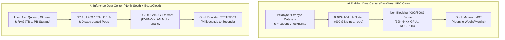
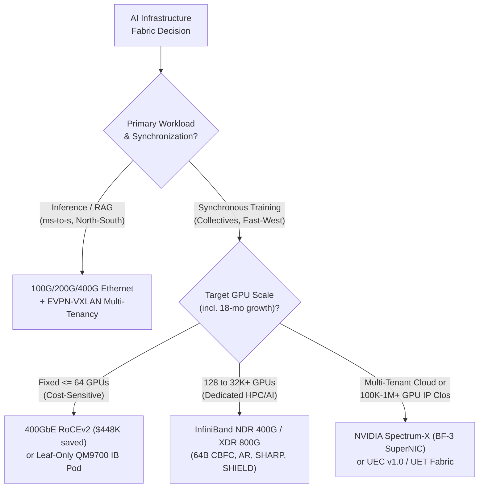

# 12.12 Ethernet versus InfiniBand: a design decision guide

| | |
|---|---|
| Level | Intermediate |
| Priority tier | 2 |
| Lab venue | Nebius GPU |
| Part | Part 12: Complete AI networking |
| Sources used | `ADC` Ch. 2, Ch. 9, Ch. 12; `V9` Ch. 1–12, `index.md`, `labs/lab-01..04`; `V21` Ch. 2, Ch. 3, Ch. 12; `bcm11-admin` §3.6.2 |
| Coverage file | `planning/coverage/chapters/12-12.md` |
| Claim ledger | `planning/ledgers/12-12.md` |
| Companion code | `code/part12/ethernet_vs_infiniband.py`, `code/part12/ethernet_vs_infiniband_lab.py` |

## Why this matters for AI infrastructure

An organization can build a `400 Gbps` or `800 Gbps` Ethernet fabric that passes every link-up test, achieves `0%` packet loss on `ping`, and hits `392.11 Gbps` on an isolated pairwise `ib_write_bw` microbenchmark—yet still stall a multi-node GPU training run the moment a second job lands on the same leaf switch. Conversely, an infrastructure team can propose a `$15,000`-per-node InfiniBand NDR fabric for a fixed `64`-GPU cluster without realizing that the `$448,000` upfront premium over `$8,000`-per-node `400GbE` RoCEv2 takes `244.14` seven-day training runs (`10.17` years at `24` runs per year) to pay back from raw `AllReduce` compute savings alone.

Choosing between **InfiniBand** (`Quantum-2` NDR `400 Gbps` and `Quantum-X800` XDR `800 Gbps`), **Standard RoCEv2 Ethernet**, **NVIDIA Spectrum-X** (`Spectrum-4` switches paired with `BlueField-3` SuperNICs), and the emerging **Ultra Ethernet Consortium (`UEC` Specification `v1.0` / `UET`)** is one of the highest-consequence architectural decisions in an AI Factory. The right answer is never a generic slogan about port speeds. It is a systems engineering calculation that weighs **workload synchronization**, **flow control and congestion physics**, **switch and endpoint hardware capabilities**, **storage and multi-tenant isolation boundaries**, **operational maturity**, and **3-year Total Cost of Ownership (`TCO`)**.

## Prerequisites and outcomes

**Prerequisites:**
- Chapters `12.1`–`12.5` (AI traffic collectives, RDMA verbs and queue pairs, RoCEv2 transport, `PFC`/`ECN`/`DCQCN`, and Data Center Bridging `QoS`).
- Chapters `12.6`–`12.11` (InfiniBand fundamentals, `OpenSM`/`UFM` routing, `CBFC`/Adaptive Routing/`SHIELD`, `HDR`/`NDR`/`XDR` optics, and NVIDIA `Spectrum-X`).

**Outcomes — after completing this chapter, you will be able to:**
1. Contrast the workload and network requirements of **AI training data centers** against **AI inference data centers**, and explain why synchronized collectives turn microsecond queue tail behavior into job-wide stalls.
2. Compare **InfiniBand**, **Standard RoCEv2**, **NVIDIA Spectrum-X**, and **Ultra Ethernet (`UET` `v1.0`)** across transport headers, credit-based (`64 B` / `256 B`) versus pause-based (`PFC`) flow control, routing/load balancing (`SLB`, `DLB`, `GLB`, `sDLB`, `AR`), and in-network collectives (`SHARP` vs `UEC INC`).
3. Configure and audit **ConnectX VPI (Virtual Protocol Interconnect)** personality switching (`LINK_TYPE_P1=1` InfiniBand vs `LINK_TYPE_P1=2` Ethernet) via `mlxconfig` and NVIDIA Base Command Manager (`cmsh`), alongside PCIe/NUMA locality (`nvidia-smi topo -m`, `lspci`) and **BlueField-3** `DPU` (`ECPF`) versus `SuperNIC` (`NIC`) operating modes.
4. Execute the **64-GPU and 128-GPU H100 TCO and break-even math**, separating upfront CapEx deltas (`$448,000`) from per-run `AllReduce` overhead (`$1,835/run`, `$44,040/year`) and nonlinear scale risks past `128`–`256` GPUs.
5. Apply the **7-stage AI fabric validation and troubleshooting ladder** (`Physical/FEC -> IP/MTU -> QoS/Trust -> Host RDMA -> GPU Locality -> Collective Matrix -> Concurrent Contention & N-1 Cut`) to commission or debug production clusters.

---

## 1. Workload-backward design: AI training versus inference fabrics

### 1.1 Why synchronized collectives expose the fabric on the critical path

Traditional enterprise data center traffic is asynchronous and stochastic: thousands of independent TCP flows start and finish at uncorrelated times, so a `5 ms` queue spike delays a single web request while the rest of the fleet proceeds normally. Distributed AI training behaves like a synchronized military convoy. During every step of data-parallel, tensor-parallel, or expert-parallel training, all participating GPUs hit a collective barrier (`AllReduce`, `AllGather`, `ReduceScatter`, or MoE `AllToAll`) simultaneously. For a `64`-GPU Llama-`70B` training loop with a `500 ms` forward pass and a `1,000 ms` backward pass (`1,500 ms` compute baseline), an exposed `AllReduce` of `5 ms` adds only `0.3%` overhead (`1,505 ms` total step), whereas an exposed `AllReduce` of `200 ms` inflates step time to `1,700 ms` (`13%` communication overhead). Because no rank can start the next iteration until the slowest rank finishes the collective, **p99 tail latency across the fabric directly sets cluster-wide Job Completion Time (`JCT`)**.

This synchronization creates five workload challenges that break conventional Ethernet switching assumptions:

1. **Low entropy at the network layer (`Layer 3`):** In `1:1` or small-group GPU communication across a rail-aligned pod, source and destination IP header pairs are sparse and repetitive.
2. **Low entropy at the transport layer (`Layer 4`):** Every `RoCEv2` packet uses the fixed UDP destination port `4791` to indicate that the next header is the InfiniBand Base Transport Header (`BTH`). Even when the UDP source port is derived from a Queue Pair (`QP`), static `5`-tuple ECMP hashing (`SLB`) frequently maps multiple high-rate GPU flows onto the same spine uplink while leaving adjacent links idle.
3. **Simultaneous and sequential low-entropy flowlets:** Two concurrent transfers between the same GPU pair whose entropy differs only inside the `BTH` (`QPair` and Packet Sequence Number `PSN`), or two back-to-back jobs reusing the same GPU pair, appear to a shallow-parsing switch as a single long-lived flow unless rebalanced across flowlet gaps.
4. **Line-rate elephant flows:** Through `GPUDirect RDMA` and `GPUDirect Storage`, each node attempts to drive its `400 Gbps` (`50 GB/s`) or `800 Gbps` (`100 GB/s`) NIC at `100%` line rate for the duration of a collective phase.
5. **Synchronized microbursts and incast:** Gradient synchronization and storage checkpointing generate sharp east-west traffic spikes where $N$ senders converge on `1` egress queue simultaneously. Five-minute interface utilization averages smooth out `100 µs`–`1 ms` microbursts completely: a port can report `20%` average utilization on a monitoring dashboard while its egress queue repeatedly overflows or emits sustained `PFC` pause frames (`rx_pfc_prio3: 118,344` over `90 s`).

### 1.2 AI training data centers versus AI inference data centers

The choice between InfiniBand and Ethernet starts by distinguishing **AI training data centers** from **AI inference data centers**:



| Dimension | AI Training Data Center (`ADC` Ch. 2 & `V21` Ch. 2) | AI Inference Data Center (`ADC` Ch. 2 Fig. 2-1 & `V21` Ch. 12) |
|---|---|---|
| **Primary objective & timescale** | Minimize **Job Completion Time (`JCT`)** and time-to-train across synchronous iterations lasting **hours to weeks or months**. | Minimize **Time to First Token (`TTFT`)** and response latency (**milliseconds to seconds**) at lowest cost per million tokens (`$0.70/1M tokens` at `2,000 QPS` on `408` GPUs). |
| **Dataset & storage footprint** | **Petabytes (`PB`) to Exabytes (`EB`)** of curated training data plus high-bandwidth burst writes for model checkpoints. | **Terabytes (`TB`) to Petabytes (`PB`)** of live query context, vector databases, and Retrieval-Augmented Generation (`RAG` / agentic `RAG`). |
| **Compute node architecture** | Dense `8`-GPU `HGX`/`DGX` nodes (`H100 SXM5` at `700 W`, `989 TFLOPS` BF16, `900 GB/s` `NVLink 4`, `$285,000`/node) or `72`-GPU `GB200 NVL72` liquid-cooled racks (`1.8 TB/s` `NVLink 5`). | Lower-power CPUs, PCIe GPUs (`L40S` `350 W` at `$8,000` or `H100 PCIe` `350 W` at `$20,000`, `64 GB/s` `PCIe Gen5 x16`), or multi-node disaggregated prefill/decode pools. |
| **Dominant traffic pattern** | **East-West** synchronous collectives (`AllReduce`, `AllToAll`) across `32,000` to `64,000+` (`100,000+`) GPU ports at `400G`/`800G`/`1.6T`. | **North-South** client query/response + East-West microservice, KV-cache, and `RAG` lookups over `100G` and `200G` (or `400G`) data center switches. |
| **Topology & oversubscription** | `1:1` non-blocking **Rail-Optimized Design (`ROD`)** or **Rail-Unified Design (`RUD`)** (or slight leaf-to-spine undersubscription in shallow-buffer packet-spraying fabrics). | Standard 3-stage IP Clos, collapsed 2-switch spine for edge sites, or hybrid cloud with `EVPN-VXLAN` multi-tenancy and edge security/firewalls. |
| **Natural fabric fit** | **InfiniBand (`NDR`/`XDR`)**, **NVIDIA Spectrum-X**, or finely tuned **lossless `RoCEv2` / `UET`** backend compute fabric. | **Standard Ethernet (`TCP/IP` + `EVPN-VXLAN`)** for frontend/edge/RAG, plus **`RoCEv2`/`Spectrum-X`/`IB`** inside disaggregated multi-node inference pods. |

### 1.3 Core advantages of InfiniBand versus Ethernet in AI training clusters

Before diving into protocol headers, every infrastructure architect should be able to state the structural trade-off between the two families:

- **Why teams choose InfiniBand (`ADC` Ch. 2 & Ch. 9):**
  1. **Sub-microsecond cut-through latency:** Native InfiniBand switches achieve `~300 ns` port-to-port latency (compared to `~800 ns` on typical Ethernet switches) because forwarding uses a lightweight `8`-byte Local Route Header (`LRH`) and a `16`-bit Local Identifier (`LID`) lookup rather than deep IP/Ethernet parsing.
  2. **Native lossless Credit-Based Flow Control (`CBFC`):** Buffer credits (`1` credit = `64 bytes`) are exchanged in hardware at the Link Layer Header (`LLH`) across `16` Virtual Lanes (`VL0..VL14` data, with `8` to `12` queues typically active for workloads, plus `VL15` reserved for Subnet Management Packets). A sender never transmits a packet unless the next-hop port has already advertised sufficient `64 B` buffer credits, preventing buffer overflow drops by construction.
  3. **Turnkey vertical integration and in-network computing:** Centralized Subnet Management (`OpenSM` / `UFM`), fine-grained hardware **Adaptive Routing (`AR`)**, autonomous **`SHIELD`** self-healing (`~10 µs` failover vs `~500 ms` software sweeps), and switch-resident **`SHARP`** collective aggregation deliver predictable scaling without manual `PFC`/`ECN` threshold tuning.
- **Why teams choose Ethernet (`ADC` Ch. 2 & `V9` Ch. 1–2):**
  1. **Cost-effectiveness and multi-vendor supply chain:** Commodity `400G`/`800G` Ethernet switches, optics, and NICs are available from multiple merchant-silicon and systems vendors (Broadcom `Tomahawk`, Cisco, Arista, NVIDIA `Spectrum`), avoiding single-vendor lock-in and expensive protocol gateways.
  2. **Operational simplicity and unified skill sets:** Operations teams use standard IP routing (`BGP`, `EVPN-VXLAN`), familiar Linux/NOS automation (`NVUE`, Ansible, `ethtool`, `iproute2`), and unified frontend-to-backend observability rather than specialized InfiniBand administration.
  3. **Ecosystem compatibility and scale beyond `48,000` nodes:** Standard Kubernetes, PyTorch, TensorFlow, and enterprise storage/cloud services run natively over IP/Ethernet. While a single InfiniBand subnet is bounded by its `16`-bit `LID` space to `49,151` unicast ports (`~48,000` end nodes), IPv4/IPv6 Clos fabrics scale past `100,000` GPUs today and toward `1,000,000+` endpoints under `UEC`.
  4. **Topology and multi-tenant flexibility:** Ethernet natively supports `EVPN-VXLAN` (`Route Type 5` IP VRFs and `MAC-VRF` instances), hardware firewalling, and `IPsec`/`MACsec` across shared compute, storage, and service roles.

---

## 2. Four-way architectural deep dive: InfiniBand vs Standard RoCEv2 vs Spectrum-X vs UET (UEC v1.0)

### 2.1 End-to-end protocol stack and congestion-control comparison

The evolution of AI networking is best understood as a convergence of InfiniBand's deterministic transport mechanisms with Ethernet's scale-out IP routing. The diagram below contrasts the four fabric architectures available to AI infrastructure designers:

```mermaid
flowchart TB
    subgraph IBStack["1. InfiniBand (Quantum-2 / X800)"]
        IB1["LRH (16b LID) + BTH + Payload"] --> IB2["Link: 64B CBFC Credits (16 VLs)"]
        IB2 --> IB3["Fabric: OpenSM/UFM + AR + SHARP"]
    end
    subgraph RoCEStack["2. Standard RoCEv2 Ethernet"]
        R1["Eth + IP + UDP 4791 + IB BTH"] --> R2["Link: 802.1Qbb PFC (8 Prios)"]
        R2 --> R3["Fabric: BGP + SLB/DLB/GLB + DCQCN"]
    end
    subgraph SpecXStack["3. NVIDIA Spectrum-X Ethernet"]
        SX1["RoCEv2 + SuperNIC Hardware DDP"] --> SX2["Link: Shared Buffer + Narrow PFC"]
        SX2 --> SX3["Fabric: Spectrum-4 AR + Telemetry CC"]
    end
    subgraph UECStack["4. Ultra Ethernet (UEC v1.0 / UET)"]
        U1["UDP 49150 or IP 253 + PDS + SES"] --> U2["Link: Optional 32-VC CBFC + LLR"]
        U2 --> U3["Fabric: NSCC / RCCC (256B) + INC"]
    end
```



| Architectural Dimension | 1. InfiniBand (`Quantum-2` / `Quantum-X800`) | 2. Standard `RoCEv2` (`IEEE 802.1Qbb` + `DCQCN`) | 3. NVIDIA `Spectrum-X` (`Spectrum-4` + `BlueField-3`) | 4. Ultra Ethernet (`UEC Spec v1.0` / `UET`) |
|---|---|---|---|---|
| **Target cluster scale (`ADC` Table 12-4)** | `< 100,000` GPUs (`49,151` unicast `LID`s / `~48,000` nodes per single `16`-bit `LID` subnet) | `> 100,000` GPUs (routed Layer 3 IPv4/IPv6 Clos) | `> 100,000` GPUs (rail-optimized 2-tier/3-tier IP Clos) | `~1,000,000+` endpoints (5-stage / 7-stage IP Clos, Dragonfly+) |
| **Wire encapsulation** | `LRH` (`8 B`, `S-LID`/`D-LID`) + optional `GRH` (`40 B`) + `BTH` (`12 B`) + `ETH`/`RETH` + Payload + `ICRC` (`4 B`) + `VCRC` (`2 B`) | `Ethernet II` + `IPv4`/`IPv6` + `UDP` (`DST PORT 4791`) + `IB BTH` (`12 B`) + Payload + `Ethernet FCS` | `RoCEv2` (`UDP 4791` + `BTH`) with hardware out-of-order sequence tracking | **Option A:** `Eth` + `IP` + `UDP` (`DST PORT 49150`, dynamic `SRC PORT` entropy) + `UET PDS` + `UET SES`. **Option B:** `Eth` + `IP` (`Protocol 253`) + `PDS` (with `Entropy` field) + `SES` |
| **Switch port-to-port latency (`ADC` Ch. 9)** | `~300 ns` cut-through | `~800 ns` store-and-forward / cut-through | `~800 ns` class (`Spectrum-4` monolithic shared buffer) | `~800 ns` class standard / UEC-ready Ethernet switches |
| **Link-level flow control** | Mandatory hardware **Credit-Based Flow Control (`CBFC`)**: `64 B` credit units in `LLH` across `16` VLs (`VL0..VL14` data + `VL15` `SMP`) | Reactive **`IEEE 802.1Qbb PFC`**: `8` priorities (`0..7`), `Xoff`/`Xon` pause quanta frames | Monolithic shared buffer + narrowly scoped `PFC` backstop on `1` RoCE priority (e.g., `prio 3`) | Optional link-level **`CBFC`** across **`32` Virtual Channels (`VCs`)** via `64B/66B` PCS `CtlOS` (`CP_Update`) + optional **Link Layer Retry (`LLR`)** |
| **End-to-end congestion control** | Hardware `FECN` (switch mark) $\rightarrow$ `BECN` (receiver notify) $\rightarrow$ HCA `CCTI` rate table | **`DCQCN`**: Switch `RED`/`ECN` sets IP `CE = 11` $\rightarrow$ Receiver sends `CNP` (`IP ECN = 01`) $\rightarrow$ Sender NIC rate cut | Hardware-coordinated `Spectrum-4` congestion telemetry + `BlueField-3 SuperNIC` RTT/ECN rate control | **1. `NSCC`** (sender RTT + ECN congestion window via `ACK_CC` / `NACK`). **2. `RCCC`** (receiver-managed **`256 B`** credits in `24`-bit `ACK_CC`). **3. Switch Packet Trimming** |
| **Proactive load balancing & multipathing** | Centralized `OpenSM`/`UFM` `LFT` + fine-grained per-packet **Adaptive Routing (`AR`)** + **`SHIELD`** (`10 µs` autonomous failover) | **1. `SLB`** (`5`-tuple CRC32). **2. `DLB`** (local link/queue utilization + flowlets). **3. `GLB`** (next-to-next-hop `NNH` spine quality). **4. `sDLB`** (`BTH` `Write` opcode spraying) + flow pinning | Per-packet `Spectrum-X` Adaptive Routing across all spine rails + `BlueField-3` **Direct Data Placement (`DDP`)** hardware reordering | Dynamic UDP source port or `PDS Entropy` mutation on `NACK`, plus `128 B` deep switch parsing of `SES` (`JobID`, `PIDonFEP`, `Resource Index`) |
| **Packet delivery modes (`ADC` Table 12-2 & 12-4)** | `RC` (Reliable Connected, in-order + `ConnectX` OOO buffer), `UC`, `UD` | `RC` (in-order go-back-to-$N$ or `ConnectX-6/7` `Write` OOO), `UC`, `UD` | `RC` with hardware OOO `DDP` into GPU memory | **`ROD`** (Reliable Ordered), **`RUD`** (Reliable Unordered), **`RUDI`** (Reliable Unordered Idempotent), **`UUD`** (Unreliable Unordered, no `PSN`/`ACK`) |
| **In-Network Collectives (`INC`)** | Production **`SHARP`** trees in `Quantum` switches (`2x–5x` collective speedup) | None (host `xCCL` / `NCCL` Ring & Tree only) | Topology-aware `NCCL` rail alignment + `NVLink SHARP` (`NVLS`) intra-rack | **`UEC INC`**: `INC Manager` (`IM` via `gRPC` OOB) + switch `sFEP` `INC Agents` + `Libfabric` (`fi_collective`) |
| **Built-in transport security** | `16`-bit `P_Key` partition table (`0x8000` full-member bit); `N/A` payload crypto in Table 12-4 | External (`MACsec` / `IPsec` + `VLAN`/`VRF`) | `EVPN-VXLAN` + `BlueField-3` host-edge isolation + hardware `IPsec`/`MACsec` | Built-in **Transport Security Sublayer (`TSS`)** with `AES-GCM` `ICV` trailer after payload (mutually exclusive with optional `UET CRC`) |
| **Deployment readiness (`ADC` Table 12-4)** | Deployed in production networks; low NIC vendor diversity | Deployed in production networks; high NIC/switch vendor diversity | Deployed in production AI Factories (`Spectrum-4` + `BlueField-3`) | Spec `v1.0` released **June 11, 2025** (`70+` members); first pilot deployments expected **late 2026** |

### 2.2 Why Standard RoCEv2 requires coordinated proactive and reactive control loops

In Standard `RoCEv2`, wrapping an InfiniBand `BTH` inside `UDP/IP` (port `4791`) allows packets to traverse any routed Layer 3 Ethernet fabric, but standard Ethernet has no link-layer `64 B` credit loop. If an egress queue overflows and drops a single packet on a standard `RC` queue pair using go-back-to-$N$ recovery, the sender must retransmit up to $N$ in-flight packets, stalling the collective step.

To prevent drops without triggering fabric-wide pause deadlocks, an AI Ethernet fabric combines **proactive congestion avoidance** (load balancing) with **reactive congestion management** (`ECN` + `PFC` coordinated via `DCQCN`):

1. **Proactive Load Balancing Pyramid (`ADC` Ch. 2 Fig. 2-3):**
   - **Static Load Balancing (`SLB`):** Hashes the packet `5`-tuple (`Src IP`, `Dst IP`, `Src Port`, `Dst Port 4791`, `Proto 17`). Preserves strict in-order arrival per flow, but is blind to real-time link utilization and fails under low-entropy elephant flows.
   - **Dynamic Load Balancing (`DLB`):** Evaluates local member-link bandwidth and egress queue occupancy in real time, reassigning new flows and existing flowlets across healthier equal-cost links.
   - **Global Load Balancing (`GLB`):** Extends `DLB` by incorporating **next-to-next-hop (`NNH`)** link and buffer quality advertised by downstream spine switches, allowing leaf switches to steer around remote spine-to-leaf hotspots.
   - **Selective Dynamic Load Balancing (`sDLB`):** Inspects the `RoCEv2` `BTH` opcode to identify large RDMA `Write` elephant flows and sprays their packets across all available ECMP uplinks in conjunction with destination NIC hardware packet reordering (`ConnectX-6/7` and `BlueField-3`).
2. **Reactive `DCQCN` (`ECN` + `PFC`, `ADC` Ch. 2 Fig. 2-5 & `V9` Ch. 4–5):**
   - **Step 1 (`ECN` Early Warning):** When a switch egress queue crosses its Random Early Detection (`RED`) / `ECN` marking threshold (well below buffer exhaustion, e.g., `~50%`), the switch sets the `2`-bit IP `ECN` field to **`11` (`Congestion Encountered`, `CE`)** and forwards the packet normally.
   - **Step 2 (`CNP` Reflection):** The destination `RoCEv2` NIC sees `CE = 11` and generates a high-priority **Congestion Notification Packet (`CNP`)** back to the source server (with `IP ECN` bits `01` in `ADC` Fig. 2-5).
   - **Step 3 (`DCQCN` Rate Cut & Recovery):** The source NIC hardware (`np_cnp_handled`) throttles the offending flow's injection rate (`rp_current_rate`) and gradually recovers (`rp_byte_reset`) once `CNP`s subside.
   - **Step 4 (`PFC` Last-Resort Backstop):** Only if an incast burst fills the receive buffer faster than the round-trip `ECN -> CNP` loop can slow the sender—crossing the `Xoff` threshold (e.g., `49,152 bytes` = `75%` of a `65,536-byte` priority `3` buffer)—does the switch send an `IEEE 802.1Qbb` `PFC` pause frame upstream for priority `3`, reserving the remaining `16,384 bytes` (`25%`) of headroom for packets already in flight on the wire until the queue drains below the `Xon` threshold (`32,768 bytes` = `50%`, a `25%` / `16,384-byte` hysteresis band).

### 2.3 How Ultra Ethernet (`UEC` `v1.0` / `UET`) redesigns the Ethernet stack for 1M+ GPUs

Released on **June 11, 2025** by more than **`70` vendors** under the Linux Foundation, the **Ultra Ethernet Specification `v1.0`** eliminates `RoCEv2`'s operational fragility (manual `DCQCN` threshold tuning, go-back-to-$N$ retransmission penalties, and `BTH` header limitations) while preserving compatibility with standard `400G`/`800G`/`1.6T` IP Clos switches:

1. **Libfabric API, Semantic Sublayer (`SES`), and Packet Delivery Sublayer (`PDS`):**
   - Applications (`PyTorch`, `OpenMPI`, `MPICH`, `NCCL`, `RCCL`) express delivery and memory semantics through **`Libfabric`** (`fi_mr` for memory regions/RKEYs, `fi_collective` for collectives) using three standardized service profiles: **`AI Base`**, **`AI Full`**, and **`HPC`**.
   - Every Fabric Endpoint (`FEP`, addressed by an IPv4/IPv6 Fabric Address `FA`) establishes logical sessions called **Packet Delivery Contexts (`PDC`s)** managed by the `PDS`. For example, in `ADC` Fig. 12-3, `FEP A` sends `Pds.flags.syn` with `PSN = 101`, `SPDCID = 201` + offset; `FEP B` replies with `ACK = 101`, `SPDCID = 301`, `DPDCID = 201`; `FEP A` clears `SYN` and sends data at `PSN = 102`, `SPDCID = 201`, `DPDCID = 301`.
   - Instead of `RoCEv2`'s `BTH` `QPair`, the `UET` **`SES` header** carries a `3`-tuple of **`JobID`** (cluster job identifier), **`PIDonFEP`** (service/process context on the `FEP`), and **`Resource Index` (`RI`)** (target receive/completion queue), plus `Message ID`, `Buffer offset`, and `Request length`.
2. **Two wire encapsulations (`UDP 49150` vs Native `IP Protocol 253`):**
   - **UET over UDP (`DST PORT 49150`):** Uses standard `Ethernet + IP + UDP (49150) + [optional TSS] + UET PDS + UET SES + Payload + [optional TSS ICV or UET CRC] + Ethernet FCS`. Unlike `RoCEv2` where the UDP source port stays static for the life of a QP, a `UET` sender dynamically mutates the **UDP `SRC PORT`** whenever `NSCC` congestion feedback (`NACK` entropy info) reports a hot path.
   - **UET over Native IP (`IP Protocol 253`):** Strips the `8`-byte UDP header completely (`Ethernet + IP [Proto 253] + UET PDS [with explicit Entropy field] + UET SES + Payload + FCS`). Because modern Ethernet switch ASICs parse up to **`128 bytes`** deep into a frame, stripping UDP allows UEC-aware switches to hash directly on the `PDS Entropy` field and `SES` `JobID`/`Resource Index` fields (provided the switch ACL/forwarding pipeline permits IP Protocol `253`).
3. **Four negotiated Packet Delivery Modes (`ROD`, `RUD`, `RUDI`, `UUD`) with selective retry:**
   - Rather than flushing an entire window via go-back-to-$N$, `UET` receivers buffer out-of-order packets (`SACK`-like selective acknowledgment) and request retransmission of *only* the missing `PSN` while the sequence space continues forward:
     - **`ROD` (Reliable Ordered Delivery):** Guarantees in-order delivery to the application (using NIC reorder buffers when packets are sprayed across the fabric); used for `HPC`, `MPI`, and serialized control flows. When `ROD` is active, all messages sharing `{JobID, src PIDonFEP, dst PIDonFEP, RI, TC}` use a single `PDC`.
     - **`RUD` (Reliable Unordered Delivery):** Tracks `PSN`s with `ACK`/`SACK`/`NACK` reliability but performs out-of-order **Direct Data Placement** straight into GPU memory without reorder buffer delay; ideal for bulk AI model-parallel transfers.
     - **`RUDI` (Reliable Unordered Delivery Idempotent):** Supports operations that can be safely retried or overwritten multiple times by one or more sources (such as `RMA` writes and AI gradient updates) without waiting for `NACK` recovery; mandatory in the `HPC` profile.
     - **`UUD` (Unreliable Unordered Delivery):** Omits `PSN`s, `ACK`s, and `TSS` security for lowest-latency best-effort fire-and-forget traffic (telemetry, inference logs).
4. **Dual-layer Congestion Management (`NSCC`, `RCCC`, Packet Trimming, `32-VC CBFC`, and `LLR`):**
   - **`NSCC` (Network Signal Congestion Control):** Sender-managed congestion window adjusted using `RTT` and `ECN` feedback carried in `ACK_CC` (received bytes, service time, out-of-order packet count) and `NACK` packets; required across all three UEC profiles on lossy networks.
   - **`RCCC` (Receiver Credit Congestion Control):** Target-managed credit pool where senders request credit via the `Credit Target` (`req_cc_state`) field and receivers grant explicit credits in units of **`256 bytes`** inside a **`24`-bit `ACK` congestion control** field—preventing receiver incast overflow on lossy fabrics without switch `PFC`.
   - **Switch Packet Trimming:** When an intermediate switch buffer overflows on a trimmable `DSCP` class, instead of silently dropping the frame, the switch **trims the payload** and forwards the compact header over a high-priority queue to the destination `FEP`, triggering an immediate selective retransmission request and pinpointing the exact congested `JobID`.
   - **Optional Link-Layer `CBFC` (`32` `VCs`) and `LLR` (`Link Layer Retry`):** Negotiated via `LLDP` for greenfield UEC links. `UEC CBFC` doubles InfiniBand's `16` VLs to **`32` Virtual Channels (`VCs`)** and exchanges consumed/freed credit counts (`CC`/`CF` counters via `CP_Update`) out-of-band inside modified `64B/66B` PCS **Control Ordered Sets (`CtlOS`)**. `LLR` prepends a link-local sequence number in the MAC preamble and stores eligible frames in an ASIC replay buffer for hop-by-hop `ACK`/`NACK` retransmission before end-to-end `PSN` timers expire.

---

## 3. ConnectX VPI adapters, BlueField-3 DPUs, and host locality

### 3.1 ConnectX VPI personality switching (`LINK_TYPE_P1=1` IB vs `=2` ETH) and BCM precedence

NVIDIA **ConnectX-6, ConnectX-7, and ConnectX-8 VPI (Virtual Protocol Interconnect)** adapters use the same physical ASIC and OSFP/QSFP112 cage to speak either native **InfiniBand** (`SDR`–`XDR`) or **Ethernet** (`100GbE`–`800GbE` `RoCEv2`). The port personality is stored in non-volatile firmware configuration (`NVConfig`) and controlled per port via `mlxconfig`:

- **`LINK_TYPE_P1=1` (`IB`):** Configures Port `1` as a native InfiniBand Host Channel Adapter (`HCA`). The port waits for an InfiniBand Subnet Manager (`OpenSM` / `UFM`) on `VL15` to assign a `16`-bit `Base lid` (`ibstat` transitions `Physical state: LinkUp` $\rightarrow$ `State: Active`), exposes `ib0` (`20`-byte `IPoIB` hardware address), and uses hardware `64 B` `CBFC` credits.
- **`LINK_TYPE_P1=2` (`ETH`):** Configures Port `1` as an Ethernet NIC (`ens1f0np0` / `eth0`). The port brings up its link autonomously via Ethernet auto-negotiation/FEC without a Subnet Manager, populates `RoCEv1`/`RoCEv2` `GID` entries (`show_gids`) from host IP/VLAN interfaces, and relies on `DSCP`/`PCP` classification, `ECN`/`DCQCN`, and `PFC`.

In clusters managed by **NVIDIA Base Command Manager (`BCM 11`, `cmsh`)**, persistent `mlxconfig` parameters are declared using `MLX_` extra values (`MLX_link_type_p1`, `MLX_num_vfs 16`, `MLX_KEEP_ETH_LINK_UP_P1 true`). BCM resolves conflicting declarations using a strict three-tier hierarchy (`bcm11-admin` §3.6.2):

$$\texttt{category.extra\_values} \;<\; \texttt{node.extra\_values} \;<\; \texttt{interface.extra\_values}$$

Changes written to `NVConfig` remain `pending` until a cold/firmware reboot of the node, and operators verify the resolved policy before rebooting with `cmsh -c "device; mlxconfig node001 --desired"`.

### 3.2 PCIe link negotiation, NUMA locality (`PIX` vs `SYS`), and multi-rail binding

Whether a ConnectX port runs in InfiniBand (`=1`) or Ethernet (`=2`) mode, the network wire is only half of the data path. The internal server path from **GPU HBM memory $\leftrightarrow$ PCIe switch / NVLink $\leftrightarrow$ ConnectX DMA engine** must sustain full line rate:

1. **PCIe Generation and Lane Width (`lspci -vv`):**
   - A `PCIe Gen5 x16` slot runs at **`32 GT/s`** per lane and delivers approximately **`63–64 GB/s`** per direction (`~504–512 Gbps`), which is required to saturate a `400 Gbps` (`50 GB/s`) ConnectX-7 port at line rate.
   - In `V9` Ch. 8, inspecting `lspci -s 41:00.0 -vv | egrep "LnkCap|LnkSta"` reveals `LnkCap: Speed 32GT/s, Width x16`, but **`LnkSta: Speed 16GT/s (downgraded), Width x8`** (`PCIe Gen4 x8`, `~16 GB/s` ceiling). A `200 Gbps` (`25 GB/s`) or `400 Gbps` (`50 GB/s`) port seated in that downgraded slot is physically capped at `~16 GB/s` (`~128 Gbps`) before a single packet ever reaches the switch.
2. **GPU-to-NIC Topology Affinity (`nvidia-smi topo -m`):**
   - On a multi-socket server, `GPU0` and `NIC0` sharing a local PCIe switch report **`PIX`** (zero CPU/NUMA traversal), whereas `GPU0` talking to `NIC1` on the second socket reports **`SYS`** (crossing the CPU host bridge and inter-socket interconnect). Assigning rails by Linux interface name order (`eth0`, `eth1`) rather than `PIX` locality silently throttles `GPUDirect RDMA`.
3. **Multi-Rail Device Selection Collisions (`ethtool -S` & `NCCL_DEBUG=INFO`):**
   - In `V9` Ch. 8 Scenario 1, a dual-rail node shows both ports `ACTIVE` (`ens1f0` and `ens1f1`), yet a `60`-second byte-counter delta shows `ens1f0` (`rx_bytes_phy`) grew from `892,481,200,384` to `981,204,882,176` (**`+88.7 GB`**) while `ens1f1` moved only **`412,992 bytes`** (`~0 GB`). Inspecting `NCCL_DEBUG=INFO` reveals that both local ranks selected `[0]mlx5_0:1/RoCE ; OOB ens1f0`, leaving the second rail completely idle. Furthermore, traditional Linux **NIC bonding (`bond0`) must not be used on multi-rail AI compute paths** when it hides physical rail topology from `NCCL`'s ring/tree planner.

### 3.3 BlueField-3 DPUs versus SuperNICs: host-edge trust and failure domains

In Ethernet AI Factories (`Spectrum-X` and multi-tenant clouds), architects must also choose between two distinct `BlueField-3` operating models (`V9` Ch. 9):

- **BlueField DPU Mode (`ECPF` — Embedded CPU Function Ownership, default on DPU SKUs):** The embedded `Arm` cores and `DOCA` operating system own the NIC resources and the internal **embedded switch (`eSwitch`)**. Host traffic traverses `representors` (slow path for first-packet policy lookup on the `Arm` cores) which program hardware offload flow rules into the `eSwitch` fast path. This creates an air-gapped **three-layer administrative boundary**: (1) Host OS interface (`enp1s0f0np0`), (2) DPU `Arm` control plane (`openvswitch-policy-load.service`), and (3) external switch uplink (`swp14`). If a DPU image rollout (`dpu-image-24.07-prod-1` vs `dpu-image-24.10-prod-3`) fails to load its `eSwitch` policy at boot, the leaf switch sees `swp14 up` (`100G/400G`) while the host remains completely dark (`enp1s0f0np0 DOWN / DORMANT`).
- **BlueField SuperNIC Mode (`NIC` Mode, default on SuperNIC SKUs):** The adapter operates as a dedicated high-rate `400G`/`800G` RoCEv2 endpoint (paired `1:1` with each GPU on the compute rail) handling hardware `DDP` packet reordering and `Spectrum-X` congestion control without interposing an independent `Arm` virtual-switch control plane in the compute path.
- **DGX / HGX H100 Node Split (`V21` Ch. 2):** Production `8×H100 SXM5` nodes combine both roles: **`8× ConnectX-7` (`400 Gbps`)** adapters (or `BlueField-3 SuperNICs`) on the East-West GPU compute rails, plus **`2× BlueField-3 DPUs`** dedicated to North-South storage, tenant virtualization, and in-band cluster services, alongside a dedicated out-of-band BMC management port.

---

## 4. Storage networks, TCO economics, and the 64-GPU break-even model

### 4.1 AI storage network transport: InfiniBand vs NVMe-o-RDMA vs NVMe-o-TCP vs Parallel File Systems

An AI training cluster requires two distinct high-speed networks—or carefully isolated traffic classes: the **compute fabric** (GPU-to-GPU collectives) and the **storage fabric** (ingesting petabyte datasets and writing frequent multi-terabyte model checkpoints so GPUs do not stall).

From `ADC` Ch. 9 (`Table 9-1` and `Table 9-2`), the four storage transport options trade latency against operational simplicity and distance:

| Storage Metric / Capability | Local `PCIe Gen5` NVMe SSD | `InfiniBand` Storage (`NVMe-o-RDMA` / `GDS`) | Ethernet `NVMe-o-RDMA` (`RoCEv2` / `GDS`) | Ethernet `NVMe-o-TCP` / `(P)NFS` |
|---|---|---|---|---|
| **Switch / bus access latency (`ADC` Ch. 9)** | `~100 ns` (`PCIe Gen5` `32 GT/s`, `~63 Gbps` / `64 GB/s` `x16`) | `~300 ns` per IB switch hop (`700–900 ns` over `1–3` hops) | `~800 ns` per Ethernet switch hop (`~66%` lower write latency than TCP) | Millisecond / multi-microsecond kernel socket + TCP stack |
| **Discovery & transport ports** | Local PCIe bus (`SQE`/`CQE` in host driver) | `TCP 8009` discovery (`RDMA_PRTYPE = 02`) $\rightarrow$ native `IB LRH/BTH` (`1:1` `SQ/CQ` per `QP`) | `TCP 8009` discovery (`RDMA_PRTYPE = 04`, vs `05` iWARP) $\rightarrow$ `UDP 4420` CM $\rightarrow$ `UDP 4791` `BTH` | `TCP 8009` (`ICReq PDU` $\rightarrow$ `CapsuleCmd` `0x01` / `CapsuleResp` + `H2CData` `0x03` / `C2HData` `0x04`, `PRP1/PRP2` `64-bit` or `SGL`, `9,000 B` jumbo MTU) |
| **Lossless fabric required?** | N/A (local PCIe bus) | **Yes** (native `64 B` `CBFC` credits across `16` VLs) | **Yes** (`PFC` + `ECN`/`DCQCN`, tuned separately from compute `DCQCN` for `1:3` oversubscription) | **No** (runs over lossy IP core; ideal for `>= 40 km` inter-site WAN replication with deep-buffer switches) |
| **`GPUDirect Storage` (`GDS`) support** | **Yes** (`cudaMalloc` + `cuFileBufRegister` pins GPU memory directly to NVMe) | **Yes** (zero-copy DMA between GPU HBM and remote SSD, bypassing host CPU and system RAM) | **Yes** (supported natively by `WekaFS` over `RoCEv2`, `VAST` `NFS-over-RDMA`, `Lustre`, `GPFS`, `BeeGFS`) | **No** (`GPUDirect Storage` requires RDMA transport—either native `InfiniBand` or `RoCEv2`) |
| **Redundancy & multi-tenancy (`ADC` Fig. 9-5..9-8)** | Server-local only (not scalable across cluster) | Physical **Fab A / Fab B** dual-fabric separation (logical virtualization limited; `<= 10 km` spec optics) | Physical **Fab A / Fab B** or Logical **EVPN-VXLAN** (`Route Type 5` / `MAC-VRF`) with `1:3` leaf-spine oversubscription | Logical IP Clos, `2`-switch collapsed edge, or hybrid cloud tiering (`WekaFS` Tier 1 RDMA + Tier 2 `S3` over `HTTPS`/`IPsec` firewall) |

### 4.2 The 128-GPU and 64-GPU H100 TCO and break-even calculation (`V21` Ch. 2)

When finance challenges an infrastructure team's interconnect choice, senior architects do not wave their hands—they run the exact **3-year TCO and `AllReduce` break-even equations** from `V21` Ch. 2 (`Part 3.2` and `Part 6`):

1. **Baseline GPU Hour Value (`128`-GPU / `16`-Node `DGX H100 SXM5` Cluster, `V21` Ch. 2 Part 3.2):**
   - **Per-Node Hardware (`Config A`):** `8× H100 80GB SXM5` (`$240,000` at `$30,000`/GPU, `989 TFLOPS` BF16 dense / `1,979 TFLOPS` FP8 dense, `3.35 TB/s` HBM3, `700 W` TDP, `$30`/BF16 TFLOP) + CPUs/2 TB DDR5/30 TB NVMe (`$30,000`) + `8× ConnectX-7` `400G` rails & `2× BlueField-3` DPUs (`$10,000`) + assembly (`$5,000`) = **`$285,000` per node** (`$35,625`/GPU, `7,912 TFLOPS` peak / `~6,500 TFLOPS` practical at `80%`, `10.2 kW` system power). By contrast, an `8× H100 PCIe` node (`Config B`, `756 TFLOPS` BF16, `350 W`, `$20,000`/GPU, `64 GB/s` PCIe Gen5 x16 without full NVSwitch) costs **`$215,000` per node** (`$26,875`/GPU, `~25%` cheaper) for independent inference.
   - **16-Node Cluster 3-Year TCO:** `16 × $285K = $4.56M` nodes + `$400K` fabric + `$200K` racks/PDUs/cooling + `$100K` installation = **`$5.26M` CapEx**. Annual OpEx (`163 kW` at `$0.12/kWh` = `$171.6K` electricity + `$400K` `2` FTEs + `$52.6K` support + `$20K` software) = **`$644K`/year**.
   - **Amortized Cost per GPU-Hour:**

$$\text{3-Year TCO} = \$5.26\text{M} + (3 \times \$644\text{K}) \approx \$7.19\text{M}, \qquad \text{Cost per GPU-Hour} = \frac{\$7.19\text{M}}{128\text{ GPU} \times 8,760\text{ hr} \times 3\text{ yr}} \approx \mathbf{\$2.14/\text{GPU-hour}}$$

   - At `107,603 TFLOPS` (`107.6 PFLOPS`, `85%` of `126,592 TFLOPS` peak), this equals **`$22` per TFLOP-year**. (At `1,200` GPUs in `V21` Ch. 12, `$44M` CapEx + `$26.2M` 3-year OpEx = `$70.2M` TCO, or `$19.5K`/GPU-year and `$19.7K`/PFLOP-year.)

2. **The `64`-GPU Interconnect Showdown: InfiniBand NDR (`$15K`) vs `400GbE` RoCEv2 (`$8K`, `V21` Ch. 2 Part 6):**
   - **Upfront CapEx Delta:** On a `64`-GPU training cluster, InfiniBand NDR at `$15,000` (`$960,000`) versus `400GbE` Ethernet at `$8,000` (`$512,000`) costs `$7K × 64 =` **`$448,000` more upfront** (`$448K`).
   - **Iteration `AllReduce` Overhead Math:** With a `100 ms` compute loop, gradient `AllReduce` takes **`2 ms` on InfiniBand** (`102 ms` total step, **`2%` overhead**) versus **`10 ms` on Ethernet** (`110 ms` total step, **`10%` overhead**)—an **`8%` throughput loss** (`7.84%` exact step-time increase).
   - **Per-Run and Annual Dollar Impact (`Llama-70B`, `7 days = 168 hours` on `64` GPUs):**
     - Extra training time per run on Ethernet: $168\text{ hours} \times 8\% = 13.44\text{ hours} \approx \mathbf{13.4\text{ extra hours}}$ (`181.4 hours` = `7.56 days` total).
     - Extra compute cost per run: $\$2.14/\text{GPU-h} \times 64\text{ GPUs} \times 13.4\text{ h} = \mathbf{\$1,835.11 \approx \$1,835/\text{run}}$.
     - Running `2` full trainings per month (**`24` runs/year**): $\$1,835 \times 24 = \mathbf{\$44,040/\text{year} \approx \$44\text{K/year}}$, or **`$132,120` (`~$132K`) over `3` years**.
     - Even if the team adds `2` runs per year of a `100B`-class model with `2×` larger gradients (`30 ms` Ethernet `AllReduce` $\rightarrow$ `130 ms` vs `102 ms` IB = **`27%` overhead**), those `2` runs add only $27\% \times \$2.14 \times 64 \times 168 \times 2 \approx \mathbf{\$12,425/\text{year} \approx \$12\text{K/year}}$.
   - **The Honest Engineering Verdict:** Over `3` years, `$132K` (plus `$36K` for larger models = `~$168K`) is **well below the `$448,000` upfront Ethernet savings** (requiring `448,000 / 1,835 = 244.14` runs or `10.17` years at `24` runs/year to break even on compute hours alone). Therefore:
     - **If the cluster will permanently stay at `<= 64` GPUs** (where a single `64`-port `Quantum-2 QM9700` switch in `32` OSFP cages or a single leaf-only `400GbE` pod suffices), **`400GbE` RoCEv2 is economically defensible**.
     - **If the cluster will grow to `128`, `256`, or `512+` GPUs within `18` months**, **buy InfiniBand NDR/XDR (or `Spectrum-X`) now**: standard RoCEv2 congestion, incast pause trees, senior-engineer debugging hours, and the downtime/cabling cost of a mid-life fabric retrofit rapidly exceed `$448,000`.

---

## 5. Workload-driven fabric decision matrix and the 7-stage validation ladder

### 5.1 End-to-end decision tree: matching workload, scale, and tenancy to the right fabric

When advising an infrastructure review board or customer architecture team, start from **workload synchronization**, **target GPU scale (including 18-month expansion)**, **multi-tenant security boundaries**, and **WAN storage replication distance**:



| Deployment Scenario | Primary Compute Fabric | Storage Network Transport | Host-Edge Adapter & Mode | Architectural Justification |
|---|---|---|---|---|
| **1. Fixed `<= 64`-GPU Research / Fine-Tuning Pod** | `400GbE` `RoCEv2` (or `1`-tier leaf-only `Quantum-2 QM9700` `64`-port NDR pod) | `NVMe-o-RDMA` (`RoCEv2` or `IB`) or `NVMe-o-TCP` (`100G`/`200G`) | `ConnectX-7` (`LINK_TYPE_P1=2` ETH or `=1` IB) in `NIC` mode | Upfront `$448,000` Ethernet savings (`$8K` vs `$15K` per unit) exceeds the `~$132,120` 3-year `AllReduce` overhead (`24` runs/yr at `$1,835`/run) if scale stays `<= 64` GPUs. |
| **2. Dedicated Foundation Model Training (`128` to `32,000+` GPUs)** | **InfiniBand NDR (`400G`) / XDR (`800G`)** `2`-tier or `3`-tier Rail-Optimized Fat-Tree | Dedicated `InfiniBand` or `RoCEv2` `GPUDirect Storage` (`WekaFS`, `VAST`, `Lustre`) | `8× ConnectX-7/8` (`LINK_TYPE_P1=1` IB) compute rails + `2× BlueField-3` storage/in-band | `~300 ns` switch latency, lossless `64 B` `CBFC` across `16` VLs, hardware `AR`, `SHARP` (`2x–5x` collective offload), and `10 µs` `SHIELD` self-healing eliminate tail-latency stalls. |
| **3. Enterprise / Cloud Multi-Tenant AI Factory (`256` to `100,000+` GPUs)** | **NVIDIA `Spectrum-X`** (`Spectrum-4` shared-buffer switches + `BlueField-3` SuperNICs) | Physical or Logical **Fab A / Fab B** (`EVPN-VXLAN` `RT5`, `1:3` oversubscribed `NVMe-o-RDMA` / `GDS`) | `8× BlueField-3 SuperNIC` (`NIC` mode) compute rails + `2× BlueField-3 DPU` (`ECPF` mode) host edge | Combines standard `BGP`/`EVPN` routing and `NetQ`/`NVUE` operations with hardware packet spraying, `DDP` out-of-order placement, and `ECPF` zero-trust tenant isolation. |
| **4. Next-Gen Hyperscale IP Clos (`100,000` to `1,000,000+` GPUs)** | **Ultra Ethernet (`UEC` `v1.0` / `UET`)** over `800G`/`1.6T` 5-stage IP Clos or Dragonfly+ | `UET` storage profile / `NVMe-o-RDMA` + cloud `S3` tiering | `UEC`-compliant `400G`/`800G` FEPs supporting `Libfabric` (`ROD`/`RUD`/`RUDI`), `NSCC`/`RCCC`, and `TSS` | Scales past InfiniBand's `49,151`-port (`~48,000`-node) single-subnet `16`-bit `LID` ceiling with `256 B` `RCCC` receiver credits, packet trimming, `32`-VC `CBFC`, and `UEC INC`. |
| **5. Multi-Region Inference, Edge & Long-Haul DR (`>= 40 km` WAN)** | `100G`/`200G`/`400G` **Ethernet IP Clos** or `2`-switch collapsed spine (`EVPN-VXLAN`) | **`NVMe-o-TCP`** (`TCP 8009`, `9,000 B` MTU, deep-buffer switches) + `S3` over `HTTPS`/`IPsec` firewall | `L40S` (`$8K`) or `H100 PCIe` (`$20K`) + `100G`/`200G` Ethernet NICs / `BlueField-3 DPU` | `DCQCN`/`PFC` cannot maintain lossless backpressure across `>= 40 km` WAN links (and IB optics spec stops at `10 km`); `NVMe-o-TCP` adapts gracefully on lossy IP cores. |

### 5.2 Capacity planning at the bottleneck cut and the 7-stage validation ladder (`V9` Ch. 10–12)

A fabric diagram is not a capacity model. In `V9` Ch. 10, every AI fabric must be sized at its **bottleneck cut** under both **normal (`N`)** and **degraded (`N-1` maintenance or single-failure)** states, and commissioned using a strict **7-stage validation ladder**:

1. **Bottleneck-Cut Arithmetic (`16`-Node Rack Example, `V9` Ch. 10):**
   - Suppose a rack of `16` GPU nodes, each equipped with `2× 400 Gbps` `RoCEv2` rails (`800 Gbps` injection per node), connects to a leaf switch with `8× 400 Gbps` spine uplinks:
     - **Worst-case downlink demand:** $16\text{ nodes} \times 800\text{ Gbps} = \mathbf{12,800\text{ Gbps}}$.
     - **Normal-state uplink capacity (`8` uplinks):** $8 \times 400\text{ Gbps} = \mathbf{3,200\text{ Gbps}} \implies \mathbf{4.00:1\text{ oversubscription}}$.
     - **Degraded `N-1` uplink capacity (`1` uplink drained for maintenance, `7` active):** $7 \times 400\text{ Gbps} = \mathbf{2,800\text{ Gbps}} \implies \mathbf{4.57:1\text{ oversubscription}}$.
   - Similarly, if an entire `2`-spine ECMP group (`nexthop-group 40`) loses `1` spine during maintenance (`V9` Ch. 2 Scenario 2), active next-hop members drop from `2` to `1`, doubling load on surviving uplinks and driving `tx_ecn_marked_prio3` up `~6×` (from `~15,000` to `88,120` per window).
2. **The 7-Stage AI Fabric Acceptance Ladder (`V9` Ch. 10 Fig. 9.10.1 & Ch. 11 Fig. 9.11.1):**
   - **Stage 1 — Physical & Link Layer:** Verify optics, DAC/AOC serials, lane state (`400000Mb/s`, `Full` duplex), and zero `fec_uncorrected_blocks` / `rx_crc_errors` deltas (`ethtool`, `mlxlink`, `iblinkinfo`).
   - **Stage 2 — IP, Addressing & Path MTU:** Verify `ip route get <peer-ip>` exits the intended rail interface with end-to-end `mtu 9000` (`RoCEv2`) or `active_mtu 4096` (`IB`), and verify `rdma link show` and `show_gids` (`v2` on the intended VLAN/netdev).
   - **Stage 3 — QoS, Trust Boundary & Buffer Contract:** Verify `tcpdump` wire marking (`tos 0xb8` $\rightarrow$ `DSCP 46` via `0xb8 >> 2 = 46`), `mlnx_qos` trust state (`dscp` vs `pcp`), single-priority `PFC` (`enabled 0 0 0 1 0 0 0 0`), `Xoff`/`Xon` hysteresis (`49,152 B` / `32,768 B` on a `65,536 B` buffer), and non-starving `ETS`/`dwrr` scheduling for management traffic.
   - **Stage 4 — Host-Memory RDMA Verbs Smoke Test:** Run `ib_write_bw` / `ib_write_lat` (`perftest`) between host RAM buffers across every rail pair (`392.11 Gbps` on `400GbE`), confirming `IBV_WC_SUCCESS` and zero `RETRY_EXC_ERR`.
   - **Stage 5 — GPU-Buffer (`GPUDirect RDMA`) & Locality Validation:** Confirm `nvidia-smi topo -m` shows `PIX`/`NV18` (not `SYS`), `lspci -vv` shows `LnkSta: Speed 32GT/s, Width x16`, and GPU-buffer RDMA achieves line rate.
   - **Stage 6 — Multi-Node Collective Matrix (`nccl-tests`):** Run `all_reduce_perf` and `alltoall_perf` across all rails and message sizes while verifying per-rail byte balance (`ethtool -S ens1f0` vs `ens1f1`).
   - **Stage 7 — Concurrent Multi-Job Contention & `N-1` Degraded-State Drill:** Run `2+` overlapping training/storage jobs and drain `1` uplink/spine in a maintenance window, recording `rx_ecn_marked_prio3`, `rx_pfc_prio3`, `np_cnp_handled`, and Spectrum `What Just Happened (WJH)` drop reasons (`show what-just-happened drop-reason all`). **A passing isolated collective never retroactively validates a skipped contention or `N-1` check.**

---

## Commands and configurations that matter

### 1. Switching ConnectX VPI personality (`IB` vs `ETH`) via `mlxconfig` and BCM `cmsh` `(untested here)`

```bash
# (untested here) — Query current & default/next-boot VPI link personality on a ConnectX-7 adapter:
mst status -v
mlxconfig -d 0000:03:00.0 -e query | grep -E "LINK_TYPE_P1|LINK_TYPE_P2|NUM_OF_VFS|SRIOV_EN"

# Switch Port 1 & Port 2 from InfiniBand (1) to Ethernet RoCEv2 (2) and allocate 16 SR-IOV VFs:
mlxconfig -y -d 0000:03:00.0 set LINK_TYPE_P1=2 LINK_TYPE_P2=2 SRIOV_EN=1 NUM_OF_VFS=16

# Or switch Port 1 back to native InfiniBand (1):
mlxconfig -y -d 0000:03:00.0 set LINK_TYPE_P1=1

# In NVIDIA Base Command Manager (BCM 11 cmsh), inspect & declare persistent MLX_ policy
# (precedence: category.extra_values < node.extra_values < interface.extra_values):
cmsh -c "device; mlxconfig node001 --adapters"
cmsh -c "device; use node001; interfaces; use ib0; set -e MLX_link_type_p1 IB; commit"
cmsh -c "device; mlxconfig node001 --desired"
```

### 2. Host locality, RDMA `GID` table, and PCIe negotiation audit (`V9` Ch. 2, Ch. 3, Ch. 8 & Labs 01–02, `untested here`)

```bash
# (untested here) — 1. Verify PCIe Gen5 x16 (32 GT/s, x16) vs downgraded Gen4 x8 (16 GT/s, x8):
lspci -s 41:00.0 -vv | egrep "LnkCap|LnkSta"
# Healthy:    LnkCap: Port #0, Speed 32GT/s, Width x16  /  LnkSta: Speed 32GT/s, Width x16
# Downgraded: LnkSta: Speed 16GT/s (downgraded), Width x8  (caps 200G/400G NIC at ~16 GB/s)

# 2. Verify GPU-to-NIC PCIe switch locality (PIX = same PCIe switch; SYS = crosses NUMA socket):
nvidia-smi topo -m

# 3. Verify RDMA kernel module (mlx5_ib), netdev mapping, MTU 9000, route, and RoCEv2 GID table:
lsmod | grep mlx5
rdma link show
ibv_devinfo -d mlx5_0 -i 1
show_gids
ip route get 10.20.8.5
ip link show dev ens1f0
ethtool ens1f0 | egrep "Speed|Duplex|Link"
```

### 3. QoS classification, `PFC` headroom/hysteresis, `ECN`/`DCQCN`, and Spectrum `WJH` telemetry (`V9` Ch. 1, 4–7, 10–11 & Labs 03–04, `untested here`)

```bash
# (untested here) — 1. Verify wire DSCP marking (tos 0xb8 -> 0xb8 >> 2 = DSCP 46) on UDP port 4791:
tcpdump -i eth0 -c 1 -v host 10.20.8.5 and udp port 4791

# 2. Inspect switch/NIC trust state (dscp vs pcp), PFC enabled mask, buffer thresholds, and ETS/strict TSA:
mlnx_qos -i swp12
# Verify: Priority trust state: dscp
#         enabled  0 0 0 1 0 0 0 0  (ONLY prio 3 enabled; prio 0/6 not sharing pause domain)
#         Buffer size: 65536 bytes, Xoff: 49152 bytes (75%), Xon: 32768 bytes (50%)

# 3. Sample time-windowed ECN marks, PFC pauses, prio0 discards, and physical FEC/CRC deltas:
date -u && ethtool -S ens1f0 | egrep "ecn_marked|pfc_prio|rx_prio0_discard|fec_uncorrected|rx_crc_errors|rx_bytes_phy"

# 4. Verify sender-side DCQCN CNP reception and rate-limiter response on ConnectX:
mlx5_cnp_stats -d mlx5_0
# Compare switch rx_ecn_marked_prio3 delta (e.g. +312) against sender np_cnp_handled (+298) and rp_byte_reset

# 5. On NVIDIA Spectrum switches, inspect What Just Happened (WJH) hardware drop reasons and ECMP groups:
show what-just-happened drop-reason all
show ip ecmp-groups | grep 10.20.0.0/16

# 6. Check BlueField-3 DPU 3-layer readiness (Switch uplink -> DPU Arm policy service -> Host representor):
show interface status swp14
systemctl status openvswitch-policy-load.service
ip -br link show dev enp1s0f0np0
```

---

## How it fails

Use the 7-stage diagnostic ladder (`Physical/FEC -> DPU Boundary -> RDMA Verbs -> GID/MTU RTR -> QoS Trust & PFC Scope -> ECN/DCQCN Loop & Uplink Cut`) to isolate production Ethernet and VPI failures without guesswork:

| Failure mode | Exact CLI symptom & counter signature | Root cause | Production resolution & verification |
|---|---|---|---|
| **1. Physical Uncorrectable FEC & Secondary `ECN` Inflation (`V9` Ch. 11)** | `ethtool -S swp17` shows `fec_corrected_blocks: 41200`, **`fec_uncorrected_blocks: 3`**, and **`rx_crc_errors: 3`** (matching `3` exactly), while `rx_ecn_marked_prio3` rises secondarily. | A degraded DAC cable (`DAC-2m`, serial `ABC123` on `rack14-node07` `mlx5_1` rail `1`) drops `3` unrecoverable frames; RDMA retransmissions add load that triggers secondary `ECN` marks. | Join `swp17` to node/job inventory (`training-run-4471`, ranks `48–55`), replace the cable/optic before touching `QoS`, and verify `fec_uncorrected_blocks` delta stays `0`. |
| **2. Silent `NCCL` Socket Fallback (`mlx5_ib` Missing, `V9` Ch. 2 Scenario 1)** | `ping` works, job runs at `<10%` speed; `NCCL_DEBUG=INFO` logs `NET/IB : No device found` and **`NET/Socket : Using [0]eth0:10.20.4.15`**. `rdma link show` returns `0` with empty output. | Low-level NIC driver (`mlx5_core`) loaded, but the RDMA verbs module (`mlx5_ib`) failed to load or VPI `LINK_TYPE_P1` mismatched expected stack. | Load/qualify the complete `DOCA-OFED` / `mlx5_ib` driver set, verify `rdma link show` lists `state ACTIVE physical_state LINK_UP`, and confirm `NCCL` logs `NET/IB : Using [0]mlx5_0:1/RoCE`. |
| **3. `Ping` Works, `RoCE` Fails at `QP to RTR` (`GID` / `MTU` Drift, `V9` Ch. 3 & 11)** | `ping -c3 10.20.8.5` shows `0% packet loss`, but `ib_write_bw -d mlx5_0 10.20.8.5` aborts with **`Failed to modify QP to RTR`** (or Lab 04 `mlx5_1` injection drops `392.11 -> 156.0 Gbps` with `24` `RETRY_EXC_ERR`). | Host hardcoded `-g 1` (`GID index 1`) across hosts where `show_gids` mapped index `1` to base `eth0` on one node and VLAN `eth0.100` (or `v1` `fe80::`) on the peer, or an intermediate hop lacked `mtu 9000`. | Select `GID` by verified `v2` IPv4/IPv6 + netdev context rather than raw table index, enforce `mtu 9000` on every routed hop, and verify `ib_write_bw` completes at `~392 Gbps`. |
| **4. `DSCP` vs `PCP` Trust Drift & `Prio 0` Drops (`V9` Ch. 6 Scenario 1)** | `PFC` is enabled on `prio 3`, yet RDMA retries spike. `tcpdump` confirms `tos 0xb8` (`DSCP 46`) and leaf `swp4` trusts `dscp`, but destination leaf `swp19` shows **`Priority trust state: pcp`**, **`rx_prio0_discard: 18420`**, and `rx_pfc_prio3: 0`. | `swp19` ignores `DSCP` and looks for an `802.1Q` `PCP` tag; routed untagged `RoCEv2` packets fall into lossy `priority 0` (best effort) where `18,420` frames tail-drop without ever triggering `prio 3` `PFC`. | Generate switch `QoS` from a single machine-readable source of truth, set `Priority trust state: dscp` across all leaves/spines, and verify `rx_prio0_discard` delta returns to `0`. |
| **5. `PFC` Pause Contamination (`prio 6`) & `Strict` Scheduler Starvation (`V9` Ch. 1 & 6)** | SSH/monitoring stalls during training bursts with `0` packet drops. `mlnx_qos -i swp12` shows **`enabled 0 0 0 1 0 0 1 0`** (`prio 3` and `prio 6` both `PFC`-enabled with `prio 6` sharing `tc2` `1,2,4,5,6,7`), or `tc1` (`prio 3`) uses **`tsa: strict`** over `tc0` (`dwrr`, `weight: 5`). | Either `prio 6` pauses `tc2` (blocking management traffic sharing `tc2`), or `tsa: strict` on `RoCE` `tc1` starves `dwrr` control-plane traffic during sustained collective bursts. | Scope `PFC` strictly to `priority 3` (`enabled 0 0 0 1 0 0 0 0`) and give infrastructure/control traffic an `ETS`-guaranteed minimum bandwidth class rather than leftover `dwrr` weight behind `strict` `RoCE`. |
| **6. Concurrent-Job Bottleneck Cut, Pause Trees & `WJH` Tail Drops (`V9` Ch. 1, 5, 7, 10)** | Pairwise `ib_write_bw` hits `392.11 Gbps`, but starting Job `2` causes `rx_pfc_prio3` to jump `0 -> 118,344` (`rx_ecn_marked_prio3: 412 -> 198,220`), or `rx_ecn_marked_prio3: 412,880` with `np_cnp_handled: 409,500` stays at `rp_current_rate: 98Gbps`, or `WJH` logs **`Tail drop (queue full)`** (`18,402` / `52,100` / `38,210`), or `rx_pfc_prio3` propagates `leaf03 (210,500) -> leaf07 (198,200) -> leaf12 (41,100)`. | Multiple jobs converge on a `4:1` (`4.57:1` `N-1`) oversubscribed leaf uplink cut or a `1`-spine drained ECMP group (`tx_ecn_marked_prio3: 88,120`). Tracing highest `rx_pfc_prio3` downstream isolates `leaf03` as the root bottleneck. | Fix job placement, ECMP/adaptive load balancing, or uplink cut capacity first; verify `WJH` tail drops return to `0` and `rx_pfc_prio3` flattens while `rx_ecn_marked_prio3` handles bursts proactively. |
| **7. BlueField-3 DPU `Arm` Boot Race / Image Drift (`V9` Ch. 9 Scenarios 1–2)** | Switch port `swp14` is `up` (`100G`), yet host interface `enp1s0f0np0` is `DOWN` (`DORMANT`) after reboot; or `node09` runs stale `dpu-image-24.07-prod-1` (vs `24.10-prod-3` on `node07/08`) after `dpu-agent` abandoned `5` image-pull retries. | In `ECPF` (`DPU`) mode, `openvswitch-policy-load.service` on the BlueField `Arm` subsystem failed (`status=1`), leaving the embedded switch without forwarding rules despite a healthy physical uplink. | Gate node readiness on all `3` layers (`swp14 up`, `Arm` policy service active, and host `enp1s0f0np0 UP`), and reconcile drifted DPU images via immutable canary rollouts with out-of-band BMC recovery. |

---

## Hands-on lab

This chapter includes a deterministic, self-checking Python simulation (`code/part12/ethernet_vs_infiniband.py` and `code/part12/ethernet_vs_infiniband_lab.py`) that encodes:
1. The **4-way architectural comparison matrix** (`InfiniBand`, `Standard RoCEv2`, `NVIDIA Spectrum-X`, and `UEC v1.0 / UET`) across scale (`100,000` vs `1,000,000`), switch latency (`300 ns` vs `800 ns`), credit/pause flow control (`16` VLs with `64 B` credits vs `8` `PFC` priorities vs `32` UEC `VCs` and `256 B` `RCCC` credits), ports (`UDP 4791`, `UDP 49150`, `IP 253`), and storage transports (`100 ns` PCIe Gen5 SSD, `TCP 8009`, `UDP 4420`, `RDMA_PRTYPE` `02`/`04`/`05`, `66%` RDMA write latency reduction, `40 km` WAN vs `10 km` IB spec).
2. The **ConnectX VPI (`LINK_TYPE_P1=1` IB vs `=2` ETH), BCM `cmsh` precedence (`category < node < interface`), PCIe (`32 GT/s x16` vs downgraded `16 GT/s x8`), `PIX`/`SYS` NUMA locality, and multi-rail byte-delta (`+88.7 GB` vs `412,992 B`) validator**.
3. The **Volume 21 `128`-GPU (`$2.14`/GPU-hour) and `64`-GPU H100 TCO & break-even calculator** (`$448,000` upfront delta vs `$1,835`/run, `$44,040`/year, `$132,120` over `3` years, `244.14` runs / `10.17` years to break even, and `27%` / `$12,425`/year large-model sensitivity).
4. The **Volume 09 `16`-node rack bottleneck-cut (`4.00:1` normal, `4.57:1` `N-1`), `PFC` buffer hysteresis (`65,536 B`, `Xoff 49,152 B` = `75%`, `Xon 32,768 B` = `50%`), workload fabric selector, and 7-stage incident diagnostic classifier**.

### Run the lab (tested here)

```bash
python3 -B code/part12/ethernet_vs_infiniband_lab.py
```

```text
=== Chapter 12.12 Lab: Ethernet versus InfiniBand Design Decision Guide ===
  [PASS] ADC Ch 2/9/12 4-way architectural matrix: InfiniBand (<100K GPUs, 300 ns) vs Standard RoCEv2 (>100K, 800 ns) vs Spectrum-X vs UET (~1M GPUs)
  [PASS] ADC Ch 9 & Ch 12 flow control: IB 16 VLs (8..12 active queues, 64B CBFC credits in LLH, 16-bit LID 48,000/49,151 nodes) vs 8 PFC prios vs 32 UEC VCs & 256B RCCC credits (24-bit ACK_CC)
  [PASS] ADC Ch 12 UEC v1.0 (2025-06-11, 70+ vendors): UDP 49150 vs IP proto 253, 128B switch parse depth, ROD/RUD/RUDI/UUD modes, TSS security, and INC over gRPC
  [PASS] ADC Ch 9 storage constants: 100 ns PCIe Gen5 SSD (32 GT/s, ~63 Gbps x16), 300 ns IB vs 800 ns ETH switch (700-900 ns 1-3 hop), 66% lower RDMA write latency, TCP 8009 / UDP 4420 / UDP 4791, RDMA_PRTYPE 02/04/05, 40 km WAN vs 10 km IB spec
  [PASS] ConnectX VPI LINK_TYPE_P1=1 (IB) + BCM11 §3.6.2 precedence (category < node < interface) + PCIe Gen5 x16 (64.0 >= 50.0 GB/s) + PIX locality -> HEALTHY_ENDPOINT_AND_LOCALITY
  [PASS] V9 Ch 8 ConnectX-7 (LINK_TYPE_P1=2 ETH): LnkSta 16GT/s x8 (16.0 < 25.0 GB/s for 200GbE), SYS NUMA crossing, and ens1f0 (+88.7 GB) vs ens1f1 (412,992 B) collision
  [PASS] Edge-case validation: evaluate_connectx_vpi_and_locality rejects LINK_TYPE_P1 not in {1, 2}
  [PASS] V21 Ch 2 GPU & Node table: H100 SXM5 (80GB, 3.35 TB/s, 989 BF16 / 1,979 FP8 TFLOPS, 700W, $30K, $30/TFLOP, 900 GB/s NVLink, $285K/node = $35,625/GPU, 10.2 kW) vs H100 PCIe (756 TFLOPS, 350W, $20K, $215K/node = $26,875/GPU) vs H200 (141GB, 4.8 TB/s, $40K) vs L40S (48GB, 362 TFLOPS, $8K)
  [PASS] V21 Ch 2 Part 6 64-GPU CapEx delta: IB NDR ($15K * 64 = $960K) vs 400GbE ($8K * 64 = $512K) -> $7K * 64 = $448,000 upfront savings
  [PASS] V21 Ch 2 Part 6 AllReduce step math: 100 ms base + 2 ms IB (102 ms, 2.0%) vs 10 ms ETH (110 ms, 10.0%) -> 8.0% throughput loss (7.84% exact step slowdown)
  [PASS] V21 Ch 2 Part 6 Llama-70B 7-day (168 h) run penalty: +13.4 h (181.4 h / 7.56 days) * 64 GPUs * $2.14/GPU-hr = $1,835/run -> $44,040/yr (24 runs) -> $132,120 over 3 yrs (< $448,000)
  [PASS] V21 Ch 2 Part 6 multi-model 2x gradient growth: 30 ms ETH AllReduce -> 130 ms vs 102 ms IB (27% overhead) -> ~$12,425/yr (~$12K/yr) for 2 extra runs
  [PASS] V9 Ch 10 16-node rack cut: 16 * 800 Gb/s = 12,800 Gb/s downlink vs 8 * 400 Gb/s = 3,200 Gb/s normal uplink (4.00:1) and 7 * 400 Gb/s = 2,800 Gb/s N-1 uplink (4.57:1)
  [PASS] V9 Ch 4 mlnx_qos prio 3 buffer (65,536 B): Xoff 49,152 B (75.0%), Xon 32,768 B (50.0%), in-flight headroom 16,384 B (25.0%), hysteresis gap 16,384 B (25.0%)
  [PASS] Workload selector (Inference + 50 km WAN + multi-tenant): selects Ethernet EVPN-VXLAN + NVMe-o-TCP (>=40 km) + BlueField-3 ECPF DPU mode
  [PASS] Workload selector (Fixed 64-GPU training): selects 400GbE RoCEv2 (or single-pod leaf-only IB NDR) + NVMe-o-RDMA/GDS + SuperNIC/NIC mode
  [PASS] Workload selector (64 GPUs growing to 512 GPUs): selects InfiniBand NDR/XDR Fat-Tree with AR, SHARP, and SHIELD
  [PASS] Workload selector (Multi-tenant 100K-GPU AI cloud): selects Spectrum-X / UEC with BlueField-3 ECPF host-edge isolation
  [PASS] V9 Ch 11 swp17 physical fault: fec_uncorrected_blocks=3 == rx_crc_errors=3 -> GATE1_PHYSICAL_LINK_OR_CABLE_FAULT
  [PASS] V9 Ch 9 BlueField DPU outage: swp14 UP + openvswitch-policy-load.service failed -> GATE1_DPU_ARM_POLICY_LOAD_FAILURE
  [PASS] V9 Ch 2 Scenario 1: mlx5_core loaded without mlx5_ib (rdma link show empty) -> GATE2_MISSING_RDMA_VERBS_DEVICE_SOCKET_FALLBACK
  [PASS] V9 Ch 3 & Ch 11: ping 0% loss but ib_write_bw 'Failed to modify QP to RTR' -> GATE3_ROCE_GID_OR_PATH_MTU_RTR_FAILURE
  [PASS] V9 Ch 6 swp19 trust drift: tos 0xb8 (DSCP 46) into PCP-trust switch -> rx_prio0_discard=18,420 -> GATE4_QOS_TRUST_MODE_DRIFT_PRIO0_DROPS
  [PASS] V9 Ch 1 Scenario 2 mlnx_qos swp12: PFC enabled on prio 3 AND prio 6 (sharing tc2) -> GATE4_BROAD_PFC_PAUSE_DOMAIN_CONTAMINATION
  [PASS] V9 Ch 6 Scenario 2: tc1 prio 3 scheduled 'strict' over dwrr weight 5 management tc0 -> GATE4_STRICT_PRIORITY_MANAGEMENT_STARVATION
  [PASS] V9 Ch 5 healthy ECN/DCQCN loop: 312 switch ECN marks -> 298 CNPs handled -> 0 PFC pauses -> GATE5_HEALTHY_PROACTIVE_ECN_DCQCN_LOOP
  [PASS] V9 Ch 5 Fig 9.5.1 broken feedback: switch ECN marks climb (15,000) while np_cnp_handled=0 -> GATE5_BROKEN_CNP_RETURN_OR_NIC_DCQCN_DISABLED
  [PASS] V9 Ch 5 Scenario 1: rx_ecn_marked=412,880 + rx_pfc_prio3=93,100 + np_cnp_handled=409,500 at 98 Gbps -> GATE5_CONGESTED_CUT_OR_WEAK_DCQCN_THROTTLE
  [PASS] V9 Ch 7 & Ch 10 Spectrum WJH: Tail drop (queue full) 52,100 / 18,402 / 38,210 -> GATE6_OVERSUBSCRIBED_LEAF_UPLINK_TAIL_DROP

Summary: 29 passed, 0 failed (total 29)
```

### Live cluster workflow (Volume 09 Labs 01–04 on Nebius GPU / RoCEv2 testbed, `untested here`)

When executing the four Volume 09 operational labs on a live GPU cluster:
1. **Lab 01 — Inventory an AI Ethernet Path (`lab-01-inventory-an-ai-ethernet-path.md`):** Capture `ip -br link show dev ens1f0`, `rdma link show`, `ibv_devinfo -l`, `ip route get 10.20.8.5` (`mtu 9000`), `ethtool ens1f0` (`Speed: 400000Mb/s`, `Duplex: Full`), `nvidia-smi topo -m` (`GPU0-NIC0 PIX` vs `GPU0-NIC1 SYS`), and baseline `ethtool -S ens1f0` counters (`rx_bytes: 892481382400`, `fec_corrected_blocks: 412`, `fec_uncorrected_blocks: 0`).
2. **Lab 02 — Validate RoCE Addressing and MTU (`lab-02-validate-roce-addressing-and-mtu.md`):** Record UTC timestamp (`2026-08-07T14:32:15Z`) and byte/FEC counters (`tx_bytes: 481029120384`), verify `ibv_devinfo -d mlx5_0 -i 1` and `show_gids` (`v2` context), and run a host-memory `ib_write_bw` smoke test across the intended rail without changing shared switch policy.
3. **Lab 03 — Observe PFC and ECN Under Load (`lab-03-observe-pfc-and-ecn-under-load.md`):** On an isolated nonproduction path with an approved abort ceiling, record the idle baseline (`14:35:22Z`: `rx_ecn_marked_prio3: 0`, `rx_pfc_prio3: 0`, `tx_pfc_prio3: 0`, `rx_prio3_packets: 102314`, `tx_prio3_packets: 89621`), then run `60 s` of two-sender bounded contention (`14:36:30Z`: `rx_ecn_marked_prio3: 47829`, `rx_pfc_prio3: 412`, `tx_pfc_prio3: 14`, `rx_prio3_packets: 51234892`, `tx_prio3_packets: 48901234`, with Sender A at `89.2 Gbps` and Sender B at `87.1 Gbps`).
4. **Lab 04 — Troubleshoot a RoCE Path (`lab-04-troubleshoot-a-roce-path.md`):** Compare the healthy `ib_write_bw -d mlx5_0 -i 1` baseline (`392.11 Gbps` in `2.1 s`, `0` retries) against a process-scoped fault injection `-d mlx5_1 -i 1` (`156 Gbps` in `8.2 s`, `24` `RETRY_EXC_ERR` completions, `rx_ecn_marked_prio3: 142`, and `GID[3]` mismatch `fe80::0c42:a1ff:fec8:d79d/64` vs `d79b/64`), then restore `-d mlx5_0` to prove recovery without touching switch `PFC`/`ECN` settings.

---

## Common first mistakes

1. **Describing `RoCEv2` as "InfiniBand over Ethernet" or assuming `ping` / link-up proves readiness:** `RoCEv2` carries RDMA verbs over routed `UDP/IP` (`port 4791`), which means Ethernet routing, `MTU 9000`, `GID` selection, `DSCP`/`PCP` trust boundaries, `ECN`/`DCQCN`, and `PFC` headroom must all be engineered and verified hop by hop.
2. **Enabling `PFC` across all `8` priorities "just in case":** `PFC` pauses an entire priority lane on a link, not an individual flow. Enabling `PFC` on `prio 6` alongside `prio 3` (`enabled 0 0 0 1 0 0 1 0`) or mapping best-effort/SSH traffic into a paused traffic class turns a transient GPU microburst into a control-plane outage.
3. **Treating `VLAN` segmentation as queue isolation:** A `VLAN` separates Layer 2 forwarding domains, but unless `DSCP` or `PCP` classification maps packets into separate internal priorities and egress queues (`mlnx_qos`), multiple `VLAN`s still contend inside the exact same best-effort switch buffer.
4. **Using Linux host NIC bonding (`bond0`) across multi-rail GPU compute ports:** Standard bonding hashes flows across NIC ports without awareness of `PIX` vs `SYS` GPU-to-NIC PCIe locality or rail-aligned leaf switches, hiding physical rail topology from `NCCL`.
5. **Forcing a `64`-GPU `AllReduce` calculation to justify `$448,000` of InfiniBand CapEx on compute hours alone:** At `64` GPUs, `8%` `AllReduce` overhead costs `$1,835` per `7`-day run (`~$44K`/year at `24` runs/year, `~$132K` over `3` years). Attempting to claim that `$132K > $448K` destroys credibility with finance; the real justification for InfiniBand is predictable scaling past `128–256` GPUs and avoiding mid-life fabric swaps.
6. **Assuming a green DPU switch uplink (`swp14 up`) means the host has network connectivity:** On a `BlueField` DPU in `ECPF` mode, the external uplink, the `Arm` control plane (`openvswitch-policy-load.service`), and the host representor (`enp1s0f0np0`) are three independent failure domains that must be health-checked separately.

---

## Exercises

1. **Four-Way Fabric Architecture & Credit/Flow-Control Math (`ADC` Ch. 2, Ch. 9, Ch. 12):**
   Using `build_fabric_comparison_matrix`:
   - (a) Compare **InfiniBand**, **Standard `RoCEv2`**, **NVIDIA `Spectrum-X`**, and **Ultra Ethernet (`UET` `v1.0`)** across target scale (`<100,000`, `>100,000`, `~1,000,000`), port-to-port switch latency (`300 ns` vs `800 ns`), wire encapsulation (`LRH/BTH`, `UDP 4791`, `UDP 49150`, `IP Protocol 253` with `128 B` parse depth), and in-network collectives (`SHARP` vs `UEC INC` over `gRPC`).
   - (b) Contrast link-level and end-to-end credit/flow control across the four fabrics: InfiniBand's `16` VLs (`8..12` active queues, `64 B` `CBFC` credits in `LLH`, `16`-bit `LID` up to `48,000` / `49,151` nodes), `RoCEv2`'s `8` `PFC` priorities (`Xoff`/`Xon`) + `DCQCN` (`CE = 11` $\rightarrow$ `CNP 01`), and `UEC`'s `32` `CBFC` Virtual Channels (`64B/66B` `CtlOS` / `CP_Update`) + `RCCC` (`256 B` credits in `24`-bit `ACK_CC`) + `NSCC` + packet trimming + `LLR`.

2. **ConnectX VPI Personality (`LINK_TYPE_P1`), BCM Precedence & Host Locality (`V9` Ch. 8 & `bcm11-admin` §3.6.2):**
   Using `evaluate_connectx_vpi_and_locality`:
   - (a) State the exact `mlxconfig` values for `LINK_TYPE_P1` to select native InfiniBand versus Ethernet, and resolve which setting wins in NVIDIA Base Command Manager (`cmsh`) when `category.extra_values = ETH`, `node.extra_values = ETH`, and `interface.extra_values = IB`.
   - (b) Evaluate why adapter `0000:41:00.0` (`200 Gbps` = `25.0 GB/s` port) with `LnkCap: Speed 32GT/s, Width x16` but `LnkSta: Speed 16GT/s, Width x8`, `nvidia-smi topo -m` relation `SYS`, and `60 s` `rx_bytes_phy` deltas of `+88.7 GB` (`892,481,200,384 -> 981,204,882,176` on `ens1f0`) versus `412,992 B` on `ens1f1` fails three distinct readiness checks.

3. **128-GPU & 64-GPU H100 TCO and Break-Even Calculation (`V21` Ch. 2 Part 3.2 & Part 6):**
   Using `calculate_64gpu_ib_vs_roce_tco`:
   - (a) From the `16`-node (`128`-GPU) `DGX H100 SXM5` reference (`$285,000`/node = `$35,625`/GPU, `$5.26M` CapEx, `$644K`/year OpEx, `$7.19M` 3-year TCO, `107,603 TFLOPS` sustained), verify the amortized cost per GPU-hour (`$2.14`/GPU-hour) and cost per TFLOP-year (`$22`/TFLOP-year), and contrast `Config A` (`H100 SXM5`, `989 TFLOPS`, `900 GB/s` NVLink, `700 W`) with `Config B` (`H100 PCIe`, `$215,000`/node = `$26,875`/GPU, `756 TFLOPS`, `64 GB/s` PCIe Gen5, `350 W`).
   - (b) For a `64`-GPU H100 cluster comparing InfiniBand NDR (`$15,000`/unit) against `400GbE` (`$8,000`/unit) with a `100 ms` compute step, `2 ms` IB `AllReduce`, and `10 ms` Ethernet `AllReduce` on a `7`-day (`168`-hour) `Llama-70B` run (`24` runs/year), compute: (i) the upfront CapEx savings, (ii) the extra hours and dollar cost per run, (iii) the `1`-year and `3`-year extra compute cost, (iv) the additional annual cost of `2` runs/year with `2×` larger gradients (`30 ms` Ethernet `AllReduce` $\rightarrow$ `27%` overhead), and (v) the exact number of runs and years required to break even on compute hours alone.

4. **Rack Bottleneck-Cut Sizing & `PFC` Buffer Hysteresis Math (`V9` Ch. 4 & Ch. 10):**
   Using `compute_rack_cut_and_pfc_buffer`:
   - (a) Calculate worst-case downlink demand, normal uplink capacity, normal oversubscription ratio, `N-1` degraded uplink capacity, and `N-1` oversubscription ratio for a `16`-node rack (`2× 400 Gbps` rails/node) connected to a leaf switch with `8× 400 Gbps` uplinks when `1` uplink is drained for maintenance.
   - (b) Given `mlnx_qos -i swp12` with a `65,536-byte` priority `3` receive buffer, `Xoff = 49,152 bytes`, and `Xon = 32,768 bytes`, compute the `Xoff` percentage, `Xon` percentage, in-flight headroom bytes/percentage, and hysteresis gap bytes/percentage, and explain what happens to `tx_pfc_prio3` if the hysteresis gap is set too narrow.

5. **AI Storage Network Architecture & Protocol State Machines (`ADC` Ch. 9):**
   - (a) Compare `PCIe Gen5` local SSD (`~100 ns`), `InfiniBand` storage (`~300 ns`), Ethernet `NVMe-o-RDMA` (`~800 ns`, `66%` lower write latency than TCP), and `NVMe-o-TCP` across `GPUDirect Storage` (`cudaMalloc` + `cuFileBufRegister`) support, `1:3` fabric oversubscription, and `>= 40 km` inter-site WAN replication.
   - (b) Trace the `NVMe-o-RDMA` over `RoCEv2` initialization sequence (`TCP 8009` discovery log page with `RDMA_PRTYPE = 04` vs `02` IB / `05` iWARP $\rightarrow$ `UDP 4420` `RDMA_CM` handshake $\rightarrow$ `UDP 4791` `BTH` `1:1` `SQ`/`CQ` per `QP`, where controller initiates `RDMA_READ`/`RDMA_WRITE`) against `NVMe-o-TCP` (`TCP 8009` `ICReq PDU` $\rightarrow$ `CapsuleCmd 0x01`, `H2CData 0x03`, `C2HData 0x04`, `64-bit` `PRP1`/`PRP2` vs `SGL`, `0x02` read / `0x01` write opcodes).

6. **Production Incident Triage Across the 7-Stage Validation Ladder (`V9` Ch. 1–11 & Labs 01–04):**
   Using `diagnose_v9_ethernet_incident`, identify the failing validation gate, root cause, and exact fix for:
   - (a) `swp17` showing `fec_corrected_blocks: 41200`, `fec_uncorrected_blocks: 3`, and `rx_crc_errors: 3` alongside rising `rx_ecn_marked_prio3`.
   - (b) `swp14` reporting `up 100G` on the leaf switch while `enp1s0f0np0` on the host is `DOWN / DORMANT` after a `BlueField-3` reboot (`openvswitch-policy-load.service` `failed`).
   - (c) `tcpdump` showing `tos 0xb8` (`DSCP 46`) on `UDP 4791`, `swp4` trusting `dscp`, and destination leaf `swp19` configured with `Priority trust state: pcp` and `rx_prio0_discard: 18420` (`rx_pfc_prio3: 0`).
   - (d) `rx_pfc_prio3` climbing `leaf03 (210,500) -> leaf07 (198,200) -> leaf12 (41,100)` with Spectrum `WJH` showing `Tail drop (queue full) 52,100` on the slow rack's uplink while a healthy rack shows `0`.

---

## Interview angles

1. **"Finance wants to save `$448,000` on our new `64`-GPU H100 cluster by buying `400GbE` (`$8K`/node) instead of InfiniBand NDR (`$15K`/node). How do you advise the VP of Infrastructure?"**
   - *Strong answer:* Walk through the exact `V21` Ch. 2 Part 6 math first: `8%` `AllReduce` overhead (`10 ms` ETH vs `2 ms` IB on a `100 ms` loop) adds `13.4` hours to a `168`-hour (`7`-day) `Llama-70B` run (`181.4` hours total). At `$2.14`/GPU-hour, that costs `$1,835` per run, `$44,040`/year at `24` runs/year, or `$132,120` over `3` years (plus `~$12K`/year for `2` larger-model runs at `27%` overhead). State candidly that **pure `AllReduce` compute savings (`~$132K–$168K`) do not pay back `$448,000` at `64` GPUs** (`244.14` runs to break even). Then pivot to the real architectural decision: if the cluster is permanently capped at `64` GPUs, `400GbE` is defensible; if it will expand to `128–256+` GPUs within `18` months, buy InfiniBand (or `Spectrum-X`) now to avoid nonlinear congestion tail stalls, senior-engineer debugging outages, and an expensive mid-life fabric replacement.
2. **"Why does an AI Ethernet fabric with `20%` average link utilization, `0` link errors, and `392 Gbps` pairwise `ib_write_bw` still stall when a second training job starts?"**
   - *Strong answer:* Pairwise `ib_write_bw` tests a single point-to-point flow (`1` source, `1` destination) and `5`-minute utilization graphs smooth out sub-millisecond collective incast bursts. When two synchronized jobs share a `4:1` oversubscribed leaf uplink cut (or collide via low-entropy `UDP 4791` ECMP hashing), egress queues fill in microseconds. Prove it by sampling per-priority queue counters at the timescale of the collective (`watch -n2 ethtool -S swp12`): healthy proactive control shows rising `rx_ecn_marked_prio3` with flat `rx_pfc_prio3 = 0` and matching sender `np_cnp_handled`, whereas a stressed cut shows `rx_pfc_prio3` climbing (`0 -> 118,344`) alongside `WJH` `Tail drop (queue full)` counts.
3. **"How do InfiniBand, Standard `RoCEv2`, and Ultra Ethernet (`UEC` `v1.0`) prevent buffer overflow, and why did `UEC` introduce `RCCC`, `NSCC`, `32`-VC `CBFC`, and `RUD`/`RUDI`?"**
   - *Strong answer:* InfiniBand uses link-layer `64 B` `CBFC` credits across `16` VLs so senders never overflow a downstream buffer. Standard `RoCEv2` retrofits lossless behavior onto `UDP 4791` using reactive `802.1Qbb` `PFC` (`8` priorities) plus `DCQCN` (`ECN CE=11` $\rightarrow$ `CNP`), which suffers from go-back-to-$N$ retransmission stalls, low-entropy ECMP hashing, and `PFC` pause trees. `UEC` `v1.0` (`UDP 49150` or `IP Protocol 253`) solves this with selective retry (`SACK`-like), out-of-order Direct Data Placement (`RUD`/`RUDI`), dynamic source-port/entropy mutation on `NACK`, end-to-end `NSCC` (RTT/ECN window) and `RCCC` (`256 B` receiver-managed credits in `24`-bit `ACK_CC`), switch packet trimming, and optional link-layer `32`-VC `CBFC` (`CtlOS` / `CP_Update`) and `LLR`.

---

## Checkpoint questions (20)

<details><summary><strong>1. How do the primary network objectives and dataset scales of AI training data centers differ from AI inference data centers?</strong></summary>

AI training data centers process **petabytes to exabytes** of data over **hours to weeks or months**, requiring non-blocking (`1:1` `ROD`/`RUD`) `400G`/`800G` East-West fabrics that minimize **Job Completion Time (`JCT`)** across synchronized collectives. AI inference data centers process live queries and `RAG` lookups (`terabytes to petabytes`) in **milliseconds to seconds**, prioritizing low **Time to First Token (`TTFT`)**, `100G`/`200G` frontend/backend switching, edge security, and **`EVPN-VXLAN` multi-tenancy**.
</details>

<details><summary><strong>2. Why does Standard RoCEv2 suffer from low packet entropy at both Layer 3 and Layer 4 in AI training clusters?</strong></summary>

At Layer 3, `1:1` or small-group rail-aligned GPU communications use a small, repetitive set of source and destination IP addresses. At Layer 4, every `RoCEv2` frame uses the fixed UDP destination port **`4791`** to identify the encapsulated InfiniBand `BTH`, and static QP-derived UDP source ports do not change during a session—causing traditional `5`-tuple static ECMP (`SLB`) to hash multiple elephant flows onto the same uplink.
</details>

<details><summary><strong>3. What are simultaneous and sequential flowlets in an AI fabric, and how do DLB, GLB, and sDLB improve upon Static Load Balancing (SLB)?</strong></summary>

**Simultaneous flowlets** are concurrent flows between the same GPU pair whose entropy differs only inside the `BTH` (`QPair`/`PSN`), while **sequential flowlets** are back-to-back job flows between the same GPU pair that a switch mistakes for a single long-lived flow. **`DLB`** steers flows/flowlets using local link bandwidth and queue occupancy; **`GLB`** incorporates **next-to-next-hop (`NNH`)** downstream spine link quality; and **`sDLB`** matches `BTH` RDMA `Write` opcodes to spray elephant flows per-packet across all paths.
</details>

<details><summary><strong>4. How do ECN and PFC interact inside the DCQCN control loop, and what counter signature separates healthy congestion control from a stressed queue?</strong></summary>

**`ECN`** is proactive and end-to-end: when a switch queue crosses its marking threshold, it sets the IP `ECN` bits to **`11` (`CE`)**; the receiver reflects a **`CNP`** (`IP ECN 01`) to the sender NIC, which cuts its `DCQCN` injection rate (`np_cnp_handled`). **`PFC`** (`IEEE 802.1Qbb`) is reactive and hop-local, pausing an entire priority lane only when buffer occupancy crosses `Xoff`. Rising `rx_ecn_marked_prio3` (`+312`) with `np_cnp_handled` (`+298`) and **`rx_pfc_prio3 = 0`** proves the proactive loop is working; climbing `rx_pfc_prio3` (`118,344`) proves the queue filled faster than `ECN` could slow senders.
</details>

<details><summary><strong>5. In `mlnx_qos`, why is there a gap between the `Xoff` threshold (`49,152 bytes`, `75%`) and the `Xon` threshold (`32,768 bytes`, `50%`) on a `65,536-byte` priority `3` buffer?</strong></summary>

The `16,384 bytes` (`25%`) above `Xoff` (`65,536 - 49,152`) is **in-flight headroom** reserved to absorb frames already in transit on the cable after the `PFC` pause frame is transmitted. The `16,384-byte` (`25%`) gap between `Xoff` (`75%`) and `Xon` (`50%`) is **hysteresis**, preventing the port from oscillating rapidly between paused and unpaused states around a single fill level.
</details>

<details><summary><strong>6. How does InfiniBand's link-layer flow control differ from IEEE 802.1Qbb PFC and UEC's link-layer CBFC?</strong></summary>

InfiniBand uses mandatory hardware **Credit-Based Flow Control (`CBFC`)** across **`16` Virtual Lanes (`VL0..VL14` data, with `8..12` active queues, plus `VL15` `SMP`)**, exchanging **`64-byte`** receive buffer credits in the Link Layer Header (`LLH`) before transmission. Standard Ethernet `PFC` reactively pauses up to **`8` priorities**. `UEC` `v1.0` defines an optional link-layer `CBFC` that scales to **`32` Virtual Channels (`VCs`)** and exchanges `CP_Update` (`CC`/`CF`) credit counts out-of-band inside modified `64B/66B` PCS **Control Ordered Sets (`CtlOS`)**.
</details>

<details><summary><strong>7. What are the two packet encapsulation formats defined by Ultra Ethernet Transport (`UET` `v1.0`), and why is `128-byte` switch parsing depth important?</strong></summary>

`UET` supports **(1) UDP encapsulation** (`DST PORT 49150`, with dynamic `SRC PORT` mutation on congestion `NACK`s) and **(2) Native IP encapsulation** (`IP Protocol 253`, which removes the UDP header and places an explicit `Entropy` field directly inside the `PDS` header). Because modern switch silicon parses up to **`128 bytes`** deep, `UET` headers place `PDS Entropy` and `SES` (`JobID`, `PIDonFEP`, `Resource Index`) within the `128-byte` window for hardware load balancing.
</details>

<details><summary><strong>8. Compare the four UET packet delivery modes (`ROD`, `RUD`, `RUDI`, and `UUD`) and their target workloads.</strong></summary>

- **`ROD` (Reliable Ordered Delivery):** In-order reliable delivery using receiver reorder buffers; used for `HPC`, `MPI`, and serialized control flows.
- **`RUD` (Reliable Unordered Delivery):** Selective-retry (`SACK`-like) reliable delivery with out-of-order **Direct Data Placement** into GPU memory; used for bulk AI model-parallel transfers.
- **`RUDI` (Reliable Unordered Delivery Idempotent):** Allows safe multiple retries/overwrites by one or multiple senders without `NACK` stalls; used for `RMA` writes and AI gradient updates (`HPC` profile).
- **`UUD` (Unreliable Unordered Delivery):** Best-effort fire-and-forget with no `PSN`s, `ACK`s, or `TSS` crypto; used for telemetry and inference logs.
</details>

<details><summary><strong>9. How do `NSCC`, `RCCC`, and Switch Packet Trimming work together in the UEC v1.0 congestion architecture?</strong></summary>

**`NSCC`** is a sender-driven congestion window regulated by `RTT` and `ECN` feedback in `ACK_CC` / `NACK` packets. **`RCCC`** is a receiver-driven credit scheme where targets grant explicit credits in units of **`256 bytes`** inside a **`24`-bit `ACK_CC`** field based on available receive pool space. **Packet Trimming** cuts the payload off congested frames (`DSCP`-marked trimmable traffic) and forwards the header on a high-priority queue so the destination immediately requests selective retransmission.
</details>

<details><summary><strong>10. How do UEC In-Network Collectives (`INC`) compare to NVIDIA InfiniBand `SHARP` and host-side `xCCL` libraries?</strong></summary>

Host `xCCL` libraries (`NCCL`, `RCCL`, `MPI`) execute collective reductions on host/GPU resources with the network acting as a passive transport. Both InfiniBand **`SHARP`** and **`UEC INC`** offload collective tree aggregation (`AllReduce`, `Broadcast`) into switch silicon (`sFEP` `INC Agents` coordinated via an out-of-band `gRPC` **`INC Manager`** and `Libfabric` `fi_collective`), cutting leaf-to-spine data movement and unifying tail latency.
</details>

<details><summary><strong>11. How do you switch an NVIDIA ConnectX VPI adapter between InfiniBand and Ethernet modes, and how does BCM `cmsh` resolve conflicting `MLX_` settings?</strong></summary>

Use `mlxconfig -d <pci-bdf> set LINK_TYPE_P1=1` for **InfiniBand (`IB`)** or `LINK_TYPE_P1=2` for **Ethernet (`ETH`)**, followed by a cold/firmware reboot. In NVIDIA Base Command Manager (`cmsh`), persistent `MLX_` settings follow the strict precedence **`category.extra_values < node.extra_values < interface.extra_values`**, verified via `cmsh -c "device; mlxconfig <node> --desired"`.
</details>

<details><summary><strong>12. Why can a ConnectX-7 port reporting `LinkUp` at `200 Gbps` or `400 Gbps` still be capped at `~16 GB/s` (`~128 Gbps`) on the host?</strong></summary>

If `lspci -vv` shows `LnkCap: Speed 32GT/s, Width x16` (`PCIe Gen5 x16`, `~64 GB/s`) but **`LnkSta: Speed 16GT/s (downgraded), Width x8`** (`PCIe Gen4 x8` due to riser wiring or bifurcation), the local PCIe slot caps DMA throughput at `~16 GB/s`—well below the `25 GB/s` required for `200GbE` or `50 GB/s` required for `400G` NDR/RoCEv2—without incrementing a single switch error counter.
</details>

<details><summary><strong>13. How does a BlueField-3 DPU in `ECPF` (`DPU`) mode differ operationally from `SuperNIC` (`NIC`) mode during boot and incident response?</strong></summary>

In **`ECPF` (`DPU`) mode** (default on DPU SKUs), the embedded `Arm` OS owns the NIC and `eSwitch`, creating **three independent layers**: external switch uplink (`swp14`), `Arm` policy service (`openvswitch-policy-load.service`), and host representor (`enp1s0f0np0`). If the `Arm` policy service fails at boot, `swp14` stays `up` while the host stays `DOWN / DORMANT`. In **`SuperNIC` (`NIC`) mode**, the host controls the RoCE data path directly without an intermediate `Arm` virtual-switch dependency.
</details>

<details><summary><strong>14. Compare local `PCIe Gen5` SSDs, `InfiniBand` storage, Ethernet `NVMe-o-RDMA`, and `NVMe-o-TCP` across switch latency, ports, and `GPUDirect Storage` (`GDS`) support.</strong></summary>

Local `PCIe Gen5` SSDs have **`~100 ns`** latency (`32 GT/s`, `~63–64 GB/s` `x16`). Networked storage switches add **`~300 ns`** per hop on **InfiniBand** and **`~800 ns`** per hop on **Ethernet** (`700–900 ns` over `1–3` hops). Both native `IB` (`RDMA_PRTYPE = 02`) and `RoCEv2` `NVMe-o-RDMA` (`RDMA_PRTYPE = 04`, `TCP 8009` discovery $\rightarrow$ `UDP 4420` CM $\rightarrow$ `UDP 4791` `BTH`, `~66%` lower write latency) require a lossless fabric and support **`GPUDirect Storage` (`GDS`)**. **`NVMe-o-TCP`** (`TCP 8009` capsules) runs on lossy IP networks (including `>= 40 km` WAN links) but does **not** support `GDS`.
</details>

<details><summary><strong>15. Walk through the exact 3-year TCO and GPU-hour cost derivation for a `128`-GPU (`16`-node) `DGX H100 SXM5` cluster (`V21` Ch. 2 Part 3.2).</strong></summary>

Sixteen `8×H100 SXM5` nodes at **`$285,000`/node** (`$35,625`/GPU) cost `$4.56M`, plus `$400K` fabric, `$200K` racks/cooling, and `$100K` install = **`$5.26M` CapEx**. Annual OpEx (`$171.6K` power at `163 kW` $\times$ `$0.12/kWh` + `$400K` `2` FTEs + `$52.6K` support + `$20K` software) = **`$644K`/year**. Total 3-year TCO is **`$5.26M + (3 × $644K) ≈ $7.19M`**, which divided by $128\text{ GPU} \times 8,760\text{ hr} \times 3\text{ yr}$ yields **`$2.14` per GPU-hour** (`$22` per TFLOP-year at `107,603 TFLOPS` sustained).
</details>

<details><summary><strong>16. Why does the `64`-GPU H100 `AllReduce` overhead calculation (`V21` Ch. 2 Part 6) yield `$1,835` per run and `$132,120` over 3 years, and what does that prove about buying InfiniBand at `64` GPUs?</strong></summary>

Saving `$7,000`/unit (`$15K` IB vs `$8K` `400GbE`) across `64` GPUs saves **`$448,000` upfront**. An `8%` `AllReduce` penalty (`10 ms` ETH vs `2 ms` IB on a `100 ms` step) adds **`13.4` hours** to a `168`-hour (`7`-day) `Llama-70B` run (`181.4` hours / `7.56` days). At `$2.14`/GPU-hour, $13.4 \times 64 \times \$2.14 = \mathbf{\$1,835/\text{run}}$, or **`$44,040`/year** (`24` runs/year) and **`$132,120` over `3` years** (`244.14` runs / `10.17` years to break even). Thus, pure `AllReduce` compute math does *not* justify IB at a permanently fixed `64`-GPU scale; IB is justified when scaling past `128–256` GPUs.
</details>

<details><summary><strong>17. What are the normal and `N-1` degraded oversubscription ratios of a `16`-node rack (`2× 400 Gbps` rails/node) with `8× 400 Gbps` leaf-to-spine uplinks?</strong></summary>

Worst-case downlink injection demand is $16 \times 800\text{ Gbps} = \mathbf{12,800\text{ Gbps}}$. With all `8` uplinks active ($8 \times 400 = \mathbf{3,200\text{ Gbps}}$), the normal oversubscription ratio is $12,800 / 3,200 = \mathbf{4.00:1}$. With `1` uplink drained for `N-1` maintenance ($7 \times 400 = \mathbf{2,800\text{ Gbps}}$), the degraded oversubscription ratio is $12,800 / 2,800 \approx \mathbf{4.57:1}$.
</details>

<details><summary><strong>18. How do you diagnose a switch port where `rx_prio0_discard` climbs (`18,420`) while `rx_pfc_prio3` remains `0`, even though the host marks packets with `tos 0xb8` (`DSCP 46`)?</strong></summary>

`tos 0xb8` shifts right by `2` bits (`0xb8 >> 2 = 46`) to `DSCP 46`. If `mlnx_qos` on the destination leaf port (`swp19`) is misconfigured with **`Priority trust state: pcp`** instead of **`dscp`**, the switch ignores the IP `DSCP` field on untagged routed packets and places them into default `priority 0` (lossy best effort), where they drop (`rx_prio0_discard: 18420`) without ever entering the `PFC`-protected `priority 3` queue.
</details>

<details><summary><strong>19. During an incident, `rx_pfc_prio3` is `210,500` on `leaf03`, `198,200` on `leaf07`, and `41,100` on `leaf12`. How do you identify the root bottleneck?</strong></summary>

`PFC` pause frames propagate **upstream** in the direction opposite to data flow. When walking the pause tree across leaves in the same time window, the switch **furthest downstream toward the receiver with the highest pause count (`leaf03` at `210,500`)** is the origin of the congestion tree, whereas smaller counts further upstream (`leaf07` at `198,200` and `leaf12` at `41,100`) are secondary propagation symptoms.
</details>

<details><summary><strong>20. What is the difference between NVIDIA `UFM`, `NetQ`, `NVUE`, and `NVIDIA Air` when operating InfiniBand versus Ethernet AI fabrics?</strong></summary>

- **`UFM` (Unified Fabric Manager):** Centralized InfiniBand subnet management, telemetry, adaptive routing, and `SHARP` orchestration platform (`Quantum` fabrics).
- **`NetQ`:** Fleet-wide Ethernet fabric validation and telemetry platform that continuously audits `BGP`/`ECMP` membership, `QoS` drift, and interface counters (`Spectrum` fabrics).
- **`NVUE` (NVIDIA User Experience):** Declarative, API/CLI-driven object-model configuration interface for Cumulus Linux on `Spectrum` switches.
- **`NVIDIA Air`:** Pre-deployment digital-twin simulation platform used to validate Ethernet topology, cabling, and routing/QoS configurations before physical rack commissioning.
</details>

---

## Sources and review notes

1. **Primary book sources read in full from the local corpus:**
   - *AI Data Center Network Design and Technologies* (`ai-data-center-network-design-and-technologies`):
     - **Chapter 2 (*"The Common-Man View" of AI Data Center Fabrics*, `/var/folders/5k/hkmswyf95w5b0y7_xc87ddf80000gn/T/opencode/adc_ch2.txt`):** Read in full and incorporated (`DONE` in `planning/gem_books/DEFERRED.md`). Covers AI Training Data Centers (`PB`/`EB` datasets, hours to weeks/months) vs AI Inference Data Centers (`ms` to `s`, `TTFT`, `TB`/`PB`, `100G`/`200G` switches, edge/RAG, `EVPN-VXLAN` multi-tenancy, `Figure 2-1`), InfiniBand vs Ethernet for AI Training Data Centers, Advantages of InfiniBand (`<1 µs` latency, native `RDMA`, `HCA`, thousand-node scale) vs Advantages of Ethernet (cost-effectiveness, simplicity, compatibility with `Kubernetes`/`PyTorch`/`TensorFlow`, topology flexibility), `RoCEv2` low network/transport entropy (`UDP 4791`, `BTH`), simultaneous and sequential flowlets, `32,000` and `64,000+` GPU radix, `ROD` vs `RUD` and shallow-buffer leaf-to-spine undersubscription, proactive vs reactive congestion management (`Figure 2-2`), Load-Balancing Pyramid (`SLB`, `DLB`, `GLB` with `NNH`, `sDLB` with `BTH` opcode matching, flow pinning, `Figure 2-3`), spine rail congestion (`8` switches/rail, `Figure 2-4`), and `DCQCN` (`ECN` IP bits `11` $\rightarrow$ `CNP` `IP ECN 01` vs `PFC` queue pause quanta, `Figure 2-5`).
     - **Chapter 9 (*Storage Network Design and Technologies*, `/var/folders/5k/hkmswyf95w5b0y7_xc87ddf80000gn/T/opencode/adc_ch9.txt`):** Read in full. Covers `PCIe Gen5` (`32 GT/s`, `~63 Gbps` `x16`, `~100 ns` local SSD latency) vs `~300 ns` InfiniBand switch latency vs `~800 ns` Ethernet switch latency (`700–900 ns` over `1–3` hops), Physical vs Logical vs Collapsed vs Hybrid Cloud **Fab A / Fab B** storage topologies (`1:3` oversubscription, `>= 40 km` WAN replication over `NVMe-o-TCP` vs `<= 10 km` IB spec), `Table 9-1` (Object vs Block vs File), `NVMe-o-TCP` (`TCP 8009`, `ICReq PDU`, `CapsuleCmd 0x01`, `H2CData 0x03`, `C2HData 0x04`, `0x02` read / `0x01` write, `64-bit` `PRP1`/`PRP2` vs `SGL`, `9,000 B` MTU), `NVMe-o-RDMA` (`RDMA_PRTYPE` `02` IB / `04` RoCEv2 / `05` iWARP, `UDP 4420` CM $\rightarrow$ `UDP 4791` `BTH`, `66%` lower write latency), `WekaFS`/`VAST`/`Lustre`/`GPFS`/`BeeGFS`, `GPUDirect Storage` (`cudaMalloc` + `cuFileBufRegister`, `PyTorch v2.7.0+`), InfiniBand storage (`16`-bit `LID` up to `48,000` end nodes, `LRH`/`GRH`/`BTH`/`ETH`/`ICRC`/`VCRC`, `16` VLs with `8..12` queues, `64 B` `CBFC` credits in `LLH`), and `Table 9-2` (`(P)NFS` vs `NVMe-o-TCP` vs `NVMe-o-RDMA` vs `InfiniBand`).
     - **Chapter 12 (*Ultra Ethernet Consortium (UEC)*, `/var/folders/5k/hkmswyf95w5b0y7_xc87ddf80000gn/T/opencode/adc_ch12.txt`):** Read in full. Covers `Ultra Ethernet Specification v1.0` (**June 11, 2025**, `70+` vendors, `100,000+` to `1,000,000+` GPUs, `Table 12-1`), UEC Working Groups (`Physical`, `Link`, `Transport`, `Software`, `Storage`, `Compliance`, `Management`, `Performance & Debug`), `AI Base` / `AI Full` / `HPC` profiles over `Libfabric` (`fi_mr`, `fi_collective`), `FEP`/`FA`/`PDC`/`PDS`/`SES` (`JobID`, `PIDonFEP`, `Resource Index`), `UET` over `UDP` (`DST PORT 49150`) vs `UET` over native `IP` (`Protocol 253` + `PDS Entropy`, `128 B` switch parse depth), `TSS` (`AES-GCM` `ICV` vs `UET CRC`), `Table 12-2` (`ROD`, `RUD`, `RUDI`, `UUD`), `NSCC`, `RCCC` (`256 B` credits in `24`-bit `ACK_CC`), `32`-VC `CBFC` (`64B/66B` `CtlOS` / `CP_Update`), Packet Trimming, `LLR`, `Table 12-3` (`UEC INC` with `sFEP` agents and `gRPC` `INC Manager` vs `xCCL`), and `Table 12-4` (`InfiniBand` vs `RoCEv2` vs `UET`).
   - *NVIDIA Base Command Manager 11 Administrator Manual* (`bcm11-admin`, §3.6.2): Read for `cmsh` `mlxconfig` and `MLX_` `extra_values` precedence (`category.extra_values < node.extra_values < interface.extra_values`, `MLX_num_vfs 16`, `MLX_link_type_p1`).

2. **All 17 mapped `nvidia-devops` Volume 09 files read in full and migrated (`planning/MIGRATION_MAP.md`):**
   - `nvidia-zero-to-hero/volume-09/index.md`
   - `nvidia-zero-to-hero/volume-09/chapter-01-why-ethernet-for-ai-is-different.md` (`rx_pfc_prio3: 0 -> 118,344`, `rx_ecn_marked_prio3: 412 -> 198,220`, `mlnx_qos` `swp12` `prio 3` & `prio 6` sharing `tc2`)
   - `nvidia-zero-to-hero/volume-09/chapter-02-ethernet-architecture-for-ai.md` (`nvidia-smi topo -m` `PIX` vs `SYS` `NV18`, `NCCL` `NET/Socket` fallback when `mlx5_ib` is missing, `nexthop-group 40` `2 -> 1` spine drain `tx_ecn_marked_prio3: 15,000 -> 88,120`, `BGP-EVPN` coexistence)
   - `nvidia-zero-to-hero/volume-09/chapter-03-rocev2-and-rdma-over-ethernet.md` (`UDP 4791`, `IBV_WC_SUCCESS` / `RETRY_EXC_ERR` / `REM_ACCESS_ERR` / `LOC_LEN_ERR`, `show_gids` `v1`/`v2` `eth0` vs `eth0.100` `0000:0000:0000:0000:0000:ffff:0a14:040f` `10.20.4.15`)
   - `nvidia-zero-to-hero/volume-09/chapter-04-priority-flow-control.md` (`IEEE 802.3x` vs `802.1Qbb`, `mlnx_qos` `262,144 B` receive buffer, `65,536 B` `prio 3` buffer, `Xoff 49,152 B` = `75%`, `Xon 32,768 B` = `50%`, `16,384 B` = `25%` headroom and hysteresis)
   - `nvidia-zero-to-hero/volume-09/chapter-05-ecn-and-dcqcn.md` (`RFC 3168`, `rx_ecn_marked_prio3: 84,200 -> 84,512` delta `312`, `mlx5_cnp_stats` `np_cnp_handled: 298`, `np_ecn_marked_roce_packets: 305`, `rp_byte_reset: 1`; Scenario 1 `rx_ecn_marked_prio3: 412,880`, `rx_pfc_prio3: 93,100`, `np_cnp_handled: 409,500`, `rp_current_rate: 98Gbps`)
   - `nvidia-zero-to-hero/volume-09/chapter-06-data-center-bridging-and-qos.md` (`tcpdump` `tos 0xb8` $\rightarrow$ `DSCP 46` via `0xb8 >> 2 = 46`, `swp4` `dscp` trust `40-47 -> prio 3` vs `swp19` `pcp` trust drift causing `rx_prio0_discard: 18,420`, and `tsa: strict` on `tc1` starving `tsa: dwrr, weight: 5` on `tc0`)
   - `nvidia-zero-to-hero/volume-09/chapter-07-spectrum-switches-for-ai.md` (`Spectrum` monolithic shared buffer, `What Just Happened (WJH)` `Tail drop (queue full)` `18,402` and `52,100` vs `0`, pause tree `leaf03: 210,500 -> leaf07: 198,200 -> leaf12: 41,100`, and `NVUE`)
   - `nvidia-zero-to-hero/volume-09/chapter-08-connectx-ethernet-adapters.md` (`lspci -s 41:00.0` `LnkCap: 32GT/s x16` vs `LnkSta: 16GT/s x8` `~16 GB/s` vs `25 GB/s` for `200GbE`, and `60 s` `rx_bytes_phy` delta `892,481,200,384 -> 981,204,882,176` = `+88.7 GB` on `ens1f0` vs `412,992 B` on `ens1f1`)
   - `nvidia-zero-to-hero/volume-09/chapter-09-bluefield-dpus-and-doca.md` (`ECPF` DPU mode vs `SuperNIC` NIC mode, `swp14 up 100G` + `openvswitch-policy-load.service` `failed` + `enp1s0f0np0 DOWN/DORMANT`, and `node09` `dpu-image-24.07-prod-1` vs `24.10-prod-3` drift)
   - `nvidia-zero-to-hero/volume-09/chapter-10-fabric-validation-and-capacity-planning.md` (`7`-stage validation ladder, `16` nodes $\times$ `800 Gb/s` = `12,800 Gb/s` downlink vs `8×400G = 3,200 Gb/s` `4:1` normal and `7×400G = 2,800 Gb/s` `4.57:1` `N-1` cut, `ib_write_bw` `392.11 Gb/s` vs `16`-rank `all-reduce` `rx_ecn_marked_prio3: 288,400` / `rx_pfc_prio3: 61,200`, `WJH` `38,210`, `NetQ`, and `NVIDIA Air`)
   - `nvidia-zero-to-hero/volume-09/chapter-11-production-troubleshooting.md` (`swp17` `fec_corrected_blocks: 41,200`, `fec_uncorrected_blocks: 3` == `rx_crc_errors: 3` on `rack14-node07` `mlx5_1` `DAC-2m` `ABC123` `training-run-4471` ranks `48–55`, and `ping 0%` vs `Failed to modify QP to RTR`)
   - `nvidia-zero-to-hero/volume-09/chapter-12-volume-09-summary.md` (`8` design principles, dedicated vs shared vs DPU-managed patterns, and troubleshooting order)
   - `nvidia-zero-to-hero/volume-09/labs/lab-01-inventory-an-ai-ethernet-path.md`
   - `nvidia-zero-to-hero/volume-09/labs/lab-02-validate-roce-addressing-and-mtu.md`
   - `nvidia-zero-to-hero/volume-09/labs/lab-03-observe-pfc-and-ecn-under-load.md`
   - `nvidia-zero-to-hero/volume-09/labs/lab-04-troubleshoot-a-roce-path.md`

3. **Supporting `nvidia-devops` Volume 21 files read in full and cited:**
   - `nvidia-zero-to-hero/volume-21/chapter-02-gpu-compute-cluster-design.md` (`A100`/`H100`/`H200`/`L40S`/`GB200 NVL72` table, `Config A` `$285,000` `8×H100 SXM5` vs `Config B` `$215,000` `8×H100 PCIe`, `128`-GPU `$7.19M` 3-yr TCO = `$2.14`/GPU-hour, and Part 6 `64`-GPU IB NDR `$15K` vs `400GbE` `$8K` = `$448K` delta, `2 ms` vs `10 ms` `AllReduce`, `8%` loss = `13.4` extra hours on `168`-hour `Llama-70B`, `$1,835`/run, `$44K`/year at `24` runs/year, `$132K` over `3` years, and `30 ms` / `27%` / `$12K`/year larger-model math).
   - `nvidia-zero-to-hero/volume-21/chapter-03-high-speed-networking-architecture.md` (`500 ms` forward + `1,000 ms` backward = `1,500 ms` step + `5 ms` `0.3%` vs `200 ms` `13%` exposed `AllReduce`).
   - `nvidia-zero-to-hero/volume-21/chapter-12-cost-optimization-and-resource-efficiency.md` (`408` GPUs at `2,000 QPS` = `$18.1K`/day = `$0.70` per million tokens; `1,200` GPUs = `$44M` CapEx + `$26.2M` OpEx = `$70.2M` 3-yr TCO = `$19.5K`/GPU-year).

4. **Verification and honest-scope note:**
   - The companion simulation and its `29` self-checks (`code/part12/ethernet_vs_infiniband.py` and `code/part12/ethernet_vs_infiniband_lab.py`) were executed and verified locally (`29 passed, 0 failed`).
   - Host/switch hardware commands (`mlxconfig`, `cmsh`, `mlnx_qos`, `mlx5_cnp_stats`, `ethtool`, `ib_write_bw`, `show what-just-happened`) and live multi-node fabric benchmark outputs are derived from the cited source texts and marked `(untested here)` where not executed on live switch/GPU hardware in this build environment. Cost and latency figures are planning baselines from the cited references; always measure and quote your exact hardware SKU and release set.

