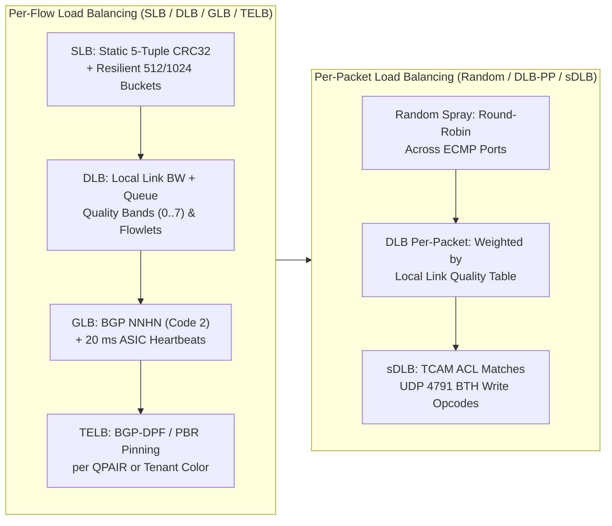
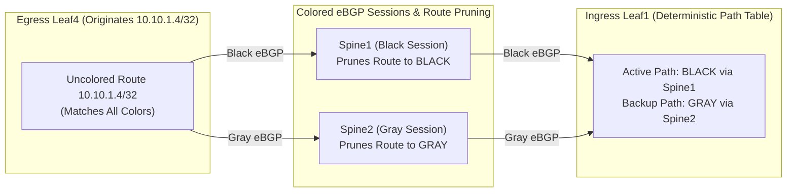

# 12.14 Load balancing and routing for AI fabrics

| | |
|---|---|
| Level | Advanced |
| Priority tier | 1 |
| Lab venue | Nebius GPU |
| Part | Part 12: Complete AI networking |
| Sources used | `ADC` Ch. 6, Ch. 8; `bcm11-admin` Ch. 3 |
| Coverage file | `planning/coverage/chapters/12-14.md` |
| Claim ledger | `planning/ledgers/12-14.md` |
| Companion code | `code/part12/load_balancing_routing_ai.py`, `code/part12/load_balancing_routing_ai_lab.py` |

## Why this matters for AI infrastructure

An AI training cluster with `1:1` non-oversubscribed `400 Gbps` or `800 Gbps` leaf-to-spine bandwidth can still run at `50%` effective fabric utilization and suffer persistent Priority Flow Control (`PFC`) stalls if its switches rely on traditional static 5-tuple Equal-Cost Multipathing (`ECMP`). Unlike enterprise web or microservice workloads that generate thousands of short, high-entropy TCP connections, distributed Large Language Model (`LLM`) training with both natural language understanding (`NLU`) and natural language generation (`NLG`) phases exchanges massive east-west synchronization bursts across a small, fixed set of GPU pairs over RDMA over Converged Ethernet version 2 (`RoCEv2`, UDP destination port `4791`). When two `100 Gbps` elephant flows hash to the same `200 Gbps` leaf-to-spine uplink while two `50 Gbps` flows land on an adjacent `200 Gbps` uplink, one spine link saturates at `100%` and drops or pauses traffic while the parallel link sits at `50%`.

Eliminating these bottlenecks requires coordinating two layers of the switching stack: **data-plane load balancing** in the switch Packet Forwarding Engine (`PFE`) and **control-plane IP routing** across three-stage, five-stage, or DragonFly topologies. In the data plane, modern AI switch ASICs progress from Static Load Balancing (`SLB`) with resilient and weighted hashing (`WCMP`) to local queue-aware Dynamic Load Balancing (`DLB`), next-next-hop Global Load Balancing (`GLB` with `20 ms` hardware heartbeats), Traffic Engineering Load Balancing (`TELB`), and Selective Packet Spraying (`sDLB`) that matches RoCEv2 Base Transport Header (`BTH`) write opcodes in Ternary Content-Addressable Memory (`TCAM`). In the control plane, operators must choose and tune `eBGP` with RFC 5549 BGP unnumbered (`Extended Next Hop Encoding` capability code `5`), spine Autonomous System Number (`ASN`) loop prevention, Link Bandwidth Extended Communities, BGP Deterministic Path Forwarding (`BGP DPF`), Routing in Fat Trees (`RIFT`, RFC 9692), `IS-IS` with distributed flood reduction and `Flex Algo` (RFC 9350 / RFC 9502), multi-tenant `EVPN-VXLAN` with NVIDIA Multi-Instance GPU (`MIG`), or Segment Routing over IPv6 (`SRv6`) compressed `16`-bit micro-SIDs (`uSID`).

## Prerequisites and outcomes

**Prerequisites:**
- Chapters `12.1`–`12.5` (AI collective traffic patterns, RDMA Queue Pairs and `BTH` headers, `RoCEv2` transport over UDP `4791`, `PFC`/`ECN`/`DCQCN` congestion control, and Data Center Bridging `QoS`).
- Chapters `12.11`–`12.13` (Switch ASIC buffer architectures, Ethernet versus InfiniBand design trade-offs, and Rail-Optimized `ROD` versus Rail-Unified `RUD` topologies).

**Outcomes — after completing this chapter, you will be able to:**
1. Compute the exact 5-tuple `CRC32` hash key (`0x8BDA7C2D`), raw modulo index (`mod 5 = 1`, `mod 8 = 5`), resilient hashing bucket remapping (`512` or `1,024` buckets), symmetric XOR normalization, and weighted `ECMP` (`WCMP`) indirection tables used in Static Load Balancing (`SLB`).
2. Compare `SLB`, `DLB` (assigned-flow, flowlet inactivity timer, and reactive path rebalancing across quality bands `0` to `7`), `GLB` (`draft-wang-idr-next-next-hop-nodes` Characteristic Code `2` and `20 ms` Tomahawk 5 ASIC heartbeats), and `TELB`.
3. Architect per-packet spraying (`Random Spray`, `DLB Per-Packet Mode`, and `sDLB` matching RoCEv2 `BTH` RDMA Write opcodes on `ConnectX-6`/`ConnectX-7` and `BlueField` DPUs) without overflowing receiver reorder buffers.
4. Design and verify `eBGP` AI underlays using RFC 5549 BGP unnumbered (`Capability Code 5`, `MP_REACH_NLRI` attribute `14`), shared spine ASNs (`65001`) to prevent valley routing, `ADD-PATH`, `AS-PATH` normalization, Link Bandwidth Extended Communities (`20%/45%/15%/20%`), and `BGP DPF` (`draft-wang-idr-dpf`) session coloring.
5. Evaluate `RIFT` (RFC 9692) on Clos and DragonFly Sparse topologies, `IS-IS` Optimal Distributed Flooding and `Flex Algo` (`FAD` planes `128`, `129`, `130`), `512`-GPU/rail `EVPN-VXLAN` + `7`-instance `H100 MIG` + `VXLAN-GBP` multi-tenancy, host-level `FRR` BGP (`4200000001`–`4200000004`), and `SRv6` `16`-bit `uSID` traffic engineering.

---

## 1. Per-flow load balancing: from static hashing to global path awareness

### 1.1 IP ECMP next-hop groups and the low-entropy RoCEv2 problem

In a three-stage Leaf-Spine Clos fabric where `GPU1` connects to `LeafA`, `GPU2` connects to `LeafB`, and both leaves connect to `SpineA`, `SpineB`, and `SpineC`, the routing control plane (`eBGP`, `IS-IS`, or `OSPF`) advertises `GPU2`'s IP subnet from `LeafB` to all three spines. Each spine rewrites the BGP next-hop attribute to `self` and advertises the prefix to `LeafA`. Because all three paths carry identical routing metrics and BGP attributes, `LeafA` installs a single shared hardware Equal-Cost Multipathing (`ECMP`) group in its ASIC forwarding table:

$$\text{ASIC ECMP Group }\texttt{nh-id123} \longrightarrow \bigl\{\texttt{Unicast\_nh1: SpineA},\;\texttt{Unicast\_nh2: SpineB},\;\texttt{Unicast\_nh3: SpineC}\bigr\}$$

In production AI clusters, the spine layer frequently scales to `32` or `64` spines, and all remote destinations reachable across the same set of spines share the same hardware `ECMP` next-hop identifier to conserve ASIC next-hop table memory (or resolve to the remote VXLAN Tunnel Endpoint `VTEP` loopback IP when `EVPN-VXLAN` `MAC-VRF` or Route Type 5 `RT5` IP overlays are enabled). Once the control plane programs `nh-id123`, packet-by-packet path selection happens entirely inside the switch ASIC Packet Forwarding Engine (`PFE`) without control-plane intervention.



| Load-Balancing Family | Specific Mechanism | Primary Input Signals | Reordering Exposure & Target Hardware |
|---|---|---|---|
| **Per-Flow (`SLB`)** | Raw Modulo, Resilient (`512`/`1,024` buckets), Symmetric XOR, Weighted (`WCMP`) | Packet 5-tuple (`SRC/DST IP`, `Proto 17`, `SRC/DST UDP`) + optional `BTH QPair` | Zero intra-flow reordering; vulnerable to low-entropy elephant collisions (`100%` vs `50%` link load). |
| **Per-Flow (`DLB`)** | Assigned-Flow Mode, Flowlet Mode (inactivity timer), Reactive Rebalancing | 5-tuple + local port bandwidth utilization and egress buffer queue depth (quality bands `0..7`) | Zero reordering if paused longer than inactivity timer; brief reordering during reactive rebalancing. |
| **Per-Flow (`GLB`)** | Broadcom Cognitive Routing / `Tomahawk 5` `GLB` App | Local `DLB` quality + remote spine-to-egress-leaf quality via `BGP NNHN` (`Code 2`) & `20 ms` ASIC heartbeats | Prevents downstream spine collisions (`Link X` on `SpineA -> LeafD`); lowers `DCQCN` and `PFC` triggers. |
| **Per-Flow (`TELB`)** | Filter-Based Forwarding (`FBF`/`PBR`), `BGP DPF`, or Out-of-Band `TELB` Controller | Source `UDP` port range, `RoCEv2 BTH QPair`, ingress GPU port, or fabric telemetry | Deterministic in-order delivery per colored fabric plane with pre-installed ASIC backup path ID. |
| **Per-Packet** | Random Spray, `DLB` Per-Packet Mode, Selective Packet Spraying (`sDLB`) | Per-datagram spraying (`1,500 B` packets `A, B, C`) + `TCAM ACL` on `BTH` RDMA `Write` opcodes (`0x06..0x0B`) | Requires NIC hardware reorder buffer (`NVIDIA ConnectX-6/7` or `BlueField` DPU for RDMA Write opcodes). |

### 1.2 Static load balancing (`SLB`): worked CRC32 5-tuple math, resilient buckets, symmetric XOR, and WCMP

When a packet enters a switch port under Static Load Balancing (`SLB`), the `PFE` extracts the 5-tuple header fields (and optionally fields from the `RoCEv2` `BTH` header) and runs them through a hardware hash polynomial such as `CRC32` or `CRC16`. If the resulting numeric hash key is `10` across an `N = 5` member `ECMP` group, raw modulo arithmetic selects interface index $10 \bmod 5 = \mathbf{0}$; if the hash key is `11`, it selects interface index $11 \bmod 5 = \mathbf{1}$.

Consider a concrete `RoCEv2` flow entering a leaf switch with the following 5-tuple:
- **Source IP address:** `192.168.1.20` $\longrightarrow$ hexadecimal `C0A80114`
- **Destination IP address:** `192.168.2.10` $\longrightarrow$ hexadecimal `C0A8020A`
- **IP Protocol:** `17` (UDP) $\longrightarrow$ hexadecimal `11`
- **Source UDP port:** `1024` $\longrightarrow$ hexadecimal `0400`
- **Destination UDP port:** `4791` (`RoCEv2`) $\longrightarrow$ hexadecimal `12B7`

Concatenating these 13 bytes produces the 104-bit hexadecimal bitstring `C0A80114 C0A8020A 11040012 B7`. Passing this value through the switch ASIC's `CRC32` mixing function outputs the 32-bit hash key:

$$\text{Hash Key} = \texttt{0x8BDA7C2D} = \mathbf{2,346,351,661}_{10}$$

Applying raw modulo arithmetic against the active `ECMP` member count $N$ yields:
- For **$N = 5$ active links:** $2,346,351,661 \bmod 5 = \mathbf{1}$ (outgoing interface index `1`).
- For **$N = 8$ active links:** $2,346,351,661 \bmod 8 = \mathbf{5}$ (outgoing interface index `5`).

This calculation exposes the first operational flaw of naive `SLB`: whenever a link flaps or an operator expands leaf-to-spine uplinks from `5` to `8`, changing the divisor $N$ in the modulo function remaps almost every active flow in the switch (`75%` churn when dropping from `5` to `4` links), causing widespread transient packet reordering.

To prevent global flow churn on link state changes, switches implement **resilient hashing**, replacing the variable divisor $N$ with a fixed hardware indirection table of **`512` or `1,024` buckets**. Consider a simplified **`8`-bucket** table (`buckets 0..7`) mapped across **`5` interfaces** (`interface_0` through `interface_4`):

| Bucket Index (`hash_key mod 8`) | Initial Mapped Interface (`5` Active Links) | Remapped Interface After `interface_2` Fails | Status on `interface_2` Failure |
|---|---|---|---|
| `Bucket 0` | `interface_0` | `interface_0` | Unchanged |
| `Bucket 1` | `interface_1` | `interface_1` | Unchanged |
| `Bucket 2` (`10 mod 8 = 2`) | `interface_2` | `interface_0` (reassigned) | **Affected (remapped)** |
| `Bucket 3` | `interface_3` | `interface_3` | Unchanged |
| `Bucket 4` | `interface_4` | `interface_4` | Unchanged |
| `Bucket 5` | `interface_0` | `interface_0` | Unchanged |
| `Bucket 6` | `interface_1` | `interface_1` | Unchanged |
| `Bucket 7` | `interface_2` | `interface_1` (reassigned) | **Affected (remapped)** |

For a flow with `hash_key = 10`, $10 \bmod 8 = \mathbf{2}$ selects `Bucket 2`, which forwards out `interface_2`. If `interface_2` goes down, the ASIC rewrites only `Bucket 2` and `Bucket 7` (`2 / 8 = 25%` of buckets), leaving flows in the other `6` buckets completely undisturbed.

Two additional `SLB` enhancements are frequently combined with resilient buckets:
1. **Symmetric hashing:** Standard 5-tuple hashing produces different keys for forward ($A \to B$) and reverse ($B \to A$) traffic because source and destination IPs and UDP ports are swapped. Symmetric hashing applies a sorting normalization or bitwise `XOR` over `(SRC_IP, DST_IP)` and `(SRC_PORT, DST_PORT)` prior to `CRC32`/`CRC16` evaluation so both directions of a bidirectional flow land on the exact same bucket and interface—a requirement when steering traffic through stateful firewalls or inline inspection engines.
2. **Weighted ECMP (`WCMP`):** Rather than filling the `512`- or `1,024`-entry bucket indirection table evenly across next hops, `WCMP` populates buckets in proportion to configured next-hop weights, intentionally biasing flow distribution toward higher-capacity spines.

Even with resilient, symmetric, and weighted enhancements, `SLB` remains blind to flow rates and queue occupancy. Suppose `LeafA` has two `200 Gbps` uplinks (`LeafA -> SpineA` and `LeafA -> SpineB`) and receives four concurrent flows: `Flow1` (`50 Gbps`), `Flow2` (`100 Gbps`), `Flow3` (`50 Gbps`), and `Flow4` (`100 Gbps`). Under `SLB`, an equal number of flows (`2` per uplink) can hash `Flow1 + Flow3` (`100 Gbps` total = **`50%` utilization**) onto `SpineA` while hashing `Flow2 + Flow4` (`200 Gbps` total = **`100%` utilization**) onto `SpineB`. Worse, under low entropy where two line-rate `200 Gbps` GPU streams produce the same hash bucket, both elephant flows collide on `SpineB` (`100%` saturated, dropping or pausing short-lived mice flows) while `SpineA` carries `0%` traffic.

### 1.3 Dynamic load balancing (`DLB`): quality bands, flowlet inactivity timers, and reactive rebalancing

**Dynamic Load Balancing (`DLB`)**, a hardware mechanism pioneered in Broadcom switch silicon (and known as Adaptive Load Balancing `ALB` on other platforms), eliminates local hash collisions by combining packet header hashing with real-time **local link bandwidth utilization** and **egress buffer queue depth**. An embedded microkernel inside the switch ASIC continuously samples port load and queue occupancy in the `PFE`, mapping each `ECMP` member interface to an integer **link quality band** from **`0` (lowest quality)** to **`7` (highest quality)** in a hardware link quality table.

In the four-flow example above (`Flow1 = 50 Gbps`, `Flow2 = 100 Gbps`, `Flow3 = 50 Gbps`, `Flow4 = 100 Gbps` across two `200 Gbps` uplinks), `DLB` assigns `Flow1` (`50 Gbps`) to `SpineA` and `Flow2` (`100 Gbps`) to `SpineB`. When `Flow4` (`100 Gbps`) arrives, the `PFE` observes that `LeafA -> SpineA` has a higher quality band (`50 Gbps` used) than `LeafA -> SpineB` (`100 Gbps` used), and steers `Flow4` to `SpineA` while placing `Flow3` (`50 Gbps`) on `SpineB`. Both `200 Gbps` uplinks settle at exactly **`150 Gbps` (`75%` utilization)** instead of `50%` and `100%`. Because `DLB` tracks port state in the `PFE` in real time, it also detects local link failures in microseconds rather than waiting for control-plane routing convergence.

`DLB` supports three operational modes:
1. **DLB Assigned-Flow Mode:** Each new flow is assigned to the highest-quality local egress port when its first packet arrives and remains pinned to that interface for its entire lifetime. Because AI training QPs remain open for hours and can degrade link quality over time, assigned-flow mode is unsuitable for AI backend fabrics.
2. **DLB Flowlet Mode (Inactivity Timer):** A GPU pair often reuses the same outer 5-tuple across sequential collective tasks (which differ only inside the upper-layer `IB BTH` header). In flowlet mode, the ASIC builds hardware **flowset tables** (tunable in size to track more macro-flows) and starts a per-flow **inactivity timer**. If a flow pauses for *less* than the inactivity timer, subsequent packets keep using the same spine (`SpineB`) to preserve strict packet ordering. If the inter-burst gap between two GPU tasks *exceeds* the inactivity timer, the ASIC treats the next burst as a new **flowlet** and reassigns it to a higher-quality uplink (`SpineA`). When all candidate spines share the same quality band (for example, all at quality `7`), `DLB` falls back to flow-hash selection.
3. **DLB Reactive Path Rebalancing:** If multiple long-lived elephant flows (`Flow1`, `Flow2`, `Flow3`) transmit continuously without ever pausing longer than the inactivity timer, their assigned uplink (`LeafA -> SpineA`) can degrade in quality. Reactive path rebalancing monitors the active link's quality band against alternative `ECMP` paths (`LeafA -> SpineC`) and migrates one or more active flows mid-stream when quality deteriorates—provided the destination NIC can tolerate brief transient packet reordering during the switchover.

### 1.4 Global load balancing (`GLB`): BGP NNHN (`draft-wang-idr-next-next-hop-nodes`) and `20 ms` ASIC heartbeats

Local `DLB` solves leaf-to-spine imbalance, but it is blind to congestion one hop further downstream on the **spine-to-egress-leaf** link. Suppose servers on `LeafA` and `LeafB` simultaneously transmit line-rate elephant flows to a destination server on `LeafD`. Using local `DLB`, `LeafA` sees that its uplink `Link A` (`LeafA -> SpineA`) is uncongested, and `LeafB` independently sees that its uplink to `SpineA` is uncongested. Both leaves forward their elephant flows to `SpineA`, which has only a single downlink **`Link X` (`SpineA -> LeafD`)**, while the parallel downlink **`Link Y` (`SpineB -> LeafD`)** sits idle. The two flows collide on `Link X` at `SpineA`, triggering `ECN` marking (`DCQCN` rate cuts) and potentially a `PFC` pause avalanche back into the fabric.

**Global Load Balancing (`GLB`)**—introduced under Broadcom's cognitive routing architecture starting with the **`Tomahawk 5`** ASIC—solves remote spine collisions by combining two mechanisms:
1. **Control-plane topology discovery via `BGP NNHN` (`draft-wang-idr-next-next-hop-nodes`):** Because standard `BGP` is a path-vector protocol without full link-state topology visibility, `draft-wang-idr-next-next-hop-nodes` defines the **Next-Next-Hop Nodes (`NNHN`)** capability inside the BGP Next-Hop Dependent Capabilities attribute:
   - **Bits `0..15`:** `Characteristic Code = 2`
   - **Bits `16..31`:** `Characteristic Length = variable`
   - **Row 2 (Bits `0..31`):** `32-bit Next-hop BGP ID` (identifying the immediate spine next hop)
   - **Row 3+ (Bits `0..31`):** One or more `32-bit Next-next-hop BGP IDs` (identifying each downstream egress leaf switch reachable via `ECMP` from that spine for the advertised `NLRI`)
2. **Data-plane `PFE` heartbeats every `20 ms`:** When an `eBGP` underlay session comes up, `BGP` sends a path-monitor message instructing the `PFE`'s `GLB` application to monitor and flood link-quality heartbeats **only on interfaces with active `BGP` underlay peering**. These change-based hardware heartbeats are exchanged every **`20 ms`**.

Inside the `Tomahawk 5` `GLB` application, each unique next-next-hop node generates a **simple path quality profile** in a **three-stage Clos fabric** (where a spine has a single next-next-hop leaf for a destination prefix). In a **five-stage Clos fabric** (where a route traverses multiple next-next-hop nodes across pod spines and super-spines), two or more simple profiles are grouped into a **compound path quality profile**. By correlating the local `LeafA -> SpineA` (`Link A`) and `LeafA -> SpineB` (`Link B`) quality with the remote `SpineA -> LeafD` (`Link X`) and `SpineB -> LeafD` (`Link Y`) quality received via `GLB` heartbeats, `LeafA` immediately sees that `Link X` is congested and steers new flows over `Link B -> SpineB -> Link Y`. This proactive avoidance reduces `DCQCN` triggers at the spine, suppresses `PFC` pause cascades, and detects remote spine-to-leaf link failures in hardware before control-plane route withdrawals arrive.

In five-stage Clos clusters, operators can deploy `GLB` in four scopes depending on hardware table scale: (1) across a three-stage Clos fabric on all switches, (2) within individual pods of a five-stage Clos (treating each pod as a three-stage `GLB` domain), (3) exclusively between the spine and super-spine layers when oversubscription exists there, or (4) across all five stages when ASIC profile table capacity permits.

### 1.5 Traffic engineering–based load balancing (`TELB`)

While `DLB` and `GLB` dynamically react to queue occupancy, multi-tenant LLM training clusters often require **deterministic path pinning** so that one tenant's bursty `AllReduce` or `AllToAll` job never shares spine links or buffers with another tenant. Traditional service-provider MPLS Traffic Engineering (`MPLS-TE`) and Segment Routing MPLS (`SR-MPLS`) require expensive software licenses on `400 Gbps` and `800 Gbps` switches, add label overhead, and often lack full telemetry and lossless `DCQCN` compatibility compared to native IP fabrics.

**Traffic Engineering–Based Load Balancing (`TELB`)** achieves deterministic path diversity in a pure Ethernet/IP fabric through three mechanisms:
1. **Multi-tenant spine slicing and Filter-Based Forwarding (`FBF` / `PBR`):** In an `8`-spine, two-stripe Rail-Optimized Design (`ROD`, `Leaf1..Leaf8` in Stripe 1 and `Leaf9..Leaf16` in Stripe 2) hosting `7` tenants (`Tenant 1..Tenant 7`), an operator can pin `Tenant 1` to `1` dedicated spine (guaranteeing strict in-order delivery) or split `4` spines for one tenant group and `4` spines for another. If a single GPU generates bursty traffic that would overload a single spine, the host splits its collective across multiple `RoCEv2` Queue Pairs (`QPAIRs`), and an orchestrator programs automated **Filter-Based Forwarding (`FBF`) / Policy-Based Routing (`PBR`)** rules on the leaf switch to map distinct `QPAIR` ranges or source UDP port ranges onto separate colored path IDs (`BGP DPF`) with pre-installed ASIC backup path IDs.
2. **Ingress-port coloring in Rail-Unified Design (`RUD`):** When all `8` GPUs (`GPU 1..8`) of a server connect to the same chassis or leaf switch complex (`Leaf1..Leaf16` connected via `3 × 400G` uplinks to `Spine1..Spine8`), `TELB` classifies traffic by **ingress switch interface**, assigning each GPU ID from every server to its own dedicated logical fabric color so a bandwidth spike on `GPU 1` cannot contend with jobs on `GPU 2..8`.
3. **Out-of-band `TELB` controller:** An external controller connected via the out-of-band (`OOB`) management network collects real-time streaming telemetry (queue buffer utilization, `DCQCN`/`PFC` counters, and active probe latencies) and dynamically updates path placements in coordination with the GPU job scheduler.

---

## 2. Per-packet load balancing and selective packet spraying (`sDLB`)

### 2.1 Random spray, DLB per-packet mode, and the receiver reordering challenge

In **per-packet load balancing**, the ingress leaf switch ignores flow tables and sprays every arriving packet of a single elephant flow across all available `ECMP` uplinks. If a server transmits a `100 Gbps` flow consisting of three `1,500-byte` datagrams (`Datagram A`, `Datagram B`, and `Datagram C`) into `Leaf1`, the switch forwards `Datagram A` out `Port 1` (`100 Gbps` to `Spine1`), `Datagram B` out `Port 2` (`100 Gbps` to `Spine2`), and `Datagram C` out `Port 3` (`100 Gbps` to `Spine3`). All three uplinks carry exactly one datagram, achieving nearly `100%` uniform link utilization even for a single `1:1` GPU pair.

However, because `Spine1`, `Spine2`, and `Spine3` experience slightly different instantaneous buffer depths, the three datagrams arrive at egress `Leaf2` and destination server `192.168.1.1` out of sequence: **`Datagram B` arrives at time `T1`, `Datagram C` at `T2`, and `Datagram A` at `T3`**. Traditional RDMA NICs without hardware reorder buffers treat out-of-order Packet Sequence Numbers (`PSNs`) as packet loss, triggering Go-Back-$N$ `NAK` storms that collapse goodput.

When modern NICs with hardware packet reordering are deployed, switches offer three per-packet spraying modes:
1. **Random Spray:** The switch distributes packets across `ECMP` members in a blind random or round-robin sequence without checking port utilization. If datagram sizes vary widely across flows (`64 B` control frames mixed with `4,096 B` or `9,000 B` RDMA payloads), blind round-robin can still overload a link.
2. **DLB Per-Packet Mode:** The switch consults its real-time `DLB` hardware link quality table for every packet, spraying a higher proportion of datagrams onto `ECMP` member ports that currently report higher quality bands (lower utilization and shallower queues).
3. **Selective Packet Spraying (`sDLB`):** Certain `400 Gbps` NICs—specifically **NVIDIA `ConnectX-6` (`CX6`), `ConnectX-7` (`CX7`), and `BlueField` DPUs**—support hardware out-of-order packet reordering in their Direct Data Placement (`DDP`) engines **only for specific `RoCEv2` RDMA `Write` opcodes** (which constitute the vast majority of east-west elephant flows in AI training), while requiring strict in-order delivery for RDMA `Read`, `Send`, or atomic control operations.

Under **`sDLB`**, the administrator allocates ingress **Ternary Content-Addressable Memory (`TCAM`)** access control list (`ACL`) entries on the leaf switch to inspect the UDP destination port (`4791`) and the `8`-bit **opcode field inside the `RoCEv2` Base Transport Header (`BTH`)**:
- **`Flow1` (non-matching traffic, such as `RDMA Read Request 0x0C` or `RDMA Send Only 0x04`):** Does not match the `TCAM` filter and is forwarded via default per-flow load balancing (`SLB` or `DLB` flowlet mode) over a single spine path so packets arrive strictly in order.
- **`Flow2` (matching elephant traffic, such as `RDMA Write First 0x06`, `Write Middle 0x07`, `Write Last 0x08`, `Write Only 0x0A`):** Matches the `TCAM` filter action and is sprayed packet-by-packet across all available spines (`DLB` per-packet mode), while the destination `ConnectX-6`/`ConnectX-7` or `BlueField` DPU places payloads directly into GPU memory out of order and defers the completion queue entry (`CQE`) until all `PSNs` arrive.

### 2.2 Complete load-balancing mechanism comparison (`ADC` Table 6-1)

| Feature / Capability | `SLB` (Static) | `DLB` (Dynamic) | `GLB` (Global) | `TELB` (Traffic Engineering) |
|---|---|---|---|---|
| **Load balancing based on packet characteristics** | Yes (`5`-tuple) | Yes (`5`-tuple + flowlets) | Yes (`5`-tuple + flowlets) | No (explicit path/color policy) |
| **Includes local link bandwidth** | No | Yes | Yes | Yes |
| **Uses queue size information** | No | Yes | Yes | No |
| **Can use remote link quality** | No | No | Yes (`BGP NNHN` + `20 ms` heartbeats) | Yes |
| **May include `RoCEv2 BTH` header for load balancing** | Yes | Yes | Yes | Yes |
| **Can use fabric telemetry for load balancing** | No | No | No | Yes |
| **Industry adoption level** | **High** | **Medium** | **Low** | **Low** |

---

## 3. IP routing for AI fabrics: eBGP unnumbered, ASN design, WCMP, and BGP DPF

### 3.1 Dynamic IP routing options: OSPF vs IS-IS vs eBGP across backend and frontend networks

An AI data center comprises two distinct routing domains: the **backend training fabric** (connecting `400 Gbps`/`800 Gbps` GPU compute nodes over lossless `RoCEv2` and `DCQCN`) and the **frontend inference and storage fabric** (connecting inference servers, client gateways, and storage clusters over `RoCEv2`, `NVMe-o-TCP`, `iSCSI`, or `iWARP`). Even when an operator chooses `eBGP` for both domains, the feature profiles diverge: the backend typically runs a pure native IP underlay optimized with `GLB` or **BGP Link Bandwidth Extended Communities** (`WCMP` / Weighted Packet Spraying `WPS`), whereas the frontend layers **`EVPN-VXLAN`** multi-tenant overlays on top of standard equal-weight `ECMP`.

When evaluating dynamic routing protocol families for these fabrics:
- **`OSPFv2` / `OSPFv3`:** Uses link-state flooding and Dijkstra's Shortest Path First (`SPF`) algorithm for fast convergence, but requires separate protocol instances for IPv4 (`OSPFv2`) and IPv6 (`OSPFv3`), lacks native policy-based traffic engineering per prefix, and is susceptible to transient micro-loops during topology changes compared to path-vector `BGP` or `RIFT`.
- **`IS-IS`:** Encapsulates directly over Layer 2 (making it immune to external TCP spoofing), carries both IPv4 and IPv6 reachability in a single protocol instance using bandwidth-based metrics and extensible Type-Length-Value (`TLV`) objects, and scales to `2,500` switches with `Flex Algo` plane separation, though enterprise data center engineers often have less operational familiarity with `IS-IS` than with `BGP`.
- **`eBGP` (RFC 7938):** The dominant cloud-scale data center routing protocol due to its deterministic path-vector loop prevention (`AS_PATH`), rich route-policy engine, native `EVPN` multi-tenancy support, and multi-vendor maturity—provided it is enhanced with **BGP unnumbered**, proper spine `ASN` allocation, `ADD-PATH`, and link-bandwidth or `DPF` communities for AI workloads.

### 3.2 eBGP underlay and BGP unnumbered (`RFC 5549` / `Capability Code 5`)

In a non-oversubscribed `1:1` AI Clos fabric with dozens of `400 Gbps` or `800 Gbps` links per switch, assigning and managing `/30` or `/31` point-to-point IPv4 subnets on every leaf-to-spine cable is operationally error-prone. **BGP Unnumbered (`RFC 5549`, updated by `RFC 8950`)** eliminates interface IPv4 address configuration by establishing `eBGP` sessions over automatic **IPv6 Link-Local Addresses (`LLAs`, `fe80::/10`)** derived from each port's unique burn-in MAC address, and advertising IPv4 server prefixes (`AFI = 1`, `SAFI = 1`) with an **IPv6 link-local Next Hop (`Next Hop AFI = 2`)**. Operators need only assign BGP Autonomous System Numbers (`ASNs`) from the **`16`-bit private range (`64512` to `65535`)** or the **`32`-bit private range (`4200000000` to `4294967294`)** and redistribute local GPU server interfaces via a route policy.

Tracing the exact wire sequence from a lab packet capture between `spine1` (interface `Eth11`, MAC `0c:59:9c:f1:00:32`, IPv6 LLA `fe80::e59:9cff:fef1:32`, `AS 65001`, Router ID `172.16.7.101`) and `leaf1` (interface `Eth11`, MAC `0c:59:9c:22:5d:d7`, IPv6 LLA `fe80::e59:9cff:fe22:5dd7`):
1. **ICMPv6 Neighbor & Router Discovery:** `spine1` and `leaf1` exchange ICMPv6 Neighbor Solicitation (`NS`) and Neighbor Advertisement (`NA`) messages with the Router (`R`) flag set, followed by ICMPv6 Router Solicitation (`RS`) and Router Advertisement (`RA`) messages carrying the **Source Link-Layer Address option** (`0c:59:9c:f1:00:32` and `0c:59:9c:22:5d:d7`) so each switch learns its neighbor's LLA and MAC without ARP.
2. **TCP 3-Way Handshake over IPv6 LLA:** `spine1` sends a `TCP SYN` from `fe80::e59:9cff:fef1:32` (source port `52659`) to `fe80::e59:9cff:fe22:5dd7` (destination port `179`), followed by `SYN-ACK` and `ACK`.
3. **BGP `OPEN` Message (`Frame 22`, `189 bytes` / `1,512 bits` on wire):** `spine1` sends a BGP `OPEN` message (`Type = 1`, `Length = 81 bytes`, `Version = 4`, `My AS = 65001`, `Hold Time = 90 s`, `BGP Identifier = 172.16.7.101`, `Optional Parameters Length = 52 bytes`). Inside the capabilities list, `spine1` advertises **Extended Next Hop Encoding (`Capability Code = 5`, `Length = 6 bytes`)** containing:
   - `Address Family Identifier (AFI) = 1` (`IPv4`)
   - `Subsequent Address Family Identifier (SAFI) = 1` (`Unicast`)
   - `Next Hop Address Family Identifier = 2` (`IPv6`)
4. **BGP `UPDATE` Message (`Frame 28`, `358 bytes` / `2,864 bits` on wire):** Once both peers negotiate `Capability Code 5`, `spine1` advertises IPv4 host prefix **`172.16.7.181/32`** inside a BGP `UPDATE` message (`Type = 2`, `Length = 82 bytes`, `Withdrawn Routes Length = 0`, `Total Path Attribute Length = 46 bytes`, `ORIGIN = IGP`, `AS_PATH = 65001` with `Flags = 0x40, Type = 2, Length = 6`). Instead of a legacy IPv4 `NEXT_HOP` attribute, the update carries **Multiprotocol Reachable NLRI (`MP_REACH_NLRI`, `Flags = 0x90`, `Type Code = 14`, `Length = 42 bytes`)** with `AFI = 1 (IPv4)`, `SAFI = 1 (Unicast)`, `Next Hop = fe80::9:0a:2f:c1:f1:32` (IPv6 global/link-local next hop), and `NLRI = 172.16.7.181/32`.

### 3.3 BGP ASN allocation, ADD-PATH, AS-PATH normalization, Link Bandwidth WCMP, and minimum peers

How an architect assigns ASNs to spines and leaves directly governs fabric behavior during multi-link failures:
- **Recommended design — Shared Spine ASN (`65001`) with Unique Leaf ASNs (`65101..65104`):** When `spine1..spine4` all share **`ASN 65001`** and `leaf1..leaf4` use unique ASNs **`65101`, `65102`, `65103`, and `65104`**, default BGP `AS_PATH` loop prevention rejects any route update that already contains the receiving switch's own ASN.
- **Anti-pattern — Unique Spine ASNs (`65001..65004`) causing valley tromboning:** Suppose `spine1..spine4` are assigned distinct ASNs `65001`, `65002`, `65003`, and `65004`, and simultaneous link failures sever `leaf1 -> spine2`, `leaf1 -> spine3`, `leaf1 -> spine4`, and `leaf2 -> spine3`. A flow from `server1` (`10.10.1.1/24` on `leaf1`, `AS 65101`) to `server5` (`10.10.5.1/24` on `leaf3`, `AS 65103`) cannot reach `leaf3` directly via `spine2..4` and instead trombones along the valley path **`server1 -> leaf1 (65101) -> spine1 (65001) -> leaf2 (65102) -> spine1/spine2 -> leaf3 (65103) -> server5`**. On `400 Gbps`/`800 Gbps` AI links, this suboptimal zigzag saturates transit `leaf2` and degrades every GPU job on `leaf2`. With a shared spine ASN (`65001`), `spine2` rejects the route bounced through `leaf2` because `65001` already appears in `AS_PATH (65001, 65102, 65101)`, cleanly failing over at the job/orchestrator layer rather than silently congesting transit leaves.

Four advanced BGP capabilities complete the AI underlay control plane:
1. **BGP `ADD-PATH`:** When an external Data Center Gateway (`DC GW`, `AS 65503`) advertises `server2` (`10.10.108.0/24`) through redundant `border-leaf1` (`AS 65501`, next hop `NH1`) and `border-leaf2` (`AS 65502`, next hop `NH2`) into `spine2` (`AS 65001`, or an `iBGP` Route Reflector), standard BGP selects only a single best path to advertise to `leaf2` (`AS 65102`, hosting `server1` `10.10.101.0/24`). Enabling **`ADD-PATH send/receive`** on `spine2` advertises *both* `NH1` and `NH2` for `10.10.108.0/24` to `leaf2`, enabling full multipath load balancing and sub-second partial failover.
2. **BGP `AS-PATH` Strip and Replace (Ingress Normalization):** When remote `server101` arrives from a private WAN core whose private ASNs overlap with fabric automation ASNs—or when multi-tenant GPU servers run host BGP daemons with varying `AS_PATH` lengths—border spines (`AS 65001`) or ToR leaves apply an ingress policy that **strips private ASNs and replaces `AS_PATH`** with a normalized operator ASN sequence of uniform length so all border paths remain equal-cost `ECMP` candidates.
3. **BGP Link Bandwidth Extended Community and `WCMP` / `WPS`:** When `spine1..spine4` (`AS 65001`) connect northbound to the IP core (or super-spines in a 5-stage Clos) with heterogeneous capacities—**`spine1 = 400 Gbps`, `spine2 = 800 Gbps`, `spine3 = 100 Gbps`, and `spine4 = 400 Gbps`** (`1,700 Gbps` total)—encoding the **BGP Link Bandwidth Extended Community** on route advertisements programs weighted `ECMP` (`WCMP`) indirection buckets on `leaf1..leaf4` (`AS 65101..65104`): **`20%` of traffic to `spine1`, `45%` to `spine2`, `15%` to `spine3`, and `20%` to `spine4`**. In a 5-stage Clos where one spine-to-super-spine link fails, leaves automatically reduce that spine's hardware weight—a capability known as **Weighted Packet Spraying (`WPS`)**.
4. **Minimum BGP Peers per IP Prefix:** If a spine normally reaches destination subnet `10.10.101.0/24` across `4`-way `ECMP` downlinks and `1` downlink fails (leaving only `3` active peers), a **minimum-peers conditional advertisement policy** forces that spine to withdraw `10.10.101.0/24` northbound so upstream leaves route exclusively through the remaining `3` full-capacity spines rather than sending `25%` of traffic into a degraded `3/4`-capacity spine.

### 3.4 BGP Deterministic Path Forwarding (`BGP DPF`, `draft-wang-idr-dpf`) and traffic-to-fabric color mapping

Standard `eBGP` treats the entire Clos fabric as a single best-effort pool of bandwidth. **BGP Deterministic Path Forwarding (`BGP DPF`, `draft-wang-idr-dpf`)** partitions a physical 3-stage or 5-stage Clos into multiple isolated **logical colored fabrics** (such as `black` and `gray`) by coloring **underlay `eBGP` peering sessions** as well as routes:
- An underlay `eBGP` session between a leaf and spine can be configured with a **single color** (`black`), **multiple colors** (`black` and `gray` over the same physical link), **excluding colors**, or **uncolored**.
- **Color pruning rule:** Only routes carrying at least one color matching the `eBGP` session color are advertised over that session, and any **unmatched colors on the route are pruned out** upon advertisement.



| BGP DPF Stage / Deployment Mode | Mechanism & Route / Forwarding Behavior | Quantitative Example from `ADC` Ch. 8 |
|---|---|---|
| **1. Route Origination & Pruning (`Fig. 8-13`)** | Egress `leaf4` originates `10.10.1.4/32` uncolored (matching all colors). Advertising over `black` session to `spine1` prunes color to `black`; advertising over `gray` session to `spine2` prunes color to `gray`. | Ingress `leaf1` installs `black` via `spine1` as **Active** and `gray` via `spine2` as pre-programmed ASIC **Backup**. |
| **2. Rail-Optimized Design (`ROD`, `Fig. 8-10`)** | Two stripes (`Leaf1..8` and `Leaf9..16`, `8` GPUs/server) share `Spine1..8`. High-priority `black` tenant LLM is pinned to `fab-id black` for deterministic low `JCT`; other tenants (`Tenant 2..7`) use `DLB` / packet spraying. | Note resiliency trade-off: in `RUD`, losing `1` leaf takes down `4` whole `H100` servers (`32` GPUs); in `ROD`, losing `1` leaf impacts `1` rail across the stripe. |
| **3. Rail-Unified Design (`RUD`, `Fig. 8-11`)** | All `8` GPUs of a server connect to the same ToR leaf complex. Specific `GPU ID` (`GPU-id 0`) or `RoCEv2 QPair` is pinned to `fab-id black` across `128` servers. | `128 × GPU-id 0` across `128` servers allocated **`3 × 400 Gbps = 1.2 Tbps`** per leaf on logical fabric `black`. |
| **4. Traffic-to-Fabric Color Mapping (`4` Options)** | (a) **Filter-Based Forwarding (`FBF`)** on ingress ports, source UDP ports, or `BTH QPairs`; (b) **On-box agent** with active probes; (c) **Central controller (`CPCE`)**; (d) **`EVPN-VXLAN` underlay-to-overlay correlation (`Fig. 8-14`)**. | `MAC-VRF-black` / `RT5-VRF-black` maps to `black` IP path (`spine1`); `MAC-VRF-gray` / `RT5-VRF-gray` maps to `gray` IP path (`spine2`). |

---

## 4. Interior gateway protocols (`RIFT` and `IS-IS Flex Algo`), multi-tenancy, host BGP, and `SRv6 uSID`

### 4.1 RIFT (`RFC 9692`) for Fat-Tree and DragonFly Sparse topologies

When an AI backend scales to `16,000`–`32,000` GPUs (`1,000+` switch nodes) or adopts low-diameter **DragonFly** topologies to cut hop count and latency, standard `eBGP` requires complex per-link policy automation and external failure detection (`BFD`). **Routing in Fat Trees (`RIFT`, `IETF RFC 9692`)** is a specialized hybrid Interior Gateway Protocol (`IGP`) purpose-built for dense data center fabrics:
- **Hybrid Northbound Link-State / Southbound Distance-Vector:** `RIFT` floods full topology link-state advertisements **northbound** toward the spines (`Top-of-Fabric`, `ToF`) so spines have complete fabric visibility, while advertising only a default route (or minimal disaggregated prefixes on failure) **southbound** via distance-vector to ToR leaves. This keeps leaf `FIB` tables minimal and supports Zero-Touch Provisioning (`ZTP`) without manual `ASN` assignments.
- **UDP Hello Adjacencies & Automatic Disaggregation:** `RIFT` forms adjacencies using lightweight **UDP `"hello"` messages** and `IPv6 Neighbor Discovery (ND)` rather than full-state TCP sessions. If a spine-to-leaf link fails and creates a blackhole risk under default routing, `RIFT` performs **automatic route disaggregation**, dynamically pushing specific `/32` or `/24` southbound prefixes so leaves route around the severed spine link, and supports wide `ECMP` and **Unequal-Cost Multipathing (`UCMP`)** proportional to northbound capacity.
- **Canonical DragonFly vs DragonFly Sparse (`draft-przygienda-rift-dragonfly`):** In a canonical DragonFly topology (`7` switch groups `Group 1..7`, each containing `8` internally meshed switches with inter-group global links connecting every group to every other group), cabling full intra-group and inter-group meshes is physically complex. **DragonFly Sparse** simplifies each group (`Group A`, `Group B`, `Group C`) into a standard two-tier Leaf-Spine Clos (`LA1/LA2 -> SA1/SA2`, `LB1/LB2 -> SB1/SB2`, `LC1/LC2 -> SC1/SC2`) and interconnects only the `T2` Top-of-Fabric (`ToF`) spines across groups (`SA1/SA2 <-> SB1/SB2 <-> SC1/SC2`). Using `draft-przygienda-rift-dragonfly`, `RIFT` encodes inter-group global links and link-quality telemetry inside distributed **Key-Value Store (`K-store`)** advertisements, permitting non-shortest-path `UCMP` forwarding across horizontal `ToF-to-ToF` links while enforcing split-horizon loop prevention.

### 4.2 IS-IS for AI IP fabrics: Optimal Distributed Flooding and Flex Algo (`RFC 9350` / `RFC 9502`)

Modernized **`IS-IS`** brings two IETF-standardized capabilities to pure IP AI fabrics (scaling up to **`2,500` switch nodes**):
1. **Optimal Distributed Flooding (`draft-white-lsr-distoptflood`):** In a dense AI fabric with `32` or `64` spines and multiple parallel `400G`/`800G` links per leaf-spine pair, standard link-state flooding causes every spine to replicate every new server prefix Link State PDU (`LSP`) back to every leaf. Under `draft-white-lsr-distoptflood`, `leaf1` elects a **single designated spine (`spine2`)** to flood new server prefix updates rather than replicating across all spines, drastically reducing `LSP` fragment churn and accelerating convergence across `T1/T2/T3/T4` topologies.
2. **IS-IS Flexible Algorithm (`Flex Algo`, `RFC 9350` & IP Flex Algo `RFC 9502`):** Originally created for Segment Routing, **`RFC 9502`** standardizes `IS-IS Flex Algo` for **native IPv4/IPv6 prefix forwarding without `SR-MPLS` or `SRv6` encapsulation**. Each switch advertises a **Flexible Algorithm Definition (`FAD`, `RFC 9350`)** specifying the tuple `(Calculation Type, Metric Type, Constraints)`—extended by `draft-ietf-lsr-flex-algo-bw-con` with `min-bandwidth` and `max-link-delay` thresholds—and announces prefixes inside the **IS-IS IPv4 Algorithm Prefix Reachability TLV** (which carries the Multi-Topology Identifier `MTID`, IPv4 prefix, and `Flex Algo` number):
   - **`Flex Algorithm 128` (`spine1` and `spine2`):** Dedicated logical plane for **Storage** traffic.
   - **`Flex Algorithm 129` (`spine3` and `spine4`):** Dedicated logical plane for **Inference** traffic.
   - **`Flex Algorithm 130` (`spine5` and `spine6`):** Dedicated logical plane for **Training** elephant flows (with all switches also participating in `Algorithm 0` default `SPF` as an automatic fallback if a constrained plane fails).

### 4.3 Protocol comparison: eBGP vs RIFT vs IS-IS (`ADC` Table 8-1)

| Characteristic | `eBGP` | `RIFT` (`RFC 9692`) | `IS-IS` (`RFC 9350` / `9502`) |
|---|---|---|---|
| **IP Clos `ECMP` topology support** | Yes | Yes | Yes |
| **DragonFly topology support** | No | **Yes** (`draft-przygienda-rift-dragonfly`) | No |
| **Multi-tenancy options for the frontend** | **Many** (`EVPN-VXLAN` `MAC-VRF` & `RT5`) | Limited | Limited |
| **Convergence speed** | Medium | **Fast** | **Fast** |
| **Link awareness** | Low (requires `BFD`/OAM/extensions) | **High** | **High** |
| **Full topology awareness** | Medium | **High** (northbound link-state) | Medium (`2,500`-node area scale) |
| **Automatic disaggregation on failure** | No | **Yes** | No |
| **Advertising fabric configuration data** | No | **Yes** (`K-store` metadata) | No |
| **Wide `ECMP` or `UCMP` (Unequal-Cost Multipathing)** | **Yes** (via Link Bandwidth Community) | **Yes** (native northbound `UCMP`) | No |

### 4.4 Network- and server-level multi-tenancy (`512` GPUs/rail, `H100 MIG`, `EVPN RT5`, and `VXLAN-GBP`)

Cloud GPU-as-a-Service (`GPUaaS`) and enterprise private AI clouds require strict security, performance, and capacity isolation across tenants at both the network and server layers:
1. **Network-level Bare-Metal (`BMSaaS`) multi-tenancy on a `512`-GPU rail:** Consider a `1:1` non-oversubscribed rail built from **`8` leaf switches and `8` spine switches** using **`64 × 800 Gbps`** radix switches. Each ToR leaf allocates **`32 × 800 Gbps` ports** northbound to the `8` spines (`4 × 800 Gbps` per spine = `25.6 Tbps`/leaf) and breaks out its remaining `32 × 800 Gbps` ports into **`64 × 400 Gbps` server ports** (`2 × 400 Gbps` breakout $\times 32$). Across the `8` leaves, the rail supports **$8 \times 64 = \mathbf{512\text{ GPUs}}$** (`64` servers of `8` GPUs each, `204.8 Tbps` total rail bisection). An operator can partition this `512`-GPU rail across **`4` bare-metal tenants with `128` GPUs per tenant**, isolating inter-rail traffic using **`EVPN Route Type 5 (RT5)` IP-VRF instances** (`RT5 IPVRF1..IPVRF7`, where spines act as transit IP routers and `EVPN` route servers) or combining **`MAC-VRF` (`RT2` MAC/IP routes with symmetric IRB)** and **`RT5` IP-VRF** so a tenant reuses just **`8` IP subnets** across all rails.
2. **Server-level and combined multi-tenancy with NVIDIA `H100 MIG`:** At the compute node, **NVIDIA Multi-Instance GPU (`MIG`)** hardware-partitions each `H100` GPU into up to **`7` isolated GPU instances** (`GPU Instance 1..7`). When combined with fabric multi-tenancy, each server-to-leaf link carries **`7` IEEE 802.1Q `VLAN` tags (`VLAN 1..7`)**, and each ToR leaf instantiates **`7` `MAC-VRF` instances (`MAC-VRF 1..7`)** mapped `1:1` to **`7` `EVPN Type-5 IP-VRF` instances (`RT5 IPVRF 1..7`)**, guaranteeing end-to-end CUDA-to-wire isolation across `Tenant 1..Tenant 7` without exhausting switch `TCAM` space as dynamic RADIUS ACLs would.
3. **Microsegmentation within a shared subnet via `VXLAN-GBP`:** When two tenants or service tiers share the same IP subnet and `VNI`, **VXLAN Group-Based Policy (`VXLAN-GBP`)** stamps a `16`-bit **Group Policy ID (`GBP tag`)** inside the VXLAN header on ingress so the egress ToR enforces microsegmentation rules without creating additional `VRFs`.

### 4.5 Extending BGP to the GPU server (`FRR`) and SRv6 compressed `16`-bit `uSID` traffic engineering

Two advanced architectures extend routing control all the way to the endpoint or packet header:
1. **Extending `BGP` to the GPU server (`FRR`):** Running an open-source routing suite such as **FRRouting (`FRR`)** directly on the Linux GPU host (or `BlueField` DPU) allows each server to peer with ToR leaves or virtual-appliance BGP Route Reflectors using **32-bit private ASNs**:
   - **Spines (`spine1..spine4`):** `ASN 4294967100`
   - **Leaves (`leaf1..leaf4`):** `ASN 4224967001`, `4224967002`, `4224967003`, `4224967004` (or `4294967100` in the `iBGP` route-reflector design)
   - **Servers (`server1..server4`):** `ASN 4200000001`, `4200000002`, `4200000003`, `4200000004`
   Each server advertises an **IP anycast inference/training service prefix (`192.168.10.10/32`)** with its own next hop (`NH1..NH4`), enabling host-level `IP-VRF`/`MAC-VRF` multi-tenancy and automatic leaf selection.
2. **Segment Routing over IPv6 (`SRv6`, `RFC 8754` / `RFC 8986`) and Compressed `16`-bit `uSID` (`draft-filsfils-srv6ops-srv6-ai-backend`):** A centralized controller learning topology via `IGP` or `BGP Link-State (BGP-LS)` and programming paths via `PCEP` can steer GPU flows deterministically without switch state by pushing a stack of Segment Identifiers (`SIDs`) at the ingress leaf—for example, pushing **`SID 5` (transit spine Node/Adjacency SID)** followed by **`SID 1` (egress leaf SID)** so the spine pops `SID 5` and forwards to `SID 1`. In `SRv6`, the **Segment Routing Header (`SRH`, `RFC 8754`)** sits between the outer IPv6 header and Layer 4 (`RoCEv2`), carrying `Next Header (bits 0..7)`, `Hdr Ext Len (8..15)`, `Routing Type (16..23)`, `Segments Left (24..31)`, `Last Entry (0..7)`, `Flags (8..15)`, `Tag (16..31)`, and a list of `128-bit` IPv6 SIDs formatted as **`Locator : Function (End / End.X) : Argument`** (`RFC 8986`). Because stacking four `128-bit` (`16-byte`) SIDs plus the `8-byte` `SRH` base header adds **`72 bytes`** of encapsulation overhead per packet, **Micro-segment SRv6 (`SRv6 uSID`, `draft-filsfils-spring-net-pgm-extension-srv6-usid-16`)** compresses each hop instruction into a **`16-bit` micro-SID**. After a shared `32-bit` locator block (such as `fc00:0a10::/32`), a single `128-bit` IPv6 Destination Address carries up to **$(128 - 32) / 16 = \mathbf{6\text{ micro-SIDs}}$** (`fc00:0a10:0005:0001:0000::` $\rightarrow$ spine shifts left to `fc00:0a10:0001:0000:0000::`), eliminating the `72-byte` `SRH` overhead while preserving strict controller-pinned path placement.

---

## 5. End-to-end packet and control-plane walkthroughs

### 5.1 Walkthrough A: Ingress RoCEv2 flowlet vs GLB NNHN vs sDLB BTH opcode path selection

To see how `SLB`, `DLB`, `GLB`, and `sDLB` interact inside a single leaf switch, trace two concurrent transfers originating from a GPU server on `LeafA` toward a remote GPU server on `LeafD`:

1. **Control-plane table installation:** `SpineA` (`BGP ID 172.16.7.101`, `AS 65001`) and `SpineB` (`BGP ID 172.16.7.102`, `AS 65001`) peer with `LeafA` (`AS 65101`) over RFC 5549 BGP unnumbered (`Capability Code 5`). Both spines advertise `LeafD`'s server prefix with the `BGP NNHN` (`draft-wang-idr-next-next-hop-nodes`, `Characteristic Code = 2`) attribute listing `LeafD`'s `32-bit BGP ID` as the next-next-hop node. Because this is a three-stage Clos fabric with a single next-next-hop node (`LeafD`) per spine, the `Tomahawk 5` `GLB` app on `LeafA` programs a **simple path quality profile** combining local uplink quality (`Link A` to `SpineA`, `Link B` to `SpineB`) with remote downlink quality (`Link X: SpineA -> LeafD`, `Link Y: SpineB -> LeafD`) flooded every **`20 ms`** via hardware `PFE` heartbeats.
2. **Control/Read flow (`RDMA Read Request 0x0C`):** A control transfer arrives with 5-tuple `192.168.1.20 -> 192.168.2.10, Proto 17, UDP 1024 -> 4791` (`CRC32 = 0x8BDA7C2D = 2,346,351,661`) and `BTH Opcode = 0x0C`. On ingress, the `sDLB` `TCAM` filter checks whether `BTH Opcode` is in the RDMA `Write` set (`0x06..0x0B`). Because `0x0C` does not match, the packet uses **per-flow `GLB`/`DLB` flowlet forwarding**. Even though local `Link A` (`LeafA -> SpineA`) is at quality band `7`, `SpineA`'s `20 ms` `GLB` heartbeat reports that remote `Link X` (`SpineA -> LeafD`) has degraded to quality band `1` due to an elephant flow from `LeafB`. `LeafA` selects `Link B -> SpineB -> Link Y` (combined quality `7`) and pins the flowlet there until an inactivity gap exceeds the flowlet timer.
3. **Bulk gradient flow (`RDMA Write Only 0x0A`):** Immediately afterward, an `AllReduce` ring step emits `1,500-byte` (`or 4,096-byte`) `RoCEv2` packets with `BTH Opcode = 0x0A` (`RDMA Write Only`) toward a `ConnectX-7` / `BlueField-3` endpoint. The ingress `TCAM` rule matches `UDP 4791 + BTH Write` and invokes **`sDLB` per-packet spraying**, distributing datagrams `A, B, C` across all uncongested spines in proportion to their real-time quality bands while the destination NIC's hardware reorder engine reassembles out-of-order arrivals (`B` at `T1`, `C` at `T2`, `A` at `T3`) directly in GPU memory.

### 5.2 Walkthrough B: Multi-tenant `512`-GPU rail with `H100 MIG`, `EVPN RT5`, and `BGP DPF`

Consider a cloud provider commissioning a `512`-GPU rail (`8` leaves $\times$ `8` spines of `64 × 800 Gbps` switches, with `64 × 400 Gbps` server breakout ports and `32 × 800 Gbps` spine uplinks per leaf = `204.8 Tbps` non-oversubscribed bisection):
- **Bare-Metal Tenant Allocation (`BMSaaS`):** Four bare-metal tenants each lease `128` GPUs (`16` servers $\times 8$ GPUs). Inter-rail traffic is segmented using `EVPN Route Type 5 (RT5)` IP-VRFs (`RT5 IPVRF1..4`) over VXLAN routing VNIs, or combined `MAC-VRF` (`RT2`) + `RT5` so each tenant reuses `8` rail subnets across the entire data center.
- **Sub-GPU `H100 MIG` Partitioning:** On shared nodes partitioned via NVIDIA `MIG` into **`7` GPU instances (`MIG 1..7`)**, each server NIC trunks **`7` VLANs (`VLAN 1..7`)** into its ToR leaf. Each leaf maps `VLAN 1..7` into **`7` `MAC-VRF` instances (`MAC-VRF 1..7`)** and **`7` `EVPN RT5` IP-VRFs (`RT5 IPVRF 1..7`)**.
- **Deterministic Underlay Correlation (`BGP DPF`):** Because `Tenant 1` (`MAC-VRF-black` / `RT5-VRF-black`) runs a latency-critical flagship LLM job requiring deterministic `JCT`, the operator colors `spine1` underlay `eBGP` sessions **`black`** and `spine2` underlay sessions **`gray`**. When `leaf4` originates `10.10.1.4/32`, `spine1` prunes the route to `black` and `spine2` prunes it to `gray`. Ingress `leaf1` maps `RT5-VRF-black` to the `black` active underlay path (`spine1`) with a pre-installed ASIC backup path over `gray` (`spine2`).

---

## Commands and configurations that matter

### 1. Cumulus Linux `NVUE` and BCM `cmsh`: eBGP unnumbered, shared spine ASN, and RoCEv2 adaptive routing

On NVIDIA Spectrum switches running Cumulus Linux managed via `NVUE` (`nv` CLI or REST API on port `8765`) and NVIDIA Base Command Manager (`bcm11-admin` Ch. 3 §3.8–3.12), configure RFC 5549 BGP unnumbered with shared spine ASN `65001`, unique leaf ASN `65101`, `RoCEv2` lossless QoS, and adaptive routing / dynamic load balancing:

```bash
# (untested here) On leaf1 (ASN 65101): enable BGP unnumbered toward spine1..spine4 (shared ASN 65001)
nv set router bgp autonomous-system 65101
nv set router bgp router-id 172.16.7.181
nv set vrf default router bgp neighbor swp1-32 remote-as external
nv set vrf default router bgp neighbor swp1-32 type unnumbered
nv set vrf default router bgp address-family ipv4-unicast enable on
nv set vrf default router bgp address-family ipv4-unicast redistribute connected enable on
nv set vrf default router bgp address-family l2vpn-evpn enable on

# (untested here) Enable lossless RoCEv2 QoS (PFC prio 3 + ECN) and hardware adaptive routing / DLB
nv set qos roce enable on
nv set interface swp1-64 link mtu 9216
nv set router adaptive-routing enable on
nv config apply
```

From the BCM head node (`cmsh`), audit the switch's `NVUE` management mode (`auto`, `manual`, or `file` pushing `/etc/nvue.d/startup.yaml` and `cm-startup.yaml` over port `8765`) and verify uplink port status (`SN2201` uplinks `15 16`, `8,048,771,072` B RAM, `115,923,419,136` B NVMe, and `NetQ` telemetry on port `443`):

```bash
# (untested here) Inspect Cumulus NVUE switch management and port mapping in BCM 11 cmsh
cmsh -c "device; use switch01; get nvconfigurationmode; get uplinks; sysinfo"
cmsh -c "device; use switch01; accesssettings; get port"
cmsh -c "device; switchoverview"
```

### 2. Inspecting BGP unnumbered `Capability Code 5` (`Extended Next Hop`) and `MP_REACH_NLRI` (`Code 14`)

Verify that `spine1` (`fe80::e59:9cff:fef1:32`) and `leaf1` (`fe80::e59:9cff:fe22:5dd7`) negotiated RFC 5549 Extended Next Hop Encoding (`Capability Code 5`, `Length 6`, `AFI 1`, `SAFI 1`, `NH AFI 2`) and advertised IPv4 prefix `172.16.7.181/32` with an IPv6 link-local next hop:

```bash
# (untested here) Verify BGP unnumbered neighbor capabilities and IPv4 routes over IPv6 LLA next hops
vtysh -c "show bgp ipv4 unicast summary"
vtysh -c "show bgp neighbors swp11" | grep -E "Extended Next Hop|fe80::|Hold time"
vtysh -c "show bgp ipv4 unicast 172.16.7.181/32"

# (untested here) Packet capture on Eth11 / swp11 matching ADC Ch 8 Fig 8-2 (OPEN) & Fig 8-3 (UPDATE)
tcpdump -ni swp11 -vvv "ip6 and tcp port 179"
```

Expected decoded fields from the `OPEN` (`Frame 22`, `189 B`) and `UPDATE` (`Frame 28`, `358 B`) frames:

```text
Frame 22: 189 bytes on wire (1512 bits), IPv6 fe80::e59:9cff:fef1:32.52659 > fe80::e59:9cff:fe22:5dd7.179
  Border Gateway Protocol - OPEN Message (Type 1, Length 81, My AS: 65001, Hold Time: 90s, BGP ID: 172.16.7.101)
    Optional Parameters Length: 52
    Capability: Extended Next Hop Encoding (Code 5, Length 6)
      AFI: IPv4 (1), SAFI: Unicast (1), Next Hop AFI: IPv6 (2)

Frame 28: 358 bytes on wire (2864 bits)
  Border Gateway Protocol - UPDATE Message (Type 2, Length 82, Path Attributes Length: 46)
    ORIGIN: IGP, AS_PATH: 65001 (Flags 0x40, Type 2, Length 6)
    MP_REACH_NLRI (Flags 0x90, Type Code 14, Length 42):
      AFI: IPv4 (1), SAFI: Unicast (1), Next Hop: fe80::9:0a:2f:c1:f1:32
      NLRI: 172.16.7.181/32
```

### 3. Configuring `DLB`, `GLB NNHN`, `sDLB` `BTH` opcode filters, and `BGP DPF` colored sessions

On switches supporting Broadcom `DLB`/`GLB` or Juniper Junos Evo `BGP DPF` and `RoCEv2` `BTH` `TCAM` classification, the logical configuration blocks map directly to the hardware pipelines:

```text
# (untested here) Conceptual Junos Evo / Broadcom Tomahawk 5 DLB + GLB + sDLB + BGP DPF stanza
forwarding-options {
    enhanced-hash-key {
        ecmp-dlb {
            mode flowlet;
            inactivity-interval 256;          # Flowlet pause threshold in microseconds
            glb {
                enable;                       # Enable Tomahawk 5 GLB app (20 ms PFE heartbeats)
            }
        }
        rocev2-bth-opcode-spray {
            udp-destination-port 4791;
            bth-opcode [ 0x06 0x07 0x08 0x09 0x0a 0x0b ]; # RDMA Write opcodes -> per-packet spray
        }
    }
}
protocols bgp {
    group underlay-spines {
        family inet { unicast { extended-nexthop; add-path { send; receive; } } }
        capability next-next-hop-nodes;       # draft-wang-idr-next-next-hop-nodes (Code 2)
        neighbor fe80::e59:9cff:fef1:32 {
            peer-as 65001;
            dpf-session-color black;          # draft-wang-idr-dpf active plane color
        }
    }
}
```

### 4. Host-level `FRR` eBGP (`32`-bit ASNs) and `EVPN-VXLAN` `MIG` multi-tenancy

On a GPU compute node (`server1`, `AS 4200000001`) peering with `leaf1` (`AS 4224967001` under `spine1` `AS 4294967100`) to advertise an anycast inference/training service (`192.168.10.10/32`) and `7` `H100 MIG` VLANs (`VLAN 1..7`):

```bash
# (untested here) Verify 7 H100 MIG instances on the GPU server and bind VLAN 1..7 subinterfaces
nvidia-smi mig -lgi
for id in 1 2 3 4 5 6 7; do
  ip link add link ens1f0 name ens1f0.${id} type vlan id ${id}
  ip link set dev ens1f0.${id} mtu 9000 up
done

# (untested here) Host FRR BGP configuration advertising anycast prefix 192.168.10.10/32
vtysh -c "show running-config bgp"
# router bgp 4200000001
#  neighbor ens1f0 interface remote-as 4224967001
#  address-family ipv4 unicast
#   network 192.168.10.10/32
```

---

## How it fails

| Failure Mode | Observable Symptom in Production | Root Cause in Data or Control Plane | Deterministic Fix |
|---|---|---|---|
| **1. Low-entropy `SLB` hash collision on `UDP 4791`** | One leaf-to-spine `200 Gbps` (`or 400G/800G`) uplink runs at **`100%` utilization** with rising `tx_ecn_marked_prio3` and `rx_pfc_prio3`, while a parallel spine uplink sits at **`50%` or `0%`**. | Static 5-tuple `CRC32` hashing maps two `100 Gbps` elephant flows (`Flow2 + Flow4`) to `SpineB` and two `50 Gbps` flows (`Flow1 + Flow3`) to `SpineA` without checking port load or queue depth. | Enable **`DLB` flowlet mode** (settling both links at **`75%` / `150 Gbps`**) or include `RoCEv2 BTH QPair` fields in the hash seed; use **`sDLB`** for RDMA Write flows. |
| **2. Downstream spine collision (`Link X` congestion) under local-only `DLB`** | Ingress leaves `LeafA` and `LeafB` show balanced local uplinks, yet `SpineA`'s downlink `Link X` (`SpineA -> LeafD`) suffers heavy `DCQCN` rate cuts and `PFC` pause propagation while `SpineB -> LeafD` (`Link Y`) is idle. | Local `DLB` evaluates only the immediate `Leaf -> Spine` link quality band (`0..7`) and is blind to downstream `Spine -> Egress Leaf` congestion when multiple leaves target `LeafD`. | Enable **Global Load Balancing (`GLB`)** with `BGP NNHN` (`draft-wang-idr-next-next-hop-nodes` `Code 2`) and **`20 ms`** `PFE` heartbeats so `LeafA` steers new flows via `SpineB -> Link Y`. |
| **3. Blind per-packet spraying (`Random Spray`) onto NICs without Read/Send reorder support** | Pairwise throughput collapses, `ib_read_bw` / `rccl` / `nccl` logs `RETRY_EXC_ERR` or `PSN` gap NAKs, and host CPU spikes reassembling out-of-order packets (`Datagram B` at `T1`, `C` at `T2`, `A` at `T3`). | Per-packet spraying was enabled globally on all traffic rather than restricted to RDMA operations supported by the NIC's hardware reorder engine. | Deploy **Selective Packet Spraying (`sDLB`)** via ingress `TCAM ACLs` matching `UDP 4791` + `BTH` **RDMA Write opcodes (`0x06..0x0B`)** on `ConnectX-6/7` or `BlueField` DPUs; keep Read/Send per-flow. |
| **4. Suboptimal valley tromboning (`leaf1 -> spine1 -> leaf2 -> spine2 -> leaf3`) on link failures** | After multiple spine-link failures, transit `leaf2` (`400G`/`800G`) unexpectedly saturates and jobs local to `leaf2` stall, even though `server1` (`leaf1`) is communicating with `server5` (`leaf3`). | Spines were assigned **distinct BGP ASNs (`65001..65004`)** instead of a shared spine ASN; `spine2` accepted a route bounced through transit `leaf2` (`AS_PATH 65001, 65102, 65101`). | Assign the **same BGP ASN (`65001`) to all spines in a tier** (`RFC 7938` / `Fig. 8-4`) so default `AS_PATH` loop detection rejects any path that traverses two spines via a transit leaf. |
| **5. `BGP DPF` color pruning mismatch or missing backup path ID** | High-priority tenant traffic pinned to `fab-id black` drops completely (`No route to host`) when `spine1` goes down, or leaks onto shared best-effort spines during normal operation. | Either the `eBGP` session on `spine2` was colored `black` instead of `gray`, or ingress `leaf1` lacked the pre-installed `gray` backup path (`10.10.1.4/32` via `spine2`). | Audit `BGP DPF` session colors (`black` on `spine1`, `gray` on `spine2`), verify uncolored route origination on egress `leaf4`, and confirm both active (`black`) and backup (`gray`) next hops in `leaf1` `FIB`. |
| **6. Unequal border/super-spine link speeds overloaded under equal-weight `ECMP`** | On a border pod with `400G`, `800G`, `100G`, and `400G` uplinks (`spine1..4`), `spine3`'s `100 Gbps` link saturates at `100%` and drops packets as soon as total northbound traffic exceeds `400 Gbps`. | Standard `ECMP` splits flows `25%/25%/25%/25%` regardless of northbound link capacity, or keeps advertising a prefix from a spine that lost `1` of `4` downlinks. | Enable **BGP Link Bandwidth Extended Community (`WCMP` / `WPS`)** to weight buckets **`20% / 45% / 15% / 20%`**, and configure **minimum BGP peers per prefix (`min-peers 4`)** to withdraw degraded spines. |

---

## Hands-on lab

**Venue:** Local workstation or **Nebius GPU** node (pure Python 3 standard library; no root privileges or physical switch hardware required).

### Step 1: Run the self-checking load-balancing and AI routing lab suite

Execute the companion lab script `code/part12/load_balancing_routing_ai_lab.py`, which runs `25` automated verification checks covering every calculation and protocol table in `ADC` Chapter 6 and Chapter 8:

```bash
python3 -B code/part12/load_balancing_routing_ai_lab.py
```

Expected output (verified locally):

```text
=== Chapter 12.14 Lab: Load Balancing and Routing for AI Fabrics ===
  [PASS] ADC Ch 6 simple ECMP modulo: hash_key=10 -> 10 mod 5 = 0, hash_key=11 -> 11 mod 5 = 1
  [PASS] ADC Ch 6 5-tuple hex packing: C0A80114 C0A8020A 11 0400 12B7
  [PASS] ADC Ch 6 CRC32 key 0x8BDA7C2D (2,346,351,661): mod 5 = 1 and mod 8 = 5
  [PASS] ADC Ch 6 resilient hashing: 512/1024 buckets; 8-bucket example (0,1,2,3,4,0,1,2) maps key=10 -> bucket 2 -> iface 2, only buckets (2,7) remapped on failure (25% vs 75% modulo churn)
  [PASS] ADC Ch 6 symmetric hashing: normalized XOR 5-tuple produces identical key for A->B and B->A
  [PASS] ADC Ch 6 Figs 6-2 & 6-4: Flows (50, 100, 50, 100) Gbps on 200G links yield SLB (100G=50%, 200G=100%) vs DLB (150G=75%, 150G=75%)
  [PASS] ADC Ch 6 DLB quality bands (0..7), flowlet inactivity timer reassignment (SpineB -> SpineA), and reactive path rebalancing (SpineA -> SpineC)
  [PASS] ADC Ch 6 GLB NNHN (Characteristic Code=2, 32-bit BGP IDs, 20 ms Tomahawk 5 heartbeats, simple vs compound profile) avoids remote Link X congestion on SpineA->LeafD
  [PASS] ADC Ch 6 Figs 6-14 & 6-15 per-packet spraying: 3 x 1500B datagrams (A, B, C) over 3 x 100G ports arrive out of order (T1=B, T2=C, T3=A) at 192.168.1.1
  [PASS] ADC Ch 6 sDLB TCAM ACL: RoCEv2 UDP 4791 BTH RDMA Write opcodes (0x06..0x0B) trigger PER_PACKET_SPRAY while Read/Send stay PER_FLOW_DEFAULT
  [PASS] ADC Ch 6 Table 6-1 capability matrix: SLB (High), DLB (Medium, local BW+queue), GLB (Low, +remote link quality), TELB (Low, local+remote+BTH+telemetry)
  [PASS] ADC Ch 8 BGP Unnumbered (RFC 5549): 16-bit private ASNs 64512..65535, 32-bit private ASNs 4200000000..4294967294, spine1 fe80::e59:9cff:fef1:32 <-> leaf1 fe80::e59:9cff:fe22:5dd7 TCP 52659->179
  [PASS] ADC Ch 8 Figs 8-2 & 8-3 packet captures: Frame 22 OPEN (189B/1512b, Cap Code 5 len 6, AFI=1 SAFI=1 NH_AFI=2, AS 65001, hold 90s, ID 172.16.7.101) & Frame 28 UPDATE (358B/2864b, MP_REACH_NLRI type 14 len 42, 172.16.7.181/32)
  [PASS] ADC Ch 8 Figs 8-4 & 8-5: Shared spine ASN 65001 with leaf ASNs 65101..65104 rejects leaf-spine-leaf-spine valley paths whereas distinct spine ASNs 65001..65004 allow suboptimal tromboning
  [PASS] ADC Ch 8 Fig 8-6 BGP ADD-PATH: DC GW (65503) -> border-leaf1 (65501) & border-leaf2 (65502) -> spine2 (65001) advertises both NH1 and NH2 for 10.10.108.0/24 to leaf2 (65102)
  [PASS] ADC Ch 8 Fig 8-8 WCMP & Link Bandwidth Extended Community: spine1..4 (400G, 800G, 100G, 400G = 1,700G) configured as 20%/45%/15%/20% (sum=100%), and spine withdraws 10.10.101.0/24 when active peers drop from 4 to 3
  [PASS] ADC Ch 8 BGP DPF (draft-wang-idr-dpf): 10.10.1.4/32 pruned to black (active via spine1) and gray (backup via spine2); 128x GPU-0 on 3x400G = 1.2 Tbps/leaf; 4 color mapping modes
  [PASS] ADC Ch 8 RIFT (RFC 9692): >=1,000 switch nodes, link-state northbound + distance-vector southbound, UDP hello + IPv6 ND, 7 canonical DragonFly groups x 8 switches/group + DragonFly Sparse ToF K-store
  [PASS] ADC Ch 8 IS-IS Flood Reduction & Flex Algo: 2,500 switch nodes, 32/64 spines, RFC 9350 FAD + RFC 9502 IP Flex Algo planes 128 (storage), 129 (inference), 130 (training)
  [PASS] ADC Ch 8 Table 8-1 routing protocol matrix: eBGP (Many frontend multi-tenancy, Wide ECMP/UCMP) vs RIFT (DragonFly=Yes, auto-disaggregation=Yes, K-store config=Yes) vs IS-IS (Fast convergence, High link awareness)
  [PASS] ADC Ch 8 Figs 8-21..8-24 multi-tenancy: 8 leafs x 8 spines (64x800G switch: 64x400G server breakout + 32x800G spine) = 512 GPUs/rail, 4 tenants x 128 GPUs BMS, 7 H100 MIG instances x 7 VLANs/MAC-VRFs/RT5-IP-VRFs + VXLAN-GBP
  [PASS] ADC Ch 8 Figs 8-25 & 8-26 BGP to the server: spine AS 4294967100, leaf ASNs 4224967001..4224967004, host ASNs 4200000001..4200000004, anycast service 192.168.10.10/32
  [PASS] ADC Ch 8 SRv6 (RFC 8754 / RFC 8986) & 16-bit uSID carrier math: 128-bit SID holds 6 x 16-bit uSIDs after 32-bit locator, saving 72B on a 4-hop SRH and shifting SID 5 -> SID 1
  [PASS] BCM 11 Cumulus Linux NVUE & NetQ management: REST API port 8765, NetQ port 443, SN2201 8,048,771,072 B RAM / 115,923,419,136 B disk, uplinks (15, 16)
  [PASS] 1:1 non-oversubscribed 512-GPU rail bandwidth invariant: 8 leafs x 64x400G server ports = 204.8 Tbps == 8 leafs x 32x800G spine ports = 204.8 Tbps

Summary: 25 passed, 0 failed
```

### Step 2: Inspect the reference simulator outputs directly

Run `code/part12/load_balancing_routing_ai.py` to print the 5-tuple hex/CRC32 breakdown, `SLB` versus `DLB` link utilization, `WCMP` `64`-bucket allocation, and `SRv6` `16`-bit `uSID` carrier shift:

```bash
python3 -B code/part12/load_balancing_routing_ai.py
```

Expected output:

```text
ADC Ch 6 5-tuple C0A80114C0A8020A11040012B7 -> CRC32 0x8BDA7C2D (2346351661), mod 5 = 1, mod 8 = 5
SLB spine util: (50%, 100%) vs DLB spine util: (75%, 75%)
ADC Ch 8 WCMP 64-bucket counts: {'spine1': 13, 'spine2': 28, 'spine3': 10, 'spine4': 13}
ADC Ch 8 SRv6 uSID carrier: fc00:0a10:0005:0001:0000:: -> fc00:0a10:0001:0000:0000::
```

---

## Common first mistakes

1. **Assuming `DLB` assigned-flow mode is sufficient for AI training clusters:** In assigned-flow mode, a flow is placed on the highest-quality local link at creation time and never rebalanced. Because `RoCEv2` Queue Pairs between GPU peers persist across entire training runs, assigned-flow mode locks elephant flows onto links whose quality later degrades; always use **`DLB` flowlet mode** (with an inactivity timer and optional reactive rebalancing) or **`GLB` / `sDLB`**.
2. **Enabling `GLB` without verifying `BGP NNHN` (`Characteristic Code 2`) and underlay peering scope:** `GLB` requires both control-plane `next-next-hop-nodes` (`32-bit` BGP IDs) to map which spine interface reaches which egress leaf *and* `20 ms` `PFE` heartbeats restricted to links with active `eBGP` underlay peering. Without `NNHN`, the leaf receives spine link quality numbers but cannot correlate them to the destination prefix's egress leaf.
3. **Assigning unique BGP ASNs to every spine switch in a tier:** Giving `spine1..spine4` distinct ASNs (`65001..65004`) disables BGP's built-in `AS_PATH` valley-loop prevention between spines, allowing failed leaf-to-spine topologies to bounce `400G`/`800G` elephant flows through a transit leaf (`leaf1 -> spine1 -> leaf2 -> spine2 -> leaf3`). Always share a single ASN (`65001`) across all spines in the same Clos stage.
4. **Deploying uncompressed `128-bit` `SRv6` `SRH` stacks on jumbo `RoCEv2` frames without checking `MTU` and `DCQCN` support:** A 4-segment uncompressed `SRH` adds `72 bytes` (`8 B` base + `4 × 16 B`) plus the `40-byte` outer IPv6 header (`112 bytes` total), which will fragment or drop `4,096 B` / `9,000 B` `RoCEv2` frames unless switch interfaces are raised to `9,216 B` and `16-bit` compressed **`uSID`** carriers (`6` micro-SIDs inside the existing IPv6 Destination Address) are used.

---

## Exercises

1. **5-Tuple `CRC32` Static Load Balancing, Resilient Buckets, and `SLB` vs `DLB` Link Utilization:**
   Using `compute_adc_ch6_five_tuple_slb` and `compare_slb_vs_dlb_spine_utilization`:
   - (a) Convert the 5-tuple `SRC_IP = 192.168.1.20`, `DST_IP = 192.168.2.10`, `IP_PROTO = 17 (UDP)`, `SRC_PORT = 1024`, `DST_PORT = 4791 (RoCEv2)` into its exact 13-byte hexadecimal string, state its `CRC32` key in hex and decimal (`0x8BDA7C2D` = `2,346,351,661`), and compute the selected outgoing interface index for `N = 5` and `N = 8` active `ECMP` members (plus `hash_key = 10` and `11` for `N = 5`).
   - (b) In the `8`-bucket resilient hashing table (`buckets 0..7` mapped to `interfaces (0, 1, 2, 3, 4, 0, 1, 2)` across `5` links), determine which bucket and interface `hash_key = 10` selects, which exact buckets are remapped when `interface_2` fails (`25%` bucket churn vs `75%` raw modulo churn), and how `SLB` (`50%` and `100%`) versus `DLB` (`75%` and `75%`) distribute `Flow1..Flow4` (`50, 100, 50, 100 Gbps`) across two `200 Gbps` leaf-to-spine links.

2. **`DLB` Flowlet Timers, `GLB NNHN` (`Characteristic Code 2`), and Selective Packet Spraying (`sDLB`):**
   Using `simulate_dlb_flowlet_and_glb_nnhn`, `classify_sdlb_rocev2_packet`, and `build_adc_table_6_1`:
   - (a) Explain how `DLB` quality bands (`0..7`), the flowlet inactivity timer (`SpineB -> SpineA` after a pause exceeding the timer), and reactive path rebalancing (`SpineA -> SpineC`) work, and why local-only `DLB` still suffers collisions on downstream `Link X` (`SpineA -> LeafD`) when `LeafA` and `LeafB` transmit simultaneously to `LeafD`.
   - (b) Detail the two components of Broadcom `Tomahawk 5` `GLB` (`draft-wang-idr-next-next-hop-nodes` TLV with `Characteristic Code = 2`, `32-bit` Next-hop and Next-next-hop BGP IDs, simple vs compound path quality profiles, and **`20 ms`** `PFE` heartbeats), trace why `3 × 1,500 B` per-packet sprayed datagrams (`A, B, C` across `3 × 100 Gbps` ports to `192.168.1.1`) arrive out of order (`B` at `T1`, `C` at `T2`, `A` at `T3`), and show how `sDLB` uses `TCAM ACLs` on `UDP 4791` `BTH` RDMA `Write` opcodes (`0x06..0x0B`) for `ConnectX-6/7` and `BlueField` NICs.

3. **BGP Unnumbered (`RFC 5549`) Packet Capture & Spine `ASN` Loop-Prevention Analysis:**
   Using `evaluate_bgp_spine_asn_allocation`:
   - (a) Trace the exact BGP unnumbered session establishment sequence between `spine1` (`Eth11`, MAC `0c:59:9c:f1:00:32`, LLA `fe80::e59:9cff:fef1:32`, `AS 65001`, BGP ID `172.16.7.101`) and `leaf1` (`Eth11`, MAC `0c:59:9c:22:5d:d7`, LLA `fe80::e59:9cff:fe22:5dd7`, TCP `52659 -> 179`), including every field of `Frame 22` (`OPEN`, `189 B` / `1,512 b`, `Length 81`, `Hold Time 90 s`, `Opt Params 52`, `Capability Code 5` `Length 6` with `AFI=1, SAFI=1, NH_AFI=2`) and `Frame 28` (`UPDATE`, `358 B` / `2,864 b`, `Length 82`, `Path Attr 46`, `MP_REACH_NLRI` `Type 14` `Length 42`, prefix `172.16.7.181/32`).
   - (b) Compare the `AS_PATH` behavior when `leaf1 -> spine2..4` and `leaf2 -> spine3` fail simultaneously between `server1` (`10.10.1.1/24` on `leaf1`, `AS 65101`) and `server5` (`10.10.5.1/24` on `leaf3`, `AS 65103`) under distinct spine ASNs (`65001..65004`) versus a shared spine ASN (`65001`), and state how `ADD-PATH` (`DC GW 65503 -> border-leaf1 65501 & border-leaf2 65502 -> spine2 65001 -> leaf2 65102` for `10.10.108.0/24`) and ingress `AS-PATH` strip-and-replace work.

4. **`WCMP` Link Bandwidth Extended Community, Minimum Peers, and `BGP DPF` (`draft-wang-idr-dpf`):**
   Using `compute_wcmp_link_bandwidth_distribution` and `build_bgp_dpf_plane_plan`:
   - (a) Given `spine1..spine4` (`AS 65001`) with northbound core links of `400 Gbps`, `800 Gbps`, `100 Gbps`, and `400 Gbps` (`1,700 Gbps` total), verify the configured `WCMP` traffic distribution (`20%`, `45%`, `15%`, `20%`), compute the `64`-bucket indirection counts, explain `Weighted Packet Spraying (WPS)` in a 5-stage Clos, and determine what happens to prefix `10.10.101.0/24` on a spine when active downlink peers drop from `4` to `3` under a minimum-peers policy.
   - (b) Trace how `BGP DPF` (`draft-wang-idr-dpf`) prunes uncolored route `10.10.1.4/32` from `leaf4` into an active `black` path (`spine1`) and backup `gray` path (`spine2`) on `leaf1`, calculate the per-leaf `black` fabric capacity allocated to `128 × GPU-id 0` across `128` servers in a Rail-Unified Design (`3 × 400 Gbps = 1.2 Tbps`), and list the `4` traffic-to-fabric color mapping methods.

5. **`RIFT` (`RFC 9692`), DragonFly Sparse, and `IS-IS` Optimal Distributed Flooding & `Flex Algo` (`RFC 9350` / `9502`):**
   Using `build_adc_table_8_1`:
   - (a) Explain how `RIFT` (`RFC 9692`, `>= 1,000` switches) combines northbound link-state flooding with southbound distance-vector default routing, UDP `"hello"` + `IPv6 ND` adjacencies, and automatic route disaggregation on failure, and contrast a canonical DragonFly (`7` groups $\times 8$ switches) with **DragonFly Sparse** (`Group A/B/C` Leaf-Spine Clos interconnected at `T2` `ToF` spines `SA1/SA2`, `SB1/SB2`, `SC1/SC2` using `K-store` global link advertisements in `draft-przygienda-rift-dragonfly`).
   - (b) Explain how `IS-IS` (`2,500`-switch scale) reduces `LSP` flooding across `32` or `64` spines (`draft-white-lsr-distoptflood` where `leaf1` elects `spine2`), how `RFC 9350` (`FAD`) and `RFC 9502` (`IPv4 Algorithm Prefix Reachability TLV` with `MTID`) slice `Flex Algorithm 128` (`spine1/2` Storage), `129` (`spine3/4` Inference), and `130` (`spine5/6` Training), and reproduce the `9`-row comparison matrix (`Table 8-1`) across `eBGP`, `RIFT`, and `IS-IS`.

6. **Multi-Tenant `512`-GPU Rail + `H100 MIG` + `VXLAN-GBP`, Server-Level `BGP`, and `SRv6` `16`-Bit `uSID` Math:**
   Using `compute_multitenant_rail_plan` and `compute_srv6_usid_carrier_shift`:
   - (a) Verify the port and bandwidth math for a `1:1` non-oversubscribed rail with `8` leaves and `8` spines of `64 × 800 Gbps` switches (`64 × 400 Gbps` server breakout ports + `32 × 800 Gbps` spine uplinks per leaf = `512` GPUs and `204.8 Tbps`), its `4 × 128`-GPU bare-metal tenant split (`EVPN RT5`), its `7`-instance `H100 MIG` mapping (`VLAN 1..7 -> MAC-VRF 1..7 -> RT5 IPVRF 1..7`), and `VXLAN-GBP` microsegmentation, plus server-level `FRR` BGP (`spine 4294967100`, `leaf 4224967001..4`, `server 4200000001..4` advertising anycast `192.168.10.10/32`).
   - (b) Contrast uncompressed `128-bit` `SRv6` `SRH` (`RFC 8754` / `RFC 8986` `Locator:Function:Argument`, `72 bytes` for `4` hops) with `16-bit` compressed **`uSID`** (`draft-filsfils-spring-net-pgm-extension-srv6-usid-16`), showing how `6` micro-SIDs fit after a `32-bit` locator (`fc00:0a10:0005:0001:0000::`) and how the carrier shifts left as `SID 5` (spine) and `SID 1` (egress leaf) are popped.

---

## Interview angles

1. **"Walk me through why traditional 5-tuple ECMP fails in a RoCEv2 AI training cluster, and how SLB, DLB, GLB, and sDLB differ in hardware."**
   - *Strong answer:* Start with the worked 5-tuple `CRC32` math (`192.168.1.20 -> 192.168.2.10, Proto 17, UDP 1024 -> 4791` $\rightarrow$ `0x8BDA7C2D`, `mod 5 = 1`, `mod 8 = 5`). Explain that `RoCEv2` uses fixed destination port `4791` and a small number of persistent elephant QP flows; even with `512`/`1,024`-bucket resilient hashing, `SLB` ignores link load (`Flow1+3 = 100G / 50%` on `SpineA` vs `Flow2+4 = 200G / 100%` on `SpineB`). **`DLB`** samples local port bandwidth and queue depth in the `PFE` (quality bands `0..7`) and rebalances across inter-burst pauses via the **flowlet inactivity timer** (yielding `75%` / `150G` on both spines). **`GLB`** (`Tomahawk 5`) adds `BGP NNHN` (`Characteristic Code 2`, `32-bit` BGP IDs) plus **`20 ms`** `PFE` heartbeats so ingress leaves see downstream `Spine -> Egress Leaf` congestion (`Link X`). Finally, **`sDLB`** uses ingress `TCAM ACLs` to match `BTH` **RDMA Write opcodes (`0x06..0x0B`)** and spray packets across all spines when the target `ConnectX-6/7` or `BlueField` NIC supports hardware out-of-order `DDP` placement.
2. **"Should we assign unique BGP ASNs or a shared ASN to the spine switches in our AI Clos underlay?"**
   - *Strong answer:* Always assign a **shared BGP ASN (`65001`) to all spines in the same tier** and unique ASNs (`65101..65104`) to each ToR leaf (`RFC 7938`). If spines have unique ASNs (`65001..65004`) and multiple uplinks fail, a route from `leaf1` (`65101`) can bounce through `spine1` (`65001`) down to transit `leaf2` (`65102`), up to `spine2` (`65002`), and down to `leaf3` (`65103`) because no ASN repeats in `AS_PATH`. In an AI cluster with `400G`/`800G` elephant flows, that valley trombone saturates transit `leaf2` and ruins innocent training jobs. With a shared spine ASN (`65001`), `spine2` immediately drops the route bounced from `leaf2` via standard `AS_PATH` loop detection.
3. **"When would you choose eBGP with BGP DPF versus RIFT or IS-IS Flex Algo for an AI backend fabric?"**
   - *Strong answer:* Cite the `Table 8-1` trade-offs: **`eBGP`** (`RFC 5549` unnumbered with `Capability Code 5`, Link Bandwidth `WCMP`, and **`BGP DPF` `draft-wang-idr-dpf`** session coloring) is ideal when you want multi-vendor familiarity, rich policy control, and unified **`EVPN-VXLAN` (`MAC-VRF` + `RT5`)** multi-tenancy (`512` GPUs/rail + `7`-instance `H100 MIG`). Choose **`RIFT` (`RFC 9692`)** for `1,000+`-switch Fat-Tree or **DragonFly Sparse** topologies (`draft-przygienda-rift-dragonfly`) that need sub-second UDP hello convergence, tiny leaf `FIBs` via southbound default routes, **automatic disaggregation on failure**, and `K-store` fabric config distribution. Choose **`IS-IS`** (`draft-white-lsr-distoptflood` + **`RFC 9350` / `RFC 9502` IP `Flex Algo`**) when you want pure Layer-2 link-state security up to `2,500` switches, designated-spine flood reduction across `32`/`64` spines, and constraint-based logical planes (`Algo 128` Storage, `129` Inference, `130` Training) without `SR-MPLS` or `SRv6` headers.

---

## Checkpoint questions (20)

<details><summary><strong>1. In a three-stage Clos fabric, how does an ingress leaf switch install ECMP routes learned from multiple spines, and why do multiple destination prefixes share a single ASIC `nh-id`?</strong></summary>

When `LeafB` advertises `GPU2`'s IP prefix to `SpineA`, `SpineB`, and `SpineC`, each spine rewrites the BGP next hop to `self` and advertises the prefix with identical attributes to `LeafA`. `LeafA`'s control plane installs a single shared hardware ECMP group (`ASIC ECMP nh-id123 -> Unicast_nh1..3`) in the `PFE`. Sharing the same `nh-id` across all remote prefixes reachable through the same `32` or `64` spines conserves hardware next-hop table memory in the switch ASIC.
</details>

<details><summary><strong>2. Walk through the exact 5-tuple hexadecimal packing and CRC32 modulo result for `192.168.1.20 -> 192.168.2.10, UDP 17, 1024 -> 4791`.</strong></summary>

`192.168.1.20` = `C0A80114`, `192.168.2.10` = `C0A8020A`, `Proto 17` = `11`, `UDP 1024` = `0400`, and `UDP 4791` = `12B7`, forming `C0A80114 C0A8020A 11040012 B7`. The hardware `CRC32` result is **`0x8BDA7C2D`** (`2,346,351,661` decimal), which selects interface index **`1`** for $N = 5$ (`0x8BDA7C2D % 5 = 1`) and interface index **`5`** for $N = 8$ (`0x8BDA7C2D % 8 = 5`).
</details>

<details><summary><strong>3. How does resilient hashing with `512` or `1,024` buckets reduce flow churn compared to raw `hash_key mod N` when a link fails?</strong></summary>

Under raw `hash_key mod N`, changing $N$ from `5` to `4` (or `5` to `8`) alters the modulo divisor and remaps almost every active flow (`75%` churn). Resilient hashing maps `hash_key mod B` into a fixed table of **`512` or `1,024` buckets** (or `8` buckets in the simplified `ADC` example where `hash_key = 10` maps to `10 mod 8 = Bucket 2 -> interface_2`). When `interface_2` fails, the ASIC reassigns **only `Bucket 2` and `Bucket 7`** (`25%` of buckets), leaving all other flows untouched.
</details>

<details><summary><strong>4. What is symmetric hashing in Static Load Balancing (SLB), and when is it required in a data center fabric?</strong></summary>

Symmetric hashing applies a normalization or bitwise `XOR` operation over the source/destination IP pair and source/destination UDP port pair before computing `CRC32`/`CRC16` so that forward ($A \to B$) and reverse ($B \to A$) packets of a bidirectional flow produce the exact same hash key and egress interface. It is required when steering flows through stateful firewalls or inline inspection appliances.
</details>

<details><summary><strong>5. Using the four-flow example (`50, 100, 50, 100 Gbps` over two `200 Gbps` uplinks), explain why `DLB` outperforms `SLB`.</strong></summary>

`SLB` assigns an equal number of flows (`2` per link) without checking bandwidth, placing `Flow1 + Flow3` (`100 Gbps` = **`50%` utilization**) on `SpineA` and `Flow2 + Flow4` (`200 Gbps` = **`100%` utilization**) on `SpineB`. `DLB` tracks real-time port bandwidth and queue depth via hardware link quality bands (`0..7`), pairing `Flow1 + Flow4` (`150 Gbps`) on `SpineA` and `Flow2 + Flow3` (`150 Gbps`) on `SpineB` so both `200 Gbps` links run at **`75%` utilization**.
</details>

<details><summary><strong>6. Compare `DLB` assigned-flow mode, flowlet mode (inactivity timer), and reactive path rebalancing.</strong></summary>

- **Assigned-flow mode:** Pins a flow to its initial interface for its entire lifetime; unsuitable for long-lived AI QPs because link quality degrades later.
- **Flowlet mode:** Monitors inter-packet gaps against a configured **inactivity timer**; if a GPU flow pauses longer than the timer between collective tasks, the next burst (flowlet) is reassigned to a higher-quality spine without causing packet reordering.
- **Reactive path rebalancing:** Migrates active long-lived flows that never pause when their current link's quality degrades relative to other `ECMP` paths (requires receiver tolerance for brief reordering).
</details>

<details><summary><strong>7. Why can congestion still occur at the spine under local `DLB`, and how does `GLB` (`draft-wang-idr-next-next-hop-nodes`) prevent it?</strong></summary>

Local `DLB` checks only the immediate `Leaf -> Spine` uplink (`Link A` or `Link B`). When `LeafA` and `LeafB` both send elephant flows to `LeafD` via `SpineA`, they collide on the single downstream downlink **`Link X` (`SpineA -> LeafD`)**. **`GLB`** (`Tomahawk 5`) learns which spine interfaces reach `LeafD` via **`BGP NNHN` (`draft-wang-idr-next-next-hop-nodes`, `Characteristic Code = 2`, `32-bit` BGP IDs)** and exchanges hardware `PFE` link-quality heartbeats every **`20 ms`** on BGP-peered fabric links, allowing `LeafA` to combine local and remote quality (simple profile for 3-stage Clos, compound profile for 5-stage Clos) and steer around `Link X` via `SpineB -> Link Y`.
</details>

<details><summary><strong>8. What happens when three `1,500-byte` datagrams (`A, B, C`) of a `100 Gbps` flow are sprayed per-packet across three `100 Gbps` spine paths, and how does `sDLB` handle this safely?</strong></summary>

Because `Spine1`, `Spine2`, and `Spine3` have different instantaneous queue depths, datagrams `A, B, C` arrive at destination server `192.168.1.1` out of order (**`Datagram B` at `T1`, `Datagram C` at `T2`, `Datagram A` at `T3`**). **Selective Packet Spraying (`sDLB`)** uses ingress switch `TCAM ACLs` to match `UDP 4791` and **RoCEv2 `BTH` RDMA `Write` opcodes (`0x06..0x0B`)**, applying per-packet spraying only to RDMA Write elephant flows that **NVIDIA `ConnectX-6/7` and `BlueField` DPUs** can reorder in hardware while keeping Read/Send flows on per-flow `ECMP`.
</details>

<details><summary><strong>9. Compare `SLB`, `DLB`, `GLB`, and `TELB` across the seven rows of `ADC` Table 6-1.</strong></summary>

All four can include `RoCEv2 BTH` header fields. `SLB`, `DLB`, and `GLB` load-balance based on packet characteristics (`TELB` uses explicit path/color rules). `DLB`, `GLB`, and `TELB` include local link bandwidth (`SLB` does not). Only `DLB` and `GLB` use queue size information. Only `GLB` and `TELB` use remote link quality. Only `TELB` uses external fabric telemetry. Industry adoption is **High** for `SLB`, **Medium** for `DLB`, and **Low** for `GLB` and `TELB`.
</details>

<details><summary><strong>10. How does BGP unnumbered (`RFC 5549`) establish an `eBGP` session without IPv4 interface addresses, and what exact capability is carried in the BGP `OPEN` message (`Frame 22`)?</strong></summary>

Switches derive unique IPv6 Link-Local Addresses (`fe80::e59:9cff:fef1:32` on `spine1` MAC `0c:59:9c:f1:00:32` and `fe80::e59:9cff:fe22:5dd7` on `leaf1` MAC `0c:59:9c:22:5d:d7`), discover each other via ICMPv6 `NS`/`NA` and `RS`/`RA` messages (with Source Link-Layer Address options), and open TCP port `179` (`52659 -> 179`). In `Frame 22` (`189 B` / `1,512 bits`, `OPEN` length `81 B`, `AS 65001`, `Hold Time 90 s`, `BGP ID 172.16.7.101`, `Opt Params 52 B`), they negotiate **Extended Next Hop Encoding (`Capability Code = 5`, `Length = 6`)** with `AFI = 1 (IPv4)`, `SAFI = 1 (Unicast)`, and `Next Hop AFI = 2 (IPv6)`, allowing `Frame 28` (`358 B` `UPDATE`, `MP_REACH_NLRI` `Type 14` `Length 42`) to advertise `172.16.7.181/32` over an IPv6 link-local next hop.
</details>

<details><summary><strong>11. What are the 16-bit and 32-bit private BGP ASN ranges, and why must all spines in a Clos stage share the same ASN (`65001`)?</strong></summary>

The 16-bit private ASN range is **`64512` to `65535`** and the 32-bit private ASN range is **`4200000000` to `4294967294`**. Assigning the same ASN (`65001`) to all spines while giving each leaf a unique ASN (`65101..65104`) ensures that BGP's default `AS_PATH` loop check rejects any route bounced from `spine1` down to a transit leaf (`leaf2`) and back up to `spine2`, preventing `400G`/`800G` valley tromboning during multi-link failures.
</details>

<details><summary><strong>12. What problems do BGP `ADD-PATH` and `AS-PATH` strip-and-replace solve in an AI data center fabric?</strong></summary>

**`ADD-PATH`** allows a spine (`spine2`, `AS 65001`) or `iBGP` Route Reflector receiving multiple paths for an external prefix (`10.10.108.0/24` via `border-leaf1` `65501` `NH1` and `border-leaf2` `65502` `NH2` from `DC GW` `65503`) to advertise **all paths (`NH1` and `NH2`)** rather than only the single best path to `leaf2` (`65102`). **Ingress `AS-PATH` strip-and-replace** normalizes routes arriving from a private WAN core (`server101`) or host BGP daemons by replacing private/variable ASNs with a uniform-length operator ASN list so `ECMP` treats all border paths equally.
</details>

<details><summary><strong>13. How do BGP Link Bandwidth Extended Community (`WCMP` / `WPS`) and Minimum BGP Peers per Prefix work (`ADC` Fig. 8-8)?</strong></summary>

When `spine1..spine4` have unequal northbound bandwidths (`400 Gbps`, `800 Gbps`, `100 Gbps`, `400 Gbps`), advertising the **BGP Link Bandwidth Extended Community** programs weighted `ECMP` (`WCMP`) on `leaf1..leaf4` (`20%` to `spine1`, `45%` to `spine2`, `15%` to `spine3`, `20%` to `spine4`), or dynamically lowers a spine's weight under **Weighted Packet Spraying (`WPS`)** when a spine-to-super-spine link fails. **Minimum BGP peers per prefix** forces a spine to withdraw a prefix (`10.10.101.0/24`) if its active downlink peers drop from `4` to `3`, keeping traffic on full-capacity spines.
</details>

<details><summary><strong>14. How does BGP Deterministic Path Forwarding (`BGP DPF`, `draft-wang-idr-dpf`) partition a Clos fabric into colored planes, and what are the four traffic-to-fabric color mapping methods?</strong></summary>

`BGP DPF` colors underlay `eBGP` sessions (`black` on `spine1`, `gray` on `spine2`). When egress `leaf4` originates an uncolored route (`10.10.1.4/32`), advertising it over a colored session **prunes unmatched colors**, giving ingress `leaf1` a deterministic `black` active path (`spine1`) and pre-installed `gray` backup path (`spine2`)—or allocating `3 × 400 Gbps = 1.2 Tbps` per leaf on `black` for `128 × GPU-id 0` in a `RUD` cluster. Traffic maps to colors via: **(1) Filter-Based Forwarding (`FBF`)** on ingress ports, UDP ports, or `BTH QPairs`; **(2) On-box active probe agents**; **(3) Central controller (`CPCE`)**; or **(4) `EVPN-VXLAN` `MAC-VRF` / `RT5` IP-VRF correlation**.
</details>

<details><summary><strong>15. How does `RIFT` (`RFC 9692`) work, and how does DragonFly Sparse (`draft-przygienda-rift-dragonfly`) simplify canonical DragonFly cabling?</strong></summary>

`RIFT` (`RFC 9692`, `>= 1,000` switches) floods link-state topology **northbound** to spines while advertising only a default route **southbound** via distance-vector (with **automatic disaggregation** on link failure, UDP `"hello"` + `IPv6 ND` peering, wide `ECMP`/`UCMP`, and `K-store` config metadata). While a canonical DragonFly requires internal and external meshes across `7` groups of `8` switches, **DragonFly Sparse** turns each group (`Group A, B, C`) into a simple Leaf-Spine Clos and meshes only the `T2` Top-of-Fabric (`ToF`) spines (`SA1/2, SB1/2, SC1/2`), advertising horizontal global links in `RIFT` `K-store` attributes.
</details>

<details><summary><strong>16. What two enhancements make `IS-IS` suitable for dense AI backend fabrics (`draft-white-lsr-distoptflood` and `RFC 9350` / `RFC 9502` Flex Algo)?</strong></summary>

First, **Optimal Distributed Flooding (`draft-white-lsr-distoptflood`)** elects a single designated spine (`spine2`) to flood new leaf prefix `LSPs` across dense `32`- or `64`-spine topologies (up to `2,500` switches). Second, **`IS-IS Flex Algo` (`RFC 9350` `FAD` + `RFC 9502` native IP Flex Algo + `draft-ietf-lsr-flex-algo-bw-con`)** uses the `IPv4 Algorithm Prefix Reachability TLV` (`MTID` + algorithm ID) to isolate **Storage (`Flex Algo 128`, `spine1/2`)**, **Inference (`Flex Algo 129`, `spine3/4`)**, and **Training (`Flex Algo 130`, `spine5/6`)** on a single physical fabric without `SRv6` or `MPLS` encapsulation.
</details>

<details><summary><strong>17. Walk through the port and tenant math for a `512`-GPU non-oversubscribed rail (`ADC` Fig. 8-21) and its `H100 MIG` + `EVPN-VXLAN` multi-tenant mapping (`Fig. 8-24`).</strong></summary>

Using `8` leaf switches and `8` spine switches of `64 × 800 Gbps` radix, each leaf dedicates `32 × 800 Gbps` ports to spines (`25.6 Tbps`) and breaks out `32 × 800 Gbps` ports into **`64 × 400 Gbps` server ports** (`25.6 Tbps`), connecting $8 \times 64 = \mathbf{512\text{ GPUs}}$ (`204.8 Tbps` `1:1` rail) split across **`4` bare-metal tenants of `128` GPUs each**. With **NVIDIA `H100 MIG` (`7` GPU instances)**, each server link trunks **`7` VLANs (`VLAN 1..7`)** mapped `1:1` into **`7` `MAC-VRF` instances** and **`7` `EVPN Route Type 5 (RT5)` IP-VRFs** on every leaf (plus **`VXLAN-GBP`** group policy tags for intra-subnet microsegmentation).
</details>

<details><summary><strong>18. How is BGP extended directly to the GPU server (`ADC` Figs. 8-25 and 8-26), and what 32-bit ASNs and prefixes are used?</strong></summary>

By running an open-source daemon such as **`FRR`** on the Linux GPU server, `server1..server4` (`AS 4200000001..4200000004`) peer directly via `eBGP` with `leaf1..leaf4` (`AS 4224967001..4224967004` below spines `AS 4294967100`)—or via `iBGP` with a virtual-appliance BGP Route Reflector—to advertise an **IP anycast service prefix (`192.168.10.10/32`)** with next hops `NH1..NH4` and enforce host-level `IP-VRF`/`MAC-VRF` multi-tenancy.
</details>

<details><summary><strong>19. How does Segment Routing over IPv6 (`SRv6`, `RFC 8754` / `RFC 8986`) steer GPU flows, and how much header overhead does `16-bit` compressed `uSID` save?</strong></summary>

An ingress leaf encapsulates packets with an IPv6 **Segment Routing Header (`SRH`, `RFC 8754`)** carrying `128-bit` SIDs (`Locator : Function : Argument`, `RFC 8986`), such as pushing `SID 5` (transit spine) and `SID 1` (egress leaf). Because `4` uncompressed `128-bit` SIDs plus the `8 B` `SRH` base add **`72 bytes`**, **Compressed `SRv6 uSID` (`draft-filsfils-spring-net-pgm-extension-srv6-usid-16`)** encodes up to **`6` `16-bit` micro-SIDs** after a `32-bit` locator directly inside the `128-bit` IPv6 Destination Address (`fc00:0a10:0005:0001:0000::`), saving all `72 bytes` of `SRH` overhead.
</details>

<details><summary><strong>20. How does NVIDIA Base Command Manager (`bcm11-admin`) manage Cumulus Linux switches via `NVUE` and `NetQ`?</strong></summary>

In BCM 11 (`cmsh`), each Cumulus Linux switch (`SN5600` or `SN2201` OOB switch with `8,048,771,072` B RAM, `115,923,419,136` B NVMe, and uplinks `15 16`) is configured over the **`NVUE` REST API on TCP port `8765`** using `nvconfigurationmode` (`auto`, `manual`, or `file` rendering `/etc/nvue.d/startup.yaml` and `cm-startup.yaml`), while fleet-wide telemetry and `BGP`/`QoS` validation stream to **`NetQ` over HTTPS port `443`**.
</details>

---

## Sources and review notes

1. **Primary book sources read in full from the local corpus:**
   - *AI Data Center Network Design and Technologies* (`ai-data-center-network-design-and-technologies`):
     - **Chapter 6 (*Efficient Load Balancing*):** Read in full and incorporated (`DONE` in `planning/gem_books/DEFERRED.md`). Covers `LLM` (`NLU`/`NLG`) low-entropy `RoCEv2` east-west flows (`UDP 4791`, `IB BTH`), `ECMP` hardware group `ASIC ECMP nh-id123` (`Unicast_nh1..3` across `32` or `64` spines and `EVPN-VXLAN` `MAC-VRF` / `RT5` loopback next hops, `Figure 6-1`), Static Load Balancing (`SLB`) with `Flow1..Flow4` (`50, 100, 50, 100 Gbps` on `200 Gbps` links yielding `50%` and `100%` utilization, `Figure 6-2`, `Figure 6-3`), worked `CRC32` 5-tuple calculation (`192.168.1.20` `C0A80114`, `192.168.2.10` `C0A8020A`, `Proto 17` `11`, `UDP 1024` `0400`, `UDP 4791` `12B7` $\rightarrow$ `C0A80114 C0A8020A 11040012 B7` $\rightarrow$ `0x8BDA7C2D` = `2,346,351,661`, `mod 5 = 1`, `mod 8 = 5`, plus `10 mod 5 = 0` and `11 mod 5 = 1`), resilient hashing (`512` or `1,024` buckets, `8`-bucket example mapping `hash_key = 10 -> bucket 2 -> interface_2` where only `buckets 2` and `7` remap on failure), symmetric `XOR` hashing, weighted `ECMP` (`WCMP`), Dynamic Load Balancing (`DLB`) quality bands (`0..7`), `75%` (`150 Gbps`) balanced spine utilization (`Figure 6-4`), `DLB` assigned-flow mode, flowlet mode with inactivity timer and flowset tables (`Figure 6-5`), reactive path rebalancing (`Figure 6-6`), Global Load Balancing (`GLB`) on Broadcom `Tomahawk 5` avoiding remote spine congestion on `Link X` (`SpineA -> LeafD`, `Figure 6-7`, `Figure 6-8`), `BGP NNHN` (`draft-wang-idr-next-next-hop-nodes`, `Characteristic Code = 2`, `32-bit` Next-hop and Next-next-hop BGP IDs, simple vs compound path quality profiles, `20 ms` change-based `PFE` heartbeats, `Figure 6-9`), Traffic Engineering–Based Load Balancing (`TELB` across `ROD`, `RUD` with `3 × 400G` links, `FBF`/`PBR` per `QPAIR`, and `OOB` `TELB` controller, `Figures 6-10..6-13`), Per-Packet Load Balancing (`3 × 1,500 B` datagrams `A, B, C` over `3 × 100 Gbps` ports arriving out of order `B` at `T1`, `C` at `T2`, `A` at `T3` at `192.168.1.1`, `Figures 6-14, 6-15`), `Random Spray`, `DLB Per-Packet Mode`, Selective Packet Spraying (`sDLB` via `TCAM ACL` on `RoCEv2 BTH` RDMA `Write` opcodes for NVIDIA `CX6`/`CX7` and `BlueField` DPUs, `Figure 6-16`), and `Table 6-1` (`SLB` vs `DLB` vs `GLB` vs `TELB`).
     - **Chapter 8 (*IP Routing for AI/ML Fabrics*):** Read in full and incorporated (`DONE` in `planning/gem_books/DEFERRED.md`). Covers `OSPFv2/v3` vs `IS-IS` vs `eBGP` (`RFC 7938`), backend vs frontend routing domains, `eBGP` unnumbered (`RFC 5549` / `RFC 8950`) with `16`-bit (`64512..65535`) and `32`-bit (`4200000000..4294967294`) private ASNs, ICMPv6 `NS`/`NA`/`RS`/`RA` and TCP `52659 -> 179` handshake between `spine1` (`0c:59:9c:f1:00:32`, `fe80::e59:9cff:fef1:32`) and `leaf1` (`0c:59:9c:22:5d:d7`, `fe80::e59:9cff:fe22:5dd7`, `Figure 8-1`), packet capture `Frame 22` (`189 B` / `1,512 bits` BGP `OPEN`, `Length 81`, `AS 65001`, `Hold Time 90 s`, `BGP ID 172.16.7.101`, `Opt Params 52 B`, `Extended Next Hop Encoding` `Capability Code 5` `Length 6` with `AFI=1, SAFI=1, NH_AFI=2`, `Figure 8-2`) and `Frame 28` (`358 B` / `2,864 bits` BGP `UPDATE`, `Length 82`, `Path Attr 46`, `MP_REACH_NLRI` `Type 14` `Length 42`, prefix `172.16.7.181/32`, `Figure 8-3`), shared spine ASN (`65001` with leaves `65101..65104`, `Figure 8-4`) vs distinct spine ASNs (`65001..65004` valley tromboning `server1 10.10.1.1/24 -> leaf1 -> spine1 -> leaf2 -> spine1/2 -> leaf3 -> server5 10.10.5.1/24`, `Figure 8-5`), `BGP ADD-PATH` (`DC GW 65503`, `border-leaf1 65501`, `border-leaf2 65502`, `spine2 65001`, `leaf2 65102`, `10.10.108.0/24` & `10.10.101.0/24`, `Figure 8-6`), ingress `AS-PATH` strip-and-replace (`server101`, `Figure 8-7`), BGP Link Bandwidth Extended Community & `WCMP` / `WPS` (`spine1..4` `400G/800G/100G/400G` $\rightarrow$ `20%/45%/15%/20%`, `Figure 8-8`), minimum BGP peers per prefix (`10.10.101.0/24` withdrawn when peers drop from `4` to `3`), `BGP DPF` (`draft-wang-idr-dpf`, `ROD` vs `RUD` where `1` leaf failure impacts `4` `H100` servers in `RUD`, `128 × GPU-id 0` on `3 × 400G = 1.2 Tbps`, `10.10.1.4/32` active `black` / backup `gray` pruning, and `4` color mapping modes including `CPCE` and `EVPN-VXLAN`, `Figures 8-9..8-14`), `RIFT` (`RFC 9692`, `>= 1,000` switches, canonical `7 × 8` DragonFly vs DragonFly Sparse `ToF` `K-store` in `draft-przygienda-rift-dragonfly`, `Figures 8-15..8-18`), `IS-IS` Optimal Distributed Flooding (`draft-white-lsr-distoptflood`, `2,500` switches, `32`/`64` spines, `Figure 8-19`) and `Flex Algo` (`RFC 9350` / `RFC 9502`, `draft-ietf-lsr-flex-algo-bw-con`, `Flex Algo 128/129/130`, `Figure 8-20`), Multi-tenancy (`8` leaves $\times 8$ spines, `64 × 800G` switches, `512` GPUs/rail, `4 × 128` GPUs BMS, `8` subnets/tenant, `7`-instance `H100 MIG` `VLAN 1..7 -> MAC-VRF 1..7 -> RT5 IPVRF 1..7`, and `VXLAN-GBP`, `Figures 8-21..8-24`), extending BGP to the server (`4294967100`, `4224967001..4`, `4200000001..4`, anycast `192.168.10.10/32`, `Figures 8-25, 8-26`), controller-driven TE with job scheduler sync (`Figure 8-27`), `SRv6` (`RFC 8754` `SRH`, `RFC 8986`, `SID 5 -> SID 1`, `Figures 8-28..8-30`), Compressed `16-bit` `uSID` (`draft-filsfils-spring-net-pgm-extension-srv6-usid-16`, `draft-filsfils-srv6ops-srv6-ai-backend`), and `Table 8-1` (`eBGP` vs `RIFT` vs `IS-IS`).
   - *NVIDIA Base Command Manager 11 Administrator Manual* (`bcm11-admin`, Chapter 3 §3.8–3.12): Read and cited for Cumulus Linux switch management via `NVUE` (`nv` CLI and REST port `8765`), `nvconfigurationmode` (`auto`/`manual`/`file` with `startup.yaml` and `cm-startup.yaml`), `SN2201` (`8,048,771,072` B RAM, `115,923,419,136` B NVMe, uplinks `15 16`), and `NetQ` (`port 443`).

2. **Verification and honest-scope note:**
   - The companion reference module (`code/part12/load_balancing_routing_ai.py`) and its `25`-check lab (`code/part12/load_balancing_routing_ai_lab.py`) were executed and verified locally (`Summary: 25 passed, 0 failed`).
   - Switch CLI / NOS snippets (`nv set`, `cmsh`, `vtysh`, `tcpdump`, Junos Evo / Broadcom `DLB`/`GLB`/`BGP DPF` stanzas, and `nvidia-smi mig`) are derived from the cited references and marked `(untested here)` where not executed on live switch hardware in this build environment.

