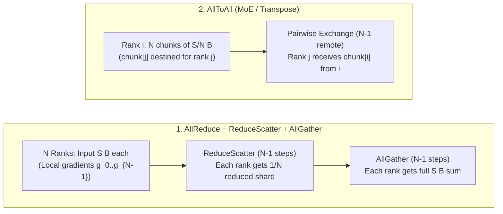
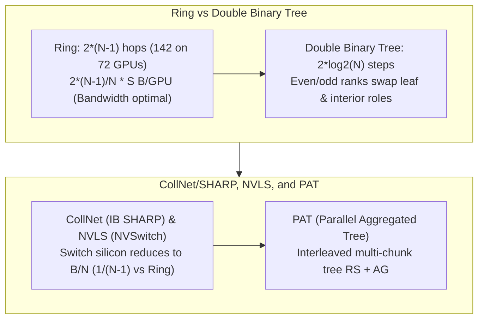

# 12.15 NCCL: collectives and algorithms

| | |
|---|---|
| Level | Advanced |
| Priority tier | 1 |
| Lab venue | Nebius GPU |
| Part | Part 12: Complete AI networking |
| Sources to use | ASP 4; V7 ch9; DAI 2; VL6 ch2 |
| Coverage file | `planning/coverage/chapters/12-15.md` |
| Companion code | `code/part12/nccl_collectives_algorithms.py` · `code/part12/nccl_collectives_algorithms_lab.py` |

## Why this matters for AI infrastructure

An `800 Gb/s` InfiniBand rail fabric or a `1.8 TB/s`-per-GPU NVLink 5 switch domain is only an upper bound on physical wire capacity. What determines whether a distributed training or inference cluster achieves `40%–60%` Model FLOPS Utilization (`MFU`)—such as a `70B`-parameter BF16 transformer executing `~860 TFLOP` per step in `2.0 s` (`430 TFLOPS` sustained against `989 TFLOPS` peak on an H100, or `43.48%` `MFU`)—is the collective communication runtime orchestrating data movement across those links: the **NVIDIA Collective Communications Library (`NCCL`, pronounced "Nickel")**.

When `1,000` or `10,000` GPUs synchronize gradients or exchange sharded weights and Mixture-of-Experts (`MoE`) tokens on every training step, sending `10 GB` tensors to a single master GPU would serialize the cluster behind one network port. Conversely, falling back to a CPU-staged `Gloo` process group over TCP drops a `400 MB` `AllReduce` on `800 Gb/s` (`100 GB/s`) InfiniBand from **`4.00 ms` (`100.0 GB/s`)** to **`200.00 ms` (`2.0 GB/s`)**—a `50x` throughput collapse. Even when `NCCL` and `GPUDirect RDMA` are active, picking a linear `Ring` algorithm for a latency-bound collective across `72` GPUs forces `71` sequential hops per reduction pass (`142` steps for a full `AllReduce`), whereas a hierarchical `Tree` completes each pass in $\lfloor\log_2(72)\rfloor = 6$ to $\lceil\log_2(72)\rceil = 7$ steps, and in-network `SHARP` or `NVLink SHARP` (`NVLS`) cuts per-endpoint data volume by a factor of **`1 / (N - 1)`** (`1/7` on `8` GPUs, `1/71` on `72` GPUs).

Infrastructure and performance engineers must understand the exact mathematics and execution mechanics of `NCCL` collectives (`AllReduce`, `ReduceScatter`, `AllGather`, `Broadcast`, `Reduce`, `AllToAll`), the algorithmic trade-offs between `Ring`, `Double Binary Tree`, `CollNet` (`SHARP`), `NVLS`, and `Parallel Aggregated Tree` (`PAT`), the wire-level framing of `LL`, `LL128`, and `Simple` protocols, bus bandwidth (`busbw`) conversion factors, persistent zero-copy buffer registration (`ncclCommRegister` / `ncclMemAlloc`), and when to pair `NCCL` with `NIXL` for disaggregated inference.

---

## Prerequisites and outcomes

### Prerequisites
- Familiarity with `RDMA` verbs, Queue Pairs, and `GPUDirect RDMA` (`nvidia-peermem`, PCIe `ACS`, and `PIX` vs `SYS` topology matrices from Chapters 12.1 and 12.2).
- Understanding of InfiniBand (`Quantum-2` `400G` NDR / `Quantum-X800` `800G` XDR) and `RoCEv2` (`Spectrum-X`, `UDP 4791`, `PFC`/`ECN`/`DCQCN`) fabrics from Chapters 12.3–12.14.
- Basic working knowledge of CUDA execution hierarchy (`Thread` $\rightarrow$ `Warp` of `32` threads $\rightarrow$ `Block` of `128–1024` threads $\rightarrow$ `Grid`, `SIMT` vs `SIMD`, `SPMD` programming model, and CUDA streams).

### Outcomes
After completing this chapter, you will be able to:
1. Map the six core `NCCL` collective operations (`AllReduce`, `ReduceScatter`, `AllGather`, `Broadcast`, `Reduce`, and `AllToAll`) plus `Gather`, `Scatter`, and `Send`/`Recv` to distributed parallelism strategies (`DDP`, `FSDP`, `ZeRO-1/2/3`, `TP`, `SP`, `CP`, `PP`, and `MoE EP`).
2. Derive the exact step counts, per-GPU byte volumes, and `algbw`-to-`busbw` conversion factors—$\frac{2(N-1)}{N}$ for `AllReduce`, $\frac{N-1}{N}$ for `ReduceScatter`/`AllGather`/`AllToAll`, and $1.0$ for `Broadcast`/`Reduce`—and reproduce `nccl-tests` and PyTorch microbenchmark outputs.
3. Calculate the latency-bandwidth crossover message size between `Ring` ($2(N-1)$ steps) and `Double Binary Tree` ($2\lceil\log_2 N\rceil$ steps), and quantify the **`1 / (N - 1)`** per-endpoint byte reduction of InfiniBand `CollNet`/`SHARP` (`2x–5x` speedup) and `NVLink SHARP` (`NVLS`, `~1/2` overlapped phase time and up to `7.6x` small-message NVLink speedup).
4. Contrast `NCCL` wire protocols—`LL` (`4 B` payload + `4 B` flag = `50.0%` efficiency), `LL128` (`120 B` payload + `8 B` flag = `93.75%` efficiency), and `Simple` (`100.0%` framing efficiency with `__threadfence_system()` over `4 MiB` `NCCL_BUFFSIZE`)—across message regimes.
5. Configure compute-communication overlap (`25 MiB` `DDP` gradient bucketing, avoiding `48.0 ms` repeated communicator initialization), zero-copy user buffer registration (`ncclCommRegister` / `ncclMemAlloc`), `NVL72` `4`-wave scheduling (`18` GPUs/wave), and `NIXL` (`0.5.x` API) for disaggregated inference.

---

## 1. Hardware, Parallelism Taxonomy, and the Six Core NCCL Collectives

### 1.1 Cluster Hardware Context, SIMT Execution, and Parallelism Classification

Before examining collective algorithms, we anchor the hardware and execution parameters that govern how `NCCL` kernels execute on GPUs and drive network links:

1. **Compute, Memory Hierarchy, and Interconnect Generations:**
   - A `70B`-parameter transformer in `FP16`/`BF16` (`2` bytes/parameter) requires `~140 GB` for weights alone and `500+ GB` per training step once gradients (`140 GB`), `Adam` optimizer states (`2x` model size = `280 GB`), and activations are included (whereas a `7B` BF16 `Adam` run requires `14 GB` weights + `14 GB` gradients + `28 GB` optimizer states = `56 GB` static + `8–16 GB` activations, peaking at `68 GB` for `12 GB` activations during `loss.backward()`, compared to `SGD` which needs `1x` momentum or `0` extra state tensors).
   - Across NVIDIA generations, `Ampere A100` (`2020`, compute capability `8.0`) provides `80 GB` HBM2e (`~1.5–2.0 TB/s` effective copy bandwidth) and `600 GB/s` `NVLink 3.0`; `Hopper H100` (`2022`, compute capability `9.0`, `132` SMs) provides `80 GB` HBM3 (`3.0 TB/s` peak, `~2.0–3.0 TB/s` effective read+write copy, `989 TFLOPS` BF16 dense, `~1.4 TFLOPS/W`, and up to `6x` transformer training throughput over A100 with `FP8` `Transformer Engine`) and `900 GB/s` `NVLink 4.0` (`NV18` across `8` GPUs with `3.6 TB/s` `NVSwitch` bisection bandwidth on `HGX`/`DGX H100`); `H200` (`2023`) expands memory to `141 GB` (`143,771 MiB`) HBM3e; and `Blackwell B200` (`2024`) doubles `NVLink 5` to `1.8 TB/s` (`18` links at `~100 GB/s` each) with `192 GB` HBM3e (`288 GB` on `B300`-class variants), `8 TB/s` HBM bandwidth, `2.25 PFLOPS` FP16, and `20 PFLOPS` FP4.
   - At rack scale, `GB200/GB300 NVL72` connects `36` Grace-Blackwell superchips (`72` GPUs) in a single `NVLink Switch` domain (`~130 TB/s` aggregate all-to-all bandwidth, `< 1 µs` / few-hundred-nanosecond hop latency), and an `8`-rack `GB200 SuperPOD` links `576` GPUs. On Grace Hopper (`GH200`, `96 GB` HBM + `512 GB` LPDDR5X = `608 GB`) and Grace Blackwell, the CPU and GPU share a `900 GB/s` `NVLink-C2C` coherent link, compared to `PCIe Gen5 x16` (`~64 GB/s` per direction) or `PCIe Gen4 x16` (`~31.5 GB/s` per direction / `~63 GB/s` bidirectional, as on `RTX 4090` `24,564 MiB`). An `8`-GPU training server requires `16–32` CPU cores (`2–4` cores/GPU), `>= 1 TB` host RAM (`1.5–2x` GPU memory), `128` PCIe lanes, and `10–20 GB/s` local NVMe read throughput.
   - While alternative accelerators exist—such as Google `TPU` pods (`v1` `256x256` `65,536`-PE systolic `MXU` at `700 MHz` = `92 TOPS` INT8; `v2–v4` `128x128` `MXU`s with `~275 TFLOPS` BF16 on `v4`, `Sparse Core` for embeddings, `2D`/`3D` torus and `OCS` optical switches, up through `v5e`/`v5p`, `Trillium`, `Ironwood`, and `TPU 8t/8i` programmed via `JAX`/`XLA` `NamedSharding`), datacenter `NPU`s (`Huawei Ascend 910C SuperPoD`, `AWS Trainium2`, `Cambricon MLU`, `Edge TPU`), and `AMD MI300X` (`CDNA3`, `4` `SIMD` units per Compute Unit under `ROCm`)—NVIDIA GPUs execute `SPMD` (Single Program, Multiple Data) kernels via **`SIMT` (Single Instruction, Multiple Thread)** across `32`-thread warps (`64 KB` registers and `48 KB` or `96 KB` L1/shared memory per SM) with Fine-Grained Multithreading (`FGMT`). Every `NCCL` communication channel runs as a dedicated CUDA thread block on one or more SMs, reading and writing peer memory over `NVLink` or `GPUDirect RDMA`.

2. **Three-Question Parallelism Taxonomy and Collective Mapping:**
   To classify any distributed strategy and determine which `NCCL` collectives sit on its critical path, ask three questions: **(Q1)** Does it split the forward/backward computation of a single layer/sample? **(Q2)** Must a single sample cross devices during forward/backward? **(Q3)** Does it introduce device-to-device collective collaboration?
   - **Data Parallelism (`Data` category — `DDP`):** `No` to Q1 and Q2, `Yes` to Q3. Every rank holds a full model replica and synchronizes gradients via **`AllReduce`**.
   - **State Sharding (`State` category — `FSDP`, `ZeRO-1`, `ZeRO-2`, `ZeRO-3`):** `No` to Q1 and Q2, `Yes` to Q3. `ZeRO-1` shards optimizer states (`ReduceScatter` + `AllGather` at optimizer step); `ZeRO-2` shards optimizer states + gradients (`ReduceScatter` on gradients); `FSDP` and `ZeRO-3` shard parameters, gradients, and optimizer states, executing an **`AllGather`** before each forward and backward layer to reconstruct full weights and a **`ReduceScatter`** during backward to average and shard gradients.
   - **Model Parallelism (`Computation` category — `TP`, `SP`, `CP`, `PP`, `MoE EP`):** `Yes` to Q1, Q2, and Q3. **Tensor Parallelism (`TP`)** splits weight matrices column-wise and row-wise within an NVLink domain, executing **`AllReduce`** (or **`AllGather` + `ReduceScatter`** when paired with **Sequence Parallelism (`SP`)**) on every transformer layer. **Context Parallelism (`CP`)** splits long-context KV caches across GPUs (`AllGather` / ring point-to-point). **Pipeline Parallelism (`PP`)** slices layers across stages using point-to-point **`Send`/`Recv`**. **Expert Parallelism (`MoE EP`)** routes tokens dynamically to experts across ranks using **`AllToAll`** dispatch and combine collectives.

### 1.2 The Six Core NCCL Collectives and Their Decomposition Rules

`NCCL` exposes five primary collective C APIs (`ncclAllReduce`, `ncclBroadcast`, `ncclReduce`, `ncclAllGather`, `ncclReduceScatter`) plus point-to-point group primitives (`ncclSend` + `ncclRecv` inside `ncclGroupStart()` / `ncclGroupEnd()`) used to construct **`AllToAll`**, **`Gather`**, and **`Scatter`**:



| Collective Operation | Communication Pattern | Input Size per Rank | Output Size per Rank | Ring Steps | Bus Bandwidth Factor (`busbw / algbw`) | Primary AI Workload Mapping |
|---|---|---|---|---|---|---|
| **`AllReduce`** | Many-to-many reduction + full distribution | $S$ | $S$ (identical reduced tensor on all $N$ ranks) | $2(N - 1)$ | $\frac{2(N - 1)}{N}$ | `DDP` gradient averaging; `Megatron-LM` `TP` layer reductions |
| **`ReduceScatter`** | Many-to-many reduction + sharded distribution | $S$ (as $N$ shards of $S/N$) | $\frac{S}{N}$ (reduced shard $r$ on rank $r$) | $N - 1$ | $\frac{N - 1}{N}$ | `FSDP` / `ZeRO-2` / `ZeRO-3` backward gradient reduction; `TP+SP` |
| **`AllGather`** | Many-to-many shard concatenation | $\frac{S}{N}$ | $S$ (concatenated in rank order $0 \dots N-1$) | $N - 1$ | $\frac{N - 1}{N}$ | `FSDP` / `ZeRO-3` parameter unsharding; `TP+SP` activation gather |
| **`Broadcast`** | One-to-all replication from `root` | $S$ on `root` ($0$ on others) | $S$ on all $N$ ranks | $N - 1$ (or $1$ with `NVLS`) | $1.0$ | Initial weight/checkpoint distribution, seed & hyperparameter sync |
| **`Reduce`** | All-to-one reduction onto `root` | $S$ on all $N$ ranks | $S$ on `root` (non-root unchanged) | $N - 1$ | $1.0$ | Centralized loss/metric aggregation and rank-0 logging |
| **`AllToAll`** | All-to-all personalized matrix transpose | $S$ ($N$ chunks of $\frac{S}{N}$) | $S$ ($N$ transposed chunks of $\frac{S}{N}$) | $N - 1$ remote rounds | $\frac{N - 1}{N}$ | `MoE` Expert Parallelism token dispatch/combine; `CP`/`SP` transpose |
| **`Gather` / `Scatter`** | All-to-one collection / One-to-all partitioning | $\frac{S}{N}$ (`Gather`) / $S$ on `root` (`Scatter`) | $S$ on `root` (`Gather`) / $\frac{S}{N}$ (`Scatter`) | $N - 1$ | $\frac{N - 1}{N}$ | Centralized validation prediction collection / dataset shard init |

Three algebraic identities govern how frameworks compose and optimize these primitives:

1. **`AllReduce` $\equiv$ `ReduceScatter` followed by `AllGather`:**
   Rather than executing `Reduce` to rank `0` followed by `Broadcast` from rank `0`—which forces rank `0` to become a serial bottleneck and requires two non-pipelined $(N-1)$-step phases—`NCCL` decomposes `Ring AllReduce` into a pipelined **`ReduceScatter`** phase ($N-1$ steps, each moving $S/N$ bytes per hop) followed immediately by an **`AllGather`** phase ($N-1$ steps, each moving $S/N$ bytes per hop). `FSDP` exploits this exact identity by splitting the `AllReduce` apart: it runs `AllGather` before the layer's forward/backward compute and `ReduceScatter` after backward compute, keeping only $1/N$ of the model state resident outside the active layer.
2. **In-Place vs Out-of-Place Buffer Semantics:**
   `AllReduce`, `Broadcast`, and `Reduce` naturally operate in-place (`sendbuff == recvbuff`). For `AllGather` (`sendcount = C`, `recvcount = N*C`) and `ReduceScatter` (`sendcount = N*C`, `recvcount = C`), `NCCL` supports in-place execution when each rank's input/output shard pointer is offset to `buff + rank * shard_bytes`. By contrast, `AllToAll` transposes $N-1$ off-diagonal chunks simultaneously and requires distinct `sendbuff` and `recvbuff` allocations.
3. **Backend Support (`NCCL` vs `Gloo`):**
   While basic collectives (`AllReduce`, `Broadcast`, `AllGather`) have CPU fallback implementations in `Gloo`, `dist.all_to_all` in PyTorch requires `backend="nccl"` on GPU tensors and fails if invoked on a CPU `Gloo` process group.

---

## 2. Algorithmic bandwidth (`algbw`), bus bandwidth (`busbw`), and step/volume math

### 2.1 Deriving Ring Step Counts and Per-GPU Data Volume

Consider an $N$-GPU communicator executing an `AllReduce` on a tensor of size $S$ bytes per rank. `NCCL` partitions each rank's buffer into $N$ equal chunks of size $\frac{S}{N}$ bytes:

1. **Phase 1 — `ReduceScatter` ($N - 1$ steps):**
   In step $k \in \{1, \dots, N-1\}$, rank $r$ sends chunk $(r - k + 1) \bmod N$ of size $\frac{S}{N}$ to rank $(r + 1) \bmod N$, receives chunk $(r - k) \bmod N$ from rank $(r - 1) \bmod N$, and accumulates (`SUM`, `MAX`, `MIN`, or `AVG`) the received chunk into its local chunk buffer. After $N - 1$ steps, each rank holds one fully reduced chunk of size $\frac{S}{N}$ containing the global reduction across all $N$ ranks.
   - **Bytes sent (and received) per GPU in Phase 1:**
     $$V_{\text{RS}} = (N - 1) \times \frac{S}{N} = \frac{N - 1}{N}\,S$$
2. **Phase 2 — `AllGather` ($N - 1$ steps):**
   In steps $N \dots 2(N - 1)$, each rank circulates its completed $\frac{S}{N}$ shard around the ring without arithmetic reduction, overwriting the remaining $N - 1$ shard slots until all $N$ ranks hold the complete $S$-byte reduced tensor.
   - **Bytes sent (and received) per GPU in Phase 2:**
     $$V_{\text{AG}} = (N - 1) \times \frac{S}{N} = \frac{N - 1}{N}\,S$$
3. **Combined `Ring AllReduce` ($2(N - 1)$ steps):**
   Summing Phase 1 and Phase 2 gives the fundamental `Ring AllReduce` volume per GPU:
   $$\text{Steps}_{\text{AllReduce}} = 2(N - 1), \qquad V_{\text{AllReduce}} = 2\,\frac{N - 1}{N}\,S$$

### 2.2 Converting `algbw` to `busbw` Across Collectives and Cluster Scales

When a collective of tensor size $S$ bytes completes in wall-clock time $t$ seconds, `nccl-tests` reports two distinct throughput figures:

- **Algorithm Bandwidth (`algbw`):** The apparent rate at which the input tensor of size $S$ is processed:
  $$\text{algbw} = \frac{S}{t}$$
- **Bus Bandwidth (`busbw`):** The actual hardware interconnect bandwidth consumed per GPU, adjusted for the collective's topological volume factor so that `busbw` can be compared directly against physical `NVLink` (`900 GB/s` on H100, `1,800 GB/s` on B200) or `InfiniBand`/`RoCEv2` (`50 GB/s` per `400G` port, `100 GB/s` per `800G` port) line rates, independent of the number of GPUs $N$:
  $$\text{busbw}_{\text{AllReduce}} = \text{algbw} \times \frac{2(N - 1)}{N}, \qquad \text{busbw}_{\text{RS / AG / A2A}} = \text{algbw} \times \frac{N - 1}{N}, \qquad \text{busbw}_{\text{Bcast / Reduce}} = \text{algbw} \times 1.0$$

The table below shows how the `AllReduce` and `ReduceScatter`/`AllGather` step counts, per-GPU byte volumes (for $S = 100\text{ MB}$), and `busbw` conversion factors evolve from $N = 2$ to $N = 72$ GPUs:

| World Size ($N$ GPUs) | `RS` / `AG` Steps ($N - 1$) | `AllReduce` Steps ($2(N - 1)$) | Chunk Size $S/N$ ($S = 100\text{ MB}$) | `RS` / `AG` / `A2A` Factor $\frac{N-1}{N}$ | `AllReduce` Factor $\frac{2(N-1)}{N}$ | `AllReduce` Volume per GPU ($S = 100\text{ MB}$) |
|---|---|---|---|---|---|---|
| **$N = 2$** | `1` | `2` | `50.00 MB` | `0.5000` | **`1.0000`** | `100.00 MB` (`algbw == busbw`) |
| **$N = 4$** | `3` | `6` | `25.00 MB` | `0.7500` | **`1.5000`** | `150.00 MB` (`busbw = 1.50 * algbw`) |
| **$N = 8$** (1 HGX node) | `7` | `14` | `12.50 MB` | `0.8750` | **`1.7500`** | `175.00 MB` (`busbw = 1.75 * algbw`) |
| **$N = 64$** (8 nodes) | `63` | `126` | `1.5625 MB` | `0.984375` | **`1.96875`** | `196.88 MB` (`busbw = 1.97 * algbw`) |
| **$N = 72$** (`NVL72` rack) | `71` | `142` | `1.3889 MB` | `0.986111` | **`1.972222`** (`142/72`) | `197.22 MB` (`142 MB` for $S = 72\text{ MB}$) |
| **$N \to \infty$** (asymptotic) | $N - 1$ | $2N - 2$ | $S / N \to 0$ | $\to 1.0000$ | **$\to 2.0000$** | $\to 2S$ (`200.00 MB`) |

:::info Reconciling `nccl-tests` `algbw` with PyTorch Cluster-Aggregate Microbenchmarks
In `nccl-tests` (`all_reduce_perf`), `algbw` is defined per rank as $S / t$, so for $N = 2$ GPUs the factor $\frac{2(2-1)}{2} = 1.0$ makes `algbw` and `busbw` identical. Some standalone PyTorch scripts (such as `allreduce_microbench.py` in our companion benchmark suite) define cluster-aggregate algorithm bytes as `alg_bytes = size_bytes * n * iterations` and ring bus bytes as `bus_bytes = size_bytes * 2 * (n - 1) * iterations`. Under that convention, running `50` iterations of a `100 MiB` (`26,214,400` `float32` elements) `AllReduce` across $N = 2$ GPUs in **`0.248 s`** moves $100\text{ MiB} \times 2 \times 50 = 10,000\text{ MiB}$ (`9.765625 GiB`), reporting **`40,322.58 MB/s` (`39.38 GB/s`)** for both `algbw` and `busbw` (since $2(N-1) = N = 2$). Compare that to a single-GPU HBM `bandwidth_test.py` (`64 MiB`, `200` iterations, `2 * nbytes` read+write = `25.0 GiB` in `0.01262339 s` = **`1,980.45 GB/s`**): the gap between `1,980.45 GB/s` local HBM copy bandwidth and `10–50 GB/s` PCIe `AllReduce` (versus tens to low hundreds of `GB/s` over `NVLink`) determines whether Tensor Parallelism is viable or whether you must restrict communication to `FSDP`/`DDP`.
:::

---

## 3. NCCL Communication Algorithms: Ring, Double Binary Tree, CollNet/SHARP, NVLS, and PAT

### 3.1 Ring vs Double Binary Tree and the Latency-Bandwidth Crossover

While `Ring` is bandwidth-optimal—because every GPU transmits and receives one $\frac{S}{N}$ chunk on every step—its startup latency grows **linearly** with $N$:
$$T_{\text{ring}}(S, N) = 2(N - 1)\,\alpha + 2\,\frac{N - 1}{N}\,\frac{S}{B}$$
where $\alpha$ is the per-hop startup/forwarding latency and $B$ is the unidirectional link bandwidth. On a `1,000`-GPU or `10,000`-GPU job, or even across a `72`-GPU `NVL72` rack (`71` hops per reduction pass, `142` hops round-trip), the $2(N-1)\alpha$ latency term dominates small and medium messages.

To eliminate linear hop scaling, `NCCL` implements **`Tree` (`Double Binary Tree`)**:

1. **Why a Single Binary Tree Wastes Half the Bandwidth:**
   In a simple binary tree of $N$ GPUs, $\frac{N}{2}$ ranks are **leaf nodes** and $\frac{N}{2} - 1$ ranks are **interior nodes**. During the upward `Reduce` phase, leaves only *send* once and never *receive*; during the downward `Broadcast` phase, leaves only *receive* and never *send*. Meanwhile, interior nodes send and receive on multiple branches. Consequently, a single binary tree leaves `50%` of the cluster's bidirectional link capacity idle.
2. **How `NCCL` Double Binary Tree Restores Full Duplex Bandwidth:**
   `NCCL` constructs **two complementary binary trees** (`Tree A` and `Tree B`) over the same $N$ GPUs by shifting the tree indexing so that every **even-numbered rank** is an interior node in `Tree A` and a leaf node in `Tree B`, while every **odd-numbered rank** is a leaf node in `Tree A` and an interior node in `Tree B`. Each message of size $S$ is split `50%` onto `Tree A` ($S/2$) and `50%` onto `Tree B` ($S/2$). Within each node, GPUs connect in a fast `NVLink`/`NVSwitch` **chain**; across nodes, leader GPUs connect in the **pipelined dual binary tree**. Every rank simultaneously acts as an interior relay for half the tensor and a leaf for the other half, completing the `Reduce` + `Broadcast` in **$2\lceil\log_2 N\rceil$ latency steps**:
   $$T_{\text{tree}}(S, N) = 2\lceil\log_2 N\rceil\,\alpha + 2\,k_{\text{tree}}\,\frac{S}{B}$$
   where $k_{\text{tree}} \ge 1.0$ (`~1.15` in practice due to dual-tree branch forwarding and node-chain relay).
3. **72-GPU (`NVL72`) Step Reduction and Crossover Size $S^*$:**
   On $N = 72$ GPUs, a single reduction pass in a `Ring` requires **$72 - 1 = 71$ sequential hops** (`142` steps for full `AllReduce`), whereas a binary `Tree` requires only **$\lfloor\log_2(72)\rfloor = 6$** (or $\lceil\log_2(72)\rceil = 7$, i.e. `14` steps for two-phase `AllReduce`). Setting $T_{\text{ring}}(S^*) = T_{\text{tree}}(S^*)$ with $\alpha = 1.0\text{ }\mu\text{s}$, $B = 100\text{ GB/s}$, and $k_{\text{tree}} = 1.15$:
   - At **$S = 1\text{ MiB}$ (`1,048,576 B`)**: `Tree` completes in **`38.12 µs`** versus **`162.68 µs`** for `Ring` (`4.27x` faster with `Tree`).
   - At **$S = 256\text{ MiB}$ (`268,435,456 B`)**: `Ring` completes in **`5,436.14 µs`** versus **`6,188.02 µs`** for `Tree` (`Ring` wins on raw streaming bandwidth).
   - **Exact Crossover Size $S^*$:**
     $$S^* = \frac{(142 - 14) \times 1.0\text{ }\mu\text{s} \times 100\text{ GB/s}}{2 \times \left(1.15 - \frac{71}{72}\right)} \approx \mathbf{37.24\text{ MiB}}\text{ (`39,051,908 B`)}$$
   Below `~37.24 MiB` (tens of megabytes), `Tree` wins; for very large multi-hundred-megabyte buckets on uncongested links, `Ring` (or `NVLS`/`PAT`) wins.



| Algorithm (`NCCL_ALGO` Token) | Step Complexity | Per-GPU Volume (`AllReduce` / `RS`) | Hardware Offload Requirement | Target Workload & Scale Regime |
|---|---|---|---|---|
| **`Ring`** (`Ring`) | $2(N - 1)$ steps (`142` on `72` GPUs) | $2\frac{N-1}{N}S$ (`AllReduce`), $\frac{N-1}{N}S$ (`RS`/`AG`) | None (GPU P2P DMA / RDMA) | Large bandwidth-bound messages (`> 32–64 MiB`) at small/moderate rank counts |
| **`Double Binary Tree`** (`Tree`) | $2\lceil\log_2 N\rceil$ steps (`12–14` on `72` GPUs) | $\approx 2S$ split `50/50` across dual complementary trees | None (intranode chain + internode dual tree) | Small/medium latency-bound messages (`< 10s of MiB`) and large multi-node clusters |
| **`CollNet`** (`CollNetDirect`, `CollNetChain`) | $O(\log_k N_{\text{nodes}})$ switch tree + local intra-node group | **`B / N`** per endpoint in `RS` (**`1 / (N - 1)`** vs Ring) | Quantum InfiniBand switch ASICs + `SHARP` `AM` + `NCCL` SHARP plugin | Multi-node InfiniBand clusters (`32+` nodes; **`2x` to `5x`** `AllReduce` speedup) |
| **`NVLink SHARP`** (`NVLS`, `NVLSTree`) | 1-hop / 2-hop NVSwitch reduction + hardware multicast | **`B / N`** in `RS` receive and `AG` send (**`1 / (N - 1)`** vs Ring) | `NVSwitch` 3.0/4.0 (`HGX H100/H200`, `GB200/GB300 NVL72`) | Intra-node / `NVL72` intra-rack collectives; overlapped `AG+RS` cuts time by **`~1/2`** |
| **`Parallel Aggregated Tree`** (`PAT`) | $O(\log_2 N)$ startup latency per staggered chunk | Near-ring optimal bandwidth across interleaved streams | Multi-stream GPU scheduling across topology links | Medium-to-large messages requiring both $O(\log N)$ latency and ring-level bandwidth |

### 3.2 CollNet (InfiniBand SHARP), NVLink SHARP (NVLS), and PAT Math

Modern NVIDIA fabrics move collective arithmetic out of the GPU SMs and into switch silicon:

1. **`CollNet` (`CollNetDirect` and `CollNetChain`) with InfiniBand `SHARP`:**
   `CollNet` is `NCCL`'s hierarchical collective path that groups GPUs sharing a fast local domain (`NVSwitch` node or rack), aggregates locally (`CollNetDirect` for dense all-to-all local groups, or `CollNetChain` for ordered forward-reduce / reverse-broadcast chains), and elects leader GPUs to inject into Quantum InfiniBand switches running **Scalable Hierarchical Aggregation and Reduction Protocol (`SHARP`)**.
   - **Prerequisites:** Quantum-class InfiniBand switches with `SHARP` firmware, an active `SHARP Aggregation Manager` (`AM`) running alongside the Subnet Manager (often on a management server or `BlueField` DPU), `nvidia-peermem` loaded on hosts, the `NCCL RDMA SHARP` plugin installed, and `NCCL_COLLNET_ENABLE=1` (with `NCCL_SHARP_DISABLE=1` reserved for A/B troubleshooting). Note that `Spectrum-X` Ethernet accelerates `AllReduce` via adaptive routing and telemetry but does **not** expose switch-resident reduction ALU silicon analogous to InfiniBand `SHARP`.
   - **Switch Buffer Caveat:** Switch silicon has finite reduction buffer memory; very large multi-hundred-MB or multi-GB collectives can exhaust switch `SHARP` trees and fall back to standard host-side algorithms unless monitored in `NCCL_DEBUG=INFO` logs.
2. **`NVLink SHARP` (`NVLS` and `NVLSTree`) and the `1 / (N - 1)` Volume Reduction:**
   Inside an `NVSwitch` domain (such as an `8`-GPU `HGX H100` baseboard or a `72`-GPU `GB200/GB300 NVL72` rack), `NVLS` (`NCCL_NVLS_ENABLE=1`) offloads arithmetic reductions and multicast replication directly to the `NVSwitch` ASICs:
   - **`ReduceScatter` In-Network Reduction:** In a standard `Ring ReduceScatter` on tensor size $B$, each GPU receives $B\frac{N-1}{N}$ bytes across $N - 1$ hops. With `NVLS` (or `SHARP`), the switch aggregates incoming shards in hardware and returns only **$\frac{B}{N}$ bytes** to each GPU—cutting per-endpoint receive volume to **`1 / (N - 1)`** of the ring volume (**`1/7`** on `8` GPUs: `100 MB` instead of `700 MB` for an `800 MB` tensor; **`1/71`** on `72` GPUs: `10 MB` instead of `710 MB` for a `720 MB` tensor).
   - **`AllGather` Hardware Multicast:** `AllGather` involves no arithmetic reduction, so `NVLS` uses hardware multicast: each GPU sends its $\frac{B}{N}$ shard **once** into the `NVSwitch`, which replicates it to all $N - 1$ peers in a single hop—cutting sender volume by **`1 / (N - 1)`** compared to a ring.
   - **Overlapping Multicast `AllGather` with In-Network `ReduceScatter`:** In sharded training (`FSDP`), overlapping an `NVLS` multicast `AllGather` (duration $T_{\text{AG}}$) with an `NVLS` in-network `ReduceScatter` (duration $T_{\text{RS}}$) reduces total bandwidth-bound exchange wall time from $T_{\text{AG}} + T_{\text{RS}}$ to **$\max(T_{\text{AG}}, T_{\text{RS}})$**—dropping phase wall time by **`~1/2` (`50%`)**. Combined with symmetric memory and low-latency NVLink kernels, `NCCL` achieves up to **`7.6x`** latency reduction on small/medium NVLink messages, while multi-node InfiniBand `SHARP` delivers **`2x` to `5x`** `AllReduce` speedups at `32+`-node scale.
3. **`Parallel Aggregated Tree` (`PAT`):**
   `PAT` is `NCCL`'s pipelined hybrid of `Ring` and `Tree`. As soon as chunk `1` completes a tree `ReduceScatter` step across a subset of GPUs, chunk `2` launches its own staggered tree `ReduceScatter` in round-robin order across multiple CUDA streams, interleaving `ReduceScatter` and `AllGather` phases so every physical link stays saturated like a `Ring` while bounding per-segment startup latency to **$O(\log_2 N)$** like a `Tree`.

---

## 4. NCCL Wire Protocols (`LL`, `LL128`, `Simple`) and Zero-Copy User Buffers

### 4.1 Wire Protocol Framing: `LL` (50%), `LL128` (93.75%), and `Simple` (100%)

Orthogonal to the graph topology (`Ring`, `Tree`, `NVLS`), `NCCL` selects a **wire transfer protocol** (`NCCL_PROTO=LL,LL128,Simple`) that governs how GPU SMs package, synchronize, and poll data across shared memory, `NVLink`, or `RDMA` channel buffers:

| Protocol (`NCCL_PROTO`) | Atomic Unit Size | Payload Bytes | Flag Overhead Bytes | Framing Efficiency | Flag Overhead % | Synchronization Mechanism | Optimal Message Size Regime |
|---|---|---|---|---|---|---|---|
| **`LL`** (Low Latency) | `8 B` | **`4 B`** | **`4 B`** | **`50.0%`** (`4 / 8`) | **`50.0%`** | `8-byte` atomic store + L2/register flag poll (no memory fence) | Tiny messages (`<= 32–64 KiB`); lowest transfer startup latency |
| **`LL128`** (Low Latency 128B) | `128 B` | **`120 B`** | **`8 B`** | **`93.75%`** (`120 / 128`) | **`6.25%`** | `128-byte` NVLink/PCIe atomic store + `8B` inline flag poll (no fence) | Small-to-medium messages (`~64 KiB` to several `MiB` on NVLink/PCIe) |
| **`Simple`** (Bulk DMA) | `NCCL_BUFFSIZE` (default `4 MiB`) | `100%` of slice | `0 B` inline | **`~100.0%`** | **`~0.0%`** | Bulk DMA write + `__threadfence_system()` before signalling peer FIFO | Large bandwidth-dominated messages (`> 4–16 MiB`) |

Why does `NCCL` need three protocols instead of always using `Simple`?
- In **`Simple`**, the sending GPU streams a large slice into a channel ring buffer (`NCCL_BUFFSIZE`, default `4 MiB = 4,194,304 B`) and must execute a full system memory fence (`__threadfence_system()`) before incrementing the receiver's ready counter so that all DMA payload bytes are globally visible in GPU HBM before the flag arrives. That memory fence adds several microseconds of latency at every hop.
- In **`LL`**, the sender packs **`4 bytes` of data and a `4-byte` iteration flag** into a single **`8-byte` (`64-bit`) atomic write**. Because `64-bit` stores are naturally atomic across PCIe, NVLink, and InfiniBand RDMA, the receiver polls the `4-byte` flag directly in L2 cache and immediately consumes the `4-byte` payload without any `__threadfence_system()` stall—at the cost of wasting `50.0%` of wire bandwidth on flags (`240,000 B` on the wire for a `120,000 B` payload).
- In **`LL128`**, `NCCL` exploits `128-byte` atomic cache-line transactions supported by `NVLink` and modern PCIe root complexes: it packs **`120 bytes` of payload and an `8-byte` flag** into each `128-byte` transaction, achieving **`120 / 128 = 93.75%` payload efficiency** (`128,000 B` on the wire for a `120,000 B` payload) while retaining fence-free sub-microsecond polling.

### 4.2 Persistent User Buffers and Zero-Copy Registration (`ncclCommRegister` / `ncclMemAlloc`)

By default, when an application passes an arbitrary tensor pointer `d_buf` to `ncclAllReduce`, `NCCL` copies slices of `d_buf` into its internal pre-registered channel staging buffers (`NCCL_BUFFSIZE`) using GPU SM threads, transmits from the staging buffer, and copies the result back out. This internal staging consumes GPU memory, burns HBM bandwidth on extra device-to-device copies, and occupies `16` to `32` SM thread blocks (one CUDA block per `NCCL` channel, controlled by `NCCL_MIN_NCHANNELS` and `NCCL_MAX_NCHANNELS`) that would otherwise execute GEMM compute kernels.

To eliminate staging copies, `NCCL` (`2.19+` / `2.21+`) provides **persistent user buffer registration**:
1. **Allocation and Registration API (`ncclMemAlloc` + `ncclCommRegister`):**
   Allocate communication-ready device buffers with `ncclMemAlloc(&ptr, bytes)` (or CUDA virtual memory management `cudaMemCreate` / `cudaMemAddressReserve` with multicast/IPC fabric handles) and register them once with the communicator via `ncclCommRegister(comm, ptr, bytes, &regHandle)` (releasing with `ncclCommDeregister(comm, regHandle)` at teardown).
2. **Strict Symmetry Invariants:**
   - **All-Rank Rule:** If *any* rank in a communicator registers its user buffer for a collective, **all ranks** in the communicator must pass registered buffers.
   - **Symmetric Offset Rule:** For symmetric zero-copy algorithms (`NVLS`, `CollNet`/`SHARP`, and symmetric NVLink kernels), the byte offset from the registered buffer head (`user_ptr - base_alloc_ptr`) must match across all participating ranks. If either invariant is violated, `NCCL` silently falls back to internal channel staging buffers.
3. **SM and Channel Savings:**
   When `ncclCommRegister` is active with `NVLS` or `SHARP` / `IBGDA` (InfiniBand GPUDirect Async, where the GPU posts RDMA work requests directly to the NIC without CPU proxy intervention), `NCCL` operates directly on the user's tensor memory (`zero-copy`), cutting required communication channels from `16` blocks down to `4` (saving `12` SM blocks per GPU for matrix math) and avoiding `UCX`/`RDMA` caching-allocator registration pool exhaustion (where freeing temporary `40 MB` and `200 MB` tensors leaves `torch.cuda.memory_allocated()` at `0.000 GB` while `torch.cuda.memory_reserved()` ratchets up from `0.800 GB` at `Iter 00` to `1.040 GB` at `Iter 01` and `1.240 GB` at `Iter 02..10`).

---

## 5. Compute-Communication Overlap, Wave Scheduling, Communicator Lifecycle, and NIXL

### 5.1 Pipelining, Wait-Free Backpropagation (`DDP` vs `DP`), and Bucketing Math

In NVIDIA's four-pillar **Magnum IO** architecture—**(1) Storage I/O** (`GPUDirect Storage` / `BlueField SNAP`), **(2) Network I/O** (`GPUDirect RDMA`, `NCCL`, `NVSHMEM`, `UCX`, `HPC-X`), **(3) In-Network Compute** (`SHARP`), and **(4) I/O Management** (`NetQ`, `UFM`)—hiding network latency behind useful Tensor Core execution is the single highest-leverage software optimization:

1. **Serial No-Overlap vs Overlapped `DistributedDataParallel` (`DDP`):**
   - If a training loop computes `loss.backward()` across all layers (`fc1`, `fc2`, `fc3`) and only calls `dist.all_reduce(p.grad)` after the backward pass finishes, compute (`10.0 ms`) and communication (`12.0 ms`) execute serially on the timeline for a total step time of **`22.0 ms`** (`0%` overlap).
   - With **Wait-Free Backpropagation (`WFBP`)** in PyTorch `DistributedDataParallel` (`DDP`), autograd hooks group parameters in reverse layer order (`fc3`, then `fc2`, then `fc1`) into **gradient buckets** (`bucket_cap_mb = 25 MiB` by default). As soon as a `25 MiB` bucket fills on the default compute CUDA stream, `DDP` launches an asynchronous `NCCL` `AllReduce` on a dedicated background communication CUDA stream while the compute stream continues calculating earlier-layer gradients. Ideal full overlap shrinks the `10.0 ms` + `12.0 ms` step to $\max(10.0, 12.0) = \mathbf{12.0\text{ ms}}$ (`45.45%` reduction). Across a broader `100.0 ms` baseline iteration (`60%` SM busy, high memory-stall warps over PCIe), achieving `~50%` communication overlap plus topology-aware `NVLink` routing cuts iteration time by **`30.0%` to `70.0 ms`** and raises SM utilization to **`90%`**.
   - **Why `DistributedDataParallel` (`30.00 ms`) Beats `nn.DataParallel` (`45.00 ms`):** Single-process `nn.DataParallel` (`DP`) splits a `[512, 1024]` batch into `[256, 1024]` shards across threads that contend on Python's Global Interpreter Lock (`GIL`), gathers outputs and gradients synchronously onto `GPU 0`, and broadcasts updated weights back. Switching to multi-process `DDP` (`1` process per GPU via `torchrun` or `torch.multiprocessing.spawn`) eliminates `GIL` contention and `GPU 0` aggregation bottlenecks, cutting step time from **`45.00 ms` to `30.00 ms`** (**`33.33%` faster**).
   - **Avoiding Accidental Host-Device Syncs:** Calling `torch.cuda.synchronize()`, `.item()`, `.cpu()`, or `print(tensor)` inside the training loop forces the CPU to block until all outstanding CUDA streams complete, destroying `DDP`'s sawtooth compute-communication overlap. Similarly, combining **`4`-step gradient accumulation** cuts `AllReduce` frequency by **`4x`**, trading activation/gradient memory for `75%` fewer collective barriers.

2. **Communicator Lifecycle (`48.0 ms` Init Penalty) and Profiler Plugin Callbacks:**
   - Initializing a communicator (`ncclCommInitRank` or `dist.init_process_group`) executes all-to-all out-of-band TCP handshakes, exchanges unique IDs, discovers `PCIe`/`NVLink`/`RDMA` graphs, and allocates channel ring buffers. Across `32` GPUs, creating `32` separate communicators can take `2–3 minutes` instead of `2–3 seconds`. Even on `2` GPUs, calling `init_process_group` + `destroy_process_group` inside the training loop adds **`48.0 ms`** per step to a **`0.5 ms`** `1`-element `AllReduce` (`48.5 ms` total); moving initialization outside the loop cuts step time by **`98.97%`** (`> 98%`) back to **`0.5 ms`**. Sub-communicators for `TP`/`PP` must be created once at startup via `torch.distributed.new_group()` or batched inside `ncclGroupStart()` / `ncclGroupEnd()`.
   - To inspect collective timelines without heavyweight trace distortion, `NCCL` exposes the **`NCCL_PROFILER_PLUGIN`** API (`32`-bit event activation mask covering group, collective, P2P, and proxy events) with **five C callbacks**: **`init`**, **`startEvent`**, **`stopEvent`**, **`recordEventState`**, and **`finalize`** (consumed by PyTorch `Kineto` and Nsight Systems alongside `CUPTI`/`NVTX`).

### 5.2 Wave Scheduling, Rotating Ring Endpoints, and Multi-Rail Striping on NVL72

At rack scale (`GB200/GB300 NVL72`, `72` GPUs connected via `18` `NVLink 5` links per GPU at `~100 GB/s` each = `1.8 TB/s` bidirectional per GPU), launching uncoordinated collectives across all `72` GPUs creates instantaneous `NVSwitch` queue spikes:

1. **`4`-Wave Scheduling (`18` GPUs per Wave):**
   If all `72` GPUs execute a simultaneous `AllToAll` embedding or `MoE` token exchange, `GPU 0` is hit by `71` concurrent senders, exceeding its **`18`-port** `NVLink` ingress capacity. Splitting the `72`-GPU exchange into **`4` staggered waves of `18` GPUs** (`72 / 4 = 18` active senders per wave) via temporal multiplexing ensures that at any instant at most `18` GPUs transmit to `GPU 0`—matching its `18` `NVLink` ports without `NVSwitch` queueing—and allows Wave `1`'s downstream layer compute to overlap with Wave `2`–`4` communication. Similarly, during multi-query inference, capping concurrent heavy expert-gather/broadcast collectives at **`2` to `4` in flight** (for example, staggering `12` collectives into **`3` waves of `4`**) finishes faster than firing all `12` simultaneously.
2. **Rotating Ring Endpoints and `NCCL_CROSS_NIC`:**
   When a `Ring` algorithm is used, the links where the ring wraps around can experience persistent load imbalance. While `NCCL`'s internal inside/outside alternating rings flip direction on successive calls, congestion-aware schedulers also **rotate ring start endpoints** across communicators (`[0, 18, 36, 54]` across `4` permuted `ncclCommInitRank` groups) so no single link remains permanently on the critical path. Across multi-NIC nodes (`2x 800 Gbps` = `1.6 Tbps`, or `4x 800 Gbps` = `3.2 Tbps`), enabling **`NCCL_CROSS_NIC`** stripes rings/trees across rails while static topology files (`NCCL_TOPO_FILE`) bind `GPUs 0–3` to `NIC 0` (`NUMA 0`) and `GPUs 4–7` to `NIC 1` (`NUMA 1`).

### 5.3 NCCL vs NIXL for Disaggregated Inference

While `NCCL` is purpose-built for synchronous many-to-many collectives (`AllReduce`, `AllGather`, `ReduceScatter`), disaggregated LLM inference (`NVIDIA Dynamo`, `vLLM`, `SGLang`, `TensorRT-LLM`) separates compute-bound **prefill** workers from memory-bandwidth-bound **decode** workers and requires asynchronous, one-sided point-to-point transfers of multi-gigabyte **KV caches** (`1 GB` to `100 GB`) across GPU HBM (`VRAM_SEG`), CPU DRAM (`512 GB` LPDDR5X over `900 GB/s` `NVLink-C2C` on `GH200`), local NVMe (`GDS`), and object storage (`S3`).

| Dimension | `NCCL` (Collective Communication Library) | `NIXL` (NVIDIA Inference Xfer Library, `0.5.x`) |
|---|---|---|
| **Primary Pattern** | Many-to-many synchronized collectives (`AllReduce`, `AllGather`, `ReduceScatter`, `AllToAll`) | One-to-one or one-to-few asynchronous point-to-point transfers (`NIXL_WRITE` / `NIXL_READ`) |
| **Synchronization Semantics** | Collective barrier semantics (all ranks in communicator must invoke the call in lockstep) | Non-blocking initiator/target agents (`agentSrc` $\rightarrow$ `agentDst`) polled via `checkXfer(reqHandle)` |
| **Core C++ Lifecycle API** | `ncclCommInitRank` $\rightarrow$ `ncclCommRegister` $\rightarrow$ `ncclAllReduce(..., stream)` $\rightarrow$ `ncclCommDestroy` | `nixlAgent` $\rightarrow$ `registerMem` $\rightarrow$ `trim` $\rightarrow$ `prepXfer` $\rightarrow$ `postXfer` $\rightarrow$ `checkXfer` $\rightarrow$ `releaseReqH` $\rightarrow$ `deregisterMem` |
| **Memory Tiers & Transports** | GPU HBM (and NVLink-C2C symmetric memory) over `NVLink`, `NVSwitch`, `PCIe`, `IB`/`RoCE`, TCP | Unified across GPU `VRAM_SEG`, CPU DRAM, NVMe SSD (`GDS`/POSIX), and `S3` via `UCX`, `GPUDirect RDMA`, and `IBGDA` |
| **Measured Speedup Benchmarks** | `100.0 GB/s` (`4.0 ms` for `400 MB`) on `800G` IB vs `2.0 GB/s` (`200 ms`) on `Gloo`; `2x–5x` with `SHARP` | **`14x` TTFT speedup** on x86 `H100` KV offload vs recompute; **`2x` faster TTFT** on `GH200` (`900 GB/s` `NVLink-C2C`) vs x86 `H100`; **`30x` higher throughput** in `Dynamo` on a `~680B` LLM across a `72`-GPU `NVL72` rack |

---

## Commands and configurations that matter

### 1. Environment Variables for Algorithm, Protocol, SHARP/NVLS, and Transport Control (`(untested here)`)

```bash
# (untested here) Explicitly select NCCL algorithm and wire protocol (for benchmarking or NVL72 tuning)
export NCCL_ALGO=NVLS,NVLSTree,Tree,Ring,PAT,CollNetDirect,CollNetChain
export NCCL_PROTO=LL,LL128,Simple

# (untested here) Enable InfiniBand CollNet/SHARP and NVSwitch NVLS offloads
export NCCL_COLLNET_ENABLE=1
export NCCL_NVLS_ENABLE=1
export NCCL_SHARP_DISABLE=0          # Set to 1 only for A/B testing SHARP vs host reduction
export NCCL_MNNVL_ENABLE=1           # Enable Multi-Node NVLink on GB200/GB300 NVL72 domains

# (untested here) Bind bootstrap and RDMA HCA interfaces; keep P2P and SHM enabled in production
export NCCL_SOCKET_IFNAME=ib0
export NCCL_IB_HCA=mlx5
export NCCL_P2P_DISABLE=0            # Never leave at 1 in prod (forces slow CPU staging)
export NCCL_SHM_DISABLE=0            # Never leave at 1 in prod
export NCCL_BUFFSIZE=4194304         # Default 4 MiB channel ring buffer; increase stepwise if needed

# (untested here) RoCEv2 QoS, GID, multi-QP, cross-NIC, and CPU affinity tuning
export NCCL_IB_TC=106
export NCCL_IB_GID_INDEX=3
export NCCL_IB_QPS_PER_CONNECTION=4
export NCCL_CROSS_NIC=1
export NCCL_IGNORE_CPU_AFFINITY=1    # Prevent inherited narrow taskset masks from collapsing NCCL threads

# (untested here) Socket transport thread x socket product MUST NOT exceed 64 (e.g., 2 * 2 = 4 <= 64)
export NCCL_SOCKET_NTHREADS=2
export NCCL_NSOCKS_PERTHREAD=2

# (untested here) Diagnostics, topology dump/injection, profiler plugin, and async error handling
export NCCL_DEBUG=INFO
export NCCL_DEBUG_SUBSYS=INIT,GRAPH,ENV,TUNING
export NCCL_TOPO_DUMP_FILE=/tmp/nccl_topo_detected.xml
# export NCCL_TOPO_FILE=/etc/nccl/topology.xml
export TORCH_NCCL_ASYNC_ERROR_HANDLING=1
export NCCL_ASYNC_ERROR_HANDLING=1
```

### 2. Zero-Copy Persistent User Buffer Registration (`ncclMemAlloc` + `ncclCommRegister`, `(untested here)`)

```cpp
// (untested here) Zero-copy persistent buffer registration in NCCL 2.19+ / 2.21+
#include <nccl.h>
#include <cuda_runtime.h>

void run_zero_copy_allreduce(ncclComm_t comm, size_t count, cudaStream_t stream) {
    const size_t bytes = count * sizeof(float);
    void* d_buf = nullptr;
    void* reg_handle = nullptr;

    // 1) Allocate fabric/IPC-compatible buffer via ncclMemAlloc
    ncclMemAlloc(&d_buf, bytes);

    // 2) Register once outside the training loop (all ranks MUST register at identical offsets)
    ncclCommRegister(comm, d_buf, bytes, &reg_handle);

    // 3) Execute zero-copy AllReduce across iterations without internal NCCL_BUFFSIZE staging
    for (int iter = 0; iter < 100; ++iter) {
        ncclAllReduce(d_buf, d_buf, count, ncclFloat, ncclSum, comm, stream);
    }
    cudaStreamSynchronize(stream);

    // 4) Deregister and free once at teardown
    ncclCommDeregister(comm, reg_handle);
    ncclMemFree(d_buf);
}
```

### 3. NIXL `0.5.x` Non-Blocking GPU-to-GPU KV Cache Transfer (`(untested here)`)

```cpp
// (untested here) NIXL 0.5.x non-blocking VRAM_SEG -> VRAM_SEG transfer (1 MiB = 1,048,576 B)
#include <nixl.h>
#include <nixl_types.h>
#include <cuda_runtime.h>
#include <thread>
#include <vector>

int transfer_kv_block() {
    nixl_agent_config cfg{};
    cfg.backends = {"UCX"};
    cfg.thread_safe = true;

    nixlAgent agentSrc("srcAgent", cfg);
    nixlAgent agentDst("dstAgent", cfg);

    const size_t bytes = 1 << 20; // 1 MiB
    void *d_src = nullptr, *d_dst = nullptr;
    cudaSetDevice(0);
    cudaMalloc(&d_src, bytes);
    cudaMalloc(&d_dst, bytes);

    nixl_desc_t srcDesc{reinterpret_cast<uintptr_t>(d_src), bytes, 0, VRAM_SEG};
    nixl_desc_t dstDesc{reinterpret_cast<uintptr_t>(d_dst), bytes, 0, VRAM_SEG};
    auto srcRegs = agentSrc.registerMem(std::vector<nixl_desc_t>{srcDesc});
    auto dstRegs = agentDst.registerMem(std::vector<nixl_desc_t>{dstDesc});
    auto srcXfer = srcRegs.trim();
    auto dstXfer = dstRegs.trim();

    nixlReqH reqHandle = nullptr;
    agentSrc.prepXfer(NIXL_WRITE, srcXfer, dstXfer, "dstAgent", reqHandle);
    agentSrc.postXfer(NIXL_WRITE, srcXfer, dstXfer, "dstAgent", reqHandle);

    while (agentSrc.checkXfer(reqHandle) == NIXL_INPROGRESS) {
        std::this_thread::yield();
    }
    agentSrc.releaseReqH(reqHandle);
    agentSrc.deregisterMem(srcRegs);
    agentDst.deregisterMem(dstRegs);
    cudaFree(d_src);
    cudaFree(d_dst);
    return 0;
}
```

---

## How it fails

In Meta's `54`-day pretraining run of `Llama 3 405B` across `16,384` H100 GPUs (`419` unexpected interruptions total), hardware and fabric stalls accounted for **`148` faulty GPUs (`30.1%`)**, **`72` GPU HBM3 errors (`17.2%`)**, **`54` software bugs (`12.9%`)**, **`35` network switch/cable faults (`8.4%`)**, **`32` unplanned host maintenance events (`7.6%`)**, **`19` GPU SRAM errors (`4.5%`)**, **`17` GPU system processor faults (`4.1%`)**, **`7` NIC faults (`1.7%`)**, and **`7` `NCCL` watchdog timeouts (`1.7%`)** (plus `6` silent data corruptions `1.4%`, `6` thermal sensor faults `1.4%`, `3` SSDs `0.7%`, `3` PSUs `0.7%`, and `2` each `0.5%` across chassis, IO board, dependency, CPU, and RAM). Below are the six most frequent `NCCL` collective and algorithm failure modes in production:

| Failure Mode | Observable Symptom | Root Cause | Diagnostic Command / Evidence | Production Fix |
|---|---|---|---|---|
| **1. Silent Fallback to `Gloo` or `NET/Socket` TCP** | `400 MB` `AllReduce` on `800G` IB takes **`200.0 ms` (`2.0 GB/s`)** instead of **`4.0 ms` (`100.0 GB/s`)**; CPU hits `100%` while GPU SMs sit idle. | `ProcessGroup` initialized with `backend="gloo"`, missing `/dev/infiniband` or `nvidia_peermem`, or wrong `NCCL_IB_GID_INDEX` / `NCCL_IB_TC` causing `NET/Socket` fallback. | `NCCL_DEBUG=INFO` prints `NET/Socket : Using [0]eth0` instead of `NET/IB`; `lsmod \| grep nvidia_peermem` empty; `torch.distributed.get_backend()` returns `gloo`. | Explicitly pass `backend="nccl"`, load `nvidia-peermem`, set `NCCL_SOCKET_IFNAME=ib0` and `NCCL_IB_HCA=mlx5`, and align `NCCL_IB_GID_INDEX` with `show_gids`. |
| **2. SuboptimalPCIe / UPI Ring Selection (`ProcessGroupNCCL` Watchdog Timeout)** | Multi-node job on `32` OEM HGX nodes (`400G` IB) randomly aborts with `ProcessGroupNCCL` watchdog timeout or runs at `< 20 GB/s` `busbw`. | PCIe `ACS` enabled in BIOS (`SYS` instead of `PIX` in `nvidia-smi topo -m`) or flattened VM/SR-IOV PCIe tree causes `NCCL` to route ring hops across CPU `UPI` or spine switches. | `nvidia-smi topo -m` shows `SYS` between GPU and NIC; `lspci -vvv \| grep -i acs` shows `ACSCtl: SrcValid+`; `NCCL_TOPO_DUMP_FILE` shows cross-socket ring. | Disable PCIe `ACS` in BIOS, verify `IOMMU` (`intel_iommu=on iommu=pt`) for SR-IOV VFs, and inject a validated `NCCL_TOPO_FILE` dumped from a known-good node. |
| **3. Per-Iteration Communicator Re-Initialization (`48.0 ms` Stall)** | Step time on tiny/medium collectives is **`48.5 ms`** (`98.97%` overhead) instead of **`0.5 ms`**, or `32`-GPU startup takes `2–3 minutes`. | Calling `init_process_group` / `ncclCommInitRank` inside the training loop or creating dynamic per-step subgroup communicators without reuse, or exhausting `/proc/sys/net/ipv4/ip_local_port_range`. | Nsight Systems trace shows repeated `ncclCommInitRank` handshakes; `ss -tan` shows ephemeral port exhaustion unless `ip_local_port_range` is widened (e.g. `50000 51000`). | Initialize communicators once outside the loop, pre-create `TP`/`PP` subgroups via `dist.new_group()` or `ncclGroupStart()`/`ncclGroupEnd()`, and widen `ip_local_port_range`. |
| **4. Linear `Ring` Latency Bottleneck on `72`-GPU `NVL72` Collectives** | Small/medium (`<= 32 MiB`) `AllReduce` or un-staggered `72`-GPU `AllToAll` experiences high tail latency (`162.68 µs` vs `38.12 µs` at `1 MiB`) and `NVSwitch` port queueing. | Using a `72`-GPU `Ring` (`71` one-way hops / `142` `AllReduce` steps) instead of `Tree`/`NVLSTree` (`6–7` hops), or firing all `72` `AllToAll` senders simultaneously into `18`-port GPUs. | `NCCL_DEBUG_SUBSYS=TUNING` shows `Algo Ring` on small/medium messages; DCGM `NVLink` counters show instantaneous port saturation across all `72` ranks. | Enable `NVLS`/`NVLSTree`/`Tree` (`NCCL_NVLS_ENABLE=1`), split `72`-GPU `AllToAll` into **`4` waves of `18` GPUs**, and cap concurrent inference collectives at `2–4`. |
| **5. Leftover Debug Flags (`NCCL_P2P_DISABLE=1` / `NCCL_SHM_DISABLE=1`) or Asymmetric Zero-Copy Buffers** | Intra-node bandwidth drops from hundreds of `GB/s` to tens of `GB/s`, or `ncclCommRegister` silently fails to free SM channels. | Leaving `NCCL_P2P_DISABLE=1` or `NCCL_SHM_DISABLE=1` in environment scripts after debugging, or registering buffers on only a subset of ranks / with mismatched buffer head offsets. | `NCCL_DEBUG=INFO` warns `unable to enable P2P, falling back to copy`; profiler shows `16+` SM blocks still consumed by internal `NCCL_BUFFSIZE` copy kernels. | Explicitly set `NCCL_P2P_DISABLE=0` and `NCCL_SHM_DISABLE=0` in production manifests, and ensure all ranks call `ncclCommRegister` on `ncclMemAlloc` buffers with identical head offsets. |
| **6. Collapsed CPU Polling Threads & UCX Caching Allocator Fragmentation** | Multi-GPU throughput degrades unpredictably across iterations; `torch.cuda.memory_reserved()` climbs from **`0.800 GB` to `1.240 GB`** while `allocated` is `0.000 GB`. | Inherited narrow `taskset` CPU mask pins all `NCCL` proxy threads to `1` core, or `NCCL_SOCKET_NTHREADS * NCCL_NSOCKS_PERTHREAD > 64`, or PyTorch's caching allocator fragments `UCX` registered memory pools. | `htop` / `ps -eLo psr,comm` shows all `nccl` threads on one core; memory logs show `Reserved: 0.800 GB -> 1.040 GB -> 1.240 GB` with `Allocated: 0.000 GB`. | Bind each rank to its local NUMA node (`numactl`) with `NCCL_IGNORE_CPU_AFFINITY=1`, keep `NTHREADS * NSOCKS <= 64`, and pre-allocate persistent registered buffers. |

---

## Hands-on lab

### Lab Venue and Objective
- **Venue:** Local workstation (CPU-only Python 3.10+ stdlib) or **Nebius GPU** node for optional live `torchrun` / `nccl-tests` verification.
- **Objective:** Run the companion `NCCL` collectives and algorithms simulator (`code/part12/nccl_collectives_algorithms_lab.py`) to verify all `29` self-checks covering the `6` core collectives, `Ring` $2(N-1)$ step and $\frac{2(N-1)}{N}S$ volume math, `busbw` conversion factors, `DAI` Ch 2 `40,322.58 MB/s` (`39.38 GB/s`) microbenchmark and `43.48%` `MFU` calculations, `72`-GPU `Ring` (`71`/`142` steps) vs `Tree` (`6`/`7`/`14` steps) crossover (`37.24 MiB`), `SHARP`/`NVLS` `1/(N-1)` volume reductions (`1/7` on `8` GPUs, `1/71` on `72` GPUs), `LL` (`50.0%`) vs `LL128` (`93.75%`) vs `Simple` (`100.0%`) framing, `ncclCommRegister` zero-copy channel savings, and `NVL72` `4`-wave (`18` GPUs/wave) scheduling.

### Step 1: Run the Self-Checking Simulation Lab (Tested Locally)

```bash
python3 -B code/part12/nccl_collectives_algorithms_lab.py
```

Expected output (`29 passed, 0 failed`):

```text
=== Chapter 12.15 Lab: NCCL Collectives and Algorithms ===
  [PASS] Core 6 NCCL collectives (AllReduce, ReduceScatter, AllGather, Broadcast, Reduce, AllToAll) are modeled
  [INFO] Ring AllReduce (100 MB): N=2 steps=2, factor=1.0; N=4 steps=6, factor=1.5; N=8 steps=14, factor=1.75, bytes=175000000
  [PASS] DAI Ch2 & ASP Ch4: Ring AllReduce for N=2 has 2 steps and busbw factor 1.0 (algbw == busbw)
  [PASS] DAI Ch2: Ring AllReduce for N=4 has 6 steps and busbw factor 1.5x (150 MB per GPU for 100 MB tensor)
  [PASS] ASP Ch4: Ring AllReduce for N=8 has 14 steps (7 RS + 7 AG) and busbw factor 1.75x (175 MB per GPU for 100 MB tensor)
  [PASS] ASP Ch4 & Ch19: Ring AllReduce for N=72 (NVL72) has 142 steps (71 per pass) and busbw factor 142/72 = 1.972222
  [PASS] DAI Ch1-2: ReduceScatter and AllGather on N=8 each take N-1=7 steps, factor (N-1)/N=0.875, and sum to AllReduce (14 steps, 175 MB)
  [PASS] nccl-tests busbw factors: AllToAll uses (N-1)/N=0.875 on N=8 (87.5 MB remote), while Broadcast and Reduce use factor 1.0
  [INFO] DAI Ch2 allreduce_microbench (N=2, 100 MiB, 50 iters, 0.248 s): alg_bw=40322.58 MB/s (39.38 GB/s), bus_bw=40322.58 MB/s (39.38 GB/s), HBM_copy=1980.45 GB/s, 70B_MFU=43.48%
  [PASS] DAI Ch2 p.793-795: 2-GPU 100 MiB AllReduce (50 iters in 0.248 s) yields 40,322.58 MB/s (39.38 GB/s) algbw and busbw
  [PASS] DAI Ch2 p.41-47 & p.745: Single-GPU 64 MiB read+write copy yields 1,980.45 GB/s and 70B model on H100 (860 TFLOP / 2.0 s / 989 TFLOPS) yields 430 TFLOPS (43.48% MFU)
  ...
Summary: 29 passed, 0 failed
```

### Step 2: Benchmark Live `AllReduce` `algbw` and `busbw` on Nebius GPU (`(untested here)`)

```bash
# (untested here) Inspect NVLink (NV18) vs PCIe (PIX/SYS) topology and run 2-GPU and 8-GPU AllReduce
nvidia-smi topo -m
NCCL_DEBUG=INFO NCCL_DEBUG_SUBSYS=INIT,TUNING torchrun --standalone --nproc_per_node=2 allreduce_microbench.py
```

---

## Common first mistakes

1. **Comparing `algbw` across different GPU counts ($N = 2$ vs $N = 8$ vs $N = 64$) without converting to `busbw`:**
   At $N = 2$, $\text{busbw} = 1.0 \times \text{algbw}$, whereas at $N = 8$, $\text{busbw} = 1.75 \times \text{algbw}$ for `AllReduce` and $0.875 \times \text{algbw}$ for `ReduceScatter`/`AllGather`. Treating a drop in `algbw` from $N = 2$ to $N = 8$ as a fabric regression ignores the $\frac{2(N-1)}{N}$ ring volume factor.
2. **Assuming `Reduce` + `Broadcast` is just as fast as `AllReduce`:**
   Calling `dist.reduce(dst=0)` followed by `dist.broadcast(src=0)` bottlenecks rank `0` and takes two un-pipelined $(N-1)$-step phases, whereas `NCCL`'s `AllReduce` pipelines `ReduceScatter` + `AllGather` across all $N$ links simultaneously or offloads to `Tree`/`NVLS`/`SHARP`.
3. **Leaving `torch.cuda.synchronize()` or `.item()` loss logging inside every training step:**
   Moving a scalar loss tensor to the CPU on every iteration forces a full device synchronization that stalls the backward pass until all background `NCCL` `AllReduce` buckets finish, eliminating `DDP`'s `~30%` overlap gain.
4. **Forcing `NCCL_ALGO=Ring` on large rank counts or small messages:**
   At `72` GPUs (`NVL72`) or `1,000+` GPUs, `Ring` incurs $2(N-1)$ serial hop latencies (`142` steps on `72` GPUs). For messages under `~37 MiB`, `Tree` or `NVLSTree` completes in $O(\log_2 N)$ steps (`4.27x` faster at `1 MiB` on `72` GPUs).
5. **Setting `NCCL_SOCKET_NTHREADS * NCCL_NSOCKS_PERTHREAD > 64` or expecting those variables to speed up InfiniBand RDMA:**
   Those two variables tune `NET/Socket` (TCP) transport only and are capped at a maximum product of **`64`** connections per communicator; they do nothing for `NET/IB` `GPUDirect RDMA` paths.

---

## Exercises

1. **`Ring AllReduce` vs `ReduceScatter` + `AllGather` Volume and `busbw` Derivation:**
   An `8`-GPU HGX H100 node executes a `100 MB` (`100,000,000 B`) `AllReduce` in `1.0 ms` (`0.001 s`).
   - **(a)** Compute the number of ring steps, the chunk size $S/N$, the per-GPU bytes transferred, `algbw` (`GB/s`), and `busbw` (`GB/s`) for `AllReduce`, `ReduceScatter`, `AllGather`, `AllToAll`, and `Broadcast`.
   - **(b)** Repeat the `AllReduce` calculation for $N = 2$, $N = 4$, and $N = 72$ GPUs (using $S = 72\text{ MB}$ for $N = 72$) and verify that `ReduceScatter` + `AllGather` equals `AllReduce` in both step count and byte volume.
2. **Reproducing PyTorch Microbenchmark Bandwidth and `70B` `MFU`:**
   - **(a)** In a `2`-GPU `allreduce_microbench.py` run (`100 MiB` per GPU, `50` iterations, elapsed time `0.248 s`) that defines `alg_bytes = size_bytes * n * iterations` and `bus_bytes = size_bytes * 2 * (n - 1) * iterations`, compute `algbw` and `busbw` in both `MB/s` (`1024^2`) and `GB/s` (`1024^3`). How does the `busbw / algbw` ratio change when scaling the same script to $N = 4$ GPUs?
   - **(b)** A single-GPU `64 MiB` HBM copy (`b.copy_(a)`, moving `2 * nbytes` per iteration for read+write) runs `200` iterations in `0.01262339 s`. Compute its effective HBM bandwidth in `GB/s` (`1024^3`), and compute the `MFU` of a `70B` BF16 model executing `860 TFLOP` per `2.0 s` iteration on an H100 (`989 TFLOPS` BF16 peak).
3. **72-GPU (`NVL72`) `Ring` vs `Double Binary Tree` Crossover Calculation:**
   Consider a `72`-GPU `GB200 NVL72` domain with per-hop latency $\alpha = 1.0\text{ }\mu\text{s}$, effective unidirectional per-channel bandwidth $B = 100\text{ GB/s}$, and dual-tree bandwidth factor $k_{\text{tree}} = 1.15$.
   - **(a)** Compute the one-way reduction hop count and full `AllReduce` step count for `Ring` versus `Tree` ($\lfloor\log_2 72\rfloor$ and $\lceil\log_2 72\rceil$).
   - **(b)** Calculate total `AllReduce` time (`µs`) for `Ring` and `Tree` at $S = 1\text{ MiB}$ (`1,048,576 B`) and $S = 256\text{ MiB}$ (`268,435,456 B`), and solve for the exact crossover message size $S^*$ in `MiB`.
4. **In-Network `SHARP` and `NVLS` Offload Math:**
   - **(a)** For an `800 MB` tensor on $N = 8$ GPUs and a `720 MB` tensor on $N = 72$ GPUs, calculate the per-GPU `ReduceScatter` receive volume (and `AllGather` send volume) under a standard `Ring` versus in-network `SHARP` / `NVLS` multicast, and express the reduction ratio in terms of $N$.
   - **(b)** If an `NVLS` multicast `AllGather` takes `10.0 ms` and an `NVLS` in-network `ReduceScatter` takes `10.0 ms`, what is the wall-clock time when the two phases are overlapped versus run serially?
5. **Wire Protocol Framing (`LL` vs `LL128` vs `Simple`) and Zero-Copy Registration:**
   - **(a)** For a `120,000 B` (`120 KB`) payload, calculate the number of atomic packets, flag overhead bytes, total wire bytes, and payload efficiency percentage for `LL`, `LL128`, and `Simple`.
   - **(b)** Explain the two rank-symmetry invariants required for `ncclCommRegister` + `ncclMemAlloc` zero-copy operation and how many SM thread blocks are freed per GPU when channel usage drops from `16` to `4`.
6. **Overlap, Communicator Lifecycle, `NVL72` Wave Scheduling, and `NIXL` Audit:**
   - **(a)** Calculate the percentage step-time reduction for: (i) overlapping `10.0 ms` compute with `12.0 ms` `AllReduce` (`22.0 ms` $\rightarrow$ `12.0 ms`), (ii) switching from `nn.DataParallel` (`45.0 ms`) to `DistributedDataParallel` (`30.0 ms`), (iii) switching a `400 MB` `AllReduce` on `800G` IB from `Gloo` (`200.0 ms`) to `NCCL` (`4.0 ms`), and (iv) moving `init_process_group` (`48.0 ms`) outside a `0.5 ms` `AllReduce` loop.
   - **(b)** Design a wave schedule for a `72`-GPU `AllToAll` on `NVL72` (`18` `NVLink 5` ports/GPU) and a burst of `12` concurrent inference expert-gather collectives, and contrast `NCCL` with `NIXL`'s `8`-step C++ lifecycle (`14x` x86 H100 TTFT, `2x` GH200 TTFT, `30x` Dynamo `680B` throughput).

---

## Interview angles

1. **Why `NCCL` Uses a Double Binary Tree Instead of a Single Binary Tree:**
   In a single binary tree of $N$ GPUs, half the ranks ($N/2$) are leaves that only send during `Reduce` and only receive during `Broadcast`, leaving `50%` of bidirectional link bandwidth idle. `NCCL` builds two complementary binary trees where even ranks are interior nodes in Tree 1 and leaves in Tree 2 (and odd ranks are leaves in Tree 1 and interior nodes in Tree 2), splitting the tensor `50/50` so all $N$ GPUs transmit and receive at full duplex across $2\lceil\log_2 N\rceil$ latency steps.
2. **Exact Derivation of `algbw` vs `busbw` (`nccl-tests` Formula):**
   Candidates are frequently handed an `nccl-tests` log and asked why `busbw` is `1.75x` `algbw` on an `8`-GPU node for `AllReduce` (`2*(8-1)/8 = 1.75`) but `0.875x` `algbw` for `ReduceScatter` and `AllGather` (`(8-1)/8 = 0.875`). Walk through the `2*(N-1)` vs `N-1` chunk steps of size $S/N$ to prove why `busbw` normalizes out cluster size $N$ to reflect hardware link saturation.
3. **`SHARP` vs `NVLS` vs `Spectrum-X` Ethernet:**
   Distinguish between **InfiniBand `SHARP`** (in-network reduction inside Quantum switch ASICs via the `SHARP Aggregation Manager` and `NCCL` `CollNet` plugin, yielding `2x–5x` multi-node `AllReduce` speedups), **`NVLink SHARP` (`NVLS`)** (intra-node/intra-rack `NVSwitch` reduction and multicast cutting endpoint volume by `1/(N-1)` and overlapped `AG+RS` time by `~1/2`), and **`Spectrum-X` Ethernet** (which accelerates `RoCEv2` collectives via adaptive routing and congestion telemetry, but does **not** have switch-resident reduction ALUs like `SHARP`).
4. **When to Use `NIXL` Instead of `NCCL`:**
   `NCCL` is built for synchronous many-to-many group collectives (`AllReduce`, `AllGather`, `ReduceScatter`) where all ranks enter a barrier-like call together. Disaggregated inference (`Prefill` $\rightarrow$ `Decode` KV cache handoff and HBM $\leftrightarrow$ CPU DRAM / NVMe offloading in `NVIDIA Dynamo`) requires non-blocking, one-sided point-to-point transfers across heterogeneous memory tiers—handled by `NIXL` (`14x` x86 H100 TTFT speedup, `2x` additional on `GH200`, `30x` `Dynamo` `680B` throughput on `NVL72`).

---

## Checkpoint questions (20)

<details><summary><strong>1. How does the three-question parallelism taxonomy distinguish Model Parallelism, State Sharding, and Data Parallelism, and which NCCL collectives does each use?</strong></summary>

Ask: **(Q1)** Does it split layer/sample computation? **(Q2)** Must a single sample cross devices? **(Q3)** Does it require device-to-device collective communication?
- **Model Parallelism (`TP`, `SP`, `CP`, `PP`, `MoE EP`):** `Yes` to Q1, Q2, and Q3 (`AllReduce` or `AllGather`+`ReduceScatter` per layer for `TP`/`SP`, `Send`/`Recv` for `PP`, `AllToAll` for `MoE EP`).
- **State Sharding (`FSDP`, `ZeRO-1/2/3`):** `No` to Q1 and Q2, `Yes` to Q3 (`AllGather` to unshard parameters before forward/backward and `ReduceScatter` to reduce and shard gradients).
- **Data Parallelism (`DDP`):** `No` to Q1 and Q2, `Yes` to Q3 (`AllReduce` to average gradients across replicated models).
</details>

<details><summary><strong>2. Why is `AllReduce` mathematically equivalent to `ReduceScatter` followed by `AllGather`, and how does `FSDP` exploit this decomposition?</strong></summary>

`ReduceScatter` reduces $N$ rank inputs of size $S$ and leaves each rank $r$ with its reduced $\frac{S}{N}$ shard in $N - 1$ ring steps ($\frac{N-1}{N}S$ bytes/GPU). `AllGather` then circulates those $N$ reduced shards in another $N - 1$ ring steps ($\frac{N-1}{N}S$ bytes/GPU) so every rank holds the full $S$-byte sum ($2(N-1)$ total steps, $\frac{2(N-1)}{N}S$ bytes/GPU). `FSDP` separates these two halves: it runs `ReduceScatter` during backward to shard gradients for the optimizer step and defers `AllGather` until just before each layer's next forward/backward pass, avoiding full-model replication.
</details>

<details><summary><strong>3. Why is `NCCL`'s fused `AllReduce` faster than calling `Reduce` to rank `0` followed by `Broadcast` from rank `0`?</strong></summary>

An explicit `Reduce` + `Broadcast` sequence funnels all $N$ tensors onto a single root rank (`rank 0`), creating an incast/egress bottleneck at `rank 0` and requiring $2(N-1)$ un-pipelined sequential steps. `NCCL` fuses `AllReduce` into a pipelined `ReduceScatter` + `AllGather` ring (or balanced `Double Binary Tree` / `NVLS` / `SHARP`), keeping all $N$ GPUs and links transmitting and receiving in parallel.
</details>

<details><summary><strong>4. What are the `nccl-tests` `algbw`-to-`busbw` conversion formulas for `AllReduce`, `ReduceScatter`, `AllGather`, `AllToAll`, `Broadcast`, and `Reduce`?</strong></summary>

Given $\text{algbw} = S / t$:
- **`AllReduce`:** $\text{busbw} = \text{algbw} \times \frac{2(N - 1)}{N}$ (`1.0x` at $N=2$, `1.5x` at $N=4$, `1.75x` at $N=8$, `1.9722x` at $N=72$).
- **`ReduceScatter`, `AllGather`, and `AllToAll`:** $\text{busbw} = \text{algbw} \times \frac{N - 1}{N}$ (`0.5x` at $N=2$, `0.75x` at $N=4$, `0.875x` at $N=8$).
- **`Broadcast` and `Reduce`:** $\text{busbw} = \text{algbw} \times 1.0$.
</details>

<details><summary><strong>5. In `DAI` Ch 2's `allreduce_microbench.py` (`2` GPUs, `100 MiB` per GPU, `50` iterations in `0.248 s`), why do `algbw` and `busbw` both equal `40,322.58 MB/s` (`39.38 GB/s`)?</strong></summary>

For $N = 2$ GPUs, the ring factor $\frac{2(N - 1)}{N} = \frac{2(1)}{2} = 1.0$, so `alg_bytes` ($100\text{ MiB} \times 2 \times 50 = 10,000\text{ MiB} = 9.765625\text{ GiB}$) equals `bus_bytes` ($100\text{ MiB} \times 2 \times (2 - 1) \times 50 = 10,000\text{ MiB}$). Dividing by `0.248 s` yields **`40,322.58 MB/s`** (**`39.38 GB/s`** in binary GiB/s) for both metrics. At $N = 4$ GPUs, `busbw` becomes **`1.5x`** `algbw`.
</details>

<details><summary><strong>6. How is Model FLOPS Utilization (`MFU`) calculated for a `70B` transformer training on `H100` GPUs (`DAI` Ch 2)?</strong></summary>

Using the dense transformer rule of `~6 * N_params` FLOPs per token (forward + backward), if a `70B` model executes **`~860 TFLOP`** per iteration in **`2.0 seconds`**, its achieved compute rate is $860 / 2.0 = \mathbf{430\text{ TFLOPS}}$. Dividing by the H100's dense BF16 datasheet peak (**`989 TFLOPS`**) yields $\text{MFU} = 430 / 989 \approx \mathbf{43.48\%}$ (`~43%`, within the `40%–60%` target band for well-tuned clusters).
</details>

<details><summary><strong>7. How does `NCCL`'s `Double Binary Tree` algorithm solve both the linear hop latency of `Ring` and the `50%` leaf underutilization of a simple binary tree?</strong></summary>

A `Ring` takes $2(N-1)$ sequential steps, which stalls small/medium messages at scale. A single binary tree cuts steps to $2\lceil\log_2 N\rceil$, but its $N/2$ leaf ranks only send during `Reduce` and only receive during `Broadcast`. `NCCL` builds **two complementary binary trees** over the same $N$ GPUs (swapping leaf and interior roles between even and odd ranks) and splits the payload `50/50` across both trees so every rank transmits and receives simultaneously in $O(\log_2 N)$ steps.
</details>

<details><summary><strong>8. On a `72`-GPU `GB200 NVL72` rack, how many sequential steps does a single reduction pass take in a `Ring` versus a `Tree`, and why should `Tree` or `NVLSTree` be favored when congestion appears?</strong></summary>

On `72` GPUs, a one-way `Ring` reduction pass traverses **`71` sequential hops** (`72 - 1 = 71`, or `142` steps for full `AllReduce`), whereas a binary `Tree` requires only **$\lfloor\log_2(72)\rfloor = 6$** (to $\lceil\log_2(72)\rceil = 7$, or `12–14` steps for full `AllReduce`) steps. Using `Tree` or `NVLSTree` avoids routing all traffic along a single `71`-hop loop and runs independent branch reductions in parallel across the `NVSwitch` fabric.
</details>

<details><summary><strong>9. How do `CollNetDirect`, `CollNetChain`, and `Parallel Aggregated Tree` (`PAT`) differ in `NCCL`?</strong></summary>

- **`CollNet` (`CollNetDirect` / `CollNetChain`):** Hierarchical two-level collectives that aggregate intra-node (`CollNetDirect` for dense direct peer exchange; `CollNetChain` for ordered chain reduction/distribution) and send leader traffic into InfiniBand `SHARP` switch trees.
- **`PAT` (Parallel Aggregated Tree):** Pipelined hybrid of `Ring` and `Tree` that splits a large tensor into multiple segments and interleaves staggered tree `ReduceScatter` and `AllGather` operations across multiple CUDA streams, achieving $O(\log_2 N)$ startup latency per segment with near-ring bandwidth saturation.
</details>

<details><summary><strong>10. Derive the exact `1 / (N - 1)` per-endpoint byte reduction provided by in-network `SHARP` and `NVLink SHARP` (`NVLS`) for `ReduceScatter` and `AllGather`.</strong></summary>

In a standard $N$-GPU `Ring`, each GPU receives $B\frac{N-1}{N}$ bytes during `ReduceScatter` and sends $B\frac{N-1}{N}$ bytes during `AllGather` across $N - 1$ hops. With `SHARP` or `NVLS` switch reduction, the switch aggregates incoming data in silicon and returns only **$\frac{B}{N}$ bytes** to each GPU in `ReduceScatter`; with `NVLS` hardware multicast, each GPU sends its $\frac{B}{N}$ shard once while the switch replicates it in `AllGather`. Taking the ratio gives:
$$\frac{B / N}{B(N - 1) / N} = \mathbf{\frac{1}{N - 1}}$$
(`1/7` on `8` GPUs, `1/71` on `72` GPUs). Furthermore, overlapping an `NVLS` multicast `AllGather` with an in-network `ReduceScatter` cuts total phase wall time by **`~1/2`** ($\max(T_{\text{AG}}, T_{\text{RS}})$ instead of $T_{\text{AG}} + T_{\text{RS}}$).
</details>

<details><summary><strong>11. Compare `NCCL`'s `LL`, `LL128`, and `Simple` protocols in terms of packet size, flag overhead, framing efficiency, and memory fencing.</strong></summary>

- **`LL` (Low Latency):** `8-byte` atomic write = **`4 B` payload + `4 B` flag** (**`50.0%` efficiency**, `50.0%` overhead); polls L2/registers with **no memory fence** for tiny messages (`<= 32–64 KiB`).
- **`LL128` (Low Latency 128-Byte):** `128-byte` NVLink/PCIe atomic write = **`120 B` payload + `8 B` flag** (**`93.75%` efficiency**, `6.25%` overhead); fence-free polling for small-to-medium messages (`~64 KiB` to several `MiB`).
- **`Simple` (Bulk DMA):** Streams into `NCCL_BUFFSIZE` (default **`4 MiB`** = `4,194,304 B`) with **`~100.0%` framing efficiency**, but requires a full **`__threadfence_system()`** per slice, making it optimal only for large messages (`> 4–16 MiB`).
</details>

<details><summary><strong>12. How does persistent user buffer registration (`ncclCommRegister` + `ncclMemAlloc`) achieve zero-copy collectives, and what two symmetry rules must hold?</strong></summary>

Registering persistent device buffers allocated via `ncclMemAlloc` with `ncclCommRegister(comm, ptr, bytes, &handle)` lets `NCCL` (`NVLS`, `SHARP`, `IBGDA`) read and write user tensors directly without copying through internal `NCCL_BUFFSIZE` channel bounce buffers—reducing active communication channels (e.g., from `16` SM blocks down to `4`, freeing `12` SMs for compute). **Two rules must hold:** (1) if any rank registers its buffer, **all ranks** in the communicator must register buffers, and (2) for symmetric algorithms, the **byte offset from the buffer head** must match across all ranks.
</details>

<details><summary><strong>13. Why does `PyTorch` `DistributedDataParallel` (`DDP`) outperform `nn.DataParallel` (`DP`) by `33.33%` (`30.0 ms` vs `45.0 ms` in `ASP` Ch 4), and how does `bucket_cap_mb` work?</strong></summary>

`nn.DataParallel` is single-process and multi-threaded, so it suffers from Python `GIL` serialization during kernel launches, gathers all outputs and gradients synchronously onto `GPU 0`, and cannot overlap communication with backward compute (`45.0 ms`). `DDP` runs **one process per GPU** (no `GIL`), groups gradients into **`25 MiB` buckets** (`bucket_cap_mb = 25`), and uses autograd hooks to launch asynchronous `NCCL` `AllReduce` calls on a background CUDA stream as soon as each bucket is ready (**Wait-Free Backpropagation**), overlapping communication with backward compute (`30.0 ms`, or `~30%` faster on a `100 ms -> 70 ms` step).
</details>

<details><summary><strong>14. What is the performance penalty of accidentally using the `Gloo` backend instead of `NCCL` for a `400 MB` `AllReduce` on `800 Gb/s` InfiniBand?</strong></summary>

`Gloo` stages tensors through CPU memory and TCP sockets, taking **`200.00 ms` (`2.0 GB/s`)** with `~100%` CPU utilization while GPUs sit idle. Switching to `backend="nccl"` with `GPUDirect RDMA` completes the same `400 MB` `AllReduce` in **`4.00 ms` (`100.0 GB/s`)**—a **`50x` (`2` orders of magnitude)** speedup running at the full `800 Gb/s` line rate.
</details>

<details><summary><strong>15. Why must `init_process_group` / `ncclCommInitRank` never be called inside the training loop, and what is the rule for `NCCL_SOCKET_NTHREADS * NCCL_NSOCKS_PERTHREAD`?</strong></summary>

Communicator initialization performs all-to-all handshakes, topology discovery, and buffer allocation (`48.0 ms` per iteration on `2` GPUs versus `0.5 ms` for a tiny `AllReduce`, or `98.97%` overhead; `2–3 minutes` across `32` communicators). Initialize once at startup and use `dist.new_group()` or `ncclGroupStart()`/`ncclGroupEnd()` for subgroups. For socket transport, the product **`NCCL_SOCKET_NTHREADS * NCCL_NSOCKS_PERTHREAD` must not exceed `64`** (the built-in per-communicator TCP connection limit).
</details>

<details><summary><strong>16. Why should you pair per-NUMA process binding (`numactl`) with `NCCL_IGNORE_CPU_AFFINITY=1`?</strong></summary>

When a launcher (`torchrun`, `mpirun`, or `taskset`) pins a GPU process to a narrow CPU core mask, `NCCL`'s internal proxy and polling threads inherit that narrow mask and can collapse onto a single CPU core, throttling network dispatch. Binding each rank to its GPU's local NUMA domain (`GPUs 0–3` on `NUMA 0`, `GPUs 4–7` on `NUMA 1`) and setting **`NCCL_IGNORE_CPU_AFFINITY=1`** allows `NCCL` to spread its worker threads across the available cores within that local NUMA node.
</details>

<details><summary><strong>17. How does `UCX`/`RDMA` GPU memory fragmentation manifest in `PyTorch`, and how do you detect it?</strong></summary>

`PyTorch`'s caching allocator retains freed GPU blocks across iterations (`torch.cuda.memory_reserved()`) rather than returning them to the OS or `UCX` RDMA registration pool. When allocating and freeing varying tensor sizes (`40 MB` and `200 MB` after an initial `0.800 GB` buffer), `memory_allocated()` drops back to **`0.000 GB`**, while `memory_reserved()` climbs from **`0.800 GB` (`Iter 00`) to `1.040 GB` (`Iter 01`) and `1.240 GB` (`Iter 02..10`)**, eventually exhausting RDMA registration pins. Detect it by logging `memory_reserved()` vs `memory_allocated()` and mitigate with persistent pre-allocated buffers.
</details>

<details><summary><strong>18. In Meta's `54`-day `Llama 3 405B` pretraining study (`419` unexpected interruptions), what share of failures came from GPUs vs network switches/cables, NICs, and `NCCL` watchdog timeouts?</strong></summary>

Out of **`419`** interruptions: faulty GPUs caused **`148` (`30.1%`)**, GPU HBM3 caused **`72` (`17.2%`)**, software bugs caused **`54` (`12.9%`)**, **network switches/cables caused `35` (`8.4%`)**, unplanned host maintenance caused **`32` (`7.6%`)**, GPU SRAM caused **`19` (`4.5%`)**, GPU system processors caused **`17` (`4.1%`)**, **NICs caused `7` (`1.7%`)**, and **`NCCL` watchdog timeouts caused `7` (`1.7%`)**. Even when the root cause is a single degraded cable or GPU, synchronous `NCCL` collectives propagate the stall to all ranks until `TORCH_NCCL_ASYNC_ERROR_HANDLING=1` aborts the job.
</details>

<details><summary><strong>19. How does `4`-wave scheduling (`18` GPUs/wave) prevent `NVSwitch` congestion during a `72`-GPU `AllToAll` on `GB200 NVL72`?</strong></summary>

Each Blackwell GPU in an `NVL72` rack has **`18` `NVLink 5` links** (`~100 GB/s` each = `1.8 TB/s`). If all `72` GPUs execute an `AllToAll` simultaneously, each GPU receives from `71` peers at once, oversubscribing its `18` ports by `~4x`. Splitting the collective into **`4` staggered waves of `18` GPUs** (`72 / 4 = 18`) means at most `18` GPUs transmit to any receiver at one instant—matching its `18`-port capacity with zero switch queueing. Similarly, capping concurrent inference expert collectives at **`2–4`** (`3` waves of `4` for `12` collectives) avoids `NVSwitch` tail-latency spikes.
</details>

<details><summary><strong>20. Walk through the `NIXL` `0.5.x` C++ transfer lifecycle and its measured TTFT and throughput speedups in `NVIDIA Dynamo`.</strong></summary>

1. Create source and destination endpoint agents (`nixlAgent agentSrc("srcAgent", cfg)`, `agentDst("dstAgent", cfg)` with `cfg.backends = {"UCX"}`).
2. Build `nixl_desc_t` descriptors (`addr`, `len`, `devId`, `VRAM_SEG`), register them via **`registerMem`**, and strip metadata via **`trim()`**.
3. Prepare and submit a non-blocking write via **`prepXfer(NIXL_WRITE, ...)`** and **`postXfer(NIXL_WRITE, ...)`**.
4. Poll **`checkXfer(reqHandle)`** while overlapping compute until `NIXL_SUCCESS`, then clean up via **`releaseReqH`** and **`deregisterMem`**.
Measured gains: **`14x` TTFT speedup** on x86 `H100` KV cache offload vs recomputation, **`2x` faster TTFT** on `GH200` (`900 GB/s` `NVLink-C2C`) over x86 `H100`, and **`30x` higher inference throughput** in `NVIDIA Dynamo` on a `~680B` LLM across a `72`-GPU `NVL72` rack.
</details>

---

## Sources and review notes

1. **Primary book sources read in full from the local corpus:**
   - *AI Systems Performance Engineering* (`ai-systems-performance-engineering`):
     - **Chapter 4 (*Tuning Distributed Networking Communication*, `/var/folders/5k/hkmswyf95w5b0y7_xc87ddf80000gn/T/opencode/asp_ch4.txt`):** Read in full and incorporated (`DONE` for `12.15` scope in `planning/gem_books/DEFERRED.md`). Covers compute-communication overlap (`10 ms` compute + `12 ms` `AllReduce` = `22 ms` serial vs `12 ms` overlapped; `Table 4-1` and `Table 4-2` `100 ms` `60%` SM busy $\rightarrow$ `70 ms` `90%` SM busy with `50%` overlap = `30%` faster; `DistributedDataParallel` `25 MiB` `bucket_cap_mb` and Wait-Free Backpropagation vs `nn.DataParallel` `45.0 ms` vs `30.0 ms` = `33.33%` faster; `4x` gradient accumulation), NVIDIA **Magnum IO** (`Storage I/O` `GDS`/`BlueField SNAP`, `Network I/O` `GPUDirect RDMA`/`NCCL`/`NVSHMEM`/`UCX`/`HPC-X`, `In-Network Compute` `SHARP`, `I/O Management` `NetQ`/`UFM`), `IBGDA` direct NIC mode, `GB200/GB300 NVL72` (`72` GPUs, `18` `NVLink 5` links/GPU at `~100 GB/s` = `1.8 TB/s` per GPU, `~130 TB/s` rack aggregate, `900 GB/s` `NVLink-C2C`), `6` multinode pitfalls (`Gloo` `200.0 ms` `2.0 GB/s` vs `NCCL` `4.0 ms` `100.0 GB/s` for `400 MB` `AllReduce` on `800G` IB; mismatched `NCCL` versions; `/proc/sys/net/ipv4/ip_local_port_range` `50000 51000`; multi-NIC `2x 800G = 1.6 Tbps` / `4x 800G = 3.2 Tbps` and `NCCL_SOCKET_NTHREADS * NCCL_NSOCKS_PERTHREAD <= 64`; stragglers; `UCX` caching allocator fragmentation `0.800 GB -> 1.040 GB -> 1.240 GB`), **`NCCL` Communication Algorithms** (`Ring` $2 \times \text{data\_size} \times (N-1)/N$, `Tree` / `NVLSTree` $O(\log N)$, `CollNet` `CollNetDirect` / `CollNetChain`, `Parallel Aggregated Tree` `PAT`, up to `7.6x` small/medium NVLink speedup), `6` communicator/environment gotchas (`Table 4-3` `48.0 ms` repeated `init_process_group` + `0.5 ms` `AllReduce` = `48.5 ms` $\rightarrow$ `0.5 ms` `98.97%` reduction; `ncclGroupStart`/`ncclGroupEnd`; `NCCL_BUFFSIZE` `4 MB`; `NCCL_P2P_DISABLE=1` / `NCCL_SHM_DISABLE=1` hazards; `NCCL_IGNORE_CPU_AFFINITY=1`; `Table 4-4` `Llama 3 405B` `54`-day `419` interruptions), **`NCCL_PROFILER_PLUGIN`** (`32`-bit event mask and `5` callbacks: `init`, `startEvent`, `stopEvent`, `recordEventState`, `finalize`), **In-Network `SHARP` & `NVLS` math** (`1/(N-1)` volume reduction in `ReduceScatter` and multicast `AllGather`, `~1/2` overlapped phase time, `2x–5x` `SHARP` speedup on `32+` nodes, `Spectrum-X` comparison), **Persistent `NCCL` User Buffers** (`ncclCommRegister` / `ncclCommDeregister`), and **`NIXL`** (`0.5.x` C++ API, `14x` x86 H100 TTFT speedup, `2x` GH200 TTFT speedup, `30x` `Dynamo` `680B` NVL72 throughput, `Table 4-5` `NCCL` vs `NIXL`).
     - **Chapter 19 (*Dynamic and Adaptive Inference Engine Optimizations*, `/var/folders/5k/hkmswyf95w5b0y7_xc87ddf80000gn/T/opencode/asp_ch19.txt`):** Read for congestion-aware `NCCL` tuning on `NVL72`: `72`-GPU `Ring` (`71` hops) vs `Tree` ($\lfloor\log_2 72\rfloor = 6$ steps, `Figure 19-11`), rotating ring endpoints (`ncclCommInitRank` permutation and alternating rings), **`4`-wave scheduling** (`72` GPUs split into `4` waves of `18` GPUs matching `18` `NVLink` ports/GPU, plus capping concurrent expert collectives at `2–4`, e.g. `12` collectives in `3` waves of `4`), and `NCCL_CROSS_NIC`.
   - *Distributed AI Systems* (`distributed-ai-systems`):
     - **Chapter 2 (*GPU Hardware, Networking, and Parallelism Strategies*, `/tmp/w/dai-ch2.txt`) and Chapter 1 (`/var/folders/5k/hkmswyf95w5b0y7_xc87ddf80000gn/T/opencode/dai_ch1.txt`):** Read in full and incorporated. Covers AI cluster metrics (`MFU` = `860 TFLOP / 2.0 s = 430 TFLOPS` on `989 TFLOPS` H100 = `43.48%` / `~43%`, `6N` FLOPs/token, linear scaling, `1.4 TFLOPS/W`, `PUE` `1.2–1.5`, `< 1 ms` intra-node and `< 5 ms` inter-node `AllReduce` latency), CPU/NUMA requirements (`2–4` cores/GPU, `1.5–2x` RAM, `128` PCIe lanes, `10–20 GB/s` NVMe), GPU generations (`A100` `80 GB` `600 GB/s` NVLink, `H100` `80 GB` `3 TB/s` HBM `900 GB/s` NVLink `132` SMs `6x` FP8 Transformer Engine, `H200` `141 GB` / `143,771 MiB` PCIe Gen5 x16 `64 GB/s`, `RTX 4090` `24,564 MiB` PCIe Gen4 x16 `31.5 GB/s`, `B200` `192 GB` / `B300` `288 GB` `8 TB/s` HBM `1.8 TB/s` NVLink `2.25 PFLOPS` FP16 `20 PFLOPS` FP4, `HGX` `3.6 TB/s` NVSwitch bisection, `GB200 NVL72` `72` GPUs `130 TB/s` and `576`-GPU `SuperPOD`, `GH200` `96+512=608 GB` `900 GB/s` `NVLink-C2C`), `TPU` (`v1` `256x256` `65,536` PEs `700 MHz` `92 TOPS`, `v2–v4` `128x128` `~275 TFLOPS` BF16, `Sparse Core`, `2D/3D` torus, `OCS`, `v5e/v5p`/`Trillium`/`Ironwood`/`TPU 8t/8i`, `XLA` `NamedSharding`), `NPU` (`Ascend 910C SuperPoD`, `AWS Trainium2`, `Cambricon MLU`, `Edge TPU`), `SPMD` vs `SIMT` (`32`-thread warps, `64 KB` registers, `48/96 KB` shared memory, `FGMT`, `AMD MI300X` `CDNA3` `4` SIMD units/CU), the **Parallelism Taxonomy Table** and **Three Questions** (`DP`, `FSDP`, `ZeRO-1/2/3`, `TP`, `SP`, `CP`, `PP`, `MoE EP`), the `6+2` collectives (`AllReduce`, `AllGather`, `ReduceScatter`, `Broadcast`, `Reduce`, `AllToAll`, `Gather`, `Scatter`), `bandwidth_test.py` (`64 MB`, `200` iters = `1,980.45 GB/s`), and `allreduce_microbench.py` (`2` GPUs, `100 MB`, `50` iters, `0.248 s` = `40,322.58 MB/s` / `39.38 GB/s`, ring factor `2*(n-1)/n`, `1.5x` at `4` GPUs).

2. **Mapped `nvidia-devops` files read in full and migrated (`planning/MIGRATION_MAP.md`):**
   - `nvidia-zero-to-hero/volume-07/chapter-09-multi-node-collectives-and-nccl-paths.md` (`1,000`-GPU and `10,000`-GPU `10 GB` gradient `AllReduce` vs master-node serialization, `Ring` `1,000`-hop latency vs `Tree` logarithmic hops, `SHARP` switch-ASIC reduction via Quantum switches + `SHARP` Aggregation Manager + `CollNet` plugin, and the `32`-node OEM HGX `400G` InfiniBand `ProcessGroupNCCL` watchdog timeout caused by `UPI`/spine misrouting fixed via `NCCL_TOPO_FILE` and `NCCL_DEBUG=INFO`).
   - `volume-06/02-gpudirect-fabric-operator-masterclass.md` (and `volume-06/02-nccl-topology-and-gpudirect-rdma.md` alias: `5`-step traditional host bounce-buffer path vs `GPUDirect RDMA` BAR1 P2P via `nvidia-peermem` and `mlx5_core`, PCIe `ACS` disablement `PIX`/`PHB` vs `SYS`, `8`-NIC `Rail 1..8` alignment across `NUMA 0` and `NUMA 1`, `NCCL` sysfs/NVML topology discovery, `Ring` `Scatter-Reduce` + `AllGather` vs `Double Binary Tree` `Reduce` + `Broadcast`, `NCCL_SOCKET_IFNAME`, `NCCL_IB_HCA=mlx5`, `NCCL_IB_TC=106`, `NCCL_IB_GID_INDEX=3`, `NCCL_IB_QPS_PER_CONNECTION=4`, `NCCL_TOPO_DUMP_FILE` / `NCCL_TOPO_FILE`, Kubernetes `Network Operator` `NicClusterPolicy` / `Multus` `macvlan` / `SriovNetworkNodePolicy` `numVfs: 8` `mtu: 9000` `vlan: 100`, and `3` troubleshooting scenarios).

3. **Verification and honest-scope note:**
   - The companion simulation and its `29` self-checks (`code/part12/nccl_collectives_algorithms.py` and `code/part12/nccl_collectives_algorithms_lab.py`) were executed and verified locally (`29 passed, 0 failed`).
   - Multi-GPU `torchrun`, `nccl-tests`, `ncclCommRegister`, and `NIXL` C++ snippets require CUDA GPUs and RDMA/NVSwitch hardware and are marked `(untested here)`.

