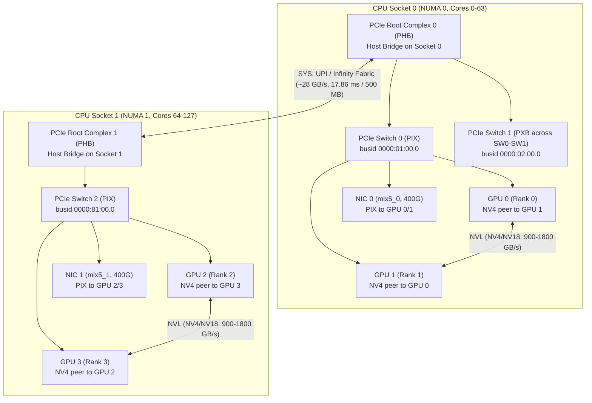
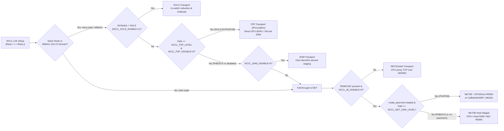

# 12.16 NCCL: topology, channels, transports and environment variables

| | |
|---|---|
| Level | Advanced |
| Priority tier | 1 |
| Lab venue | Nebius GPU |
| Part | Part 12: Complete AI networking |
| Sources to use | ASP 4; V7 ch8; V7 ch9; VL6 ch2; V2 ch10; V13 ch8 |
| Coverage file | `planning/coverage/chapters/12-16.md` |
| Companion code | `code/part12/nccl_topology_channels_env.py` · `code/part12/nccl_topology_channels_env_lab.py` |

## Why this matters for AI infrastructure

Chapter 12.15 established how `NCCL` decomposes collective operations into `Ring`, `Double Binary Tree`, `CollNet` (`SHARP`), `NVLS`, and `PAT` schedules. Yet an optimal collective algorithm still collapses in production if `NCCL` maps its logical rings or trees onto the wrong physical links, starves GPU compute by allocating too many Streaming Multiprocessor (`SM`) communication blocks, or silently falls back from `GPUDirect RDMA` to host-staged bounce buffers or kernel TCP sockets.

Consider the quantitative gap between a topology-aligned path and a misconfigured fallback on the exact same server hardware:
- **Intra-node `NVLink` (`NVL`) versus cross-socket `SYS`:** Moving a `500 MB` (`0.5 GB`) gradient slice between two GPUs over a `900 GB/s` `NVLink 4.0` aggregate (`Hopper H100` / `H200`) takes **`0.56 ms`**, whereas routing that identical `0.5 GB` transfer across a `SYS` path (PCIe Gen4 x16 plus an inter-socket Intel `UPI` or AMD `Infinity Fabric` hop at `~28 GB/s`) takes **`17.86 ms` (`~18 ms`)**—a **`32.14x` (`> 30x`)** latency penalty. When a 4-GPU job naively pairs `GPU0+GPU2` (`SYS`) instead of `GPU0+GPU1` (`NV4`), warps stall on memory accesses, SM busy time drops to **`60%`**, and step time stretches to **`100.0 ms`**; switching to a topology-aware hierarchical schedule with compute-communication overlap raises SM utilization to **`90%`** and cuts step time by **`30.0%` to `70.0 ms`**.
- **Inter-node `NET/IB` (`GPUDirect RDMA`) versus `NET/Socket` (`TCP`) or `Gloo`:** Over an `800 Gb/s` (`100 GB/s`) InfiniBand link, a `400 MB` `AllReduce` completes in **`4.00 ms` (`100.0 GB/s`)** when `NCCL` uses `NET/IB` with `GPUDirect RDMA`, compared to **`200.00 ms` (`2.0 GB/s`)** on a CPU-bound `Gloo` TCP path (`50x` slower). Even on `NCCL`, forgetting to remove a debug flag such as `NCCL_P2P_DISABLE=1` or `NCCL_SHM_DISABLE=1`, omitting `/dev/infiniband` in a container, or leaving PCIe Access Control Services (`ACS`) enabled in BIOS forces traffic through CPU RAM or `eth0`, dropping multi-hundred-GB/s links to tens of GB/s or a few Gb/s with zero crash errors.

This chapter dissects how `NCCL` discovers hardware topology (`sysfs`, `NVML`, `PCIe`, `NUMA`, and `NCCL_TOPO_FILE` XML graphs), scores path costs (`LOC < NVL < C2C < PIX < PXB < PHB < SYS`), partitions collectives across parallel **channels** (and CUDA SM thread blocks), selects runtime **transports** (`P2P`, `SHM`, `NET/IB`, `NET/Socket`, `NVLS`, and `CollNet`), and responds to production **environment variables** and Kubernetes `Topology Manager` (`single-numa-node`) policies.

---

## Prerequisites and outcomes

### Prerequisites
- Completion of Chapter 12.15 (`NCCL: collectives and algorithms`), including `Ring` vs `Tree` step math, `LL` / `LL128` / `Simple` protocols, and `busbw` conversion factors.
- Working familiarity with PCIe root complexes, switches, BAR1 peer-to-peer (`P2P`) addressing, `nvidia-peermem`, InfiniBand `GID`s, and `RoCEv2` (`NCCL_IB_GID_INDEX`, `NCCL_IB_TC`) from Chapters 12.1–12.14.
- Basic knowledge of Linux `sysfs` (`/sys/class/pci_bus/`, `/sys/class/infiniband/`), `numactl`, and Kubernetes device plugins (`NVIDIA GPU Operator`, `NVIDIA Network Operator`, `Multus`, and `SR-IOV`).

### Outcomes
After completing this chapter, you will be able to:
1. Trace `NCCL`'s 3-phase topology discovery and graph-search pipeline (`sysfs` + `NVML` + `ibv_get_device_list`), interpret `nvidia-smi topo -m` labels (`X`/`LOC`, `NV#`/`NVL`, `C2C`, `PIX`, `PXB`, `PHB`, `SYS`), and author or audit `NCCL_TOPO_DUMP_FILE` / `NCCL_TOPO_FILE` XML overrides.
2. Calculate `NCCL` channel counts (`NCCL_MIN_NCHANNELS`, `NCCL_MAX_NCHANNELS`), subring parallelism, SM thread-block occupancy (`1` CUDA block per channel), `NCCL_BUFFSIZE` memory footprint (starting at `4 MiB` = `4,194,304 B`), and zero-copy user buffer registration savings (`16 -> 4` channels, freeing `12` SM blocks).
3. Predict exact transport selection across `P2P` (`CUDA IPC` / `cuMem` / `MNNVL`), `SHM` (`/dev/shm`), `NET/IB` (`GPUDirect RDMA` vs host-staged vs `IBGDA`), `NET/Socket` (`TCP`), `NVLS`, and `CollNet` (`SHARP`) as governed by `NCCL_P2P_LEVEL`, `NCCL_NET_GDR_LEVEL`, and `NCCL_CROSS_NIC`.
4. Evaluate `NCCL_SOCKET_IFNAME` and `NCCL_IB_HCA` filter expressions using exact (`=`), exclude-prefix (`^`), and exclude-exact (`^=`) operators, and enforce the `NCCL_NSOCKS_PERTHREAD * NCCL_SOCKET_NTHREADS <= 64` socket ceiling.
5. Configure dual-socket NUMA affinity (`numactl`, `NCCL_IGNORE_CPU_AFFINITY=1`) and Kubernetes `kubelet` `Topology Manager` (`single-numa-node`) policies without triggering `TopologyAffinityError` pod rejections.

---

## 1. NCCL Topology Discovery, Path Cost Scoring, and XML Graph Overrides

### 1.1 Logical GPU Indices versus Physical Locality

GPU runtimes enumerate accelerators as `GPU 0`, `GPU 1`, ..., `GPU N-1`, but logical device indices do not guarantee physical proximity. Enumeration order can shift across BIOS updates, PCIe bus re-enumeration, or hardware replacements. A scheduler or launch script that blindly pairs adjacent indices (`GPU 0` with `GPU 1`, or `GPU 0` with `GPU 2` in round-robin order) risks mapping collective rings onto a cross-socket interconnect.

To make deterministic routing decisions, `NCCL` inspects seven hardware attributes during `ncclCommInitRank` (invoked once by `torch.distributed.init_process_group(backend="nccl")`):
1. **GPU UUID and compute capability (`sm="80"` for A100, `sm="90"` for H100/H200, `sm="100"` for Blackwell B200/GB200)** via `NVML`.
2. **PCIe Bus-Device-Function (`BDF`) address and bridge tree** via `/sys/class/pci_bus/` and `/sys/devices/pci*` (checking PCIe generation Gen4 `31.5 GB/s` vs Gen5 `64 GB/s` per x16 direction, switch hierarchy `class="0x060400"`, and whether PCIe Access Control Services `ACS` is enabled).
3. **Direct GPU interconnects (`NVLink` / `NVSwitch` / `NVLink-C2C`)** via `NVML` (`nvidia-smi nvlink -s`), distinguishing point-to-point bridges (`NV4`), 8-GPU `HGX`/`DGX` `NVSwitch` domains (`NV12` on A100 `600 GB/s`, `NV18` on H100 `900 GB/s` with `3.6 TB/s` bisection, `NV18` on B200 `1.8 TB/s`), `900 GB/s` `NVLink-C2C` superchip links (`GH200` `608 GB`, `GB200`), and 72-GPU multi-node `NVLink Switch` racks (`GB200/GB300 NVL72` `~130 TB/s`).
4. **Network adapter (`NIC` / `HCA`) PCIe locality and link rate** via `/sys/class/infiniband/` and `/sys/class/net/` (mapping `mlx5_0..mlx5_7` `400 Gb/s` NDR or `800 Gb/s` XDR ports to their nearest PCIe switch).
5. **CPU socket and `NUMA` node affinity** (`numaid="0"`, `numaid="1"`, and local core bitmasks such as `0-31` or `0-63`).
6. **Peer-to-peer (`P2P`) and `GPUDirect RDMA` (`GDR`) capability** (`gdr="1"` when `nvidia-peermem` or `DMA-BUF` can map GPU `BAR1` physical pages directly to the `mlx5_core` NIC driver).
7. **Inter-node fabric reachability** exchanged across ranks over the bootstrap TCP store so `NCCL` can connect rail-aligned rings and trees across servers.

### 1.2 The Seven NCCL Topology Path Levels (`LOC` through `SYS`)

Both `nvidia-smi topo -m` and `NCCL`'s internal graph solver (`ncclTopoGetSystem` $\rightarrow$ `ncclTopoComputePaths`) classify the path between any two endpoints (`GPU-to-GPU` or `GPU-to-NIC`) into seven ordered distance tiers. `NCCL` assigns each hop a bandwidth-weighted cost so that graph search always prefers lower-cost (higher-bandwidth, lower-latency) edges:

$$\text{Cost}(\text{LOC}) < \text{Cost}(\text{NVL}) < \text{Cost}(\text{C2C}) < \text{Cost}(\text{PIX}) < \text{Cost}(\text{PXB}) < \text{Cost}(\text{PHB}) < \text{Cost}(\text{SYS})$$



| Path Token (`nvidia-smi` / `NCCL`) | Rank / Model Cost | Typical Unidirectional BW | Typical Hop Latency | Physical Path Traversal | `GPUDirect P2P` / `RDMA` (`GDR`) Viability |
|---|---|---|---|---|---|
| `X` / `LOC` | Rank `0` (Cost `0`) | `~3,000 GB/s` (HBM3) | `~0.1 µs` | Self (loopback on the same GPU device) | Native on-device memory |
| `NV#` (`NV4`, `NV12`, `NV18`) / `NVL` | Rank `1` (Cost `10`) | `600–1,800 GB/s` (bidir) | `~0.5 µs` (`< 1 µs` NVL72) | Direct `NVLink` bridges or `NVSwitch` fabric (`A100` `600 GB/s`, `H100` `900 GB/s`, `B200` `1,800 GB/s`) | Ideal direct GPU `P2P` (`CUDA IPC` / `cuMem` / `NVLS`) |
| `C2C` | Rank `2` (Cost `15`) | `900 GB/s` (bidir) | `~0.6 µs` | Coherent `NVLink-C2C` chip-to-chip link (`Grace Hopper GH200` / `Grace Blackwell GB200`) | Coherent CPU-GPU memory extension & `P2P` |
| `PIX` | Rank `3` (Cost `30`) | `~31.5–64 GB/s` (Gen4/5 x16) | `~1.2 µs` | Traverses at most **one** PCIe switch/bridge (`class="0x060400"`, `ACS` disabled) | **Gold standard** for `GPU <-> NIC` `GPUDirect RDMA` (`Rail 1..8`) |
| `PXB` | Rank `4` (Cost `50`) | `~28–48 GB/s` | `~1.8 µs` | Traverses **multiple** cascaded PCIe switches without crossing the CPU Host Bridge | Viable for `P2P` and `GPUDirect RDMA` (`NCCL_NET_GDR_LEVEL=PXB`) |
| `PHB` | Rank `5` (Cost `80`) | `~16–32 GB/s` | `~3.0 µs` | Traverses the CPU PCIe Host Bridge / Root Complex within a single `NUMA` socket | Hairpins through CPU Root Complex; `GDR` disabled by default |
| `SYS` | Rank `6` (Cost `200`) | `~12–28 GB/s` | `~8.0+ µs` | Crosses both PCIe and the inter-socket `NUMA` link (`Intel UPI` / `AMD Infinity Fabric`) | **Severe bottleneck** (`32.14x` slower than `NVL`); `P2P`/`GDR` disabled by default |

Consider the `nvidia-smi topo -m` matrix from a dual-socket, 4-GPU server with two `NV4` pairs and a single high-speed NIC attached to Socket 0:

```text
$ nvidia-smi topo -m
        GPU0    GPU1    GPU2    GPU3    NIC0    CPU Affinity    NUMA Affinity
GPU0     X      NV4     SYS     SYS     PIX     0-31            0
GPU1    NV4      X      SYS     SYS     SYS     0-31            0
GPU2    SYS     SYS      X      NV4     SYS     32-63           1
GPU3    SYS     SYS     NV4      X      SYS     32-63           1
NIC0    PIX     SYS     SYS     SYS      X
```

Three architectural facts jump straight out of this matrix:
1. **`GPU0 <-> GPU1` and `GPU2 <-> GPU3` are `NV4` (`NVL`):** A `500 MB` (`0.5 GB`) collective exchange inside either pair at `900 GB/s` takes $0.5\text{ GB} / 900\text{ GB/s} = 0.000556\text{ s} \approx \mathbf{0.56\text{ ms}}$.
2. **Any cross-pair link (`GPU0 <-> GPU2`, `GPU1 <-> GPU3`) is `SYS`:** The same `500 MB` transfer across PCIe + `UPI` at `~28 GB/s` takes $0.5\text{ GB} / 28\text{ GB/s} = 0.017857\text{ s} \approx \mathbf{17.86\text{ ms}}$ (`~18 ms`, or **`32.14x` slower**). If a 2-GPU job is scheduled by index onto `GPU1` and `GPU2` (or a 4-GPU job forms a flat ring `0 -> 2 -> 1 -> 3 -> 0`), every step is throttled by the `28 GB/s` `SYS` link.
3. **Hierarchical topology-aware routing:** When `NCCL` detects that `GPU0–GPU1` and `GPU2–GPU3` form two fast islands separated by a slow `PCIe`/`SYS` bridge, its hierarchy algorithm first reduces within `{GPU0, GPU1}` and `{GPU2, GPU3}` over `NVLink`, exchanges a single reduced shard across the slower inter-group link between one leader per pair, and broadcasts back over `NVLink`. In Nsight Systems, this appears as distinct intra-group and inter-group `NCCL` CUDA kernels, raising SM busy from **`60%` to `90%`** and cutting total iteration time from **`100.0 ms` to `70.0 ms` (`30.0%` faster)**.

### 1.3 Inspecting and Overriding Topologies with `NCCL_TOPO_DUMP_FILE` and `NCCL_TOPO_FILE`

In virtualized clouds, SR-IOV guests, or complex multi-root OEM HGX servers, hypervisors or ACPI tables can expose a flattened or misordered PCIe tree. When that happens, `NCCL` may pair `GPU 0` with a remote NIC across `UPI` (`SYS`) or build rings that hairpin out to a Spine switch instead of staying on a local Leaf switch, triggering `ProcessGroupNCCL` watchdog timeouts on 32-node `400G` InfiniBand runs.

`NCCL` provides two complementary XML topology environment variables:
- **`NCCL_TOPO_DUMP_FILE=/tmp/nccl_topo_detected.xml`:** Instructs `NCCL` to write the exact XML hardware graph it constructed at the end of topology discovery. Always dump a working node's XML first rather than writing XML from scratch, because the production schema requires CPU architecture/vendor/family/model attributes, PCIe link speed/width attributes, GPU `sm` and `gdr` flags, and NIC `speed` (in `Mbps`, e.g., `400000` for `400G` or `800000` for `800G`).
- **`NCCL_TOPO_FILE=/etc/nccl/topology.xml`:** Forces `NCCL` to load your explicit XML graph before computing paths, overriding erroneous `sysfs` or VM bridge hierarchies so that each GPU (`dev="0"`, `rank="0"`, `gdr="1"`) and its local rail NIC (`name="mlx5_0"`, `speed="400000"`, `gdr="1"`) are explicitly anchored under the same PCIe switch (`<pci busid="0000:01:00.0" class="0x060400">`, yielding `PIX`).

---

## 2. NCCL Channels, Subrings, SM Thread Blocks, and `NCCL_BUFFSIZE`

### 2.1 How Channels Map to Subrings and GPU Streaming Multiprocessors (`SM`s)

A single CUDA thread block cannot saturate `900 GB/s` of `NVLink 4.0`, `1,800 GB/s` of `NVLink 5`, or eight `400G`/`800G` InfiniBand rails. To drive all physical links in parallel, `NCCL` partitions each collective tensor across $C$ independent execution pipelines called **channels**:

1. **One Channel = One Subring/Subtree = One CUDA Thread Block per GPU:** If `NCCL` initializes $C = 16$ channels for a ring collective, it constructs `16` parallel subrings (`Channel 0..15`) that match the concurrent hardware links (`NVLinks` and multi-rail NICs). On every participating GPU, an `ncclDevKernel` launch spawns **$C$ CUDA thread blocks**—one thread block per active channel—scheduled onto $C$ distinct Streaming Multiprocessors (`SM`s).
2. **The Compute-vs-Communication SM Contention Trade-off:** Because each active `NCCL` channel occupies one `SM` while the collective kernel runs, overlapping communication with backward pass computation (such as PyTorch `DDP` running `AllReduce` on a background stream while `cuBLAS` GEMMs run on the default compute stream) directly trades compute SMs for communication SMs:
   - On an `NVIDIA H100` with **`132` SMs**, running **`16` channels** consumes `16` SM thread blocks (**`12.12%`** of the GPU's SMs), leaving `116` SMs (`87.88%`) for matrix math; cranking `NCCL_MAX_NCHANNELS` up to **`32` channels** consumes **`24.24%`** of the GPU (`32 / 132` SMs), which can slow down overlapped compute kernels on medium-sized tensors.
   - Conversely, when persistent user buffer registration (`ncclCommRegister` with `ncclMemAlloc`) is enabled on `NVSwitch` (`NVLS`) paths, `NCCL` performs zero-copy transfers directly from the user's tensor without SM-driven staging copies, dropping the required channel count from **`16` channels down to `4` channels** (**`3.03%`** of `132` SMs) and freeing **`12` SM thread blocks** for model compute.

### 2.2 Controlling Channel Count and Channel Buffer Memory (`NCCL_BUFFSIZE`)

Three environment variables govern channel parallelism and per-channel staging memory:
- **`NCCL_MIN_NCHANNELS` and `NCCL_MAX_NCHANNELS`:** Clamp the minimum and maximum number of channels `NCCL` may allocate per communicator:

$$C_{\text{active}} = \max\!\left(\text{NCCL\_MIN\_NCHANNELS},\; \min\!\left(\text{NCCL\_MAX\_NCHANNELS},\; C_{\text{auto}}\right)\right)$$

  On `NVSwitch` systems, `NCCL` auto-tunes $C_{\text{auto}}$ based on topology and message size; leave these at their defaults unless profiling proves either link under-utilization (raise `NCCL_MIN_NCHANNELS`) or compute SM starvation during overlapped execution (lower `NCCL_MAX_NCHANNELS`, e.g., to `8` or `4`).
- **`NCCL_BUFFSIZE` (Default / Recommended Starting Point: `4 MiB` = `4,194,304` bytes):** Sets the size in bytes of the internal FIFO communication buffer allocated in GPU HBM **for each peer slot in each channel**. For a ring communicator where each channel maintains $P_{\text{peers}} = 2$ peer buffer slots (send/receive neighbors), the per-communicator GPU HBM footprint for channel buffers is:

$$\text{Memory}_{\text{channels}} = C_{\text{active}} \times P_{\text{peers}} \times \text{NCCL\_BUFFSIZE}$$

| Configuration Scenario | Active Channels ($C_{\text{active}}$) | `NCCL_BUFFSIZE` (Bytes / MiB) | Peer Slots ($P_{\text{peers}}$) | Total Channel HBM per Communicator | H100 (`132` SMs) SM Blocks Used (`%`) |
|---|---|---|---|---|---|
| Default 16-Channel Ring (`4 MiB` start) | `16` | `4,194,304 B` (`4.0 MiB`) | `2` | `134,217,728 B` (**`128.0 MiB`**) | `16` SMs (**`12.12%`**) |
| Clamped 8-Channel Ring (`8 MiB` tuned) | `8` (`MIN=4, MAX=8`) | `8,388,608 B` (`8.0 MiB`) | `2` | `134,217,728 B` (**`128.0 MiB`**) | `8` SMs (**`6.06%`**) |
| High-Channel 32-Channel Ring (`16 MiB` aggressive) | `32` | `16,777,216 B` (`16.0 MiB`) | `2` | `1,073,741,824 B` (**`1,024.0 MiB` / `1.0 GiB`**) | `32` SMs (**`24.24%`**) |
| Zero-Copy `ncclCommRegister` + `NVLS` | `4` (`16 -> 4` saved) | `4,194,304 B` (`4.0 MiB`) | `2` | `33,554,432 B` (**`32.0 MiB`**) | `4` SMs (**`3.03%`**, saves `12` SMs) |

When tuning `NCCL_BUFFSIZE` for large bandwidth-bound `AllReduce` operations, **start at `4 MB` (`4,194,304` bytes) and increase stepwise (`4 MiB -> 8 MiB -> 16 MiB`)** while monitoring `torch.cuda.memory_reserved()`. Because channel buffers are allocated per communicator, creating multiple sub-communicators (`TP`, `PP`, `DP`, `EP`) with an inflated `NCCL_BUFFSIZE` multiplies this HBM tax across every process group and can trigger out-of-memory (`OOM`) evictions.

---

## 3. NCCL Transports: `P2P`, `SHM`, `NET` (`IB` / `RoCE` / `IBGDA` / `Socket`), `NVLS`, and `CollNet`

Once `NCCL` computes its topology graph and channel rings/trees, it binds every channel link between two ranks to one of six concrete **transport engines** (`src/transport/`):



| Transport Engine | `NCCL_DEBUG=INFO` Signature | Primary Scope | Data Path & Memory Registration Mechanism | Key Controlling Environment Variables | Fallback Path When Disabled or Blocked |
|---|---|---|---|---|---|
| **`P2P`** (Peer-to-Peer) | `P2P/IPC` or `P2P/CUMEM` | Intra-node (and intra-rack `MNNVL` on `NVL72`) | Direct GPU-to-GPU loads/stores or copy engine DMA over `NVLink`/`NVSwitch` or PCIe `BAR1` (`CUDA IPC` handles or `cuMem` fabric handles) | `NCCL_P2P_DISABLE`, `NCCL_P2P_LEVEL`, `NCCL_MNNVL_ENABLE` | `SHM/direct` (host `/dev/shm` staging) |
| **`SHM`** (Shared Memory) | `SHM/direct` | Intra-node | GPU A DMAs over PCIe into pinned host shared memory (`/dev/shm`); GPU B DMAs from `/dev/shm` over PCIe | `NCCL_SHM_DISABLE` | `NET/IB` loopback or `NET/Socket` TCP |
| **`NET/IB`** (`GPUDirect RDMA` / `IBGDA`) | `NET/IB : ... [GDRDMA]` | Inter-node (and intra-node `PXN`) | `mlx5_core` NIC DMAs directly to/from GPU `BAR1` pages pinned via `nvidia-peermem` / `DMA-BUF` (or GPU SMs post WRs directly via `IBGDA`) | `NCCL_IB_DISABLE`, `NCCL_IB_HCA`, `NCCL_NET_GDR_LEVEL`, `NCCL_IB_GID_INDEX`, `NCCL_IB_TC`, `NCCL_CROSS_NIC` | `NET/IB` host-staged (if `GDR` fails) or `NET/Socket` (if `IB` fails) |
| **`NET/Socket`** (POSIX TCP) | `NET/Socket : Using [0]eth0...` | Bootstrap handshake + Inter-node fallback | GPU copies to host RAM; CPU proxy threads send/recv over kernel TCP/IP sockets (`eth0`/`ib0`) | `NCCL_SOCKET_IFNAME`, `NCCL_SOCKET_NTHREADS`, `NCCL_NSOCKS_PERTHREAD` | Communicator init aborts if no reachable interface |
| **`NVLS`** (`NVLink SHARP`) | `NVLS` / `NVLSTree` | Intra-node `HGX`/`DGX` & 72-GPU `NVL72` rack | Switch-resident ALUs on `NVSwitch 3.0/4.0` perform reductions and hardware multicast (`1/(N-1)` endpoint volume) | `NCCL_NVLS_ENABLE`, `NCCL_MNNVL_ENABLE` | `P2P` `Ring` or `Tree` over `NVLink` |
| **`CollNet`** (`InfiniBand SHARP`) | `CollNet/SHARP` | Multi-node Quantum InfiniBand (`32+` nodes) | Quantum IB switch ASICs aggregate reductions via `SHARP Aggregation Manager` + `NCCL RDMA SHARP` plugin (`2x–5x` speedup) | `NCCL_COLLNET_ENABLE`, `NCCL_SHARP_DISABLE` | `NET/IB` hierarchical `Tree` or `Ring` |

### 3.1 Deep Dive into the Five Critical Transport Mechanisms

1. **`P2P` (`NCCL_P2P_LEVEL` and `NCCL_MNNVL_ENABLE`):**
   - By default, `NCCL` enables direct `P2P` across `NVL`, `C2C`, `PIX`, and `PXB` links, while avoiding direct `P2P` across `PHB` or `SYS` because PCIe root complexes and inter-socket `UPI` links frequently suffer severe packet credit stalls on peer-to-peer BAR1 reads/writes.
   - You can override the cutoff distance with **`NCCL_P2P_LEVEL=<LOC|NVL|PIX|PXB|PHB|SYS>`**. Setting `NCCL_P2P_DISABLE=1` (equivalent to `NCCL_P2P_LEVEL=LOC`) disables all direct GPU peer copies and forces every intra-node transfer through host CPU memory (`SHM`), increasing latency from a few microseconds to tens of microseconds and dropping bandwidth from hundreds of GB/s (`900–1,800 GB/s` on NVLink) down to tens of GB/s. Never leave `NCCL_P2P_DISABLE=1` enabled after debugging.
   - On `GB200` and `GB300 NVL72` rack systems, **`NCCL_MNNVL_ENABLE=1`** activates **Multi-Node NVLink (`MNNVL`)**, allowing `P2P/CUMEM` and `NVLS` transports to span all `72` GPUs (`36` Grace-Blackwell compute trays) across the `NVLink Switch` backplane at `~130 TB/s` aggregate bandwidth and sub-microsecond (`< 1 µs`) latency without touching InfiniBand or Ethernet NICs.

2. **`SHM` (`NCCL_SHM_DISABLE` and `/dev/shm` Sizing):**
   - When two GPUs on the same host cannot establish direct `P2P` (for example, they sit across `SYS` on dual sockets, or PCIe `ACS` is enabled in BIOS), `NCCL` uses the `SHM` transport to stage buffers through POSIX shared memory (`/dev/shm`).
   - Two operational rules govern `SHM`: first, in Docker and Kubernetes containers, the default `/dev/shm` tmpfs mount is only **`64 MiB`**, which immediately causes `NCCL WARN Call to posix_fallocate failed : No space left on device`—always mount an in-memory `emptyDir` (`medium: Memory`) of at least **`16–64 GiB`** at `/dev/shm` (or pass `--shm-size=16g`). Second, never leave `NCCL_SHM_DISABLE=1` in production, as disabling `SHM` forces non-P2P intra-node traffic out through the network/socket driver stack.

3. **`NET/IB`, `GPUDirect RDMA` (`NCCL_NET_GDR_LEVEL`), `PXN` (`NCCL_CROSS_NIC`), and `IBGDA`:**
   - In the traditional `5`-step non-GDR path, moving data from `GPU A` to `GPU B` requires: (1) `GPU A -> Host RAM A` over PCIe, (2) `Host RAM A -> NIC A`, (3) `NIC A -> NIC B` wire transit, (4) `NIC B -> Host RAM B`, and (5) `Host RAM B -> GPU B` over PCIe.
   - **`GPUDirect RDMA`** eliminates steps 1, 2, 4, and 5 by pinning GPU `BAR1` physical pages in the NVIDIA driver and passing them via `nvidia-peermem` (verify with `lsmod | grep nvidia_peermem`) or `DMA-BUF` to `mlx5_core`, so `NIC A` DMAs straight from `GPU A` HBM over the local PCIe switch (`PIX`) and `NIC B` DMAs straight into `GPU B` HBM.
   - **`NCCL_NET_GDR_LEVEL` (Default: `PIX` or `PXB` depending on platform):** Controls the maximum topological distance between a GPU and a NIC at which `NCCL` allows `GPUDirect RDMA`. If a GPU and NIC are separated by `PHB` or `SYS` (for example, `GPU 2` on NUMA 1 talking to `NIC 0` on NUMA 0, or PCIe `ACS` enabled so `nvidia-smi topo -m` reports `SYS`), `NCCL` automatically disables `GPUDirect RDMA` for that pair and falls back to host-staged RDMA bounce buffers (`NET/IB` without `[GDRDMA]`).
   - **`NCCL_CROSS_NIC` (`0`, `1`, or `2`, default `2` on NVSwitch systems) and `PXN` (PCIe x NVLink):** When rank $i$ on Node A needs to send to a non-rail-aligned NIC on Node B, `NCCL` can route the packet from `GPU i` over intra-node `NVLink` (`900 GB/s`) to proxy `GPU j` on the same node, which then transmits via its local `PIX`-attached `NIC j` (`Rail j`)—avoiding cross-socket `SYS` GPU-to-NIC traffic entirely.
   - **Direct NIC Mode and `IBGDA` (InfiniBand GPUDirect Async):** Even with `GPUDirect RDMA` on the data plane, a CPU proxy thread traditionally rings the NIC doorbell and polls Completion Queues (`CQ`s). With **`IBGDA`**, the GPU's own SMs construct and post RDMA Work Requests (`WR`s) and ring the ConnectX NIC doorbell directly over PCIe without any CPU proxy thread intervention on the critical path.

---

## 4. Production NCCL Environment Variables Reference and Filter Grammar

### 4.1 Complete Categorized Environment Variable Matrix

In production clusters, never rely on undocumented defaults that can shift across `NCCL` minor releases—pin performance- and resiliency-critical environment variables explicitly in your launch manifests:

| Environment Variable | Valid Values / Syntax | Default / Recommended Production Value | Subsystem & Operational Impact |
|---|---|---|---|
| `NCCL_DEBUG` | `VERSION`, `WARN`, `INFO`, `TRACE` | `WARN` in steady-state prod; `INFO` during validation/triage | Controls log verbosity (`TRACE`/`DEBUG` adds latency overhead; never run `TRACE` in prod) |
| `NCCL_DEBUG_SUBSYS` | `INIT`, `COLL`, `P2P`, `SHM`, `NET`, `GRAPH`, `TUNING`, `ENV`, `ALLOC`, `ALL` | `INIT,ENV,GRAPH` (when `NCCL_DEBUG=INFO`) | Filters `NCCL_DEBUG` output to specific subsystems (`INIT,GRAPH,ENV` shows transport & ring setup) |
| `NCCL_TOPO_DUMP_FILE` | File path (e.g., `/tmp/topo.xml`) | Unset (set on 1 node to capture baseline XML) | Dumps `NCCL`'s auto-discovered hardware topology graph to an XML file |
| `NCCL_TOPO_FILE` | File path (e.g., `/etc/nccl/topo.xml`) | Unset (set in VMs / complex OEM HGX servers) | Overrides auto-detection with an explicit XML hardware topology graph |
| `NCCL_ALGO` | `Ring`, `Tree`, `CollNetDirect`, `CollNetChain`, `NVLS`, `NVLSTree`, `PAT` | Auto-selected by message size & topology | Forces specific collective algorithms (set before `ncclCommInitRank`) |
| `NCCL_PROTO` | `LL`, `LL128`, `Simple` | Auto-selected (`LL` `<64KB`, `LL128` mid, `Simple` large) | Forces wire framing protocol (`50%`, `93.75%`, or `100%` payload efficiency) |
| `NCCL_MIN_NCHANNELS` / `NCCL_MAX_NCHANNELS` | Integer `1..64` | Auto-tuned by topology (`16–32` on NVSwitch) | Clamps subring channel count (and SM thread blocks consumed per collective) |
| `NCCL_BUFFSIZE` | Bytes (power of 2) | **`4194304` (`4 MiB`)** starting point | Per-channel peer FIFO buffer size in GPU HBM (`C * P * NCCL_BUFFSIZE`) |
| `NCCL_P2P_DISABLE` | `0` or `1` | **`0`** (never leave `1` in production) | Disables intra-node GPU-to-GPU direct `P2P`, forcing slow `/dev/shm` host staging |
| `NCCL_P2P_LEVEL` | `LOC`, `NVL`, `PIX`, `PXB`, `PHB`, `SYS` | Auto (`PXB` typical cutoff) | Maximum topological distance allowed for direct GPU `P2P` transfers |
| `NCCL_SHM_DISABLE` | `0` or `1` | **`0`** (never leave `1` in production) | Disables `/dev/shm` shared-memory transport, forcing network loopback fallback |
| `NCCL_MNNVL_ENABLE` | `0` or `1` | **`1` on GB200/GB300 NVL72** (`0` otherwise) | Enables Multi-Node NVLink (`MNNVL`) across NVLink Switch rack domains |
| `NCCL_IB_DISABLE` | `0` or `1` | **`0`** (never leave `1` on IB/RoCE fabrics) | Disables `NET/IB` RDMA verbs, forcing fallback to `NET/Socket` TCP |
| `NCCL_IB_HCA` | `[=\|^\|^=]mlx5_0[:1],...` | `mlx5` or explicit rail list (`=mlx5_0:1,mlx5_1:1`) | Selects or excludes InfiniBand / RoCEv2 RDMA Host Channel Adapters and ports |
| `NCCL_NET_GDR_LEVEL` | `LOC`, `PIX`, `PXB`, `PHB`, `SYS` | **`PIX`** (or `PXB` on cascaded switches) | Max GPU-to-NIC topological distance allowed for `GPUDirect RDMA` (`GDRDMA`) |
| `NCCL_CROSS_NIC` | `0` (off), `1` (ring/tree), `2` (PXN auto) | **`2`** on NVSwitch rail-optimized clusters | Controls cross-NIC traffic and `PXN` (NVLink-assisted NIC rail alignment) |
| `NCCL_IB_GID_INDEX` | Integer (`0..N`) | **`3`** for RoCEv2 IPv4 (verify with `show_gids`) | Selects the InfiniBand/RoCE Global Identifier (`GID`) table index |
| `NCCL_IB_TC` | Integer (`0..255`, DSCP * 4) | **`106`** (DSCP `26` AF31, or `184` DSCP `46`) | Sets IP/RoCEv2 Traffic Class (`TOS`/`DSCP`) to match lossless switch PFC/ECN queues |
| `NCCL_IB_QPS_PER_CONNECTION` | Integer (`1..16`) | **`4`** (or `2–8` on multi-plane/ECMP fabrics) | Stripes each channel connection across multiple Queue Pairs (`QP`s) for ECMP/throughput |
| `NCCL_COLLNET_ENABLE` / `NCCL_NVLS_ENABLE` | `0` or `1` | `1` when Quantum `SHARP` / `NVSwitch NVLS` active | Enables in-network switch reduction (`CollNet`) and NVSwitch `NVLink SHARP` (`NVLS`) |
| `NCCL_SHARP_DISABLE` | `0` or `1` | `0` (set `1` for A/B testing or switch buffer triage) | Explicitly disables InfiniBand `SHARP` offload even when `CollNet` is present |
| `NCCL_SOCKET_IFNAME` | `[=\|^\|^=]ib0,eth0,...` | **`ib0`** (or high-speed bond, e.g., `^docker,lo`) | Selects OS network interface for `NCCL` bootstrap TCP handshakes and `NET/Socket` |
| `NCCL_SOCKET_NTHREADS` & `NCCL_NSOCKS_PERTHREAD` | Integers with product **`<= 64`** | Product **`<= 64`** (e.g., `2` threads $\times$ `2` sockets = `4`) | Tunes CPU proxy threads and TCP sockets per thread when `NET/Socket` is active |
| `NCCL_IGNORE_CPU_AFFINITY` | `0` or `1` | **`1`** (paired with NUMA-level `numactl`) | Ignores inherited narrow CPU core affinity masks so `NCCL` spreads threads across the local NUMA node |
| `TORCH_NCCL_ASYNC_ERROR_HANDLING` / `NCCL_ASYNC_ERROR_HANDLING` | `0` or `1` (`1` = abort on error/timeout) | **`1`** | Enables asynchronous watchdog abort on rank crash or collective stall instead of infinite hang |
| `NCCL_PROFILER_PLUGIN` | Shared library name / path | Unset (or Kineto / custom profiler `.so`) | Loads the 5-callback (`init`, `startEvent`, `stopEvent`, `recordEventState`, `finalize`) profiler plugin |

### 4.2 Prefix and Exact Filter Operators (`=`, `^`, `^=`) for `NCCL_SOCKET_IFNAME` and `NCCL_IB_HCA`

Both `NCCL_SOCKET_IFNAME` (which selects IP interfaces from `ip addr`) and `NCCL_IB_HCA` (which selects RDMA verbs devices and optional port numbers from `ibv_devinfo`, such as `mlx5_0:1`) share a 4-mode prefix/exact filter grammar:

1. **Default Prefix Include (`<token1>,<token2>`):** Matches any interface or HCA whose name **starts with** any listed token.
   - `NCCL_SOCKET_IFNAME=ib` on `["lo", "docker0", "eth0", "eth0.100", "eth1", "ib0", "ib1"]` selects **`["ib0", "ib1"]`**.
   - Warning: `NCCL_SOCKET_IFNAME=eth0` is a prefix match and will match **both** `"eth0"` and VLAN sub-interface `"eth0.100"`.
2. **Exact Include (`=<token1>,<token2>`):** Matches only interfaces or HCAs whose name **exactly equals** one of the tokens.
   - `NCCL_SOCKET_IFNAME==eth0` selects **`["eth0"]`** and excludes `"eth0.100"` and `"eth1"`.
   - `NCCL_IB_HCA==mlx5_0:1,mlx5_1:1` binds strictly to port `1` of `mlx5_0` and `mlx5_1`.
3. **Prefix Exclude (`^<token1>,<token2>`):** Excludes any interface or HCA starting with any listed token and keeps everything else.
   - `NCCL_SOCKET_IFNAME=^docker,lo,eth` excludes `"lo"`, `"docker0"`, `"eth0"`, `"eth0.100"`, and `"eth1"`, leaving **`["ib0", "ib1"]`**.
   - `NCCL_IB_HCA=^mlx5_bond` on `["mlx5_0:1", "mlx5_1:1", "mlx5_2:1", "mlx5_3:1", "mlx5_bond_0:1"]` excludes the management bond and keeps **`["mlx5_0:1", "mlx5_1:1", "mlx5_2:1", "mlx5_3:1"]`**.
4. **Exact Exclude (`^=<token1>,<token2>`):** Excludes only exact token matches and keeps sub-interfaces or numbered variants.
   - `NCCL_SOCKET_IFNAME=^=lo,docker0,eth0` excludes exact `"eth0"`, `"lo"`, and `"docker0"`, keeping **`["eth0.100", "eth1", "ib0", "ib1"]`**.

### 4.3 Multi-NIC Socket Tuning and the `64`-Socket Limit (`NCCL_NSOCKS_PERTHREAD * NCCL_SOCKET_NTHREADS <= 64`)

When `NCCL` runs over high-speed InfiniBand or RoCE (`NET/IB`), multi-rail striping across two `800 Gbps` NICs (`1.6 Tbps` aggregate) or four `800 Gbps` links (`3.2 Tbps` aggregate) is controlled by `NCCL_IB_HCA` and `NCCL_IB_QPS_PER_CONNECTION`. However, when `NCCL` uses the **`NET/Socket` (TCP)** transport—for example on cloud instances without RDMA—a single TCP stream cannot saturate a `100–400 Gbps` NIC or stripe across multiple NICs.

For `NET/Socket`, `NCCL` spawns `NCCL_SOCKET_NTHREADS` CPU proxy threads per interface and opens `NCCL_NSOCKS_PERTHREAD` parallel TCP sockets per thread:
- On a dual-NIC host using Socket transport, setting **`NCCL_NSOCKS_PERTHREAD=2`** and **`NCCL_SOCKET_NTHREADS=2`** opens $2 \times 2 = \mathbf{4}$ concurrent TCP socket connections per communicator.
- **Hard Architectural Ceiling (`<= 64`):** `NCCL` enforces a built-in maximum of **`64` total TCP sockets per communicator**:

$$\text{NCCL\_SOCKET\_NTHREADS} \times \text{NCCL\_NSOCKS\_PERTHREAD} \le 64$$

  For example, $8 \times 8 = 64$ reaches the ceiling, whereas setting $16 \times 8 = 128$ violates NVIDIA's `64`-socket limit, wasting CPU cycles on lock contention and OS file-descriptor exhaustion. Increase these values stepwise (`2 -> 4 -> 8`) only when `NET/Socket` is actually active.

---

## 5. CPU/GPU NUMA Affinity, Kubernetes Topology Manager, and Rail-Aligned Multi-Tenancy

### 5.1 `NCCL_IGNORE_CPU_AFFINITY=1` and Dual-Socket NUMA Binding

Even when `GPUDirect RDMA` moves tensor payloads directly between GPU HBM and ConnectX NICs without touching host RAM, `NCCL` still launches background CPU proxy threads to coordinate bootstrap handshakes, ring RDMA doorbells (when `IBGDA` is not active), poll Completion Queues (`CQ`s), and enqueue CUDA kernels.

On a dual-socket, 8-GPU server where `GPUs 0–3` and `NICs 0–3` (`Rails 1–4`) attach to `CPU Socket 0` (`NUMA 0`, cores `0–63`) and `GPUs 4–7` and `NICs 4–7` (`Rails 5–8`) attach to `CPU Socket 1` (`NUMA 1`, cores `64–127`), two failure modes arise:
1. **Cross-NUMA proxy and IRQ penalty:** If `Rank 0` (`GPU 0`, `NUMA 0`) runs its CPU proxy thread or NIC interrupt (`IRQ`) handler on a core in `NUMA 1`, every control doorbell and completion event traverses the inter-socket `UPI` link. Always pin NIC IRQs and rank processes to the local NUMA node (`NUMA 0` for `Ranks 0–3`, `NUMA 1` for `Ranks 4–7`).
2. **Over-constrained inherited core masks (`NCCL_IGNORE_CPU_AFFINITY=1`):** When launchers (`mpirun`, `srun`, `taskset`) pin a process to a very narrow core mask (for example, a single core), `NCCL`'s background proxy and polling threads inherit that mask and collapse onto one CPU core, throttling collective throughput. The production best practice is to bind each rank process to the **full CPU core set of its local NUMA domain** (using `numactl --cpunodebind=0 --membind=0` for `Ranks 0–3` and `numactl --cpunodebind=1 --membind=1` for `Ranks 4–7`) and export **`NCCL_IGNORE_CPU_AFFINITY=1`** so `NCCL` ignores any narrow inherited core mask and spreads its worker threads cleanly across cores within the local NUMA node.

### 5.2 Kubernetes `Topology Manager` (`single-numa-node`) and the `TopologyAffinityError` Trap

By default, the Kubernetes `kube-scheduler` treats a dual-socket server as a flat bag of resources (`--topology-manager-policy=none`). If a pod requests `16` CPU cores, `1` GPU, and `1` NIC, the `kubelet` can assign `16` cores from `NUMA 0`, `GPU 3` from `NUMA 1`, and `NIC 0` from `NUMA 0`, forcing every host-to-device and GPU-to-NIC transfer across the `UPI` link (`SYS`).

To prevent cross-NUMA placement, the `kubelet` **Topology Manager** collects NUMA hints from the `CPU Manager` (`static` policy, requiring `Guaranteed` QoS pods with integer CPU requests), `Memory Manager`, and `Device Manager` (`NVIDIA GPU Operator` device plugin and `SR-IOV Network Device Plugin`) and enforces one of four policies:
1. **`none` (Default):** No NUMA alignment; random cross-socket placement.
2. **`best-effort`:** Attempts NUMA alignment, but admits the pod across split NUMA nodes if single-NUMA capacity is unavailable (non-deterministic performance).
3. **`restricted`:** Rejects pods if allocated devices do not align to the minimum possible number of NUMA nodes.
4. **`single-numa-node` (AI Production Standard):** Strictly requires all requested CPU cores, memory, GPUs, and SR-IOV NIC VFs to reside on a **single physical NUMA node**; otherwise, the `kubelet` rejects the pod with **`TopologyAffinityError`**.

#### Production Case Study: Why the 5th (or 8th) Pod Fails with `TopologyAffinityError` on a 128-Core, 8-GPU Server
Suppose a platform team configures `--topology-manager-policy=single-numa-node` on a fleet of dual-socket HGX servers with **`128` CPU cores (`64` cores on `NUMA 0`, `64` cores on `NUMA 1`)** and **`8` GPUs (`4` GPUs on `NUMA 0`, `4` GPUs on `NUMA 1`)**. They deploy 1-GPU inference or training worker pods requesting **`16` CPU cores and `1` GPU** each ($8 \times 16 = 128$ cores total):
- `Pods 1–4` schedule onto `NUMA 0`, consuming $4 \times 16 = \mathbf{64}$ cores (`0` cores left on `NUMA 0`) and `GPUs 0–3` (`0` GPUs left on `NUMA 0`).
- On `NUMA 1`, the Linux kernel, `kubelet`, and monitoring DaemonSets consume just **`2` CPU cores**, leaving $64 - 2 = \mathbf{62}$ allocatable cores and `4` free GPUs (`GPUs 4–7`).
- After three pods (`Pods 5–7`) take $3 \times 16 = 48$ cores on `NUMA 1`, only $62 - 48 = \mathbf{14}$ **free cores** remain on `NUMA 1` alongside `1` empty GPU (or if `systemReserved` / `kubeReserved` carved `2` cores out of each NUMA node up front so `NUMA 0` and `NUMA 1` each start with `62` cores, `Pods 1–3` take `48` cores on `NUMA 0`, `Pod 4` takes `16` cores on `NUMA 1`, and any pod targeting a NUMA domain with only **`14` cores left** is rejected with **`TopologyAffinityError`**).
- **The Fix:** Do not weaken `single-numa-node` to `best-effort`. Instead, right-size the pod's integer CPU request below $\lfloor(64 - \text{reserved}) / 4\rfloor = 15$ cores—specifically to **`12` CPU cores per pod** ($4 \times 12 = 48 \le 62$ cores per NUMA node)—so all `8` pods admit cleanly with `100%` `PIX`/`NVL` locality.

---

## Commands and configurations that matter

### 1. Host Topology, `nvidia-peermem`, PCIe `ACS`, and Ephemeral Port Audit (`(untested here)`)

```bash
# (untested here) 1. Inspect full GPU-to-GPU and GPU-to-NIC topology matrix and NVLink status
nvidia-smi topo -m
nvidia-smi nvlink -s

# (untested here) 2. Verify GPUDirect RDMA kernel module is loaded and check PCIe ACS status
lsmod | grep nvidia_peermem || sudo modprobe nvidia-peermem
sudo lspci -vvv | grep -E "ACSia|ACSCtl"

# (untested here) 3. Verify RoCEv2 GID table index (e.g., index 3 for RoCEv2 IPv4) and widening TCP bootstrap port range
show_gids
sudo sysctl -w net.ipv4.ip_local_port_range="50000 51000"
sudo sysctl -w net.core.rmem_max=134217728 net.core.wmem_max=134217728
```

### 2. Production `NCCL` Launch Profile with Topology Dump and NUMA Binding (`(untested here)`)

```bash
# (untested here) Production multi-node NCCL environment configuration
export NCCL_DEBUG=INFO
export NCCL_DEBUG_SUBSYS=INIT,GRAPH,ENV
export TORCH_NCCL_ASYNC_ERROR_HANDLING=1
export NCCL_ASYNC_ERROR_HANDLING=1

# Ensure P2P, SHM, and IB RDMA are explicitly enabled
export NCCL_P2P_DISABLE=0
export NCCL_SHM_DISABLE=0
export NCCL_IB_DISABLE=0
export NCCL_NET_GDR_LEVEL=PIX
export NCCL_CROSS_NIC=2

# Bind bootstrap to ib0 and select rail HCAs mlx5_0..mlx5_7 (excluding management bonds)
export NCCL_SOCKET_IFNAME==ib0
export NCCL_IB_HCA=^mlx5_bond
export NCCL_IB_GID_INDEX=3
export NCCL_IB_TC=106
export NCCL_IB_QPS_PER_CONNECTION=4

# Channel buffer starting point (4 MiB) and NUMA thread spreading
export NCCL_BUFFSIZE=4194304
export NCCL_IGNORE_CPU_AFFINITY=1
export NCCL_TOPO_DUMP_FILE=/tmp/nccl_topo_detected.xml
# When overriding broken VM/OEM PCIe trees:
# export NCCL_TOPO_FILE=/etc/nccl/topology.xml

# Launch with torchrun across 8 local GPUs
torchrun --nnodes=4 --nproc_per_node=8 --rdzv_backend=c10d --rdzv_endpoint=$MASTER_ADDR:29500 train.py
```

### 3. Schematic `NCCL_TOPO_FILE` (`topology.xml`) Anchoring GPU and NIC under One PCIe Switch (`(untested here)`)

```xml
<!-- (untested here) Schematic topology.xml derived from NCCL_TOPO_DUMP_FILE -->
<system version="1">
  <cpu numaid="0" affinity="00000000,00000000,ffffffff,ffffffff" arch="x86_64" vendor="GenuineIntel" familyid="6" modelid="143">
    <pci busid="0000:00:00.0" class="0x060400" link_speed="32.0 GT/s PCIe" link_width="16">
      <!-- Force NCCL to recognize that GPU 0 and mlx5_0 share PCIe switch 0000:01:00.0 (PIX) -->
      <pci busid="0000:01:00.0" class="0x060400" link_speed="32.0 GT/s PCIe" link_width="16">
        <gpu dev="0" sm="90" rank="0" gdr="1"/>
        <nic>
          <net name="mlx5_0" dev="0" speed="400000" port="1" guid="0x08c0eb0300a1b2c0" maxconn="131072" gdr="1"/>
        </nic>
      </pci>
    </pci>
  </cpu>
</system>
```

### 4. Kubernetes `NVIDIA Network Operator`, `Multus`, and `SR-IOV` Multi-Tenant Manifests (`(untested here)`)

```yaml
# (untested here) sriov-policy-and-network.yaml: 8 VFs on enp1s0f0 with MTU 9000 and VLAN 100
apiVersion: sriovnetwork.openshift.io/v1
kind: SriovNetworkNodePolicy
metadata:
  name: mlx5-rdma-policy
  namespace: sriov-network-operator
spec:
  resourceName: rdma_vf
  nodeSelector:
    feature.node.kubernetes.io/network-sriov.capable: "true"
  priority: 99
  mtu: 9000
  numVfs: 8
  nicSelector:
    vendor: "15b3"
    pfNames: ["enp1s0f0"]
  deviceType: netdevice
  isRdma: true
---
apiVersion: sriovnetwork.openshift.io/v1
kind: SriovNetwork
metadata:
  name: sriov-rdma-vlan100
  namespace: sriov-network-operator
spec:
  resourceName: rdma_vf
  networkNamespace: tenant-a
  vlan: 100
  ipam: '{"type": "whereabouts", "range": "10.10.100.0/24"}'
```

---

## How it fails

| Failure Mode | Observable Symptom (`NCCL_DEBUG=INFO` / `dmesg` / Profiler) | Root Cause | Verification & Remediation |
|---|---|---|---|
| **1. Silent Fallback from `NET/IB` to `NET/Socket` (`TCP`)** | `AllReduce` throughput drops from `~100 GB/s` (`4.00 ms` on `400 MB`) to a few `Gb/s` (`~1–2 GB/s`), CPU utilization spikes to `100%`, and logs show `NCCL INFO NET/Socket : Using [0]eth0:10.0.0.5<0>` instead of `NET/IB`. | Container is missing `/dev/infiniband` (`rdma/rdma_shared_device_a` or `sriov` resource not requested), `NCCL_IB_DISABLE=1` was left set, or RoCEv2 `GID` index (`NCCL_IB_GID_INDEX=3`) / Traffic Class (`NCCL_IB_TC=106`) mismatches host `show_gids`. | Expose `/dev/infiniband` via Network Operator device plugin, set `NCCL_IB_DISABLE=0`, match `NCCL_IB_GID_INDEX` to `show_gids`, and verify `NCCL INFO NET/IB` in logs. |
| **2. Silent Fallback from `GPUDirect RDMA` to Host-Staged `NET/IB`** | `NET/IB` is selected, but `[GDRDMA]` is absent from `NCCL INFO channel 00 : ... via NET/IB/...`, PCIe host memory bandwidth saturates, and inter-node `busbw` plateaus at `20–30%` of line rate. | `nvidia_peermem` kernel module is not loaded, PCIe `ACS` is enabled in BIOS (making `nvidia-smi topo -m` show `SYS` instead of `PIX`), or container `GID` table is desynchronized in `rdma-shared` mode. | Load `modprobe nvidia-peermem`, disable PCIe `ACS` in BIOS so GPU-NIC is `PIX`, ensure `NCCL_NET_GDR_LEVEL=PIX` (or `PXB`), and confirm `[GDRDMA]` in `NCCL_DEBUG=INFO`. |
| **3. Leftover `NCCL_P2P_DISABLE=1` or `NCCL_SHM_DISABLE=1` in Production** | Intra-node `NVLink` (`900–1,800 GB/s`) is ignored; `NCCL` logs `SHM/direct` or `NET/Socket` for same-node ranks, raising latency from `< 2 µs` to `> 20 µs` and cutting bandwidth by `10x–30x` (or crashing with `No space left on device` in `/dev/shm`). | Engineer set `NCCL_P2P_DISABLE=1` or `NCCL_SHM_DISABLE=1` during troubleshooting and forgot to unset it, or container `/dev/shm` is left at Docker's `64 MiB` default. | Explicitly set `NCCL_P2P_DISABLE=0` and `NCCL_SHM_DISABLE=0`, and mount a `>= 16–64 GiB` `emptyDir: {medium: Memory}` at `/dev/shm`. |
| **4. Post-Reboot `NVLink` Drop to `PCIe` (`800 GB/s -> 90 GB/s`)** | Job throughput drops from `950 tokens/sec` to `310 tokens/sec` after a node reboot, and `nccl-tests` `all_reduce_perf` drops from `~800 GB/s` to `~90 GB/s` with `NCCL INFO Using PCIe interface`. | `nvidia-fabricmanager` service failed to start after reboot or an `NVLink` link failed training, causing `nvidia-smi topo -m` to downgrade `NV18`/`NV4` pairs to `PIX`/`SYS`. | Run `nvidia-smi topo -m` and `systemctl status nvidia-fabricmanager`; restart `nvidia-fabricmanager` and inspect `dmesg` for NVLink training errors before scheduling jobs. |
| **5. `ProcessGroupNCCL` Watchdog Timeout on OEM HGX / VM Topologies** | Multi-node job on `32` OEM HGX `400G` IB nodes halts mid-run with `ProcessGroupNCCL` watchdog timeout or `NCCL WARN Watchdog caught network down!`. | Flattened ACPI/VM PCIe tree caused `NCCL` to route GPU traffic across `UPI` (`SYS`) or build rings across the Spine switch, saturating a bottleneck link; or a remote rank died (`OOM` kill). | Check the **first rank to fail** and `dmesg -T \| grep -i oom`; dump topology with `NCCL_TOPO_DUMP_FILE`, fix `<pci>` switch grouping, and inject `NCCL_TOPO_FILE=/etc/nccl/topology.xml`. |
| **6. `SR-IOV` Virtual Functions (`VF`s) Fail to Create or Pods Stick in `TopologyAffinityError`** | `SriovNetworkNodePolicy` creates `0` VFs in `ip link`, or pods 5–8 hang in `TopologyAffinityError` on a 128-core, 8-GPU node under `single-numa-node`. | For `SR-IOV`: `IOMMU` (`intel_iommu=on iommu=pt`) is disabled in GRUB/BIOS. For `TopologyAffinityError`: `16` cores/pod $\times 4 = 64$ leaves `0` headroom for `2` OS cores on `NUMA 1` (`14` free cores $< 16$). | Enable `intel_iommu=on iommu=pt` in GRUB for `SR-IOV`; reduce pod CPU request from `16` to `12` cores (`4 * 12 = 48 <= 62` free cores per NUMA node). |

---

## Hands-on lab

### Venue and Scope
- **Venue:** Nebius GPU (or any local Linux/macOS environment with Python 3.9+; uses Python standard library only).
- **Companion scripts:** `code/part12/nccl_topology_channels_env.py` and `code/part12/nccl_topology_channels_env_lab.py`.
- **What the lab validates:** Runs `29` automated self-checks verifying `NCCL` topology path cost ordering (`LOC < NVL < C2C < PIX < PXB < PHB < SYS`), the `500 MB` `NVLink` (`0.56 ms`) vs `SYS` (`17.86 ms`, `32.14x`) transfer math and `Table 4-2` overlap metrics (`60% -> 90%` SM busy, `100 ms -> 70 ms`), `NCCL_TOPO_FILE` XML parsing (`PIX` vs `PXB` vs `SYS`), channel/SM block/buffer sizing (`NCCL_BUFFSIZE=4,194,304` and `16 -> 4` zero-copy channel reduction), transport selection (`P2P`, `SHM`, `NET/IB/GDRDMA`, `NET/Socket`, `NVLS`, `CollNet`, `MNNVL`), `NCCL_SOCKET_IFNAME` / `NCCL_IB_HCA` `=`/`^`/`^=` filters, the `<= 64` socket limit, and the 128-core/8-GPU `TopologyAffinityError` fix.

### Run Command and Verified Output

```bash
python3 -B code/part12/nccl_topology_channels_env_lab.py
```

```text
=== Chapter 12.16 Lab: NCCL Topology, Channels, Transports, and Environment Variables ===
  [PASS] All 7 NCCL topology path levels (LOC, NVL, C2C, PIX, PXB, PHB, SYS) are cataloged
  [PASS] Strict NCCL topology path cost ordering: NVL (10) < C2C (15) < PIX (30) < PXB (50) < PHB (80) < SYS (200)
  [PASS] normalize_topo_label maps NV4, NV12, NV18 to NVL and X to LOC
  [PASS] score_topology_path ranks NV4 (NVL, 900 GB/s) strictly faster than SYS (28 GB/s)
  [INFO] 500 MB transfer: NVLink (900 GB/s)=0.56 ms vs SYS (28 GB/s)=17.86 ms (32.14x slower); Table 4-2 SM busy: 60.0% -> 90.0%, iter time: 100.0 ms -> 70.0 ms
  [PASS] V2 Ch10: 500 MB (0.5 GB) transfer takes 0.56 ms on NVLink (900 GB/s) vs 17.86 ms (~18 ms, 32.14x slower) on SYS (28 GB/s)
  [PASS] ASP Ch4 Table 4-2: Topology-aware + overlapped NCCL raises SM busy from 60% to 90% and cuts iteration time from 100 ms to 70 ms (-30%)
  [INFO] Parsed topology.xml GPU-to-NIC paths: {(0, 'mlx5_0'): 'PIX', (0, 'mlx5_1'): 'SYS', (1, 'mlx5_0'): 'PXB', (1, 'mlx5_1'): 'SYS', (2, 'mlx5_0'): 'SYS', (2, 'mlx5_1'): 'PIX'}
  [PASS] V6 Ch2 & ASP Ch4: topology.xml parser identifies GPU0<->mlx5_0 as PIX (same switch 0000:01:00.0, 400000 Mbps / 800000 Mbps, gdr=1)
  [PASS] topology.xml parser identifies GPU1<->mlx5_0 as PXB (same root 0000:00:00.0, different switch) and GPU0<->mlx5_1 as SYS (cross NUMA 0->1)
  [INFO] Channels & buffers: 16 ch @ 4 MiB = 128.0 MiB (16.0 SM blocks = 12.12% of 132 H100 SMs, leaving 116 SMs / 87.88%); 8 ch = 6.06%; 32 ch @ 16 MiB = 1024.0 MiB (24.24%); zero-copy registered = 4 ch (saved 12 SM blocks)
  [PASS] ASP Ch4: Default NCCL_BUFFSIZE=4,194,304 B (4 MiB) across 16 channels (2 peers/ch) uses 16 SM blocks (12.12% of 132 H100 SMs, leaving 87.88%) and 128 MiB buffer memory
  [PASS] ASP Ch4: NCCL_MIN_NCHANNELS=4 and NCCL_MAX_NCHANNELS=8 clamp 16 detected channels to 8 channels (6.06% of 132 SMs, 128 MiB at 8 MiB NCCL_BUFFSIZE); 32 channels @ 16 MiB uses 24.24% SMs and 1024.0 MiB
  [PASS] ASP Ch4: Persistent zero-copy buffer registration (ncclCommRegister) cuts NVLS channels from 16 to 4, saving 12 SM blocks (3.03% of 132 SMs)
  [PASS] All 6 NCCL transport classes (P2P, SHM, NET_IB, NET_SOCKET, NVLS, COLLNET) are cataloged
  [PASS] Intra-node NV18 selects P2P/IPC by default and NVLS when NVSwitch + NCCL_NVLS_ENABLE=1 are present
  [PASS] ASP Ch4: Multi-Node NVLink (NCCL_MNNVL_ENABLE=1) on GB200/GB300 NVL72 selects MNNVL NVLS/P2P across trays
  [PASS] ASP Ch4: Setting NCCL_P2P_DISABLE=1 (or crossing SYS without NCCL_P2P_LEVEL=SYS) forces fallback to SHM (/dev/shm host staging)
  [PASS] V6 Ch2 & ASP Ch4: Inter-node PIX GPU-NIC with nvidia_peermem loaded enables NET/IB/GDRDMA (GPUDirect RDMA)
  [PASS] V6 Ch2 & ASP Ch4: Missing nvidia_peermem or SYS GPU-NIC path disables GPUDirect RDMA and forces host-staged NET/IB
  [PASS] ASP Ch4: NCCL_COLLNET_ENABLE=1 enables CollNet/SHARP on Quantum IB switches, while NCCL_SHARP_DISABLE=1 forces fallback to NET/IB
  [PASS] V6 Ch2 & ASP Ch4: NCCL_IB_DISABLE=1 (or missing /dev/infiniband) falls back to NET/Socket (TCP)
  [PASS] NCCL_SOCKET_IFNAME prefix match: 'ib' selects ['ib0', 'ib1'] and 'eth0' selects ['eth0', 'eth0.100']
  [PASS] NCCL_SOCKET_IFNAME exact match ('='): '=eth0' selects only ['eth0'] and excludes 'eth0.100'
  [PASS] NCCL_SOCKET_IFNAME exclude prefix ('^'): '^docker,lo,eth' leaves only ['ib0', 'ib1']
  [PASS] NCCL_SOCKET_IFNAME exclude exact ('^='): '^=lo,docker0,eth0' excludes exact 'eth0' but keeps 'eth0.100' and 'eth1'
  [PASS] NCCL_IB_HCA filter: 'mlx5_0,mlx5_1' selects rails 0-1, '=mlx5_0:1' matches exact port, and '^mlx5_bond' excludes bond devices
  [INFO] Socket transport limits: 2x2=4 sockets (2x800G=1.6 Tbps); 8x8=64 sockets (4x800G=3.2 Tbps); 16x8=128 (within_64=False)
  [PASS] ASP Ch4 p.223 & p.299: 2 threads * 2 sockets = 4 connections; 2x 800 Gbps NICs yield 1.6 Tbps and 4x 800 Gbps NICs yield 3.2 Tbps
  [PASS] ASP Ch4 p.299 & p.617-618: NCCL_NSOCKS_PERTHREAD * NCCL_SOCKET_NTHREADS <= 64 passes for 8*8=64 and flags 16*8=128
  [INFO] K8s Topology Manager (single-numa-node, 128 cores, 8 GPUs): 16 cores/pod -> status=TopologyAffinityError, free_cores=[0, 14]; 12 cores/pod -> status=AllPodsRunning (8/8 pods admitted)
  [PASS] V7 Ch8: On a 128-core (2x64), 8-GPU (2x4) server with 2 OS cores used on NUMA 1, requesting 16 cores/pod triggers TopologyAffinityError when 14 cores remain
  [PASS] V7 Ch8 & ASP Ch4: Reducing request to 12 cores/pod schedules all 8 pods within strict single-numa-node bounds with NCCL_IGNORE_CPU_AFFINITY=1
  [PASS] Invalid topology path label raises NCCLTopologyEnvError

Summary: 29 passed, 0 failed
```

---

## Common first mistakes

1. **Assuming `NCCL_SOCKET_IFNAME=eth0` is an exact match:** Without the leading `=` operator (`NCCL_SOCKET_IFNAME==eth0`), `NCCL` treats `eth0` as a prefix filter and matches `eth0`, `eth0.100`, and `eth0:1`. Use `=` for exact inclusion, `^` for prefix exclusion, and `^=` for exact exclusion.
2. **Tuning `NCCL_NSOCKS_PERTHREAD` and `NCCL_SOCKET_NTHREADS` to speed up InfiniBand RDMA:** Those two variables only affect the `NET/Socket` (TCP) transport path and have zero effect when `NCCL` is running over `NET/IB` RDMA. Furthermore, setting their product above **`64`** violates `NCCL`'s hard per-communicator socket limit.
3. **Leaving `NCCL_DEBUG=TRACE` or `NCCL_P2P_DISABLE=1` in production manifests:** `NCCL_P2P_DISABLE=1` forces all intra-node NVLink traffic through host `/dev/shm` memory, and `NCCL_DEBUG=TRACE` serializes collective launches behind heavy console I/O. Use `NCCL_DEBUG=INFO` with `NCCL_DEBUG_SUBSYS=INIT,GRAPH,ENV` so logging occurs only once during communicator initialization.
4. **Writing `NCCL_TOPO_FILE` XML by hand from scratch:** Hand-written minimal XML snippets often omit required CPU `arch`/`vendor`/`familyid`/`modelid` or PCIe `link_speed`/`link_width` attributes, causing `NCCL` to reject the file. Always capture a real file first with `NCCL_TOPO_DUMP_FILE=/tmp/topo.xml` and edit the `<pci>` hierarchy from that baseline.
5. **Re-initializing `NCCL` communicators inside the training loop:** Calling `init_process_group` and `destroy_process_group` on every step adds **`48.0 ms`** of bootstrap/topology discovery overhead to a **`0.5 ms`** collective (`48.5 ms` total vs `0.5 ms`, or `98.97%` wasted time), and creating `32` separate communicators on `32` GPUs can stall startup for `2–3 minutes` instead of `2–3 seconds`.

---

## Exercises

1. **Topology Path Scoring and NVLink vs `SYS` Step Penalty:**
   Given the `nvidia-smi topo -m` matrix in Section 1.2 where `GPU0<->GPU1` and `GPU2<->GPU3` are `NV4` (`900 GB/s`) and `GPU0<->GPU2` is `SYS` (`28 GB/s`), (a) rank the seven `NCCL` topology levels from lowest cost to highest cost, (b) compute the exact transfer time in milliseconds for a `500 MB` (`0.5 GB`) tensor over `NV4` versus `SYS` and the resulting slowdown multiplier, and (c) state the SM utilization (`%`) and iteration time (`ms`) before and after switching to a topology-aware overlapped schedule.
2. **`NCCL_TOPO_FILE` XML Graph Analysis:**
   In the dual-socket XML topology tested in `nccl_topology_channels_env_lab.py`, `GPU 0` and `mlx5_0` (`400000 Mbps`, `gdr="1"`) reside under `<pci busid="0000:01:00.0">` on `numaid="0"`, `GPU 1` resides under `<pci busid="0000:02:00.0">` under the same root port `<pci busid="0000:00:00.0">` on `numaid="0"`, and `GPU 2` and `mlx5_1` reside under `<pci busid="0000:81:00.0">` on `numaid="1"`. Determine the exact `NCCL` path level (`PIX`, `PXB`, `PHB`, or `SYS`) for `(GPU 0, mlx5_0)`, `(GPU 1, mlx5_0)`, `(GPU 0, mlx5_1)`, and `(GPU 2, mlx5_1)`, and state which pairs qualify for `GPUDirect RDMA` when `NCCL_NET_GDR_LEVEL=PIX` versus `NCCL_NET_GDR_LEVEL=PXB`.
3. **Channel Count, SM Occupancy, and `NCCL_BUFFSIZE` Memory Math:**
   An `NVIDIA H100` (`132` SMs) initializes a ring communicator with `16` auto-detected channels and `2` peer slots per channel at the default `NCCL_BUFFSIZE=4,194,304` (`4 MiB`). (a) Calculate the number of CUDA SM thread blocks consumed, the percentage of H100 SMs occupied (`%`), and the total channel buffer memory in `MiB`. (b) Recalculate the active channels and buffer memory if `NCCL_MIN_NCHANNELS=4`, `NCCL_MAX_NCHANNELS=8`, and `NCCL_BUFFSIZE=8,388,608` (`8 MiB`). (c) Calculate the active channels, SM blocks saved, SM occupancy (`%`), and buffer memory (`MiB`) when persistent user buffer registration (`ncclCommRegister`) is enabled on the `16`-channel `4 MiB` baseline.
4. **Transport Selection Matrix under Environment Overrides:**
   Using `select_nccl_transport`, state the exact `selected_transport` (`P2P`, `NVLS`, `SHM`, `NET_IB`, `COLLNET`, or `NET_SOCKET`), `log_prefix`, and `gpudirect_rdma_active` boolean for: (a) intra-node `NV18` with `NCCL_P2P_DISABLE=0` vs `NCCL_P2P_DISABLE=1`, (b) inter-tray `GB200 NVL72` with `NCCL_MNNVL_ENABLE=1` and `NCCL_NVLS_ENABLE=1`, (c) inter-node `PIX` GPU-to-NIC with `nvidia_peermem` loaded vs unloaded, (d) inter-node `PIX` on Quantum IB switches with `NCCL_COLLNET_ENABLE=1` and `NCCL_SHARP_DISABLE=0` vs `NCCL_SHARP_DISABLE=1`, and (e) inter-node when `NCCL_IB_DISABLE=1`.
5. **`NCCL_SOCKET_IFNAME` / `NCCL_IB_HCA` Filter Evaluation and the `64`-Socket Rule:**
   (a) Given host interfaces `["lo", "docker0", "eth0", "eth0.100", "eth1", "ib0", "ib1"]`, write the exact list of interfaces matched by `NCCL_SOCKET_IFNAME` for `"eth0"`, `"=eth0"`, `"^docker,lo,eth"`, and `"^=lo,docker0,eth0"`. (b) Given HCAs `["mlx5_0:1", "mlx5_1:1", "mlx5_2:1", "mlx5_3:1", "mlx5_bond_0:1"]`, write the exact list matched by `NCCL_IB_HCA` for `"^mlx5_bond"` and `"=mlx5_0:1"`. (c) Compute total sockets and validity (`<= 64`) for `(nsocks_perthread=2, socket_nthreads=2)`, `(8, 8)`, and `(16, 8)`, plus aggregate bandwidth in `Tbps` for `2` and `4` `800 Gbps` NICs.
6. **Kubernetes `single-numa-node` `TopologyAffinityError` Resolution:**
   A dual-socket server has `128` CPU cores (`64` per NUMA node) and `8` GPUs (`4` per NUMA node), with `--topology-manager-policy=single-numa-node` and `2` CPU cores consumed by OS/DaemonSets on `NUMA 1`. (a) Show why launching `8` pods requesting `16` CPU cores and `1` GPU each results in `TopologyAffinityError`, stating the exact `[NUMA 0, NUMA 1]` remaining free cores and free GPUs. (b) State the maximum integer CPU core request per pod that allows all `8` pods to schedule and why `NCCL_IGNORE_CPU_AFFINITY=1` should be set inside the container.

---

## Interview angles

1. **"How does `NCCL` decide between `P2P`, `SHM`, `NET/IB`, and `NET/Socket`, and how do you prove in 60 seconds which one your job is actually using?"**
   - *Strong answer:* Walk through `NCCL`'s initialization graph (`sysfs` PCIe tree + `NVML` NVLink + `ibv_get_device_list`). Intra-node ranks use `NVLS` (if `NVSwitch` + `NCCL_NVLS_ENABLE=1`) or `P2P/IPC` (`P2P/CUMEM` across `MNNVL` on `NVL72`) when the path cost is `<= NCCL_P2P_LEVEL` and `NCCL_P2P_DISABLE=0`; otherwise they fall back to `SHM/direct` (`/dev/shm`). Inter-node ranks use `CollNet/SHARP` (if enabled on Quantum IB) or `NET/IB` with `[GDRDMA]` when `nvidia_peermem` is loaded and GPU-to-NIC distance is `<= NCCL_NET_GDR_LEVEL` (`PIX`/`PXB`); if `GDR` fails they use host-staged `NET/IB`, and if RDMA verbs fail they fall back to `NET/Socket` (`TCP`). To prove it in 60 seconds, export `NCCL_DEBUG=INFO` and `NCCL_DEBUG_SUBSYS=INIT,GRAPH,ENV` and grep for `Channel 00` / `via P2P`, `via SHM`, `via NET/IB/... [GDRDMA]`, or `via NET/Socket`.
2. **"Why does increasing `NCCL_MAX_NCHANNELS` or `NCCL_BUFFSIZE` sometimes make a distributed training step slower or crash with OOM?"**
   - *Strong answer:* Every `NCCL` channel is backed by one CUDA thread block occupying one `SM` during collective execution, plus $P_{\text{peers}} \times \text{NCCL\_BUFFSIZE}$ bytes of GPU HBM. On a `132`-SM H100, raising channels from `16` (`12.12%` of SMs, `128 MiB` at `4 MiB` `NCCL_BUFFSIZE`) to `32` (`24.24%` of SMs, `1,024 MiB` at `16 MiB` `NCCL_BUFFSIZE`) steals SMs from overlapped backward-pass `cuBLAS` GEMM kernels and multiplies HBM buffer consumption across every process group (`DP`, `TP`, `PP`, `EP`). Conversely, zero-copy buffer registration (`ncclCommRegister`) with `NVLS` cuts channels from `16` to `4` (`3.03%` of SMs), saving `12` SM blocks for compute.
3. **"After enabling `--topology-manager-policy=single-numa-node` on 128-core, 8-GPU servers, pods 5–8 fail with `TopologyAffinityError` even though 4 GPUs are idle. Why, and how do you fix it?"**
   - *Strong answer:* `single-numa-node` requires a pod's CPU cores, GPU, and SR-IOV NIC VF to come from the exact same physical NUMA node (`64` cores and `4` GPUs per socket). Requesting `16` cores/pod consumes all `64` cores on `NUMA 0` across `4` pods, and on `NUMA 1` where OS/kubelet Daemons use `2` cores (`62` free), `3` pods take `48` cores leaving only `14` free cores—less than the `16` cores required for the final pod. Do not downgrade to `best-effort` (which allows `32.14x` slower `SYS` UPI crossings); reduce the pod's CPU request to `12` cores (`4 * 12 = 48 <= 62`) and set `NCCL_IGNORE_CPU_AFFINITY=1`.

---

## Checkpoint questions (20)

<details>
<summary><strong>1. In what exact order does NCCL rank hardware interconnect path costs from fastest to slowest?</strong></summary>

`LOC` (`X`, self, cost `0`) $<$ `NVL` (`NV4`/`NV12`/`NV18` NVLink/NVSwitch, cost `10`) $<$ `C2C` (`NVLink-C2C`, cost `15`) $<$ `PIX` (single PCIe bridge/switch, cost `30`) $<$ `PXB` (multiple PCIe switches, cost `50`) $<$ `PHB` (PCIe Host Bridge / Root Complex on same NUMA node, cost `80`) $<$ `SYS` (crosses PCIe and inter-socket NUMA UPI/Infinity Fabric link, cost `200`).
</details>

<details>
<summary><strong>2. How long does a 500 MB (0.5 GB) GPU-to-GPU transfer take over a 900 GB/s NVLink path versus a 28 GB/s SYS path, and what is the slowdown factor?</strong></summary>

Over `NVLink` (`900 GB/s`), $0.5\text{ GB} / 900\text{ GB/s} = \mathbf{0.56\text{ ms}}$. Over `SYS` (`28 GB/s`), $0.5\text{ GB} / 28\text{ GB/s} = \mathbf{17.86\text{ ms}}$ (`~18 ms`), which is **`32.14x` (`> 30x`) slower**.
</details>

<details>
<summary><strong>3. What is the difference between PIX, PXB, and PHB in nvidia-smi topo -m and NCCL path scoring?</strong></summary>

`PIX` traverses at most a single PCIe switch (`class="0x060400"`), `PXB` traverses multiple cascaded PCIe switches without reaching the CPU host bridge, and `PHB` traverses the CPU's PCIe Host Bridge / Root Complex within a single NUMA socket.
</details>

<details>
<summary><strong>4. How does PCIe Access Control Services (ACS) break GPUDirect P2P and GPUDirect RDMA, and how does it appear in nvidia-smi topo -m?</strong></summary>

When PCIe `ACS` is enabled in BIOS, PCIe switches are forbidden from routing peer-to-peer transactions directly between downstream ports and must redirect every packet up to the CPU Root Complex / IOMMU. This causes `nvidia-smi topo -m` to report `SYS` or `PHB` instead of `PIX`, disabling `GPUDirect RDMA` and collapsing throughput.
</details>

<details>
<summary><strong>5. How do you capture NCCL's auto-detected hardware graph and inject a corrected topology in a virtualized or OEM HGX environment?</strong></summary>

Set `NCCL_TOPO_DUMP_FILE=/tmp/topo.xml` on a working run to dump `NCCL`'s discovered XML schema (`<system version="1">`, `<cpu numaid="...">`, `<pci busid="...">`, `<gpu>`, `<nic><net>`), edit the `<pci>` hierarchy so each GPU and its local rail NIC sit under the same PCIe switch (`PIX`), and inject it at runtime via `NCCL_TOPO_FILE=/etc/nccl/topology.xml`.
</details>

<details>
<summary><strong>6. What is an NCCL channel, and how does the number of active channels affect GPU Streaming Multiprocessor (SM) compute resources?</strong></summary>

An `NCCL` channel is an independent parallel subring or subtree pipeline that executes collective communication across hardware links. Each active channel launches **`1` CUDA thread block** on `1` GPU `SM` (for example, `16` channels on a `132`-SM H100 occupy `16` SMs or `12.12%` of the GPU), trading compute SMs for communication bandwidth during overlapped execution.
</details>

<details>
<summary><strong>7. How does persistent zero-copy user buffer registration (ncclCommRegister with ncclMemAlloc) change channel and SM usage on NVSwitch systems?</strong></summary>

By allowing `NVLS` / `NCCL` engines to operate directly on registered user tensor memory without SM-staged intermediate copies, zero-copy registration reduces the required channel count from **`16` channels down to `4` channels** (`3.03%` of `132` H100 SMs), freeing **`12` SM thread blocks** per GPU for model computation.
</details>

<details>
<summary><strong>8. What is the recommended starting value for NCCL_BUFFSIZE, and how do you calculate the per-communicator GPU HBM footprint of channel buffers?</strong></summary>

The default and recommended starting value is **`4 MB` (`4 MiB` = `4,194,304` bytes)**. Total channel buffer memory per communicator is $C_{\text{active}} \times P_{\text{peers}} \times \text{NCCL\_BUFFSIZE}$ (for example, $16\text{ channels} \times 2\text{ peers} \times 4\text{ MiB} = \mathbf{128.0\text{ MiB}}$).
</details>

<details>
<summary><strong>9. What happens to intra-node collective performance if NCCL_P2P_DISABLE=1 is left enabled in production?</strong></summary>

`NCCL_P2P_DISABLE=1` disables direct GPU-to-GPU peer transfers over `NVLink` and PCIe `BAR1`, forcing all intra-node traffic to fall back to `SHM` (host CPU shared memory in `/dev/shm`), which increases latency from a few microseconds to tens of microseconds and drops bandwidth from hundreds of GB/s down to tens of GB/s.
</details>

<details>
<summary><strong>10. Why do multi-GPU containers in Docker or Kubernetes sometimes fail with "Call to posix_fallocate failed : No space left on device" during NCCL initialization?</strong></summary>

When `NCCL` uses the `SHM` transport (`SHM/direct`), it allocates shared-memory staging buffers inside `/dev/shm`. Docker and Kubernetes default `/dev/shm` to **`64 MiB`**, which is quickly exhausted. Fix by passing `--shm-size=16g` in Docker or mounting an in-memory `emptyDir` (`medium: Memory`, `16–64 GiB`) at `/dev/shm` in Kubernetes.
</details>

<details>
<summary><strong>11. What does NCCL_NET_GDR_LEVEL control, and what happens when the GPU-to-NIC path exceeds that level?</strong></summary>

`NCCL_NET_GDR_LEVEL` (default `PIX` or `PXB`) sets the maximum topological distance between a GPU and an RDMA NIC at which `NCCL` permits `GPUDirect RDMA` (`[GDRDMA]`). If the GPU-to-NIC path is `PHB` or `SYS` (worse than `NCCL_NET_GDR_LEVEL`), `NCCL` disables `GPUDirect RDMA` for that link and stages RDMA buffers through host CPU RAM.
</details>

<details>
<summary><strong>12. How does PXN (controlled by NCCL_CROSS_NIC=2) avoid cross-socket SYS traffic on multi-rail NVSwitch servers?</strong></summary>

When a GPU on `NUMA 0` needs to transmit through a NIC rail attached to `NUMA 1`, `PXN` routes the payload first over intra-node `NVLink`/`NVSwitch` (`900–1,800 GB/s`) to a proxy GPU on `NUMA 1` that is `PIX`-local to the target NIC, which then performs `GPUDirect RDMA` over its local PCIe switch without ever crossing the CPU `UPI` link.
</details>

<details>
<summary><strong>13. What is the difference between standard GPUDirect RDMA and InfiniBand GPUDirect Async (IBGDA)?</strong></summary>

Standard `GPUDirect RDMA` bypasses host RAM on the data path (`NIC <-> GPU BAR1`), but still relies on a CPU proxy thread on the control path to post RDMA Work Requests (`WR`s) and poll Completion Queues (`CQ`s). `IBGDA` (direct NIC mode) moves the control path onto the GPU as well, allowing GPU SMs to post work descriptors and ring the NIC doorbell directly without CPU intervention.
</details>

<details>
<summary><strong>14. Which environment variables control Multi-Node NVLink (MNNVL), NVSwitch SHARP (NVLS), and InfiniBand SHARP (CollNet)?</strong></summary>

`NCCL_MNNVL_ENABLE=1` enables Multi-Node NVLink across `GB200/GB300 NVL72` rack domains; `NCCL_NVLS_ENABLE=1` controls `NVLink SHARP` (`NVLS`) in-switch reduction and multicast on `NVSwitch`; `NCCL_COLLNET_ENABLE=1` enables InfiniBand `CollNet`/`SHARP` switch reduction; and `NCCL_SHARP_DISABLE=1` explicitly disables `SHARP` for A/B testing or troubleshooting.
</details>

<details>
<summary><strong>15. Given interfaces ["lo", "docker0", "eth0", "eth0.100", "eth1", "ib0"], what is the difference between NCCL_SOCKET_IFNAME=eth0, =eth0, ^docker,lo,eth, and ^=lo,docker0,eth0?</strong></summary>

`eth0` (prefix include) matches `["eth0", "eth0.100"]`; `=eth0` (exact include) matches only `["eth0"]`; `^docker,lo,eth` (prefix exclude) excludes `lo`, `docker0`, and all `eth*`, leaving `["ib0"]`; and `^=lo,docker0,eth0` (exact exclude) excludes only exact `lo`, `docker0`, and `eth0`, keeping `["eth0.100", "eth1", "ib0"]`.
</details>

<details>
<summary><strong>16. What is the hard upper limit on NCCL_NSOCKS_PERTHREAD * NCCL_SOCKET_NTHREADS, and which transport do those variables affect?</strong></summary>

Their product must not exceed **`64`** ($\text{NCCL\_SOCKET\_NTHREADS} \times \text{NCCL\_NSOCKS\_PERTHREAD} \le 64$), which is `NCCL`'s built-in per-communicator TCP socket limit. They tune **only** the `NET/Socket` (`TCP`) transport and do not tune `NET/IB` RDMA data paths.
</details>

<details>
<summary><strong>17. Why should you set NCCL_IGNORE_CPU_AFFINITY=1 when launching multi-GPU jobs with taskset, Slurm, or MPI?</strong></summary>

If a process inherits a narrow CPU affinity mask (such as a single core), `NCCL`'s background proxy and network polling threads are forced onto that single core and contend with one another. Setting `NCCL_IGNORE_CPU_AFFINITY=1` (while binding the process at the NUMA domain level) lets `NCCL` spread its worker threads across all CPU cores in the local NUMA node.
</details>

<details>
<summary><strong>18. Why does a routine node reboot sometimes drop 8-GPU AllReduce busbw from ~800 GB/s to ~90 GB/s without crashing the training job?</strong></summary>

If `nvidia-fabricmanager` fails to start after reboot or an `NVLink` link fails initialization, `NCCL` silently falls back from `NVLink` (`NV18`/`NV4`, `~800–900 GB/s`) to `PCIe` (`~32 GB/s` unidirectional / `~90 GB/s` algorithm-adjusted across pairs), logging `NCCL INFO Using PCIe interface` instead of crashing.
</details>

<details>
<summary><strong>19. Compare the four Kubernetes kubelet Topology Manager policies: none, best-effort, restricted, and single-numa-node.</strong></summary>

`none` ignores NUMA locality completely; `best-effort` prefers NUMA alignment but admits split-NUMA pods when local capacity is full; `restricted` rejects pods that cannot align to the minimum theoretical number of NUMA nodes; and `single-numa-node` strictly requires all CPUs, memory, GPUs, and SR-IOV NICs to reside on a single NUMA node or rejects the pod with `TopologyAffinityError`.
</details>

<details>
<summary><strong>20. How does the NVIDIA Network Operator provide hardware-isolated GPUDirect RDMA in a multi-tenant Kubernetes cluster?</strong></summary>

The `NVIDIA Network Operator` deploys the `MOFED`/`DOCA` driver, `nvidia-peermem`, `Multus` CNI, and the `SR-IOV Network Operator` (`SriovNetworkNodePolicy` with `numVfs: 8`, `mtu: 9000`, `isRdma: true`, and `SriovNetwork` with hardware `vlan: 100`), passing dedicated PCIe Virtual Functions (`VF`s) with NUMA topology hints directly into tenant pods.
</details>

---

## Sources and review notes

### Primary Sources Read in Full and Cited
1. **Local TOON-RAG Book Corpus:**
   - *AI Systems Performance Engineering* (`ai-systems-performance-engineering`), Chapter 4: *Tuning Distributed Networking Communication* (`/var/folders/5k/hkmswyf95w5b0y7_xc87ddf80000gn/T/opencode/asp_ch4.txt` — required input from `planning/gem_books/DEFERRED.md`). Read in full for `Topology Awareness in NCCL` (`Table 4-2` `60% -> 90%` SM busy, `100 ms -> 70 ms` iteration time, `18` `NVLink 5` links at `100 GB/s` = `1.8 TB/s` on `B200`/`GB200`, `~130 TB/s` on `72`-GPU `NVL72`, `900 GB/s` `NVLink-C2C` on `GH200`/`GB200`), `NCCL` channels and SM thread blocks (`NCCL_MIN_NCHANNELS`, `NCCL_MAX_NCHANNELS`, `1` CUDA block per channel, persistent `ncclCommRegister` zero-copy registration reducing channels and SM usage), `NCCL_BUFFSIZE` starting at `4 MB` (`4,194,304` bytes), `NCCL_TOPO_FILE` and `NCCL_TOPO_DUMP_FILE`, `NCCL_MNNVL_ENABLE`, `NCCL_COLLNET_ENABLE`, `NCCL_NVLS_ENABLE`, `NCCL_SHARP_DISABLE`, `NCCL_P2P_DISABLE`, `NCCL_P2P_LEVEL`, `NCCL_SHM_DISABLE`, `NCCL_SOCKET_IFNAME=ib0`, `NCCL_IB_HCA`, `NCCL_IB_GID_INDEX`, `NCCL_NSOCKS_PERTHREAD * NCCL_SOCKET_NTHREADS <= 64` socket limit (`2 * 2 = 4`, `2x 800 Gbps = 1.6 Tbps`, `4x 800 Gbps = 3.2 Tbps`), `NCCL_IGNORE_CPU_AFFINITY=1`, `TORCH_NCCL_ASYNC_ERROR_HANDLING` / `NCCL_ASYNC_ERROR_HANDLING=1`, `net.ipv4.ip_local_port_range` (`50000 51000`), `48.0 ms` repeated communicator init penalty (`Table 4-3`), `Table 4-4` `Llama 3 405B` `419` interruptions (`7` `1.7%` NCCL watchdog timeouts, `35` `8.4%` switch/cable, `7` `1.7%` NIC), and `NCCL_PROFILER_PLUGIN` (`5` callbacks, `32`-bit event activation mask).
   - *Distributed AI Systems* (`distributed-ai-systems`), Chapter 2: *GPU Hardware, Networking, and Parallelism Strategies* (`/tmp/w/dai-ch2.txt`). Cited for `nvidia-smi topo -m` (`NV18`/`NV12`/`NV4` vs `PIX`/`PXB`/`PHB`/`SYS`), `numactl`, and `PCIe Gen4/Gen5 x16` (`31.5–64 GB/s`) vs `NVLink` (`600–1,800 GB/s`).
2. **`nvidia-devops` Source Chapters Read in Full and Cited:**
   - `nvidia-devops` Volume 07 Chapter 8 (`nvidia-zero-to-hero/volume-07/chapter-08-topology-aware-placement.md` / `/var/folders/5k/hkmswyf95w5b0y7_xc87ddf80000gn/T/opencode/v7_ch8.txt`): Kubernetes `kubelet` `Topology Manager` policies (`none`, `best-effort`, `restricted`, `single-numa-node`), `NVIDIA GPU Operator` + `SR-IOV Network Device Plugin` NUMA hint reporting, and the `128`-core (`2x64`), `8`-GPU (`2x4`) `16` cores/pod `TopologyAffinityError` incident (`14` free cores left on `NUMA 1`, fixed by requesting `12` cores/pod).
   - `nvidia-devops` Volume 07 Chapter 9 (`nvidia-zero-to-hero/volume-07/chapter-09-multi-node-collectives-and-nccl-paths.md` / `/var/folders/5k/hkmswyf95w5b0y7_xc87ddf80000gn/T/opencode/v7_ch9.txt`): `32`-node OEM HGX `400G` InfiniBand `ProcessGroupNCCL` watchdog timeout caused by `UPI`/spine misrouting, resolved via `NCCL_TOPO_FILE` and `NCCL_DEBUG=INFO`.
   - `nvidia-devops` Legacy Volume 06 Chapter 2 (`volume-06/02-gpudirect-fabric-operator-masterclass.md` / `02-nccl-topology-and-gpudirect-rdma.md` / `/var/folders/5k/hkmswyf95w5b0y7_xc87ddf80000gn/T/opencode/v6_ch2.txt`): `5`-step traditional host bounce-buffer path vs `GPUDirect RDMA` (`BAR1` + `nvidia-peermem` + `mlx5_core`), PCIe `ACS` disablement (`lspci -vvv | grep -i acs`), `8`-NIC `Rail 1..8` architecture across `NUMA 0` and `NUMA 1`, `/sys/class/pci_bus/` + `NVML` topology discovery, `NCCL_SOCKET_IFNAME`, `NCCL_IB_HCA=mlx5`, `NCCL_P2P_DISABLE=0`, `NCCL_IB_DISABLE=0`, `NCCL_DEBUG_SUBSYS=INIT,GRAPH,ENV`, `NCCL_IB_TC=106`, `NCCL_IB_GID_INDEX=3`, `NCCL_IB_QPS_PER_CONNECTION=4`, `NCCL_TOPO_DUMP_FILE` / `NCCL_TOPO_FILE` `<system version="1">` XML schema (`speed="400000"`, `gdr="1"`), and `NVIDIA Network Operator` (`NicClusterPolicy`, `Multus` `macvlan`, `SriovNetworkNodePolicy` `numVfs: 8`, `mtu: 9000`, `vlan: 100`, `intel_iommu=on iommu=pt`).
   - `nvidia-devops` Volume 02 Chapter 10 (`GPU Topology, Peer Access, and Data Paths`, `/var/folders/5k/hkmswyf95w5b0y7_xc87ddf80000gn/T/opencode/v2_topo.txt`) and Volume 13 Chapter 8 (`NCCL Collectives and Communication Paths`, `/var/folders/5k/hkmswyf95w5b0y7_xc87ddf80000gn/T/opencode/v13_ch8.txt`): `nvidia-smi topo -m` 4-GPU `NV4` vs `SYS` matrix, `500 MB` (`0.5 GB`) transfer over `NVLink` (`900 GB/s` = `0.56 ms`) vs `SYS` (`28 GB/s` = `17.86 ms` / `~18 ms`, `32.14x` / `> 30x` slower), and post-reboot `nvidia-fabricmanager` failure (`950 -> 310 tokens/sec`, `800 GB/s -> 90 GB/s` `PCIe` fallback).

