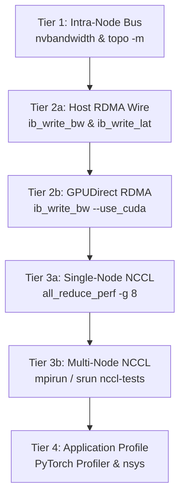
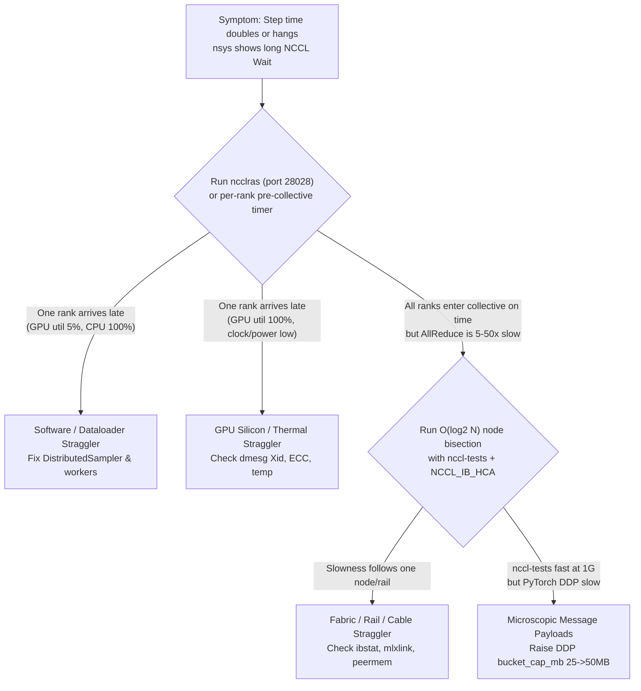

# 12.17 nccl-tests and fabric benchmarking

| | |
|---|---|
| Level | Advanced |
| Priority tier | 1 |
| Lab venue | Nebius GPU |
| Part | Part 12: Complete AI networking |
| Sources | `ai-systems-performance-engineering` (Ch. 4); `distributed-ai-systems` (Ch. 10); `nvidia-devops` (Volume 05 Lab 02, Volume 07 Ch. 10 & Lab 03, Volume 08 Lab 02, Volume 10 Ch. 9 & Deep Dive 3, Volume 13 Ch. 8, Ch. 11 & Lab 02, Volume 20 Straggler Detection) |
| Coverage file | `planning/coverage/chapters/12-17.md` |
| Claim ledger | `planning/ledgers/12-17.md` |

## Why this matters for AI infrastructure

A distributed AI cluster that completes a training job or returns HTTP responses from an inference endpoint is not necessarily operating at its hardware speed of light. Consider a team training a large language model across `64` GPUs (`8` nodes of `8` GPUs each) on `$100,000` worth of accelerators. The training loop converges without crashing, yet cluster telemetry reveals `45%` average GPU utilization and `52%` scaling efficiency from `8` to `64` GPUs. Paying for `64` GPUs while extracting the effective throughput of `33.28` (`~33`) GPUs leaves `30.72` (`~31`) GPU-equivalents idle waiting on network collectives or data loading. Over a two-week (`336`-hour) run, those `30.72` wasted GPUs burn `10,321.92` GPU-hours—roughly `$46,448.64` (`~$50,000`) at `$4` to `$5` per GPU-hour (`$4.50`/GPU-hour midpoint). In a similar two-week `64`-GPU incident where `45%` GPU utilization was caused by storage starvation rather than compute, a `$50` NVMe SSD upgrade would have prevented `$10,000` in wasted GPU time. On the serving side, evaluating `vLLM` against `SGLang` with fixed `100`-token synthetic prompts masks real production traffic where prompts span `50` to `5,000` tokens (`SGLang` radix attention yields `40%` higher throughput on variable-length shared prefixes) and tail latency spikes to `500 ms` `P99`—`2.5x` a `200 ms` `P99` service-level agreement (SLA).

You cannot diagnose a degraded optical transceiver, a PCIe root-complex downtrain from `x16` to `x8`, a missing `nvidia_peermem` kernel module, or a silent `NCCL` fallback to TCP sockets from inside a full PyTorch model script. High-level frameworks interleave data loading, autograd kernel launches, memory caching allocators, and asynchronous CUDA stream hooks. A senior infrastructure engineer isolates the hardware and middleware layers bottom-up—validating intra-node PCIe and NVLink paths (`nvbandwidth`), raw point-to-point RDMA wires (`perftest`: `ib_write_bw`, `ib_write_lat`, `ib_send_lat`), and standalone GPU collectives (`nccl-tests`: `all_reduce_perf`, `reduce_scatter_perf`, `all_gather_perf`, `alltoall_perf`, `broadcast_perf`, `reduce_perf`)—before profiling application-level overlap and scaling efficiency with PyTorch Profiler, NVIDIA Nsight Systems (`nsys`), and `genai-bench`.

## Prerequisites and outcomes

**Prerequisites:**
- Chapter 12.14 (`GPUDirect RDMA, GPUDirect Storage, and Zero-Copy Data Paths`) for BAR1 peer memory (`nvidia_peermem`), PCIe Access Control Services (`ACS`), and `PIX` versus `SYS` NUMA locality.
- Chapter 12.15 (`NCCL: collectives and algorithms`) and Chapter 12.16 (`NCCL: topology, channels, transports and environment variables`) for Ring, Tree, `CollNet`/`SHARP`, `NVLS`, and `PAT` algorithms and transport selection (`P2P`, `SHM`, `NET/IB`, `NET/Socket`).

**Expected learning outcomes:**
After completing this chapter, you will be able to:
1. Execute the three-tier hardware-to-collective validation sequence (`nvbandwidth` $\rightarrow$ `perftest` `ib_write_bw` / `ib_write_lat` $\rightarrow$ `nccl-tests`) to attribute bottlenecks to the exact hardware or software layer.
2. Derive and verify `nccl-tests` algorithmic bandwidth (`algbw`) and bus bandwidth (`busbw`) conversion factors across `AllReduce` (`2(n-1)/n`), `ReduceScatter` / `AllGather` / `AllToAll` (`(n-1)/n`), and `Broadcast` / `Reduce` (`1`), and interpret `out-of-place` versus `in-place` columns and `#wrong` data-integrity counters.
3. Isolate a single degraded straggler node or rail across $N$ nodes in $\lceil \log_2 N \rceil$ binary-search bisection steps, and combine `NCCL_RUN_DIAGNOSTICS=1` (`NCCL 2.31+`) and the `ncclras` daemon (`NCCL 2.24+`, port `28028`) to identify hung or lagging ranks.
4. Design reproducible training and inference benchmarks with warmup (`5–10` eager steps or `20–50` `torch.compile`/CUDA-graph steps), explicit `torch.cuda.synchronize()` barriers, `100+` timed iterations, percentile latency reporting (`P50`, `P95`, `P99`), Amdahl's Law scaling analysis, and statistical accuracy validation (`p = 0.001` vs `p = 0.3`).

---

## 1. The three-tier fabric validation hierarchy (`nvbandwidth`, `perftest`, `nccl-tests`)

When a multi-node job runs `40%` to `60%` slower than expected, testing the full training script first violates fault-isolation discipline. A single symptom—slow `AllReduce` completion—can originate from a motherboard PCIe lane failure, a dirty MPO fiber connector, a missing peer-memory module that forces host bounce buffers, a stopped `nvidia-fabricmanager` daemon, or fragmented `256 KB` framework gradient buckets. To prove mathematically which layer is responsible, benchmark the stack in four sequential tiers from physical silicon up to the framework.



| Validation Tier | Primary Binary / Tool | Target Subsystem | Healthy Reference Baseline | Diagnostic Failure Signature |
|---|---|---|---|---|
| **Tier 1: Intra-node motherboard & NVLink** | `nvbandwidth -t device_to_host_memcpy_ce`, `nvidia-smi topo -m`, `nvidia-smi nvlink --status` | PCIe Gen5 x16 root complex/switches and intra-node NVLink/NVSwitch fabric | `50–60 GB/s` D2H/H2D on PCIe Gen5 x16 (`64 GB/s` raw); `~25 GB/s` per A100 NVLink3 (`~600 GB/s` total); `900 GB/s` H100 NVLink4; `1.8 TB/s` (`18 x 100 GB/s`) B200 NVLink5 | `25–30 GB/s` D2H indicates PCIe downtrained from `x16` to `x8` (`lspci -vv` `LnkSta`); `PIX` missing or `NVLink` `< 20 GB/s` or `inactive` |
| **Tier 2a: Physical RDMA wire (Host RAM)** | `ib_write_bw --report_gbits --duration 30`, `ib_write_lat`, `ib_send_lat`, `ibstat`, `mlxlink` | HCA (`mlx5_0..mlx5_7`), optical transceivers, cables, and switch ASICs | `~390 Gbps` (`48.75 GB/s`, `97.5%` of `400G NDR` `50 GB/s` line rate); stable few-microsecond latency (`1–5 µs`) and zero counter deltas | `~195 Gbps` (`~200 Gbps`) indicates link width downtrained (`4x` $\rightarrow$ `2x`) or rate downshift; rising `symbol_error` or `PortXmitWait` |
| **Tier 2b: GPUDirect RDMA wire (GPU HBM)** | `ib_write_bw -d mlx5_0 --use_cuda=0`, `lsmod \| grep nvidia_peermem` | GPU BAR1 to NIC DMA across shared PCIe switch (`PIX`) | Matches Tier 2a (`~385–390 Gbps` on `400G NDR`) when GPU and NIC share a local PCIe switch (`PIX`, same NUMA node) | Host RDMA is `390 Gbps` but `--use_cuda` drops to `80–120 Gbps`: `nvidia_peermem` unloaded, PCIe `ACS` enabled, or `SYS` cross-socket pairing |
| **Tier 3a: Single-node collectives** | `./build/all_reduce_perf -b 8M -e 8G -f 2 -g 8` | Intra-node NCCL P2P/SHM/NVLS channels and NVSwitch routing | `busbw` approaches NVLink rating at `>= 32 MiB–512 MiB` (e.g., `95.18 GB/s` on PCIe/hybrid baseline; `750–800+ GB/s` on 8x H100 NVSwitch) | `busbw` stuck at `20–90 GB/s` on an NVSwitch node: `nvidia-fabricmanager` down, `ACS` enabled, or `NCCL_P2P_DISABLE=1` / `NCCL_SHM_DISABLE=1` left set |
| **Tier 3b: Multi-node collectives** | `mpirun` / `srun` `all_reduce_perf`, `all_gather_perf`, `reduce_scatter_perf`, `alltoall_perf` | Multi-rail NCCL rings/trees, `SHARP`/`CollNet`, RoCEv2 GID/PFC/ECN | Multi-node `busbw >= 80%` of single-rail-implied or local-node baseline (e.g., `~361.36 GB/s` across `8 x 400G` NDR rails) | Multi-node `busbw` drops to `58.2 GB/s` (`61.15%` of `95.18 GB/s`, failing `80%` gate) or `2.0 GB/s` (`NET/Socket` TCP fallback instead of `NET/IB`) |
| **Tier 4: Framework & application loop** | `torch.profiler`, `nsys profile --trace=cuda,nvtx,osrt`, `ncu`, `TrainingBenchmark` | DDP `bucket_cap_mb` (`25 MB` default), stream overlap, dataloader `num_workers` | `> 80%` GPU utilization, `40%–60%` MFU (`43.48%` / `48%`), `70%–90%+` scaling efficiency, `< 10%` dataloader time | Tiers 1–3 pass at `1 GiB`, but training is `40%` slow: model issues thousands of `256 KB` `AllReduce` calls (fix `bucket_cap_mb` `25 MB` $\rightarrow$ `50 MB`) |

### Why `iperf3` cannot validate an AI fabric

Standard TCP tools such as `iftop`, `nload`, and `iperf3` are useful only for initial management-network reachability or coarse `100 Gbps` (`~12.5 GB/s`) Ethernet sanity checks. `iperf3` drives packets through the Linux kernel TCP/IP socket stack, incurring context switches, skb buffer copies, and software interrupts that bottleneck the host CPU cores well before saturating a `200 Gbps` (`~200 GB/s` aggregate multi-rail) or `400 Gbps` (`50 GB/s` per port) link. Furthermore, if `iperf3` measures `100 Gbps` between two nodes while distributed training achieves only `20 Gbps` effective throughput, `iperf3` cannot tell you whether the loss comes from host-staged GPU copies, NUMA misalignment, or small-message collective launch overhead.

For RDMA fabrics (InfiniBand and RoCEv2), Tier 2 validation always uses the OpenFabrics `perftest` suite (`ib_write_bw`, `ib_read_bw`, `ib_send_bw`, `ib_write_lat`, `ib_send_lat`), which posts Verbs Work Queue Elements (`WQEs`) directly to the Host Channel Adapter (`HCA`) hardware queues, bypassing the OS kernel entirely.

### Reading `nvidia-smi topo -m` and InfiniBand port counters before benchmarking

Before launching `ib_write_bw` or `nccl-tests`, capture the immutable hardware topology and counter baseline on every participating node. On an 8-GPU dual-socket reference node (`node-a`, `node-b`) equipped with eight H100 `80 GB` SXM GPUs (`NV18`—18 bonded fourth-generation NVLinks through NVSwitch) and eight ConnectX-7 (`MT4129`, firmware `28.39.2048`) `NDR400` (`400 Gb/s` = `50 GB/s` theoretical line rate) adapters (`mlx5_0` through `mlx5_7`), `nvidia-smi topo -m` reveals the exact GPU-to-NIC pairing:
- `GPU0` $\leftrightarrow$ `mlx5_0` is `PIX` (traversing at most a single PCIe bridge on NUMA node `0`, CPU cores `0–63, 128–191`).
- `GPU7` $\leftrightarrow$ `mlx5_7` is `PIX` on NUMA node `1` (CPU cores `64–127, 192–255`).
- `GPU0` $\leftrightarrow$ `mlx5_7` is `SYS` (traversing PCIe as well as the inter-socket SMP interconnect, `UPI`/`QPI`, between NUMA nodes `0` and `1`).

Testing `ib_write_bw` on `GPU0` with `mlx5_7` (`SYS`) forces every RDMA payload across the CPU inter-socket link before reaching the wire, corrupting the benchmark before a single packet enters the switch. Similarly, `ibstat mlx5_0` verifies two distinct states: `Physical state: LinkUp` (optical transceiver and cable lock) and logical `State: Active` (OpenSM subnet manager assigned `Base lid: 7`, `SM lid: 1`, `Rate: 400`). A port stuck in `Physical state: LinkUp` with `State: Initializing` points to Subnet Manager (`sminfo`) or partition (`P_Key`) configuration, whereas `Rate: 200` or `Rate: 100` on an `NDR400` port exposes physical link downshifting. Always snapshot `/sys/class/infiniband/mlx5_*/ports/1/counters/*` before and after a run: `port_rcv_data` and `port_xmit_data` will climb by billions of 32-bit words (`8,823,914,021` / `8,801,220,117`), while `symbol_error`, `link_error_recovery`, `link_downed`, `port_rcv_errors`, `local_link_integrity_errors`, `excessive_buffer_overrun_errors`, and `VL15_dropped` must remain flat (`0` delta).

---

## 2. `nccl-tests` architecture, CLI flags, and exact `algbw` versus `busbw` math

The `nccl-tests` suite (`https://github.com/NVIDIA/nccl-tests`) compiles standalone C++/CUDA binaries—`all_reduce_perf`, `all_gather_perf`, `reduce_scatter_perf`, `alltoall_perf`, `broadcast_perf`, `reduce_perf`, `sendrecv_perf`, `gather_perf`, `scatter_perf`, and `hypercube_perf`—that allocate device buffers, initialize NCCL communicators, and time collective kernels in a tight loop without Python, autograd, or storage overhead.

### Core `nccl-tests` CLI flags

| Flag | Parameter Name | Default | Operational Meaning and Sizing Guidance |
|---|---|---|---|
| `-b <bytes>` | `--minbytes` | `32M` | Starting tensor size in bytes (supports suffixes `K`, `M`, `G`, e.g., `-b 8` or `-b 8M`). Sweep from `4 KiB–64 KiB` to expose latency and `128 MiB–8 GiB` to saturate bandwidth. |
| `-e <bytes>` | `--maxbytes` | `32M` | Ending tensor size in bytes (e.g., `-e 128M`, `-e 1G`, `-e 8G`, `-e 10G`). Must be large enough to amortize startup latency (`>= 256 MiB–1 GiB` on NVLink4/5 and multi-rail NDR/XDR). |
| `-f <int>` | `--stepfactor` | `1` (disabled) | Multiplicative step factor between message sizes (typically `-f 2` to double size each row: `8M`, `16M`, `32M`, ..., `1G`). |
| `-g <int>` | `--ngpus` | `1` | Number of GPUs managed **per process/thread**. Use `-g 8` for a single-process 8-GPU local run, or `-g 1` when launching 1 MPI/Slurm process per GPU (`--ntasks-per-node=8`). |
| `-t <int>` | `--nthreads` | `1` | Number of CPU threads per process. Total collective ranks $n = \text{processes} \times \text{threads} \times g$. |
| `-w <int>` | `--warmup_iters` | `5` | Untimed warmup iterations executed at each message size before starting the CUDA event timer. Increase to `10–20` on large multi-rack fabrics. |
| `-n <int>` | `--iters` | `20` | Timed measurement iterations averaged per row (use `-n 100` for production burn-in and jitter detection). |
| `-c <0\|1\|N>` | `--check` | `1` | Data-integrity verification iteration count (`0` disables checking for fast sweeps; `1` compares collective output against expected math and populates the `#wrong` column). |
| `-d <type>` | `--datatype` | `float` | Element datatype (`int8`, `uint8`, `int32`, `int64`, `half`, `float`, `double`, `bfloat16`, `fp8_e4m3`, `fp8_e5m2`). |
| `-o <op>` | `--op` | `sum` | Reduction operator (`sum`, `prod`, `min`, `max`, `avg`, `all`). |
| `-R <0\|1\|2>` | `--local_register` | `0` | Enables persistent user-buffer registration (`1` = `ncclCommRegister` local, `2` = symmetric `ncclMemAlloc`) to test zero-copy `NVLS`/`SHARP` paths. |

### Deriving `algbw` and `busbw` from first principles

For a collective operating on a buffer of size $S$ bytes that completes in elapsed time $t$ seconds across $n$ ranks, `nccl-tests` reports two bandwidth columns in decimal gigabytes per second ($\text{GB/s} = 10^9\text{ B/s}$):

1. **Algorithmic bandwidth (`algbw`):** The apparent rate at which the logical collective tensor size $S$ is processed:
   $$\text{algbw} = \frac{S}{t}$$
   If an `all_reduce_perf` call reduces an $S = 400\text{ MB}$ ($4 \times 10^8\text{ B}$) gradient buffer in $t = 4.00\text{ ms}$ ($0.004\text{ s}$), then $\text{algbw} = \frac{400\text{ MB}}{0.004\text{ s}} = 100.0\text{ GB/s}$.

2. **Bus bandwidth (`busbw`):** Because a collective requires multiple hops across physical links, $\text{algbw}$ under-reports actual hardware link utilization for `AllReduce` and depends on the rank count $n$. `busbw` normalizes $\text{algbw}$ by the minimum theoretical per-rank data volume required to execute the collective on an optimal ring topology, making `busbw` **directly comparable to the hardware's rated physical link speed** (such as `50 GB/s` per `400G NDR` NIC or `900 GB/s` on H100 NVLink4) regardless of the number of GPUs $n$:

| `nccl-tests` Binary | Collective Operation | Logical Input $\rightarrow$ Output | Per-Rank Bytes Transferred | Exact `busbw` Conversion Formula | Factor at $n=2$ | Factor at $n=4$ | Factor at $n=8$ | Factor at $n=64$ | Factor at $n=72$ |
|---|---|---|---|---|---|---|---|---|---|
| `all_reduce_perf` | `AllReduce` | $S$ on each rank $\rightarrow$ reduced $S$ on every rank | $\frac{2(n - 1)}{n} \cdot S$ | $\text{busbw} = \text{algbw} \cdot \frac{2(n - 1)}{n}$ | `1.0000` | `1.5000` | `1.7500` | `1.96875` | `1.972222` (`142/72`) |
| `reduce_scatter_perf` | `ReduceScatter` | $S$ on each rank $\rightarrow$ reduced $S/n$ shard per rank | $\frac{n - 1}{n} \cdot S$ | $\text{busbw} = \text{algbw} \cdot \frac{n - 1}{n}$ | `0.5000` | `0.7500` | `0.8750` | `0.984375` | `0.986111` (`71/72`) |
| `all_gather_perf` | `AllGather` | $S/n$ shard per rank $\rightarrow$ gathered $S$ on every rank | $\frac{n - 1}{n} \cdot S$ | $\text{busbw} = \text{algbw} \cdot \frac{n - 1}{n}$ | `0.5000` | `0.7500` | `0.8750` | `0.984375` | `0.986111` (`71/72`) |
| `alltoall_perf` | `AllToAll` | $n$ distinct $S/n$ chunks exchanged with $n$ peers | $\frac{n - 1}{n} \cdot S$ | $\text{busbw} = \text{algbw} \cdot \frac{n - 1}{n}$ | `0.5000` | `0.7500` | `0.8750` | `0.984375` | `0.986111` (`71/72`) |
| `broadcast_perf` | `Broadcast` | $S$ on root rank $\rightarrow$ $S$ replicated to $n-1$ ranks | $1.0 \cdot S$ | $\text{busbw} = \text{algbw} \cdot 1$ | `1.0000` | `1.0000` | `1.0000` | `1.0000` | `1.0000` |
| `reduce_perf` | `Reduce` | $S$ on each rank $\rightarrow$ reduced $S$ on root rank | $1.0 \cdot S$ | $\text{busbw} = \text{algbw} \cdot 1$ | `1.0000` | `1.0000` | `1.0000` | `1.0000` | `1.0000` |

Why does `AllReduce` multiply $\text{algbw}$ by $\frac{2(n-1)}{n}$? A ring `AllReduce` decomposes into an $(n-1)$-step `ReduceScatter` pass followed by an $(n-1)$-step `AllGather` pass, each moving $n-1$ chunks of size $\frac{S}{n}$ per GPU for a total of $2(n-1)$ steps and $\frac{2(n-1)}{n}S$ bytes per GPU. At $n = 2$ GPUs, $\frac{2(2-1)}{2} = 1.0$, so $\text{busbw} = \text{algbw}$. At $n = 8$ GPUs, $\frac{2(8-1)}{8} = \frac{14}{8} = 1.75$, meaning every GPU transmits and receives $1.75 \times S$ bytes over its links to complete an `AllReduce` of size $S$. As $n \to \infty$, $\frac{2(n-1)}{n} \to 2.0$, so `algbw` can never exceed half of the physical bottleneck link bandwidth for a ring `AllReduce` at large scale.

### Annotating an `all_reduce_perf` output table

Consider an `8`-GPU `all_reduce_perf` sweep from `8 MiB` (`8,388,608` bytes, `2,097,152` `float32` elements) to `512 MiB` (`536,870,912` bytes, `134,217,728` `float32` elements):

```text
#                                                              out-of-place                       in-place
#       size         count      type   redop    root     time   algbw   busbw #wrong     time   algbw   busbw #wrong
#        (B)    (elements)                               (us)  (GB/s)  (GB/s)            (us)  (GB/s)  (GB/s)
     8388608       2097152     float     sum      -1    412.3   20.35   35.61      0    410.0   20.46   35.81      0
    67108864      16777216     float     sum      -1   1653.1   40.60   71.05      0   1645.0   40.80   71.40      0
   536870912     134217728     float     sum      -1   9871.4   54.39   95.18      0   9820.0   54.67   95.67      0
```

Every column carries specific operational meaning:
- **`size (B)` and `count (elements)`:** For `float` (`4` bytes/element), $\text{size} = 4 \times \text{count}$ (`8,388,608 = 4 * 2,097,152`).
- **`out-of-place` vs `in-place`:** In `out-of-place` mode, `sendbuff` and `recvbuff` are separate GPU allocations; in `in-place` mode (`sendbuff == recvbuff`), results overwrite the input buffer directly (matching PyTorch DDP gradient buckets). For `8` GPUs (`factor = 1.75`), verify the arithmetic on each row:
  - At `8 MiB` (`8,388,608` B) in `412.3 µs`: $\text{algbw} = \frac{8,388,608}{412.3 \times 10^3} = 20.35\text{ GB/s}$, and $\text{busbw} = 20.35 \times 1.75 = 35.61\text{ GB/s}$.
  - At `64 MiB` (`67,108,864` B) in `1653.1 µs`: $\text{algbw} = \frac{67,108,864}{1653.1 \times 10^3} = 40.60\text{ GB/s}$, and $\text{busbw} = 40.60 \times 1.75 = 71.05\text{ GB/s}$.
  - At `512 MiB` (`536,870,912` B) in `9871.4 µs`: $\text{algbw} = \frac{536,870,912}{9871.4 \times 10^3} = 54.39\text{ GB/s}$, and $\text{busbw} = 54.39 \times 1.75 = 95.18\text{ GB/s}$.
- **`#wrong`:** Must be `0` on every row. Any non-zero `#wrong` count means the collective completed but corrupted floating-point values in transit (for example, due to silent data corruption, bad HBM/SRAM, or unaligned buffer registration)—a correctness bug that invalidates any throughput figure.
- **Single-node vs multi-node acceptance gate:** If the local single-node baseline at `512 MiB` is `95.18 GB/s` (passing a `>= 90 GB/s` platform gate), and a multi-node collective requires `>= 80%` of the baseline (`>= 76.14 GB/s`), an observed multi-node result of `58.2 GB/s` (`61.15%` of local) is an immediate **Fail** that narrows the fault to inter-node RDMA transport or rail placement. On an 8-GPU H100 SXM NVSwitch node (`900 GB/s` bidirectional NVLink4 per GPU), a `1 GiB` (`1,073,741,824` B) single-node `all_reduce_perf` completing in `2,480.0 µs` achieves $\text{algbw} = 432.96\text{ GB/s}$ and $\text{busbw} = 757.68\text{ GB/s}$, whereas an `8`-node (`64`-GPU) `8 x 400G` NDR InfiniBand run completing `1 GiB` in `5,850.0 µs` (`factor = 1.96875`) achieves $\text{algbw} = 183.55\text{ GB/s}$ and $\text{busbw} = 361.36\text{ GB/s}$ (`~45.17 GB/s` per `50 GB/s` rail).

---

## 3. Benchmarking methodology, training scaling efficiency, and Amdahl's Law

Moving from standalone microbenchmarks to distributed training benchmarks requires strict statistical methodology; otherwise, thermal drift, lazy kernel compilation, or asynchronous CUDA queuing will produce misleading numbers.

### Three rules of reproducible GPU benchmarking

1. **Warmup before measurement:** The first execution of a CUDA operation triggers lazy JIT kernel compilation, cuBLAS/NCCL handle initialization, caching-allocator block reservation, and instruction cache population. Run `5–10` warmup iterations for standard eager PyTorch, or `20–50` warmup iterations when `torch.compile` or CUDA Graphs spend early steps capturing and compiling graphs.
2. **Synchronize before starting and stopping the timer:** CUDA kernel launches and `dist.all_reduce` calls are asynchronous on the host CPU. Always call `torch.cuda.synchronize()` immediately after warmup (before recording `start_time`) and again immediately before recording `end_time` so you measure completed GPU execution rather than Python queue-dispatch latency.
3. **Run `100+` iterations and report percentiles (`P50`, `P95`, `P99`):** A single iteration tells you nothing about thermal throttling, background daemon jitter, or fabric congestion. Run at least `100` timed iterations and report mean, standard deviation, median (`P50`), `P95`, and `P99`.

### Key distributed training metrics and phase decomposition

A complete training benchmark (`TrainingBenchmark`) instruments four phases per step—`data_loading`, `forward`, `backward`, and `optimizer`—alongside three fleet-level efficiency metrics:

- **Samples per Second (and Tokens per Second):** Aggregate training throughput across all GPUs. Processing `1,000` samples/second on a `1,000,000`-sample dataset completes one epoch in `1,000` seconds (`~16.67` / `~17` minutes).
- **GPU Utilization versus Model FLOPs Utilization (`MFU`):** `nvidia-smi` GPU utilization reports only the fraction of time *at least one* kernel is active on the GPU—a rank spin-waiting inside `ncclKernel_AllReduce` or running tiny unfused memory-bound kernels still displays `98%–100%` `nvidia-smi` utilization. `MFU` measures true useful math throughput against silicon peak ($\text{MFU} = \frac{6 \times N_{\text{params}} \times \text{tokens/sec}}{\text{Peak Theoretical FLOPs/sec}}$). For a `70B`-parameter model on `8` H100 SXM GPUs (`8 x 989 TFLOPS = 7,912 TFLOPS` peak BF16), a dataloader-starved run at `3,200` tokens/sec achieves $6 \times 70 \times 10^9 \times 3,200 = 1,344\text{ TFLOPS}$, or `16.99%` (`~17%`) `MFU`. Increasing dataloader workers and moving augmentations to the GPU raises throughput to `9,000` tokens/sec ($3,780\text{ TFLOPS}$), reaching `47.78%` (`~48%`) `MFU`—squarely in the `40%–50%` (`40%–60%`) production target range.
- **Phase-level diagnostic rules:**
  - If `data_loading` exceeds `10%` of total iteration time (and GPU utilization sits below `80%`, e.g., `30%`), increase PyTorch `DataLoader` `num_workers` to `2–4x` the CPU cores per GPU (on a dual-socket `112`-core DGX H100 with `2 x 56` cores, `14` cores/GPU exist physically, so allocate `--cpus-per-task=12` or `14` in Slurm) and set `pin_memory=True`.
  - If `backward` takes more than `2x` to `3x` `forward`, inspect gradient synchronization stalls, activation recomputation, or memory fragmentation.
- **Communication Overhead growth with scale:** On a single GPU, communication overhead is `0%`. As you scale from `1` GPU (`155 ms` iteration time) to `16` GPUs (`33 ms` iteration time, a `4.70x` speedup), communication overhead can grow to `55%` of the step (`18.15 ms` spent in gradient synchronization versus `14.85 ms` in compute), explaining why doubling GPUs fails to halve step time.

### Scaling efficiency and Amdahl's Law

**Scaling efficiency** ($\eta_N$) quantifies the fraction of ideal linear speedup retained on $N$ GPUs:
$$\eta_N = \frac{\text{Throughput}_N}{N \times \text{Throughput}_1} = \frac{\text{Speedup}_N}{N}$$

If `8` GPUs deliver `6.5x` the throughput of `1` GPU, the scaling efficiency is $\frac{6.5}{8} = 81.25\%$ (`~81%`), meaning `18.75%` (`~20%`) of the hardware investment is lost to coordination overhead. Using $\eta_8 = 81.25\%$ as a first-order baseline predicts that `16` GPUs will deliver roughly $16 \times 0.8125 = 13.0\times$ (`~13x`) throughput rather than `16x`.

| Scaling Efficiency Band | Operational Rating | Root-Cause Interpretation and Action |
|---|---|---|
| `> 90%` | **Excellent** | Compute dominates; `DDP`/`FSDP` communication is almost completely hidden under backward compute (`WFBP`). |
| `70%–90%` | **Good** | Typical for well-tuned multi-node distributed training; monitor `bucket_cap_mb` and rail balance. |
| `50%–70%` | **Moderate** | Significant communication overhead (`30%–50%` of step); check network topology, `SHARP`/`NVLS`, gradient accumulation, or `FP8`/gradient compression. |
| `< 50%` | **Poor** | Severe bottleneck (`55%+` comm overhead, TCP fallback, straggler rank, or dataloader starvation); halt expansion and run the 3-tier diagnostic ladder. |

**Amdahl's Law** sets the hard upper bound on speedup when a fraction $s$ of the iteration is strictly serial (unoverlapped collective barriers, CPU synchronization points, or non-parallelized preprocessing) and $p = 1 - s$ is parallelizable:
$$\text{Speedup}(N) = \frac{1}{s + \frac{1 - s}{N}} \xrightarrow{N \to \infty} \frac{1}{s}$$
With a `10%` serial fraction ($s = 0.10$), even an infinite number of GPUs can never exceed a `10.0x` speedup, and `64` GPUs are mathematically capped at $\frac{1}{0.10 + 0.90/64} = 8.77\times$ (`13.70%` scaling efficiency).

---

## 4. Isolating stragglers, silent fallbacks, and hung collectives at scale

In synchronous data-parallel (`DDP`, `FSDP`, `ZeRO`) and tensor/expert-parallel training, every collective is a barrier: a `1,000`-GPU cluster runs at the exact speed of its slowest rank. When one GPU or network rail degrades, the other `999` GPUs spin inside `ncclKernel_AllReduce` waiting for data to arrive.



| Isolation Branch | Primary Diagnostic Evidence | Root Cause | Remediation |
|---|---|---|---|
| **Software / Dataloader Straggler** | Pre-collective timer shows GPU `2` takes `1,250.5 ms` vs `124.8–126.1 ms` on GPUs `0, 1, 3` (`10.02x` ratio); `nvidia-smi dmon` shows GPU `2` at `5%` SM util / `40 W` while peers are at `96%–98%` / `315–320 W` | Unequal batch distribution, missing `DistributedSampler`, or single-threaded CPU audio/image decompression pinning one host core at `100%` | Enforce equal per-rank batch sizes with `DistributedSampler`, increase `num_workers`, and bind NUMA cores cleanly |
| **GPU Silicon / Thermal Straggler** | `DCGM_FI_PROF_PIPE_TENSOR_ACTIVE` on one GPU is `> 0.15` (`15` percentage points) below node average while `DCGM_FI_DEV_GPU_UTIL > 80%`; `clocks_event_reasons.hw_slowdown` is `Active` | Thermal throttling (cooling loop degradation dropping MFU from `45%` to `28%` over hours), row-remap/ECC faults, or `Xid 48`/`74`/`79` | Drain node via Slurm Epilog/NHC, inspect `dmesg` and `nvidia-smi -q -d TEMPERATURE,CLOCK`, and RMA or reseat hardware |
| **Fabric / Rail / NVLink Straggler** | `all_reduce_perf` drops from `800 GB/s` to `90 GB/s` after reboot (`nvidia-fabricmanager` inactive), or `nvidia-smi nvlink --status` shows Link `3` `DEGRADED (5 GB/s)` / `FAILED (0 Mbps)` vs `25 GB/sec`, or one HCA rail has high `PortXmitWait` | Degraded optical transceiver, loose NVLink/MPO cable, stopped `nvidia-fabricmanager`, or `NET/Socket` fallback (`2.0 GB/s` vs `100.0 GB/s`) | Restart `nvidia-fabricmanager`, isolate rail with `NCCL_IB_HCA=mlx5_x:1`, run `O(\log_2 N)` node bisection, and cordon faulty node |
| **Microscopic Message Payloads** | `ib_write_bw` hits `400 Gbps` (`~390 Gbps`) and `all_reduce_perf` hits expected `busbw` at `1 GiB`, but 8-node PyTorch training is `40%` slower than calculated | Model has thousands of tiny layers issuing `256 KB` `AllReduce` calls where per-message handshake latency dominates wire bandwidth | Increase PyTorch DDP `bucket_cap_mb` from the `25 MB` (`25 MiB`) default to `50 MB` and verify kernel coalescing in Nsight Systems (`nsys`) |

### Why post-collective timers lie—and how to instrument pre-collective arrival

A classic beginner mistake is recording `iter_end = time.time()` *after* `dist.all_reduce(loss)`. Because `all_reduce` is a barrier, fast ranks block inside the collective until the straggler arrives, making total step time look identical across all ranks. To expose a compute or dataloader straggler, synchronize the GPU (`torch.cuda.synchronize()`) and record each rank's timestamp **immediately before** entering the collective (or inspect PyTorch's `torch.distributed.monitored_barrier` / `ncclras`). When Rank `0`, `1`, and `3` reach the barrier in `125.3 ms`, `126.1 ms`, and `124.8 ms` while Rank `2` takes `1,250.5 ms` (`10.02x` slower), Rank `2` is the straggler; the other three ranks simply spent `~1,125 ms` waiting for Rank `2`.

### Active NCCL diagnostics (`NCCL 2.31+`) and the `ncclras` daemon (`NCCL 2.24+`)

Modern NCCL releases include two built-in diagnostic mechanisms that eliminate guesswork during cluster bring-up and live hangs:
1. **Init-time active diagnostics (`NCCL_RUN_DIAGNOSTICS=1`, NCCL `2.31+`):** When enabled, NCCL executes hardware and topology verification checks during `ncclCommInitRank` before any user workload runs, printing `NCCL DIAG` lines from rank `0`. Checks that pass print `[OK]`; anomalies print `[INFO]`, such as `p2p: only 52/56 GPU-to-GPU peer accesses passed verification` on an 8-GPU node ($8 \times 7 = 56$ directed P2P pairs), immediately pinpointing a broken NVLink pair before training starts.
2. **Reliability, Availability, and Serviceability (`ncclras`, NCCL `2.24+`):** NCCL runs a background RAS thread inside each process that forms a peer keep-alive mesh listening on `localhost:28028` by default (configurable via `NCCL_RAS_ADDR`). When a job hangs, connect from any node in the job:
   ```bash
   # (untested here) Query the live NCCL RAS subsystem on port 28028
   ncclras -v
   echo verbose status | nc localhost 28028
   ```
   The output prints a per-communicator table with `Status` and `Errors` columns:
   - A `MISMATCH` row (`"Communicator ranks have different collective operation counts"`) lists how many ranks have launched up to each operation sequence number and explicitly names the lagging ranks (GPU index, PID, and hostname) that failed to reach the collective. (Query twice a few seconds apart to confirm the operation counts are static rather than simply in flight.)
   - An `INCOMPLETE` row identifies a dead or unresponsive rank whose process crashed or whose GPU fell off the bus (`NVRM: Xid 79`), while RAS automatically routes around the dead peer to return the diagnostic summary quickly.

Note that `"Watchdog caught collective operation timeout"` / `"watchdog thread terminated"` is raised by **PyTorch's** `ProcessGroupNCCL` wrapper (`TORCH_NCCL_*` environment variables and `TORCH_FR_BUFFER_SIZE` / `TORCH_NCCL_TRACE_BUFFER_SIZE` flight recorder), not by NCCL itself (`NCCL_WATCHDOG_DUMP` does not exist in NCCL).

### Binary-search node bisection ($\lceil \log_2 N \rceil$) and per-rail isolation

When `all_reduce_perf` across $N$ nodes is slow because all ranks enter the collective on time but one node has a degraded NIC, cable, or PCIe switch, testing all $N$ nodes sequentially or running $\binom{N}{2}$ pairwise tests takes too long. Instead, run **binary-search bisection**:
1. Split the $N$ nodes into two halves of $N/2$ nodes (`left` and `right`) and run `all_reduce_perf` on each half.
2. Whichever half exhibits the degraded `busbw` contains the straggler node; the other half is proven healthy and provides a known-good reference node when a subset eventually shrinks to $1$ node.
3. Repeat by halving the suspect group until a single node is isolated in exactly $\lceil \log_2 N \rceil$ split steps ($\lceil \log_2 N \rceil + 1$ total runs including the initial full-cluster test):
   - On $N = 8$ nodes: $\lceil \log_2 8 \rceil = 3$ split steps (`4` total runs).
   - On $N = 64$ nodes: $\lceil \log_2 64 \rceil = 6$ split steps (`7` total runs vs `64` linear runs, saving `58` runs).
   - On $N = 128$ nodes: $\lceil \log_2 128 \rceil = 7$ split steps (`8` total runs vs `128` linear runs, saving `121` runs).

Once the suspect node (or node pair) is isolated, test each of its `8` InfiniBand rails individually by restricting `NCCL_IB_HCA` (for example, `NCCL_IB_HCA==mlx5_0:1`, then `=mlx5_1:1`, ..., `=mlx5_7:1`) or running `ib_write_bw -d mlx5_<k>` per rail alongside `ibdiagnet` and `perfquery -x <lid>`.

---

## 5. Profiling tools (`torch.profiler`, `nsys`, `NCCL_PROFILER_PLUGIN`), inference benchmarking (`genai-bench`), and accuracy validation

Once the physical fabric and `nccl-tests` pass their acceptance gates, the remaining performance gap lives inside the application runtime—where compute kernels, communication streams, memory allocators, and serving schedulers interact.

### PyTorch Profiler, NVIDIA Nsight Systems (`nsys`), and the `NCCL_PROFILER_PLUGIN` API

Start with **PyTorch Profiler** (`torch.profiler`) for phase-level visibility (`record_function` labels, `activities=[ProfilerActivity.CPU, ProfilerActivity.CUDA]`, `record_shapes=True`, `profile_memory=True`, `with_stack=True`). For multi-iteration training jobs, use `torch.profiler.schedule(wait=2, warmup=2, active=4, repeat=1)` with `tensorboard_trace_handler` or export `trace.json` for `chrome://tracing`. In the operator table sorted by total CUDA time, compute kernels appear as `aten::matmul` and `aten::linear`, whereas collective communication overhead appears as `nccl:all_reduce` and `nccl:all_gather`.

When you need microsecond-accurate hardware timelines across multiple CUDA streams, host OS threads, and NICs, move to **NVIDIA Nsight Systems (`nsys`)**:
```bash
# (untested here) Capture CUDA kernels, NVTX ranges, and OS runtime events
nsys profile --trace=cuda,nvtx,osrt --output=training_profile.nsys-rep python train.py
nsys stats --report gputrace training_profile.nsys-rep
```
In an unoptimized synchronous loop (`train_no_overlap`), `nsys` shows a strict two-phase split: all backward compute kernels (`fc3`, `fc2`, `fc1`) execute first (`10.0 ms`), and only after `loss.backward()` finishes do the `ncclDevKernel_AllReduce` kernels launch (`12.0 ms`), yielding a serial `22.0 ms` step where compute SMs sit idle during communication. With PyTorch `DistributedDataParallel` (`DDP`) wait-free backpropagation (`WFBP`, default `25 MB` / `25 MiB` buckets), `nsys` shows a sawtooth pipeline where `ncclDevKernel_AllReduce` on the background communication CUDA stream overlaps with backward compute on the default stream—cutting total iteration time from `22.0 ms` to `~12.0 ms` (`45.45%` faster), or in a standard multi-layer benchmark from `100.0 ms` (`60%` SM utilization, `0%` overlap) down to `70.0 ms` (`90%` SM utilization, `30.0%` faster with `~50%` communication covered by compute). Similarly, replacing single-process `nn.DataParallel` (`DP`, `45.00 ms` per step on a `[512, 1024]` batch split into two `[256, 1024]` shards due to Python GIL contention and GPU `0` gradient gathering) with multi-process `DDP` drops step time to `30.00 ms` (`33.33%` faster). Avoid accidental `torch.cuda.synchronize()` calls or `.item()` / `print()` tensor transfers inside the step loop, which destroy stream overlap.

To give third-party profilers such as PyTorch Kineto hierarchical visibility into internal NCCL proxy and network events without high CUPTI overhead, NCCL exposes the dynamic **`NCCL_PROFILER_PLUGIN`** interface. When loaded via `NCCL_PROFILER_PLUGIN=<lib>`, the plugin configures a `32`-bit event activation mask (covering group, collective, point-to-point, and proxy operations) and implements five C callbacks:
1. `init`: initializes the profiler context and returns the active event mask.
2. `startEvent`: receives an event descriptor and allocates an opaque event handle when a collective or proxy step begins.
3. `stopEvent`: marks event completion and recycles handle resources.
4. `recordEventState`: tracks fine-grained state transitions across proxy queues and RDMA completions.
5. `finalize`: releases profiler resources when the communicator is destroyed.

### Understanding percentile latencies and LLM inference metrics (`TTFT`, `ITL`, `TPOT`, `TPS`, `RPS`)

In production inference serving, average latency hides tail-latency violations. Compare two serving deployments against a `200 ms` `P99` SLA:
- **System A** has `100.0 ms` average latency with every request completing tightly between `90.0 ms` and `110.0 ms` (`P50 = 100.0 ms`, `P95 = 109.0 ms`, `P99 = 110.0 ms`). System A passes the `200 ms` SLA with margin.
- **System B** has a lower `80.0 ms` average latency (`95%` of requests complete in `57.89 ms`), but `5%` of requests hit long-context KV-cache stalls or garbage collection and take `500.0 ms` (`P50 = 57.89 ms`, `P95 = 57.89 ms`, `P99 = 500.0 ms`). Despite a better average, System B violates the `200 ms` `P99` SLA by `2.5x`. Always plot the Cumulative Distribution Function (`CDF`) and report `P50` (median typical behavior), `P95` (common SLA target), and `P99` (worst-case user experience). A `10x` `P99/P50` ratio (e.g., `P50 = 50 ms`, `P99 = 500 ms`) signals queuing contention, memory fragmentation, or cold-cache spikes.

Autoregressive LLM inference requires cinco distinct engineering metrics:
1. **Time to First Token (`TTFT`):** Elapsed time from request arrival through tokenization, prompt prefill (compute-bound matrix multiplications building the KV cache), first token generation, and detokenization. Users perceive `TTFT` as initial responsiveness.
2. **Inter-Token Latency (`ITL`), also called Time per Output Token (`TPOT`):** Average time between consecutive generated tokens during the memory-bandwidth-bound decode phase. Users perceive `ITL`/`TPOT` as streaming typing speed.
3. **End-to-End Request Latency (`e2e_latency`):** Total time from query submission to final token completion:
   $$\text{e2e\_latency} = \text{TTFT} + (\text{output\_tokens} - 1) \times \text{ITL}$$
   With $\text{TTFT} = 45.0\text{ ms}$ and $\text{ITL} = 10.0\text{ ms}$, a short `16`-token response (`10–20` token regime) takes $45.0 + 15 \times 10.0 = 195.0\text{ ms}$ (`TTFT` accounts for `23.08%` of total time), whereas a long `201`-token response takes $45.0 + 200 \times 10.0 = 2,045.0\text{ ms}$ (`decode` accounts for `2,000.0 ms` or `97.80%` of total time).
4. **Tokens per Second (`TPS`) and Requests per Second (`RPS`):** `TPS` measures token generation throughput (which climbs with concurrency until GPU compute or HBM saturates), while `RPS` measures end-to-end API request capacity including routing and queueing.

For disaggregated prefill-and-decode inference across nodes and racks (such as NVIDIA Dynamo), point-to-point KV cache transfers (`1 MiB` to `100 GB`) use **NVIDIA NIXL** (`nixlAgent`, `registerMem`, `trim`, `prepXfer`, `postXfer`, `checkXfer`, `releaseReqH`, `deregisterMem`) over `UCX`, GPUDirect RDMA, and `IBGDA` rather than synchronous NCCL collectives—delivering up to a `14x` `TTFT` speedup from KV cache offloading on PCIe x86 H100 systems, an additional `2x` `TTFT` speedup on Grace Hopper (`GH200`) over `900 GB/s` `NVLink-C2C`, and up to `30x` higher inference throughput on a `~680B`-parameter LLM across a `72`-GPU Blackwell `GB200 NVL72` rack (`130 TB/s` NVSwitch bisection, `< 1 µs` latency).

### Workload-realistic inference benchmarking (`genai-bench`), cold starts, and reasoning models

Benchmarking an inference server (`vLLM`, `SGLang`, `TensorRT-LLM`, or `NVIDIA GenAI-Perf` / `NIM`) by sending identical prompts in a constant-concurrency loop misses production behavior:
- **`genai-bench` traffic matrices:** `genai-bench` (`pip install genai-bench`) models deterministic and stochastic prompt/completion distributions across a concurrency matrix. Scenario `D(100,100)` sends deterministic `100`-input / `100`-output token requests for controlled baseline comparisons; `D(512,512)` and variable distributions (`10` to `10,000` tokens) expose non-linear KV-cache memory pressure and prefix-caching gains.
- **Cold start versus warm decode:** The first request after model load incurs JIT kernel compilation, weight paging, and KV cache allocation—running `3–5x` slower than warm decode for small (`1–3B`) models, `~16x` slower for mid-size LLMs, and `50x+` slower for `70B+` checkpoints (`30 s` cold start versus `100 ms` warm request = `300x`). Benchmark both cold and warm paths so autoscalers maintain enough minimum warm instances to avoid `30 s` user stalls.
- **Reasoning and multi-step agentic models:** Chain-of-thought and tool-augmented workflows execute multiple LLM calls interleaved with external API requests, vector retrieval, and database queries. Decompose per-step `TTFT`/`ITL`, end-to-end session latency, and external wait time: in production agentic workloads, `60%` or more of total session latency comes from external tool/API/database calls rather than GPU inference.

### Validating distributed training and inference accuracy

Performance optimizations that silently corrupt model quality are regressions, not speedups.
- **Distributed training accuracy validation:** Bugs in gradient reduction scaling (such as missing `/ world_size`), altered effective batch sizes under gradient accumulation, or `FP8`/mixed-precision underflow can leave training loss curves looking normal while downstream test accuracy drops by `8%`. Always compare distributed training against a single-GPU baseline on a held-out evaluation set using statistical significance tests (`t`-test / bootstrap): a `0.5%` accuracy difference with $p = 0.3$ is random run-to-run noise, whereas a `0.5%` drop with $p = 0.001$ is a statistically significant bug requiring immediate investigation.
- **Inference accuracy validation:** `INT8` or `FP4` quantization may double (`2x`) `TPS` throughput, but if accuracy on math or code benchmarks drops by `15%`, or if two serving engines (`vLLM` vs `SGLang`) diverge due to sampling or kernel accumulation order, you must catch it before deployment. Pair every performance benchmark (`genai-bench`) with standardized accuracy suites (`GLUE`/`SuperGLUE`, `MMLU`, `HumanEval` `Pass@k`, `HELM`, `BLEU`, `ROUGE`, `BERTScore`, `F1`, or `NVIDIA NeMo Evaluator`) and gate CI/CD on both `P99` latency and statistical accuracy parity ($p > 0.05$).

---

## Commands and configurations that matter

### 1. Tier 1 & Tier 2: Intra-node `nvbandwidth` and point-to-point RDMA `perftest`

```bash
# (untested here) Tier 1: Inspect GPU-NIC locality, NVLink status, and PCIe Gen5 x16 copy bandwidth
nvidia-smi topo -m
nvidia-smi nvlink --status
nvbandwidth -t device_to_host_memcpy_ce

# (untested here) Snapshot InfiniBand port state and error counters before load
ibstat mlx5_0
rdma link show
for dev in /sys/class/infiniband/*/ports/*/counters; do
  echo "### $dev"
  grep -H . "$dev"/* 2>/dev/null
done > counters-before.txt

# (untested here) Tier 2a: Host-memory RDMA latency and bandwidth pinned to local NUMA node 0
# On node-a (server):
numactl --cpunodebind=0 --membind=0 ib_write_lat -d mlx5_0 -i 1 -a
numactl --cpunodebind=0 --membind=0 ib_write_bw -d mlx5_0 -i 1 --report_gbits --duration 30
# On node-b (client):
numactl --cpunodebind=0 --membind=0 ib_write_lat -d mlx5_0 -i 1 -a <node-a-ip>
numactl --cpunodebind=0 --membind=0 ib_write_bw -d mlx5_0 -i 1 --report_gbits --duration 30 <node-a-ip>

# (untested here) Tier 2b: GPUDirect RDMA bandwidth from GPU 0 BAR1 memory via nvidia_peermem
lsmod | grep -Ei 'nvidia_peermem|rdma'
# On node-a (server) and node-b (client):
ib_write_bw -d mlx5_0 --use_cuda=0 --report_gbits --duration 30 -a
ib_write_bw -d mlx5_0 --use_cuda=0 --report_gbits --duration 30 -a <node-a-ip>
```

### 2. Tier 3: Building and launching `nccl-tests` (`mpirun` and Slurm `sbatch`/`srun`)

```bash
# (untested here) Build nccl-tests with MPI support for multi-node collective sweeps
git clone https://github.com/NVIDIA/nccl-tests.git
make -C nccl-tests MPI=1 MPI_HOME=/usr/mpi/gcc/openmpi-4.1.7a1 CUDA_HOME=/usr/local/cuda

# (untested here) Tier 3a: Single-node 8-GPU AllReduce sweep from 8 B to 8 GiB
./nccl-tests/build/all_reduce_perf -b 8 -e 8G -f 2 -g 8 -w 5 -n 50 -c 1

# (untested here) Tier 3b: Multi-node 2-node (16-GPU) mpirun launch with transport verification
export NCCL_DEBUG=INFO
export NCCL_DEBUG_SUBSYS=INIT,NET,GRAPH,TUNING
export NCCL_NET=IB
export NCCL_SOCKET_IFNAME=^docker,lo
export NCCL_RUN_DIAGNOSTICS=1

mpirun -np 16 -H node-a:8,node-b:8 \
  -x NCCL_DEBUG -x NCCL_DEBUG_SUBSYS -x NCCL_NET -x NCCL_SOCKET_IFNAME -x NCCL_RUN_DIAGNOSTICS \
  ./nccl-tests/build/all_reduce_perf -b 8M -e 1G -f 2 -g 1 -w 5 -n 100 -c 1
```

### 3. Production Slurm `sbatch` job for 4-node (32-GPU) 8-rail NDR400 `all_reduce_perf`

```bash
#!/bin/bash
# (untested here) Slurm multi-node PMIx nccl-tests burn-in across 8 ConnectX-7 NDR400 rails
#SBATCH --job-name=nccl_ib_test
#SBATCH --nodes=4
#SBATCH --ntasks-per-node=8
#SBATCH --gpus-per-node=8
#SBATCH --cpus-per-task=12
#SBATCH --exclusive
#SBATCH --time=00:30:00

export NCCL_NET=IB
export NCCL_IB_HCA=mlx5_0:1,mlx5_1:1,mlx5_2:1,mlx5_3:1,mlx5_4:1,mlx5_5:1,mlx5_6:1,mlx5_7:1
export NCCL_SOCKET_IFNAME=^docker,lo
export NCCL_P2P_DISABLE=0
export NCCL_SHM_DISABLE=0
export NCCL_ASYNC_ERROR_HANDLING=1
export TORCH_NCCL_ASYNC_ERROR_HANDLING=1

srun --mpi=pmix /shared/nccl-tests/build/all_reduce_perf \
    -b 1G -e 10G -f 2 -g 1 -c 1 -w 10 -n 100
```

---

## How it fails

| Failure Mode | Observable Symptom in Logs / Metrics | Root-Cause Mechanism | Deterministic Fix & Verification |
|---|---|---|---|
| **1. Silent fallback to `Gloo` or `NET/Socket` TCP** | `all_reduce_perf` or DDP training runs without crashing, but `400 MB` `AllReduce` takes `200.00 ms` (`2.0 GB/s`) instead of `4.00 ms` (`100.0 GB/s`, a `50x` slowdown); CPU hits `100%` | Container lacks `/dev/infiniband` access, `NCCL_IB_DISABLE=1` was left set, or process group initialized with `backend="gloo"` instead of `backend="nccl"` | Pass `--device=/dev/infiniband`, set `NCCL_NET=IB` (so NCCL fails fast rather than falling back to sockets), set `backend="nccl"`, and verify `NCCL INFO Using network IB` |
| **2. GPUDirect RDMA host bounce-buffer fallback** | Host `ib_write_bw` reaches `~390 Gbps` on `400G NDR`, but `ib_write_bw --use_cuda=0` and multi-node `all_reduce_perf` drop to `58.2 GB/s` (`61.15%` of `95.18 GB/s`) or lower | `nvidia_peermem` module not loaded, PCIe `ACS` (`SrcValid+`, `ReqRedir+`) enabled on PCIe switch, container GID mismatch, or rank bound to `SYS` cross-socket NIC | Load `nvidia_peermem` (`modprobe nvidia_peermem`), disable PCIe `ACS` per platform guidance, let `NCCL_IB_GID_INDEX=AUTO` (`2.32u1+`), and bind `PIX` GPU-NIC pairs |
| **3. Leftover debug flags (`NCCL_P2P_DISABLE=1` / `NCCL_SHM_DISABLE=1`) or dead `nvidia-fabricmanager`** | Single-node `all_reduce_perf -g 8` on an H100 NVSwitch node drops from `~800 GB/s` (`950` tokens/sec) to `90 GB/s` (`310` tokens/sec) after a node reboot or debugging session | `nvidia-fabricmanager` failed to start after reboot, or an engineer left `NCCL_P2P_DISABLE=1` or `NCCL_SHM_DISABLE=1` in the shell environment | Enable and restart `nvidia-fabricmanager` (`systemctl restart nvidia-fabricmanager`), `unset NCCL_P2P_DISABLE NCCL_SHM_DISABLE`, and verify `NV18` in `nvidia-smi topo -m` |
| **4. Per-iteration communicator re-initialization** | A 1-element `dist.all_reduce` takes `48.5 ms` per step (`48.0 ms` init/destroy + `0.5 ms` collective), or creating `32` communicators takes `2–3` minutes instead of `2–3` seconds | Calling `init_process_group` / `destroy_process_group` or `new_group()` inside the training loop triggers all-to-all TCP handshakes and buffer allocations every step | Initialize process groups and sub-communicators (`ncclGroupStart` / `ncclCommInitRank` / `ncclGroupEnd`) once before the loop, cutting step time by `98.97%` (`48.5 ms` $\rightarrow$ `0.5 ms`) |
| **5. Bootstrap interface hang, port exhaustion, or `memlock` QP failure** | Job hangs at `ncclCommInitRank` or prints `NCCL WARN Call to connect returned Connection timed out` or `Call to ibv_create_qp / ibv_reg_mr failed` | NCCL picked an unroutable bridge (`docker0`), ephemeral TCP ports were exhausted, or Linux `memlock` limit blocked RDMA pinned memory registration | Set `NCCL_SOCKET_IFNAME=^docker,lo` (or `=ib0`), widen `/proc/sys/net/ipv4/ip_local_port_range` (`50000 51000`), and set `memlock unlimited` in `/etc/security/limits.conf` (`ulimit -l`) |
| **6. Microscopic DDP buckets & `UCX`/RDMA allocator fragmentation** | `ib_write_bw` (`390 Gbps`) and `nccl-tests` (`1 GiB`) pass, but training is `40%` slow; or `torch.cuda.memory_reserved()` climbs `0.800 GB` $\rightarrow$ `1.040 GB` $\rightarrow$ `1.240 GB` while `memory_allocated()` is `0.000 GB` | Model issues thousands of `256 KB` `AllReduce` calls (latency-bound); or varying `40 MB`/`200 MB` tensors fragment PyTorch's caching allocator and exhaust `UCX` registration pools | Increase DDP `bucket_cap_mb` from `25 MB` to `50 MB`; pre-allocate static buffers or register persistent user buffers with `ncclCommRegister` / `ncclMemAlloc` (`-R 1` / `-R 2`) |

---

## Hands-on lab

The deterministic companion lab (`code/part12/nccl_tests_benchmarking.py` and `code/part12/nccl_tests_benchmarking_lab.py`) runs anywhere with Python 3 standard library only and verifies `27` self-checks covering `algbw` and `busbw` math across all six collective families, `all_reduce_perf` table parsing and `#wrong` integrity checks, the three-tier hardware-to-collective bottleneck attribution engine, $\lceil \log_2 N \rceil$ binary-search straggler bisection across `8`, `64`, and `128` nodes, distributed training scaling efficiency and fleet-waste calculations, and LLM inference latency percentile SLA evaluation.

```bash
python3 -B code/part12/nccl_tests_benchmarking_lab.py
```

Expected output (verified in this workspace):
```text
=== Chapter 12.17 Lab: nccl-tests and Fabric Benchmarking ===
  [PASS] All 6 nccl-tests collective families (all_reduce, reduce_scatter, all_gather, alltoall, broadcast, reduce) are supported
  [PASS] AllReduce busbw factor 2*(n-1)/n equals 1.0 (n=2), 1.5 (n=4), 1.75 (n=8), 1.96875 (n=64), 142/72=1.972222 (n=72)
  [PASS] ReduceScatter, AllGather, and AllToAll busbw factor (n-1)/n equals 0.5 (n=2), 0.875 (n=8), 63/64=0.984375 (n=64)
  [PASS] Broadcast and Reduce busbw factor equals 1.0 for any n >= 2 (and 0.0 for n == 1)
  [INFO] V5 Lab 02 8-GPU all_reduce_perf rows: 8MiB -> algbw=20.35, busbw=35.61; 64MiB -> algbw=40.6, busbw=71.05; 512MiB -> algbw=54.39, busbw=95.18 GB/s
  [PASS] V5 Lab 02: 8 MiB (8,388,608 B) in 412.3 us on 8 GPUs -> algbw = 20.35 GB/s, busbw = 35.61 GB/s
  [PASS] V5 Lab 02: 64 MiB (67,108,864 B) in 1653.1 us on 8 GPUs -> algbw = 40.60 GB/s, busbw = 71.05 GB/s
  [PASS] V5 Lab 02: 512 MiB (536,870,912 B) in 9871.4 us on 8 GPUs -> algbw = 54.39 GB/s, busbw = 95.18 GB/s
  [PASS] Single-node 8x H100 SXM (NVLink 4, 900 GB/s): 1 GiB (1,073,741,824 B) in 2480.0 us -> algbw = 432.96 GB/s, busbw = 757.68 GB/s
  [PASS] Multi-node 64-GPU (8 nodes x 8x400G NDR IB): 1 GiB in 5850.0 us -> algbw = 183.55 GB/s, busbw = 361.36 GB/s
  [PASS] nccl-tests sweep (-b 8M -e 1G -f 2 -g 1 on 8 MPI ranks, -w 5 -n 20) steps through 8 sizes and 400 total collective launches
  [PASS] 13-column all_reduce_perf parser validates #wrong == 0, 0 formula mismatches, and peak busbw = 95.67 GB/s
  [PASS] Parser flags data-corruption failure when #wrong > 0
  [PASS] V7 Ch10 Tier 1: nvbandwidth = 28.0 GB/s (vs 50-60 GB/s PCIe Gen5 x16) isolates downtrained x8 PCIe link
  [PASS] V7 Ch10 Tier 2a: ib_write_bw = 195.0 Gbps (vs 390.0 Gbps on 400G NDR) isolates physical link/optics width degradation
  [PASS] V7 Lab 03 Tier 2b: host RDMA = 390.0 Gbps but --use_cuda = 110.0 Gbps isolates GPUDirect RDMA / peermem / SYS locality
  [PASS] V5 Lab 02 Tier 3b: multi-node 58.2 GB/s vs single-node 95.18 GB/s (61.15% < 80% gate) isolates multi-node NCCL path
  [PASS] V7 Ch10 Tier 4: hardware and nccl-tests pass (88.0 GB/s), but PyTorch DDP is at 32.0 GB/s due to 256 KB fragments (fix bucket_cap_mb 25->50 MB)
  [INFO] Binary-search straggler bisection: N=8 -> 3 splits (dgx-05); N=64 -> 6 splits (dgx-41, saves 58 runs); N=128 -> 7 splits (dgx-093, saves 121 runs)
  [PASS] Binary bisection on N=8 nodes isolates dgx-05 in exactly ceil(log2(8)) = 3 split steps (4 total runs)
  [PASS] Binary bisection on N=64 nodes isolates dgx-41 in ceil(log2(64)) = 6 split steps (7 total runs vs 64 linear runs, saving 58)
  [PASS] Binary bisection on N=128 nodes isolates dgx-093 in ceil(log2(128)) = 7 split steps (8 total runs vs 128 linear runs, saving 121)
  [INFO] DAI Ch10 scaling: 8-GPU eff=81.25%, 64-GPU effective=33.28 GPUs (wasted=30.72 GPUs, $46448.64), 16-GPU iter=33.0ms (18.15ms comm)
  [PASS] DAI Ch10: 6.5x speedup on 8 GPUs yields 81.25% scaling efficiency and predicts 13.0x speedup on 16 GPUs
  [PASS] DAI Ch10: 64 GPUs at 52% scaling efficiency yields 33.28 (~33) effective GPUs and 30.72 (~31) wasted GPUs ($46,448.64 / ~$50k over 336 h at $4.50/GPU-hr)
  [PASS] DAI Ch10 Fig 10.1: Iteration time drops 155 ms (1 GPU, 0% comm) -> 33 ms (16 GPUs, 55% comm = 18.15 ms comm + 14.85 ms compute, 4.70x speedup)
  [PASS] DAI Ch10 Amdahl's Law: 10% serial work bounds max speedup to 10.0x at infinite GPUs (8.77x at 64 GPUs)
  [PASS] DAI Ch10 e2e_latency = TTFT + (output_tokens - 1) * ITL: 16 tokens -> 45 + 15*10 = 195.0 ms; 201 tokens -> 45 + 200*10 = 2045.0 ms
  [PASS] DAI Ch10 System A (100 ms mean, P99 = 110 ms <= 200 ms SLA) passes SLA while System B (80 ms mean, 5% at 500 ms -> P99 = 500 ms = 2.5x SLA) fails
  [PASS] Invalid collective name raises FabricBenchmarkError

Summary: 27 passed, 0 failed
```

---

## Common first mistakes

1. **Comparing `algbw` instead of `busbw` against physical hardware specs:** At $n = 64$ GPUs, `AllReduce` `busbw` is $1.96875 \times \text{algbw}$. Reading `algbw = 183.55 GB/s` and concluding that an `8 x 400G` NDR node (`400 GB/s` raw line rate) is running at under `50%` utilization ignores the `2(n-1)/n` ring multiplier (`busbw = 361.36 GB/s`, or `90.34%` of line rate).
2. **Judging fabric health from small message sizes (`< 1 MiB`) or ignoring `#wrong`:** Small collectives (`8 B` to `64 KiB`) are dominated by kernel launch and network hop latency (`O(N)` on a ring, `O(\log N)` on a tree), not link bandwidth. Conversely, a high `busbw` at `1 GiB` with `#wrong > 0` means the fabric or GPU memory is actively corrupting tensors.
3. **Timing asynchronous GPU operations without `torch.cuda.synchronize()` or warmup:** Starting or stopping a host `time.perf_counter()` timer without `torch.cuda.synchronize()` measures only Python kernel-launch overhead, and including the first `5–10` eager steps (or `20–50` `torch.compile`/CUDA-graph steps) contaminates the benchmark with JIT compilation.
4. **Measuring per-rank iteration time *after* `dist.all_reduce` to hunt stragglers:** Because a collective synchronizes all participants, post-collective iteration times look identical (`1,250.5 ms`) across every rank. Always measure the pre-collective compute/dataload arrival time or query `ncclras` (`localhost:28028`) to identify the rank that arrived late.
5. **Hard-coding `NCCL_IB_GID_INDEX=3` or `NCCL_SOCKET_IFNAME=eth0` across heterogeneous nodes:** Modern NCCL (`2.21+`, defaulting to `AUTO` in `2.32u1+`) selects the RoCE GID index dynamically; hard-coding `3` breaks nodes whose GID tables differ, and hard-coding `=eth0` fails when interface names vary (`ens`, `enp`, `bond`). Use prefix/exclusion rules (`^docker,lo`) and verify with `show_gids`.
6. **Setting `NCCL_SOCKET_NTHREADS * NCCL_NSOCKS_PERTHREAD > 64` or thinking they tune InfiniBand RDMA:** Those two variables tune only the TCP/Socket transport (`NET/Socket`) and are capped at a product of `64` connections per communicator (e.g., `2 * 2 = 4`). They have zero effect on InfiniBand or RoCEv2 `NET/IB` RDMA data paths.

---

## Exercises

1. **`algbw` and `busbw` across collective families (`nccl-tests` math):**
   An `8`-GPU node runs `all_reduce_perf`, `reduce_scatter_perf`, `all_gather_perf`, `alltoall_perf`, and `broadcast_perf` on a `536,870,912`-byte (`512 MiB`) `float32` tensor (`134,217,728` elements), completing in `9,871.4 µs`.
   - (a) Compute `algbw` (in `GB/s`) and the exact `busbw` conversion factor and `busbw` (in `GB/s`) for each of the five collectives at $n = 8$.
   - (b) Repeat the `all_reduce_perf` calculation for a `1 GiB` (`1,073,741,824`-byte) tensor completing in `2,480.0 µs` on `8` H100 GPUs (single-node NVSwitch) and in `5,850.0 µs` across `64` GPUs (`8` nodes of `8 x 400G` NDR InfiniBand).

2. **Three-tier hardware-to-collective fault attribution:**
   You are commissioning two `8 x H100` nodes (`PCIe Gen5 x16` expected `50–60 GB/s` in `nvbandwidth`; `400G NDR` expected `~390 Gbps` in `ib_write_bw`; single-node `all_reduce_perf` baseline `95.18 GB/s` at `512 MiB` with an `80%` multi-node acceptance gate). Diagnose the exact failing tier and root cause in four independent cases:
   - (a) `nvbandwidth -t device_to_host_memcpy_ce` reports `28.0 GB/s`.
   - (b) `nvbandwidth` reports `56.0 GB/s`, but host-memory `ib_write_bw` reports `195.0 Gbps`.
   - (c) Host-memory `ib_write_bw` reports `390.0 Gbps`, but `ib_write_bw --use_cuda=0` drops to `110.0 Gbps` and `multi-node all_reduce_perf` drops to `24.0 GB/s`.
   - (d) Single-node `all_reduce_perf` hits `95.18 GB/s` and multi-node hits `88.0 GB/s` (`92.46%`), yet an 8-node PyTorch DDP job is `40%` slower than expected (`32.0 GB/s` effective).

3. **Binary-search straggler bisection ($\lceil \log_2 N \rceil$):**
   A `64`-node (`512`-GPU) cluster exhibits `65.0 GB/s` `busbw` on a full-cluster `all_reduce_perf` run instead of the healthy `360.0 GB/s` baseline because a single node (`dgx-41`) has a degraded optical transceiver.
   - (a) Walk through the exact node-range splits (`[0..31]` vs `[32..63]`, etc.) required to isolate `dgx-41` using binary-search bisection, and state the number of split runs, total runs (including the initial full-cluster run), and how many runs are saved compared to `64` sequential single-node removals.
   - (b) Once `dgx-41` is isolated, state the exact `NCCL_IB_HCA` and `ib_write_bw` commands to isolate which of its `8` ConnectX-7 rails (`mlx5_0..mlx5_7`) is degraded.

4. **Distributed training scaling efficiency, fleet waste, and Amdahl's Law:**
   - (a) A model processes `100` samples/sec on `1` GPU and `650` samples/sec on `8` GPUs. Compute the `8`-GPU speedup, `8`-GPU scaling efficiency (`%`), and predicted `16`-GPU speedup.
   - (b) On a `64`-GPU cluster running for `2` weeks (`336` hours) at `$4.50`/GPU-hour (`$4–$5`/GPU-hour), scaling efficiency drops to `52%` (`45%` GPU utilization). Compute the effective GPU count, wasted GPU count, wasted GPU-hours, and wasted cloud cost in dollars.
   - (c) If iteration time drops from `155 ms` on `1` GPU (`0%` comm overhead) to `33 ms` on `16` GPUs with `55%` communication overhead, compute the `16`-GPU speedup, scaling efficiency, and exact milliseconds spent in communication versus compute per step. Also compute the Amdahl's Law maximum speedup for a workload with a `10%` serial fraction at `64` GPUs and at $\infty$ GPUs.

5. **Pre-collective straggler timing, `MFU`, and communicator lifecycle overhead:**
   - (a) On a `4`-GPU node, pre-collective step timings are `[125.3, 126.1, 1250.5, 124.8] ms`, while `nvidia-smi dmon` shows GPU `2` at `5%` SM utilization (`40 W`) and GPUs `0, 1, 3` at `96%–98%` (`315–320 W`). Explain why post-collective timing fails to identify GPU `2`, compute the max/min imbalance ratio, and classify whether GPU `2` has a hardware fault or a software/dataloader bottleneck.
   - (b) A `70B` BF16 model on `8` H100 SXM GPUs (`989 TFLOPS` peak per GPU = `7,912 TFLOPS` total) processes `3,200` tokens/sec before dataloader tuning and `9,000` tokens/sec after tuning. Using $6N$ FLOPs/token, compute the achieved TFLOPS and `MFU` (`%`) before and after tuning.
   - (c) A naive training loop calls `init_process_group` and `destroy_process_group` (`48.0 ms`) around a `0.5 ms` `all_reduce` on every step (`48.5 ms` total). Compute the percentage reduction in iteration time when communicator initialization is moved outside the loop.

6. **LLM inference latency (`TTFT`, `ITL`, `e2e_latency`) and percentile SLA validation:**
   An LLM serving endpoint has $\text{TTFT} = 45.0\text{ ms}$ and $\text{ITL} = 10.0\text{ ms}$.
   - (a) Compute `decode_ms`, `e2e_latency`, and the `TTFT` percentage share of total latency for a short `16`-token output and a long `201`-token output.
   - (b) Evaluate two serving engines against a `200.0 ms` `P99` SLA: System A (`100.0 ms` mean, uniform `90–110 ms` range, `P99 = 110.0 ms`) and System B (`80.0 ms` mean, `95%` of requests at `57.89 ms` and `5%` of requests at `500.0 ms`). Explain why System B fails the SLA by `2.5x` despite a `20.0 ms` lower average latency.

---

## Interview angles

1. **"Why is `iperf3` useless for validating a 400G InfiniBand or RoCEv2 AI cluster, and what exact sequence of tools do you run instead?"**
   - *Strong answer:* `iperf3` exercises the kernel TCP/IP socket stack, which bottlenecks on single-core CPU interrupt and copy overhead well below `400 Gbps` and never tests RDMA Verbs or GPU BAR1 peer memory. I validate in three hardware-isolated tiers before touching PyTorch: Tier 1 (`nvbandwidth -t device_to_host_memcpy_ce` and `nvidia-smi topo -m`) proves intra-node PCIe Gen5 x16 (`50–60 GB/s`, ruling out an `x8` downtrain at `25–30 GB/s`) and NVLink (`NV18`); Tier 2 (`ib_write_bw` and `ib_write_lat` with and without `--use_cuda`) proves raw `400G NDR` wire speed (`~390 Gbps`) and GPUDirect RDMA via `nvidia_peermem` on `PIX`-paired GPU/NICs; Tier 3 (`nccl-tests` `all_reduce_perf`) proves single-node and multi-node collective `busbw` (`>= 80%` baseline with `#wrong == 0`).

2. **"In `nccl-tests`, what is the mathematical difference between `algbw` and `busbw`, and why does `AllReduce` multiply by `2(n-1)/n` while `ReduceScatter`, `AllGather`, and `AllToAll` multiply by `(n-1)/n`?"**
   - *Strong answer:* `algbw = S / t` divides the logical tensor size $S$ by elapsed time $t$. However, in a ring `ReduceScatter`, `AllGather`, or `AllToAll` across $n$ ranks, each rank must send and receive $n - 1$ shards of size $S/n$, moving $\frac{n-1}{n}S$ bytes over its physical links. Because a ring `AllReduce` executes a `ReduceScatter` followed by an `AllGather`, each rank moves $\frac{2(n-1)}{n}S$ bytes (`1.75x` at $n=8$, `1.96875x` at $n=64$, approaching `2x` as $n \to \infty$). Multiplying `algbw` by that volume factor yields `busbw`—the actual per-rank link bandwidth consumed—which can be compared directly against the NIC (`50 GB/s` for `400G`) or NVLink (`900 GB/s` on H100) spec sheet regardless of cluster size.

3. **"An 8-node training job is 40% slower than expected, yet `ib_write_bw` shows 400 Gbps and `all_reduce_perf -b 1G -e 1G` hits full bus bandwidth. How do you explain this to the ML team and fix it?"**
   - *Strong answer:* Both `ib_write_bw` and a `1 GiB` `all_reduce_perf` test large, contiguous, bandwidth-dominated payloads. When I profile the PyTorch job with Nsight Systems (`nsys`), we see thousands of tiny, fragmented `AllReduce` calls (e.g., `256 KB` payloads) where per-collective launch and network handshake latency dominate wire serialization time. The network is healthy, but the framework is starving it with small messages. Increasing PyTorch DDP `bucket_cap_mb` from the `25 MB` default to `50 MB` coalesces those micro-transfers into bandwidth-bound buckets.

4. **"A 128-node job hangs or runs at 20% speed. How do you find the offending rank or node without running 128 individual tests?"**
   - *Strong answer:* First, if the job is currently hung on NCCL `2.24+`, I query the built-in RAS daemon (`ncclras -v` on `localhost:28028`) to inspect `MISMATCH` (which prints the exact ranks lagging on collective operation counts) or `INCOMPLETE` (which names unresponsive processes), and sweep `journalctl -k` for `NVRM: Xid` (`Xid 79` / `48` / `74`). Second, if all ranks enter collectives on time but `all_reduce_perf` is slow across the `128` nodes, I run binary-search node bisection—splitting the candidate node list in half each step—to isolate the bad node in $\lceil \log_2 128 \rceil = 7$ split tests (`8` total runs, saving `121` runs), then test its `8` NIC rails individually using `NCCL_IB_HCA=mlx5_<k>:1`.

---

## Checkpoint questions (20)

<details>
<summary><strong>1. Why must you run <code>nvbandwidth</code> and <code>ib_write_bw</code> before running <code>nccl-tests</code> when troubleshooting a slow cluster?</strong></summary>

`nccl-tests` exercises the entire stack simultaneously (GPU HBM, PCIe switches, `nvidia_peermem`, NICs, cables, switch ASICs, and NCCL ring/tree algorithms). If `all_reduce_perf` is slow and you skipped Tier 1 (`nvbandwidth`) and Tier 2 (`ib_write_bw`), you cannot tell whether the root cause is a downtrained PCIe Gen5 link (`x16` $\rightarrow$ `x8` at `25–30 GB/s`), a dirty optical cable (`~195 Gbps` instead of `~390 Gbps`), a missing `nvidia_peermem` module, or a software `NET/Socket` fallback.
</details>

<details>
<summary><strong>2. What bandwidth should <code>nvbandwidth -t device_to_host_memcpy_ce</code> report on a healthy PCIe Gen5 x16 server, and what does a reading of <code>25–30 GB/s</code> indicate?</strong></summary>

A healthy PCIe Gen5 x16 link (`64 GB/s` raw theoretical bandwidth) delivers roughly `50–60 GB/s` in `device_to_host_memcpy_ce`. A reading of `25–30 GB/s` (half of normal) indicates that the GPU or riser has downtrained its PCIe link width from `x16` to `x8` (or speed from Gen5 to Gen4), which you confirm via `nvidia-smi -q -d PCI` or `lspci -vv` (`LnkSta`).
</details>

<details>
<summary><strong>3. Why is <code>iperf3</code> unsuitable for benchmarking a 400G InfiniBand or RoCEv2 fabric?</strong></summary>

`iperf3` sends data through the Linux kernel TCP/IP stack, which incurs socket buffer copies, context switches, and CPU interrupt overhead, bottlenecking on the host CPU well below `400 Gbps`. RDMA validation requires `perftest` (`ib_write_bw`, `ib_write_lat`, `ib_send_lat`), which posts Verbs work requests directly to the HCA hardware and bypasses the OS kernel.
</details>

<details>
<summary><strong>4. In <code>nvidia-smi topo -m</code> on an 8-GPU DGX H100 node, what is the difference between <code>PIX</code>, <code>SYS</code>, and <code>NV18</code>?</strong></summary>

`PIX` means the GPU and NIC (e.g., `GPU0` and `mlx5_0`) communicate across at most a single PCIe bridge on the same NUMA node—the required pairing for full-speed GPUDirect RDMA. `SYS` means traffic between the GPU and NIC (e.g., `GPU0` and `mlx5_7`) must cross the inter-socket CPU link (`UPI`/`QPI`) between NUMA nodes `0` and `1`. `NV18` means the two GPUs are connected via `18` bonded fourth-generation NVLinks through the intra-node NVSwitch fabric (`900 GB/s` bidirectional per GPU).
</details>

<details>
<summary><strong>5. In <code>ibstat</code>, what does it mean when a port shows <code>Physical state: LinkUp</code> but <code>State: Initializing</code>?</strong></summary>

`Physical state: LinkUp` proves the optical transceiver, laser, and physical cable have established a layer-1 electrical/optical lock with the switch port. `State: Initializing` (instead of `State: Active`) means the InfiniBand Subnet Manager (`OpenSM`, checked via `sminfo`) has not yet assigned an LID or programmed forwarding tables for that port.
</details>

<details>
<summary><strong>6. What is the exact formula for <code>algbw</code> and <code>busbw</code> in <code>nccl-tests</code> for <code>AllReduce</code>, <code>ReduceScatter</code>, <code>AllGather</code>, <code>AllToAll</code>, and <code>Broadcast</code> across $n$ ranks?</strong></summary>

For tensor size $S$ bytes and collective execution time $t$ seconds, $\text{algbw} = S / t$. Then:
- `AllReduce`: $\text{busbw} = \text{algbw} \times \frac{2(n - 1)}{n}$
- `ReduceScatter`, `AllGather`, `AllToAll`: $\text{busbw} = \text{algbw} \times \frac{n - 1}{n}$
- `Broadcast` and `Reduce`: $\text{busbw} = \text{algbw} \times 1$
</details>

<details>
<summary><strong>7. On an 8-GPU <code>all_reduce_perf</code> run, a <code>67,108,864</code>-byte (<code>64 MiB</code>) collective completes in <code>1,653.1 µs</code>. What are <code>algbw</code> and <code>busbw</code>?</strong></summary>

$$\text{algbw} = \frac{67,108,864\text{ B}}{1,653.1 \times 10^{-6}\text{ s}} = 40.60\text{ GB/s}$$
With $n = 8$ GPUs, the `AllReduce` ring factor is $\frac{2(8-1)}{8} = 1.75$, giving:
$$\text{busbw} = 40.60 \times 1.75 = 71.05\text{ GB/s}$$
</details>

<details>
<summary><strong>8. What do the <code>-b</code>, <code>-e</code>, <code>-f</code>, <code>-g</code>, <code>-w</code>, <code>-n</code>, and <code>-c</code> flags control in <code>all_reduce_perf</code>?</strong></summary>

`-b` sets the minimum starting message size in bytes; `-e` sets the maximum ending message size; `-f` sets the multiplicative step factor between sizes (e.g., `-f 2` doubles size each row); `-g` sets the number of GPUs per process/thread (`-g 8` for single-process 8-GPU, `-g 1` for 1-MPI-process-per-GPU); `-w` sets untimed warmup iterations; `-n` sets timed measurement iterations; and `-c` enables data-integrity verification (`#wrong` column).
</details>

<details>
<summary><strong>9. What does a non-zero value in the <code>#wrong</code> column of <code>nccl-tests</code> mean, and how should you respond?</strong></summary>

`#wrong` counts the number of elements whose reduced numerical output failed validation against the expected reduction result when `-c 1` is active. Any `#wrong > 0` indicates silent data corruption (faulty GPU HBM/SRAM, bad PCIe/RDMA transfer, or broken buffer registration) and must be treated as a critical correctness failure before evaluating any bandwidth numbers.
</details>

<details>
<summary><strong>10. Host-memory <code>ib_write_bw</code> between two nodes measures <code>390 Gbps</code>, but <code>ib_write_bw --use_cuda=0</code> and multi-node <code>all_reduce_perf</code> are 4x slower. What is broken?</strong></summary>

Because host-memory RDMA (`390 Gbps`) uses the exact same physical NIC, cable, and switch ports as `--use_cuda=0`, the physical InfiniBand/RoCE fabric is healthy. The bottleneck is in the local GPU-to-NIC GPUDirect RDMA path: either `nvidia_peermem` is not loaded (`lsmod | grep peermem`), PCIe Access Control Services (`ACS`) is enabled on the PCIe switch forcing packets through the CPU root complex, or the test paired a GPU and NIC across different NUMA sockets (`SYS` instead of `PIX`).
</details>

<details>
<summary><strong>11. How many benchmark runs are required to isolate a single slow straggler node among <code>64</code> nodes using binary-search bisection versus linear testing?</strong></summary>

Binary-search bisection halves the suspect candidate pool at each step, requiring $\lceil \log_2 64 \rceil = 6$ split steps (`7` total runs including the initial 64-node test), saving `58` runs compared to `64` sequential single-node exclusion tests.
</details>

<details>
<summary><strong>12. What is the difference between <code>NCCL_RUN_DIAGNOSTICS=1</code> and <code>ncclras</code>, and which NCCL versions introduced them?</strong></summary>

`NCCL_RUN_DIAGNOSTICS=1` (introduced in NCCL `2.31`) runs active hardware/P2P verification checks during communicator initialization (`ncclCommInitRank`) before the workload starts and logs `NCCL DIAG` (`[OK]` / `[INFO]`, such as `52/56` P2P pairs passing). `ncclras` (introduced in NCCL `2.24`, listening on `localhost:28028`) queries the live peer keep-alive daemon during a running or hung job to report `MISMATCH` (lagging collective operation counts per rank) or `INCOMPLETE` (unresponsive/dead ranks).
</details>

<details>
<summary><strong>13. Why does measuring iteration time immediately after <code>dist.all_reduce</code> fail to identify a compute or dataloader straggler?</strong></summary>

`dist.all_reduce` is a synchronous collective barrier across all participating ranks. Fast ranks that finish their forward and backward passes in `125 ms` block inside `all_reduce` waiting for a slow rank that takes `1,250 ms`, causing every rank to report `~1,250 ms` after the barrier. You must call `torch.cuda.synchronize()` and record timestamps *before* entering the collective.
</details>

<details>
<summary><strong>14. A distributed training job on <code>64</code> GPUs has <code>52%</code> scaling efficiency over a 2-week (<code>336</code>-hour) run at `$4.50`/GPU-hour. How many GPUs and dollars are wasted?</strong></summary>

At `52%` scaling efficiency, `64` GPUs deliver the effective work of $64 \times 0.52 = 33.28$ (`~33`) GPUs, leaving $64 - 33.28 = 30.72$ (`~31`) GPUs idle on coordination overhead. Over `336` hours, that wastes $30.72 \times 336 = 10,321.92$ GPU-hours, costing $10,321.92 \times \$4.50 = \$46,448.64$ (`~$50,000`).
</details>

<details>
<summary><strong>15. What is the formula for scaling efficiency, and what does an <code>81.25%</code> scaling efficiency at <code>8</code> GPUs mean?</strong></summary>

$$\text{Scaling Efficiency} = \frac{\text{Throughput}_N}{N \times \text{Throughput}_1}$$
An `81.25%` scaling efficiency at `8` GPUs means the `8`-GPU job achieves $8 \times 0.8125 = 6.5\times$ the throughput of a single GPU instead of `8.0x`, losing `18.75%` of ideal linear throughput to communication and synchronization overhead.
</details>

<details>
<summary><strong>16. According to Amdahl's Law, what is the maximum theoretical speedup on <code>64</code> GPUs and on infinite GPUs if <code>10%</code> of a training step is strictly serial?</strong></summary>

With serial fraction $s = 0.10$, the maximum speedup on $N = 64$ GPUs is $\frac{1}{0.10 + 0.90/64} = 8.77\times$, and as $N \to \infty$ the speedup is bounded by $\frac{1}{0.10} = 10.0\times$ regardless of how many GPUs are added.
</details>

<details>
<summary><strong>17. Why can a GPU show <code>99%–100%</code> utilization in <code>nvidia-smi</code> while achieving only <code>17%–22%</code> Model FLOPs Utilization (<code>MFU</code>)?</strong></summary>

`nvidia-smi` GPU utilization only reports the percentage of sampling intervals during which *at least one* CUDA kernel was active on the device. A GPU spinning inside an `ncclKernel_AllReduce` wait loop or executing thousands of small, memory-bound, unfused kernels registers `100%` `nvidia-smi` utilization while leaving its Tensor Cores mostly idle. Verify true compute efficiency via `MFU` ($6N \times \text{tokens/sec} / \text{Peak FLOPS}$) and Nsight Compute (`ncu --metrics sm__throughput.avg.pct_of_peak_sustained_elapsed`).
</details>

<details>
<summary><strong>18. How do <code>TTFT</code> and <code>ITL</code> (<code>TPOT</code>) combine to determine end-to-end LLM inference latency (<code>e2e_latency</code>), and which dominates for short versus long outputs?</strong></summary>

$$\text{e2e\_latency} = \text{TTFT} + (\text{output\_tokens} - 1) \times \text{ITL}$$
For short outputs (`10–20` tokens), `TTFT` (prompt tokenization and compute-bound prefill) represents a large share of total latency and dominates user-perceived responsiveness. For long outputs (`100+` tokens), `(output_tokens - 1) * ITL` (memory-bandwidth-bound autoregressive decode) accounts for over `90%–98%` of total request latency.
</details>

<details>
<summary><strong>19. Why is reporting only average latency dangerous for inference SLAs, and what do <code>P50</code>, <code>P95</code>, and <code>P99</code> represent?</strong></summary>

Average latency masks high-latency outliers: a system with an `80 ms` average where `5%` of requests take `500 ms` has a `P99` of `500 ms`, violating a `200 ms` `P99` SLA by `2.5x`. `P50` (median) represents typical request behavior, `P95` is the standard operational SLA target, and `P99` captures worst-case tail latency experienced by `1%` of requests.
</details>

<details>
<summary><strong>20. When comparing model accuracy between a single-GPU baseline and a distributed training or quantized inference run, how do you distinguish random variance from a real regression?</strong></summary>

Evaluate both models on the same held-out benchmark (`MMLU`, `HumanEval`, `GLUE`, `HELM`) across multiple seeds or samples and run a statistical significance test. A small accuracy delta (`0.5%`) with a high $p$-value ($p = 0.3$) is consistent with random noise, whereas the same `0.5%` drop with $p = 0.001$ ($p < 0.05$) proves a statistically significant numerical or synchronization regression.
</details>

---

## Sources and review notes

### Primary sources cited
1. **Book corpus (`~/Desktop/books-toon-rag`):**
   - *Distributed AI Systems* (`distributed-ai-systems`), Chapter 10: *Distributed Benchmarking and Performance Optimization* (`$100,000` GPUs, `200 ms` vs `500 ms` `2.5x` P99 SLA, `64` GPUs across `8` nodes at `45%` utilization and `52%` scaling efficiency = `33` effective GPUs / `31` wasted GPUs over `336` hours = `~$50,000` at `$4–$5`/GPU-hr, `$50` SSD saving `$10,000`, `vLLM` vs `SGLang` `50–5,000` tokens `40%` radix attention gain, System A `100 ms` [`90–110 ms`] vs System B `80 ms` [`5%` at `500 ms`], `81.25%` scaling efficiency at `8` GPUs [`6.5x`] -> `13x` at `16` GPUs, `20 GB` free / `10 GB` fragmentation, warmup `5–10` eager vs `20–50` `torch.compile`, `100+` iterations, `1,000` samples/sec on `1M` samples = `~17` min, `155 ms` [`1` GPU, `0%` comm] -> `33 ms` [`16` GPUs, `55%` comm], `torch.profiler`, `nsys`, `TrainingBenchmark`, `NVLink` `~600 GB/s` / `IB` `~200 GB/s` / `Ethernet` `~12.5 GB/s`, `iperf3` `100 Gbps` vs `20 Gbps`, Amdahl `10%` serial = `10x` max, `TTFT`/`ITL`/`TPOT`/`TPS`/`RPS`, `genai-bench` `D(100,100)` & `D(512,512)`, cold start `3–5x` / `16x` / `50x+` [`30 s` vs `100 ms`], `60%+` external agent latency, and accuracy validation `8%` drop / `15%` INT8 drop / `0.5%` at `p = 0.3` vs `p = 0.001`).
   - *AI Systems Performance Engineering* (`ai-systems-performance-engineering`), Chapter 4: *Tuning Distributed Networking Communication* (`/var/folders/5k/hkmswyf95w5b0y7_xc87ddf80000gn/T/opencode/asp_ch4.txt`: `10 ms` + `12 ms` = `22 ms` vs `12 ms` overlap, `100 ms` [`60%` SM] -> `70 ms` [`90%` SM, `30%` faster, `50%` overlap], `25 MB` `bucket_cap_mb` `WFBP`, `DP` `45.00 ms` vs `DDP` `30.00 ms` [`33%` faster], `Gloo` `200.00 ms` [`2.0 GB/s`] vs `NCCL` `4.00 ms` [`100.0 GB/s`] on `400 MB` / `800G` IB, `48.0 ms` repeated `init_process_group` + `0.5 ms` = `48.5 ms` -> `0.5 ms` [`98.97%` reduction], `64` socket limit, `UCX` `0.800 -> 1.040 -> 1.240 GB` fragmentation, `Llama 3 405B` `54`-day `419` interruptions, `NCCL_PROFILER_PLUGIN` `5` callbacks, `SHARP` `2x–5x` / `1/(n-1)` / `7.6x` NVLink small-message speedup, and `NIXL` `14x` / `2x` / `30x` `Dynamo` `680B` NVL72 throughput).
2. **`nvidia-devops` notes (`~/Documents/GitHub/nvidia-devops/docs`):**
   - `nvidia-zero-to-hero/volume-07/chapter-10-performance-bottlenecks-and-benchmarking.md` (`nvbandwidth` `50–60 GB/s` vs `25–30 GB/s` downtrained PCIe Gen5, `ib_write_bw` `~390 Gbps` on `400G NDR` vs `iperf3`, `nccl-tests` `all_reduce_perf`, and `256 KB` DDP fragment fix `bucket_cap_mb` `25 MB` $\rightarrow$ `50 MB`).
   - `nvidia-zero-to-hero/volume-07/labs/lab-03-benchmark-rdma-and-gpudirect-paths.md` (`8x H100` `MT4129` `FW 28.39.2048` `mlx5_0..mlx5_7` `NDR400`, `PIX` vs `SYS` topology, `ibstat` `Base lid: 7` / `SM lid: 1` / `Rate: 400`, counter snapshots `8,823,914,021` / `8,801,220,117`, and `mpirun` `all_reduce_perf -b 8M -e 1G -f 2 -g 1`).
   - `nvidia-zero-to-hero/volume-08/labs/lab-02-benchmark-infiniband-bandwidth-and-latency.md` (`numactl` NUMA-pinned `ib_write_lat` and unidirectional/bidirectional `ib_write_bw` across leaf, spine, and rail pairs).
   - `nvidia-zero-to-hero/volume-05/labs/lab-02-validate-dgx-data-and-network-paths.md` (`fio` `3103 MiB/s` read / `3099 MiB/s` write, `all_reduce_perf` rows at `8 MiB` [`412.3 µs`, `20.35` / `35.61 GB/s`], `64 MiB` [`1653.1 µs`, `40.60` / `71.05 GB/s`], and `512 MiB` [`9871.4 µs`, `54.39` / `95.18 GB/s`], and multi-node `58.2 GB/s` [`61%` of local, failing `80%` gate]).
   - `volume-10/09-job-provisioning-health-gating-and-orchestration-masterclass.md` & `volume-10/15-mpi-nccl-and-fabric-joint-debugging.md` (`NCCL_NET=IB`, `srun --mpi=pmix` `all_reduce_perf -b 1G -e 10G -f 2 -g 1 -c 1 -n 100`, `NCCL_RUN_DIAGNOSTICS=1` `52/56` P2P check, `ncclras` port `28028`, `memlock unlimited`, Cumulus RoCE DSCP `26`/`48` PFC `3`, and `DCGM_FI_PROF_PIPE_TENSOR_ACTIVE > 0.15` straggler alert).
   - `nvidia-zero-to-hero/volume-13/chapter-08-nccl-collectives-and-communication-paths.md`, `chapter-11-performance-engineering-and-troubleshooting.md`, `labs/lab-02-benchmark-nccl-collectives.md`, and `nvidia-zero-to-hero/volume-20/20-multi-gpu-imbalance-and-straggler-detection.md` (`800 GB/s` $\rightarrow$ `90 GB/s` post-reboot `nvidia-fabricmanager` drop, `70B` H100 `MFU` `3,200` tokens/sec [`17%`] $\rightarrow$ `9,000` tokens/sec [`48%`], and pre-collective straggler timings `[125.3, 126.1, 1250.5, 124.8] ms` = `10.02x`).

### Inferences and verification notes
- Multi-GPU and multi-node shell commands (`nvbandwidth`, `ib_write_bw`, `ib_write_lat`, `all_reduce_perf`, `mpirun`, `srun`, `ncclras`, `nsys`, `ncu`) are marked `(untested here)` because this authoring workspace does not have physical H100/Blackwell GPUs or InfiniBand HCAs attached.
- All mathematical formulas, `all_reduce_perf` table rows, three-tier bottleneck attributions, $\lceil \log_2 N \rceil$ straggler bisections, scaling efficiency/fleet waste calculations, and inference percentile SLA checks are deterministically verified by `python3 -B code/part12/nccl_tests_benchmarking_lab.py` (`27 passed, 0 failed`).
