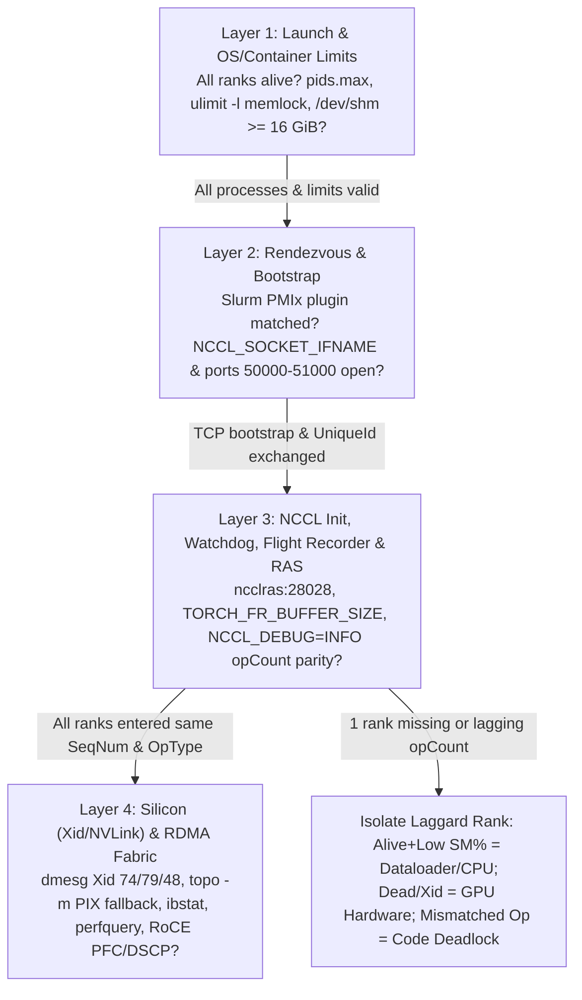
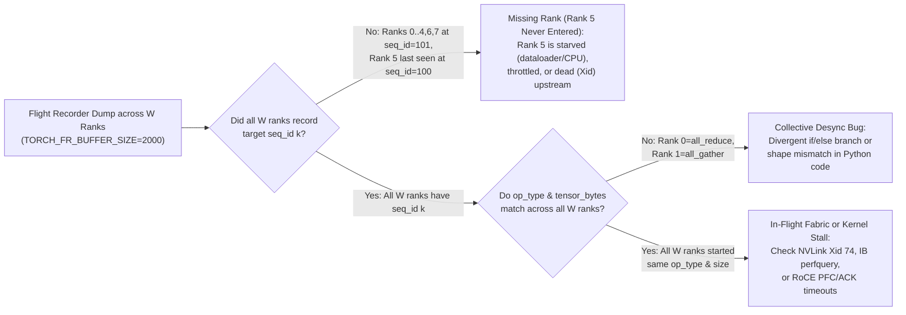

# 12.18 NCCL debugging: hangs, timeouts and errors

| | |
|---|---|
| Level | Advanced |
| Priority tier | 1 |
| Lab venue | Nebius GPU |
| Part | Part 12: Complete AI networking |
| Sources to use | V20; ASP 4; VL10 ch15 |
| Coverage file | `planning/coverage/chapters/12-18.md` |
| Companion code | `code/part12/nccl_debugging_hangs.py` · `code/part12/nccl_debugging_hangs_lab.py` |

## Why this matters for AI infrastructure

An `NCCL operation timed out` or `Watchdog caught collective operation timeout: WorkNCCL(SeqNum=4821, OpType=ALLREDUCE, NumelIn=268435456, NumelOut=268435456, Timeout(ms)=600000)` stack trace is the most frequently misdiagnosed error in distributed AI infrastructure. Because synchronous collectives (`AllReduce`, `ReduceScatter`, `AllGather`, `Broadcast`) enforce barrier semantics across all participating GPUs, the ranks that print the timeout exception are almost always the healthy ranks that arrived on time and waited until the process-group watchdog timer expired. The actual fault lies on the single rank that never entered the collective, died mid-flight with a hardware Xid error, or stalled behind a degraded physical link.

During the `54`-day pretraining run of `Llama 3 405B` across **`16,384` `H100` GPUs**, **`419` unexpected interruptions** occurred—a mean time between interruptions (`MTBI`) of **`3.09 hours`** (`54 * 24 / 419`). While **`268` (`64.0%`)** of those `419` interruptions originated in GPU hardware—led by **`148` (`30.1%`)** faulty GPUs, **`72` (`17.2%`)** GPU HBM3 memory faults, **`19` (`4.5%`)** GPU SRAM faults, **`17` (`4.1%`)** GPU system processor (`GSP`) faults, **`6` (`1.4%`)** silent data corruption (`SDC`) events, and **`6` (`1.4%`)** GPU thermal interface/sensor faults—and **`54` (`12.9%`)** stemmed from software bugs, **`35` (`8.4%`)** from network switches/cables, **`32` (`7.6%`)** from unplanned host maintenance, **`7` (`1.7%`)** from host NICs, and **`7` (`1.7%`)** from unclassified `NCCL` watchdog timeouts (`49` interruptions, or **`11.7%`**, across switches/cables, NICs, and watchdog timeouts combined), nearly every single-device or single-link failure surfaced to the training framework as a cluster-wide `NCCL` collective hang or abort.

Even when a job does not crash, silent communication fallbacks and lifecycle misconfigurations can destroy cluster throughput by orders of magnitude:
- Accidentally initializing a CPU-staged `Gloo` backend instead of `NCCL` on an `800 Gb/s` (`100 GB/s`) InfiniBand fabric drops a `400.0 MB` `AllReduce` from **`4.00 ms` (`100.0 GB/s`)** to **`200.00 ms` (`2.0 GB/s`)**—a **`50x`** slowdown with near-`100%` CPU utilization.
- Repeatedly calling `dist.init_process_group` and `dist.destroy_process_group` inside the training loop adds **`48.0 ms`** of handshake and buffer-allocation overhead to a **`0.5 ms`** `1`-element `AllReduce` (`48.5 ms` total vs `0.5 ms` when initialized once, a **`98.97%`** iteration-time reduction).
- A single degraded `NVLink` lane (`184,213` CRC errors and `92,104` replay errors culminating in **`Xid 74`** and a silent **`PIX`** PCIe fallback between `GPU 2` and `GPU 3`) or a single rank stalled for **`47.31 s`** fetching a batch from a **`96%`-full** (`480G / 500G`) storage volume with a **`4.56x`** shard imbalance (`187G` vs `41G`) can inflate one GPU's step time from **`124.8 ms` to `1,250.5 ms`** (**`10.02x` straggler ratio**) or trigger a cluster-wide timeout.

This chapter builds a deterministic, four-layer debugging methodology spanning process launch and OS/container limits (`/dev/shm` `64 MiB` exhaustion, `ulimit -l` `memlock`), bootstrap rendezvous (`NCCL_SOCKET_IFNAME`, `50000 51000` ephemeral ports), `NCCL` runtime diagnostics (`ncclResult_t` `0..6`, `NCCL_DEBUG=INFO`, `NCCL_DEBUG_SUBSYS`, `TORCH_FR_BUFFER_SIZE` Flight Recorder ring buffers, `TORCH_NCCL_ENABLE_MONITORING=1`, `TORCH_NCCL_HEARTBEAT_TIMEOUT_SEC`, `ncclras` on port `28028`, `NCCL_RUN_DIAGNOSTICS=1`, and the `5`-callback `NCCL_PROFILER_PLUGIN` API), and cross-layer hardware/fabric correlation (`Xid` Tiers `1–3`, `NVLink`, `InfiniBand`, and `RoCEv2`).

---

## Prerequisites and outcomes

### Prerequisites
- Understanding of `NCCL` collective primitives (`AllReduce`, `ReduceScatter`, `AllGather`, `Broadcast`, `Reduce`, `AllToAll`), algorithms (`Ring`, `Tree`, `NVLS`, `CollNet`, `PAT`), and protocols (`LL`, `LL128`, `Simple`) from Chapter 12.15.
- Familiarity with `NCCL` topology detection (`nvidia-smi topo -m`, `PIX`/`PHB`/`SYS`/`NV#`), channel allocation, transports (`P2P`, `SHM`, `NET/IB`, `NET/Socket`), and environment variables from Chapter 12.16.
- Working knowledge of `RDMA` (`RoCEv2` `UDP 4791`, `PFC`/`ECN`/`DCQCN`, `DSCP 26` and `DSCP 48`) and `InfiniBand` (`ibstat`, `perfquery`, `ibdiagnet`, `SHARP`) from Chapters 12.2–12.14.

### Outcomes
After completing this chapter, you will be able to:
1. Execute the **four-layer joint debugging ladder** (Layer 1 Launch & OS/Container Limits $\rightarrow$ Layer 2 Bootstrap & PMI Rendezvous $\rightarrow$ Layer 3 `NCCL` Init, Watchdog, Flight Recorder & RAS $\rightarrow$ Layer 4 Hardware `Xid`, `NVLink` & RDMA Fabric) to isolate any multi-node hang without guesswork.
2. Decode **`ncclResult_t` error codes `0..6`** (`ncclSuccess=0`, `ncclUnhandledCudaError=1`, `ncclSystemError=2`, `ncclInternalError=3`, `ncclInvalidArgument=4`, `ncclInvalidUsage=5`, `ncclRemoteError=6`) and calculate container `/dev/shm` memory requirements to prevent `ncclSystemError` (`Error 28: No space left on device`) under Docker and Kubernetes `64 MiB` defaults.
3. Configure and analyze PyTorch `ProcessGroupNCCL` watchdog and Flight Recorder telemetry (`TORCH_NCCL_ASYNC_ERROR_HANDLING=1`, `TORCH_NCCL_ENABLE_MONITORING=1`, `TORCH_NCCL_HEARTBEAT_TIMEOUT_SEC`, `TORCH_FR_BUFFER_SIZE=2000`), `NCCL 2.24+` **RAS** (`ncclras` on `localhost:28028`), `NCCL 2.31+` **`NCCL_RUN_DIAGNOSTICS=1`**, and the `5`-callback **`NCCL_PROFILER_PLUGIN`** API (`32`-bit event activation mask) to pinpoint the exact lagging or missing rank (`opCount` / `seq_id`).
4. Diagnose all **six multinode communication pitfalls** and all **six `NCCL` communicator lifecycle and environment gotchas**, including `Gloo` (`200.0 ms`, `2.0 GB/s`) vs `NCCL` (`4.0 ms`, `100.0 GB/s`), `48.0 ms` repeated `init_process_group` overhead, `64`-connection socket limits (`NCCL_SOCKET_NTHREADS * NCCL_NSOCKS_PERTHREAD <= 64`), `UCX` caching allocator fragmentation (`0.800 GB` $\rightarrow$ `1.040 GB` $\rightarrow$ `1.240 GB` reserved), and the `Llama 3 405B` `419`-interruption reliability distribution.
5. Correlate `NCCL` hangs and stragglers (`10.02x` iteration ratio) across the hardware stack using the **three-tier `Xid` classification** (Tier 1: `45`, `63`, `92`; Tier 2: `13`, `31`, `32`, `43`, `94`; Tier 3: `48`, `61`, `62`, `64`, `79`, `95`; plus `NVLink` `Xid 74`), `dcgmi nvlink -e`, `MIG` `0 MiB` / P2P isolation checks, thermal/power/DVFS throttle bitmasks (`1,980 MHz` $\rightarrow$ `1,833 MHz` at `85°C`, `300 W` $\rightarrow$ `200 W` PSU cap), and layer-by-layer timing (`750.0 ms` breakdown) while avoiding profiler Heisenbugs (`10%–50%` overhead).

---

## 1. The Four-Layer Debugging Ladder and the Llama 3 405B Reliability Baseline

### 1.1 Why Multi-Node Hangs Mislead Engineers—and the Empirical Reality at 16,384-GPU Scale

When a distributed training job stalls, four distinct subsystems can produce an identical outward symptom ("all GPUs sit at `0%` or `100%` utilization until a timeout kills the job"):
1. **Slurm / Kubernetes Launch and OS Limits:** A rank failed to spawn (`pids.max`), could not pin RDMA memory (`ulimit -l` `memlock`), or ran out of POSIX shared memory (`/dev/shm` `64 MiB` container ceiling).
2. **Process-Management (`PMIx`/`MPI`) and TCP Bootstrap Rendezvous:** Ranks started, but `NCCL` picked an unreachable bridge interface (`docker0`, `lo`) or exhausted ephemeral TCP ports (`/proc/sys/net/ipv4/ip_local_port_range`) during `ncclCommInitRank`.
3. **Application / Framework / `NCCL` Collective Execution:** Ranks initialized, but one rank is starved upstream by a slow dataloader (`47.31 s` batch fetch), one rank took a divergent `if/else` branch and issued a different collective, or a parameter went unused in `DDP` without `find_unused_parameters=True`.
4. **GPU Silicon, `NVLink`, or RDMA Fabric Hardware:** One rank's GPU suffered an unrecoverable hardware fault (`Xid 79` fallen off the bus, `Xid 48`/`95` uncorrectable ECC), an `NVLink` lane degraded and dropped to `PCIe` (`Xid 74`), or an InfiniBand/RoCEv2 switch port dropped packets (`local_ack_timeout_err`, `rnr_nak_retry_err`, or a `PFC` pause storm).

Meta's `54`-day pretraining run of `Llama 3 405B` on **`16,384` `H100` GPUs** quantifies why systematic triage is mandatory at scale. Over `54` days (`1,296` hours), the job experienced **`419` unexpected interruptions**—one interruption every **`3.09 hours`** on average:

| Component | Category | Interruption Count | % of Interruptions (`419` Total) | Operational Signature in `NCCL` & System Logs |
|---|---|---|---|---|
| **Faulty GPU** | GPU | `148` | `30.1%` | `Xid 79` (fallen off bus), `Xid 61`/`62` (microcontroller halt), `ncclUnhandledCudaError=1` or peer `ncclRemoteError=6` |
| **GPU HBM3 memory** | GPU | `72` | `17.2%` | `Xid 48` (double-bit UEC), `Xid 94`/`95` (contained/uncontained ECC), `Xid 63`/`64` (row remap event/failure) |
| **Software bug** | Dependency | `54` | `12.9%` | Rank collective desync, OOM, or `ncclInvalidUsage=5` / `ncclInvalidArgument=4` |
| **Network switch/cable** | Network | `35` | `8.4%` | `SymbolErrorCounter` / `LinkDownedCounter` rising, `local_ack_timeout_err`, all ranks stuck on identical `SeqNum` |
| **Host maintenance** | Unplanned Maintenance | `32` | `7.6%` | Node reboot/drain; `INCOMPLETE` row in `ncclras` and `ncclRemoteError=6` on surviving peers |
| **GPU SRAM memory** | GPU | `19` | `4.5%` | L1/L2/register file uncorrectable parity/ECC fault (`nvidia-smi -q -d ECC`) |
| **GPU system processor** | GPU | `17` | `4.1%` | GSP firmware timeout (`Xid 119`/`120`); `nvidia-smi` hangs on affected host |
| **NIC** | Host | `7` | `1.7%` | ConnectX HCA PCIe/firmware fault (`mlx5_core` error in `dmesg`, `ibstat` `Down`) |
| **NCCL watchdog timeouts** | Unknown | `7` | `1.7%` | `ProcessGroupNCCL` watchdog fired (`WorkNCCL` timeout) without an obvious single hardware counter |
| **Silent data corruption** | GPU | `6` | `1.4%` | NaN/loss spike without Xid; caught by deterministic replay or per-GPU validation checks |
| **GPU thermal interface and sensor** | GPU | `6` | `1.4%` | `HW Thermal Slowdown` (`1,980 MHz` $\rightarrow$ `1,833 MHz` or lower at `>= 85°C`), creating a `10x` straggler |
| **SSD** | Host | `3` | `0.7%` | Local NVMe read stall starving dataloader on one rank (`SM util = 2%`, `opCount` lagging) |
| **Power supply** | Host | `3` | `0.7%` | PSU brownout / `HW Power Brake Slowdown` (`300 W` $\rightarrow$ `200 W` cap) |
| **Server chassis** | Host | `2` | `0.5%` | Chassis fan/management fault (`ipmitool sdr type Fan`) |
| **IO expansion board** | Host | `2` | `0.5%` | PCIe switch (`PIX`/`PXB`) link width/speed downgrade (`Gen5 x16` $\rightarrow$ `Gen3 x8`) |
| **Dependency** | Dependency | `2` | `0.5%` | External service / storage mount hang |
| **CPU** | Host | `2` | `0.5%` | Host CPU machine check exception (MCE) or lockup |
| **System memory** | Host | `2` | `0.5%` | Host DDR5 EDAC error or kernel panic |

Notice the operational lesson embedded in those `419` interruptions:
- **GPU silicon and memory (`148 + 72 + 19 + 17 + 6 + 6 = 268` interruptions, or `64.0%`)** outnumber network switch/cable and NIC failures (`35 + 7 = 42` interruptions, or `10.0%`) by more than **`6.3x`**.
- Yet because `NCCL` collectives are synchronous barriers, a GPU Xid fault on `1` out of `16,384` GPUs (`0.0061%` of the fleet) causes the other `16,383` GPUs to block inside `ncclAllReduce` until `ProcessGroupNCCL`'s watchdog or heartbeat monitor aborts the job.

### 1.2 The Four-Layer Joint Debugging Ladder

To avoid wasting hours inspecting InfiniBand switches when a container bridge (`docker0`) or a starved dataloader is to blame, always walk the four-layer ladder in strict bottom-up order:



| Layer | Core Diagnostic Question | Fast Verification Command (`(untested here)`) | Signature of Failure at This Layer |
|---|---|---|---|
| **Layer 1: Launch & Limits** | Did every rank start with required OS/container limits? | `srun --jobid=<id> --ntasks-per-node=1 bash -c 'echo "$(hostname): procs=$(pgrep -fc python3) memlock=$(ulimit -l) shm=$(df -h /dev/shm \| tail -1)"'` | Missing rank process (`pids.max`), `ibv_reg_mr`/`ibv_create_qp failed` (`memlock`), or `Error 28: No space left on device` on `/dev/shm/nccl-*` (`ncclSystemError=2`) |
| **Layer 2: Rendezvous** | Did all ranks exchange bootstrap addresses? | `srun --mpi=list`; check `NCCL_SOCKET_IFNAME=^docker,lo` and `/proc/sys/net/ipv4/ip_local_port_range` (`50000 51000`) | Hang inside `init_process_group` / `ncclCommInitRank` before any collective runs; `connect() timed out` on unreachable `docker0`/`virbr0` subnet |
| **Layer 3: `NCCL` & Framework** | Which transport was chosen, and which rank is behind on `opCount` / `seq_id`? | `ncclras -v` (`localhost:28028`), `TORCH_FR_BUFFER_SIZE=2000`, `NCCL_DEBUG=INFO NCCL_DEBUG_SUBSYS=INIT,COLL,GRAPH,ENV`, `NCCL_RUN_DIAGNOSTICS=1` | `MISMATCH` (`opCount 4820` vs `4821`) or `INCOMPLETE` in `ncclras`; Flight Recorder shows rank $k$ never entered `seq_id`; fallback to `NET/Socket` or `Gloo` |
| **Layer 4: Silicon & Fabric** | Did a GPU throw an `Xid`, drop an `NVLink`, or suffer RDMA packet loss/PFC pause? | `dmesg -T \| grep -i xid`; `nvidia-smi topo -m`; `dcgmi nvlink -e`; `ibstat`; `perfquery -x`; `rdma statistic`; `ethtool -S <nic>`; `nv show qos roce` | `Xid 79`/`48`/`95` in `dmesg`; `PIX` where `NV12`/`NV18` expected (`Xid 74`); `SymbolErrorCounter`, `local_ack_timeout_err`, or `rnr_nak_retry_err` rising |

---

## 2. `ncclResult_t` Error Codes (`0..6`), `/dev/shm` Exhaustion, and Layer 1–2 Bootstrap Failures

### 2.1 Complete `ncclResult_t` Error Taxonomy (`0..6`)

When `NCCL` aborts synchronous or asynchronous execution rather than hanging silently, it returns one of seven standard `ncclResult_t` status codes (`0..6`, plus `ncclInProgress=7` for non-blocking operations in flight). Knowing the exact mapping between the numeric return code, the C enum name, the human-readable string returned by `ncclGetErrorString()`, and the subsystem that raised it prevents misrouting tickets between application, systems, and network teams:

| `ncclResult_t` Code | Enum Name | `ncclGetErrorString()` Log String | Originating Subsystem | Concrete Root Causes | Immediate Triage Action |
|---|---|---|---|---|---|
| **`0`** | `ncclSuccess` | `"no error"` | None | Operation succeeded | None |
| **`1`** | `ncclUnhandledCudaError` | `"unhandled cuda error"` | CUDA Runtime / GPU Driver | Asynchronous CUDA kernel fault on the same stream/device (`Xid 13` illegal instruction, `Xid 31` MMU page fault, `Xid 43` command processor hang, `Xid 48`/`94`/`95` uncorrectable ECC, `Xid 79` GPU fell off bus) or `CUDA_ERROR_OUT_OF_MEMORY` prior to `NCCL` launch | Sweep `dmesg -T \| grep -i xid` on all nodes; rerun with `CUDA_LAUNCH_BLOCKING=1` to attribute the exact failing kernel before `NCCL` |
| **`2`** | `ncclSystemError` | `"unhandled system error"` | Linux OS / Container / Verbs / NVML | `/dev/shm` exhaustion (`Error 28: No space left on device` when `NCCL` allocates `/dev/shm/nccl-*` under Docker/K8s `64 MiB` default), `ulimit -l` `memlock` ceiling (`Call to ibv_create_qp failed` / `ibv_reg_mr failed`), socket port exhaustion, or fatal `NVLink`/`PCIe` link error | Check `df -h /dev/shm` (mount `>= 16 GiB`), verify `ulimit -l` is `unlimited`, inspect `NCCL WARN` lines immediately above the abort |
| **`3`** | `ncclInternalError` | `"internal error"` | `NCCL` Internal State / P2P / Version Mismatch | Running PyTorch's bundled `NCCL` against a mismatched system `libnccl.so`, corrupted internal proxy ring state, broken P2P BAR1 mapping, or passing an invalid algorithm token to `NCCL_ALGO` on `NCCL 2.24+` | Verify `torch.cuda.nccl.version()` matches `libnccl` across all nodes; check `nvidia-smi topo -m` and unset custom `NCCL_ALGO` overrides |
| **`4`** | `ncclInvalidArgument` | `"invalid argument"` | Application / Framework API Call | Passing a `NULL` `sendbuff`/`recvbuff` pointer, negative element count, out-of-range rank (`< 0` or `>= nranks`), or unsupported `ncclDataType_t` / `ncclRedOp_t` | Enable `TORCH_DISTRIBUTED_DEBUG=DETAIL` and validate tensor device, dtype, and pointer allocation before the collective |
| **`5`** | `ncclInvalidUsage` | `"invalid usage"` | Application Collective Ordering / Registration | Two ranks on the same node assigned the same GPU device (`torch.cuda.set_device(local_rank)` omitted), asymmetric `ncclCommRegister()` buffer registration across ranks, or mismatched `ncclGroupStart()`/`ncclGroupEnd()` calls | Ensure `local_rank = int(os.environ["LOCAL_RANK"]); torch.cuda.set_device(local_rank)` before `init_process_group`; audit group and buffer registration symmetry |
| **`6`** | `ncclRemoteError` | `"remote process exited or there was a network error"` | Remote Peer Process / RDMA Network | A remote rank died (`OOM-killer`, `SIGSEGV`, `Xid 79`/`48`) and closed its socket/QP, or an InfiniBand/RoCEv2 QP exceeded its retry limit (`local_ack_timeout_err`, `rnr_nak_retry_err`) due to a downed link or `PFC` storm | Do **not** debug the rank that printed `ncclRemoteError` first—find the rank that exited earliest (or check `ncclras -v` and `rdma statistic`) |

### 2.2 Container `/dev/shm` `64 MiB` Exhaustion $\rightarrow$ `ncclSystemError` (`Code 2`, `Errno 28`)

One of the most common Layer 1 container failures occurs when launching an `8`-GPU training job inside Docker or Kubernetes without overriding the default POSIX shared-memory mount (`/dev/shm`), which both Docker and Kubernetes size at **`64 MiB` (`67,108,864 B`)** by default.

When `NCCL` initializes intra-node shared-memory (`SHM`) transport channels, host-staged bounce buffers, or proxy control rings across $R_{\text{local}}$ local ranks, $C$ channels, and $M$ communicators (for example, `1` data-parallel + `1` tensor-parallel communicator, $M = 2$) with default `NCCL_BUFFSIZE = 4 MiB` (`4,194,304 B`) and `~2 MiB` per-rank control metadata, the shared-memory footprint is:

$$\text{SHM}_{\text{req}} = M \times R_{\text{local}} \times \left(C \times \text{NCCL\_BUFFSIZE} + \text{Control}_{\text{rank}}\right)$$

For an `8`-GPU node ($R_{\text{local}} = 8$), $C = 16$ channels, $\text{NCCL\_BUFFSIZE} = 4\text{ MiB}$, $\text{Control}_{\text{rank}} = 2\text{ MiB}$, and $M = 2$ communicators:

$$\text{SHM}_{\text{req}} = 2 \times 8 \times (16 \times 4\text{ MiB} + 2\text{ MiB}) = 1,024\text{ MiB} + 32\text{ MiB} = \mathbf{1,056.0\text{ MiB}}$$

Because `1,056.0 MiB` exceeds the `64.0 MiB` default container limit by **`16.5x`**, `posix_fallocate` fails on `/dev/shm/nccl-*` with Linux `errno 28` (`ENOSPC`, `No space left on device`), and `NCCL` aborts immediately with **`ncclSystemError` (`code 2`)**:

```text
NCCL WARN Error 28 : No space left on device
NCCL INFO include/shm.h:48 -> 2
NCCL INFO init.cc:904 -> 2
RuntimeError: NCCL error in: .../ProcessGroupNCCL.cpp, unhandled system error, NCCL version 2.21.5
ncclSystemError: System call (e.g. socket, malloc) or external library call failed or device error.
```

**Production Fix (`(untested here)`):**
- **Docker:** Pass `--shm-size=16g` (or `--ipc=host`) to `docker run`.
- **Kubernetes PodSpec:** Mount an in-memory `emptyDir` (`medium: Memory`, `sizeLimit: 16Gi` or `32Gi`) at `/dev/shm`. Never work around `/dev/shm` exhaustion by setting `NCCL_SHM_DISABLE=1` in production, as disabling shared memory forces fallback to network or kernel-driver copies that add context switches and throttle intra-node bandwidth.

### 2.3 `memlock` Limits, Slurm `PMIx`, `NCCL_SOCKET_IFNAME`, and Ephemeral Ports (`50000 51000`)

Once `/dev/shm` and process counts (`pgrep -fc python3`) are verified, check the remaining Layer 1 and Layer 2 prerequisites:

1. **Pinned Memory (`memlock`) for RDMA Queue Pairs and Memory Regions:**
   `GPUDirect RDMA` and `libibverbs` pin pages in physical memory. If the job's cgroup or PAM limits leave `ulimit -l` at the Linux default (`64 KB`), `NCCL` logs:
   ```text
   NCCL WARN Call to ibv_create_qp failed
   NCCL WARN Call to ibv_reg_mr failed
   ```
   and either aborts with `ncclSystemError=2` or silently falls back to TCP sockets. Set `soft memlock unlimited` and `hard memlock unlimited` in `/etc/security/limits.conf` (and `LimitMEMLOCK=infinity` in `slurmd.service` / container `securityContext`) and confirm `ulimit -l` prints `unlimited` inside a job step.

2. **Slurm PMI Plugin Alignment (`srun --mpi=pmix`):**
   In Slurm clusters, `MpiDefault` in `slurm.conf` and `srun --mpi=<type>` (or `SLURM_MPI_TYPE`) must match the MPI/PMIx library the container or environment was built against. Check supported plugins with `srun --mpi=list` and invoke `srun --mpi=pmix` explicitly; on RPM-based hosts, ensure `slurm-libpmi` and `pmix-libpmi` do not conflict after upgrades.

3. **Bootstrap Interface Selection (`NCCL_SOCKET_IFNAME` Prefix Syntax):**
   Before `NCCL` can use `NVLink` or `GPUDirect RDMA`, ranks open out-of-band TCP sockets to exchange `ncclUniqueId` and ring/tree connection metadata. If a node has an `UP` virtual or container interface (`docker0` `172.17.0.1/16`, `virbr0`, `cni0`, or `lo`) that is unreachable from remote hosts, `NCCL` may select it during `ncclCommInitRank` and hang indefinitely. Control selection using `NCCL_SOCKET_IFNAME`'s prefix, exact-match (`=`), and exclusion (`^`) syntax:
   - `NCCL_SOCKET_IFNAME=eth`: Matches any interface starting with `eth` (`eth0`, `eth1`).
   - `NCCL_SOCKET_IFNAME==eth0` or `=ib0`: Matches **only** the exact interface name `eth0` or `ib0`.
   - `NCCL_SOCKET_IFNAME==eth0,eth1`: Matches **only** `eth0` and `eth1`.
   - `NCCL_SOCKET_IFNAME=^docker,lo,virbr`: Excludes any interface starting with `docker`, `lo`, or `virbr` (safe across heterogeneous node types whose management NICs vary between `eth0`, `ens3f0`, and `bond0`).

4. **TCP Ephemeral Port Exhaustion (`50000 51000`):**
   Large multi-node jobs open hundreds of out-of-band TCP bootstrap sockets. If `/proc/sys/net/ipv4/ip_local_port_range` is too narrow or blocked by host firewall rules, handshakes stall or fail during bootstrap. Configure a dedicated, firewall-permitted ephemeral range (for example, `echo 50000 51000 > /proc/sys/net/ipv4/ip_local_port_range`) across all compute nodes.

---

## 3. Layer 3 Triage: Watchdog Timeouts, PyTorch Flight Recorder, NCCL RAS (`28028`), and Active Diagnostics

### 3.1 Understanding the `ProcessGroupNCCL` Watchdog and Heartbeat Monitor

A critical architectural fact for every AI infrastructure engineer is that **`NCCL` itself has no `NCCL_TIMEOUT` or `NCCL_WATCHDOG_DUMP` environment variable**. The collective timeout and watchdog thread belong to the calling framework—in PyTorch, `c10d::ProcessGroupNCCL`:

1. **Collective Timeout (`timeout` argument in `dist.init_process_group`):**
   When `dist.init_process_group("nccl", timeout=datetime.timedelta(seconds=600))` is initialized (in PyTorch `2.14+`, the signature displays `timeout=None` and resolves to the backend default, typically `10 minutes` = `600,000 ms` unless overridden), `ProcessGroupNCCL` records a CUDA event for every enqueued `WorkNCCL` collective. A background C++ watchdog thread polls those CUDA events. If a collective's completion event has not fired within `Timeout(ms)`, the watchdog prints:
   ```text
   [Rank 0] Watchdog caught collective operation timeout: WorkNCCL(SeqNum=4821, OpType=ALLREDUCE, NumelIn=268435456, NumelOut=268435456, Timeout(ms)=600000) ran for 600082.45 milliseconds before timing out.
   ```
2. **Asynchronous Error Handling and Heartbeat Monitoring (`TORCH_NCCL_*`):**
   - `TORCH_NCCL_ASYNC_ERROR_HANDLING=1` (preferred in modern PyTorch over the legacy `NCCL_ASYNC_ERROR_HANDLING=1` alias, which should still be set explicitly in runbooks so defaults never shift silently across versions): Enables asynchronous abort of the `NCCL` communicator when an error or timeout occurs.
   - `TORCH_NCCL_ENABLE_MONITORING=1`: Spawns a dedicated monitoring thread inside `ProcessGroupNCCL` that watches the watchdog's heartbeat and terminates the OS process cleanly if the watchdog or `ncclCommAbort` hangs inside the CUDA driver.
   - `TORCH_NCCL_HEARTBEAT_TIMEOUT_SEC=<sec>` (for example, `180` or `300`): Sets the maximum number of seconds between heartbeats before the monitoring thread dumps diagnostic traces and forces process termination.

### 3.2 PyTorch Flight Recorder (`TORCH_FR_BUFFER_SIZE`) Ring Buffer Analysis

When a `1,024`-GPU job times out on `SeqNum=4821`, grepping `1,024` stdout logs is slow and error-prone. PyTorch provides the **Flight Recorder**, an always-on, low-overhead in-memory ring buffer inside `ProcessGroupNCCL` that records the lifecycle (`scheduled`, `started`, `completed`) of the last $N$ collectives on every rank:

```bash
# Enable the Flight Recorder ring buffer and automatic dump on timeout (untested here)
export TORCH_FR_BUFFER_SIZE=2000                  # Store last 2,000 collective entries per rank (modern name)
export TORCH_NCCL_TRACE_BUFFER_SIZE=2000           # Legacy alias supported across PyTorch 2.x releases
export TORCH_NCCL_DUMP_ON_TIMEOUT=1                # Dump ring buffer to disk when watchdog fires
export TORCH_NCCL_DEBUG_INFO_TEMP_FILE=/tmp/nccl_trace_rank_
```

When a timeout occurs (or when an operator sends `SIGUSR1` / queries the dump endpoint), each rank writes its ring buffer of `{pg_name, seq_id, op_type, tensor_sizes, state, timestamp_scheduled, timestamp_started, duration_ms}` entries. Comparing the ring buffers across all $W$ ranks yields one of three deterministic signatures:



| Flight Recorder Cross-Rank Pattern | `present_ranks` at Target `seq_id` $k$ | `missing_ranks` at Target `seq_id` $k$ | `op_type` / `tensor_bytes` Parity | Exact Root-Cause Classification |
|---|---|---|---|---|
| **Pattern 1: Missing Rank Never Entered** | `W - 1` ranks (`[0, 1, 2, 3, 4, 6, 7]` in `started` state at `seq_id=101`) | **`[5]`** (last entry on Rank `5` is `seq_id=100` `completed`) | Matching (`all_reduce`, `104,857,600 B`) | **Rank `5` never called the collective.** Investigate Rank `5` for upstream CPU/dataloader starvation, GPU thermal throttle, or process/Xid crash. |
| **Pattern 2: Collective Desync Mismatch** | All ranks (or subset) at `seq_id=102` | `[]` | **Mismatched** (Rank `0` has `all_reduce`, Rank `1` has `all_gather` or different byte count) | **Application code bug.** Divergent conditional (`if rank == 0:`) or dynamic shape mismatch across ranks. |
| **Pattern 3: In-Flight Fabric / Kernel Hang** | All `W` ranks (`[0..W-1]` in `started` state at `seq_id=103`, `0` `completed`) | `[]` | Matching (`all_reduce`, `104,857,600 B`) | **True in-flight hang.** Every rank entered the collective; a link dropped mid-transfer (`Xid 74`, IB `SymbolErrorCounter`, RoCE `local_ack_timeout_err` / `PFC` pause storm). |

### 3.3 `NCCL 2.24+` RAS (`ncclras` on Port `28028`), `NCCL 2.31+` Active Diagnostics, and `NCCL_DEBUG`

In addition to PyTorch's Flight Recorder, modern `NCCL` includes two built-in diagnostic subsystems plus structured debug logging and a `5`-callback profiler plugin API:

1. **`NCCL 2.24+` Reliability, Availability, and Serviceability (`RAS`) Subsystem (`ncclras`):**
   The RAS subsystem runs a background thread inside every `NCCL` process that forms an out-of-band peer keep-alive mesh and listens on **`localhost:28028`** by default (configurable via `NCCL_RAS_ADDR`). While a job is hung—even if `NCCL_DEBUG=INFO` was **not** enabled before launch—an operator can SSH to any node in the job and query RAS live (`(untested here)`):
   ```bash
   $ ncclras -v                                  # Query local RAS daemon with verbose communicator table
   $ echo "verbose status" | nc localhost 28028  # Equivalent netcat query if ncclras binary is not in PATH
   ```
   - A **`MISMATCH`** row with the message *"Communicator ranks have different collective operation counts"* prints how many ranks have launched up to each operation count and explicitly lists the lagging rank IDs, their GPU indices, PIDs, and hostnames. Because collectives can briefly outpace a single RAS query in a running job, **query `ncclras` twice a few seconds apart**: if the operation counts are advancing, it is a false alarm; if the counts are frozen and one rank remains behind, that rank is your straggler.
   - An **`INCOMPLETE`** row indicates that a process is unresponsive (crashed or node down); RAS names the dead rank/node and routes subsequent queries around it.

2. **`NCCL 2.31+` Built-In Active Diagnostics (`NCCL_RUN_DIAGNOSTICS=1`):**
   Setting `NCCL_RUN_DIAGNOSTICS=1` (off by default) runs active hardware and fabric self-tests at every communicator initialization before application traffic begins, printing `NCCL DIAG` lines from `rank 0`:
   - `[OK]` confirms the check passed.
   - `[INFO]` flags partial degradation (for example, `NCCL DIAG [INFO] p2p: only 52/56 GPU-to-GPU peer accesses passed verification`). Because `NCCL_RUN_DIAGNOSTICS=1` executes prior to user code, any `[INFO]` failure immediately isolates the problem to the hardware, driver, or system configuration rather than the training script.

3. **Targeted `NCCL_DEBUG` and `NCCL_DEBUG_SUBSYS` Tracing:**
   When reproducing a hang or verifying transport paths, enable `NCCL_DEBUG=INFO` (use `WARN` in normal production to avoid logging overhead) and filter by subsystem via `NCCL_DEBUG_SUBSYS` (default `INIT,BOOTSTRAP,ENV`; valid tokens include `INIT`, `COLL`, `P2P`, `SHM`, `NET`, `GRAPH`, `TUNING`, `ENV`, `ALLOC`, `CALL`, `PROXY`, `NVLS`, `REG`, `PROFILE`, `RAS`, `ALL`):
   ```text
   [rank0] NCCL INFO AllReduce: opCount 4821, sendbuff 0x7f1200000000, recvbuff 0x7f1200000000, count 268435456, datatype 7, op 0, root 0
   [rank1] NCCL INFO AllReduce: opCount 4821, sendbuff 0x7f1200000000, recvbuff 0x7f1200000000, count 268435456, datatype 7, op 0, root 0
   [rank2] NCCL INFO AllReduce: opCount 4821, sendbuff 0x7f1200000000, recvbuff 0x7f1200000000, count 268435456, datatype 7, op 0, root 0
   [rank3] NCCL INFO AllReduce: opCount 4820, sendbuff 0x7f1200000000, recvbuff 0x7f1200000000, count 268435456, datatype 7, op 0, root 0
   ```
   Here, ranks `0–2` have reached `opCount 4821` (`268,435,456` elements = `1 GiB` FP32 / `512 MiB` BF16), while `rank 3` is stuck on `opCount 4820`. Ranks `0–2` are healthy and waiting; `rank 3` is the investigation target.

4. **The `NCCL` Profiler Plugin API (`NCCL_PROFILER_PLUGIN`):**
   To capture hierarchical collective, point-to-point, and proxy timelines with minimal runtime overhead in tools like PyTorch Kineto, `NCCL` exposes the dynamically loaded `NCCL_PROFILER_PLUGIN` interface:
   - Once loaded, the plugin configures a **`32`-bit integer event activation mask** in which each bit enables a specific hierarchy of events (`Group` $\rightarrow$ `Collective` / `P2P` $\rightarrow$ `ProxyOp` / `ProxyStep` / `ProxyCtrl` / `KernelCh` / `NetPlugin`).
   - The C API defines **five function callbacks**:
     1. `init`: Initializes the profiler context and returns the `32`-bit event activation mask.
     2. `startEvent`: Receives an event descriptor from `NCCL`, allocates an event object, and returns an opaque handle.
     3. `stopEvent`: Marks completion of an event and recycles its resources.
     4. `recordEventState`: Updates an active event as it transitions across internal proxy/FIFO states.
     5. `finalize`: Releases all profiler context resources at communicator teardown.

---

## 4. The Six Multinode Pitfalls and Six Communicator Lifecycle & Environment Gotchas

### 4.1 The Six Multinode Communication Pitfalls

Scaling distributed training across multiple nodes introduces six recurring infrastructure pitfalls that either stall jobs or silently degrade throughput by `10x–50x`:

1. **Multinode Pitfall #1 — Using a CPU-Bound `Gloo` Backend Instead of `NCCL` (`200.00 ms` vs `4.00 ms`):**
   If a script initializes `dist.init_process_group(backend="gloo")` (or if `NCCL` initialization fails and a wrapper falls back to `Gloo`), all collective communication stages through host CPU DRAM and kernel TCP sockets. On a `2`-node cluster connected by **`800 Gb/s` (`100 GB/s`) InfiniBand**, an `AllReduce` of **`100M` floats (`1024 * 1024 * 100` $\approx$ `400.0 MB`)** behaves as follows:
   - **`backend="gloo"` (CPU + TCP):** Takes **`200.00 ms`**, achieving only **`2.0 GB/s`** aggregate throughput with CPU utilization pinned near `100%` while GPUs sit idle.
   - **`backend="nccl"` (GPU + `GPUDirect RDMA`):** Takes **`4.00 ms`**, achieving **`100.0 GB/s`**—a **`50x` (`2` orders of magnitude)** speedup running at the physical `800 Gb/s` line rate.
   Always pass `backend="nccl"` explicitly, verify with `torch.distributed.get_backend()`, set `NCCL_SOCKET_IFNAME=ib0` (or your HCA/management prefix), and confirm in container deployments that `/dev/infiniband` is mounted, `lsmod | grep nvidia_peermem` is loaded, and container GID tables match the host so `NCCL` does not silently fall back to `NET/Socket` or CPU-staged RDMA.

2. **Multinode Pitfall #2 — Mismatched `NCCL` Versions Across PyTorch and System Libraries:**
   Running PyTorch's bundled `NCCL` (checked via `torch.cuda.nccl.version()`) against a different system-installed `libnccl.so` (`nvidia-nccl-cu*`) across nodes or inside mixed container images causes `ncclInternalError=3`, silent protocol fallbacks, or indefinite hangs during ring/tree setup. Pin identical `nvidia-nccl-cu*` and PyTorch versions across all nodes in the job.

3. **Multinode Pitfall #3 — TCP Ephemeral Port Exhaustion During `NCCL` Bootstrap:**
   As detailed in Section 2.3, `NCCL` uses ephemeral TCP ports for out-of-band bootstrap setup. If `/proc/sys/net/ipv4/ip_local_port_range` is too narrow on large clusters, port exhaustion stalls handshakes. Widen and pin the allowed range (for example, `50000 51000`).

4. **Multinode Pitfall #4 — Insufficient Network Bandwidth, Misconfigured NICs, and the `64`-Socket Limit:**
   Saturating a single `400 Gb/s` link is trivial on Hopper/Blackwell nodes. Using two `800 Gb/s` NICs in multirail provides **`1.6 Tb/s`**, and four `800 Gb/s` links (two dual-port NICs) provide **`3.2 Tb/s`**.
   - When **RDMA/InfiniBand** (`NET/IB`) is active, tune fabric health and `NCCL_IB_HCA`, `NCCL_IB_TC`, and `NCCL_IB_QPS_PER_CONNECTION` (leaving `NCCL_IB_GID_INDEX` at `AUTO` on `NCCL 2.21+` / `2.32u1+`).
   - When **Socket/TCP** (`NET/Socket`) transport is active across multiple NICs (for example, `2` NICs), tune `NCCL_SOCKET_NTHREADS=2` and `NCCL_NSOCKS_PERTHREAD=2` (`2 threads * 2 sockets = 4` connections per process), stepping up gradually (`2 -> 4 -> 8`). **Never exceed `NCCL_SOCKET_NTHREADS * NCCL_NSOCKS_PERTHREAD <= 64`**, which is `NCCL`'s built-in per-communicator TCP connection ceiling.

5. **Multinode Pitfall #5 — Straggler Nodes or Processes:**
   Because synchronous collectives move at the speed of the slowest rank, a single node with a flapping NIC, heterogeneous cloud VM placement outside a placement group, or a thermal-throttling GPU slows the entire cluster. Combine `torch.distributed.monitored_barrier`, `TORCH_NCCL_ASYNC_ERROR_HANDLING=1`, and per-rank pre-collective timing (`torch.cuda.synchronize()` before the collective) to isolate the slow rank.

6. **Multinode Pitfall #6 — GPU Memory Fragmentation Under `UCX`/`RDMA` (`0.800 GB` $\rightarrow$ `1.240 GB` Reserved):**
   PyTorch's caching allocator retains freed GPU memory blocks across iterations to accelerate subsequent allocations, but never returns those blocks to the OS or the `UCX`/RDMA memory-registration pool. When a rank pre-allocates a **`0.800 GB`** (`2e8` floats) buffer registered with `UCX` and then allocates and frees per-iteration temporary tensors of **`~40 MB`** (`1e7` floats) and **`~200 MB`** (`5e7` floats), `torch.cuda.memory_allocated()` and `torch.cuda.memory_reserved()` diverge:
   ```text
   [Iter 00] Reserved: 0.800 GB, Allocated: 0.800 GB
   [Iter 01] Reserved: 1.040 GB, Allocated: 0.000 GB
   [Iter 02] Reserved: 1.240 GB, Allocated: 0.000 GB
   ...
   [Iter 10] Reserved: 1.240 GB, Allocated: 0.000 GB
   ```
   While live allocated memory drops to `0.000 GB` after `del small, medium`, reserved memory climbs from **`0.800 GB` to `1.040 GB` (`+240 MB`) and `1.240 GB` (`+440 MB`)**, exhausting RDMA registration pins (`ibv_reg_mr` failures) or triggering sudden performance cliffs. Monitor `memory_reserved()` versus `memory_allocated()`, pre-allocate persistent communication buffers, and avoid dynamic per-step tensor shapes.

### 4.2 The Six `NCCL` Communicator Lifecycle and Environment Gotchas

Even on a healthy RDMA fabric, how application code manages `NCCL` communicators and environment variables can introduce `98%+` overhead or severe bandwidth regressions:

| Lifecycle / Environment Gotcha | Bad Configuration / Anti-Pattern | Measured Impact | Production Best Practice |
|---|---|---|---|
| **Gotcha #1: Creating `NCCL` Communicators Too Often** | Calling `dist.init_process_group` + `dist.destroy_process_group` inside the training loop (`5` iterations on `2` GPUs, `1`-element `AllReduce`) | `init + destroy` costs **`48.0 ms`/iter** vs **`0.5 ms`** for `AllReduce` (**`48.5 ms` total** vs **`0.5 ms`** when initialized once = **`98.97%` reduction**; `32` communicators on `32` GPUs can take **`2–3 minutes`** vs `2–3 seconds`) | Initialize `init_process_group` **once** before the training loop and destroy **once** at shutdown |
| **Gotcha #2: Creating Subgroup Communicators per Step** | Calling `dist.new_group()` or `ncclCommInitRank` dynamically inside `forward()`/`backward()` for `TP`/`PP` subgroups | Worse-than-linear all-to-all handshake overhead and rank lockstep deadlocks if called conditionally | Create all `TP`/`PP`/`EP`/`DP` subgroups once at startup via `dist.new_group()`; in C++, batch multi-communicator init inside `ncclGroupStart()` / `ncclGroupEnd()` |
| **Gotcha #3: Leaving Debugging Overrides Enabled in Production** | Forgetting `NCCL_P2P_DISABLE=1`, `NCCL_SHM_DISABLE=1`, `NCCL_DEBUG=DEBUG`, or oversized `NCCL_BUFFSIZE` in launch scripts | `NCCL_P2P_DISABLE=1` forces intra-node NVLink (`hundreds of GB/s`, `few µs`) onto CPU host bounce buffers (`tens of GB/s`, `tens of µs`); oversized `NCCL_BUFFSIZE` evicts model working sets | Leave `NCCL_P2P_DISABLE=0` and `NCCL_SHM_DISABLE=0`; start `NCCL_BUFFSIZE` at **`4 MiB` (`4,194,304 B`)** and step up only while monitoring VRAM; use `NCCL_DEBUG=WARN` in production |
| **Gotcha #4: Narrow CPU Affinity Mask Collapsing `NCCL` Threads** | Pinning a rank process with `taskset` to `1` core without letting `NCCL` spread its proxy/polling threads across the local NUMA node | All `NCCL` background proxy and network polling threads collapse onto a single core, starving kernel dispatch and RDMA polling | Bind ranks `0–3` to `NUMA 0` cores and ranks `4–7` to `NUMA 1` cores (`numactl` / `--cpu-bind`), then set **`NCCL_IGNORE_CPU_AFFINITY=1`** so `NCCL` spreads its threads freely within the local NUMA domain |
| **Gotcha #5: Ignoring `NCCL WARN` and `INFO` Fallback Logs** | Ignoring `"unable to enable P2P, falling back to copy"` or `NCCL INFO NET/Socket: using Ethernet interface eth0` | Silent `10x–50x` throughput drop over cross-root-complex PCIe (`SYS`) or a `10 GbE` management NIC instead of `400G`/`800G` RDMA | Alert on any `falling back to copy` or `NET/Socket` log line; remap GPU pairs onto the same NUMA/NVSwitch domain and pin `NCCL_SOCKET_IFNAME=ib0` |
| **Gotcha #6: Relying on Implicit Version-Dependent Defaults** | Omitting `TORCH_NCCL_ASYNC_ERROR_HANDLING=1` or hard-coding legacy `NCCL_ALGO=CollNet` / `NCCL_IB_GID_INDEX=3` across upgrades | From `NCCL 2.14+`, CollNet algorithms are `CollnetDirect` and `CollnetChain`; from `NCCL 2.24+`, invalid `NCCL_ALGO` tokens warn and fail with no implicit fallback to `ring` | Pin `TORCH_NCCL_ASYNC_ERROR_HANDLING=1` explicitly; let `NCCL_IB_GID_INDEX` default to `AUTO` (`NCCL 2.21+`/`2.32u1+`); re-benchmark on every `NCCL` upgrade |

Recall also how framework execution choices interact with `NCCL` overlap:
- In manual synchronous gradient averaging (`loss.backward()` followed by a loop calling `dist.all_reduce(p.grad)`), **`10.0 ms`** of compute plus **`12.0 ms`** of `AllReduce` takes **`22.0 ms`** serially, whereas overlapping communication on a background CUDA stream reduces iteration time toward $\max(10.0, 12.0) = \mathbf{12.0\text{ ms}}$ (**`45.45%` savings**).
- Combining topology-aware `NCCL` with compute-communication overlap raises SM busy utilization from **`60%` to `90%`** and cuts step time from **`100.0 ms` to `70.0 ms`** (**`30.0%` faster** with `~50%` of communication hidden behind compute).
- Switching from single-process `nn.DataParallel` (`DP`, which suffers from Python `GIL` contention and synchronous `GPU 0` gradient gathering, taking **`45.00 ms`** on a `[512, 1024]` batch split into two `[256, 1024]` shards) to multi-process `DistributedDataParallel` (`DDP`, with **`25 MiB`** default `bucket_cap_mb` and Wait-Free Backpropagation) cuts step time to **`30.00 ms`** (**`33.33%` faster**). Avoid calling `.item()`, `print(tensor)`, or manual `torch.cuda.synchronize()` mid-step, which flushes CUDA streams and destroys `DDP` overlap.

---

## 5. Layer 4 Cross-Layer Hardware, Xid, NVLink, Straggler, and Fabric Triage

### 5.1 The Three-Tier Xid Classification and Precursor Chains (`92` $\rightarrow$ `45` $\rightarrow$ `79`)

When a rank stops progressing or `NCCL` aborts with `ncclUnhandledCudaError=1` or `ncclRemoteError=6`, immediately sweep kernel logs (`dmesg -T | grep -B5 -A5 "Xid"` or `journalctl -k --since "-6 hours" | grep "NVRM: Xid"`) across every node in the job. The NVIDIA kernel driver logs Xid events in the form `NVRM: Xid (PCI:<bus>): <code>, pid=<pid>, name=<proc>, <message>`. Always triage by the numeric **Xid code** across three operational severity tiers (plus link-specific **`Xid 74`**):

| Xid Tier | Xid Codes | Driver Meaning & Subsystem | Operational Action for Distributed `NCCL` Jobs |
|---|---|---|---|
| **Tier 1: Informational / Self-Healing** | **`45`**, **`63`**, **`92`** | `45`: Preemptive context cleanup due to previous errors (always inspect the Xid immediately preceding `45`); `63`: ECC page retirement / row-remapping recording event; `92`: High single-bit (correctable) ECC error rate | GPU keeps running. Do not page at 3 AM for a single event, **but track the 7–30 day rate trend**: rising `Xid 92`/`63` counts are often early precursors to a fatal Tier 3 fault (`Xid 92` at `14:21:52` $\rightarrow$ `Xid 45` at `14:21:58` $\rightarrow$ `Xid 79` at `14:22:03`). |
| **Tier 2: Process / Application Recoverable** | **`13`**, **`31`**, **`32`**, **`43`**, **`94`** | `13`: Graphics/Compute Engine exception (illegal instruction/address); `31`: GPU MMU memory page fault (out-of-bounds access or DMA target fault); `32`: Corrupted pushbuffer stream; `43`: GPU stopped processing; `94`: **Contained** uncorrectable ECC error (isolated to one application; do **not** confuse with PCIe bus fall-off) | Restart the affected job/process (`Xid 94` requires restarting the affected application and resetting the GPU when convenient). Escalate to Tier 3 hardware drain **only** if the same GPU repeats the same code across different, unrelated workloads. |
| **Tier 3: Unrecoverable GPU-Level Failure** | **`48`**, **`61`**, **`62`**, **`64`**, **`79`**, **`95`** | `48`: Double-bit uncorrectable ECC error (`UEC`); `61`/`62`: Internal microcontroller breakpoint/halt; `64`: ECC page retirement or row-remapping failure (self-healing failed); `79`: **GPU has fallen off the PCIe bus** (`lspci` missing, `RmInitAdapter failed`); `95`: **Uncontained** ECC error | **Cordon and drain the node immediately.** Flag any model checkpoints written during a `48`/`95` window as suspect, run `dcgmi diag -r 3`, and route to hardware RMA/field service. |
| **Link-Level NVLink Fault** | **`74`** | `74`: `NVLink: fatal error detected on link N` (`NVLink link N disabled due to error`) | Distinct from internal GPU tiers. Run `nvidia-smi topo -m` and `dcgmi nvlink -e -g <gpu>` on both endpoints of the shared link to isolate the faulty transceiver or baseboard trace. |

Also check for **GPU memory reporting `0 MiB`** (`cudaGetDeviceProperties()` returning `totalGlobalMem = 0` or `nvidia-smi` showing `0 MiB` on `GPU 0` while `GPU 1` shows `81,920 MiB` on an `A100-SXM4-80GB`). Before suspecting hardware failure, check `nvidia-smi -i 0 -q | grep -A5 "MIG Mode"` and `nvidia-smi mig -lgi`: if **MIG Mode is `Enabled` with zero GPU instances created**, CUDA applications cannot allocate memory from the parent device and see `0 MiB` by design. Either disable MIG (`sudo nvidia-smi -i 0 -mig 0`) or create the required MIG GPU/Compute instances (`nvidia-smi mig -cgi`).

### 5.2 Silent `NVLink` Degradation (`Xid 74`), Asymmetric Error Isolation, and `PIX` PCIe Fallback

When an `NVLink` lane degrades physically, the job often does **not** crash—instead, the NVIDIA driver disables the failed link (`Xid 74`) and silently reroutes peer traffic over the PCIe switch (`PIX`), host bridge (`PHB`), or cross-NUMA interconnect (`SYS`), causing a **`2x–10x` slowdown** in `AllReduce`:

1. **Step 1 — Compare Actual vs Expected Topology (`nvidia-smi topo -m`):**
   On an `A100` (`NV12`, `12` NVLink3 links at `~25 GB/s` each = `600 GB/s` bidirectional) or `H100` (`NV18`, `900 GB/s`) baseboard, every intra-node GPU pair should display `NV12` or `NV18`. If `GPU 2` $\leftrightarrow$ `GPU 3` shows **`PIX`** while all other pairs show `NV12`, that specific pair has fallen back to PCIe.
2. **Step 2 — Rule Out `MIG` Mode P2P Isolation:**
   `NVLink` peer-to-peer (`P2P`) is intentionally disabled between separate `MIG` instances as a hardware isolation boundary. Verify `MIG Mode: Disabled` (`nvidia-smi -i 2 -q | grep -A3 "MIG Mode"`) before opening a hardware ticket.
3. **Step 3 — Asymmetric Per-Link Error Counter Isolation (`dcgmi nvlink -e`):**
   Query both endpoints of the degraded `GPU 2` $\leftrightarrow$ `GPU 3` link (`link 2`):
   - On `GPU 2` (`dcgmi nvlink -e -g 2`): Link `2` reports **`184,213` CRC errors**, **`92,104` Replay errors**, and **`12` Recovery errors** with `Status: Down` (paired with `Xid 74` on `PCI:0000:65:00` in `dmesg`), while Links `0` and `1` show `0` errors.
   - On `GPU 3` (`dcgmi nvlink -e -g 3`): Link `2` reports **`0` CRC errors, `0` Replay errors, and `0` Recovery errors** before going `Down`.
   This asymmetry proves that `GPU 3` is a passive victim and isolates the physical hardware fault to **`GPU 2`'s NVLink transceiver** (or the `GPU 2` side of the baseboard trace). If `sudo nvidia-smi -i 2 --gpu-reset` does not restore `NV12`, cordon/drain the node (or label `nvlink-degraded=gpu2-gpu3`) and escalate with the asymmetric `dcgmi nvlink -e` evidence.

### 5.3 Hunting Stragglers (`10.02x` Ratio): Dataloaders, Thermals, Power Caps, DVFS, and When Metrics Lie

When `NCCL` collectives are slow (`40%–60%` throughput loss) or time out without any `Xid` or `NVLink` errors, a **straggler** is holding back the barrier:

1. **Measuring Pre-Collective Arrival Time (`10.02x` Imbalance Ratio):**
   Because `dist.all_reduce()` synchronizes all ranks, measuring total step time *after* `all_reduce` makes every GPU appear equally slow. Instead, call `torch.cuda.synchronize()` immediately *before* the collective to measure each rank's time to reach the barrier. For example, if `GPUs 0, 1, 2, 3` record `[125.3, 126.1, 1250.5, 124.8] ms`, the minimum is **`124.8 ms`**, the maximum (`GPU 2`) is **`1,250.5 ms`**, and the straggler ratio is:
   $$\text{Ratio} = \frac{1250.5\text{ ms}}{124.8\text{ ms}} = \mathbf{10.02\times}$$
   In production monitoring, alert whenever $\max(t_i) / \min(t_i) > \mathbf{1.2}$ (`20%` imbalance) for more than `5 minutes` (or when `max(nccl_op_count) - min(nccl_op_count) > 2` for `3 minutes`).

2. **Classifying the Straggler via GPU Utilization, Throttle Reasons, and Layer Timing:**
   - **Case A — Starved Upstream Rank (Low SM Utilization):**
     In our `opCount 4820` vs `4821` trace, `rank 3`'s process is alive and `dmesg` is clean, but `nvidia-smi` reports **`2%` SM utilization**, **`61°C`**, and **`78.3 W`** (or `5%` SM util and `40 W` vs `96%–98%` and `315–320 W` on peers). Timing `next(iter(train_loader))` reveals **`47.31 s`** per batch on `rank 3` because `/data` (`storage-pv-3`) is **`96%` full (`480G / 500G`)** and `/data/shard-3` is **`187G` versus `41G`** on `/data/shard-0` (**`4.56x` shard imbalance**). Fix the sharding (`DistributedSampler`) and storage volume—not `NCCL`.
   - **Case B — Thermal Throttling, Fan Failure, Power Brake, or DVFS Oscillation (High SM Utilization, Reduced Clocks):**
     When a GPU's clock drops from its **`1,980 MHz`** `H100` boost to **`1,833 MHz`** (`~7.4%` clock reduction) or **`1,200 MHz` / `800 MHz`** while temperature reaches **`80°C–85°C`** and power drops from **`300 W` to `250 W`**, raw clock and power numbers alone cannot distinguish thermal slowdown from power capping because lower clocks always draw less power. Query the **throttle-reason bitmask** via `nvidia-smi -i <gpu> -q -d PERFORMANCE` (`DCGM_FI_DEV_CLOCK_THROTTLE_REASONS`) and `power.limit,power.default_limit`:
     - **`HW Thermal Slowdown` / `SW Thermal Slowdown` active:** Check airflow, liquid cooling loop, or fan speed (`0 RPM` / `0%` on fan-equipped PCIe cards; on fanless datacenter SXM/HGX modules where `fan.speed` is `N/A`, query chassis fans via BMC `ipmitool sdr type Fan` or Redfish `ThermalSubsystem`).
     - **`SW Power Cap` or `HW Power Brake Slowdown` active:** If `Power Draw` (`198 W`) is pinned against an `Enforced Power Limit` (`200 W`) below the `Default Power Limit` (`300 W`), check `/etc/` scripts for `nvidia-smi -pl` overrides or BMC/PSU brownouts.
     - **DVFS P-State Oscillation (`1,980 MHz` $\rightarrow$ `1,200 MHz` $\rightarrow$ `800 MHz`, `P0` $\leftrightarrow$ `P2`/`P8`):** Bursty dataloaders allow the GPU to downshift P-states during short `5 ms` idle gaps; lock graphics clocks via `sudo nvidia-smi -lgc 1980` (reset with `-rgc`) and enable persistence mode (`nvidia-smi -pm 1`).

3. **Cross-Layer Diagnosis When Metrics Lie—and Avoiding Profiler Heisenbugs:**
   Single-layer dashboards frequently mislead operators:
   - **The Utilization Lie:** `nvidia-smi` reports `100%` `utilization.gpu` (`NVML` measures whether *any* kernel was resident on the GPU during the sampling interval, including spin-wait loops or tiny kernels stalled on CPU launch latency where only `50` kernels/sec are launched instead of `1,000+` kernels/sec). Use DCGM profiling counters (`SM_ACTIVE` / `DCGM_FI_PROF_SM_ACTIVE`) or Nsight Systems (`nsys`) to measure true compute occupancy, and use **CUDA Graphs** to eliminate CPU kernel-launch gaps.
   - **The Memory Lie:** `nvidia-smi` shows `35 GB / 40 GB` or `80 GB` used while PyTorch profiler shows `10 GB` live tensors because the caching allocator holds reserved blocks (`torch.cuda.memory_reserved()` vs `torch.cuda.memory_allocated()`).
   - **The Layer-by-Layer `750.00 ms` Breakdown:** Synchronizing (`torch.cuda.synchronize()`) around each phase of a slow `750.00 ms` step exposes where the wall time actually goes:
     - `data_load_cpu`: **`450.00 ms` (`60.0%`)** $\leftarrow$ primary CPU bottleneck
     - `allreduce_network`: **`150.00 ms` (`20.0%`)**
     - `backward_gpu`: **`60.00 ms` (`8.0%`)**
     - `forward_gpu`: **`30.00 ms` (`4.0%`)**
     - `data_transfer_pcie`: **`10.00 ms` (`1.3%`)**
     - `optimizer_gpu`: **`10.00 ms` (`1.3%`)**
     - `loss_gpu`: **`8.00 ms` (`1.1%`)**
   - **Profiler Heisenbugs (`10%` to `50%` Overhead):** When an uninstrumented job runs at **`500 samples/sec`**, polling `nvidia-smi` in a loop drops it to **`450 samples/sec` (`10.0%` overhead)**, and full Nsight Systems tracing drops it to **`250 samples/sec` (`50.0%` overhead)**, altering collective arrival timing and masking or creating race conditions. Always characterize profiler overhead first, start with lightweight `time.perf_counter()` (`< 1%` overhead) or DCGM daemon sampling, and verify fixes with all profilers disabled.

### 5.4 Layer 4 Fabric Verification: InfiniBand, RoCEv2 Lossless QoS, and SHARP

If `ncclras`, Flight Recorder, and `dmesg` confirm that all ranks entered the same collective cleanly with healthy GPUs, validate the network fabric in strict sequence:

1. **InfiniBand Fabric Sequence (`ibstat` $\rightarrow$ `sminfo` $\rightarrow$ `perfquery` $\rightarrow$ `ibdiagnet` $\rightarrow$ `perftest`):**
   - Verify port state `Active`, physical state `LinkUp`, and full link `Rate` (`400G` NDR / `800G` XDR) via `ibstatus` and `ibstat`.
   - Check Subnet Manager liveness via `sudo sminfo` (note that on MLNX_OFED secure-host fabrics with the SMP firewall enabled, `sminfo` fails from compute nodes by design—confirm with the fabric administrator).
   - Read port error counters twice, minutes apart, via `sudo perfquery -x <lid>` before any counter reset: **increasing** `SymbolErrorCounter`, `LinkErrorRecoveryCounter`, or `LinkDownedCounter` proves physical cabling or transceiver degradation.
   - Compare host-memory `ib_write_bw -d mlx5_0 <server> -a` against GPU-memory `ib_write_bw -d mlx5_0 --use_cuda=<gpu_id> <server> -a` and tail latency (`ib_write_lat`). If host RDMA is fast and `--use_cuda` is slow, `nvidia-peermem` (`GPUDirect RDMA`) or PCIe `ACS` is misconfigured. Watch `rdma statistic` for growing `rnr_nak_retry_err`, `packet_seq_err`, `implied_nak_seq_err`, and `local_ack_timeout_err`, and check physical link eye/BER via `mlxlink -d <mst_device>`.
   - When a job works on `2` nodes (single leaf switch) and hangs on `8` nodes (crossing spine uplinks or exercising all rails), isolate individual rails using `NCCL_IB_HCA==mlx5_5:1` with `nccl-tests` and run `sudo ibdiagnet` to locate bad spine links or routing loops.

2. **RoCEv2 Lossless QoS Verification (Cumulus Linux 5.12 Defaults & `AUTO` GID):**
   - Do **not** hard-code `NCCL_IB_GID_INDEX=3` on modern `NCCL`: `NCCL 2.21+` selects GIDs dynamically and `NCCL 2.32u1+` defaults `NCCL_IB_GID_INDEX` to **`AUTO`**. Hard-coding an integer breaks nodes whose `show_gids` table indices differ.
   - Verify that host NIC QoS (`NCCL_IB_TC`) and switch QoS (`nv show qos roce` on Cumulus Linux 5.12) match the lossless RoCEv2 contract:
     - **PFC:** Enabled on switch priority **`3`** in lossless mode (`UDP` port **`4791`**).
     - **RoCEv2 Data Traffic:** **`DSCP 26`** $\rightarrow$ switch priority **`3`** $\rightarrow$ traffic class **`3`** (`ECN` enabled on traffic classes `0` and `3`).
     - **Congestion Notification Packets (`CNP`):** **`DSCP 48`** $\rightarrow$ switch priority **`6`** $\rightarrow$ traffic class **`6`** (`strict priority`).
   - Monitor `ethtool -S <nic>` for PFC pause storms, buffer drops, and ECN/CNP counters alongside `rdma statistic` before altering any `NCCL` algorithm knobs.

3. **Verifying `SHARP` vs `NVLink SHARP` (`NVLS`) Without Chasing Non-Existent Log Lines:**
   - **InfiniBand `SHARP` (`CollNet`):** Requires `NCCL_COLLNET_ENABLE=1` (off by default, available since `NCCL 2.6`) and a running `SHARP Aggregation Manager` (controlled under UFM Enterprise `6.19.1` via `/etc/init.d/ufmd sharp_stop` and `sharp_start` without stopping UFM). In `NCCL_ALGO`, `Collnet` was valid only in `NCCL 2.5–2.13`; from **`NCCL 2.14+`**, the algorithm names are **`CollnetDirect`** and **`CollnetChain`**, and from **`NCCL 2.24+`**, strict `NCCL_ALGO` parser validation rejects unknown tokens and disables implicit fallback to `ring`.
   - **`NVLink SHARP` (`NVLS`):** Controlled by `NCCL_NVLS_ENABLE` (since `NCCL 2.17`, default `2`, using algorithms `NVLS` and `NVLSTree` on Hopper/Blackwell NVSwitch domains) and does not use the InfiniBand Aggregation Manager.

---

## Commands and configurations that matter

```bash
# ==============================================================================
# 1. Production Launch Environment: Explicit NCCL, Watchdog & Flight Recorder
# (untested here — run inside your multi-node Slurm or Kubernetes job template)
# ==============================================================================
export NCCL_DEBUG=WARN                                   # Use INFO only when diagnosing; WARN in prod
export NCCL_DEBUG_SUBSYS=INIT,GRAPH,ENV,COLL             # Subsystem filter when NCCL_DEBUG=INFO
export NCCL_SOCKET_IFNAME=^docker,lo,virbr               # Exclude unreachable local bridges
export TORCH_NCCL_ASYNC_ERROR_HANDLING=1                 # Explicit PyTorch watchdog abort on error
export NCCL_ASYNC_ERROR_HANDLING=1                       # Explicit NCCL-level fallback variable
export TORCH_NCCL_ENABLE_MONITORING=1                    # Enable heartbeat monitor thread
export TORCH_NCCL_HEARTBEAT_TIMEOUT_SEC=180              # Kill wedged process after 180s heartbeat loss
export TORCH_FR_BUFFER_SIZE=2000                         # Keep 2,000 collectives in Flight Recorder
export TORCH_NCCL_TRACE_BUFFER_SIZE=2000                 # Compatible alias for Flight Recorder size
export TORCH_NCCL_DUMP_ON_TIMEOUT=1                      # Dump Flight Recorder JSON/pickle on timeout
export TORCH_NCCL_DEBUG_INFO_TEMP_FILE=/tmp/nccl_fr_     # Prefix for per-rank Flight Recorder dumps
export NCCL_IGNORE_CPU_AFFINITY=1                        # Spread NCCL proxy threads across local NUMA

# ==============================================================================
# 2. Layer 1 & Layer 2 Pre-Flight Verification Across All Allocated Slurm Nodes
# (untested here)
# ==============================================================================
srun --jobid=<jobid> --ntasks-per-node=1 bash -c '
  echo "=== $(hostname) ==="
  echo "procs=$(pgrep -fc python3) memlock=$(ulimit -l)"
  df -h /dev/shm | tail -1
  cat /proc/sys/net/ipv4/ip_local_port_range
  lsmod | grep nvidia_peermem || echo "WARN: nvidia_peermem not loaded"
'

# ==============================================================================
# 3. Layer 3 Live Hang Triage: NCCL 2.24+ RAS & NCCL 2.31+ Active Diagnostics
# (untested here)
# ==============================================================================
ncclras -v                                               # Query local RAS daemon on localhost:28028
echo "verbose status" | nc localhost 28028               # Netcat equivalent without ncclras binary
NCCL_RUN_DIAGNOSTICS=1 /opt/nccl-tests/build/all_reduce_perf -b 8M -e 128M -f 2 -g 8

# ==============================================================================
# 4. Layer 4 Silicon (Xid / NVLink / MIG / Thermal / Power) & Fabric Sweep
# (untested here)
# ==============================================================================
dmesg -T | grep -B3 -A3 -i "xid\|nvlink\|pcie\|dmar" | tail -40
nvidia-smi topo -m
nvidia-smi -i 0 -q -d MIG,ECC,PAGE_RETIREMENT,ROW_REMAPPER,TEMPERATURE,POWER,PERFORMANCE
dcgmi nvlink -e -g 2
dcgmi nvlink -e -g 3
ibstat
sudo perfquery -x <lid>
rdma statistic
ethtool -S <roce_nic> | grep -iE "pfc|pause|drop|ecn|cnp"
```

---

## How it fails

| Failure Mode | Outward Symptom | Diagnostic Evidence | Root Cause | Exact Remediation |
|---|---|---|---|---|
| **1. Upstream Dataloader / Storage Straggler Masquerading as `NCCL` Timeout** | Job crashes after `10 min` with `Watchdog caught collective operation timeout` on `SeqNum=4821` | `NCCL_DEBUG=INFO` / `ncclras` / Flight Recorder shows ranks `0–2` at `opCount 4821` and `rank 3` stuck at `opCount 4820`; `rank 3` has `0` Xids, `2%` SM util (`61°C`, `78.3 W`), `47.31 s` batch fetch, `/data` `96%` full (`480G/500G`), and `187G` vs `41G` shard size (`4.56x`) | `Rank 3` never reached `ncclAllReduce` because its CPU dataloader stalled on a nearly full storage volume and uneven dataset sharding | Rebalance shards (`DistributedSampler`), clean `/data/tmp`, and alert when `max(op_count) - min(op_count) > 2` or shard size exceeds `2x` median; do **not** disable the watchdog timeout |
| **2. Container `/dev/shm` `64 MiB` Exhaustion (`ncclSystemError=2`)** | Multi-GPU container aborts during communicator init or collective start with `unhandled system error` (`ncclSystemError`, code `2`) | Log prints `NCCL WARN Error 28 : No space left on device` at `include/shm.h`; `df -h /dev/shm` inside container shows `64M` (`100%` used vs `1,056.0 MiB` needed for `8` ranks $\times$ `16` channels $\times$ `4 MiB` $\times$ `2` comms + control) | Docker and Kubernetes mount `/dev/shm` at `64 MiB` by default, starving `NCCL` intra-node shared-memory channel allocation | Mount `--shm-size=16g` in Docker or an in-memory `emptyDir` (`medium: Memory`, `sizeLimit: 16Gi`) at `/dev/shm` in Kubernetes; never leave `NCCL_SHM_DISABLE=1` in production |
| **3. Silent `NVLink` Link Failure (`Xid 74`) and `PIX` PCIe Fallback** | Training throughput drops `2x–10x` mid-run without crashing; `AllReduce` latency spikes on collectives involving `GPU 2` | `nvidia-smi topo -m` shows `PIX` between `GPU 2` and `GPU 3` where `NV12` was expected (`MIG Mode: Disabled`); `dcgmi nvlink -e -g 2` shows `184,213` CRC, `92,104` replay, and `12` recovery errors on Link `2` (`Down`), while `GPU 3` Link `2` shows `0` errors; `dmesg` logs `Xid 74` | Progressive physical transceiver/bridge degradation on `GPU 2` Link `2` caused the driver to disable the NVLink lane (`Xid 74`) and silently route `GPU 2` $\leftrightarrow$ `GPU 3` traffic over PCIe (`PIX`) | Attempt `sudo nvidia-smi -i 2 --gpu-reset` after draining; if `PIX` persists, cordon node and escalate to hardware repair targeting `GPU 2`'s transceiver using the asymmetric `dcgmi nvlink -e` counters |
| **4. GPU Hardware Fault (`Xid 79` / `48` / `95`) Causing Cluster-Wide Hang** | `16,384`-GPU or `64`-GPU job freezes; surviving ranks log `ncclRemoteError=6` or watchdog timeout | `ncclras -v` reports `INCOMPLETE` on `node-042`; `dmesg -T` on `node-042` shows precursor `Xid 92` (`14:21:52`) $\rightarrow$ `Xid 45` (`14:21:58`) $\rightarrow$ `Xid 79` (`14:22:03`, `GPU has fallen off the bus`) and `lspci` omits GPU `0a:00.0` | Physical PCIe link drop (`Xid 79`) or uncorrectable HBM3 ECC fault (`Xid 48`/`95`, accounting for `148 + 72 = 220` of `419` interruptions in `Llama 3 405B`) killed one rank while peers waited at the collective barrier | Enable `TORCH_NCCL_ASYNC_ERROR_HANDLING=1` and `TORCH_NCCL_ENABLE_MONITORING=1` for fast abort; cordon/drain the Tier 3 Xid node immediately, run `dcgmi diag -r 3`, and resume training from the last verified checkpoint |
| **5. Application Rank Desynchronization (Divergent Conditional Collective)** | All ranks hang permanently at the exact same training step; raising `init_process_group(timeout=...)` to `1800s` only delays the crash | Flight Recorder (`TORCH_FR_BUFFER_SIZE=2000`) and `NCCL_DEBUG=INFO` show `rank 0` waiting inside a second `all_reduce(tensor_b)` (`opCount 4822`) while non-zero ranks moved on or called `broadcast` (`opCount 4821`, static non-converging gap) | Python conditional (`if rank == 0:`) or an unused model branch in `DDP` (without `find_unused_parameters=True`) caused ranks to invoke different collective sequences | Remove rank-gated collectives so every rank executes the identical collective sequence unconditionally (or enable `find_unused_parameters=True` in `DDP` when branches are dynamically skipped) |
| **6. Silent `Gloo` / `NET/Socket` Fallback and Repeated `init_process_group`** | Multi-node training works without errors but achieves `2.0 GB/s` instead of `100.0 GB/s`, or spends `98.97%` of each step in initialization | `400 MB` `AllReduce` on `800G` IB takes `200.00 ms` (`2.0 GB/s`, `100%` CPU util) vs `4.00 ms` (`100.0 GB/s`); or per-iteration `init_process_group` + `destroy_process_group` adds `48.0 ms` to a `0.5 ms` `AllReduce` (`48.5 ms` total) | Process group initialized with `backend="gloo"` (or container missing `/dev/infiniband` / `nvidia_peermem`), or `init_process_group` placed inside the training loop | Enforce `backend="nccl"`, verify `Using network IB` in `NCCL_DEBUG=INFO` and `lsmod \| grep nvidia_peermem`, and call `init_process_group` **once** outside the iteration loop |

---

## Hands-on lab

### Lab Venue and Objective
- **Venue:** Local Python 3 environment (for the deterministic 27-check diagnostic simulator) and **Nebius GPU** `8x H100` / `H200` nodes for live `ncclras`, Flight Recorder, and `nccl-tests` verification.
- **Objective:** Run and verify the companion diagnostic engine (`code/part12/nccl_debugging_hangs.py` and `code/part12/nccl_debugging_hangs_lab.py`), which parses `ProcessGroupNCCL` watchdog timeout logs, classifies root causes across stragglers, dead/Xid ranks, divergent code paths, and fabric drops, analyzes PyTorch Flight Recorder ring buffers to pinpoint missing ranks, models `/dev/shm` `64 MiB` container exhaustion (`ncclSystemError=2`, `errno 28`), and verifies the `Llama 3 405B` (`419` interruptions) and communicator lifecycle (`48.0 ms` $\rightarrow$ `0.5 ms`) calculations.

### Step 1: Run the Self-Checking Diagnostic Lab (Verified Here)

```bash
python3 -B code/part12/nccl_debugging_hangs_lab.py
```

Expected output (verified locally):

```text
=== Chapter 12.18 Lab: NCCL Debugging: Hangs, Timeouts and Errors ===
  [PASS] ncclResult_t error codes 0..6 (ncclSuccess..ncclRemoteError) are completely specified
  [PASS] ncclUnhandledCudaError=1 and ncclRemoteError=6 map to exact log strings
  [INFO] Watchdog straggler parse: seq=4821, op=ALLREDUCE, timeout=600000 ms, lagging=[3] -> upstream_straggler_starvation
  [PASS] Watchdog parser extracts Rank 0, SeqNum 4821, ALLREDUCE, 600000 ms (600.082 s)
  [PASS] Volume 20 Ch 3: Rank 3 at opCount 4820 (2% SM util) vs Ranks 0..2 at 4821 classifies as upstream_straggler_starvation
  [PASS] Dead rank or GPU Tier 3 Xid (e.g. Xid 79 on Rank 2) classifies as dead_rank_or_gpu_xid
  [PASS] Divergent conditional collective across ranks classifies as rank_desync_divergent_collective
  [PASS] All ranks at SeqNum 4821 with RDMA retries classifies as fabric_transport_drop
  [INFO] Flight Recorder analysis: target_seq_id=101, missing_ranks=[5], diagnosis=missing_rank_never_entered
  [PASS] Flight Recorder ring buffer pinpoints missing Rank 5 that never entered AllReduce seq_id 101
  [PASS] Flight Recorder detects op_type mismatch (all_reduce vs all_gather) as collective_desync_mismatch
  [PASS] Flight Recorder detects all ranks started seq_id 103 without completion as in_flight_fabric_or_kernel_stall
  [INFO] /dev/shm check: 8 GPUs x 16 channels x 4 MiB x 2 comms + control = 1056.0 MiB (64 MiB default -> ncclSystemError, errno 28)
  [PASS] Default 64 MiB container /dev/shm exhausts under 8 ranks (requires 1056.0 MiB) -> ncclSystemError (code 2, errno 28)
  [PASS] Mounting 16 GiB (16384 MiB) /dev/shm in Docker/K8s resolves ncclSystemError -> ncclSuccess (code 0)
  [PASS] ASP Ch 4 Table 4-3: moving 48.0 ms init_process_group out of 0.5 ms AllReduce loop cuts step time 48.5 -> 0.5 ms (98.97%)
  [PASS] ASP Ch 4 Multinode Pitfall #1: Gloo 400 MB AllReduce (200.0 ms, 2.0 GB/s) vs NCCL (4.0 ms, 100.0 GB/s) = 50x speedup
  [PASS] ASP Ch 4 Tables 4-1 & 4-2 & DDP: 22.0->12.0 ms (45.45%), 100.0->70.0 ms (30.0%, SM 60%->90%), DP 45.0->DDP 30.0 ms (33.33%, 25 MiB bucket)
  [PASS] ASP Ch 4 Multinode Pitfalls #3, #4, #6: ephemeral ports 50000..51000, 64 socket cap (2x2=4), UCX reserved 0.800->1.040->1.240 GB
  [PASS] ASP Ch 4 Table 4-4: Meta Llama 3 405B 54-day run on 16,384 H100s had 419 interruptions (MTBI = 3.09 h)
  [PASS] ASP Ch 4 Table 4-4 GPU breakdown: Faulty GPU 148 (30.1%), HBM3 72 (17.2%), SRAM 19 (4.5%), GSP 17 (4.1%), SDC 6 (1.4%), Thermal 6 (1.4%) = 268 (64.0%)
  [PASS] ASP Ch 4 Table 4-4 Network/Software/Watchdog breakdown: SW bug 54 (12.9%), Switch/cable 35 (8.4%), Host maint 32 (7.6%), NIC 7 (1.7%), NCCL watchdog 7 (1.7%)
  [PASS] ASP Ch 4 NCCL Profiler Plugin API defines 5 callbacks and 32-bit event activation mask
  [PASS] Volume 20 Ch 2, 4, 5, 7: Xid 3-tier classification (Tier 1: 45,63,92; Tier 2: 13,31,32,43,94; Tier 3: 48,61,62,64,79,95; NVLink: 74)
  [PASS] Volume 20 Ch 4: Asymmetric NVLink fault on GPU 2 Link 2 (184,213 CRC, 92,104 replay, 12 recovery errors -> Xid 74 & PIX fallback)
  [PASS] Volume 20 Ch 3: Starved Rank 3 (opCount 4820 vs 4821, 2% SM, 61C, 78.3W, 47.31s batch fetch, 96% disk, 187G/41G = 4.56x shard imbalance)
  [PASS] Volume 20 Ch 11: Straggler timing [125.3, 126.1, 1250.5, 124.8] ms yields min=124.8 ms, max=1250.5 ms, ratio=10.02x
  [PASS] Volume 20 Ch 12: Cross-layer 750 ms breakdown (data_load 60.0%, allreduce 20.0%, backward 8.0%) and Heisenbug overhead (10.0% smi, 50.0% nsys)
  [PASS] Volume 10 Ch 15: NCCL 2.24+ RAS port 28028 and Cumulus 5.12 RoCE defaults (PFC prio 3, DSCP 26->TC3, CNP DSCP 48->TC6, UDP 4791)
  [PASS] Invalid watchdog log line raises NCCLDebugModelError

Summary: 27 passed, 0 failed
```

### Step 2: Reproduce and Triage a Rank-Starvation Hang on Nebius GPU (`(untested here)`)

On a multi-GPU Nebius node, run a synthetic straggler/Flight Recorder test with a `10-second` process-group timeout and inspect `ncclras` while `rank 1` sleeps before `all_reduce`:

```bash
# Terminal 1: Launch a 2-GPU job where Rank 1 delays 15s before seq_id 2 (untested here)
TORCH_FR_BUFFER_SIZE=2000 \
TORCH_NCCL_ASYNC_ERROR_HANDLING=1 \
TORCH_NCCL_ENABLE_MONITORING=1 \
NCCL_DEBUG=INFO NCCL_DEBUG_SUBSYS=COLL \
torchrun --standalone --nproc_per_node=2 -m python -c '
import datetime, os, time, torch, torch.distributed as dist
rank = int(os.environ["LOCAL_RANK"])
torch.cuda.set_device(rank)
dist.init_process_group("nccl", timeout=datetime.timedelta(seconds=10))
x = torch.ones(1024, device=rank)
dist.all_reduce(x)  # seq_id 1 succeeds on both ranks
if rank == 1:
    time.sleep(15)  # simulate upstream dataloader stall on rank 1
dist.all_reduce(x)  # rank 0 enters seq_id 2 and times out waiting for rank 1
'

# Terminal 2: While Terminal 1 is waiting inside the 10s window, query RAS (untested here)
ncclras -v
```

---

## Common first mistakes

1. **Debugging the Rank That Printed `Watchdog caught collective operation timeout` or `ncclRemoteError`:**
   The first rank to time out is the *fastest* rank that arrived at the barrier earliest and waited the full `Timeout(ms)`. Always inspect `ncclras -v`, the Flight Recorder ring buffer (`TORCH_FR_BUFFER_SIZE`), or `grep "AllReduce" nccl_trace.log` to find the rank with the **lowest** `opCount` / missing `seq_id`.
2. **Setting a Multi-Hour Timeout (`timeout=timedelta(hours=12)`) or Inventing Non-Existent Variables (`NCCL_TIMEOUT`, `NCCL_WATCHDOG_DUMP`):**
   `NCCL` has no `NCCL_TIMEOUT` or `NCCL_WATCHDOG_DUMP` variable—timeouts belong to `ProcessGroupNCCL`. Setting an enormous timeout never fixes a code deadlock or a dead GPU (`Xid 79`); it merely burns thousands of idle GPU-hours before the job finally aborts.
3. **Leaving `NCCL_P2P_DISABLE=1`, `NCCL_SHM_DISABLE=1`, or `NCCL_DEBUG=DEBUG` in Production Scripts:**
   Disabling P2P or SHM during troubleshooting forces intra-node `NVLink` traffic onto host CPU bounce buffers or kernel sockets, cutting bandwidth from hundreds of `GB/s` to tens of `GB/s` and raising latency from a few microseconds to tens of microseconds.
4. **Hard-Coding `NCCL_IB_GID_INDEX=3` or Legacy `NCCL_ALGO=CollNet`:**
   On `NCCL 2.21+` / `2.32u1+`, `NCCL_IB_GID_INDEX` defaults to `AUTO`; hard-coding `3` breaks nodes with differing GID tables. Similarly, from `NCCL 2.14+`, CollNet algorithms are named `CollnetDirect` and `CollnetChain`, and `NCCL 2.24+` fails if an invalid algorithm token is supplied.
5. **Measuring Per-GPU Iteration Time *After* `dist.all_reduce()`:**
   Because `all_reduce` is a barrier, post-collective timestamps are nearly identical across all ranks. Always call `torch.cuda.synchronize()` *before* the collective to measure true per-rank compute + data-loading arrival time.
6. **Confusing `Xid 94` or `Xid 63` with PCIe Bus Failures (`Xid 79`) or `MIG` Mode with Hardware Defects:**
   `Xid 79` means the GPU fell off the PCIe bus (`Xid 31` is a GPU MMU/DMA page fault), whereas `Xid 94` (contained uncorrectable ECC) and `Xid 63` (row-remapping recording) are memory ECC signals. Likewise, `0 MiB` total memory on a `MIG`-enabled GPU with zero instances created—or `PIX` topology between `MIG` slices—is expected hardware isolation, not a broken GPU.

---

## Exercises

1. **Watchdog Log Parsing and Four-Way Hang Classification:**
   A `4`-GPU training job aborts with:
   `[Rank 0] Watchdog caught collective operation timeout: WorkNCCL(SeqNum=4821, OpType=ALLREDUCE, NumelIn=268435456, NumelOut=268435456, Timeout(ms)=600000) ran for 600082.45 milliseconds`
   - **(a)** Extract the reporting rank, `SeqNum`, `OpType`, configured timeout (`ms`), and elapsed runtime (`seconds` to `3` decimal places).
   - **(b)** Classify the root cause and state the exact remediation for four independent scenarios:
     - *Scenario 1:* Ranks `0, 1, 2` are at `opCount 4821` (`SM util = 0%`), `Rank 3` is at `opCount 4820` (`SM util = 2%`, `61°C`, `78.3 W`, `0` Xids, batch fetch `47.31 s`, `/data` `480G/500G` = `96%`, `/data/shard-3` = `187G` vs `/data/shard-0` = `41G`). Compute the shard imbalance ratio.
     - *Scenario 2:* `Rank 2` is at `opCount 4820` and `dmesg` on `Rank 2`'s host shows `Xid 92` $\rightarrow$ `Xid 45` $\rightarrow$ `Xid 79`.
     - *Scenario 3:* `Rank 0` is at `opCount 4822` (`ALLREDUCE`) while `Ranks 1, 2, 3` are at `opCount 4821` (`BROADCAST`).
     - *Scenario 4:* All `4` ranks are at `opCount 4821` (`ALLREDUCE`), all processes/GPUs are healthy, and `rdma statistic` shows `14` new `local_ack_timeout_err` events.

2. **PyTorch Flight Recorder (`TORCH_FR_BUFFER_SIZE`) Ring Buffer Audit:**
   An `8`-rank job (`Ranks 0..7`) dumps its `TORCH_FR_BUFFER_SIZE=2000` ring buffers upon timeout:
   - All `8` ranks (`0..7`) show `seq_id=100` (`all_reduce`, `104,857,600 B`) in state `completed` (`4.1 ms`).
   - Ranks `0, 1, 2, 3, 4, 6, 7` show `seq_id=101` (`all_reduce`, `104,857,600 B`) in state `started` (`600,000.0 ms`).
   - **(a)** Which rank(s) are in `present_ranks` and `missing_ranks` at `target_seq_id=101`, what is each rank's highest completed `seq_id`, and why did `Ranks 0, 1, 2, 3, 4, 6, 7` time out?
   - **(b)** How would the Flight Recorder diagnosis change if `Rank 5` also had `seq_id=101` in state `started`, first with `op_type="all_gather"`, and second with `op_type="all_reduce"` (`104,857,600 B`)?

3. **Container `/dev/shm` Sizing and `ncclResult_t` (`0..6`) Mapping:**
   - **(a)** Calculate the shared-memory requirement (`MiB`) for an `8`-GPU container ($R_{\text{local}} = 8$) running $M = 2$ `NCCL` communicators with $C = 16$ channels, `NCCL_BUFFSIZE = 4 MiB` (`4,194,304 B`), and `2.0 MiB` per-rank control overhead per communicator. Compare this against the Docker/Kubernetes **`64.0 MiB`** `/dev/shm` default and state the exact `ncclResult_t` integer code, enum name, and Linux `errno` produced.
   - **(b)** Map each of the seven `ncclResult_t` codes (`0..6`) to its exact C enum name, `ncclGetErrorString()` string, and primary diagnostic command.

4. **Communicator Lifecycle (`Table 4-3`), `Gloo` vs `NCCL`, and `UCX` Fragmentation Math:**
   - **(a)** Using the communicator lifecycle measurements (`init_process_group + destroy = 48.0 ms` per iteration, `1`-element `dist.all_reduce = 0.5 ms`), calculate the total iteration time before and after moving communicator initialization outside the loop, and the percentage reduction in iteration time.
   - **(b)** Calculate the achieved bandwidth (`GB/s`) and speedup factor when switching a `400.0 MB` `AllReduce` on `800 Gb/s` InfiniBand from `backend="gloo"` (`200.00 ms`) to `backend="nccl"` (`4.00 ms`), the percentage iteration-time reductions for `22.0 ms` $\rightarrow$ `12.0 ms` (overlap), `100.0 ms` $\rightarrow$ `70.0 ms` (topology + overlap, `60%` $\rightarrow$ `90%` SM busy), and `45.0 ms` $\rightarrow$ `30.0 ms` (`DP` $\rightarrow$ `DDP`), and explain why `torch.cuda.memory_reserved()` grows from `0.800 GB` (`Iter 00`) to `1.040 GB` (`Iter 01`) and `1.240 GB` (`Iter 02..10`) while `memory_allocated()` returns to `0.000 GB`.

5. **Llama 3 405B `16,384`-GPU Interruption Breakdown (`Table 4-4`) and Profiler Plugin API:**
   - **(a)** From the `54`-day `Llama 3 405B` pretraining interruption table (`16,384` `H100` GPUs), compute the total number of unexpected interruptions across all `18` rows, the mean time between interruptions (`MTBI` in hours), the combined count and percentage of all `GPU`-category interruptions (`Faulty GPU` `148`, `HBM3` `72`, `SRAM` `19`, `GSP` `17`, `SDC` `6`, `Thermal` `6`), and the combined count and percentage of `Network switch/cable` (`35`), `NIC` (`7`), and `NCCL watchdog timeouts` (`7`).
   - **(b)** List the five C callbacks and the activation-mask width of the `NCCL_PROFILER_PLUGIN` API, plus the port and query commands for `NCCL 2.24+` `ncclras`.

6. **Cross-Layer Hardware Triage (`Xid`, `NVLink`, Stragglers, Layer Timing, and Heisenbugs):**
   - **(a)** Classify Xids `13, 31, 32, 43, 45, 48, 61, 62, 63, 64, 74, 79, 92, 94, 95` into Tiers `1`, `2`, `3`, and link-level faults, and explain how to tell whether `GPU 2` or `GPU 3` is physically faulty when `nvidia-smi topo -m` shows `PIX` and `dcgmi nvlink -e` shows `184,213` CRC / `92,104` replay / `12` recovery errors on `GPU 2` Link `2` versus `0` errors on `GPU 3` Link `2`.
   - **(b)** Given per-rank pre-collective arrival times `[125.3, 126.1, 1250.5, 124.8] ms`, compute the straggler ratio (`max/min`). Then, given a `750.00 ms` step breakdown (`data_load_cpu=450 ms`, `allreduce_network=150 ms`, `backward_gpu=60 ms`, `forward_gpu=30 ms`, `data_transfer_pcie=10 ms`, `optimizer_gpu=10 ms`, `loss_gpu=8 ms`) and throughput measurements of `500 samples/sec` (no profiler), `450 samples/sec` (`nvidia-smi` loop), and `250 samples/sec` (`nsys`), compute the layer percentages and profiler overhead percentages.

---

## Interview angles

1. **"A `1,024`-GPU training job crashes every 8–12 hours with a PyTorch `ProcessGroupNCCL` watchdog timeout. The ML team blames the network. Walk through your exact first 10 minutes."**
   First, clarify that the watchdog belongs to PyTorch's `ProcessGroupNCCL` (`TORCH_NCCL_*`), not `NCCL` itself, and that a timeout simply means at least one rank failed to complete a synchronous collective in time. Second, inspect the **Flight Recorder** dump (`TORCH_FR_BUFFER_SIZE=2000`) or live **`ncclras -v`** output (`localhost:28028`) to see whether one rank is missing/behind on `opCount` (`MISMATCH`) or dead (`INCOMPLETE`), or whether all `1,024` ranks entered the exact same `SeqNum`. Third, sweep all nodes for `NVRM: Xid` (`Xid 79` PCIe drop, `Xid 48`/`95` HBM3 ECC, `Xid 74` NVLink down—remembering that GPU hardware caused `64.0%` of interruptions in `Llama 3 405B` vs `8.4%` for switches/cables). Fourth, if the lagging rank is alive with `0` Xids and `2%` SM utilization, inspect its CPU dataloader and storage volume (`47.31 s` fetch on a `96%` full PV); only if all `1,024` ranks entered the collective together do we indict the RDMA fabric (`perfquery -x`, `rdma statistic`, `ethtool -S` PFC/CNP counters).
2. **"Why is increasing the `init_process_group` timeout to several hours an operational anti-pattern?"**
   The collective watchdog is a safety net designed to fail fast when a rank dies (`Xid 79`) or hits a code deadlock. Setting an multi-hour timeout does not allow `NCCL` to self-heal a dead process or a divergent `if rank == 0:` branch; it simply turns a `10-minute` detection latency into hours of silent cluster-wide GPU idling. Raise `timeout=datetime.timedelta(seconds=...)` only by a bounded, calculated amount when a legitimately massive checkpoint or collective exceeds the default window on a known topology.
3. **"How do you distinguish an `NVLink` hardware fault (`Xid 74`) from `MIG` isolation or a CPU dataloader bottleneck when `AllReduce` looks slow?"**
   Run `nvidia-smi topo -m`. If all intra-node pairs show the expected `NV12`/`NV18` and `dcgmi nvlink -e` shows `0` CRC/replay errors, `NVLink` hardware is healthy and the slowdown is upstream (dataloader, CPU kernel launch gap, or algorithm selection). If `topo -m` shows `PIX` where `NV12` is expected, check `nvidia-smi -i <gpu> -q | grep -A3 "MIG Mode"` first (`MIG` intentionally disables P2P NVLink between instances). If `MIG` is disabled, query `dcgmi nvlink -e` on both GPUs sharing the link: the GPU with accumulated CRC/replay errors (`184,213` CRC errors) and `Xid 74` in `dmesg` is the faulty transceiver, while the peer with `0` errors is the passive victim.
4. **"Explain why a job works on bare metal but crashes immediately with `ncclSystemError` (`Error 28`) inside a Kubernetes Pod or Docker container."**
   Docker and Kubernetes default `/dev/shm` to **`64 MiB`**. For an `8`-GPU node with `16` channels and `4 MiB` `NCCL_BUFFSIZE` across `2` communicators, `NCCL` needs `~1,056 MiB` of `/dev/shm` space. When `posix_fallocate` hits the `64 MiB` ceiling, Linux returns `ENOSPC` (`Error 28: No space left on device`) and `NCCL` returns `ncclSystemError` (`code 2`). Fix it by mounting an in-memory `emptyDir` (`medium: Memory`, `sizeLimit: 16Gi`) at `/dev/shm` (or `--shm-size=16g`), never by setting `NCCL_SHM_DISABLE=1` in production.

---

## Checkpoint questions (20)

<details><summary><strong>1. Why does an `NCCL` collective timeout almost always get logged first by a healthy rank rather than the broken rank?</strong></summary>

Because `AllReduce`, `ReduceScatter`, `AllGather`, and `Broadcast` are synchronous barriers, healthy ranks finish their local compute on schedule, enter the collective call first, and start their `ProcessGroupNCCL` watchdog timers first. While the broken, starved, or dead rank lags behind or never arrives, the healthy ranks' timers expire first and raise `Watchdog caught collective operation timeout`.
</details>

<details><summary><strong>2. What are the four layers of the `MPI`/`NCCL`/Fabric joint debugging ladder, and why must you traverse them in order?</strong></summary>

1. **Layer 1 (Launch & OS/Container Limits):** Did every rank process start (`pids.max`) with `ulimit -l` (`memlock unlimited`) and `/dev/shm >= 16 GiB`?
2. **Layer 2 (Rendezvous & Bootstrap):** Did Slurm's PMI plugin (`srun --mpi=pmix`) and `NCCL`'s TCP bootstrap sockets (`NCCL_SOCKET_IFNAME=^docker,lo`, ephemeral ports `50000 51000`) connect all ranks?
3. **Layer 3 (`NCCL` Init, Watchdog, Flight Recorder & RAS):** Did `NCCL` pick `NET/IB` (not `NET/Socket` or `Gloo`), and are all ranks at the same `opCount` / `seq_id` (`ncclras`, `TORCH_FR_BUFFER_SIZE`)?
4. **Layer 4 (Silicon `Xid` & RDMA Fabric):** Are `dmesg` (`Xid`), `nvidia-smi topo -m`, `dcgmi nvlink -e`, `ibstat`, `perfquery -x`, `rdma statistic`, and RoCE QoS (`nv show qos roce`) clean?
Traversing in order prevents wasting hours debugging switches when a missing process, `docker0` bridge, or starved dataloader at Layers 1–3 caused the hang.
</details>

<details><summary><strong>3. List all seven `ncclResult_t` error codes (`0..6`), their C enum names, and the exact subsystem each indicates.</strong></summary>

- **`0` (`ncclSuccess` — `"no error"`):** Success.
- **`1` (`ncclUnhandledCudaError` — `"unhandled cuda error"`):** CUDA runtime / GPU driver fault (`Xid 13, 31, 43, 48, 79, 94, 95` or prior CUDA OOM).
- **`2` (`ncclSystemError` — `"unhandled system error"`):** OS / container / Verbs / NVML failure (`/dev/shm` `Error 28`, `memlock` `ibv_reg_mr`/`ibv_create_qp` failure, or link hardware error).
- **`3` (`ncclInternalError` — `"internal error"`):** `NCCL` internal bug, P2P mapping failure, bundled-vs-system `libnccl` version mismatch, or invalid `NCCL_ALGO` token (`2.24+`).
- **`4` (`ncclInvalidArgument` — `"invalid argument"`):** Invalid API pointer (`NULL`), negative count, invalid rank, or unsupported dtype/op.
- **`5` (`ncclInvalidUsage` — `"invalid usage"`):** Application misuse—two ranks sharing the same GPU, asymmetric `ncclCommRegister`, or mismatched collective/group ordering.
- **`6` (`ncclRemoteError` — `"remote process exited or there was a network error"`):** Peer rank crashed (`OOM`, `Xid 79`/`48`) or RDMA transport retry/timeout (`local_ack_timeout_err`, `rnr_nak_retry_err`).
</details>

<details><summary><strong>4. Why does the Docker and Kubernetes default `/dev/shm` size (`64 MiB`) trigger `ncclSystemError` (`Error 28`), and how much `/dev/shm` does an `8`-GPU node require?</strong></summary>

For $R_{\text{local}} = 8$ GPUs, $C = 16$ channels, `NCCL_BUFFSIZE = 4 MiB`, `2 MiB` control overhead per rank, and $M = 2$ communicators, `NCCL` allocates $2 \times 8 \times (16 \times 4 + 2) = \mathbf{1,056.0\text{ MiB}}$ in `/dev/shm/nccl-*`. That exceeds the `64.0 MiB` default by **`16.5x`**, causing `ENOSPC` (`Error 28: No space left on device`) and `ncclSystemError` (`code 2`). Mount `--shm-size=16g` (Docker) or `emptyDir: {medium: Memory, sizeLimit: 16Gi}` (Kubernetes).
</details>

<details><summary><strong>5. What log message appears when Linux `memlock` (`ulimit -l`) is too low on an InfiniBand or RoCEv2 node, and how do you fix it?</strong></summary>

`NCCL` logs **`NCCL WARN Call to ibv_create_qp failed`** or **`Call to ibv_reg_mr failed`** because the RDMA driver cannot pin enough physical pages. Set `soft memlock unlimited` and `hard memlock unlimited` in `/etc/security/limits.conf` (and `LimitMEMLOCK=infinity` in `slurmd` / container specs) and verify with `ulimit -l` inside a running job step.
</details>

<details><summary><strong>6. Explain the prefix, exact-match (`=`), and exclusion (`^`) syntax of `NCCL_SOCKET_IFNAME`.</strong></summary>

- `eth`: Prefix match—selects any interface starting with `eth` (`eth0`, `eth1`).
- `=eth0` or `=eth0,eth1`: Exact match—selects **only** `eth0` (or `eth0` and `eth1`).
- `^docker,lo`: Exclusion prefix—ignores any interface starting with `docker` or `lo`, preventing `NCCL` from binding its bootstrap socket to an unreachable local container bridge.
</details>

<details><summary><strong>7. Does `NCCL` have an `NCCL_TIMEOUT` or `NCCL_WATCHDOG_DUMP` variable? How do `TORCH_NCCL_ASYNC_ERROR_HANDLING=1`, `TORCH_NCCL_ENABLE_MONITORING=1`, and `TORCH_NCCL_HEARTBEAT_TIMEOUT_SEC` work?</strong></summary>

No—`NCCL` has neither `NCCL_TIMEOUT` nor `NCCL_WATCHDOG_DUMP`. Collective timeouts belong to the framework (`timeout` in `dist.init_process_group`). In PyTorch's `ProcessGroupNCCL`, `TORCH_NCCL_ASYNC_ERROR_HANDLING=1` aborts the communicator asynchronously on timeout/error, while `TORCH_NCCL_ENABLE_MONITORING=1` and `TORCH_NCCL_HEARTBEAT_TIMEOUT_SEC` run an independent heartbeat thread that terminates wedged processes if the watchdog or CUDA driver hangs during abort.
</details>

<details><summary><strong>8. How does PyTorch's Flight Recorder (`TORCH_FR_BUFFER_SIZE`) distinguish a missing/starved rank from a code-level collective desynchronization and a true fabric stall?</strong></summary>

By comparing the ring buffer of `{seq_id, op_type, tensor_bytes, state}` across all $W$ ranks at the highest `seq_id` $k$:
- **Missing Rank (`missing_rank_never_entered`):** $W - 1$ ranks show `seq_id` $k$ as `started`, while one rank's last entry is `seq_id` $k - 1$ (`completed`)—that missing rank never called the collective.
- **Code Desync (`collective_desync_mismatch`):** Ranks entered `seq_id` $k$ with different `op_type` (`all_reduce` vs `all_gather`) or different `tensor_bytes`.
- **In-Flight Fabric Stall (`in_flight_fabric_or_kernel_stall`):** All $W$ ranks entered `seq_id` $k$ with identical `op_type` and `tensor_bytes` (`started`), but none completed.
</details>

<details><summary><strong>9. How does `NCCL 2.24+` RAS (`ncclras`) work on a live hung job, and why should you query port `28028` twice?</strong></summary>

`NCCL 2.24+` runs an internal RAS keep-alive mesh listening on `localhost:28028` (`ncclras -v` or `echo verbose status | nc localhost 28028`). A **`MISMATCH`** row lists how many ranks have launched up to each collective operation count and names the lagging ranks (GPU, PID, node); an **`INCOMPLETE`** row names dead/unresponsive ranks and routes around them. Query twice a few seconds apart because fast collectives in a running job can briefly outpace a single RAS snapshot; static non-advancing counts confirm a true hang.
</details>

<details><summary><strong>10. What does `NCCL_RUN_DIAGNOSTICS=1` (`NCCL 2.31+`) do, and what does `NCCL DIAG [INFO] p2p: only 52/56 GPU-to-GPU peer accesses passed verification` tell you?</strong></summary>

`NCCL_RUN_DIAGNOSTICS=1` runs built-in hardware and P2P/fabric verification tests during communicator initialization *before* any user workload executes, printing `[OK]` or `[INFO]` lines from `rank 0`. A `52/56` P2P verification `[INFO]` line proves that `4` intra-node peer paths are degraded at the hardware/driver/topology level before a single line of model training runs.
</details>

<details><summary><strong>11. What are the five function callbacks and the activation-mask structure of the `NCCL_PROFILER_PLUGIN` API?</strong></summary>

When loaded via `NCCL_PROFILER_PLUGIN`, the plugin configures a **`32`-bit integer event activation mask** (covering group, collective, P2P, and proxy events) and implements **five callbacks**: (1) `init`, (2) `startEvent`, (3) `stopEvent`, (4) `recordEventState`, and (5) `finalize`.
</details>

<details><summary><strong>12. In `ASP` Ch 4 (`Table 4-4`), how many unexpected interruptions occurred during the `54`-day `Llama 3 405B` run on `16,384` `H100` GPUs, and what were the top five root-cause categories?</strong></summary>

There were **`419` unexpected interruptions** over `54` days (`MTBI = 3.09 hours`). The top five categories were:
1. **Faulty GPU:** `148` (`30.1%`)
2. **GPU HBM3 memory:** `72` (`17.2%`)
3. **Software bug:** `54` (`12.9%`)
4. **Network switch/cable:** `35` (`8.4%`)
5. **Unplanned host maintenance:** `32` (`7.6%`)
All GPU-category faults combined (`148 + 72 + 19 + 17 + 6 + 6`) accounted for **`268` (`64.0%`)** of all interruptions, while switches/cables (`35`), NICs (`7`), and `NCCL` watchdog timeouts (`7`) accounted for **`49` (`11.7%`)**.
</details>

<details><summary><strong>13. Quantify the cost of calling `init_process_group` + `destroy_process_group` on every training iteration (`ASP` Ch 4 `Table 4-3`).</strong></summary>

In `Table 4-3`, `init_process_group` + `destroy_process_group` costs **`48.0 ms`** per iteration while a `1`-element `dist.all_reduce` costs **`0.5 ms`** (`48.5 ms` total per iteration). Initializing the communicator **once** outside the loop eliminates the `48.0 ms` per-step penalty, reducing iteration time from `48.5 ms` to **`0.5 ms`**—a **`98.97%` reduction**.
</details>

<details><summary><strong>14. Summarize the six multinode communication pitfalls from `ASP` Ch 4 and their quantitative signatures.</strong></summary>

1. **CPU-bound `Gloo` instead of `NCCL`:** `400.0 MB` `AllReduce` on `800G` IB takes **`200.00 ms` (`2.0 GB/s`)** on `Gloo` vs **`4.00 ms` (`100.0 GB/s`)** on `NCCL` (**`50x`** slower).
2. **Mismatched `NCCL` versions:** Bundled PyTorch `NCCL` vs system `libnccl` causes hangs or `ncclInternalError=3`.
3. **TCP ephemeral port exhaustion:** Narrow `/proc/sys/net/ipv4/ip_local_port_range` stalls bootstrap; widen to e.g. `50000 51000`.
4. **Insufficient bandwidth / NIC misconfiguration:** Cap `NCCL_SOCKET_NTHREADS * NCCL_NSOCKS_PERTHREAD <= 64` (`2 * 2 = 4` for `2` NICs); stripe multirail (`2x 800G = 1.6 Tbps`, `4x 800G = 3.2 Tbps`).
5. **Straggler nodes/processes:** Slowest rank dictates collective pace; detect with `monitored_barrier` and pre-collective sync timing.
6. **`UCX`/RDMA GPU memory fragmentation:** Caching allocator keeps freed blocks (`0.800 GB` $\rightarrow$ `1.040 GB` $\rightarrow$ `1.240 GB` reserved vs `0.000 GB` allocated), exhausting RDMA registrations.
</details>

<details><summary><strong>15. How does the three-tier `Xid` classification (`Volume 20` Ch 2/5/7) group GPU error codes, and why must Tier 1 codes still be tracked over time?</strong></summary>

- **Tier 1 (Informational / Self-Healing — `45, 63, 92`):** Job continues; log and monitor rate trend.
- **Tier 2 (Process / App Recoverable — `13, 31, 32, 43, 94`):** Restart process/job; escalate to hardware only if repeating on the same GPU across unrelated apps.
- **Tier 3 (Unrecoverable GPU Failure — `48, 61, 62, 64, 79, 95`):** Cordon and drain GPU immediately (`48`/`95` uncorrectable/uncontained ECC, `64` row-remap failure, `79` fallen off bus).
Tier 1 codes must be tracked because an accelerating single-bit ECC rate (`Xid 92`) followed by context cleanup (`Xid 45`) often precedes a catastrophic bus drop (`Xid 79`) by seconds or hours.
</details>

<details><summary><strong>16. On a node where `nvidia-smi topo -m` shows `PIX` between `GPU 2` and `GPU 3` instead of `NV12`, how do you prove whether `MIG` or hardware is the cause, and which GPU is physically broken?</strong></summary>

First check `nvidia-smi -i 2 -q | grep -A3 "MIG Mode"`: if `MIG` is enabled, P2P NVLink is disabled by design. If `MIG` is disabled, run `dcgmi nvlink -e` on both `GPU 2` and `GPU 3` and check `dmesg` for **`Xid 74`**. When `GPU 2` Link `2` shows **`184,213` CRC errors, `92,104` replay errors, and `12` recovery errors** while `GPU 3` Link `2` shows **`0` errors**, `GPU 2`'s transceiver (or baseboard trace) is the physical fault and `GPU 3` is healthy.
</details>

<details><summary><strong>17. Why can `nvidia-smi` clock and power readings (`1,980` $\rightarrow$ `1,833 MHz`, `300` $\rightarrow$ `250 W`, `80°C` rising) not distinguish thermal throttling from power capping by themselves, and what command decides it?</strong></summary>

Any clock reduction lowers dynamic power draw ($P \propto C V^2 f$), so falling wattage accompanies both thermal throttling and power capping. The deciding evidence is the **clock throttle reason bitmask** from `nvidia-smi -i 0 -q -d PERFORMANCE` (`DCGM_FI_DEV_CLOCK_THROTTLE_REASONS`) paired with `nvidia-smi -i 0 --query-gpu=power.limit,power.default_limit --format=csv,noheader` (`HW/SW Thermal Slowdown` vs `SW Power Cap` / `HW Power Brake Slowdown`).
</details>

<details><summary><strong>18. In `Volume 20` Ch 3, `Rank 3` lags at `opCount 4820` while `Ranks 0–2` wait at `opCount 4821`. What four commands prove that uneven data sharding—not `NCCL`—caused the timeout?</strong></summary>

1. `ps aux | grep python` and `dmesg | grep -i xid` on `rank 3`'s host (process alive, `0` Xids).
2. `nvidia-smi -i 0 --query-gpu=utilization.gpu,temperature.gpu,power.draw` (`2%` SM util, `61°C`, `78.3 W` $\rightarrow$ GPU is starved of work).
3. Timing `next(iter(train_loader))` (`47.31 s` on `rank 3` vs sub-second on peers).
4. `df -h /data` (`480G / 500G = 96%` used on `storage-pv-3`) and `du -sh /data/shard-3 /data/shard-0` (`187G` vs `41G` = **`4.56x`** shard imbalance).
</details>

<details><summary><strong>19. What are the documented Cumulus Linux `5.12` lossless RoCEv2 QoS defaults (`Volume 10` Ch 15), and why should you leave `NCCL_IB_GID_INDEX` unset (`AUTO`) on modern `NCCL`?</strong></summary>

On Cumulus Linux `5.12` (`nv show qos roce`):
- **PFC:** Enabled on switch priority **`3`** (lossless mode, `UDP` port **`4791`**).
- **RoCEv2 Data:** **`DSCP 26`** $\rightarrow$ switch priority **`3`** $\rightarrow$ traffic class **`3`** (`ECN` enabled on TC `0` and `3`).
- **CNP (Congestion Notification Packets):** **`DSCP 48`** $\rightarrow$ switch priority **`6`** $\rightarrow$ traffic class **`6`** (`strict priority`).
Since `NCCL 2.21+` (and `AUTO` default in `2.32u1+`), `NCCL` selects the RoCEv2 GID dynamically; hard-coding `NCCL_IB_GID_INDEX=3` breaks multi-node jobs whenever GID table numbering differs across hosts or containers.
</details>

<details><summary><strong>20. How can `nvidia-smi` report `100%` GPU utilization while true throughput is only `20%` of baseline, and how do you avoid a profiler Heisenbug when diagnosing it?</strong></summary>

`nvidia-smi`'s `utilization.gpu` only measures the percentage of time *at least one* kernel was active on the GPU, which reads `100%` during spin-wait kernels or when the CPU launches tiny kernels slowly (`50` kernels/sec instead of `1,000+` kernels/sec). Use layer-by-layer synchronized `time.perf_counter()` timing (`< 1%` overhead) or DCGM `SM_ACTIVE` counters first—because heavy profiling (`nsys profile` at `50%` overhead, dropping `500` $\rightarrow$ `250 samples/sec`, or `nvidia-smi` polling loops at `10%` overhead, `500` $\rightarrow$ `450 samples/sec`) can alter timing enough to mask or induce a Heisenbug.
</details>

---

## Sources and review notes

1. **Primary book sources read in full from the local corpus:**
   - *AI Systems Performance Engineering* (`ai-systems-performance-engineering`):
     - **Chapter 4 (*Tuning Distributed Networking Communication*, `/var/folders/5k/hkmswyf95w5b0y7_xc87ddf80000gn/T/opencode/asp_ch4.txt`):** Read in full and incorporated (`DONE` for `12.18` scope in `planning/gem_books/DEFERRED.md`). Covers compute-communication overlap (`10.0 ms` compute + `12.0 ms` `AllReduce` = `22.0 ms` serial vs `12.0 ms` overlapped = `45.45%` savings; `Table 4-1` and `Table 4-2` `100.0 ms` `60%` SM busy $\rightarrow$ `70.0 ms` `90%` SM busy = `30.0%` faster with `~50%` overlap; `nn.DataParallel` `45.00 ms` on `[512, 1024]` $\rightarrow$ `[256, 1024]` vs `DistributedDataParallel` `30.00 ms` = `33.33%` faster with `25 MiB` default `bucket_cap_mb`; avoiding `.item()` / `print()` / `torch.cuda.synchronize()` mid-step), **all `6` Multinode Communication Pitfalls** (Pitfall #1 `Gloo` `400.0 MB` `AllReduce` in `200.00 ms` at `2.0 GB/s` vs `NCCL` `4.00 ms` at `100.0 GB/s` on `800 Gb/s` IB = `50x` speedup, `/dev/infiniband`, `lsmod | grep nvidia_peermem`, `NCCL_SOCKET_IFNAME=ib0`; Pitfall #2 mismatched bundled vs system `libnccl` versions; Pitfall #3 `/proc/sys/net/ipv4/ip_local_port_range` `50000 51000`; Pitfall #4 `2x 800G = 1.6 Tbps`, `4x 800G = 3.2 Tbps`, and `NCCL_SOCKET_NTHREADS * NCCL_NSOCKS_PERTHREAD <= 64` socket limit; Pitfall #5 stragglers and `torch.distributed.monitored_barrier`; Pitfall #6 `UCX`/RDMA caching allocator fragmentation `0.800 GB` $\rightarrow$ `1.040 GB` $\rightarrow$ `1.240 GB` `memory_reserved()` vs `0.000 GB` `memory_allocated()` after freeing `40 MB` and `200 MB` tensors), **all `6` `NCCL` Communicator Lifecycle and Environment Gotchas** (Gotcha #1 `Table 4-3` `48.0 ms` repeated `init_process_group` + `0.5 ms` `AllReduce` = `48.5 ms` $\rightarrow$ `0.5 ms` `98.97%` reduction, and `32` communicators taking `2–3 minutes` vs `2–3 seconds`; Gotcha #2 `dist.new_group()` and `ncclGroupStart()`/`ncclGroupEnd()`; Gotcha #3 `NCCL_BUFFSIZE` `4 MB` (`4,194,304 B`), `NCCL_P2P_DISABLE=1`, `NCCL_SHM_DISABLE=1`, `NCCL_DEBUG=WARN`; Gotcha #4 `NCCL_IGNORE_CPU_AFFINITY=1` with per-NUMA binding; Gotcha #5 `"unable to enable P2P, falling back to copy"` and `NET/Socket: using Ethernet interface eth0` warnings; Gotcha #6 **`Table 4-4` Meta `Llama 3 405B` `54`-day pretraining on `16,384` `H100` GPUs with `419` unexpected interruptions**: `Faulty GPU` `148` `30.1%`, `GPU HBM3 memory` `72` `17.2%`, `Software bug` `54` `12.9%`, `Network switch/cable` `35` `8.4%`, `Host maintenance` `32` `7.6%`, `GPU SRAM memory` `19` `4.5%`, `GPU system processor` `17` `4.1%`, `NIC` `7` `1.7%`, `NCCL watchdog timeouts` `7` `1.7%`, `Silent data corruption` `6` `1.4%`, `GPU thermal interface and sensor` `6` `1.4%`, `SSD` `3` `0.7%`, `Power supply` `3` `0.7%`, `Server chassis` `2` `0.5%`, `IO expansion board` `2` `0.5%`, `Dependency` `2` `0.5%`, `CPU` `2` `0.5%`, `System memory` `2` `0.5%`, plus `TORCH_NCCL_ASYNC_ERROR_HANDLING` and `NCCL_ASYNC_ERROR_HANDLING`), and the **`NCCL_PROFILER_PLUGIN` API** (`32`-bit event activation mask and `5` callbacks: `init`, `startEvent`, `stopEvent`, `recordEventState`, `finalize`).
   - *Distributed AI Systems* (`distributed-ai-systems`):
     - **Chapter 3 (*Distributed Training with PyTorch DDP*) and Chapter 8 (*Running Distributed Training with SLURM*):** Read for `DDP` `_sync_module_states`, `broadcast_buffers=True`, reverse-parameter-order `25 MB` `bucket_cap_mb` autograd hooks, `find_unused_parameters=True` to prevent unused-parameter bucket hangs, and Slurm `slurmctld`/`slurmd`/`slurmdbd`, `gres.conf`, and `SLURM_PROCID`/`SLURM_LOCALID`/`SLURM_NTASKS` environment mapping.

2. **All `18` mapped `nvidia-devops` files read in full and migrated (`planning/MIGRATION_MAP.md` & `check_coverage.py 12.18`):**
   - `nvidia-zero-to-hero/volume-20/index.md` (`7`-step operational troubleshooting framework across Chapters `1–12` and Labs `01–04`).
   - `nvidia-zero-to-hero/volume-20/chapter-01-gpu-memory-not-detected.md` (`0 MiB` `memory.total` on `A100-SXM4-80GB` vs `81,920 MiB` on peer GPU due to `MIG Mode: Enabled` with zero MIG instances created, driver/kernel mismatch, or orphaned contexts).
   - `nvidia-zero-to-hero/volume-20/chapter-02-gpu-driver-crash-and-xid-errors.md` (`3`-tier Xid reference table: Tier 1 `45, 63, 92`; Tier 2 `13, 31, 32, 43, 94`; Tier 3 `48, 61, 62, 64, 79, 95`; link-level `74`; and the `dmesg -T` precursor sequence `Xid 92` at `14:21:52` $\rightarrow$ `Xid 45` at `14:21:58` $\rightarrow$ `Xid 79` at `14:22:03` on `PCI:0000:0a:00`).
   - `nvidia-zero-to-hero/volume-20/chapter-03-nccl-timeout-and-collective-communication-failures.md` (`NCCL_DEBUG=INFO NCCL_DEBUG_SUBSYS=COLL` trace showing `ranks 0–2` at `opCount 4821` and `rank 3` stuck at `opCount 4820` on `count 268435456`; `rank 3` alive with `0` Xids, `2%` SM util, `61°C`, `78.3 W`, `47.31 s` batch fetch, `/data` `96%` full `480G/500G`, and `/data/shard-3` `187G` vs `/data/shard-0` `41G` = `4.56x` imbalance; `init_process_group(..., timeout=datetime.timedelta(seconds=1800))`; divergent `if rank == 0:` collective deadlock; and `max(nccl_op_count) - min(nccl_op_count) > 2` Prometheus alert).
   - `nvidia-zero-to-hero/volume-20/chapter-04-nvlink-errors-and-topology-issues.md` (`nvidia-smi topo -m` `PIX` fallback where `NV12` expected between `GPU 2` and `GPU 3`; ruling out `MIG Mode`; asymmetric `dcgmi nvlink -e` showing `184,213` CRC, `92,104` replay, and `12` recovery errors on `GPU 2` Link `2` vs `0` errors on `GPU 3` Link `2`; `Xid 74` on `PCI:0000:65:00`; `nvidia-smi -i 2 --gpu-reset`; and `sha256sum` topology signature alerting).
   - `nvidia-zero-to-hero/volume-20/chapter-05-ecc-errors-and-memory-bit-flips.md` (`nvidia-smi -i 0 -q -d ECC` volatile `42` device + `3` L2 = `45` and aggregate `891` single-bit vs `0` double-bit errors; Xids `63, 92, 94, 48, 64, 95`; and `dcgmi diag -r 3`).
   - `nvidia-zero-to-hero/volume-20/chapter-06-thermal-throttling-and-cooling-degradation.md` (`H100` `1,980 MHz` boost dropping to `1,833 MHz` at `85°C` thermal threshold and `245–250 W` in `nvidia-smi dmon -s puctem`; SXM fanless caveat).
   - `nvidia-zero-to-hero/volume-20/chapter-07-dma-engine-failures-and-pcie-issues.md` (`Xid 79` fallen off bus vs `Xid 31` MMU/DMA page fault vs `Xid 94`/`63` ECC codes; `DMAR: DRHD` fault on `0000:08:00.0`; `Gen4 x16` $\rightarrow$ `Gen3 x8` downgrade; and `127` `DCGM_FI_DEV_PCIE_REPLAY_COUNTER` replays).
   - `nvidia-zero-to-hero/volume-20/chapter-08-fan-failure-and-cooling-system-degradation.md` (`0%` / `0 RPM` fan speed under load vs BMC `ipmitool sdr type Fan` and Redfish `ThermalSubsystem` on fanless SXM/HGX servers).
   - `nvidia-zero-to-hero/volume-20/chapter-09-power-supply-issues-and-brownout-scenarios.md` (`Power Draw` `198 W` pinned at `Enforced Power Limit` `200 W` vs `Default Power Limit` `300 W`; `HW Power Brake Slowdown` vs `SW Power Cap`).
   - `nvidia-zero-to-hero/volume-20/chapter-10-clock-instability-and-frequency-scaling-problems.md` (DVFS P-state oscillation `1,980` $\rightarrow$ `1,200` $\rightarrow$ `800 MHz` in `P2`/`P8`; `nvidia-smi -lgc` / `-rgc` clock locking).
   - `nvidia-zero-to-hero/volume-20/chapter-11-multi-gpu-imbalance-and-straggler-detection.md` (pre-collective arrival timing `[125.3, 126.1, 1250.5, 124.8] ms` = `10.02x` ratio; `GPU 2` at `5%` SM util / `40 W` vs `96%–98%` / `315–320 W`; `25 GB/s` per-link A100 NVLink3 status; and `> 1.2x` straggler alert).
   - `nvidia-zero-to-hero/volume-20/chapter-12-cross-layer-diagnosis-when-metrics-lie.md` (`Utilization Lie`, `Memory Lie`, `Network Lie`; `750.00 ms` 7-layer breakdown with `450.00 ms` `60.0%` CPU data load and `150.00 ms` `20.0%` `AllReduce`; `50` vs `1,000+` kernels/sec launch bottleneck fixed with CUDA Graphs; and profiler Heisenbug `500` $\rightarrow$ `450` (`10%`) $\rightarrow$ `250 samples/sec` (`50%`) overhead).
   - `nvidia-zero-to-hero/volume-20/labs/lab-01-symptom-to-evidence-mapping.md` (evidence hierarchy: integrity Xid/ECC $\rightarrow$ throttle reasons $\rightarrow$ downstream `NCCL` opCounts).
   - `nvidia-zero-to-hero/volume-20/labs/lab-02-root-cause-analysis.md` (`nvidia-smi -i 0 -q -d PERFORMANCE` throttle bitmask proof; `12 ms` vs `125 ms` pairwise NVLink isolation; `num_workers=8, prefetch_factor=4, pin_memory=True`).
   - `nvidia-zero-to-hero/volume-20/labs/lab-03-production-incident-simulation.md` (`09:15–10:00` `NCCL` hang incident timeline with `ncclras` and `GPU 2` `85°C` / `1,200 MHz` thermal throttle).
   - `nvidia-zero-to-hero/volume-20/labs/lab-04-postmortem-analysis.md` (`2h 15m` detection latency postmortem and `10:00–10:16` `12 ms` $\rightarrow$ `30 ms` $\rightarrow$ `100 ms` $\rightarrow$ `300 s` `NCCL` timeout progression).
   - `volume-10/15-senior-deep-dive-3-mpi-and-nccl-joint-debugging.md` (and `15-nccl-and-distributed-training-failures.md` legacy alias: `4`-layer ladder, `pids.max` and `memlock unlimited` for `ibv_create_qp`/`ibv_reg_mr`, `srun --mpi=pmix`, `NCCL_SOCKET_IFNAME` prefix/exact/exclude table, `50000 51000` port range, `NCCL_RUN_DIAGNOSTICS=1` `52/56` P2P check, `ncclras -v` on `localhost:28028` `MISMATCH`/`INCOMPLETE`, `TORCH_FR_BUFFER_SIZE`, `Xid 79`, `ibstat`/`sminfo`/`perfquery`/`ibdiagnet`/`ib_write_bw --use_cuda`/`rdma statistic`/`mlxlink`, Cumulus Linux `5.12` RoCE defaults `PFC 3`, `DSCP 26 -> TC 3`, `CNP DSCP 48 -> TC 6`, `UDP 4791`, `NCCL_IB_GID_INDEX=AUTO`, and `CollnetDirect`/`CollnetChain` + UFM `6.19.1` `/etc/init.d/ufmd sharp_start`).

3. **Verification and honest-scope note:**
   - The companion diagnostic model and its `27` self-checks (`code/part12/nccl_debugging_hangs.py` and `code/part12/nccl_debugging_hangs_lab.py`) were executed and verified locally (`Summary: 27 passed, 0 failed`).
   - Multi-node Slurm/Kubernetes, `ncclras`, `nccl-tests`, `ibstat`/`perfquery`, and `nv show qos roce` commands require multi-GPU/RDMA cluster hardware and are marked `(untested here)`.

