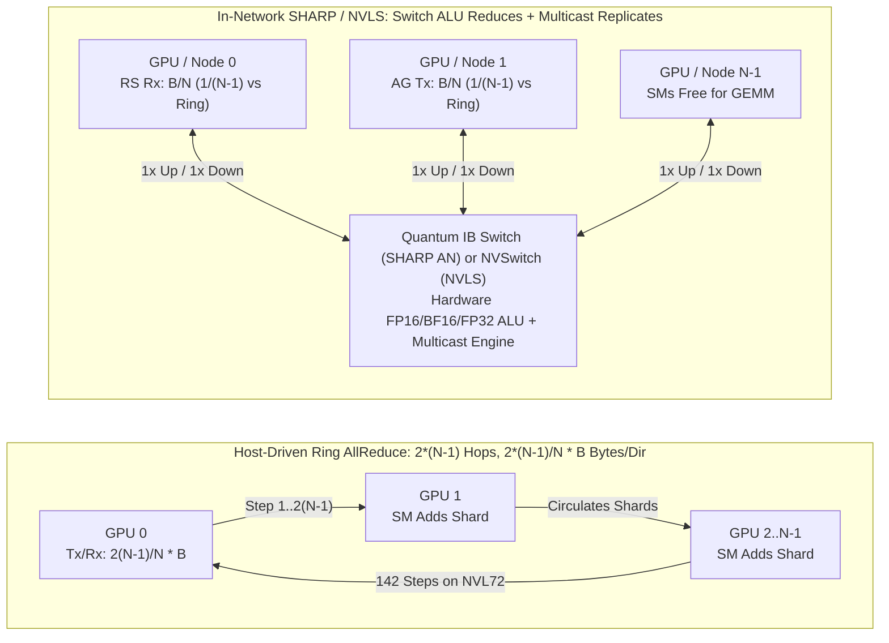
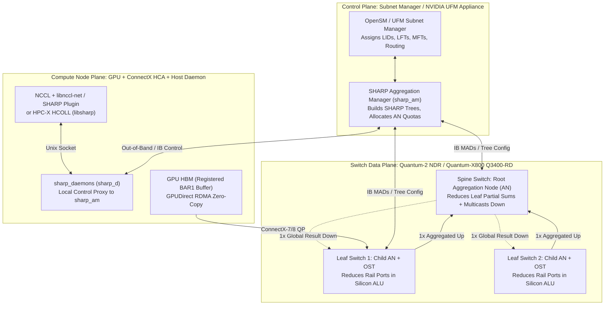

# 12.20 SHARP and in-network computing

| Field | Value |
|---|---|
| Level | Advanced |
| Priority tier | 2 |
| Lab venue | Nebius GPU + Local Python Verification Lab (`code/part12/sharp_in_network_computing_lab.py`) |
| Part | Part 12: Complete AI networking |
| Primary sources | *AI Systems Performance Engineering* (Chapters 2, 4); *AI Data Center Network Design and Technologies* (Chapter 12); *Supercomputers for Linux SysAdmins* (Chapters 5, 21); *NVIDIA DGX SuperPOD GB300 Reference Architecture* |
| Coverage file | `planning/coverage/chapters/12-20.md` |
| Claim & number ledger | `planning/ledgers/12-20.md` |

## Why this matters for AI infrastructure

In a classical distributed training cluster, the network switch is treated as a stateless byte pipe: GPUs compute partial gradients in High-Bandwidth Memory (`HBM`), pass intermediate shards from peer to peer around a logical `Ring` or `Tree`, and execute every floating-point addition inside GPU Streaming Multiprocessors (`SM`s). That endpoint-centric model breaks down in two ways as clusters scale to thousands of GPUs:

1. **Redundant Data Movement Across Endpoints (`2(N - 1) / N` vs `1 / (N - 1)` Volume Reduction):** In a standard `Ring` `ReduceScatter` on a tensor of size $B$ across $N$ GPUs, each GPU must receive $B\frac{N - 1}{N}$ bytes over $N - 1$ sequential hops (`700 MB` on an `8`-GPU node for an `800 MB` tensor, or `710 MB` on a `72`-GPU `GB200/GB300 NVL72` rack for a `720 MB` tensor). In a full `Ring` `AllReduce` (`ReduceScatter` followed by `AllGather`), each rank sends and receives $2\frac{N - 1}{N}B$ bytes across $2(N - 1)$ steps (`14` steps on `8` GPUs, `62` steps on `32` nodes, `142` steps on `72` GPUs). When the switch fabric itself contains arithmetic reduction engines and hardware multicast replicators, the switch aggregates incoming shards in silicon and returns only $\frac{B}{N}$ bytes to each GPU in `ReduceScatter` (`100 MB` on `8` GPUs, `10 MB` on `72` GPUs)—a **`1 / (N - 1)` per-endpoint receive volume** (`7.0x` less traffic on `8` GPUs, `31.0x` on `32` nodes, and `71.0x` on `72` GPUs).
2. **SM Occupancy and Collective Latency at Scale (`2x` to `5x` Speedup):** When GPUs execute `Ring` or host-driven `Tree` reductions, `16` to `32` GPU SM thread blocks (one CUDA block per `NCCL` channel) are occupied copying and summing communication buffers instead of running `GEMM` or attention kernels, and collective latency grows linearly with hop count in `Ring` ($2(N - 1)$ steps). Offloading the reduction into switch silicon frees GPU SMs (cutting communication channels from `16` down to `4` when paired with persistent zero-copy user buffer registration `ncclCommRegister`), collapses multi-node hop complexity from $O(N)$ to $O(\log_k N_{\text{nodes}})$, cuts sharded `AllGather` + `ReduceScatter` phase wall time by **`~1/2` (`50.0%`)** when overlapped, and delivers **`2x` to `5x` `AllReduce` speedups** on large-scale (`32+`-node) InfiniBand AI clusters.

NVIDIA implements in-network computing across two distinct switch domains within the **Magnum IO** stack:
- **NVLink SHARP (`NVLS`, `NCCL_NVLS_ENABLE=1`):** Switch-resident reduction and hardware multicast engines integrated directly into **`NVSwitch` Gen 3** (`HGX H100`/`H200`, `900 GB/s` bidirectional per GPU) and **`NVSwitch` Gen 4** (`DGX GB200`/`GB300 NVL72`, `18` `NVLink 5` links $\times$ `100 GB/s` = `1.8 TB/s` bidirectional per GPU, `130 TB/s` rack bisection across `72` GPUs and `18` `NVSwitch` chips in `9` switch trays).
- **InfiniBand SHARP (`CollNet`, `NCCL_COLLNET_ENABLE=1`):** Switch-resident **Scalable Hierarchical Aggregation and Reduction Protocol (`SHARP`)** engines inside **Quantum-class InfiniBand switches** (`SHARPv2` on `200 Gbps` `HDR`, `SHARPv3` on `400 Gbps` `NDR`, and `SHARPv4` on `800 Gbps` `XDR` `Quantum-X800` `Q3400-RD` `144`-port switches), orchestrated by the **`SHARP Aggregation Manager` (`sharp_am`)** running alongside the Subnet Manager (`OpenSM` or `NVIDIA Unified Fabric Manager` `UFM`) and host **`sharp_daemons`**.

## Prerequisites and outcomes

### Prerequisites
- Working mastery of `RDMA` Queue Pairs (`QP`s), Memory Regions (`MR`s), and `GPUDirect RDMA` (`nvidia-peermem` and `dma-buf`) from Chapters `12.2` and `12.19`.
- Familiarity with InfiniBand Subnet Manager (`OpenSM`), `UFM`, `LID`s/`GID`s, and `64`-byte Credit-Based Flow Control (`CBFC`) from Chapters `12.6`, `12.7`, and `12.9`.
- Understanding of `NCCL` collective operations (`AllReduce`, `ReduceScatter`, `AllGather`, `Broadcast`), algorithms (`Ring`, `Tree`, `PAT`), and wire protocols (`LL`, `LL128`, `Simple`) from Chapters `12.15` and `12.16`.

### Outcomes
After completing this chapter, you will be able to:
1. Derive and calculate the exact byte volume and step complexity of **`Ring` (`2(N - 1)/N * B` across `2(N - 1)` steps)** versus **InfiniBand `SHARP` (`2 * B` total tx+rx per node / `1 * B` per direction)** and **`NVSwitch` `NVLS` (`B / N` per endpoint in `ReduceScatter` and `AllGather`, a `1 / (N - 1)` reduction)**, including **`~1/2` phase time** when overlapping multicast `AllGather` with in-network `ReduceScatter`.
2. Architect **two-level hierarchical collectives** that combine intra-node / intra-rack `NVSwitch` **`NVLS`** (`8`-GPU `HGX` or `72`-GPU `GB200`/`GB300 NVL72`) with inter-rack **`CollNet` (`CollNetDirect`, `CollNetChain`)** over `400 Gbps` `NDR` or `800 Gbps` `Quantum-X800` `Q3400-RD` InfiniBand (`2` to `16` Scalable Units, `1,152` to `9,216` GPUs).
3. Trace the **`SHARP` control plane and data plane**: `UFM` / `OpenSM`, `sharp_am` (Aggregation Manager), `sharp_daemons` (`sharp_d` on compute nodes), switch **Aggregation Nodes (`AN`s)**, `SHARP` trees, `OST`s (Operand State Tables), and switch buffer quota exhaustion fallback.
4. Distinguish **`SHARPv1` (`100G` `EDR`)**, **`SHARPv2` (`200G` `HDR`)**, **`SHARPv3` (`400G` `NDR`)**, **`SHARPv4` (`800G` `XDR`)**, and **`NVLS` (`NVSwitch` Gen 3/4)** hardware capabilities, supported floating-point/integer precisions (`FP4`, `FP8`, `FP16`, `BF16`, `FP32`, `FP64`, `INT32`, `INT64`), and IEEE-754 floating-point non-associativity in `Ring` versus deterministic `SHARP` tree reductions.
5. Configure, verify, and troubleshoot **`NCCL` (`NCCL_COLLNET_ENABLE=1`, `NCCL_NVLS_ENABLE=1`, `NCCL_SHARP_DISABLE=0`, `ncclCommRegister`)**, **`OpenMPI` / `HPC-X` (`HCOLL_ENABLE_SHARP=1`)**, and compare InfiniBand `SHARP` against `Spectrum-X` Ethernet and the **Ultra Ethernet Consortium (`UEC`) In-Network Collectives (`INC` vs `xCCL`)** architecture.

---

## 1. Mathematical Foundations: Endpoint Ring/Tree Collectives vs In-Network Reduction

### 1.1 Why Host-Driven Ring Collectives Multiply Traffic by `(N - 1)`

Consider $N$ GPUs (or $N$ compute nodes) holding an input tensor of $B$ bytes that must be globally summed (`AllReduce`) or shard-reduced (`ReduceScatter`).

In a standard **Ring `ReduceScatter`**:
- Each tensor of size $B$ is partitioned into $N$ equal chunks of size $\frac{B}{N}$.
- Over $N - 1$ pipelined steps, every rank sends one chunk of size $\frac{B}{N}$ to its downstream neighbor and receives one chunk of size $\frac{B}{N}$ from its upstream neighbor, adding the incoming chunk into its local accumulator.
- Consequently, during `ReduceScatter` alone, every GPU sends and receives:

$$V_{\text{Ring, RS}} = (N - 1) \times \frac{B}{N} = B\frac{N - 1}{N}\text{ bytes}$$

In a standard **Ring `AllGather`**:
- Each GPU starts with its fully reduced $\frac{B}{N}$ shard and circulates shards around the ring for another $N - 1$ steps without arithmetic addition.
- Every GPU sends and receives an additional $B\frac{N - 1}{N}$ bytes.

Combining both phases into a **Ring `AllReduce`** requires **$2(N - 1)$ sequential hops** and forces every GPU (and every network link in the ring) to transmit $2\frac{N - 1}{N}B$ bytes and receive $2\frac{N - 1}{N}B$ bytes:

$$V_{\text{Ring, AR (unidirectional per rank)}} = 2\frac{N - 1}{N}B\text{ bytes}, \qquad \text{Steps}_{\text{Ring, AR}} = 2(N - 1)$$

As $N$ grows (`8`, `32`, `72`, `1,024`), $\frac{N - 1}{N} \to 1$, so each GPU transmits nearly $2B$ bytes and receives nearly $2B$ bytes ($4B$ combined bidirectional movement) while waiting through $2(N - 1)$ serial hop latencies.

### 1.2 In-Network Reduction (`NVLS` and `SHARP`) and the `1 / (N - 1)` Traffic Collapse

When the switch ASIC itself contains arithmetic reduction units (**Aggregation Nodes**, `AN`s) and hardware multicast engines, partial results no longer circulate from GPU to GPU:

1. **In-Network `ReduceScatter` (`1 / (N - 1)` Receive Volume):**
   - With `NVLink SHARP` (`NVLS`) or InfiniBand `SHARP`, the switch aggregates incoming contributions from all $N$ endpoints inside the switch silicon and writes only the final reduced **$\frac{B}{N}$ shard** back to each target GPU.
   - Instead of receiving $B\frac{N - 1}{N}$ bytes across $N - 1$ hops, each GPU receives only **$\frac{B}{N}$ bytes**:

$$\frac{V_{\text{SHARP/NVLS, RS (rx)}}}{V_{\text{Ring, RS (rx)}}} = \frac{B / N}{B(N - 1) / N} = \frac{1}{N - 1}$$

   - Concretely:
     - On an **`8`-GPU** `HGX H100` node reducing an **`800 MB`** tensor, a `Ring` `ReduceScatter` receives **`700.0 MB`** per GPU across `7` hops (`1,400.0 MB` across `14` steps for `AllReduce`), whereas `NVLS` returns **`100.0 MB`** per GPU—a **`7.0x` (`1 / 7`)** reduction in receive volume.
     - On a **`32`-node** InfiniBand cluster reducing a **`1,024 MB`** (`1.024 GB`) tensor, a `Ring` `ReduceScatter` receives **`992.0 MB`** per node (`1,984.0 MB` across `62` steps for `AllReduce`), whereas `SHARP` reduces the shards to **`32.0 MB`** per node—a **`31.0x` (`1 / 31`)** volume ratio (`10` tree steps vs `62` ring steps).
     - On a **`72`-GPU `GB200`/`GB300 NVL72`** rack reducing a **`720 MB`** tensor, a `Ring` `ReduceScatter` receives **`710.0 MB`** per GPU (`1,420.0 MB` across `142` steps for `AllReduce`), whereas `NVLS` returns **`10.0 MB`** per GPU—a **`71.0x` (`1 / 71`)** reduction (`14` tree steps vs `142` ring steps).

2. **Hardware Multicast `AllGather` (`1 / (N - 1)` Send Volume):**
   - `AllGather` has no arithmetic reduction, so `NVLS` accelerates it via **hardware multicast**: each GPU sends its $\frac{B}{N}$ shard **once** into the `NVSwitch` fabric, and the switch replicates that shard to all $N - 1$ peers in a single hop.
   - Each sender transmits only $\frac{B}{N}$ bytes instead of $B\frac{N - 1}{N}$ bytes—again cutting sender volume to **`1 / (N - 1)`** of the full ring.

3. **Inter-Node `SHARP` `AllReduce` (`2 * B` Total Fabric Traversals vs `2(N - 1)/N * B` Unidirectional):**
   - In an inter-node InfiniBand `SHARP` `AllReduce` on tensor size $B$, each node streams $1 \times B$ bytes up into its leaf switch (`1` uplink traversal), the switch hierarchy reduces all nodes' tensors in flight as packets climb to the root switch, and the root switch multicast-broadcasts the $1 \times B$ reduced result back down (`1` downlink traversal) for **`2` total fabric traversals (`1 * B` up + `1 * B` down = `2 * B` total tx+rx bytes)** per node, compared to $2\frac{N - 1}{N}B$ bytes **per direction** ($4\frac{N - 1}{N}B$ total tx+rx bytes) in a `Ring` `AllReduce`.
   - On a full-duplex link of bandwidth $W$ (`50.0 GB/s` for `400 Gbps` `NDR` or `100.0 GB/s` for `800 Gbps` `XDR`), cutting unidirectional per-node volume from $2\frac{N - 1}{N}B$ (`1,984.0 MB` at $N = 32$) down to $1.0 \times B$ (`1,024.0 MB`) while collapsing latency steps from $2(N - 1) = 62$ down to $2\lceil\log_2 N\rceil = 10$ produces **`~1.94x` to `5x` end-to-end `AllReduce` speedups** at `32+`-node scale.

4. **Overlapping Multicast `AllGather` with In-Network `ReduceScatter` (`~1/2` Phase Wall Time):**
   - In Fully Sharded Data Parallelism (`FSDP`) or ZeRO-3 training, forward/backward parameter `AllGather` (duration $T_{\text{AG}}$) and gradient `ReduceScatter` (duration $T_{\text{RS}}$) contend for endpoint bandwidth in a ring ($T_{\text{serial}} = T_{\text{AG}} + T_{\text{RS}}$, e.g., `8.0 ms + 8.0 ms = 16.0 ms`).
   - With `NVLS`, hardware multicast replication and in-network arithmetic reduction execute concurrently inside the switch fabric, so overlapping a multicast `AllGather` with an in-network `ReduceScatter` reduces the effective wall time to:

$$T_{\text{overlapped, NVLS}} = \max(T_{\text{AG}}, T_{\text{RS}})$$

   - When $T_{\text{AG}} \approx T_{\text{RS}} = 8.0\text{ ms}$, total shard-exchange wall time drops from `16.0 ms` to **`8.0 ms`**—a **`50.0%` (`~1/2`)** wall-time reduction.



| Collective Metric | Host-Driven `Ring` (`NCCL_ALGO=Ring`) | Host-Driven `Tree` (`NCCL_ALGO=Tree`) | In-Network `NVLS` / `CollNet` (`SHARP`) |
|---|---|---|---|
| `ReduceScatter` per-rank receive volume | $B\frac{N - 1}{N}$ (`700 MB` on `8` GPUs; `710 MB` on `72` GPUs) | N/A (Tree executes Reduce + Broadcast) | **`B / N`** (`100 MB` on `8` GPUs; `10 MB` on `72` GPUs = **`1 / (N - 1)`** of Ring) |
| `AllGather` per-rank send volume | $B\frac{N - 1}{N}$ (`700 MB` on `8` GPUs; `710 MB` on `72` GPUs) | N/A | **`B / N`** via `NVLS` hardware multicast (**`1 / (N - 1)`** of Ring) |
| `AllReduce` unidirectional bytes per rank | $2\frac{N - 1}{N}B$ (`1,984 MB` for `1,024 MB` on `32` nodes) | $\approx 2B$ split `50/50` across dual complementary trees | **`1.0 * B`** up + **`1.0 * B`** down (`2 * B` total tx+rx; **`~2x` less wire traffic**) |
| Step / latency complexity | $2(N - 1)$ steps (`62` on `32` nodes; `142` on `72` GPUs) | $2\lceil\log_2 N\rceil$ steps (`10` on `32` nodes; `14` on `72` GPUs) | **`1`–`2` switch hops (`NVLS`)** or **$2\lceil\log_k N_{\text{nodes}}\rceil$ (`SHARP`)** |
| Where arithmetic reduction executes | GPU `SM`s (`16–32` CUDA channel blocks) | GPU `SM`s on interior tree nodes | **Switch ASIC silicon** (`NVSwitch` `NVLS` ALU or `Quantum` `SHARP` `AN`) |
| Overlapped `AllGather` + `ReduceScatter` time | $T_{\text{AG}} + T_{\text{RS}}$ (`16.0 ms` serial bandwidth contention) | $T_{\text{AG}} + T_{\text{RS}}$ | **$\max(T_{\text{AG}}, T_{\text{RS}})$** (`8.0 ms`, **`~1/2` wall time**) |

---

## 2. Two Domains of In-Network Computing: NVLink SHARP (`NVLS`) vs InfiniBand `SHARP` (`CollNet`)

A frequent source of confusion in production interviews and cluster bring-up is conflating **NVLink SHARP (`NVLS`)** with **InfiniBand `SHARP` (`CollNet`)**. Both belong to NVIDIA's **Magnum IO** in-network compute pillar and both use switch-resident reduction ALUs, but they operate on different physical fabrics, use different control planes, and are enabled by different `NCCL` pathways.

### 2.1 Intra-Node and Intra-Rack NVLink SHARP (`NVLS` and `NVLSTree`)

**NVLink SHARP (`NVLS`)** offloads reductions and multicast replication inside an **NVLink Switch (`NVSwitch`) domain**:
1. **`HGX H100` / `H200` (`NVSwitch` Gen 3):** Connects `8` GPUs inside a single server node at **`900 GB/s`** bidirectional (`450 GB/s` unidirectional) per GPU over `18` `NVLink 4` links (`3.6 TB/s` aggregate bisection across `4` NVSwitch chips).
2. **`DGX GB200` / `GB300 NVL72` (`NVSwitch` Gen 4):** Connects **`72` Blackwell GPUs** (`18` compute trays $\times$ `2` Grace-Blackwell Superchips $\times$ `2` dual-die Blackwell GPUs, paired with `36` Grace CPUs over `900 GB/s` cache-coherent `NVLink-C2C`) across **`9` NVLink switch trays** (`2` NVSwitch chips per tray = **`18` NVSwitch chips total**, `144` NVLink ports at `100 GB/s` per switch tray). Every GPU exposes **`18` `NVLink 5` links** (`100 GB/s` bidirectional each = **`1.8 TB/s` bidirectional per GPU**), wired one link to each of the `18` NVSwitch chips to form a **1-hop full crossbar with `130 TB/s` of aggregate rack bisection bandwidth** and sub-microsecond (`< 1 us` per hop, `1–2 us` small-message) latency.
3. **How `NVLS` Works in `NCCL`:**
   - Enabled via `NCCL_NVLS_ENABLE=1` (default enabled on supported `Hopper`/`Blackwell` NVSwitch systems + CUDA `12.1+`) and selectable via `NCCL_ALGO=NVLS,NVLSTree`.
   - Uses CUDA fabric multicast memory handles (`cuMemCreate` / `cuMulticastCreate`) mapped across the NVSwitch BAR address space. When a GPU issues a multicast store or reduction instruction to the shared NVSwitch fabric address, the `NVSwitch` ASICs perform the reduction (`FP4`, `FP8`, `FP16`, `BF16`, `FP32`, `INT32`, `INT64`) or 1-hop broadcast replication directly in switch hardware without routing intermediate packets through peer GPUs.
   - Combined with symmetric memory and low-latency NVLink kernels, `NCCL` achieves up to **`7.6x` latency reduction** on small and medium messages inside NVLink domains.
   - Managed at the rack level on `DGX GB200`/`GB300` by **NVIDIA Network Manager eXperience (`NMX-M`)** running over the switch trays' `COMe` / `NVOS` management interfaces (rather than InfiniBand `OpenSM`).

### 2.2 Inter-Node and Inter-Rack InfiniBand `SHARP` (`CollNetDirect` and `CollNetChain`)

When a training job spans multiple `8`-GPU `HGX` servers or multiple `72`-GPU `NVL72` racks (up to `8` racks = `576` GPUs per Scalable Unit `SU`, or `16` `SUs` = `128` racks = **`9,216` GPUs** in a `DGX GB300 SuperPOD`), traffic exits the NVSwitch domain through **`4` `ConnectX-8` `800 Gbps` (`3.2 Tbps` per compute tray, `57.6 Tbps` per `NVL72` rack)** or **`8` `ConnectX-7` `400 Gbps`** Host Channel Adapters (`HCA`s) into a rail-optimized **Quantum InfiniBand** fat-tree fabric.

Here, **InfiniBand `SHARP`** performs in-network reductions inside the **Quantum switch silicon** via `NCCL`'s **`CollNet`** collective path:
1. **`CollNetDirect`:** Optimized for dense intra-node connectivity (`NVSwitch` nodes) where all local GPUs can communicate directly in parallel with the designated rail leader GPUs that inject into the InfiniBand `SHARP` switch tree.
2. **`CollNetChain`:** Organizes local GPUs into an ordered sequence, performing a forward local reduction along the chain toward the NIC leader and distributing the globally reduced `SHARP` result back in the reverse direction.

### 2.3 Two-Level Hierarchical `NVLS` + InfiniBand `SHARP` Execution Pipeline

On a multi-node `HGX` or multi-rack `NVL72` cluster with both `NCCL_NVLS_ENABLE=1` and `NCCL_COLLNET_ENABLE=1`, `NCCL` executes a **three-stage hierarchical collective** across $D$ domains (nodes or racks), each containing $G$ GPUs ($N = D \times G$ total GPUs):

1. **Stage 1 — Intra-Domain `NVLS` `ReduceScatter` (at `1.8 TB/s`/GPU on `NVL72` or `900 GB/s`/GPU on `HGX`):**
   Inside each domain, the `NVSwitch` ASICs aggregate the $G$ GPUs' local tensors of size $S$ so that each of the $G$ GPUs (or each of the rail-aligned NIC leaders) receives a reduced $\frac{S}{G}$ shard (`128.0 MB` per GPU for a `1,024 MB` tensor on an `8`-GPU node, or `10.0 MB` per GPU for a `720 MB` tensor on a `72`-GPU `NVL72` rack).
2. **Stage 2 — Inter-Domain InfiniBand `SHARP` `AllReduce` (at `400 Gbps` `NDR` or `800 Gbps` `XDR` per rail):**
   Each rail-aligned GPU leader injects its $\frac{S}{G}$ shard via **GPUDirect RDMA** (`BAR1` zero-copy) into its rail's **Quantum leaf switch**. Across all rails, each domain transmits a total of $G \times \frac{S}{G} = \mathbf{1.0 \times S}$ **bytes** up into the InfiniBand `SHARP` tree (instead of $2\frac{D - 1}{D}S$ bytes in an inter-domain `Ring`, or $2\frac{N - 1}{N}S \times G$ bytes in a topology-unaware flat ring). The Quantum leaf and spine switches sum the shards across all $D$ domains in switch silicon and multicast the globally reduced $\frac{S}{G}$ shard back down each rail (`1.0 \times S$ bytes received per domain).
   - On a **`32`-node $\times$ `8`-GPU (`256`-GPU)** cluster with a **`1,024 MB`** tensor, inter-node InfiniBand `SHARP` injects **`1,024.0 MB`** per node up the tree versus **`1,984.0 MB`** per node in a hierarchical inter-node `Ring` (**`1.9375x`** less inter-node unidirectional traffic and `10` tree steps vs `62` ring steps).
   - On a **`16`-rack $\times$ `72`-GPU (`1,152`-GPU, `2` `SU`) `DGX GB300 SuperPOD`** with a **`720 MB`** tensor, intra-rack `NVLS` `ReduceScatter` receives only **`10.0 MB` per GPU** (`1 / 71` of an intra-rack ring's `710.0 MB`), and inter-rack InfiniBand `SHARP` sends **`720.0 MB` per rack** across the `Quantum-X800` fabric versus **`1,350.0 MB` per rack** in an inter-rack `Ring` (**`1.875x`** inter-rack bandwidth savings).
3. **Stage 3 — Intra-Domain `NVLS` Hardware Multicast `AllGather`:**
   Each rail leader writes its globally reduced $\frac{S}{G}$ shard into the local `NVSwitch` multicast address, which replicates the full reduced tensor $S$ across all $G$ GPUs in `1` hop.

---

## 3. InfiniBand `SHARP` Architecture: `sharp_am`, `sharp_daemons`, Aggregation Nodes (`AN`s), and Trees

Unlike standard RDMA `RC` Queue Pairs that are negotiated purely end-to-end between two host NICs, InfiniBand `SHARP` requires coordinated state inside the **switch silicon**, the **fabric control plane**, and the **compute hosts**.

### 3.1 The Four Architectural Components of InfiniBand `SHARP`



| Component | Binary / Process / Silicon Block | Where It Runs | Exact Operational Role |
|---|---|---|---|
| **Subnet Manager & `UFM`** | `opensm` / `ufm-enterprise` | Dedicated Management Node or `BlueField` DPU | Discovers physical topology, assigns `16`-bit `LID`s (`1..49,151`), computes deadlock-free `LFT`/`MFT` tables, and exports topology graph to `sharp_am` |
| **SHARP Aggregation Manager** | **`sharp_am`** | Co-located with `OpenSM` / `UFM` (or DPU) | Parses fabric topology, computes physical **SHARP spanning trees** across Quantum switches, programs switch `AN` tables via InfiniBand `MAD`s, and enforces per-job tree quotas |
| **Host SHARP Daemon** | **`sharp_daemons` (`sharp_d`)** | Every GPU compute node (or local DPU) | Persistent root/system daemon that authenticates local job ranks (`NCCL` / `MPI`), requests tree allocations and `OST` resources from `sharp_am`, and sets up switch-facing `QP`s |
| **Switch Aggregation Node** | **`AN` + `OST` (Operand State Table)** | Inside Quantum / Quantum-2 / Quantum-X800 ASIC | Tracks expected child/host operands per collective transaction in the `OST`, sums arriving `FP16`/`BF16`/`FP32`/`FP64`/`INT` packets in silicon ALU as soon as all children arrive, and forwards 1 packet up or broadcasts down |
| **Application Plugin** | **`libnccl-net.so` (`nccl-rdma-sharp-plugins`)**, `libsharp.so`, `HCOLL` | User-space training process (`torchrun` / `srun`) | Exposes `CollNet` collective hooks to `NCCL` (`NCCL_COLLNET_ENABLE=1`) or `MPI` (`HCOLL_ENABLE_SHARP=1`) and posts GPUDirect RDMA sends/receives to the leaf switch `AN` |

### 3.2 Step-by-Step Lifecycle of a `SHARP` Collective

1. **Fabric Discovery and Physical Tree Construction (`sharp_am` Startup):**
   - `OpenSM` or `NVIDIA UFM` sweeps the InfiniBand subnet (`ibnetdiscover` / SMP directed routes) and writes the topology file (`opensm-subnet.lst` / fabric graph).
   - `sharp_am` reads the switch topology, identifies every Quantum switch whose firmware supports `SHARP` (`Capability mask` / `AN` support), and builds one or more physical **SHARP spanning trees** (`Tree 0 .. Tree 63` on `SHARPv3`/`SHARPv4`), designating leaf switches as **Child `AN`s** and spine switches as **Root `AN`s**.
2. **Job Initialization and Communicator Reservation (`ncclCommInitRank`):**
   - When `PyTorch` initializes `ProcessGroupNCCL` with `NCCL_COLLNET_ENABLE=1`, the `NCCL RDMA SHARP` plugin connects over a local socket to the compute node's `sharp_d` (`sharp_daemons`) process.
   - The leader rank's `sharp_d` contacts `sharp_am` to request a **SHARP Job context** and a logical **Aggregation Group (`AG`)** bound to a physical switch tree that spans the participating compute nodes.
   - If `sharp_am` has available tree quota and switch buffer capacity, it programs the participating Leaf and Spine `AN`s, allocates entries in each switch's **Operand State Table (`OST`)**, and returns the `AN` Queue Pair (`QP`) connection parameters to the hosts.
3. **In-Flight Switch Reduction (`OST` Synchronization and Streaming Aggregation):**
   - During `ncclAllReduce`, each node's rail-aligned GPU leader posts a GPUDirect RDMA send of its local shard directly to its Leaf Switch `AN` `QP`.
   - As packets arrive from the $k$ child ports attached to that Leaf `AN`, the switch's **Operand State Table (`OST`)** tracks which ports have contributed to the current reduction offset and accumulates the running sum in dedicated on-switch SRAM reduction buffers using the switch's IEEE-754 floating-point / integer ALU.
   - **Critical Store-and-Reduce Invariant:** A switch `AN` never forwards `k` separate packets upstream. It waits until all $k$ expected child operands for that chunk have arrived in the `OST`, emits **one single combined packet** upstream to the parent Spine `AN`, and clears the `OST` slot for the next pipelined chunk (**Streaming Aggregation Protocol**, `SAT`).
   - Once the Root Spine `AN` sums the partial results from all Leaf `AN`s, it immediately multicasts the final reduced packet back down the tree to every Leaf `AN`, which replicates it to each host NIC `QP` and via GPUDirect RDMA into GPU `HBM`.
4. **Teardown and Quota Reclamation (`ncclCommDestroy`):**
   - When the job finishes (or if a rank crashes and `sharp_d` detects process termination), `sharp_am` tears down the job's logical `AG`, flushes any in-flight `OST` entries on the switches, and returns the `SHARP` tree quota to the cluster pool.

---

## 4. Hardware Generations (`SHARPv1`–`SHARPv4`, `NVLS`), Data Types, and Floating-Point Determinism

### 4.1 Evolution from `SHARPv1` (`EDR`) to `SHARPv4` (`Quantum-X800`) and `NVLS` Gen 4

Early InfiniBand `SHARP` (`SHARPv1` on `100 Gbps` `EDR` `Switch-IB 2`) was designed for traditional CPU-based HPC MPI workloads (`MPI_Barrier`, small `FP64`/`INT64` reductions) and lacked both 16-bit AI data types and high-throughput streaming bandwidth. Modern AI factories rely on `SHARPv2`, `SHARPv3`, `SHARPv4`, and `NVSwitch` `NVLS`:

| Hardware Generation | Switch Platform & ASIC | Port Speed & Radix | Supported Reduction Data Types | Key Architectural Capabilities |
|---|---|---|---|---|
| **`SHARPv1`** | `Switch-IB 2` (`EDR` InfiniBand) | `100 Gbps` (`4x25G`), `36` ports | `INT32`, `INT64`, `FP32`, `FP64` | First-gen small-message Low-Latency Tree (`LLT`); no `FP16`/`BF16`; single active tree |
| **`SHARPv2`** | `Quantum-1` `QM8700` (`HDR` InfiniBand) | `200 Gbps` (`4x50G` PAM4), `40` ports | `FP16`, `BF16`, `FP32`, `FP64`, `INT32`, `INT64` | Added **Streaming Aggregation (`SAT`)** at line rate + native **`FP16` and `BF16`** for deep learning gradients (`NCCL` `CollNet`) |
| **`SHARPv3`** | `Quantum-2` `QM9700` (`NDR` InfiniBand) | `400 Gbps` (`4x100G` PAM4), `64` ports | `FP16`, `BF16`, `FP32`, `FP64`, `INT32`, `INT64` | Multi-tenant concurrent job trees (up to **`64` trees/groups**), multi-rail parallel aggregation across rails |
| **`SHARPv4`** | `Quantum-X800` `Q3400-RD` (`XDR` InfiniBand) | `800 Gbps` (`4x200G` PAM4), **`144` ports** | `FP8`, `FP16`, `BF16`, `FP32`, `FP64`, `INT32`, `INT64` | `144`-port `800G` radix (`115.2 Tbps` switch capacity), `FP8` support, scales `2`-layer fat-tree to **`16` `SUs` (`9,216` GPUs)** |
| **`NVLS` Gen 3** | `NVSwitch 3.0` (`HGX H100` / `H200`) | `900 GB/s` bidir (`3,600 Gbps` unidir) / GPU, `64` ports | `FP8`, `FP16`, `BF16`, `FP32`, `INT32`, `INT64` | Intra-node (`8` GPUs) & `NVL256` in-switch reduction + hardware multicast (`NCCL_NVLS_ENABLE=1`) |
| **`NVLS` Gen 4** | `NVSwitch 4.0` (`DGX GB200` / `GB300 NVL72`) | `1.8 TB/s` bidir (`7,200 Gbps` unidir) / GPU, **`144` ports/tray** | `FP4` (`NVFP4`), `FP8`, `FP16`, `BF16`, `FP32`, `INT32`, `INT64` | **`72`-GPU** single-rack NVLink domain (`18` compute trays, `9` switch trays / `18` NVSwitch chips, **`130 TB/s`** bisection) |

### 4.2 `DGX GB300 SuperPOD` Scale-Out with `Quantum-X800` `Q3400-RD` (`144`-Port) Switches

Because the **`Quantum-X800` `Q3400-RD`** switch provides a **`144`-port radix at `800 Gbps`** (`2.25x` the `64`-port radix of `NDR` `QM9700`), a `DGX GB300 SuperPOD` can scale up to **`16` Scalable Units (`SUs`) — `128` `DGX GB300 NVL72` racks or `9,216` `B300` GPUs — in a non-blocking `2`-layer leaf-spine InfiniBand compute fabric** without requiring a third super-spine tier (which would add an extra `SHARP` `AN` hop and double optical cabling):
- Each **Scalable Unit (`1 SU`)** comprises **`8` `DGX GB300 NVL72` racks** (`8 x 72 = 576` GPUs, `8 x 18 = 144` compute trays, `1.2 MW` TDP) and **`8` `Q3400-RD` leaf switches** distributed across **`4` rails** (`2` leaf switches per rail).
- Each compute tray integrates **`4` `ConnectX-8` `800 Gbps` InfiniBand NICs** (`1` per rail) for the inter-rack compute fabric, plus **`1` `BlueField-3` (`BF3240`) dual-port `2x400 Gbps` DPU** connected to `Spectrum-4` `SN5600D` (`64`-port `800 Gbps`) Ethernet switches (`400 Gbps` dedicated to `RoCEv2` High-Performance Storage at `90 GB/s` read / `45 GB/s` write Standard or `280 GB/s` read / `140 GB/s` write Enhanced per `SU`, and `>= 200 Gbps` dedicated to In-Band Management) and `SN2201` (`48 x 1 Gbps`) Out-of-Band switches.

| `DGX GB300 SuperPOD` Scale (`# SUs`) | `# Compute Racks` (`NVL72`) | `# GPUs` (`B300`) | IB Leaf Switches per `SU` (`Q3400-RD`) | Total IB Leaf Switches (`Q3400-RD`) | Total IB Spine Switches (`Q3400-RD`) | Storage & In-Band `SN5600D` Spines / Compute Leaves / Storage Leaves |
|---|---|---|---|---|---|---|
| **`2 SUs`** | `16` racks | **`1,152` GPUs** | `8` (`4` rails $\times$ `2`) | **`16`** | **`8`** | `4` spines / `8` compute leaves / `2` storage leaves (`64x400GbE`) |
| **`4 SUs`** | `32` racks | **`2,304` GPUs** | `8` (`4` rails $\times$ `2`) | **`32`** | **`18`** | `8` spines / `16` compute leaves / `2` storage leaves (`128x400GbE`) |
| **`8 SUs`** | `64` racks | **`4,608` GPUs** | `8` (`4` rails $\times$ `2`) | **`64`** | **`36`** | `12` spines / `32` compute leaves / `4` storage leaves (`256x400GbE`) |
| **`16 SUs`** | `128` racks | **`9,216` GPUs** | `8` (`4` rails $\times$ `2`) | **`128`** | **`72`** | `24` spines / `64` compute leaves / `8` storage leaves (`1024x400GbE`) |

### 4.3 IEEE-754 Floating-Point Non-Associativity and Deterministic `SHARP` Tree Reductions

In exact real arithmetic, addition is associative: $(a + b) + c = a + (b + c)$. In **IEEE-754 floating-point arithmetic (`FP32`, `BF16`, `FP16`, `FP8`)**, addition is **not associative** because every intermediate sum rounds to a finite mantissa (`23` explicit fraction bits in `FP32`, `10` in `FP16`, `7` in `BF16`).

Consider summing `8` `FP32` values across `8` ranks:

$$[10^7,\; -10^7,\; 1.0,\; 0.25,\; 10^6,\; -10^6,\; 0.5,\; 0.125]$$

whose exact mathematical sum is **`1.875`**:
- **Rank-Rotated `Ring` Reduction (`((((v[k] + v[k+1]) + v[k+2]) + ...))`):**
  - If the reduction chain starts at `Rank 0`, $10^7 + (-10^7) = 0.0$ cancels cleanly first, and the remaining terms accumulate to **`1.875`**.
  - If the reduction chain starts at `Rank 2` (`1.0`), the running sum reaches $1.25 + 10^6 = 1000001.25$, then adds $-10^6 \to 1.25$, then adds $0.5 + 0.125 = 1.875$, then adds $10^7$ in `FP32`: because `10,000,000.0` in `FP32` has a unit in the last place (`ULP`) of $2^{23 - 23} = 1.0$, adding `1.875` to `10,000,000.0` rounds to `10,000,002.0`, and subtracting `10,000,000.0` yields **`2.0`** instead of `1.875` (a `0.125` discrepancy, with `6` distinct `FP32` values produced across the `8` starting rank rotations).
- **Fixed-Topology Binary `SHARP` Tree Reduction:**
  - Inside a `SHARP` Aggregation Node (`AN`), operands are not summed in arbitrary packet arrival order ("first-come, first-summed") unless explicitly configured for unordered reductions. Instead, the `AN` `OST` waits for the fixed set of child port operands and reduces them according to a **deterministic binary tree parenthesization** indexed by switch port/tree slot:
    - Pair `(0, 1)`: $10^7 + (-10^7) = 0.0$
    - Pair `(2, 3)`: $1.0 + 0.25 = 1.25$
    - Pair `(4, 5)`: $10^6 + (-10^6) = 0.0$
    - Pair `(6, 7)`: $0.5 + 0.125 = 0.625$
    - Level 2 & Root: $(0.0 + 1.25) + (0.0 + 0.625) = \mathbf{1.875}$.
  - **Operational Takeaway for Bitwise Reproducibility:** Because `Ring` and `SHARP` (`CollNet`) use different summation trees (`((((a+b)+c)+d))` vs `((a+b)+(c+d))`), switching a training run from `NCCL_SHARP_DISABLE=1` (`Ring`) to `NCCL_COLLNET_ENABLE=1` (`SHARP`) will produce slightly different least-significant mantissa bits in the reduced gradient tensor. However, **within a fixed `SHARP` tree topology and rank placement**, repeated runs are **100% bit-repeatable** (`sharp_tree_repeatable = True`), and every rank receives the **exact same bit-identical reduced tensor** because the Root `AN` broadcasts a single canonical result down the tree.

---

## 5. Software Stack Integration: `NCCL` (`CollNet`, `NVLS`, `ncclCommRegister`), `HPC-X` `OpenMPI` (`HCOLL`), and `UEC` `INC`

### 5.1 Enabling InfiniBand `SHARP` (`CollNet`) and `NVSwitch` `NVLS` in `NCCL`

By default, InfiniBand `SHARP` is **not** enabled automatically in standard `NCCL` jobs unless the `NCCL RDMA SHARP` plugin (`libnccl-net.so` from `nccl-rdma-sharp-plugins` / `HPC-X`) is installed and `CollNet` is explicitly activated:

1. **Five Prerequisites for InfiniBand `SHARP` in `NCCL`:**
   - **Quantum Switch Firmware:** Quantum, Quantum-2 (`QM9700`), or Quantum-X800 (`Q3400-RD`) switches running `SHARP`-enabled firmware (`SHARPv2`, `SHARPv3`, or `SHARPv4`).
   - **Active `sharp_am` and Subnet Manager:** `OpenSM` or **NVIDIA Unified Fabric Manager (`UFM`)** (`ufm-enterprise`) running with an active **`SHARP Aggregation Manager` (`sharp_am`)** that has discovered the fabric and built `SHARP` trees.
   - **Compute Host `sharp_daemons` and `GPUDirect RDMA`:** Each GPU host must run the `sharp_daemons` (`sharp_d`) service and have the **GPUDirect RDMA** kernel module loaded (`lsmod | grep nvidia_peermem` or `dma-buf` on Linux `>= 5.12` with OpenRM `-open` and `rdma-core >= 34`).
   - **`NCCL RDMA SHARP` Plugin:** The external network plugin `libnccl-net.so` (`nccl-rdma-sharp-plugins`) must be on `LD_LIBRARY_PATH` so `NCCL` initializes `NET/IB` with `SHARP` `CollNet` support.
   - **Environment Variables:**
     - `NCCL_COLLNET_ENABLE=1`: Enables the `CollNet` (`CollNetDirect` / `CollNetChain`) collective path for InfiniBand `SHARP`.
     - `NCCL_NVLS_ENABLE=1`: Explicitly enables `NVLink SHARP` (`NVLS` / `NVLSTree`) on supported `NVSwitch` domains (`HGX H100`/`H200`, `GB200`/`GB300 NVL72`).
     - `NCCL_SHARP_DISABLE=0` (or `NCCL_SHARP_DISABLE=1` to force-disable `SHARP` during A/B benchmarking or switch-buffer triage while keeping `NVLS` active).
     - `NCCL_ALGO=NVLS,NVLSTree,CollNetDirect,CollNetChain,Tree,Ring,PAT`: Optional algorithm list override (set **before** `ncclCommInitRank()`).

2. **Persistent Zero-Copy User Buffers (`ncclMemAlloc` + `ncclCommRegister`):**
   - To unlock the lowest-latency, lowest-SM-occupancy `SHARP` and `NVLS` paths, applications register persistent tensor buffers directly with the `NCCL` communicator using `ncclCommRegister(comm, ptr, size, &handle)` (and `ncclCommDeregister(comm, handle)` on teardown).
   - **Two Strict Correctness Rules:**
     1. **All-Rank Registration:** If *any* rank in a communicator passes a registered user buffer to a collective, **every rank** in that communicator must pass a registered buffer.
     2. **Symmetric Offset Alignment:** For symmetric `NVLS` and `CollNet`/`SHARP` zero-copy algorithms, the byte offset from the registered buffer head (`tensor_ptr - base_registered_ptr`) must be identical across all ranks. If either rule is violated, `NCCL` falls back to internal channel staging buffers (`NCCL_BUFFSIZE`, default `4 MiB`).

### 5.2 Enabling `SHARP` in `OpenMPI` and `HPC-X` via `HCOLL` (`HCOLL_ENABLE_SHARP=1`)

In traditional HPC and hybrid `MPI + PyTorch` / `DeepSpeed` clusters managed with `Slurm` (`PMIx`) and `OpenMPI` (`HPC-X`), collective operations are accelerated by NVIDIA's **Hierarchical Collectives (`HCOLL`)** library (`coll_hcoll` module in `OpenMPI`'s Modular Component Architecture, `MCA`):
- **Enabling `HCOLL` and `SHARP` in `OpenMPI`:**
  - Pass `-mca coll_hcoll_enable 1` (or `export OMPI_MCA_coll_hcoll_enable=1` when launching via `srun --mpi=pmix`), bind the primary HCA with `-x HCOLL_MAIN_IB=mlx5_0:1`, enable non-blocking collectives with `-x HCOLL_ENABLE_NBC=1`, and activate in-switch `SHARP` reductions with **`-x HCOLL_ENABLE_SHARP=1`**.
  - If `HCOLL` misbehaves on a non-SHARP job or legacy transport, administrators disable it cleanly with `mpiexec -mca coll_hcoll_enable 0` or `export OMPI_MCA_coll_hcoll_enable=0`.
  - Parameter precedence in `OpenMPI` `MCA` (from lowest to highest priority, inspectable via `ompi_info -a`):
    1. Global config file: `/etc/openmpi-mca-params.conf` (`key=value`)
    2. User config file: `$HOME/.openmpi/mca-params.conf`
    3. Tuned option files: `mpiexec --tune file1,file2`
    4. Environment variables: `export OMPI_MCA_<param>=<value>`
    5. Command-line flags: `mpiexec -mca <param> <value>`

### 5.3 Ethernet Fabrics: `Spectrum-X` vs `UEC` In-Network Collectives (`INC` and `xCCL`)

What happens if you run distributed training over Ethernet (`RoCEv2` or `Ultra Ethernet`) instead of InfiniBand?

1. **NVIDIA `Spectrum-X` Ethernet (`SN5600` / `Spectrum-4` and `Spectrum-X800`):**
   - `Spectrum-X` accelerates `NCCL` `AllReduce` and `AllToAll` over Ethernet using per-packet adaptive routing (`sDLB` / `Spectrum-X` adaptive spraying), hardware-assisted congestion control (`DCQCN` + telemetry), and `BlueField-3` SuperNIC reordering.
   - However, **as of current production releases, `Spectrum-X` Ethernet switches do not expose switch-resident arithmetic reduction engines analogous to InfiniBand `SHARP`**. Setting `NCCL_COLLNET_ENABLE=1` on a `Spectrum-X` `RoCEv2` cluster will not offload floating-point additions into the `SN5600` switch ASIC; `NCCL` will use `NVSwitch` `NVLS` intra-node/intra-rack and standard `RDMA` `Ring`/`Tree`/`PAT` inter-rack.

2. **Ultra Ethernet Consortium (`UEC`) In-Network Collectives (`INC` vs `xCCL`):**
   - While **Ultra Ethernet Specification v1.0** (released June 11, 2025) standardizes the link layer (`LLR`, `PRI`, `CBFC` with `32` Virtual Channels and `CtlOS` messages), the **Ultra Ethernet Transport (`UET`)** over `UDP` port **`49150`** or native IP protocol **`253`** (with `PDS`, `SES`, `JobID`, `PIDonFEP`, `Resource Index`, `ROD`/`RUD`/`RUDI`/`UUD` delivery modes, and `NSCC`/`RCCC` in `256`-byte credits), the **UEC Software Working Group** defines an architectural framework for **In-Network Collectives (`INC`)** bridging **Libfabric (`fi_collective` API)** and `xCCL` libraries (`NCCL`, `RCCL`, `MPI`):
   - **Three Core Components of UEC `INC`:**
     1. **`INC`-Capable Switches (`sFEPs` — Switch Fabric Endpoints):** Ethernet/IP switches running an `INC` engine in switch silicon or microkernel alongside a local **`INC` switch agent**.
     2. **`INC` Manager (`IM`):** Centralized controller (analogous to InfiniBand `sharp_am`) that communicates over the **out-of-band (`OOB`) network via `gRPC`** to every switch `INC` agent, organizing collective groups (`Collectives-gr1`, `Collectives-gr2`) and electing Spine switches as **Roots of the `INC` tree** (`Root of tree1 spine1`, `Root of tree2 spine2`) to aggregate or multicast-replicate flows across Leaf `INC` agents (`INC agent leaf1`, `INC agent leaf2`).
     3. **`Libfabric` (`fi_collective` and `fi_mr` APIs):** Application-facing user-space layer connecting `PyTorch` $\to$ `OpenMPI` (`xMPI`) / `NCCL` / `RCCL` $\to$ `Libfabric` $\to$ `SES`/`PDS` and the `INC` Manager.

| Feature Dimension | `INC` (In-Network Collectives) | `xCCLs` (`NCCL`, `RCCL`, `MPI` Collectives) |
|---|---|---|
| **Architectural Layer** | Fabric level (switch hardware / silicon) | Software library (user space on endpoints) |
| **Primary Execution** | Inside network switches (**`sFEPs`** — Switch Fabric Endpoints) | On host CPUs and GPUs using standard transport protocols |
| **Software Integration** | Requires **Libfabric (`fi_collective`)** and `INC`-capable switches | Integrates directly with `MPI` or AI frameworks (`PyTorch`); switch is transparent |
| **Offload Capabilities** | **Yes** (offloads aggregation, filtering, and replication to switches) | Only when paired with `INC` or InfiniBand `SHARP` |
| **Performance Impact** | Lower latency, higher effective throughput, and freed GPU SMs | Optimizes GPU link scheduling, but endpoints still move and sum shards |
| **Scalability** | Very high in supported fabrics (hierarchical switch spine/leaf trees) | Bounded by endpoint hop count and server library serialization |
| **Required Infrastructure** | `INC`-capable switches (`sFEPs`), **`INC` Manager (`IM` via `gRPC` OOB)**, and `Libfabric` | Standard RDMA NICs and the `MPI` / `xCCL` software stack |
| **Target Implementations** | `UEC` fabrics with `INC` switches + `IM` (and InfiniBand `SHARP` + `sharp_am`) | `PyTorch DDP`/`FSDP`, `TensorFlow`, and `OpenMPI` / `MPICH` collectives |

---

## Commands and configurations that matter

### 1. Verifying InfiniBand Fabric, `UFM` / `OpenSM`, `sharp_am`, and `sharp_daemons` (`(untested here)`)

```bash
# (untested here) 1. Check HCA port state (State: Active, Physical state: LinkUp) and SM LID
ibstat
ibstatus
ibv_devinfo -v -d mlx5_0

# (untested here) 2. Verify Subnet Manager / UFM and SHARP Aggregation Manager (sharp_am) status
sminfo
systemctl status opensm ufm-enterprise sharp_am

# (untested here) 3. Verify compute-node SHARP daemon (sharp_d) and GPUDirect RDMA module
systemctl status sharp_daemons
ps -ef | grep -E "sharp_am|sharp_d"
lsmod | grep nvidia_peermem

# (untested here) 4. Run fabric-wide audit including SHARP AN / tree and FDB verification
sudo ibdiagnet -o /var/tmp/ibdiagnet2 --ber_test --pm_pause_time 30
grep -i "sharp" /var/tmp/ibdiagnet2/ibdiagnet2.log
```

### 2. Launching `NCCL` (`nccl-tests` / `PyTorch`) with `CollNet` (`SHARP`) and `NVLS` (`(untested here)`)

```bash
# (untested here) Production NCCL environment for hierarchical NVLS (intra-node/rack) + IB SHARP (inter-rack)
export NCCL_DEBUG=INFO
export NCCL_DEBUG_SUBSYS=INIT,COLL,NET,ENV
export NCCL_SOCKET_IFNAME=ib0
export NCCL_IB_HCA=mlx5

# (untested here) Enable InfiniBand SHARP (CollNet) and NVSwitch NVLink SHARP (NVLS)
export NCCL_COLLNET_ENABLE=1
export NCCL_NVLS_ENABLE=1
export NCCL_SHARP_DISABLE=0
export NCCL_MNNVL_ENABLE=1
export TORCH_NCCL_ASYNC_ERROR_HANDLING=1

# (untested here) Benchmark AllReduce WITH SHARP vs WITHOUT SHARP (A/B test on 32 nodes x 8 GPUs = 256 GPUs)
mpirun -np 256 -N 8 \
  -x NCCL_DEBUG=INFO \
  -x NCCL_COLLNET_ENABLE=1 \
  -x NCCL_NVLS_ENABLE=1 \
  -x NCCL_SHARP_DISABLE=0 \
  ./build/all_reduce_perf -b 8M -e 1G -f 2 -g 1

# (untested here) A/B baseline: disable InfiniBand SHARP while keeping everything else identical
mpirun -np 256 -N 8 \
  -x NCCL_DEBUG=INFO \
  -x NCCL_COLLNET_ENABLE=0 \
  -x NCCL_SHARP_DISABLE=1 \
  ./build/all_reduce_perf -b 8M -e 1G -f 2 -g 1
```

### 3. Launching `OpenMPI` (`HPC-X`) with `HCOLL` and `SHARP` (`(untested here)`)

```bash
# (untested here) Enable HCOLL non-blocking collectives and SHARP in OpenMPI / Slurm PMIx
mpirun -np 64 \
  -mca pml ucx \
  -mca coll_hcoll_enable 1 \
  -x UCX_NET_DEVICES=mlx5_0:1 \
  -x HCOLL_MAIN_IB=mlx5_0:1 \
  -x HCOLL_ENABLE_NBC=1 \
  -x HCOLL_ENABLE_SHARP=1 \
  ./mpi_allreduce_bench

# (untested here) Disable HCOLL if troubleshooting a broken SHARP tree or legacy MPI transport
export OMPI_MCA_coll_hcoll_enable=0
srun --mpi=pmix -N 8 --ntasks-per-node=8 ./mpi_allreduce_bench
```

---

## How it fails

In production AI clusters, `SHARP` and `NVLS` failures rarely crash the job outright with a clean stack trace; instead, they either **silently fall back** to slower host-based `Ring`/`Tree` algorithms (`2x–5x` collective slowdown) or stall during communicator initialization when switch `AN` quotas leak.

| # | Failure Mode | Production Symptom (`NCCL_DEBUG=INFO` / Switch Telemetry) | Root Cause | Exact Diagnosis & Remediation |
|---|---|---|---|---|
| **1** | **Switch `SHARP` Tree Quota / Buffer Exhaustion & Silent Fallback** | First `2–4` training jobs achieve `2x–5x` faster `AllReduce` (`SHARP` active in `NCCL_DEBUG=INFO`), but subsequent concurrent jobs or multi-communicator (`TP`/`DP`/`PP`) jobs log `SHARP: group allocation failed` / `resource busy` and drop to standard `Ring`/`Tree` speed, or very large (`512 MB+`) collectives fall back mid-run. | Quantum switches have finite hardware `SHARP` trees (e.g., `64` concurrent trees on `SHARPv3`/`SHARPv4`) and finite on-switch SRAM reduction buffers (`OST`s). Creating multiple `NCCL` communicators per job or zombie `sharp_d` sessions from crashed jobs exhausts the tree pool. | 1. Inspect `sharp_am` logs on the `UFM` / SM host for tree quota exhaustion.<br/>2. Only enable `NCCL_COLLNET_ENABLE=1` on the inter-node `Data Parallel` (`DP`/`FSDP`) communicator, not on intra-node `Tensor Parallel` (`TP`) groups.<br/>3. Restart `sharp_daemons` on nodes with leaked sessions or let `sharp_am` reclaim orphaned job IDs; alert on `SHARP` fallback log lines. |
| **2** | **`NCCL_COLLNET_ENABLE=1` Set Without `nccl-rdma-sharp-plugins` or `sharp_daemons`** | Engineer exports `NCCL_COLLNET_ENABLE=1`, sees no errors, assumes `SHARP` is active, but `all_reduce_perf` shows identical bus bandwidth to `Ring`/`Tree` and `NCCL_DEBUG=INFO` prints `Channel 00 : ... [Ring]` with no `SHARP` plugin initialization line. | `NCCL` does not bundle the proprietary InfiniBand `SHARP` wire protocol inside `libnccl.so.2` by default; it requires `libnccl-net.so` (`nccl-rdma-sharp-plugins` / `HPC-X`), a running `sharp_d` on every node, and `sharp_am` on the `UFM`/SM node. | 1. Grep `NCCL_DEBUG=INFO` output for `NET/IB` and `SHARP` plugin load.<br/>2. Verify `ldconfig -p \| grep nccl-net` (or `HPC-X` module paths in `LD_LIBRARY_PATH`).<br/>3. Verify `systemctl status sharp_daemons` on compute nodes and `sharp_am` on the `UFM` appliance. |
| **3** | **`GPUDirect RDMA` (`nvidia-peermem` / `dma-buf`) Missing Inside Container** | `SHARP` plugin loads, but `CollNet` initialization fails or drops to host-staged RDMA (`~6.25 GB/s` instead of `50–100 GB/s`), and CPU utilization spikes to `100%` during `AllReduce`. | Container lacks `/dev/infiniband` access, has mismatched `rdma-shared` `GID` tables, `PCIe ACS` is enabled, or `nvidia-peermem` / `dma-buf` is not loaded on the host kernel—preventing the HCA from registering GPU `HBM` for `SHARP` `QP`s. | 1. Run `lsmod \| grep nvidia_peermem` on the host.<br/>2. Expose `/dev/infiniband` into the container and verify `NCCL_DEBUG=INFO` logs `GDRDMA` on `NET/IB`.<br/>3. Validate GPU-to-GPU RDMA with `ib_write_bw --use_cuda`. |
| **4** | **Subnet Manager Sweep Stall (`Trap 128` Flapping Cable) Invalidates `SHARP` Trees** | Mid-training `NCCL` watchdog timeout (`ProcessGroupNCCL` abort) accompanied by `SHARP` tree error / `IBV_WC_RETRY_EXC_ERR` on switch `AN` Queue Pairs. | A flapping optical transceiver (`LinkDownedCounter > 0`) triggers continuous `OpenSM` / `UFM` heavy sweeps (`Trap 128`). When a switch link inside an active `SHARP` spanning tree goes down, `sharp_am` must tear down and rebuild the affected `SHARP` tree. | 1. Run `ibqueryerrors` and `perfquery` from the management node to locate the port with `LinkDownedCounter > 0` or `SymbolErrorCounter` spikes.<br/>2. Inspect optical power (`Rx Power Current [dBm]`) and per-lane BER with `mlxlink -d mlx5_X -c -m`.<br/>3. Fence the flapping port (`ibportstate <lid> <port> disable`) so `OpenSM` and `sharp_am` converge on a stable tree. |
| **5** | **Asymmetric `ncclCommRegister` User Buffers Disable Zero-Copy `NVLS` / `SHARP`** | Developer registers user buffers via `ncclCommRegister` to cut SM channels from `16` to `4`, but Nsight Systems still shows `16` SM channel blocks and internal `NCCL_BUFFSIZE` staging copies. | Either one rank in the communicator passed an unregistered tensor buffer, or ranks passed slices at different byte offsets from the head of their registered allocation. | Enforce the two `ncclCommRegister` invariants across all ranks: (1) **every rank** must register its buffer, and (2) `(uintptr_t)user_ptr - (uintptr_t)reg_base_ptr` must be **identical** across all ranks. |
| **6** | **Bitwise Loss Divergence When Comparing `Ring` vs `SHARP` Checkpoints** | Regression test comparing `Ring` (`NCCL_SHARP_DISABLE=1`) against `SHARP` (`NCCL_COLLNET_ENABLE=1`) shows `1e-6` to `1e-5` gradient differences on step `1`, growing over `1,000` steps. | IEEE-754 floating-point addition (`FP16`/`BF16`/`FP32`) is non-associative: `Ring` reduces sequentially (`((((a+b)+c)+d))`), whereas `SHARP` `AN`s reduce pairwise in a hardware switch tree (`((a+b)+(c+d))`). | Do not require bitwise identity *between* `Ring` and `SHARP`. Validate that repeated runs *within* `SHARP` on the same tree topology are bitwise identical, and verify that `SHARP` uses `FP32` internal accumulation (or `BF16` with expected numerical tolerance). |

---

## Hands-on lab

### Venue and Scope
- **Local Verification Lab (runnable anywhere with Python 3 standard library):** `code/part12/sharp_in_network_computing_lab.py` (backed by `code/part12/sharp_in_network_computing.py`).
- **Cluster Target Venue:** Nebius GPU / multi-node InfiniBand + `NVSwitch` cluster (`HGX H100`/`H200` or `DGX GB200`/`GB300 NVL72`) for live `NCCL_COLLNET_ENABLE=1` and `NCCL_NVLS_ENABLE=1` `nccl-tests` profiling.

### Part 1: Run the Self-Checking Python Verification Lab (`26/26` Checks)

Run the standalone verification lab to verify all `Ring` vs `SHARP`/`NVLS` volume ratios (`1 / (N - 1)`), overlapped `AllGather` + `ReduceScatter` wall-time savings (`50.0%`), two-level hierarchical `NVLS` + InfiniBand `SHARP` byte reductions (`256` GPUs and `1,152` `NVL72` GPUs), `SHARPv1`–`SHARPv4` and `DGX GB300 SuperPOD` `Q3400-RD` scale-out tables (`1,152` to `9,216` GPUs), `sharp_am` tree quota / switch buffer exhaustion fallbacks, IEEE-754 `FP32` non-associativity vs deterministic `SHARP` `AN` tree summation, and `NCCL`/`HCOLL`/`UEC` `INC` configurations:

```bash
python3 -B code/part12/sharp_in_network_computing_lab.py
```

Expected output:

```text
=== Chapter 12.20 Lab: SHARP and In-Network Computing ===
  [PASS] 1. 8-GPU ReduceScatter: Ring receives 700 MB (B*(N-1)/N) vs SHARP/NVLS 100 MB (B/N)
  [PASS] 2. 8-GPU ReduceScatter and AllGather volume reduction factor is (N - 1) = 7.0x
  [PASS] 3. 8-GPU Ring AllReduce transfers 2*(N-1)/N * B = 1,400 MB unidirectional (14 steps vs 6 tree steps)
  [PASS] 4. 72-GPU NVL72 ReduceScatter: Ring receives 710 MB vs NVLS 10 MB (71.0x volume reduction)
  [PASS] 5. 72-GPU NVL72 Ring requires 142 steps vs 14 tree steps and 1,420 MB Ring unidirectional bytes
  [PASS] 6. 32-node IB ReduceScatter: Ring receives 992 MB vs SHARP 32 MB (31.0x volume reduction)
  [PASS] 7. 32-node IB AllReduce: Ring transfers 1,984 MB across 62 steps vs SHARP 1,024 MB per direction across 10 steps (~1.94x bandwidth + latency speedup)
  [PASS] 8. Overlapping NVLS multicast AllGather (8 ms) with in-network ReduceScatter (8 ms) cuts wall time from 16.0 ms to 8.0 ms (50.0% / ~1/2 reduction)
  [PASS] 9. Hierarchical 32x8 (256-GPU) NVLS+SHARP: intra-node NVLS RS receives 128 MB/GPU and inter-node IB SHARP injects 1,024 MB/node vs 1,984 MB/node in hierarchical Ring
  [PASS] 10. Hierarchical 16x72 NVL72 (1,152 GPUs): intra-rack NVLS RS receives 10 MB/GPU and inter-rack IB SHARP sends 720 MB/rack vs 1,350 MB/rack in inter-rack Ring (1.875x ratio)
  [PASS] 11. SHARPv1 (100G EDR, 36p, no FP16/BF16) vs SHARPv2 (200G HDR, 40p, adds FP16/BF16) vs SHARPv3 (400G NDR, 64p) vs SHARPv4 (800G XDR Q3400-RD, 144p, adds FP8)
  [PASS] 12. NVSwitch Gen 4 (NVL72) delivers 7,200 Gbps (1.8 TB/s bidir) per GPU across 144-port switch trays with FP4/FP8/FP16/BF16/FP32 NVLS support
  [PASS] 13. DGX GB300 SuperPOD Quantum-X800 Q3400-RD 2-layer fabric scales from 2 SUs (1,152 GPUs, 16 leaves, 8 spines) to 16 SUs (9,216 GPUs, 128 leaves, 72 spines)
  [PASS] 14. sharp_am allocates 32 + 32 = 64 SHARP trees across Jobs 101 and 102 (0 remaining)
  [PASS] 15. Job 103 requesting 4 trees when 64/64 trees are in use triggers HOST_RING_TREE_FALLBACK
  [PASS] 16. Collective size 512.0 MB > 256.0 MB switch AN buffer limit falls back to non-SHARP host aggregation
  [PASS] 17. Releasing Job 101 frees 32 trees and allows Job 105 (16 trees) to allocate cleanly (16 remaining)
  [PASS] 18. Inactive UFM/SM sharp_am or dead compute-node sharp_daemons triggers immediate fallback
  [PASS] 19. IEEE-754 FP32 Ring reduction across 8 rank start offsets produces multiple distinct results (non-associativity)
  [PASS] 20. Fixed-topology binary SHARP Aggregation Node (AN) tree reduction is bit-repeatable and preserves exact sum 1.875
  [PASS] 21. Production IB + NVSwitch config enables CollNet_IB_SHARP, NVSwitch_NVLS, zero-copy user buffers, and MPI HCOLL SHARP with 0 warnings
  [PASS] 22. Setting NCCL_SHARP_DISABLE=1 disables IB SHARP (RDMA_Ring_Tree) while keeping intra-node NVSwitch_NVLS active
  [PASS] 23. Spectrum-X Ethernet with NCCL_COLLNET_ENABLE=1 warns that Ethernet switches lack SHARP reduction engines and selects RDMA_Ring_Tree
  [PASS] 24. Missing GPUDirect RDMA (nvidia-peermem / dma-buf) blocks InfiniBand SHARP offload
  [PASS] 25. Asymmetric user-buffer head offsets disable zero-copy ncclCommRegister fast path
  [PASS] 26. UEC INC executes inside network switches (sFEPs) coordinated by INC Manager (gRPC OOB) + Libfabric fi_collective

Summary: 26 passed, 0 failed
```

---

## Common first mistakes

1. **Confusing `NVLS` (`NVSwitch` intra-node/rack `SHARP`) with InfiniBand `SHARP` (`CollNet`):** Assuming `NCCL_NVLS_ENABLE=1` offloads reductions into Quantum InfiniBand switches across nodes, or assuming `NCCL_COLLNET_ENABLE=1` is needed for intra-node `NVSwitch` reductions. Keep the boundary clear: `NCCL_NVLS_ENABLE=1` controls `NVSwitch` in-network reduction (`NVLS` / `NVLSTree`), whereas `NCCL_COLLNET_ENABLE=1` + the `NCCL RDMA SHARP` plugin + `sharp_am` + `sharp_daemons` controls inter-node Quantum InfiniBand `SHARP`.
2. **Expecting `Spectrum-X` Ethernet Switches to Execute `SHARP` Reductions Today:** Setting `NCCL_COLLNET_ENABLE=1` on a `Spectrum-X` (`SN5600`) `RoCEv2` fabric expecting switch-resident floating-point reduction. `Spectrum-X` optimizes `AllReduce` via adaptive packet spraying and congestion telemetry, not switch-resident `SHARP` ALUs (which remain an InfiniBand Quantum and `NVSwitch` capability, with `UEC` `INC` standardized for future `sFEP` Ethernet switches).
3. **Leaving `NCCL_COLLNET_ENABLE=1` Global Across Every Sub-Communicator:** Allowing `Tensor Parallel` (`TP`), `Pipeline Parallel` (`PP`), and `Data Parallel` (`DP`) process groups to all request hardware `SHARP` trees from `sharp_am`. Because a Quantum switch fabric supports a bounded number of concurrent `SHARP` trees (e.g., `64`), reserve InfiniBand `SHARP` for the cross-node/cross-rack `DP`/`FSDP` `AllReduce`/`ReduceScatter` communicator.
4. **Assuming `AllGather` Uses Arithmetic Reduction in `SHARP` / `NVLS`:** `AllGather` performs zero arithmetic additions; `NVLS` accelerates `AllGather` using **hardware multicast** (each GPU sends its $\frac{B}{N}$ shard once and the `NVSwitch` replicates it to all $N - 1$ peers), which yields a smaller standalone speedup than `AllReduce`/`ReduceScatter` unless overlapped with an in-network `ReduceScatter` (`~1/2` phase time).
5. **Forgetting to Re-Enable `SHARP` (`NCCL_SHARP_DISABLE=0`) or `P2P` (`NCCL_P2P_DISABLE=0`) After Debugging:** Temporarily setting `NCCL_SHARP_DISABLE=1` or `NCCL_P2P_DISABLE=1` during a triage session and baking that override into the production container image or Helm chart, silently sacrificing `2x–5x` inter-node collective speedups or forcing intra-node `NVLink` traffic through host CPU memory.

---

## Exercises

1. **Exact `ReduceScatter`, `AllGather`, and `AllReduce` Volume Math (`8` GPUs, `32` Nodes, `72` GPUs):**
   - (a) For an `800 MB` tensor across `8` GPUs (`HGX H100`), calculate the per-GPU received byte volume in a `Ring` `ReduceScatter` ($B\frac{N - 1}{N}$) versus an `NVLS` in-network `ReduceScatter` ($\frac{B}{N}$), the volume reduction factor ($N - 1$), and the unidirectional bytes transferred per GPU in a `Ring` `AllReduce` ($2\frac{N - 1}{N}B$).
   - (b) Repeat for a `720 MB` tensor across `72` GPUs in a `DGX GB200`/`GB300 NVL72` rack (`Ring` step count vs `Tree` step count, and `Ring` vs `NVLS` `ReduceScatter` receive volume).
   - (c) Repeat for a `1,024 MB` tensor across `32` InfiniBand nodes (`Ring` `ReduceScatter` vs `SHARP` `ReduceScatter`, and `Ring` `AllReduce` unidirectional volume vs `SHARP` `1.0 * B` per direction).

2. **Overlapped `NVLS` Multicast `AllGather` + In-Network `ReduceScatter` Timing:**
   In an `FSDP` training step inside an `NVL72` rack, a shard `AllGather` takes `8.0 ms` and a gradient `ReduceScatter` takes `8.0 ms`. Compute the total communication phase wall time when executed serially in a bandwidth-saturated `Ring` ($T_{\text{AG}} + T_{\text{RS}}$) versus overlapped using `NVLS` hardware multicast `AllGather` + in-network `ReduceScatter` ($\max(T_{\text{AG}}, T_{\text{RS}})$), and state the percentage wall-time reduction.

3. **Two-Level Hierarchical `NVLS` + InfiniBand `SHARP` Sizing (`256` GPUs and `1,152` `NVL72` GPUs):**
   - (a) On a `32`-node $\times$ `8`-GPU (`256`-GPU) `HGX` cluster reducing a `1,024 MB` tensor, compute the per-GPU received volume during Stage 1 intra-node `NVLS` `ReduceScatter` and compare Stage 2 inter-node unidirectional bytes injected per node under InfiniBand `SHARP` (`1.0 * S`) versus a hierarchical inter-node `Ring` ($2\frac{D - 1}{D}S$).
   - (b) On a `2`-`SU` (`16`-rack $\times$ `72`-GPU = `1,152`-GPU) `DGX GB300 SuperPOD` reducing a `720 MB` tensor, compute the per-GPU intra-rack `NVLS` `ReduceScatter` receive volume, the inter-rack unidirectional bytes per rack under `Quantum-X800` `SHARP` versus inter-rack `Ring` (and the exact ratio), and state how many `Q3400-RD` InfiniBand leaf and spine switches are required at `2 SUs` (`1,152` GPUs) and `16 SUs` (`9,216` GPUs).

4. **`sharp_am` Tree Quota & Switch Buffer Fallback Triage:**
   A `Quantum-2` `NDR` (`SHARPv3`) InfiniBand fabric is configured in `sharp_am` with `max_concurrent_trees = 64` and a per-tree switch `AN` buffer ceiling of `256.0 MB`. `Job 101` allocates `32` trees (`64.0 MB` collectives) and `Job 102` allocates `32` trees (`128.0 MB` collectives).
   - (a) What happens when `Job 103` requests `4` trees (`64.0 MB` collectives) while `Jobs 101` and `102` are running?
   - (b) After `Job 101` finishes and releases its `32` trees, `Job 104` requests `8` trees for a single `512.0 MB` unbucketed collective, and `Job 105` requests `16` trees for `64.0 MB` collectives. Which job gets `SHARP_COLLNET`, which falls back to `HOST_RING_TREE_FALLBACK`, and how many free trees remain?

5. **IEEE-754 `FP32` Non-Associativity (`Ring` Rank Rotations vs Fixed `SHARP` `AN` Tree):**
   Given `8` ranks holding the `FP32` values `[1e7, -1e7, 1.0, 0.25, 1e6, -1e6, 0.5, 0.125]`, explain why a rank-rotated `Ring` reduction starting at `Rank 2` (`1.0`) rounds the sum to `2.0` instead of the exact `1.875`, whereas a binary `SHARP` Aggregation Node (`AN`) tree pairing `(0,1)`, `(2,3)`, `(4,5)`, `(6,7)` produces the exact `1.875` repeatably on every run.

6. **Production `NCCL`, `OpenMPI` `HCOLL`, and `UEC` `INC` Configuration Audit:**
   Determine the active intra-node path, active inter-node path, and any configuration warnings for each scenario:
   - (a) InfiniBand + `NVSwitch` cluster with `NCCL_COLLNET_ENABLE=1`, `NCCL_NVLS_ENABLE=1`, `NCCL_SHARP_DISABLE=0`, `HCOLL_ENABLE_SHARP=1`, `nvidia-peermem` loaded, and all ranks registering symmetric user buffers via `ncclCommRegister`.
   - (b) Same cluster during an A/B test with `NCCL_SHARP_DISABLE=1`.
   - (c) `Spectrum-X` Ethernet cluster with `NCCL_COLLNET_ENABLE=1` and `NCCL_NVLS_ENABLE=1`.
   - (d) InfiniBand cluster where `Rank 0` registers user buffer at offset `0` and `Rank 1` passes a slice at offset `4096` without `nvidia-peermem` loaded.

---

## Interview angles

1. **"Walk me through the exact math of why `SHARP` and `NVLS` reduce endpoint traffic by `(N - 1)` in `ReduceScatter` and `AllGather`, and by `~2x` in inter-node `AllReduce`."**
   - *Target answer:* In a `Ring` `ReduceScatter` on $B$ bytes across $N$ ranks, each rank receives $N - 1$ chunks of size $\frac{B}{N}$, totaling $B\frac{N - 1}{N}$ bytes. With `NVLS` or InfiniBand `SHARP`, the switch silicon sums the incoming operands and writes only the final reduced $\frac{B}{N}$ shard to each GPU—cutting receive volume by $\frac{B/N}{B(N-1)/N} = \frac{1}{N - 1}$ (`1/7` on `8` GPUs, `1/71` on `72` GPUs). For `AllGather`, `NVLS` uses hardware multicast so each GPU sends its $\frac{B}{N}$ shard once (`1/(N - 1)` vs Ring), and overlapping multicast `AllGather` with in-network `ReduceScatter` cuts shard-exchange wall time from $T_{\text{AG}} + T_{\text{RS}}$ to $\max(T_{\text{AG}}, T_{\text{RS}})$ (`~1/2` time). For full inter-node `AllReduce` of size $S$, a host-driven `Ring` sends $2\frac{N - 1}{N}S$ bytes per direction across $2(N - 1)$ steps, whereas an InfiniBand `SHARP` tree sends $1.0 \times S$ bytes up to the leaf switch and receives $1.0 \times S$ bytes back down (`2 * S` total tx+rx) in $O(\log N)$ switch hops, yielding `2x` to `5x` speedups on `32+`-node clusters.

2. **"What is the difference between `NVLS` and InfiniBand `SHARP`, and how do they work together on a `DGX GB200` / `GB300 SuperPOD`?"**
   - *Target answer:* `NVLS` (`NVLink SHARP`, `NCCL_NVLS_ENABLE=1`) runs inside the **`NVSwitch` ASICs** (`18` NVSwitch chips across `9` switch trays in a `72`-GPU `NVL72` rack, providing `1.8 TB/s` bidirectional NVLink 5 per GPU and `130 TB/s` rack bisection) and is managed by `NMX-M`. InfiniBand `SHARP` (`CollNet`, `NCCL_COLLNET_ENABLE=1`) runs inside **Quantum InfiniBand switch ASICs** (`Q3400-RD` `144`-port `800 Gbps` `Quantum-X800` switches in `GB300 SuperPOD`, scaling up to `16` `SUs` / `9,216` GPUs in a `2`-layer fat-tree) and is orchestrated by `sharp_am` (on `UFM` / `OpenSM`) plus `sharp_daemons` (`sharp_d`) on compute trays. In a multi-rack `AllReduce`, `NCCL` runs a 3-stage hierarchy: (1) intra-rack `NVLS` `ReduceScatter` across the `72` GPUs, (2) inter-rack InfiniBand `SHARP` `AllReduce` across the `4` `ConnectX-8` `800G` rails per compute tray, and (3) intra-rack `NVLS` hardware multicast `AllGather`.

3. **"A user sets `NCCL_COLLNET_ENABLE=1` on a `64`-node InfiniBand cluster, or their job suddenly slows down by `3x` mid-week without code changes. How do you triage whether `SHARP` is actually running?"**
   - *Target answer:* Check the five dependencies in order: (1) inspect `NCCL_DEBUG=INFO` logs to confirm `NET/IB` loaded the `NCCL RDMA SHARP` plugin (`libnccl-net.so`) and selected `CollNetDirect`/`CollNetChain` without printing a `SHARP` resource allocation fallback; (2) check `systemctl status sharp_daemons` (`sharp_d`) on the compute nodes and `lsmod | grep nvidia_peermem` for `GPUDirect RDMA`; (3) check `sharp_am` and `UFM`/`OpenSM` on the fabric management node for exhausted switch `SHARP` tree quotas (`64` trees leaked by zombie jobs or over-allocated across `TP`/`PP` sub-communicators) or collectives exceeding the switch `AN` buffer limit; and (4) run `ibdiagnet` / `ibqueryerrors` to verify no flapping link (`LinkDownedCounter > 0`) is forcing `OpenSM` heavy sweeps and tearing down active `SHARP` spanning trees.

---

## Checkpoint questions (20)

<details>
<summary><strong>1. What does SHARP stand for, and what fundamental shift does it introduce in distributed collective communication?</strong></summary>

**Scalable Hierarchical Aggregation and Reduction Protocol (`SHARP`)**. Instead of treating network switches as passive packet forwarders while GPUs circulate and sum intermediate tensor shards across $2(N - 1)$ endpoint hops, `SHARP` moves the collective reduction arithmetic (`SUM`, `MIN`, `MAX`, bitwise operations) and broadcast replication directly into the **switch ASIC silicon** (**Aggregation Nodes**, `AN`s) as data flows through the fabric.
</details>

<details>
<summary><strong>2. In a Ring ReduceScatter of a tensor of size B across N GPUs, how many bytes does each GPU receive, and how does in-network reduction (NVLS or SHARP) change that volume?</strong></summary>

In a `Ring` `ReduceScatter`, each GPU receives **$B\frac{N - 1}{N}$ bytes** across $N - 1$ sequential hops. With in-network reduction (`NVLS` or `SHARP`), the switch aggregates all $N$ contributions in hardware and returns only **$\frac{B}{N}$ bytes** to each GPU—reducing per-endpoint receive traffic to **`1 / (N - 1)`** of the ring volume (`100 MB` vs `700 MB` for an `800 MB` tensor on `8` GPUs, or `10 MB` vs `710 MB` for a `720 MB` tensor on `72` GPUs).
</details>

<details>
<summary><strong>3. Since AllGather performs no arithmetic addition, how does NVLink SHARP (NVLS) accelerate AllGather, and what happens when you overlap an NVLS AllGather with an NVLS ReduceScatter?</strong></summary>

`NVLS` accelerates `AllGather` using **hardware multicast** inside the `NVSwitch` ASIC: each GPU sends its $\frac{B}{N}$ shard **once** into the switch, and the switch replicates it to all $N - 1$ peers in one hop, cutting sender volume by **`1 / (N - 1)`** compared to a ring. When you overlap a multicast `AllGather` (duration $T_{\text{AG}}$) with an in-network `ReduceScatter` (duration $T_{\text{RS}}$), the network performs both replication and aggregation concurrently, reducing the bandwidth-bound phase wall time from $T_{\text{AG}} + T_{\text{RS}}$ to **$\max(T_{\text{AG}}, T_{\text{RS}})$**—cutting phase time by **`~1/2` (`50.0%`)**.
</details>

<details>
<summary><strong>4. Compare the unidirectional per-node network traffic and step count of a host-driven Ring AllReduce versus an InfiniBand SHARP AllReduce across N = 32 nodes for a 1,024 MB tensor.</strong></summary>

- **Host-driven `Ring` `AllReduce`:** Each node sends (and receives) $2\frac{N - 1}{N}B = 2 \times \frac{31}{32} \times 1,024\text{ MB} = \mathbf{1,984.0\text{ MB}}$ per direction across $2(N - 1) = \mathbf{62}$ **sequential steps**.
- **InfiniBand `SHARP` `AllReduce`:** Each node sends $1.0 \times B = \mathbf{1,024.0\text{ MB}}$ up into its leaf switch once and receives $1.0 \times B = \mathbf{1,024.0\text{ MB}}$ of globally reduced data back down once (`2,048.0 MB` total tx+rx, or `1,024.0 MB` per direction on a full-duplex link) across $2\lceil\log_2 32\rceil = \mathbf{10}$ **tree steps** (`~1.94x` less unidirectional wire volume and `6.2x` fewer latency steps).
</details>

<details>
<summary><strong>5. What is the architectural difference between InfiniBand SHARP (CollNet) and NVLink SHARP (NVLS)?</strong></summary>

- **InfiniBand `SHARP` (`CollNet`, `NCCL_COLLNET_ENABLE=1`):** Executes inter-node / inter-rack reductions inside **Quantum-series InfiniBand switches** (`QM8700`, `QM9700`, `Q3400-RD`), requires the external `NCCL RDMA SHARP` plugin, compute-node `sharp_daemons` (`sharp_d`), and the fabric-wide `SHARP Aggregation Manager` (`sharp_am`) running with `OpenSM` / `UFM`.
- **NVLink `SHARP` (`NVLS`, `NCCL_NVLS_ENABLE=1`):** Executes intra-node (`8`-GPU `HGX`) or intra-rack (`72`-GPU `GB200`/`GB300 NVL72`) reductions and hardware multicasts inside **`NVSwitch` Gen 3 / Gen 4 ASICs** over NVLink memory-mapped multicast addresses, managed on `NVL72` by `NMX-M`.
</details>

<details>
<summary><strong>6. What is the difference between NCCL's CollNetDirect and CollNetChain algorithms?</strong></summary>

Both are hierarchical `CollNet` algorithms that combine intra-node aggregation with inter-node InfiniBand `SHARP` tree reduction:
- **`CollNetDirect`:** Designed for dense all-to-all local topologies (such as `NVSwitch` nodes) where all intra-node GPUs communicate directly with the designated rail leader GPUs in parallel.
- **`CollNetChain`:** Organizes intra-node GPUs into a linear chain, performing the local reduction in the forward direction toward the NIC leader and distributing the `SHARP`-reduced result in the reverse direction.
</details>

<details>
<summary><strong>7. What are the roles of OpenSM/UFM, sharp_am, sharp_daemons (sharp_d), and switch Aggregation Nodes (ANs) in an InfiniBand SHARP fabric?</strong></summary>

1. **`OpenSM` / `UFM`:** Discovers the physical InfiniBand topology, assigns `LID`s, programs switch `LFT`/`MFT` routing tables, and exports the topology to `sharp_am` (`UFM` is required for enterprise `SHARP` management).
2. **`sharp_am` (SHARP Aggregation Manager):** Computes physical `SHARP` spanning trees across Quantum switches, configures switch `AN`s via InfiniBand `MAD`s, and manages per-job tree and buffer quotas.
3. **`sharp_daemons` (`sharp_d`):** Runs on each compute node to broker tree allocation requests between local `NCCL`/`MPI` ranks and `sharp_am`.
4. **Switch `AN` (Aggregation Node) + `OST` (Operand State Table):** Hardware unit in the Quantum switch ASIC that synchronizes arriving child operands in the `OST`, sums them in the switch ALU, and forwards a single reduced packet upstream (or broadcasts downstream).
</details>

<details>
<summary><strong>8. How did floating-point data type support evolve across SHARPv1, SHARPv2, SHARPv3, SHARPv4, and NVSwitch NVLS Gen 4?</strong></summary>

- **`SHARPv1` (`100G` `EDR` `Switch-IB 2`):** Supported only `INT32`, `INT64`, `FP32`, and `FP64` (no 16-bit AI formats).
- **`SHARPv2` (`200G` `HDR` `Quantum-1`):** Added **`FP16` and `BF16`** plus line-rate Streaming Aggregation (`SAT`) for deep learning gradients.
- **`SHARPv3` (`400G` `NDR` `Quantum-2`):** Kept `FP16`/`BF16`/`FP32`/`FP64`/`INT` and scaled to **`64` concurrent `SHARP` trees** and multi-rail aggregation.
- **`SHARPv4` (`800G` `XDR` `Quantum-X800` `Q3400-RD`):** Added **`FP8`** support across a **`144`-port `800G`** switch radix.
- **`NVLS` Gen 4 (`NVSwitch 4.0` in `GB200`/`GB300 NVL72`):** Supports **`FP4` (`NVFP4`), `FP8`, `FP16`, `BF16`, `FP32`, `INT32`, and `INT64`** at `1.8 TB/s` bidirectional per GPU.
</details>

<details>
<summary><strong>9. Why can a DGX GB300 SuperPOD scale up to 16 Scalable Units (9,216 GPUs) in a 2-layer InfiniBand fabric, and how many Q3400-RD leaf and spine switches does it use?</strong></summary>

Because the **`Quantum-X800` `Q3400-RD`** switch provides **`144` ports at `800 Gbps`**. Each `SU` (`8` `DGX GB300 NVL72` racks = `576` GPUs) uses **`8` leaf switches** across `4` rails (`2` leaves per rail):
- **`2 SUs` (`1,152` GPUs):** `16` leaf switches, `8` spine switches.
- **`4 SUs` (`2,304` GPUs):** `32` leaf switches, `18` spine switches.
- **`8 SUs` (`4,608` GPUs):** `64` leaf switches, `36` spine switches.
- **`16 SUs` (`9,216` GPUs):** `128` leaf switches, `72` spine switches.
</details>

<details>
<summary><strong>10. Why does switching from Ring AllReduce to SHARP CollNet slightly change floating-point gradient values, yet SHARP remains deterministic across repeated runs?</strong></summary>

IEEE-754 floating-point addition is **non-associative** (`(a + b) + c != a + (b + c)`) due to rounding after each addition. `Ring` accumulates sequentially (`((((a+b)+c)+d))` rotated by rank), whereas a `SHARP` Aggregation Node (`AN`) reduces operands in a **fixed binary tree parenthesization** (`((a+b)+(c+d))`) indexed by switch port. Because the `SHARP` tree topology is fixed and the Root `AN` multicasts a single reduced tensor down to all ranks, every rank receives a bit-identical tensor and repeated runs on the same tree are **100% bit-repeatable**.
</details>

<details>
<summary><strong>11. Which NCCL environment variables enable InfiniBand SHARP, enable NVLink SHARP (NVLS), and disable SHARP for A/B testing?</strong></summary>

- `NCCL_COLLNET_ENABLE=1`: Enables InfiniBand `SHARP` via `CollNet` (`CollNetDirect` / `CollNetChain`).
- `NCCL_NVLS_ENABLE=1`: Enables `NVSwitch` `NVLink SHARP` (`NVLS` / `NVLSTree`).
- `NCCL_SHARP_DISABLE=1`: Explicitly disables InfiniBand `SHARP` offload for A/B benchmarking or troubleshooting (`NCCL_SHARP_DISABLE=0` keeps it enabled).
</details>

<details>
<summary><strong>12. How do persistent user buffers (ncclCommRegister) improve SHARP and NVLS performance, and what two invariants must hold across all ranks?</strong></summary>

Registering user buffers via `ncclCommRegister()` allows `NCCL` to perform zero-copy `SHARP` and `NVLS` collectives directly on the application's tensor memory without copying through internal `NCCL_BUFFSIZE` channel staging buffers, reducing GPU SM channel blocks (e.g., from `16` down to `4`). The two mandatory invariants are:
1. If **any** rank in a communicator uses a registered buffer for a collective, **all ranks** must use registered buffers.
2. The **byte offset from the registered buffer head** must match across all ranks.
</details>

<details>
<summary><strong>13. How do you enable or disable SHARP in OpenMPI / HPC-X when running MPI collectives via HCOLL?</strong></summary>

Enable `HCOLL` and `SHARP` with:
`mpiexec -mca coll_hcoll_enable 1 -x HCOLL_MAIN_IB=mlx5_0:1 -x HCOLL_ENABLE_NBC=1 -x HCOLL_ENABLE_SHARP=1 ./myprog`
To disable `HCOLL` (for example, if `HCOLL`/`SHARP` is misconfigured), pass `mpiexec -mca coll_hcoll_enable 0` or `export OMPI_MCA_coll_hcoll_enable=0` before `srun --mpi=pmix`.
</details>

<details>
<summary><strong>14. Does NVIDIA Spectrum-X Ethernet support switch-resident SHARP reduction engines today?</strong></summary>

**No.** As of current production hardware (`Spectrum-4` `SN5600` / `Spectrum-X800`), `Spectrum-X` accelerates `NCCL` `AllReduce` via adaptive packet spraying, hardware telemetry, and congestion control over `RoCEv2`, but it does **not** expose switch-resident arithmetic reduction engines analogous to InfiniBand `SHARP`.
</details>

<details>
<summary><strong>15. In the Ultra Ethernet Consortium (UEC) architecture, what are sFEPs, the INC Manager (IM), and Libfabric's fi_collective API?</strong></summary>

- **`sFEPs` (Switch Fabric Endpoints):** `UEC`-capable Ethernet switches equipped with an **In-Network Collectives (`INC`)** silicon/microkernel engine and a local `INC` switch agent.
- **`INC` Manager (`IM`):** Centralized control plane that communicates with switch `INC` agents over the **Out-of-Band (`OOB`) network via `gRPC`** to construct collective trees (`Collectives-gr1`, `Collectives-gr2`) and elect Spine switches as tree roots.
- **`Libfabric` (`fi_collective`):** User-space API layer that translates collective requests from `PyTorch` / `OpenMPI` / `NCCL` / `RCCL` into `UET` `SES`/`PDS` semantics and coordinates with the `INC` Manager.
</details>

<details>
<summary><strong>16. Why can very large collectives (hundreds of MBs or multiple GBs) or multi-job clusters silently fall back from SHARP to standard Ring/Tree?</strong></summary>

Quantum switches have a **finite number of hardware `SHARP` trees** (`64` on `SHARPv3`/`SHARPv4`) and **finite on-switch SRAM reduction buffer memory (`OST`s)**. If concurrent jobs or multiple per-job communicators exhaust the `64` trees, or if an unbucketed collective exceeds the switch's `SHARP` buffer allocation, `NCCL` logs a warning and falls back to non-SHARP host-driven `Ring`/`Tree` aggregation.
</details>

<details>
<summary><strong>17. On what cluster sizes does InfiniBand SHARP provide the largest speedup, and what speedup range does NVIDIA report?</strong></summary>

On a small `2`- to `4`-node cluster, inter-node latency is tiny and `SHARP` gains are modest. On **large-scale clusters (`32+` nodes and hundreds or thousands of GPUs)** where network hops and bisection bandwidth dominate collective time, InfiniBand `SHARP` cuts collective latency and traffic to deliver **`2x` to `5x` `AllReduce` speedups**.
</details>

<details>
<summary><strong>18. Why is GPUDirect RDMA (nvidia-peermem or dma-buf) a mandatory prerequisite for InfiniBand SHARP in NCCL?</strong></summary>

Because the `NCCL RDMA SHARP` plugin streams tensor shards directly from GPU `HBM` through the ConnectX HCA into the Leaf Switch `AN` Queue Pair (`QP`) and receives reduced shards directly back into GPU `HBM`. Without `GPUDirect RDMA` (`nvidia-peermem` or `dma-buf`), `SHARP` cannot register GPU `BAR1` memory regions on the `CollNet` `QP`s.
</details>

<details>
<summary><strong>19. Inside a single DGX GB200 / GB300 NVL72 rack, how many compute trays, NVSwitch trays, NVSwitch chips, and NVLink 5 links per GPU form the NVLS domain?</strong></summary>

An `NVL72` rack contains **`18` compute trays** (`4` Blackwell GPUs + `2` Grace CPUs per tray = **`72` GPUs and `36` CPUs**) and **`9` NVLink switch trays**, with **`2` NVSwitch chips per switch tray (`18` NVSwitch chips total, `144` NVLink ports at `100 GB/s` per switch tray)**. Each GPU uses its **`18` `NVLink 5` links** (`100 GB/s` bidirectional each = **`1.8 TB/s` per GPU**) to connect `1` link to each of the `18` NVSwitch chips (`130 TB/s` aggregate rack bisection bandwidth).
</details>

<details>
<summary><strong>20. Which diagnostic commands verify that the InfiniBand subnet, UFM / OpenSM, and SHARP trees are healthy across the fabric?</strong></summary>

1. `ibstat` / `ibstatus` / `ibv_devinfo -v` on compute nodes to verify `State: Active`, `Physical state: LinkUp`, and `SM lid`.
2. `sminfo` and `systemctl status opensm ufm-enterprise sharp_am` on the management / `UFM` node.
3. `systemctl status sharp_daemons` and `lsmod | grep nvidia_peermem` on compute nodes.
4. `ibdiagnet -o /var/tmp/ibdiagnet2 --ber_test --pm_pause_time 30` (inspecting `ibdiagnet2.log`, `ibdiagnet2.sm`, `ibdiagnet2.fdbs`, and `ibdiagnet2.pm` for `SHARP` `AN`/tree errors, duplicate `GUID`s, or flapping links).
</details>

---

## Sources and review notes

### Primary Sources Read in Full and Cited
1. **Book sources from the local TOON-RAG corpus:**
   - ***AI Systems Performance Engineering*** (`ai-systems-performance-engineering`, **Chapter 2: *AI System Hardware Overview*** and **Chapter 4: *Tuning Distributed Networking Communication*** — required input from `planning/gem_books/DEFERRED.md`): Read in full for the four-pillar **Magnum IO** stack (`Storage I/O`, `Network I/O`, `In-network compute` with `SHARP`, `I/O management` with `NetQ`/`UFM`), **In-Network SHARP Aggregation**, `Ring` `ReduceScatter` $B(N - 1)/N$ vs `NVLS`/`SHARP` $B/N$ (**`1 / (N - 1)`** volume reduction), `NVLS` hardware multicast `AllGather` (**`1 / (N - 1)`** sender volume), overlapped multicast `AllGather` + in-network `ReduceScatter` (**`~1/2`** wall time: $\max(T_{\text{AG}}, T_{\text{RS}})$), `CollNet` (`CollNetDirect`, `CollNetChain`), `PAT` (Parallel Aggregated Tree), **`2x` to `5x` `AllReduce` speedup** at `32+`-node scale, `~7.6x` NVLink small/medium message latency reduction, `NCCL_COLLNET_ENABLE=1`, `NCCL_NVLS_ENABLE=1`, `NCCL_SHARP_DISABLE=1`, `NCCL_MNNVL_ENABLE=1`, persistent user buffer registration (`ncclCommRegister` / `ncclCommDeregister` all-rank & symmetric-offset rules), `Spectrum-X` Ethernet vs InfiniBand `SHARP` switch reduction engines, switch `SHARP` buffer pressure fallback monitoring, and `GB200`/`GB300 NVL72` (`72` GPUs, `36` Grace CPUs, `18` compute trays, `9` switch trays / `18` NVSwitch chips, `144` ports/tray at `100 GB/s`, `18` `NVLink 5` links = `1.8 TB/s` per GPU, `130 TB/s` rack bisection, `4 x 800 Gbps` `ConnectX-8` = `3.2 Tbps`/node and `57.6 Tbps`/rack, `130 kW` liquid-cooled rack).
   - ***AI Data Center Network Design and Technologies*** (`ai-data-center-network-design-and-technologies`, **Chapter 12: *Ultra Ethernet Consortium (UEC)*** and **Chapter 14: *Conclusion***): Read in full for **Ultra Ethernet Specification v1.0** (June 11, 2025), **In-Network Collectives (`INC`) and `xCCL` (`Table 12-3` & `Figure 12-17`)**, Switch Fabric Endpoints (`sFEPs`), `INC` Manager (`IM` over `gRPC` OOB), Spine root election (`Root of tree1 spine1`, `Root of tree2 spine2`), Leaf `INC` agents (`INC agent leaf1`, `INC agent leaf2`), `Libfabric` (`fi_collective` and `fi_mr` APIs), `UET` over `UDP` port `49150` vs raw IP protocol `253`, `PDS`/`SES` (`JobID`, `PIDonFEP`, `Resource Index`), `ROD`/`RUD`/`RUDI`/`UUD` (`Table 12-2`), `NSCC`, `RCCC` (`256`-byte credits), `CBFC` (`32` Virtual Channels, `CtlOS`), and `Table 12-4` (`InfiniBand` vs `RoCEv2` vs `UET`).
   - ***Supercomputers for Linux SysAdmins*** (`supercomputers-for-linux-sysadmins-managing-modern-hpc-clusters-and-supercomputers-from-software-to`, **Chapter 5: *InfiniBand*** and **Chapter 21: *Compilers and Environments, for Parallel Technologies***): Read in full for InfiniBand `SDR`–`GDR` link speeds and encoding (`Table 5-1`), `16`-bit `LID` (`49,151` subnet cap), `GUID`/`GID`, Subnet Manager (`OpenSM`) & **NVIDIA Unified Fabric Manager (`UFM`)** requirement for `SHARP`, `ibstat`/`ibstatus`/`perfquery`/`mlxlink`/`smpquery`/`saquery`/`ibdiagnet`, and `OpenMPI` Modular Component Architecture (`MCA`) **`HCOLL` configuration (`-mca coll_hcoll_enable 0/1`, `OMPI_MCA_coll_hcoll_enable`, `-x HCOLL_MAIN_IB=mlx5_0:1`, `-x HCOLL_ENABLE_NBC=1`, `-x HCOLL_ENABLE_SHARP=1`)**.
   - ***NVIDIA DGX SuperPOD: Next Generation Scalable Infrastructure for AI Factories Reference Architecture Featuring NVIDIA DGX GB300 Systems*** (`superpod-gb300-ra`): Read in full for `DGX GB300 NVL72` compute trays (`2` `GB300` Superchips = `4` `B300` GPUs + `2` Grace CPUs over `900 GB/s` `NVLink-C2C`, `4 x ConnectX-8` `800 Gbps` IB + `1 x BlueField-3` `BF3240` `2x400 Gbps`), `9` NVLink switch trays (`COMe` `NVOS` + `NMX-M`), `Quantum-X800` `Q3400-RD` (`800 Gbps`, `144`-port radix, `SHARPv3`/`SHARPv4`), `UFM Enterprise` appliance, and **`Table 3` / `Table 4` / `Table 5` scale-out architecture (`2` to `16` `SUs`, `1,152` to `9,216` GPUs, `16` to `128` `Q3400-RD` leaves and `8` to `72` `Q3400-RD` spines)**.
2. **Author's `nvidia-devops` notes cross-referenced:**
   - `nvidia-zero-to-hero/volume-07/chapter-09-multi-node-collectives-and-nccl.md` (`Ring` vs `Tree` vs `SHARP` switch ASIC reduction overview).
3. **Other corpus books evaluated (`check_coverage.py 12.20`):**
   - `computer-networking-problems-and-solutions`, `hands-on-llm-serving-and-optimization`, `learning-python-6th-edition`, `llmops`, `ai-factory`, `fluent-python-2nd-edition`: searched and inspected via `check_coverage.py 12.20`; recorded as *read, nothing new* for `SHARP` and in-network computing in `planning/ledgers/12-20.md`.

