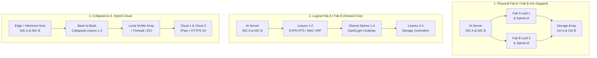
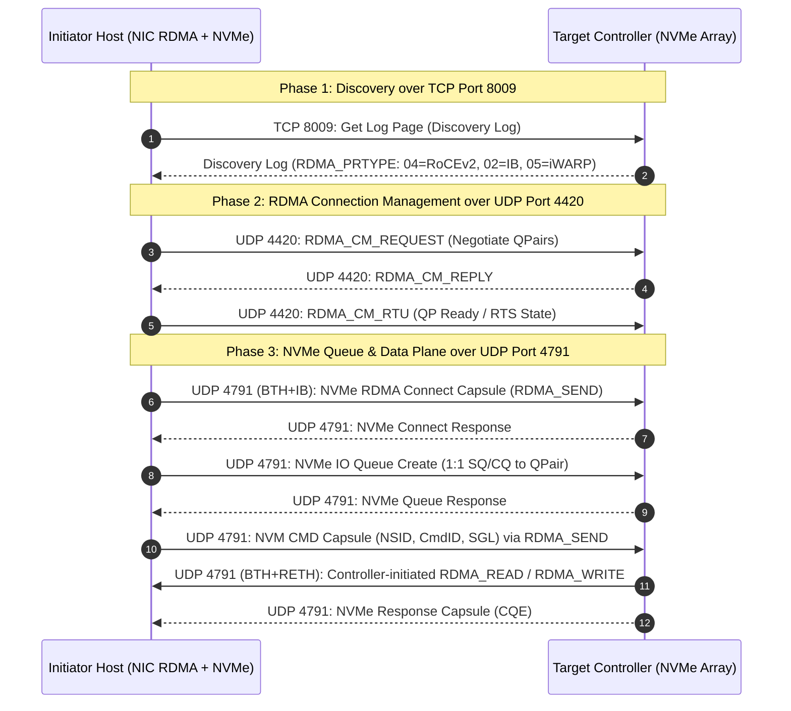
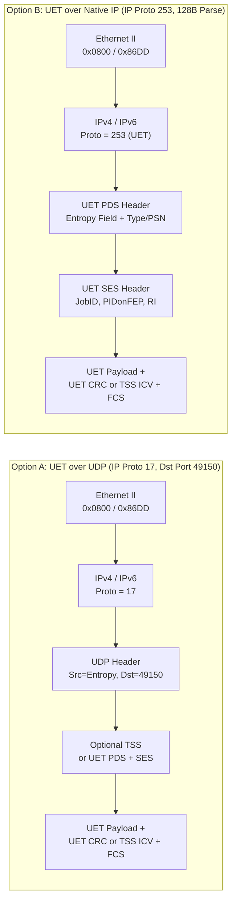
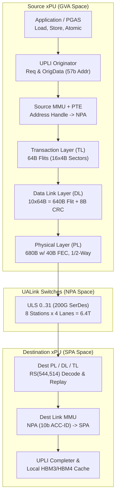

# 12.21 Storage networks, Ultra Ethernet and scale-up fabrics

| Field | Value |
|---|---|
| Level | Advanced |
| Priority tier | 2 |
| Lab venue | Nebius GPU + Local Python Verification Lab (`code/part12/storage_uec_scaleup_lab.py`) |
| Part | Part 12: Complete AI networking |
| Primary sources | *AI Data Center Network Design and Technologies* (Chapters 9, 12, 13) |
| Coverage file | `planning/coverage/chapters/12-21.md` |
| Claim & number ledger | `planning/ledgers/12-21.md` |

## Why this matters for AI infrastructure

An AI factory is sustained by three distinct fabric domains whose protocol semantics, latency targets, and failure modes differ by orders of magnitude:

1. **AI Storage Networks (`100 Gbps`–`800 Gbps` per server, `1:3` leaf-to-spine oversubscription):** Curated training datasets must stream continuously into GPU memory, and multi-terabyte model checkpoints must flush to non-volatile flash without stalling synchronous training steps. While local `PCIe Gen5/Gen6` `SSD` access delivers roughly `100 ns` device latency (`32 GT/s` per lane, `~63 Gbps` / `64 GB/s` unidirectional across `x16` lanes), local drives inside individual servers cannot hold petabyte-scale corpora or provide a shared namespace across thousands of nodes. Dedicated storage fabrics bridge compute to shared flash arrays with `~300 ns` switch latency on InfiniBand or `700–900 ns` (`~800 ns`) port-to-port latency on Ethernet switches, using **`NVMe-o-TCP`** (TCP port `8009`), **`NVMe-o-RDMA`** over `RoCEv2` (TCP `8009` discovery, UDP `4420` `RDMA CM`, UDP `4791` `BTH`/`RETH` data plane with up to `66%` lower write latency), and RDMA-accelerated parallel file systems (`WekaFS`, `VAST`, `Lustre`, `GPFS`, `BeeGFS`) integrated with **GPUDirect Storage (`GDS`)**.
2. **Ultra Ethernet Consortium (`UEC Specification v1.0`, `400 Gbps`–`1.6 Tbps` scale-out up to `1 million` endpoints):** Production `RoCEv2` clusters have scaled past `100,000` GPUs, yet `RoCEv2` inherits legacy InfiniBand `BTH` queue-pair (`QPair`) semantics, static flow hashing, `Go-Back-N` retransmission amplification, and manual `PFC`/`ECN`/`DCQCN` buffer tuning. Released on June 11, 2025, `UEC Specification v1.0` replaces the `RoCEv2` transport stack with **Ultra Ethernet Transport (`UET`)** over either **UDP port `49150`** or **native IP protocol `253`**, splitting transport duties between a **Packet Delivery Sublayer (`PDS`)** and a **Semantic Sublayer (`SES`)** (`JobID`, `PIDonFEP`, `Resource Index`) driven by **`Libfabric`** (`fi_mr`, `fi_collective`). `UEC` introduces four explicit packet delivery modes (**`ROD`**, **`RUD`**, **`RUDI`**, **`UUD`**), built-in **`TSS`** (`AES-GCM`) security, **`NSCC`** (window/RTT/ECN) and **`RCCC`** (`256-byte` receiver credits in a `24-bit` ACK field) end-to-end congestion control, link-level **`CBFC`** (`32` Virtual Channels with `PCS` `CtlOS` `CP_Update`), **`DSCP` packet trimming**, **Link Layer Reliability (`LLR`)**, and **In-Network Collectives (`INC`)**.
3. **Scale-Up Fabrics (`100–300 ns` latency, up to `6.4 Tbps` per `xPU`, `72` to `1,000` accelerators per pod):** Tensor parallelism, Mixture-of-Experts (`MoE`) token all-to-all routing, multi-step reasoning, and diffusion micro-batching exchange activations at sub-microsecond cadence that exceeds both `PCIe 5.0` (`500 ns`–`1 us` latency) and scale-out `NICs`. To break single-vendor lock-in around proprietary scale-up fabrics such as NVIDIA `NVLink 5` (`1.8 Tbps` bidirectional per GPU across `18` `NVLink` switches in `NVL72`), two open standards have emerged: the Open Compute Project (`OCP`) **Scale-Up Ethernet Transport (`SUE-T` / `ESUN`)** (`6-byte` compressed and `12-byte` non-compressed **AI Fabric Header `AFH Gen 2`**, **Reliability Header `RH`**, `LLR`, `CBFC`, and on-die `FIFO` or `ARM AXI 4.0` `5`-channel interfaces) and the **Ultra Accelerator Link (`UALink 1.0`)** (`8` stations x `4` x `200 Gbps` lanes = `32` lanes = **`6.4 Tbps`** per `xPU`, `64-byte` Transaction Layer `TL` flits packed `10:1` into `640-byte` Data Link `DL` flits plus `40-byte` `FEC` = `680-byte` wire units aligned `1:1` to `544/514` `PCS` codewords, `1-way`/`2-way` interleaving, `GVA -> NPA -> SPA` `MMU` address handles, and software `PGAS` coherence).

## Prerequisites and outcomes

### Prerequisites
- Working familiarity with `RoCEv2` (`UDP 4791`, `BTH`), `PFC`, `ECN`, and `DCQCN` from earlier chapters in this part.
- Understanding of InfiniBand addressing (`LID`, `GUID`, `GID`, Virtual Lanes `VLs`) from earlier chapters in this part.
- Familiarity with `GPUDirect RDMA` and `GPUDirect Storage` (`cuFile`, `BAR1`) from earlier chapters in this part.

### Outcomes
After completing this chapter, you will be able to:
1. Design **AI storage network topologies** (physical `Fab A / Fab B`, logical `EVPN-VXLAN` `RT5` / `MAC-VRF` `Fab A / Fab B` at `1:3` oversubscription, collapsed spine for `40 km+` deep-buffer links, and hybrid cloud `S3` replication) and select between block (`NVMe-oF`), file (`WekaFS`, `VAST`, `Lustre`, `GPFS`, `BeeGFS`), and object (`S3`) storage across the `4`-stage AI training and RAG lifecycle.
2. Trace and compare the protocol state machines, packet headers, and queue mappings of **`NVMe-o-TCP`** (`TCP 8009`, `ICReq`/`ICResp`, `CapsuleCmd` `0x01`, `H2CData` `0x03`, `C2HData` `0x04`, `PRP1`/`PRP2` vs `SGL`, `MTU 9000` multi-PDU packing), **`NVMe-o-RDMA`** (`TCP 8009` `RDMA_PRTYPE` `04`/`02`/`05` -> `UDP 4420` `RDMA CM` -> `UDP 4791` `BTH`/`RETH`), and **native InfiniBand storage** (`16-bit LID` up to `48,000` nodes, `16` `VLs`, `64-byte` `CBFC` credits).
3. Architect **Ultra Ethernet (`UEC Specification v1.0`)** scale-out fabrics, decoding `UET-over-UDP` (port `49150`) vs `UET-over-IP` (protocol `253` + `PDS` `Entropy` field within `128-byte` switch parse depth), `SES` addressing (`JobID`, `PIDonFEP`, `Resource Index`), delivery modes (`ROD`, `RUD`, `RUDI`, `UUD`), and congestion/reliability loops (`NSCC`, `RCCC` `256B` credits, `CBFC` `32` `VCs` + `CtlOS` `CP_Update`, `DSCP` packet trimming, `LLR`, and `INC` vs `xCCL`).
4. Evaluate and size **scale-up super-accelerator fabrics** up to `4` racks and `1,000` `xPUs`, contrasting **`SUE-T` (`ESUN`)** (`6B`/`12B` `AFH Gen 2`, `RH` `10-bit xPU ID` + `16-bit NPSN/APSN`, `FIFO` vs `AXI 4.0` `VC0`/`VC1`), **`UALink 1.0`** (`8 x 4 x 200G = 6.4 Tbps`, `UPLI`, `64B` `TL` / `640B` `DL` / `680B` wire flits, `1-way`/`2-way` codeword interleaving, `GVA -> NPA -> SPA` `MMU` address handles, software `PGAS` coherence), and **`NVLink 5` (`NVL72`)** (hardware directory/snoop coherence).

---

## 1. AI Storage Network Lifecycle, Topologies, and Access Models

### 1.1 The Four-Stage AI Data Lifecycle and Storage Access Tiers

Storage networking in an AI data center is not a single homogeneous SAN. Every large-language-model (`LLM`) or multimodal pipeline moves through four distinct data-lifecycle phases with different I/O sizes, concurrency patterns, and latency budgets:

1. **Data ingestion:** Raw structured and unstructured datasets are pulled from external repositories, web crawls, or enterprise lakes into high-capacity staging pools.
2. **Data processing and curation:** Tokenization, deduplication, quality filtering, and format conversion transform raw assets into training shards, demanding high sequential and random read/write throughput across distributed CPU/GPU workers.
3. **AI model training and checkpointing:** Training servers stream curated batches into GPU High-Bandwidth Memory (`HBM`) over dedicated `100 Gbps`–`200 Gbps` (or `400 Gbps`–`800 Gbps` in converged high-end pods) storage `NICs` while periodically pausing compute to flush multi-terabyte model checkpoints (`weights + optimizer states`) to fast-write flash arrays. Any stall during checkpoint writes idles the entire GPU training fabric.
4. **Post-training data warehouse, archival, and RAG inference:** Trained checkpoints, evaluation artifacts, and vector/document corpora move into long-term repositories and feeds for Retrieval-Augmented Generation (`RAG`) and agentic `RAG` inference, which require low-latency random reads and continuous live updates.

To serve these four phases, operators combine three logical storage architectures—**Object**, **Block**, and **File**—whose protocol and fabric characteristics are summarized below.

| Characteristic | Object Storage (`S3`) | Block Storage (`NVMe-oF` / SAN) | File Storage (`(P)NFS` / Parallel FS / NAS) |
|---|---|---|---|
| **Data organization** | Flat objects with rich metadata and object IDs | Fixed-size logical blocks addressed by `NSID` + LBA | Hierarchical files and directories (`POSIX` namespace) |
| **Access method** | `HTTP`/`HTTPS` `REST` API calls (`GET`, `PUT`) | Block-level commands (`NVMe` `SQE`/`CQE` capsules) | File-level `POSIX` syscalls (`open`, `read`, `write`, `stat`, `unlink`) |
| **Transport protocols** | `TCP`/`HTTPS` over lossy Ethernet/IP | `NVMe-o-TCP`, `NVMe-o-RDMA` (`RoCEv2`/IB), `NVMe-o-FC`, `FCoIP` | Ethernet/IP (`TCP` or `RDMA` over `RoCEv2`) or InfiniBand |
| **OS page-cache usage** | Not used on compute host (application buffers) | Bypassed (raw block device / direct DMA) | Supported by OS page cache (or bypassed via `O_DIRECT` / `GDS`) |
| **Scalability & cost** | Highest scale (exabytes); lowest cost per TB | High performance per array; higher cost per TB | High parallel scale (`WekaFS`, `VAST`, `Lustre`, `GPFS`); moderate cost |
| **Primary AI domain** | Post-training cloud replication, cold archives, `RAG` / agentic `RAG` | High-IOPS local/on-prem datasets, raw block volumes, fast checkpoint targets | Shared multi-node training datasets, synchronous checkpointing, hybrid cloud tiering |

### 1.2 Four Storage Fabric Topologies: Physical Fab A/B, Logical Fab A/B, Collapsed Spine, and Hybrid Cloud

Regardless of whether the transport is `NVMe-o-TCP`, `NVMe-o-RDMA`, or a parallel file system, storage availability is governed by **Fabric A / Fabric B (`Fab A / Fab B`) path diversity**: if `Fabric A` fails or undergoes maintenance, `Fabric B` must carry `100%` of the storage workload without IOPS, bandwidth, or latency degradation. Unlike backend GPU training fabrics that require strict `1:1` non-blocking leaf-to-spine bandwidth, dedicated storage leaf-spine fabrics are routinely engineered with a **`1:3` leaf-to-spine oversubscription ratio** (and `100 Gbps`/`200 Gbps` storage `NICs` per server) because storage reads and checkpoint bursts have shorter flow longevity and lower simultaneous all-to-all correlation than `AllReduce` collectives.



| Topology Pattern | Physical & Control-Plane Architecture | Oversubscription & Distance Rules | Best-Fit AI Use Case |
|---|---|---|---|
| **1. Physical `Fab A / Fab B` Separation** | Two completely independent physical leaf-spine fabrics (`Fabric A` and `Fabric B`). `NIC A` connects only to `Fab A` `ToR` (`Leaf 1`), and `NIC B` connects only to `Fab B` `ToR` (`Leaf 3`). Storage array controllers mirror this physical split. | Identical leaf-to-spine link counts and speeds on both fabrics (typically `1:3` oversubscribed) so failover preserves `100%` capacity. | Mission-critical enterprise and large-scale training clusters requiring blast-radius demarcation and hitless single-fabric upgrades. |
| **2. Logical `Fab A / Fab B` Separation** | A single physical 3-stage IP Clos (`Leaves 1–4` full-mesh to `Spines 1–4`, at least `2` links per leaf-spine pair for ASIC local repair). `L2` stays confined to each `ToR`; `Fab A` and `Fab B` are isolated via two `EVPN-VXLAN` `Route Type 5` (`RT5`) IP-VRF instances or two `MAC-VRF` instances pinned to disjoint underlay paths. | `1:3` leaf-to-spine oversubscription is standard; multi-tenant managed training services isolate tenants via `EVPN` `RT5` `VXLAN` tunnels across the shared storage underlay. | Medium-scale or multi-tenant AI clusters seeking dual-path resilience without paying for two physical spine planes. |
| **3. Collapsed `Fab A / Fab B` Spine** | Just two switches (`Leaf 1` and `Leaf 2`) connected back-to-back, with both AI servers (`NIC A`/`NIC B`) and storage targets dual-homed directly to the collapsed pair. | No spine tier; when replicating across sites over **`40 km+`** WAN/DCI links, use **deep-buffer Ethernet switches** and **`NVMe-o-TCP`** (avoiding long-haul lossless `DCQCN`/`PFC`). | Geographically distributed inference POPs, regional RAG caches, and compact edge pods. |
| **4. Hybrid On-Prem + Multi-Cloud Fabric** | Local `Fab A / Fab B` IP Clos (`Leaves 1–4`, `Spines 1–4`) extended via border leaves (`Leaves 5–6`), a firewall cluster, and dual DCI gateways to two public clouds (`Cloud 1`, `Cloud 2`). | On-premises hot data runs over `NVMe-o-RDMA` / parallel FS (`Tier 1`); cold checkpoints and multi-cloud backups traverse `IPsec` or `TLS`/`HTTPS` (`S3 REST API`, `Tier 2`). | Disaster recovery of expensive LLM training checkpoints and unified on-prem/cloud namespace tiering. |

---

## 2. NVMe-oF State Machines (`NVMe-o-TCP` vs `NVMe-o-RDMA`), Parallel File Systems, and InfiniBand Storage

### 2.1 `NVMe-oF` Architecture: Queues, Capsules, `NSID`, and `PRP` vs `SGL`

Native `PCIe` `NVMe` drives communicate with the host CPU driver through circular **Submission Queues (`SQs`)** holding `64-byte` **Submission Queue Entries (`SQEs`)** and **Completion Queues (`CQs`)** holding `16-byte` **Completion Queue Entries (`CQEs`)**. **NVMe over Fabrics (`NVMe-oF`)** preserves the core `NVMe` base specification, I/O command sets (`NVM`, `Key-Value`, `Zoned Namespace`), management interface, and boot specification while replacing the local `PCIe` bus with a network transport binding (`NVMe-o-TCP`, `NVMe-o-RDMA`, or `NVMe-o-FC`).

In `NVMe-oF`, `SQEs`, `CQEs`, and optional inline payloads are wrapped inside **Capsules**:
- A **Command Capsule** (host initiator -> target controller) encapsulates the `64-byte` `SQE` (plus optional in-capsule write data).
- A **Response Capsule** (target controller -> host initiator) encapsulates the `16-byte` `CQE` reporting completion status for the matching `Command ID`.

Every `NVMe-oF` read (`opcode 0x02`) or write (`opcode 0x01`) command carries two distinct addressing constructs that must never be confused:
1. **`NSID` (Namespace Identifier):** Identifies the **logical storage volume** (partition or virtual disk) exposed by the remote `NVMe` target controller. A single flash array controller can expose multiple `NSIDs` with distinct capacities, block sizes, or tenant permissions.
2. **`PRP1`/`PRP2` (Physical Region Page pointers) vs `SGL` (Scatter-Gather List descriptors):** Identify the **initiator host (or GPU `BAR1`) memory buffer addresses** where DMA places read data or fetches write data:
   - **`PRP1` and `PRP2`** are two `64-bit` pointers: `PRP1` points to the start of the first memory page in host memory, and `PRP2` points either to the second contiguous page or to a `PRP` list.
   - **`SGL` (Scatter-Gather List)** describes multiple non-contiguous memory segments in a single `64-byte` `NVMe` command header, making `SGL` the preferred descriptor format for network fabrics (`NVMe-o-TCP` and `NVMe-o-RDMA`).

### 2.2 `NVMe-o-TCP` State Machine, PDUs, and Jumbo-Frame Packing

`NVMe-o-TCP` runs over standard, lossy Ethernet/IP routing fabrics without requiring `PFC`, `ECN`, or `DCQCN`. Each multi-core host CPU establishes a `1:1` mapping between a TCP connection (typically per CPU core) and a dedicated Admin or I/O `SQ`/`CQ` pair on the target controller over **destination TCP port `8009`**:

1. **TCP + Optional TLS Handshake:** The host initiator completes a standard `TCP SYN -> SYN-ACK -> ACK` handshake to target port **`8009`** (followed by an optional `TLS` handshake when encrypted storage is required). Sequence numbers and byte-stream acknowledgments are handled entirely by the TCP layer rather than inside `NVMe` headers.
2. **`ICReq` and `ICResp` PDUs (Initialize Connection):** The host sends an `NVMe/TCP ICReq PDU` advertising its `NVMe` version, header/data digest capabilities (`HDGST`/`DDGST`), requested PDU data alignment/offset, and host identifier. The target controller replies with `ICResp PDU` accepting the parameters.
3. **`NVMe/TCP Connect Request` and `Connect Response`:** The host binds the TCP connection to a specific Controller ID and negotiates Admin or I/O queue IDs (`QID`) and queue depth.
4. **Data Transfer (`CapsuleCmd`, `H2CData`, `C2HData`, `CapsuleResp`):** Four capsule/data `PDU` types govern I/O:
   - **`0x01` (`CapsuleCmd`):** Host-to-controller command capsule carrying the `64B` `SQE` (`Command ID`, `opcode 0x02` for Read or `0x01` for Write, `NSID`, data byte length, and `PRP1`/`PRP2` or `SGL`).
   - **`0x02` (`CapsuleResp`):** Controller-to-host response capsule carrying the `16B` `CQE`.
   - **`0x03` (`H2CData`):** Host-to-controller off-capsule write data `PDU`.
   - **`0x04` (`C2HData`):** Controller-to-host read data `PDU`.
   - For a **Read (`opcode 0x02`)**, the host sends `CapsuleCmd (0x01)` -> the controller streams sequential `C2HData (0x04)` PDUs (`#1..#N`) -> the controller concludes with `CapsuleResp (0x02)`.
   - For a **Write (`opcode 0x01`)**, `NVMe-o-TCP` supports both **in-capsule writes** (variable-length `CapsuleCmd` containing `SQE + Data` in order, marked by the `LAST-PDU` flag, followed by `CapsuleResp`) and **off-capsule writes** (fixed-size `CapsuleCmd` followed by faster, potentially out-of-order `H2CData (0x03)` PDUs).
5. **PDU Framing and `MTU 9000` Multi-PDU Packing:** Every `NVMe-o-TCP PDU` consists of:
   $$\text{Common Header (CH)} \;\to\; \text{PDU-Specific Header (PSH)} \;\to\; \text{Header Digest (HDGST)} \;\to\; \text{Padding (PAD)} \;\to\; \text{PDU Data (Capsule/Payload)} \;\to\; \text{Data Digest (DDGST)}$$
   On a dedicated storage IP fabric configured with jumbo frames around **`9,000 bytes`** (`MTU 9000`), a single TCP segment is large enough to encapsulate **two or more `NVMe-o-TCP` PDUs** back-to-back inside one TCP payload.
6. **Session Termination (`H2CTermReq` / `C2HTermReq`):** Either endpoint sends `H2CTermReq` or `C2HTermReq` followed by a final `CapsuleResp` (`CQE` status) to release the `NSID`, `Command IDs`, and `SQ`/`CQ` bindings before closing the TCP socket.

### 2.3 `NVMe-o-RDMA` (`RoCEv2`) State Machine: `TCP 8009` -> `UDP 4420` -> `UDP 4791`

When lower CPU utilization, faster session ramp-up, and up to **`66%` lower write latency** are required—or when **GPUDirect Storage (`GDS`)** moves blocks directly between GPU `HBM` and remote `NVMe` arrays bypassing the host CPU—operators deploy **`NVMe-o-RDMA`** over a lossless `RoCEv2` (or native InfiniBand) fabric. Unlike `NVMe-o-TCP`, `NVMe-o-RDMA` traverses a **three-port, two-protocol state machine**:



| Phase | Protocol & Destination Port | Key Header Fields & State Transitions | Architectural Rules |
|---|---|---|---|
| **1. Discovery Phase** | **TCP Port `8009`** | Host issues `Get Log Page – Discovery Log Pages`. Target returns **`RDMA_PRTYPE`**: **`04`** (`RoCEv2`), **`02`** (`InfiniBand`), or **`05`** (`iWARP`). | Standard `NVMe-oF` Discovery Controller runs over TCP `8009` before any UDP/RDMA packet is sent. |
| **2. RDMA CM Handshake** | **UDP Port `4420`** | `RDMA_CM_REQUEST` -> `RDMA_CM_REPLY` -> `RDMA_CM_RTU` (`Ready to Use`), transitioning the `RDMA QPair` into `RTS` (`Ready to Send`). | No `NVMe` capsules can be exchanged until both endpoints' `RDMA QPs` reach `RTS`. |
| **3. NVMe Connect & I/O Data Plane** | **UDP Port `4791`** (`RoCEv2`) | Outer `Ethernet -> IP -> UDP (4791) -> BTH (Opcode, Dest QPair) -> RETH (VA, RKey, DMA Length) -> NVM CMD QID + NVM CMD (NSID, CmdID, SGL)`. | Strict **`1:1` mapping** between one I/O `SQ`/`CQ` pair and one `RDMA QPair` (multiplexing multiple `SQs`/`CQs` onto one `QP` is forbidden). Host sends command capsules via `RDMA_SEND`; **all `RDMA_READ` and `RDMA_WRITE` bulk transfers are initiated by the target controller**. |

### 2.4 High-Performance Parallel File Systems and GPUDirect Storage Integration

Because raw `NVMe-oF` block connections bind `1:1` sessions between a host initiator and a target namespace without providing coherent multi-client file metadata, large training clusters layer **parallel file systems**—such as **`WekaFS`**, **`VAST`**, **`Lustre`**, **`GPFS` (IBM Storage Scale)**, or **`BeeGFS`**—on top of `NVMe-o-RDMA` (`RoCEv2` or InfiniBand):
- **Parallel data + metadata striping (`WekaFS` & `VAST`):** Rather than funneling clients through a single sequential NFS server, `WekaFS` distributes and parallelizes both file data and metadata in small chunks across all on-premises `NVMe` storage servers (`Servers 1..8`). When `PyTorch` or `TensorFlow` writes `.pt`, `.npy`, `.ckpt`, `.h5`, or `.bin` files via standard `POSIX` syscalls (`open()`, `read()`, `write()`, `stat()`, `unlink()`), the local `WekaFS` client on the GPU server translates the `POSIX` call into an `RDMA` (`RoCEv2`/IB) transport request across the storage fabric (**Tier 1 hot storage**), while transparently tiering cold snapshots over `HTTPS`/`TLS` **`S3` REST APIs** to public cloud object storage (**Tier 2 cold storage**). `VAST` similarly runs multipath `NFS over RDMA` across existing IP storage networks.
- **GPUDirect Storage (`GDS`) zero-copy DMA:** When `PyTorch` (`v2.7.0+`) or the `CUDA` orchestrator allocates GPU memory via `cudaMalloc` and registers it via **`cuFileBufRegister`**, the GPU memory pages are **pinned for direct I/O (`PIN to direct IO`)**. The `GDS` library programs the storage `NIC` driver directly over `PCIe`, transferring data between external `RoCEv2`/InfiniBand storage arrays and `GPU 1..8` `HBM` via dedicated storage `NICs` (`NIC A` and `NIC B` at `100G`/`200G` or `400G`/`800G`) without touching host CPU cores or system `DRAM`.

### 2.5 InfiniBand for Storage: `16-Bit LID` (`48,000` Nodes), Frame Format, and `64B` `CBFC` Credits

When native InfiniBand is used as the storage fabric for `NVMe-o-RDMA` and `GDS`, the RDMA state machine (`CM Request -> CM Reply -> CM Ready`) and `NVMe` capsule payload (`Command/Response Capsules + Common Header + SGL`) remain identical to `RoCEv2`, but the outer Ethernet/IP/UDP headers are replaced by the lightweight native InfiniBand frame:

$$\underbrace{\text{LRH (S-LID, D-LID, VL)}}_{\text{Link Layer (Subnet Local)}} \;\to\; \underbrace{\text{GRH (Optional)}}_{\text{Inter-Subnet Routing}} \;\to\; \underbrace{\text{BTH (Opcode, Dest QP)}}_{\text{Base Transport}} \;\to\; \underbrace{\text{ETH (Src QP / RDMA)}}_\text{Extended Transport} \;\to\; \underbrace{\text{NVMe-o-RDMA Capsule + Data}}_{\text{Payload}} \;\to\; \underbrace{\text{ICRC} + \text{VCRC}}_{\text{End-to-End \& Hop Integrity}}$$

- **Centralized `16-bit LID` addressing (`48,000` node limit):** The InfiniBand **Subnet Manager (`SM`)** (running on a designated switch while every switch runs a **Subnet Manager Agent `SMA`**) assigns each port a **`16-bit` Local Identifier (`LID`)** carried in the **Local Routing Header (`LRH`, `S-LID` and `D-LID`)**. Although `16` bits represent `65,536` values, a single InfiniBand subnet supports up to **`48,000` end nodes**; scaling beyond `48,000` nodes or routing between separate subnets requires the **Global Routing Header (`GRH`)** (analogous to IP).
- **Data integrity (`ICRC` + `VCRC`):** Every frame ends with an **Invariant CRC (`ICRC`)** covering end-to-end immutable fields and a **Variant CRC (`VCRC`)** covering hop-by-hop link fields.
- **Virtual Lanes (`16 VLs`) and `64-byte` `CBFC` credits:** InfiniBand provides up to **`16` Virtual Lanes (`VLs`)** per physical link (typically `8` to `12` data `VLs` mapped to storage or training queues). Lossless delivery is enforced per `VL` at every hop (`HCA <-> IB Switch 1 <-> IB Switch 2`) via **Credit-Based Flow Control (`CBFC`)**: each credit exchanged in the **Link Layer Header (`LLH`)** grants permission to transmit **`64 bytes`** of data (`64` credits = `4,096 bytes`), guaranteeing that a sender never transmits a packet unless the next-hop switch port has reserved buffer space on that specific `VL`.

| Storage Option | `(P)NFS` / Parallel FS | `NVMe-o-TCP` | `NVMe-o-RDMA` (`RoCEv2`) | Native InfiniBand Storage |
|---|---|---|---|---|
| **Training & Inference Fit** | Training + Inference | Inference + Cold/Tier-2 Training | Training + Inference | Training (legacy/HPC + NVIDIA pods) |
| **Parallel Shared File Access** | Yes (`POSIX` / `NFS`) | Yes (when layered with FS) | Block-level (`1:1` `QP`, needs PFS for shared files) | Block or File (`Lustre`/`GPFS`/`Weka` over IB) |
| **Switch Port-to-Port Latency** | `~700–900 ns` (Ethernet) | `~700–900 ns` (Ethernet) | `~700–900 ns` (Ethernet) | **`~300 ns`** (InfiniBand switch) |
| **Requires Lossless Fabric** | No (unless over `RDMA`) | **No** (runs on lossy IP) | **Yes** (`PFC` + `ECN` + `DCQCN`) | **Yes** (native `16 VLs` + `64B` `CBFC`) |
| **Built-in Transport Reliability** | Via TCP (or RDMA) | **Yes** (standard TCP) | Via NIC RDMA QP state machine | **Yes** (hardware HCA + `CBFC`) |
| **Port Speeds & Multi-Vendor Scale** | `400G`/`800G`/`1.6T`; High multi-vendor | `400G`/`800G`/`1.6T`; High multi-vendor | `400G`/`800G`/`1.6T`; High multi-vendor | `400G`/`800G`/`1.6T`; Single-vendor (`<48,000` nodes/subnet) |

---

## 3. Ultra Ethernet Consortium (`UEC Specification v1.0`): Architecture, `PDS`/`SES`, Encapsulations, and Delivery Modes

### 3.1 UEC Working Groups, Service Profiles (`AI Base`, `AI Full`, `HPC`), and Core Terminology

Released on June 11, 2025 by more than `70` member organizations under the Linux Foundation, **`UEC Specification v1.0`** re-architects Ethernet for scale-out AI and HPC clusters exceeding **`1 million` endpoints**. The specification is organized across eight working groups—**Physical Layer** (`FEC` statistics, link fault signaling, modified `64B/66B` `PCS` encoding with out-of-band **Control Ordered Sets `CtlOS`**), **Link Layer** (**`LLR`**, **Packet Rate Improvement `PRI`**, **`CBFC`**), **Transport Layer** (**`UET`**, **`PDS`**, **`SES`**, **`TSS`**, **`NSCC`**, **`RCCC`**, **packet trimming**), **Software** (**`Libfabric`**, **`INC`**), **Storage**, **Management**, **Performance & Debug**, and **Compliance**—and groups implementation requirements into three service profiles negotiated via `Libfabric` during session setup:
- **`AI Base` Profile:** Supports `ROD` and `RUD` packet delivery modes and mandatory `NSCC` congestion control over standard lossy or lossless `400G`/`800G` Ethernet switches.
- **`AI Full` Profile:** Adds **`RUDI`** (idempotent unordered writes for gradient aggregation) as mandatory while keeping **`UUD`** optional.
- **`HPC` Profile:** Enforces the strictest latency and feature requirements, supporting `ROD`, `RUD`, `RUDI`, and optional `UUD`.

To read a `UEC` packet capture or configure a `UET` NIC, you must master seven core architectural terms:
1. **Fabric Endpoint (`FEP`):** Any server `NIC` or switch port (`sFEP` for `INC`-capable switches) participating in the `UEC` fabric.
2. **Fabric Address (`FA`):** The `IPv4` or `IPv6` address (often provisioned plug-and-play via `IPv6 SLAAC`) identifying an `FEP`.
3. **Packet Delivery Context (`PDC`):** A logical point-to-point transport channel between an initiator `FEP` and a target `FEP` (identified by `SPDCID` and `DPDCID`), bound to a single **Congestion Control Context (`CCC` / `CCC_ID`)**.
4. **Packet Delivery Sublayer (`PDS`):** The lower `UET` sublayer responsible for `PDC` session establishment (`SYN`), **Packet Sequence Numbers (`PSNs`)**, `Clear PSN Offset`, `ACK`/`NACK`/`SACK` processing, and congestion control state (`req_cc_state` / `ACK_CC`).
5. **Semantic Sublayer (`SES`):** The upper `UET` sublayer that translates **`Libfabric`** API calls (`fi_mr` for memory region registration and `RKEY` validation, `fi_collective` for collectives) into wire semantics (`Opcode` such as `RMA WRITE 0x01`, `TAGGED_SEND 0x80`, or `DEFERRABLE SEND`, `Message ID`, `Buffer Offset`, `Match Bits`, and `Request Length`).
6. **`JobID`, `PIDonFEP`, and `Resource Index` (`RI`):** Replace the legacy `RoCEv2` `BTH` `QPair` number:
   - **`JobID`** uniquely identifies a distributed job across the cluster (allowing multiple parallel jobs to share one GPU and `NIC`).
   - **`PIDonFEP`** identifies the target operating-system process / service context on the receiving `FEP`.
   - **`Resource Index` (`RI`)** identifies the specific memory completion/receive queue within that service.
7. **Transport Security Sublayer (`TSS`):** Built-in `UET` encryption and authentication header using **`AES-GCM`** with a trailing **Integrity Check Value (`ICV`)**, providing end-to-end confidentiality, integrity, and anti-replay protection without external `MACsec` hop-by-hop overhead.

### 3.2 `PDC` Session Handshake, UDP-Based Encapsulation for UET (`UDP Port 49150`), and `UET` over IP (`IP Protocol 253`)

Before data transfers begin on a `PDC`, `FEP A` (initiator) and `FEP B` (target) execute a lightweight `PDS` handshake:
1. `FEP A` sends a `PDS` packet with `pds.flags.syn = 1`, its initial `PSN` (for example, `PSN = 101`), `Source PDC ID` (`SPDCID = 201`), `Clear PSN Offset`, and the requested delivery mode (`ROD_REQ 0x03` or `RUD_REQ`).
2. `FEP B` allocates its local `PDC` (`301`) and replies with `ACK = 101, SPDCID = 301, DPDCID = 201`.
3. `FEP A` records `DPDCID = 301`, clears the `SYN` bit (`pds.flags.syn = 0`), and transmits subsequent data packets (`PSN = 102, SPDCID = 201, DPDCID = 301`). When **`ROD`** is selected, all messages sharing `{JobID, source PIDonFEP, destination PIDonFEP, RI, Traffic Class (TC)}` are pinned to a single `PDC`.

`UEC Specification v1.0` defines two wire encapsulations for `UET` packets, which must be pre-configured identically on both endpoints prior to `PDC` creation:



| Encapsulation Property | Option A: `UET-over-UDP` | Option B: `UET-over-IP` (Native / Raw IP) |
|---|---|---|
| **Outer L3/L4 Headers** | `Ethernet -> IPv4/IPv6 (Protocol = 17) -> UDP (Dst Port = 49150)` | `Ethernet -> IPv4/IPv6 (Protocol = 253)` (no `UDP` header) |
| **Multipath Entropy Carrier** | **UDP Source Port** (dynamically rotated by the sender `NIC` mid-session whenever an `NSCC` `NACK` signals path congestion). | Dedicated **`Entropy` field at the start of the `PDS` header** (updated by the sender `NIC` upon `NSCC` feedback). |
| **Switch ASIC Parsing & Compatibility** | Works transparently across all existing `400G`/`800G` Ethernet switches using standard `UDP` `ECMP`/packet-spraying hashes. | Removes `8-byte` `UDP` overhead so `PDS` + `SES` (`JobID`, `RI`) fit comfortably inside the **`128-byte` switch packet-parsing window**, but requires switches to permit **`IP Protocol 253`**. |
| **Integrity (`UET CRC`) vs Security (`TSS`)** | Supports optional `UET CRC` (e.g., `0xfcfdfeff`) **or** optional `TSS` (`AES-GCM` header after `UDP` + trailing `ICV`). **Never enable both `UET CRC` and `TSS` simultaneously.** | Supports optional `UET CRC` **or** optional `TSS` (immediately after the `PDS` `Entropy` field). When `TSS` encrypts `PDS`/`SES`, switches must hash on outer `UDP Src Port` or `PDS Entropy`. |

### 3.3 The Four `UEC` Packet Delivery Modes (`ROD`, `RUD`, `RUDI`, `UUD`)

Through `PyTorch -> OpenMPI / MPICH / NCCL / RCCL -> Libfabric`, an AI application selects one of four packet delivery modes per `PDC`, replacing `RoCEv2`'s rigid `Go-Back-N` ordering with selective retransmissions (`SACK`-like forward sequence progression where only the missing `PSN` is resent):

| Delivery Mode | Reliability & Ordering Semantics | Pros & Cons | Mandatory / Optional Profiles & Target Workloads |
|---|---|---|---|
| **`ROD` (`Reliable Ordered Delivery`)** | `PSN`-tracked (`ACK`/`NACK`/`SACK`), delivered **in strict order** to the upper layer. Receiver `NIC` uses its **reordering buffer** to absorb fabric packet spraying. | **Pros:** Preserves strict MPI/control ordering even over packet-sprayed fabrics.<br/>**Cons:** Higher tail latency and `NIC` reorder buffer memory footprint. | Mandatory in **`AI Base`**, **`AI Full`**, and **`HPC`**. Used for `HPC`, `MPI`, and serialized control flows. |
| **`RUD` (`Reliable Unordered Delivery`)** | `PSN`-tracked (`ACK`/`NACK`/`SACK`), **out-of-order Direct Data Placement (`DDP`)** straight into GPU `HBM` without waiting for earlier `PSNs`. | **Pros:** Eliminates reorder-buffer head-of-line blocking; lower latency under per-packet spraying.<br/>**Cons:** Application/collective must tolerate out-of-order completion. | Mandatory in **`AI Base`**, **`AI Full`**, and **`HPC`**. Used for AI tensor/pipeline parallelism and bulk data transfers. |
| **`RUDI` (`Reliable Unordered Delivery Idempotent`)** | Reliable unordered delivery for **idempotent** operations that can be safely retried or written multiple times to the same memory offset by one or multiple sources. | **Pros:** Allows proactive application-level retries without waiting for `NACK` round-trips; supports multi-writer updates.<br/>**Cons:** Requires idempotent memory semantics. | Mandatory in **`AI Full`** and **`HPC`** (`HPC` profile required for full semantic support). Used for `RMA` writes and **AI gradient updates**. |
| **`UUD` (`Unreliable Unordered Delivery`)** | Best-effort fire-and-forget: **omits `PSNs` (`Clear PSN Offset`), `ACKs`, `SACKs`, `NACKs`, and retransmissions**. | **Pros:** Fastest session ramp time and lowest latency.<br/>**Cons:** No loss recovery, no integrity checking, **incompatible with `TSS` security**. | Optional in **`AI Full`** and **`HPC`**. Used for real-time telemetry and inference logging. |

---

## 4. `UEC` Congestion Management (`NSCC`, `RCCC`, `CBFC`), Packet Trimming, `LLR`, and In-Network Collectives (`INC`)

### 4.1 Two-Tier Congestion Management: `NSCC`, `RCCC` (`256B` Credits), and Link-Level `CBFC` (`32 VCs`)

To eliminate `RoCEv2` `PFC` pause storms and victim-flow head-of-line blocking, `UEC` decouples **end-to-end congestion control** (managed between `FEP` `NICs` per `CCC`) from optional **link-level lossless flow control**:

1. **Network Signal Congestion Control (`NSCC`, Sender-Driven Window):** Mandatory across all three `UEC` profiles on lossy fabrics. The sender `PDS` maintains an explicit **congestion window (`cwnd`)** of in-flight unacknowledged bytes. The receiver returns **`ACK_CC`** packets carrying the **received byte count, service time, and out-of-order packet count**, or **`NACK`** packets with the **`ECN` flag** and path entropy hint. The sender adjusts `cwnd` using **`RTT` + `ECN` feedback** and rotates its `UDP` source port (or `PDS` `Entropy` field) to route around hot links. Because `NSCC` reuses standard switch `ECN` marking, it deploys cleanly over brownfield Ethernet switches.
2. **Receiver Credit Congestion Control (`RCCC`, Target-Driven `256-Byte` Credits):** An optional receiver-driven end-to-end scheme created to prevent receiver incast (`N -> 1`). Senders request credit via the **`Credit Target`** (`req_cc_state`) field in data packets. The target `FEP` arbitrates its local **Credit Pool** across all active incoming sessions and grants credits back via `Credit Control` / **`24-bit` ACK congestion control fields in units of `256 bytes`** (for example, granting `256` credits authorizes `256 x 256 B = 65,536 bytes` = `64 KiB` of transmission). If the receiver's buffer pool is full, it simply withholds credits before packets ever enter the fabric.
3. **Link-Level Credit-Based Flow Control (`CBFC`, `32` Virtual Channels & `PCS CtlOS`):** Inspired by InfiniBand `CBFC` (`16` `VLs`), `UEC` `CBFC` doubles capacity to **`32` Virtual Channels (`VCs`) per port**, allowing lossless and best-effort `VCs` to coexist on the same physical link without `PFC` cable-length/headroom fragility:
   - Neighboring switches/NICs first discover `CBFC` support via **`LLDP`**.
   - Both link partners maintain **Consumed Credit (`CC`)** and **Freed Credit (`CF`)** counters per `VC`.
   - Instead of consuming Layer-2 frame bandwidth for credit requests, the sender's `PCS` physical sublayer sends out-of-band **Control Ordered Set (`CtlOS`) `CP_Update`** messages to report consumed credits at line rate, and the receiver's credit generator returns freed credit tokens as packets exit its input buffer. (While `UEC` allows `PFC` and `CBFC` on different `VCs` in theory, mixing `PFC` pause thresholds with `CBFC` and `LLR` on the same link is operationally complex and discouraged; `CBFC` targets greenfield `UEC` links.)

### 4.2 Fast Retransmission via `DSCP` Packet Trimming and Hop-by-Hop Link Layer Reliability (`LLR`)

When microbursts overflow a switch buffer despite `NSCC`/`RCCC`, waiting for a sender retransmission timeout degrades Job Completion Time (`JCT`). `UEC` attacks packet loss at two layers:
- **`DSCP` Packet Trimming (Switch-to-Target Fast NACK Trigger):** Packets belonging to trim-eligible `DSCP` classes are **not silently dropped** when an intermediate switch buffer fills. Instead, the congested switch **trims (cuts off) the data payload**, preserves the packet header and original `ECN-capable` state (without generating standard `ECN` feedback), and forwards the lightweight trimmed header over a **high-priority queue** to the destination `FEP`. Upon receiving a trimmed packet, the destination `NIC` does not write the payload into GPU `HBM`; instead, it immediately dispatches a targeted fast-retransmission request (`NACK`/`SACK`) to the sender for that exact `PSN` and logs per-workload congestion telemetry.
- **Link Layer Reliability (`LLR`, Hop-by-Hop ASIC Replay Buffer):** Negotiated per link segment (`Switch 1 <-> Switch 2` or `NIC <-> Switch`). Each `LLR`-eligible Ethernet frame is assigned a **link-layer sequence number (`SEQ`)** embedded into the **MAC preamble**, stored in an on-ASIC **replay buffer**, and guarded by a short link timer:
  - When `Switch 2` receives `SEQ = 1` cleanly, it returns a link-level `ACK` and `Switch 1` flushes `SEQ = 1` from its replay buffer.
  - If `SEQ = 2` is corrupted or lost on the wire, `Switch 1` times out (or if `SEQ = 3` is lost and `SEQ = 4` arrives out of order, `Switch 2` immediately returns **`NACK SEQ = 3`**) and `Switch 1` retransmits the missing frame directly from its local replay buffer in hundreds of nanoseconds—hiding the optical bit error from the end-to-end `UET` `PDS` layer.

### 4.3 In-Network Collectives (`INC`) vs User-Space `xCCL`, Management and Orchestration, Interoperability and Backward Compatibility, Compliance and Certification, and UEC Challenges and Future Directions

Under the `UEC` Software Working Group, **`Libfabric`'s `fi_collective` API** bridges `PyTorch` / `OpenMPI` / `MPICH` (`MPI_Allreduce`, `MPI_Alltoall`) and vendor **`xCCLs`** (`NCCL`, `RCCL`) to hardware **In-Network Collectives (`INC`)**:
- An **INC Manager (`IM`)** communicates via out-of-band **`gRPC`** with **INC Agents** running inside **`sFEPs`** (switches with `INC` engines in their silicon microkernel).
- For collective groups (`Collectives-gr1`, `Collectives-gr2`), leaf `INC` agents forward vectors to an elected **root-of-tree spine switch (`Spine 1` / `Spine 2`)**, which aggregates or replicates the collective flow once in hardware and distributes the result downstream—saving leaf-to-spine bandwidth and equalizing tail latency across GPU servers, analogous to InfiniBand `SHARP`.
- **Management and orchestration, interoperability and backward compatibility, compliance and certification, and UEC challenges and future directions:** `UET` integrates fine-grained per-flow telemetry (tracking `CBFC` and `RCCC` credits, latency, jitter, and drops) and synchronizes `Libfabric`, `MPI`, `NCCL`/`RCCL`, and the `INC Manager`. For backward compatibility, `UEC Specification v1.0` supports dual-mode link negotiation so brownfield IP fabrics can run lossless `RoCEv2` alongside end-to-end `UET` (`NSCC`/`RCCC`), while reserving link-level `CBFC` and `LLR` for greenfield deployments. The `UEC` compliance suite validates multi-vendor interoperability, line-rate performance benchmarks, and `TSS` security across the `AI Base`, `AI Full`, and `HPC` profiles, addressing early ecosystem challenges around optional feature subsets and initial `NIC` diversity.

| Dimension | InfiniBand (`IBTA`) | `RoCEv2` (`DCQCN`) | Ultra Ethernet (`UET` / `UEC v1.0`) |
|---|---|---|---|
| **Target Cluster Scale** | `< 100,000` endpoints (`48,000` per `16-bit LID` subnet) | `> 100,000` endpoints | **`~1 million` endpoints** |
| **Wire Encapsulation** | Native InfiniBand (`LRH`/`GRH`/`BTH`) | `Ethernet / IP / UDP (4791) / BTH` | **`UDP (49150) + PDS/SES`** or **`Native IP (253) + PDS/SES`** |
| **Delivery & Loss Recovery** | Reliable Connected (`RC`) in-order; Go-Back-N / IB retry | `RC` in-order (`Go-Back-N` window flush on single loss) | Flexible **`ROD` / `RUD` / `RUDI` / `UUD`** with selective retry |
| **Congestion & Flow Control** | Link-level `16 VLs` + `64B` `CBFC` credits | `PFC` (`8` priorities) + `ECN` + `DCQCN` manual tuning | **`NSCC` (`RTT`/`ECN`), `RCCC` (`256B` credits), `CBFC` (`32 VCs`), Packet Trimming, `LLR`** |
| **Security & In-Network Collectives** | Partition keys (`P_Key`); optional `SHARP` | External `MACsec` / `IPsec`; no native Ethernet `INC` | Built-in **`TSS` (`AES-GCM`)**; optional **`INC` (`sFEP` + `IM` + `fi_collective`)** |

---

## 5. Scale-Up Systems: Architecture, OCP `SUE-T` (`ESUN`), `UALink 1.0`, and Memory Coherence

### 5.1 Why Scale-Up Pods Exist: Latency, Bandwidth, and the `4`-Rack / `1,000-xPU` Boundary

Scale-out networks (`RoCEv2`, `UET`, InfiniBand) connect independent `8`-GPU servers across multi-tier leaf-spine fabrics via external `400G`/`800G` `NICs` over `PCIe`. However, seven modern AI workload classes—foundational multi-hundred-billion-parameter LLM training, multimodal text-to-video diffusion (for example, `1,024` images spread across `512` `xPUs` at `2` images per micro-batch), Mixture-of-Experts (`MoE`) all-to-all token routing and multi-step reasoning, real-time physics/digital-twin simulation, Graph Neural Networks (`GNNs`) with irregular `~300 ns` sparse neighbor reads, nanosecond financial risk modeling, and edge federated inference—require **direct load/store/atomic memory semantics** across tens to hundreds of `xPUs` treated as a single **virtual super-accelerator**:

- **The `PCIe` and `CXL` bottleneck:** Legacy `PCIe 5.0` delivers `3.94 GB/s` per lane (`64 Gbps` / `63.02 GB/s` unidirectional on `x16`, `32 GT/s`) at **`500 ns` to `1 us`** latency, while `PCIe 6.0` reaches `8 GB/s` per lane (`~128 GB/s` bidirectional on `x16`). `CXL 3.0` lowers latency to **`~100 ns`** and adds cache-coherent shared memory, but remains tied to `PCIe 6.0` (`32 GT/s`) per-lane bandwidth and cannot scale to hundreds of accelerators.
- **Scale-up pod geometry (`72` to `1,000` `xPUs`, single-hop switches, `< 4 m` cables):** Scale-up systems integrate `72` to `1,000` `xPUs` across **`1` to `4` pre-engineered racks (pods)** with unified power shelves, out-of-band management switches, compute trays (`4` GPUs with `1,152 GB` aggregate `HBM3` in `B300`, or `72` GPUs with `18` `NVLink 5` switches at `1.8 Tbps` / `1,800 Gbps` per GPU in `NVL72`), local `NVMe-oF` storage, and **single-hop scale-up interconnect switches** (`ESUN`/`SUE-T`, `UALink Switches ULS`, or `NVSwitch`). Instead of traversing an external `NIC` card, each `xPU` integrates an **on-die interconnect point (`IP`)** driving multiple **`200 Gbps` `SerDes` lanes** directly into the rack's single-hop scale-up switches (`200–300 ns` port-to-port switch latency, `< 1 us` end-to-end RTT). Separate `400G`/`800G` scale-out `NICs` (attached via `PCIe Gen5/Gen6` across multi-plane `Fabric Plane 1 | Plane 2` Clos networks) interconnect multiple scale-up pods horizontally.

### 5.2 Open Compute Project (`OCP`) Scale-Up Ethernet Transport (`SUE-T` / `ESUN`)

Announced in October 2025 under the `OCP` **Ethernet Scale-Up Networking (`ESUN`)** initiative, **Scale-Up Ethernet Transport (`SUE-T`)** adapts standard `100 Gbps`/`200 Gbps` `PAM-4` Ethernet `PHY`/`MAC` (`800G`, `1.6T`, or `3.2T` per `SUE` interface, such as `12` `SUE` instances x `12` lanes per `xPU` connected `1:1` to `12` `ESUN` switches) for single-hop scale-up pods by replacing `IP`/`UDP`/`BTH` with two lightweight Layer-2 headers:

1. **AI Fabric Header (`AFH Generation 2`, `6-Byte` Compressed vs `12-Byte` Non-Compressed):** Converts a **`256-byte` frame** into a scale-up Ethernet flit capable of carrying up to a **`4,096-byte` `SUE PDU`** over a Virtual Channel (`VC`):
   - **Compressed `AFH` (`6 bytes`):** Used in **single-hop** scale-up topologies, encoding `Destination xPU`, `Traffic Class`, `Source xPU`, `Opaque` bits, and control flags (`V` version `0`, `W` compressed vs non-compressed format/hop count, `Z` administratively assigned local MAC identifier, `X`/`Y`/`R` reserved, `M` multicast) directly inside the Ethernet `DMAC`/`SMAC` positions.
   - **Non-Compressed `AFH` (`12 bytes`):** Used in **two-hop** scale-up topologies.
2. **Reliability Header (`RH`):** Placed immediately after `EtherType` and before `SUE Payload + R-CRC + PAD + FCS`, the `RH` carries:
   - Row 1: `VER`, `OP` (opcode), `RSV`, **`10-bit xPU ID`** (addressing up to `1,024` `xPUs`), and **`16-bit NPSN`** (Next/Packet Sequence Number).
   - Row 2: **`VC`** (`4` or more virtual channels), `RSV`, **`Partition`** (multi-tenant virtual pod isolation), and **`16-bit APSN`** (Acknowledge Sequence Number).
3. **Dual-Layer Reliability (`RH` + `LLR` + `CBFC`):** While `RH` (`NPSN`/`APSN`) tracks end-to-end Layer-2 sequence numbers between source and destination `xPUs`, hop-by-hop **`LLR`** (`xPU <-> ESUN Switch` and `ESUN Switch <-> xPU`) retransmits lost frames directly from the switch replay buffer, and link-level **`CBFC`** (or `PFC` fallback if an `xPU` lacks `CBFC`) prevents buffer overflow when multiple `xPUs` write concurrently to one target `xPU`.
4. **On-Die `xPU`-to-`SUE` Interfaces (`FIFO` vs `ARM AXI 4.0`):** `SUE-T` supports two on-die interconnect interfaces between the `xPU` compute core/HBM controller (primary node) and the on-die `SUE` transport block (secondary node):
   - **`FIFO` Interface:** Streams raw `PDUs` using a **`10-bit xPU` identifier and `2-bit VC` identifier** without memory-transaction state management.
   - **`ARM AXI 4.0` Interface:** Provides five independent high-frequency memory transaction channels mapped across two virtual channels for inter-`xPU` synchronization: **Requests (`AR` Read Address, `AW` Write Address, `W` Write Data) map to `VC0`**, and **Responses (`B` Write Response, `R` Read Data) map to `VC1`**.

### 5.3 Ultra Accelerator Link (`UALink 1.0`): `6.4 Tbps` Stations, `64B`/`640B` Flits, `UPLI`, and `GVA -> NPA -> SPA`

The **Ultra Accelerator Link (`UALink Specification 1.0`)** defines a complete, clean-slate scale-up architecture connecting up to **`1,000` accelerators** across single-hop **UALink Switches (`ULS 0..31`)** (or direct full-mesh `UALink Direct` links for small systems) over short (`< 4 m`) in-rack cables at sub-`1 us` RTT:



| `UALink 1.0` Layer / Mechanism | Quantitative Specification & Framing | Architectural Function |
|---|---|---|
| **Stations & Per-`xPU` Bandwidth** | **`8` Stations per `xPU` x `4` lanes per Station x `200 Gbps` (`200 GT/s`) `SerDes` = `32` lanes = `6.4 Tbps`** aggregate bandwidth per accelerator. | Delivers `8x–16x` the bandwidth of a single `400G`/`800G` scale-out `NIC` over `< 4 m` in-rack cables. |
| **`UPLI` (Protocol Level Interface)** | **Four channelized links** between `UPLI Originator` and `UPLI Completer`: **`Req`** (Request), **`OrigData`** (Write Request Data), **`RD Res`** (Read Response + Data), and **`WR Res`** (Write Response). | Carries a **`57-bit` `ReqAddr`**, `ReqCmd`, credit return/release counts, and **`10-bit` `ReqSrcPhysAccID` / `DSTACCID`** (up to `1,000` accelerators per pod). |
| **Transaction Layer (`TL`) Flits** | Fixed **`64-byte` `TL` flits**, organized into **`16` x `4-byte` sectors** and split into an **Upper `32-byte` Half-Flit** and **Lower `32-byte` Half-Flit** (`Req0..Req3` control in lower half; `Req0.Data` across halves). | Encodes semantic operations (`read`, `write`, `atomic`, `RMA_SYNC`, `NOTIFY`, `RMA_FENCE`, `RMA_COMPLETION`, `ATOMIC_ACK`). |
| **Data Link (`DL`) Flits & Replay** | Packs **`10` x `64-byte` `TL` flits** from multiple sources/destinations into one **`640-byte` `DL` flit** (plus **`8-byte` `CRC`** for link-level replay `CRD`/`RREQ`/`ACK`/`NACK`, and **`40-byte` `FEC`** = **`680-byte` fixed wire unit**). | Eliminates variable-length Ethernet fragmentation and handles hop-by-hop link training, credit updates (`CRD`), and `CRC` replay (`RREQ`). |
| **Physical Layer (`PL`) & `PCS` Alignment** | One **`640-byte` `DL` flit maps `1:1` into one `RS(544, 514)` `PCS` codeword** (`544/514` `10-bit` symbols; first several `257-bit` blocks overwritten with `802.3` alignment markers). Uses **`1-way` (no interleave) or `2-way` codeword interleaving** instead of standard `4-way` Ethernet interleaving. | Waiting for only `1` or `2` codewords instead of `4` cuts `FEC` decoding latency by `4x` or `2x` (`200–300 ns` switch hop latency), requiring purpose-built `ULS` switches. |
| **Address Translation (`GVA -> NPA -> SPA`)** | **Guest Virtual Address (`GVA`)** -> Source `MMU` Page Table Entry (`PTE`) + **Address Handle ID** -> **Network Physical Address (`NPA` + `10-bit ACC-ID` + key bits)** -> `ULS` switch forwarding -> Destination **Link `MMU`** -> **System Physical Address (`SPA`)**. | Replaces Ethernet `MAC` switching with hardware memory-address routing and **virtual pod partitioning** (where `10-bit ACC-IDs` remain constant across partition changes). |

### 5.4 Hardware Directory Coherence vs Software `PGAS` Coherence and Scale-Up Systems: Key Differences and Similarities

A fundamental architectural divide separates proprietary `NVLink` / `Infinity Fabric` pods from open `SUE-T` and `UALink 1.0` pods:
1. **Hardware Cache Coherence (`NVLink`/`NVSwitch`, `AMD Infinity Fabric`, `CXL 3.0`):** The fabric silicon enforces cache consistency automatically without software intervention. A **directory-based home agent** tracks which `xPU` caches hold copies of each cache line (`owner`, `sharers`, `state`). When `GPU 1` writes to memory address `X`, the `NVSwitch` (acting as a coherence router) dispatches hardware **invalidate snoop messages** to all peer `xPUs` caching line `X`, collects acknowledgments, and grants exclusive ownership to `GPU 1`. Hardware coherence allows transparent pointer dereferencing across `xPUs` (`72` GPUs in `NVL72`), but snoop/directory state scales poorly beyond tens of accelerators and locks the pod to a single silicon vendor.
2. **Software-Managed `PGAS` Coherence (`UALink 1.0` and `SUE-T`):** To scale cleanly to **`1,000` multi-vendor accelerators**, `UALink 1.0` and `SUE-T` omit hardware cache snoops and adopt a **Partitioned Global Address Space (`PGAS`)** memory model above the Transaction Layer. Runtime libraries (`NCCL`, `RCCL`, `SHMEM`, `CUDA`, `ROCm`) explicitly coordinate cache flushes and memory visibility at iteration or collective boundaries using lightweight `TL` control verbs (**`RMA_FENCE`**, **`RMA_SYNC`**, **`NOTIFY`**, **`RMA_COMPLETION`**, and **`ATOMIC_ACK`**).

| Capability | `OCP SUE-T` (`ESUN`) | `UALink 1.0` | `NVIDIA NVLink 5` (`NVL72`) |
|---|---|---|---|
| **Wire / PHY Layer** | Standard Ethernet `PHY` (`100G`–`800G` `PAM-4`) | Custom `802.3dj`-aligned `200G` `PAM-4` (`1-way`/`2-way` `FEC`) | Proprietary NVIDIA `NVLink 5` high-speed `SerDes` |
| **On-Wire Unit** | Ethernet frame (`256B` base flit, up to `4,096B` `PDU`) + `6B`/`12B` `AFH Gen 2` + `RH` | **`64B` `TL` flits** packed `10:1` into **`640B` `DL` flits** (`680B` with `40B` `FEC`) | Proprietary `NVLink` flits over `18` `NVSwitch` crossbars |
| **Memory & Coherence Model** | One-sided `PGAS` (`put`/`get`/`atomic`) via `FIFO` or `AXI 4.0`; **software-managed** fences | `PGAS` (`load`/`store`/`atomic`/`fence`/`notify`) via `GVA->NPA->SPA`; **software-managed** | **Hardware-coherent** shared memory (directory + snoop invalidations via `NVSwitch`) |
| **Reliability & Flow Control** | `RH` (`16-bit NPSN/APSN`) + hop-by-hop `LLR` + `CBFC` | `DL`-level credits (`CRD`) + `8B` `CRC` + replay (`RREQ`/`ACK`/`NACK`) | Hardware retry and internal credit scheduler inside `NVSwitch` |
| **Topology Scope & Scale** | `1`-hop (or `2`-hop) pod; up to `1,024` (`10-bit xPU ID`) | In-rack / `4`-rack pod up to **`1,000` `xPUs`** (`10-bit ACC-ID`) | **`72` GPUs** fully connected (`NVL72`) |
| **1-Hop Latency & Per-`xPU` BW** | `~250 ns` switch hop (`< 1 us` E2E); `0.8–3.2 Tbps` typical | `200–300 ns` switch hop (`< 1 us` RTT); **up to `6.4 Tbps` (`8x4x200G`)** | Tens of `ns` switch hop (`100–300 ns` system); **`1.8 Tbps` (`1,800 Gbps`)** per GPU |

---

## Commands and configurations that matter

### 1. `NVMe-o-TCP` (Port `8009`) and `NVMe-o-RDMA` (`RoCEv2` Ports `8009` -> `4420` -> `4791`) Host Operations

```bash
# 1. Verify storage NIC jumbo frame MTU (9000 bytes) for multi-PDU NVMe-o-TCP / RoCEv2 packing (untested here)
ip -d link show dev eth2

# 2. Discover NVMe-oF targets over the standard Discovery Controller TCP port 8009 (untested here)
# Returns RDMA_PRTYPE (04=RoCEv2, 02=InfiniBand, 05=iWARP) or TCP transport descriptors
sudo nvme discover -t tcp  -a 10.40.1.100 -s 8009
sudo nvme discover -t rdma -a 10.40.2.100 -s 8009

# 3. Connect an NVMe-o-TCP namespace (lossy IP fabric, 1:1 SQ/CQ per core over TCP 8009) (untested here)
sudo nvme connect -t tcp  -n nqn.2026-10.io.ai-storage:subsys01 -a 10.40.1.100 -s 8009 --nr-io-queues=16

# 4. Connect an NVMe-o-RDMA namespace over RoCEv2 (UDP 4420 CM -> UDP 4791 BTH/RETH) (untested here)
sudo nvme connect -t rdma -n nqn.2026-10.io.ai-storage:subsys01 -a 10.40.2.100 -s 4420 --nr-io-queues=16

# 5. Inspect active NVMe-oF subsystems, namespaces (NSIDs), and Fab A / Fab B multipath state (untested here)
sudo nvme list-subsys
```

### 2. Inspecting `NVMe-o-RDMA`, `UET-over-UDP` (`49150`), and `UET-over-IP` (`Proto 253`) on the Wire

```bash
# 1. Capture NVMe-oF Discovery (TCP 8009), RDMA CM (UDP 4420), and RoCEv2 data (UDP 4791) (untested here)
sudo tcpdump -ni eth2 'tcp port 8009 or udp port 4420 or udp port 4791' -c 50

# 2. Capture Ultra Ethernet Transport (UET) over UDP (port 49150) or Native IP (protocol 253) (untested here)
sudo tcpdump -ni eth0 'udp port 49150 or ip proto 253 or ip6 proto 253' -vvv -c 50

# 3. Query Libfabric UET provider capabilities, delivery modes (ROD/RUD/RUDI/UUD), and domain (untested here)
fi_info -v -p uet
```

### 3. InfiniBand Storage Subnet (`LID` & `16 VLs`) and GPUDirect Storage Verification

```bash
# 1. Inspect InfiniBand HCA 16-bit LID assignment, active Virtual Lanes (VLs), and port state (untested here)
ibstat
ibv_devinfo -v

# 2. Verify GPUDirect Storage (GDS) registration with NVMe-oF / WekaFS / VAST mounts (untested here)
/usr/local/cuda/gds/tools/gdscheck -p
```

---

## How it fails

| # | Failure Mode | Observable Symptom | Root-Cause Diagnosis | Remediation |
|---|---|---|---|---|
| **1** | **Long-Haul (`40 km+`) Lossless `RoCEv2` Storage Replication Collapse** | Inter-site checkpoint replication over a `40 km+` DCI link suffers periodic throughput collapses and `PFC` pause backpressure into the local storage leaf switches. | `DCQCN` reaction loops and `PFC` pause quanta cannot maintain lossless headroom across long propagation delays (`40 km+`), starving local `ToR` buffers. | Keep `NVMe-o-RDMA` (`RoCEv2`) strictly intra-site; switch inter-site (`40 km+`) replication to **`NVMe-o-TCP`** (port `8009`) or `HTTPS` `S3` over **deep-buffer Ethernet switches**. |
| **2** | **`NVMe-o-RDMA` Session Hang at Discovery vs CM (`TCP 8009` vs `UDP 4420`/`4791`)** | `nvme discover -t rdma -s 8009` succeeds and prints target `NQN` and `RDMA_PRTYPE = 04`, but `nvme connect -t rdma` times out before creating I/O queues. | Security ACLs or `EVPN` `VRF` policies permit `TCP 8009` (`Discovery Log`) and `UDP 4791` (`RoCEv2`), but block **`UDP 4420`** (`RDMA CM` `QPair` negotiation), preventing `QPs` from reaching `RTS`. | Permit all three `NVMe-o-RDMA` ports end-to-end across `Fab A` and `Fab B`: **`TCP 8009`** (Discovery), **`UDP 4420`** (`RDMA CM`), and **`UDP 4791`** (`RoCEv2` data). |
| **3** | **`UET-over-IP` (`Protocol 253`) Silent Blackholing on Brownfield Switches** | `UET-over-UDP` (port `49150`) works at line rate, but switching endpoints to lightweight `UET-over-IP` drops `100%` of `PDS` `SYN` packets across the spine. | Brownfield Ethernet switch ACLs or L3 forwarding pipelines restrict IP protocol numbers to standard TCP (`6`)/UDP (`17`)/ICMP (`1`) or fail to parse the `PDS` `Entropy` field under **`IP Protocol 253`**. | Use **`UET-over-UDP` (`Dst Port 49150`)** on brownfield fabrics, or explicitly allow **`IP Protocol 253`** and verify `128-byte` `PDS`/`SES` deep-header parsing on `UEC`-compliant switches. |
| **4** | **`UET` `TSS` Security Enabled Alongside `UET CRC` or `UUD` Delivery Mode** | `PDC` initialization fails with protocol configuration errors, or switch `SES`-field load balancing collapses to a single link when `TSS` encryption is turned on. | `UEC Specification v1.0` forbids enabling `UET CRC` and `TSS` (`AES-GCM` + `ICV`) simultaneously, marks **`UUD` incompatible with `TSS`**, and encrypts `SES` (`JobID`/`RI`) under `TSS` so switches cannot read inner `SES` fields. | Disable `UET CRC` when enabling `TSS`, use `ROD`/`RUD`/`RUDI` (never `UUD`) for `TSS`-protected flows, and configure switches to hash on outer **`UDP Source Port`** or **`PDS Entropy`**. |
| **5** | **Mixing Legacy `PFC` and `UEC` `CBFC`/`LLR` on the Same Shared Queue** | Brownfield `ToR` hosting both `RoCEv2` and `UET` servers experiences erratic buffer stalls, false link retries, and tail-latency spikes. | Running `PFC` pause thresholds and `UEC` `CBFC` (`CtlOS` `CP_Update`) / `LLR` simultaneously on overlapping buffer pools causes conflicting backpressure loops. | On mixed brownfield `ToRs`, keep the lossless `PFC`/`DCQCN` queue dedicated to legacy `RoCEv2` and run `UET` over a separate best-effort queue using end-to-end **`NSCC`** or **`RCCC`**, reserving link-level `CBFC`/`LLR` for greenfield links. |
| **6** | **Stale Tensor Reads in Software-Coherent Scale-Up Pods (`UALink` / `SUE-T`)** | Porting a multi-GPU kernel that relies on direct shared-memory pointers from `NVLink` (`NVL72`) to `UALink 1.0` or `SUE-T` produces silent numerical divergence during training. | Unlike `NVLink`/`NVSwitch` (which dispatches hardware directory **snoop invalidations** on every cache-line write), `UALink 1.0` and `SUE-T` use **software-managed `PGAS` coherence** without hardware cache snooping. | Insert explicit `PGAS` / `TL` synchronization barriers (**`RMA_FENCE`**, **`RMA_SYNC`**, **`NOTIFY`**, **`RMA_COMPLETION`**) via the collective/runtime library (`NCCL`/`RCCL`/`SHMEM`) before peer `xPUs` read updated `HBM` regions. |

---

## Hands-on lab

### Venue and Scope
- **Local runnable lab (verified here):** `code/part12/storage_uec_scaleup.py` and `code/part12/storage_uec_scaleup_lab.py` (pure Python 3 standard library, `25` automated self-checks covering `NVMe-o-TCP` port `8009` vs `NVMe-o-RDMA` `8009 -> 4420 -> 4791` state machines, `MTU 9000` multi-PDU packing, InfiniBand `16-bit LID` `48,000`-node and `16-VL` `64B` `CBFC` sizing, `UET` `UDP 49150` vs `IP 253` encapsulation, `ROD`/`RUD`/`RUDI`/`UUD` delivery modes, `RCCC` `256B` credits and `CBFC` `32` `VCs`, `Go-Back-N` vs selective retransmission math, `SUE-T` `6B`/`12B` `AFH Gen 2` and `AXI 4.0` `5`-channel mapping, and `UALink 1.0` `8x4x200G = 6.4 Tbps` `64B` `TL` / `640B` `DL` / `680B` wire flits).
- **Cluster verification (`Nebius GPU`, marked `(untested here)`):** `nvme`, `tcpdump`, `fi_info`, `ibstat`, and `gdscheck` commands in `## Commands and configurations that matter`.

### Run the Verification Lab

```bash
python3 -B code/part12/storage_uec_scaleup_lab.py
```

Expected output (verified):

```text
=== Chapter 12.21 Lab: Storage Networks, Ultra Ethernet and Scale-Up Fabrics ===
  [PASS] 1. NVMe-o-TCP session uses TCP port 8009, ICReq/ICResp PDUs, and runs on lossy IP fabrics
  [PASS] 2. NVMe-o-TCP capsule IDs map 0x01=CapsuleCmd, 0x02=CapsuleResp, 0x03=H2CData, 0x04=C2HData and opcodes 0x01=Write, 0x02=Read
  [PASS] 3. Jumbo-frame MTU 9000 (MSS 8960B) packs 2 NVMe-o-TCP 4 KB in-capsule PDUs (4192B each) into one TCP segment
  [PASS] 4. NVMe-o-RDMA over RoCEv2 discovers over TCP 8009 (RDMA_PRTYPE=0x04), negotiates QPs over UDP 4420, and transfers data over UDP 4791
  [PASS] 5. NVMe-o-RDMA RDMA_PRTYPE codes map 0x02=InfiniBand, 0x04=RoCEv2, and 0x05=iWARP
  [PASS] 6. InfiniBand storage fabric uses 16-bit LID (up to 48,000 nodes per subnet), 16 VLs, and 64-byte CBFC credits (64 credits for 4096B)
  [PASS] 7. InfiniBand deployment exceeding 48,000 nodes requires inter-subnet routing with the Global Routing Header (GRH)
  [PASS] 8. UET over UDP uses IP protocol 17, destination UDP port 49150, and UDP source port for dynamic path-spraying entropy
  [PASS] 9. UET over native IP uses IP protocol 253, omits the UDP header, and places Entropy directly in the PDS header within the 128B switch parse depth
  [PASS] 10. UET enforces mutual exclusion between UET CRC and TSS (AES-GCM + ICV) security on the same packet
  [PASS] 11. UEC delivery modes ROD and RUD are supported across AI Base, AI Full, and HPC profiles
  [PASS] 12. UEC RUDI supports idempotent multi-writer gradient retries, while UUD omits PSNs/ACKs and is incompatible with TSS security
  [PASS] 13. UEC RCCC allocates receiver credits in 256-byte units inside a 24-bit ACK field (256 credits for a 64 KB transfer)
  [PASS] 14. UEC link-level CBFC doubles virtual channels from 16 (InfiniBand VLs) to 32 VCs per port using PCS CtlOS CP_Update messages
  [PASS] 15. Dropping packet 1 of a 64-packet window triggers 64 retransmissions under RoCEv2 Go-Back-N vs 1 selective retry under UET (64.0x reduction)
  [PASS] 16. SUE-T AFH Generation 2 uses a 6-byte compressed header for single-hop scale-up pods and a 12-byte non-compressed header for two-hop topologies
  [PASS] 17. SUE-T Reliability Header (RH) encodes a 10-bit xPU ID (up to 1,024 endpoints) and 16-bit NPSN/APSN sequence numbers with up to 4096B SUE PDUs
  [PASS] 18. SUE-T on-die ARM AXI 4.0 interface maps 5 channels (AR, AW, W requests on VC0; B, R responses on VC1) vs 1 raw stream on FIFO
  [PASS] 19. UALink 1.0 supports 8 stations x 4 lanes x 200 Gbps = 32 lanes = 6.4 Tbps aggregate bandwidth per xPU accelerator
  [PASS] 20. UALink Transaction Layer (TL) flits are 64 bytes (16 x 4B sectors, split into upper and lower 32B half-flits)
  [PASS] 21. UALink Data Link (DL) packs 10 x 64B TL flits into one 640B DL flit (+ 40B FEC = 680B wire unit) aligned 1:1 with an RS(544,514)x10b PCS codeword
  [PASS] 22. UALink 1-way and 2-way PCS codeword interleaving cut FEC serialization latency by 4.0x and 2.0x compared to standard 4-way Ethernet interleaving
  [PASS] 23. UALink UPLI exposes 4 channels (Req, OrigData, RD Res, WR Res) with 57-bit ReqAddr and 10-bit ACC-ID (up to 1,000 accelerators per pod)
  [PASS] 24. UALink MMU address handle pipeline translates GVA -> NPA -> SPA across UALink Switches (ULS) using software PGAS coherence
  [PASS] 25. Scale-up technology comparison verifies NVLink 5 (18 switches, 72 GPUs, 1.8 Tbps, 100-300 ns hardware coherence) vs PCIe 5.0 (500-1000 ns, 32 GT/s, 64 Gbps x16)

Summary: 25 passed, 0 failed
```

---

## Common first mistakes

1. **Confusing `NSID` with `PRP1`/`PRP2` and `SGL` in `NVMe-oF` packet captures:** `NSID` identifies the **target logical volume** on the storage array controller, whereas `PRP1`/`PRP2` (`64-bit` pointers) and `SGL` (Scatter-Gather List descriptors) specify the **initiator host (or GPU `BAR1`) memory buffer addresses** for DMA placement.
2. **Sizing storage fabrics at `1:1` non-blocking leaf-to-spine capacity or stretching `RoCEv2` across `40 km+` WAN links:** Dedicated storage fabrics operate efficiently at **`1:3` leaf-to-spine oversubscription** (`100G`/`200G` storage `NICs`), provided `Fab A` and `Fab B` have symmetric failover capacity. Across `40 km+` inter-site links, never stretch lossless `RoCEv2`/`PFC`; use **`NVMe-o-TCP`** with deep-buffer switches or `HTTPS` `S3` tiering.
3. **Configuring switches to hash `UET` packets on `RoCEv2` `BTH` `QPair` offsets:** `UET` removes the InfiniBand `BTH` header completely. Switches forwarding `UET` traffic must hash on the **`UDP Source Port`** (for `UET-over-UDP` port `49150`), the **`PDS Entropy` field** (for `UET-over-IP` protocol `253`), or unencrypted `SES` fields (`JobID`, `Resource Index`).
4. **Assuming standard Ethernet switches can transparently switch `UALink 1.0` traffic:** Although `UALink 1.0` reuses `200G` `IEEE 802.3` `PHY` signaling, it aligns `640-byte` `DL` flits directly to `RS(544, 514)` `PCS` codewords with `1-way`/`2-way` interleaving and switches on **`10-bit ACC-ID` / `NPA` memory addresses** rather than Ethernet `DMAC`/`SMAC` headers, requiring purpose-built **UALink Switches (`ULS`)**. By contrast, `OCP` **`SUE-T` (`ESUN`)** preserves IEEE-compliant `DMAC`/`SMAC` positions via its `6B`/`12B` `AFH Gen 2` header.

---

## Exercises

1. **`NVMe-o-TCP` Jumbo-Frame Multi-PDU Packing vs `NVMe-o-RDMA` Handshake:** Using `calculate_nvme_tcp_pdu_packing()` and `trace_nvme_of_session()` in `code/part12/storage_uec_scaleup.py`, calculate (a) the exact byte size of a single `NVMe-o-TCP` in-capsule write `PDU` (`24B` common/specific header + `4B` `HDGST` + `64B` `SQE` + `4,096B` data + `4B` `DDGST`) and how many such `PDUs` fit inside one `MTU 9000` (`MSS 8,960B`) TCP segment with how many bytes remaining, and (b) the three ordered L4 ports (`TCP` and `UDP`) and `RDMA_PRTYPE` values (`RoCEv2`, `InfiniBand`, `iWARP`) traversed during an `NVMe-o-RDMA` session bring-up.
2. **InfiniBand Storage `LID` Scale and `64B` `CBFC` Credit Math:** A storage architect evaluates native InfiniBand for a `32,000`-node cluster vs a `60,000`-node cluster, transferring `4,096-byte` storage blocks across `12` active `VLs`. Determine (a) the bit width of an `LRH` `LID`, the maximum nodes supported per InfiniBand subnet (`48,000`), and which cluster requires inter-subnet routing via the `GRH`, and (b) the exact number of `64-byte` `LLH` `CBFC` credits required per `4,096-byte` block and the maximum `VLs` supported per InfiniBand port.
3. **`UET-over-UDP` vs `UET-over-IP` and `Go-Back-N` vs Selective Retry:** Compare `UET-over-UDP` and `UET-over-IP` across outer IP protocol numbers (`17` vs `253`), UDP destination port (`49150` vs `None`), entropy carrier fields, and switch packet-parse depth (`128 bytes`). Then compute how many packets are retransmitted when packet `#1` of a `64`-packet in-flight window is lost under `RoCEv2` `Go-Back-N` versus `UET` (`RUD`/`RUDI` + packet trimming) selective retransmission.
4. **`UEC` `RCCC` Receiver Credit and `CBFC` Virtual Channel Sizing:** A `UET` sender requests permission via `Credit Target` (`req_cc_state`) to transmit a `64 KiB` (`65,536-byte`) payload under Receiver Credit Congestion Control (`RCCC`), while link-level `CBFC` is enabled on the switch ports. Calculate (a) how many `256-byte` `RCCC` credits the receiver grants in its `24-bit` ACK congestion control field and the maximum window bytes representable by `24` bits of `256B` credits, and (b) the number of Virtual Channels (`VCs`) supported per `UEC` `CBFC` port compared to InfiniBand `VLs` and the `PCS` ordered-set message used for out-of-band credit updates.
5. **`OCP SUE-T` (`ESUN`) Header Efficiency and `ARM AXI 4.0` Channel Mapping:** Using `evaluate_suet_scaleup_fabric()`, compute (a) the total frame size and payload efficiency percentage of a `256-byte` payload carried in a single-hop (`6B` compressed `AFH Gen 2`) vs two-hop (`12B` non-compressed `AFH Gen 2`) `SUE-T` frame (`+ 2B` `EtherType` + `8B` `RH` + `8B` `R-CRC/FCS`), and (b) how `SUE-T` maps the `5` `ARM AXI 4.0` channels (`AR`, `AW`, `W`, `B`, `R`) onto `VC0` and `VC1` compared to the `FIFO` interface.
6. **`UALink 1.0` Bandwidth, `TL`/`DL`/`PCS` Flit Alignment, and `MMU` Address Translation:** An accelerator implements `8` `UALink 1.0` stations with `4` lanes of `200 Gbps` `SerDes` per station. Calculate (a) the total lanes and aggregate bandwidth (`Gbps` and `Tbps`) per `xPU`, (b) the exact byte sizes of a `TL` sector (`4B`), a `TL` half-flit (`32B`), a `TL` flit (`64B`), a `DL` flit packing `10` `TL` flits (`640B`), and the on-wire transmission unit including `40B` `FEC` (`680B`) mapped to an `RS(544, 514)` `10-bit` `PCS` codeword under `1-way` and `2-way` interleaving, and (c) the end-to-end address translation pipeline from `GVA` to `NPA` (`10-bit ACC-ID`) to `SPA`.

---

## Interview angles

1. **"Walk me through the exact wire-level difference between establishing an `NVMe-o-TCP` session and an `NVMe-o-RDMA` (`RoCEv2`) session."**
   - *What they are testing:* Depth of storage protocol state machines beyond high-level "TCP vs RDMA" buzzwords.
   - *Senior answer:* `NVMe-o-TCP` runs entirely over **TCP port `8009`** on a lossy IP fabric: after `TCP SYN/SYN-ACK/ACK` (and optional `TLS`), the host exchanges `ICReq`/`ICResp` PDUs and `NVMe Connect` req/resp to bind a `1:1` `SQ`/`CQ` pair, then transfers `CapsuleCmd (0x01)`, `H2CData (0x03)` / `C2HData (0x04)`, and `CapsuleResp (0x02)` PDUs (packing multiple PDUs per `MTU 9000` TCP segment). By contrast, `NVMe-o-RDMA` over `RoCEv2` requires a lossless fabric (`1:3` oversubscribed leaf-spine) and spans **three ports**: first, **TCP port `8009`** for the Discovery Controller `Get Log Page` returning `RDMA_PRTYPE = 04` (`RoCEv2`, vs `02` IB, `05` `iWARP`); second, **UDP port `4420`** for the `RDMA CM` handshake (`Request -> Reply -> RTU`) to bring the `QPair` to `RTS`; and third, **UDP port `4791`** (`BTH` + `RETH`) for `1:1` `SQ/CQ-to-QPair` queue creation, `RDMA_SEND` command capsules, and controller-initiated `RDMA_READ`/`RDMA_WRITE` bulk DMA (delivering up to `66%` lower write latency and enabling `GPUDirect Storage`).
2. **"How does Ultra Ethernet (`UEC v1.0`) eliminate `RoCEv2`'s `PFC` storms and `Go-Back-N` retransmission penalties?"**
   - *What they are testing:* Understanding of `UET` `PDS`/`SES`, `ROD`/`RUD`/`RUDI`/`UUD`, `NSCC`/`RCCC`, packet trimming, and `LLR`.
   - *Senior answer:* `RoCEv2` pins flows to static `BTH` `QPairs` and flushes an entire window (`Go-Back-N`) if a single packet is dropped, forcing operators to rely on fragile hop-by-hop `PFC` pause frames. `UEC v1.0` replaces `BTH` with `UET` (`UDP port 49150` or `IP protocol 253`) split into `PDS` and `SES` (`JobID`, `PIDonFEP`, `Resource Index`). First, `RUD` and `RUDI` allow out-of-order Direct Data Placement into GPU `HBM` with **selective retransmission** of only the missing `PSN` while the sequence window continues forward. Second, **sender-driven `NSCC`** (`RTT`/`ECN` + dynamic `UDP Src Port` or `PDS Entropy` rotation) and **target-driven `RCCC`** (`256-byte` receiver credits in a `24-bit` ACK field) prevent congestion and receiver incast end-to-end without `PFC`. Third, **`DSCP` packet trimming** slices off payloads on congested switches and forwards trimmed headers on a high-priority queue to trigger immediate targeted `NACKs`, while optional link-level **`LLR`** (replay buffer + `SEQ` in MAC preamble) and **`CBFC`** (`32` `VCs` via `PCS` `CtlOS` `CP_Update`) handle hop-by-hop loss and flow control cleanly.
3. **"Compare `NVIDIA NVLink`, `OCP SUE-T` (`ESUN`), and `UALink 1.0` for building a scale-up super-accelerator pod."**
   - *What they are testing:* Architectural trade-offs across wire framing, switch silicon, bandwidth, and hardware vs software memory coherence.
   - *Senior answer:* `NVLink 5` (`NVL72`) connects `72` GPUs across `18` proprietary `NVSwitches` at `1.8 Tbps` per GPU (`100–300 ns` latency) with **hardware directory/snoop cache coherence**, where `NVSwitch` broadcasts cache-line invalidation snoops in silicon. To create open multi-vendor ecosystems scaling up to `1,000` `xPUs` across `1–4` racks, **`OCP SUE-T` (`ESUN`)** keeps standard Ethernet `DMAC`/`SMAC` switching via a `6-byte` compressed (1-hop) or `12-byte` non-compressed (2-hop) **`AFH Gen 2`** header + **`RH`** (`10-bit xPU ID`, `16-bit NPSN/APSN`), `LLR`, `CBFC`, and on-die `FIFO` or `5`-channel `ARM AXI 4.0` (`VC0` requests, `VC1` responses). **`UALink 1.0`** goes further: each `xPU` exposes `8` stations x `4` x `200G` lanes = **`6.4 Tbps`**, translates **`GVA -> NPA -> SPA`** via `MMU` address handles and `10-bit ACC-IDs`, and packs ten **`64B` `TL` flits** into one **`640B` `DL` flit** (`680B` with `40B` `FEC`) aligned `1:1` to an `RS(544, 514)` `PCS` codeword with `1-way`/`2-way` interleaving across purpose-built `ULS` switches. Both `SUE-T` and `UALink` replace hardware snoops with **software-managed `PGAS` coherence** (`RMA_FENCE`, `RMA_SYNC`, `NOTIFY`) so coherence scales to `1,000` `xPUs`.

---

## Checkpoint questions (20)

<details><summary><strong>1. How do local `PCIe Gen5` SSD latency, InfiniBand storage switch latency, and Ethernet storage switch latency compare?</strong></summary>

Local `PCIe Gen5` SSD access is roughly **`100 ns`** (`32 GT/s` per lane, `~63 Gbps` / `64 GB/s` unidirectional on `x16`), native InfiniBand storage switch latency is roughly **`300 ns`**, and Ethernet storage switch port-to-port latency is roughly **`700–900 ns` (`~800 ns`)**.
</details>

<details><summary><strong>2. What are the four AI storage network topology designs, and what leaf-to-spine oversubscription ratio is typical for dedicated storage fabrics?</strong></summary>

The four topologies are **Physical `Fab A / Fab B` separation**, **Logical `Fab A / Fab B` separation** (`EVPN-VXLAN` `RT5` or `MAC-VRF` over a shared Clos), **Collapsed `Fab A / Fab B` spine** (two back-to-back switches for edge/regional inference), and **Hybrid on-prem + multi-cloud fabric** (firewall + DCI gateways to dual clouds). A **`1:3` leaf-to-spine oversubscription ratio** is standard for dedicated storage fabrics.
</details>

<details><summary><strong>3. Why is `NVMe-o-TCP` preferred over `NVMe-o-RDMA` (`RoCEv2`) for inter-site storage replication across `40 km+` links?</strong></summary>

Maintaining a strictly lossless `RoCEv2` fabric with `DCQCN` and `PFC` pause frames over **`40 km+`** long-distance links is operationally fragile due to long round-trip delay and buffer-headroom exhaustion. **`NVMe-o-TCP`** runs reliably over lossy IP core networks using standard TCP congestion/flow control and adaptable `MSS` (`MTU 9000` or WAN `MTU`) paired with deep-buffer switches.
</details>

<details><summary><strong>4. Trace the complete `NVMe-o-TCP` session establishment, data transfer, and teardown sequence on TCP port `8009`.</strong></summary>

1. `TCP SYN -> SYN-ACK -> ACK` on **port `8009`** (plus optional `TLS` handshake).
2. **`NVMe/TCP ICReq PDU` -> `ICResp PDU`** (host/controller capabilities, digests, data offset).
3. **`NVMe/TCP Connect Request` -> `Connect Response`** (`1:1` controller and `SQ`/`CQ` binding).
4. Data phase using **`CapsuleCmd` (`0x01`, `64B` `SQE`)**, **`H2CData` (`0x03`)** / **`C2HData` (`0x04`)**, and **`CapsuleResp` (`0x02`, `16B` `CQE`)** (`opcode 0x02` Read, `0x01` Write).
5. Graceful teardown via **`H2CTermReq` / `C2HTermReq`**.
</details>

<details><summary><strong>5. What are the six ordered fields of an `NVMe-o-TCP` PDU, and how does `MTU 9000` improve PDU transport efficiency?</strong></summary>

An `NVMe-o-TCP` PDU consists of **`Common Header (CH)` -> `PDU-Specific Header (PSH)` -> `Header Digest (HDGST)` -> `PDU Padding (PAD)` -> `PDU Data (Command Capsule: SQE + Data)` -> `Data Digest (DDGST)`**. Configuring **`MTU 9000`** (`9,000-byte` jumbo frames) end-to-end across the storage fabric allows **two or more `NVMe-o-TCP` PDUs** to be packed into a single TCP segment.
</details>

<details><summary><strong>6. Trace the three-phase `NVMe-o-RDMA` (`RoCEv2`) session state machine and list the three `RDMA_PRTYPE` provider codes.</strong></summary>

1. **Discovery (`TCP port 8009`):** Host sends `Get Log Page – Discovery Log Pages`; target returns **`RDMA_PRTYPE`**: **`04` (`RoCEv2`)**, **`02` (`InfiniBand`)**, or **`05` (`iWARP`)**.
2. **RDMA CM (`UDP port 4420`):** `RDMA_CM_REQUEST` -> `RDMA_CM_REPLY` -> `RDMA_CM_RTU` (`QPair` enters `RTS`).
3. **NVMe Connect & Data (`UDP port 4791`):** `NVMe RDMA Connect Capsule` (`RDMA_SEND`) -> `Connect Response` -> `NVMe IO Queue Create` (`1:1` `SQ/CQ` to `QPair`) -> controller-initiated `RDMA_READ`/`RDMA_WRITE` over `BTH` + `RETH`.
</details>

<details><summary><strong>7. How does native InfiniBand storage handle addressing, inter-subnet routing, frame integrity, and per-hop lossless QoS?</strong></summary>

The InfiniBand **Subnet Manager (`SM`)** assigns each node a **`16-bit LID`** in the **Local Routing Header (`LRH`)**, supporting up to **`48,000` nodes per subnet**; larger or multi-subnet fabrics route via the optional **Global Routing Header (`GRH`)**. Frames carry `LRH -> GRH -> BTH -> ETH -> Payload -> ICRC + VCRC`, and lossless QoS is enforced across up to **`16` Virtual Lanes (`VLs`)** using **`64-byte` `CBFC` credits** in the `LLH`.
</details>

<details><summary><strong>8. What are the three `UEC Specification v1.0` service profiles, and how does `Libfabric` map application requests into `PDS` and `SES`?</strong></summary>

The three profiles are **`AI Base`**, **`AI Full`**, and **`HPC`**. Applications (`PyTorch`, `OpenMPI`, `MPICH`, `NCCL`/`RCCL`) invoke **`Libfabric`** (`fi_mr` for memory registration and `RKEYs`, `fi_collective` for collectives), which translates semantic operations (`JobID`, `PIDonFEP`, `Resource Index`, `Buffer Offset`, `Message ID`) into the **Semantic Sublayer (`SES`)** and packet delivery/reliability rules (`SPDCID`/`DPDCID`, `PSN`, `ROD`/`RUD`/`RUDI`/`UUD`, `NSCC`/`RCCC`) into the **Packet Delivery Sublayer (`PDS`)**.
</details>

<details><summary><strong>9. Compare `UET-over-UDP` and `UET-over-IP` encapsulations across protocol numbers, ports, entropy fields, and switch parsing limits.</strong></summary>

**`UET-over-UDP`** encapsulates `UET` (`PDS` + `SES` + payload) inside **`IP Protocol 17` / `UDP Dst Port 49150`** and carries path-spraying entropy in the **`UDP Source Port`**. **`UET-over-IP`** omits `UDP`, uses **`IP Protocol 253`**, and places a dedicated **`Entropy` field at the start of the `PDS` header**, keeping `PDS` + `SES` within the **`128-byte`** switch ASIC parsing window.
</details>

<details><summary><strong>10. What is the rule governing `UET CRC` and the `Transport Security Sublayer (TSS)` on a `UET` packet?</strong></summary>

According to `UEC Specification v1.0`, a packet may use **either** the `UET CRC` **or** `TSS` (`AES-GCM` encryption header + trailing `ICV`), **never both simultaneously**. Furthermore, `TSS` is not compatible with `UUD` (`Unreliable Unordered Delivery`).
</details>

<details><summary><strong>11. Contrast the four `UEC` packet delivery modes (`ROD`, `RUD`, `RUDI`, `UUD`) and their primary AI/HPC workloads.</strong></summary>

- **`ROD` (`Reliable Ordered Delivery`):** In-order delivery via receiver `NIC` reorder buffer (`HPC`, `MPI`, serialized control).
- **`RUD` (`Reliable Unordered Delivery`):** Out-of-order Direct Data Placement with selective retry (AI model parallelism, bulk transfers).
- **`RUDI` (`Reliable Unordered Delivery Idempotent`):** Unordered delivery supporting safe multi-retry and multi-writer updates (`RMA` writes, **AI gradient updates**).
- **`UUD` (`Unreliable Unordered Delivery`):** Best-effort with **no `PSNs`, no `ACKs`/`NACKs`, and no `TSS`** (telemetry, inference logs).
</details>

<details><summary><strong>12. How do `NSCC` and `RCCC` differ in `UEC` end-to-end congestion management, and what is the exact `RCCC` credit unit size?</strong></summary>

**`NSCC` (`Network Signal Congestion Control`)** is **sender-driven**, adjusting a congestion window (`cwnd`) and packet-spraying entropy based on `RTT`, `ECN` flags in `NACKs`, and **`ACK_CC`** telemetry (received bytes, service time, out-of-order count). **`RCCC` (`Receiver Credit Congestion Control`)** is **target-driven**: senders request credit via `Credit Target` (`req_cc_state`), and the receiver grants credits from its local Credit Pool via a **`24-bit` ACK field in units of `256 bytes`**.
</details>

<details><summary><strong>13. How does `UEC` link-level `CBFC` improve upon both IEEE `PFC` and InfiniBand `CBFC`?</strong></summary>

`UEC` `CBFC` expands capacity from `8` `PFC` priorities (and `16` InfiniBand `VLs`) to **`32` Virtual Channels (`VCs`) per port**, negotiates capability via **`LLDP`**, tracks **Consumed (`CC`)** and **Freed (`CF`)** credits per `VC`, and transmits credit consumption updates out-of-band in the physical sublayer using **`PCS` Control Ordered Set (`CtlOS`) `CP_Update`** messages at line rate.
</details>

<details><summary><strong>14. How do `UEC` `DSCP` Packet Trimming and Link Layer Reliability (`LLR`) accelerate loss recovery?</strong></summary>

With **`DSCP` Packet Trimming**, a congested switch cuts off the data payload of trim-eligible packets and forwards the header on a high-priority queue to the target `FEP`, which immediately sends a targeted fast-retransmission request (`NACK`) without placing the trimmed header into GPU memory. With **`LLR`**, neighboring link partners assign each frame a `SEQ` number in the **MAC preamble** and store a copy in an ASIC **replay buffer**, retransmitting lost frames locally across the single link upon timeout or `NACK SEQ`.
</details>

<details><summary><strong>15. What are the components of `UEC` In-Network Collectives (`INC`), and how do they interact with `xCCLs`?</strong></summary>

`UEC` `INC` comprises **`INC`-capable switches (`sFEPs`)** running switch `INC` agents, an out-of-band **`INC Manager (IM)`** communicating via **`gRPC`**, and **`Libfabric`'s `fi_collective` API**. While user-space `xCCLs` (`NCCL`, `RCCL`, `MPI`) coordinate GPU collectives on hosts, `INC` elects a **root-of-tree spine switch** to aggregate and distribute collective vectors inside the switch silicon.
</details>

<details><summary><strong>16. Why do scale-up pods replace `PCIe` with `NVLink`, `SUE-T`, or `UALink`, and what is the physical scale limit of a scale-up pod?</strong></summary>

`PCIe 5.0` (`500 ns–1 us` latency, `32 GT/s`, `64 Gbps` unidirectional on `x16`) and `PCIe 6.0` (`~128 Gbps` bidirectional on `x16`) cannot match the **`100–300 ns`** latency and **multi-`Tbps` per-`xPU` bandwidth** (`1.8 Tbps` on `NVLink 5`, `6.4 Tbps` on `UALink 1.0`) needed for tightly coupled tensor parallelism and `MoE` all-to-all routing. Physical cabling (`< 4 m`) and power constraints bound scale-up pods to **`1` to `4` racks** and up to **`1,000` `xPUs`**.
</details>

<details><summary><strong>17. In `OCP SUE-T` (`ESUN`), what is the difference between the `6-byte` and `12-byte` `AFH Gen 2` headers, and what fields reside in the Reliability Header (`RH`)?</strong></summary>

The **`6-byte` compressed `AFH Gen 2`** header is used for **single-hop** scale-up pods (encoding `Destination xPU`, `Traffic Class`, and `Source xPU` inside the `DMAC`/`SMAC`), whereas the **`12-byte` non-compressed `AFH Gen 2`** header is used for **two-hop** topologies. The **`RH`** carries `VER`, `OP`, **`10-bit xPU ID`** (`1,024` endpoints), **`16-bit NPSN`**, **`VC`**, **`Partition`** (tenant isolation), and **`16-bit APSN`**.
</details>

<details><summary><strong>18. How do the `FIFO` and `ARM AXI 4.0` on-die interfaces differ in `SUE-T` accelerators?</strong></summary>

The **`FIFO` interface** streams raw `PDUs` using a `10-bit xPU` ID and `2-bit VC` ID without memory-transaction semantics. The **`ARM AXI 4.0` interface** exposes **five independent transaction channels** mapped onto two virtual channels: **`AR` (Read Address), `AW` (Write Address), and `W` (Write Data) requests on `VC0`**, and **`B` (Write Response) and `R` (Read Data) responses on `VC1`**.
</details>

<details><summary><strong>19. Explain the `UALink 1.0` station/lane hierarchy (`6.4 Tbps`) and how `64B` `TL` flits pack into `640B` `DL` flits and `RS(544, 514)` `PCS` codewords.</strong></summary>

Each `UALink 1.0` `xPU` supports up to **`8` stations x `4` lanes x `200 Gbps` `SerDes` = `32` lanes = `6.4 Tbps`**. The Transaction Layer (`TL`) encodes commands/data into **`64-byte` `TL` flits** (`16` x `4B` sectors, upper and lower `32B` half-flits). The Data Link (`DL`) layer packs **`10` `TL` flits into one `640-byte` `DL` flit** (`+ 8B` `CRC`, `+ 40B` `FEC` = **`680-byte` wire unit**), which aligns **`1:1` into a single `RS(544, 514)` `10-bit` `PCS` codeword** transmitted with **`1-way` or `2-way` interleaving**.
</details>

<details><summary><strong>20. Trace the `UALink 1.0` `GVA -> NPA -> SPA` address translation pipeline and explain why `UALink` uses software `PGAS` coherence instead of hardware snoops.</strong></summary>

A compute unit issues a request in **Guest Virtual Address (`GVA`)** space -> the source `MMU` (`PTE`) and **Address Handle** translate `GVA` into a globally unique **Network Physical Address (`NPA`)** carrying a **`10-bit` `DSTACCID`/`SRCACCID`** -> **UALink Switches (`ULS`)** route the `DL` flit using the `10-bit ACC-ID` -> the destination **Link `MMU`** translates the `NPA` into a local **System Physical Address (`SPA`)** in `HBM`. `UALink 1.0` uses **software-managed `PGAS` coherence** (`RMA_FENCE`, `RMA_SYNC`, `NOTIFY`) instead of hardware directory snoops so coherence can scale across **`1,000` multi-vendor accelerators**.
</details>

---

## Sources and review notes

1. **Primary book source read in full from the local corpus:**
   - *AI Data Center Network Design and Technologies* (`ai-data-center-network-design-and-technologies`):
     - **Chapter 9 (*Storage Network Design and Technologies*):** Read in full and incorporated. Covers local `PCIe Gen5/Gen6` (`32 GT/s` per lane, `~63 Gbps` unidirectional on `x16`, `~100 ns` latency) vs network-connected storage (`~300 ns` InfiniBand switch latency, `700–900 ns` / `800 ns` Ethernet switch latency), the `4`-stage AI training storage lifecycle (ingestion, processing/curation, model training/checkpointing, data warehouse), `100 Gbps`/`200 Gbps` (`400G`/`800G`) storage `NICs`, the `4` storage network topologies (**Physical `Fab A / Fab B`**, **Logical `Fab A / Fab B`** with `EVPN-VXLAN` `RT5` / `MAC-VRF` and `1:3` leaf-to-spine oversubscription, **Collapsed `Fab A / Fab B` spine** with deep-buffer switches for `40 km+` links, and **Hybrid Cloud** with firewall `IPsec`/`HTTPS` `S3` replication across `Cloud 1` and `Cloud 2`), `Table 9-1` (Object vs Block vs File storage), **`NVMe-oF`** architecture, **`NVMe-o-TCP` state machine** (`TCP port 8009`, `ICReq`/`ICResp` PDUs, `Connect Req/Resp`, `CapsuleCmd` `0x01`, `CapsuleResp` `0x02`, `H2CData` `0x03`, `C2HData` `0x04`, `opcode 0x02` Read / `0x01` Write, `NSID` vs `64-bit` `PRP1`/`PRP2` vs `SGL` descriptors, in-capsule vs off-capsule writes with `LAST-PDU`, `CH`/`PSH`/`HDGST`/`PAD`/`DATA`/`DDGST` PDU format, `MTU 9000` multi-PDU packing, `H2CTermReq`/`C2HTermReq`), **`NVMe-o-RDMA` (`RoCEv2`) state machine** (`66%` lower write latency, `TCP 8009` Discovery Log with `RDMA_PRTYPE = 04` `RoCEv2` / `02` IB / `05` `iWARP`, `UDP 4420` `RDMA CM` `Request/Reply/RTU`, `UDP 4791` `BTH` + `RETH` + `NVM CMD QID/CMD`, strict `1:1` `SQ/CQ` to `QPair` mapping, controller-initiated `RDMA_READ`/`RDMA_WRITE`), parallel file systems (`WekaFS`, `VAST`, `Lustre`, `GPFS`, `BeeGFS`, `POSIX` `.pt`/`.npy`/`.ckpt`/`.h5`/`.bin` Tier-1 RDMA + Tier-2 `S3`), **GPUDirect Storage (`GDS`)** (`cudaMalloc`, `cuFileBufRegister`, `PIN to direct IO`, `PyTorch v2.7.0+`), **InfiniBand for storage** (`16-bit LID` up to `48,000` nodes in `LRH`, `SM`/`SMA`, optional `GRH`, `BTH`, `ETH`, `ICRC`/`VCRC`, `16` `VLs` with `8–12` queues, `64-byte` `CBFC` credits in `LLH`, `10 km` spec distance), and `Table 9-2` comparison of `(P)NFS`, `NVMe-o-TCP`, `NVMe-o-RDMA`, and InfiniBand.
     - **Chapter 12 (*Ultra Ethernet Consortium (UEC)*):** Read in full and incorporated. Covers `UEC Specification v1.0` (June 11, 2025, `70+` vendors, `1 million+` endpoint target), `Table 12-1` motivations, the `8` `UEC` working groups (**Physical Layer** `FEC` stats + `64B/66B` `PCS` `CtlOS`, **Link Layer** `LLR` + `PRI` + `CBFC`, **Transport** `UET` + `PDS`/`SES` + `TSS` + `NSCC`/`RCCC` + packet trimming, **Software** `Libfabric` `fi_mr`/`fi_collective` + `INC`, **Storage**, **Management**, **Performance & Debug**, **Compliance**), the `3` profiles (**`AI Base`**, **`AI Full`**, **`HPC`**), `UEC` terminology (**`FEP`**, **`FA`** with `IPv6 SLAAC`, **`PDC`** with `SPDCID`/`DPDCID` and `CCC_ID`, **`PDS`**, **`SES`**, **`JobID`**, **`PIDonFEP`**, **`Resource Index`**), `PDC` `SYN` handshake (`PSN 101`, `SPDCID 201`, `DPDCID 301`, `Clear PSN Offset`), **`UET-over-UDP`** (`IP Protocol 17`, `UDP Dst Port 49150`, dynamic `UDP Src Port` entropy) vs **`UET-over-IP`** (`IP Protocol 253`, `PDS Entropy` field within `128-byte` switch parse depth), **`UET CRC`** vs **`TSS` (`AES-GCM` + `ICV`)** mutual exclusion, the `4` packet delivery modes (**`ROD`**, **`RUD`**, **`RUDI`**, **`UUD`** in `Table 12-2` and selective retry vs `RoCEv2` `Go-Back-N`), **`NSCC`** (`cwnd`, `RTT`, `ECN`, `ACK_CC` received bytes/service time/out-of-order count), **`RCCC`** (`Credit Target` `req_cc_state`, `24-bit` ACK credits in **`256-byte` units**), **`CBFC`** (**`32` `VCs`** vs `16` IB `VLs`, `CC`/`CF` counters, `PCS` `CtlOS` `CP_Update`, `LLDP` negotiation), **`DSCP` packet trimming**, **`LLR`** (`SEQ` in MAC preamble + ASIC replay buffer + `ACK`/`NACK`), **`INC` vs `xCCL`** (`Table 12-3`, `sFEPs`, `INC Manager` over `gRPC`, root-of-tree spine aggregation), and `Table 12-4` (InfiniBand vs `RoCEv2` vs `UET`).
     - **Chapter 13 (*Scale-Up Systems*):** Read in full and incorporated. Covers scale-up vs scale-out (`100–300 ns` `NVLink` vs `500 ns–1 us` `PCIe 5.0` at `32 GT/s` / `3.94 GB/s` per lane / `64 Gbps` `x16`, `PCIe 6.0` `8 GB/s` per lane / `~128 Gbps` bidir `x16`, `CXL 3.0` `100 ns` at `32 GT/s`, `NVLink 5` `1.8 Tbps` / `1,800 Gbps` per GPU across `18` `NVLink` switches in `NVL72`, `B300` `4` GPUs with `1,152 GB` `HBM3`, `1–4` racks / `72` to `1,000` `xPUs`), the `7` scale-up AI use cases (foundational LLMs, diffusion `1,024` images on `512` `xPUs`, `MoE` / reasoning, digital-twin physics, `GNNs` `~300 ns`, financial modeling, edge AI), multi-plane `Fabric Plane 1 | Plane 2` scale-out integration, **OCP `SUE-T` (`ESUN`)** (`100G`/`200G` `SerDes`, `12` `SUE` instances x `12` lanes, `256B` flit / `4,096B` `SUE PDU`, **`6-byte` compressed vs `12-byte` non-compressed `AFH Gen 2`**, **`RH`** with `10-bit xPU ID` + `16-bit NPSN/APSN` + `VC` + `Partition`, `LLR` + `CBFC`, on-die **`FIFO`** `10-bit xPU + 2-bit VC` vs **`ARM AXI 4.0`** `5` channels `AR`/`AW`/`W` on `VC0` and `B`/`R` on `VC1`), **`UALink 1.0`** (**`8` stations x `4` x `200 Gbps` lanes = `32` lanes = `6.4 Tbps`** per `xPU`, `< 4 m` cables, `< 1 us` RTT, `ULS 0..31` switches vs `UALink Direct`, **`UPLI`** `4` channels `Req`/`OrigData`/`RD Res`/`WR Res`, `57-bit ReqAddr`, `10-bit ACC-ID` for up to `1,000` accelerators, **`64-byte` `TL` flits** with `16 x 4B` sectors and upper/lower `32B` half-flits, **`640-byte` `DL` flits** packing `10` `TL` flits + `8B` `CRC` + `40B` `FEC` = **`680-byte` wire unit** aligned `1:1` to **`RS(544, 514)` `10-bit` `PCS` codewords**, **`1-way`/`2-way` vs `4-way` codeword interleaving**, **`GVA -> NPA -> SPA`** `MMU` + **Address Handle** translation, virtual pod partitioning), **Hardware Directory/Snoop Coherence vs Software `PGAS` Coherence** (`RMA_SYNC`, `NOTIFY`, `RMA_FENCE`, `RMA_COMPLETION`, `ATOMIC_ACK`), and `Table 13-1` (`SUE-T` vs `UALink 1.0` vs `NVLink`).

2. **Verification and honest-scope note:**
   - The companion simulation and its `25` self-checks (`code/part12/storage_uec_scaleup.py` and `code/part12/storage_uec_scaleup_lab.py`) were executed and verified locally (`25 passed, 0 failed`).
   - Cluster `nvme`, `tcpdump`, `fi_info`, `ibstat`, and `gdscheck` commands require physical `NVMe-oF` targets, `UEC`/`RoCEv2` `NICs`, or InfiniBand hardware and are marked `(untested here)`.

