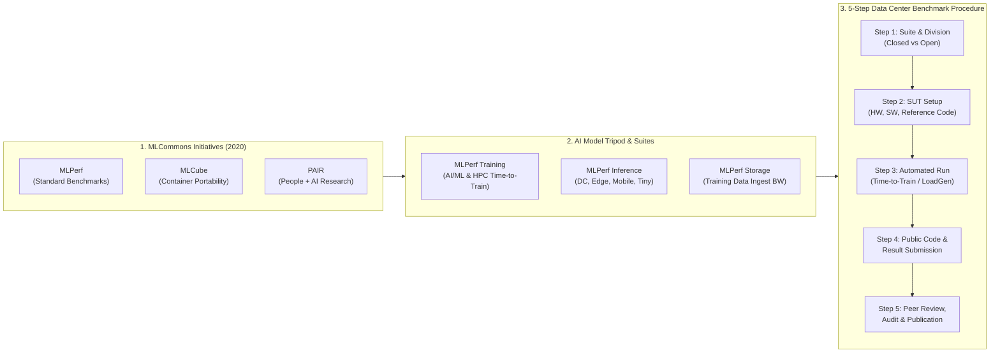
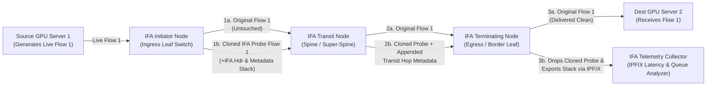
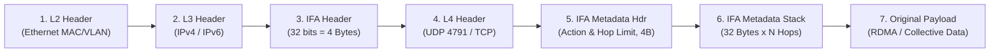
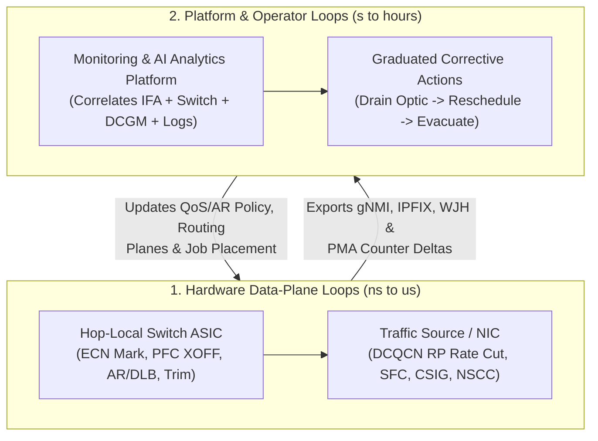

# 12.22 AI network telemetry and KPIs

| | |
|---|---|
| Level | Advanced |
| Priority tier | 2 |
| Lab venue | Nebius GPU |
| Part | Part 12: Complete AI networking |
| Sources | `ai-data-center-network-design-and-technologies` Ch. 10, Ch. 11 & Appendix A; `nvidia-zero-to-hero/volume-08/chapter-09-fabric-monitoring-and-telemetry.md`, `chapter-12-volume-08-summary.md`, `index.md` & `labs/lab-01..04`; `nvidia-zero-to-hero/volume-09` & Legacy `volume-07` (`01-metrics-logs-traces-masterclass.md`, `02-k8s-gpu-observability-masterclass.md`); `systems-performance-2nd-edition` Ch. 10 |
| Code | `code/part12/ai_network_telemetry_kpis.py`, `code/part12/ai_network_telemetry_kpis_lab.py` |
| Coverage file | `planning/coverage/chapters/12-22.md` |

## Why this matters for AI infrastructure

An AI data center network does not exist to pass `ping` checks or maintain green port icons on a five-minute SNMP dashboard; its primary purpose is to minimize **Job Completion Time (`JCT`)** and **time-to-train** for distributed training runs while enforcing strict tail-latency service-level objectives (`p99` and `p99.9`) for real-time inference. Because synchronous collectives (`AllReduce`, `AllGather`, `ReduceScatter`, and Mixture-of-Experts `AllToAll`) lock hundreds or thousands of GPUs to the slowest participating rank on every iteration, a transient microburst or a single degraded optical lane on one rail throttles the entire cluster.

Consider three production failure patterns documented across AI InfiniBand and RoCEv2 fabrics:
1. **The fabric that failed slowly (`45.5x` error-rate acceleration):** Across a multi-day training run, every switch and Host Channel Adapter (`HCA`) port reported `State: Active` and `Physical state: LinkUp`, yet step throughput steadily eroded. Inspecting switch port `12` with `perfquery` revealed `SymbolErrorCounter` climbing from `4` on Day `1` to `890` on Day `4` (`+886`, or `295.33` errors/day) and `41,200` on Day `7` (`+40,310`, or `13,436.67` errors/day—a **`45.5x` acceleration** in physical error rate) while `LinkDownedCounter` climbed from `0` to `3` to `11`.
2. **Step-time variance across `128` nodes (`> 20%` JCT inflation):** On a `128`-node (`1,024`-GPU) cluster where every link showed `Active`, distributed training step times varied by more than `20%` across racks because a replacement cable had trained down from `4x` (`400 Gbps`) to `1x` width (`100 Gbps`, a `4.00x` rail bandwidth skew), Adaptive Routing was missing on the active Service Level, and several ranks were bound to remote HCAs across NUMA sockets.
3. **Sub-millisecond microbursts invisible to legacy polling:** When synchronized elephant flows converge on a spine or leaf egress port, buffer queues fill in microseconds or nanoseconds. Legacy `30`-to-`300`-second SNMP polling completely smooths out these microbursts, hiding why `DCQCN` Congestion Notification Packets (`CNP`s), Priority Flow Control (`PFC`) `XOFF` pauses, or InfiniBand `PortXmitWait` credit stalls (`998,432` ticks with `0` symbol errors) inflated `JCT` from `4.1667` hours to `5.8333` hours (`1.40x` slowdown, wasting `1,706.67` GPU-hours on a `1,024`-GPU job).

This chapter unifies the two halves of AI fabric performance engineering:
- **Standardized AI data center KPIs and MLCommons / MLPerf benchmarking:** Quantifying model and data performance (accuracy, precision byte widths, data efficiency, time-to-train, and `JCT`), evaluating the six core infrastructure KPIs (throughput, latency, accuracy, power/`PUE`, efficiency in `FLOPS/Watt`, and strong/weak scaling), and executing reproducible `MLPerf Training`, `MLPerf Inference` (`LoadGen` `Offline` and Poisson `Server` scenarios), and `MLPerf Storage` benchmarks across `Closed` and `Open` divisions with `MLCube`.
- **High-resolution network telemetry, In-Band Flow Analyzer (`IFA`), and closed-loop correlation:** Moving beyond legacy SNMP polling to streaming telemetry (`gRPC`/`gNMI` periodic `sample` and event-driven `on_change` pushed directly from the switch forwarding engine), hardware packet cloning with **In-Band Flow Analyzer (`IFA`, `draft-kumar-ippm-ifa-08`)** across `Initiator`, `Transit`, and `Terminator` nodes (`4`-byte IFA header + `4`-byte metadata header + `32`-byte per-hop metadata stack exported via `IPFIX`), **Mirror-on-Drop** (`What Just Happened`), InfiniBand (`perfquery`, `UFM Telemetry`) and RoCEv2 (`ethtool -S`, `gNMI`, `DCGM`) counter correlation, and human-in-the-loop to autonomous corrective actions.

## Prerequisites and outcomes

**Prerequisites:** Chapter 2.31 (foundational Prometheus/Grafana/Alertmanager network monitoring stack), Chapter 12.1 (AI collectives, incast, and elephant flows), Chapters 12.3–12.5 (`RoCEv2`, `PFC`, `ECN`, `DCQCN`, and `DCB`/`QoS`), Chapters 12.6–12.9 (InfiniBand architecture, OpenSM, Adaptive Routing, `perfquery`/`mlxlink`/`ibdiagnet`, and `UFM`), and Chapter 12.17 (`nccl-tests` and fabric benchmarking).

**Outcomes:** After completing this chapter, you will be able to:
- Formulate and compute the core AI data center KPIs—**Job Completion Time (`JCT`)**, **time-to-train**, **throughput** (`OPS`, `FLOPS`, `QPS`, `samples/sec`), **per-operation and tail latency** (`ms`, `us`, `ns`, `p99`, `p99.9`), **accuracy** (`MSE`, precision, recall, `F1`, `MAP`), **power and `PUE`** (`Watts`, `kW`, `MW`, $\text{PUE} = P_{\text{facility}} / P_{\text{IT}}$), **efficiency** (`TPW`, `FPW = FLOPS/Watt`, `QPW`), and **scalability** (**strong scaling** vs **weak scaling** speedup and efficiency).
- Explain the **MLCommons** (founded `2020`) ecosystem (**`MLPerf`**, **`MLCube`**, and **`PAIR`**), the **AI model tripod** (model, dataset, and modification rules/metrics), **`Closed`** vs **`Open`** divisions, and the **`5`-step MLPerf data center benchmarking lifecycle** across `MLPerf Training`, `MLPerf Inference` (`LoadGen` `Offline` vs Poisson `Server` scenarios), and `MLPerf Storage`.
- Compare all nine network monitoring mechanisms (`SNMP polling` `v2c`/`v3`, `SNMP traps`, `Syslog`, `gRPC`/`gNMI` periodic and `on_change` streaming telemetry, `IFA`, `RPC` queries in `XML`/`JSON`, `TWAMP` `RFC 2455` active probes, `sFlow`/`IPFIX`, and `Mirror-on-Demand` / `Mirror-on-Drop`) across historical trend forecasting (`+10%` biweekly growth) and microsecond/nanosecond real-time congestion analysis.
- Decode and size **In-Band Flow Analyzer (`IFA`, `draft-kumar-ippm-ifa-08`)** packets hop by hop: `Initiator` (ingress leaf cloning/tagging), `Transit` (spine/super-spine stack push), and `Terminator` (egress leaf stripping and `IPFIX` export); the `7`-layer packet sequence (`L2 -> L3 -> IFA Header [4B] -> L4 -> IFA Metadata Header [4B] -> IFA Metadata Stack [32B/hop] -> Payload`); every bit field of the `32`-bit IFA Header and `256`-bit (`8 x 32-bit` rows) Metadata Stack; `9000`-byte jumbo MTU validation (`104` B overhead for `3`-stage vs `168` B for `5`-stage Clos); per-hop **residence time** ($t_{\text{tx}} - t_{\text{rx}}$) plus wire propagation time; and why `ECN` must be enabled on egress ports for the `2`-bit congestion field to be valid.
- Correlate switch and server telemetry across **InfiniBand** (`perfquery` state vs cumulative counters vs rates/deltas, `PortXmitWait` credit backpressure, `SymbolErrorCounter` acceleration, `PortXmitData` `4`-octet words, `ib_write_lat` `p99.9` tail drift) and **RoCEv2** (`rx_ecn_marked_prio3`, `np_cnp_handled`, `rx_pfc_prio3` / `tx_pfc_prio3` pause-tree relay vs root, `fec_uncorrected_blocks == rx_crc_errors`, `max/min` rail bandwidth skew `> 1.3` / `> 1.5`), and select the right **corrective action** from per-hop/source adjustments up to scheduler job restarts or data center evacuation.

---

## 1. AI data center performance KPIs: JCT, scaling, power, and MLCommons / MLPerf

### 1.1 Evolution of benchmarking and the model-plus-data KPI duality

Standardized Key Performance Indicators (`KPIs`) exist to measure engineering progress across hardware and software generations. Just as transportation evolved from walking and pack animals to stone wheels, lighter wooden wheels, shock-absorbing leather/metal/rubber outer bands, and modern metallic/alloy rims—where each iteration reduced pulling force, extended range, and improved ride quality—AI data center fabrics evolve from `100G` to `400G`, `800G`, and `1.6T` interconnects to move exponentially larger parameter and dataset volumes faster and more predictably. Without standardized, repeatable benchmarks, operators cannot separate genuine architectural gains from workload variance.

In an AI/ML data center, tracking traditional IT server availability and facility power is necessary but insufficient. Every AI system comprises two tightly coupled components—**the model** and **the data**—each governed by distinct KPIs that directly stress the underlying network fabric:

| Component / KPI Dimension | Specific Indicators & Units | How Precision, Scale & Network Fabrics Interact |
|---|---|---|
| **Model — Accuracy** | Mean Squared Error (`MSE`) for regression; classification accuracy, precision, recall, `F1-score`, or Mean Average Precision (`MAP`) for prediction | Higher-precision arithmetic (`32`-bit / `4`-byte `FP32` or `64`-bit / `8`-byte `FP64`) can converge to target accuracy in fewer, longer iterations; lower-precision formats (`16`-bit / `2`-byte `FP16`/`BF16` or `8`-bit / `1`-byte `FP8`/`INT8`) cut per-step compute and collective payload bytes (`1, 2, 4, 8, 16, 32` bytes) but may require more iterations to reach the same quality target. |
| **Model — Precision & Recall** | True-positive vs false-positive/false-negative identification; numeric representation in bytes (`1`, `2`, `4`, `8`, `16`, or `32` bytes) | Halving numeric precision (e.g., `4`-byte `FP32` to `2`-byte `BF16`) halves the gradient volume exchanged in every `AllReduce` collective, directly reducing network serialization delay per step. |
| **Model — Latency** | Time to generate a prediction or complete an operation (`ms`, `us`, `ns`; average and `p99` / `p99.9` tail) | Critical for real-time inference (`TTFT`, `TPOT`, and LoadGen `Server` `p99` latency SLAs) and for synchronous collective barriers during distributed training. |
| **Data — Data Efficiency** | Dataset quality, low redundancy, and scenario diversity | High-variety, low-redundancy datasets improve model robustness and reduce wasted training epochs over petabyte-scale storage networks. |
| **Data — Training Time (`Time to Train` & `JCT`)** | End-to-end wall-clock time from data loading to target model quality (`minutes`, `hours`, `days`) | The **single most important KPI for AI training fabrics**. Datasets reach petabytes in size, and large models require massive parallel clusters—for example, OpenAI trained ChatGPT (`GPT-3` class) across **`1,023` NVIDIA A100 GPUs** over approximately **`34` days**. |

### 1.2 The six core AI data center KPIs and Job Completion Time (`JCT`) math

Across node, rack, cluster, and data-center boundaries, AI infrastructure is evaluated across **six canonical KPIs**:

1. **Throughput:** Operations or tasks completed per unit of time—measured at the node, rack, cluster, or data-center level in Operations Per Second (`OPS`), Floating-Point Operations Per Second (`FLOPS` / `TFLOPS` / `PFLOPS`), samples/second (training), or Queries Per Second (`QPS`, inference).
2. **Latency:** Elapsed time between the start and end of an operation (`ms`, `us`, or `ns`), evaluated both **per operation** (median/typical) and at the **tail** (`p99` and `p99.9`). While throughput dominates batch training, tail latency governs both real-time inference SLAs and synchronous collective step barriers.
3. **Accuracy:** Correctness or quality of model output (`MSE`, precision, recall, `F1-score`, `MAP`). A fast system that fails to reach target accuracy (due to corrupted gradients, bad quantization, or diverged hyperparameters) has zero useful goodput.
4. **Power Consumption & `PUE`:** Electrical power drawn at the node, rack (`15 kW` per DGX server, `60 kW+` to `130 kW+` per rack, `458 kW` per DGX B200 SuperPOD Scalable Unit), cluster, or data-center (`W`, `kW`, `MW`) level, paired with **Power Usage Effectiveness (`PUE`)**:
   $$\text{PUE} = \frac{\text{Total Facility Power}}{\text{IT Equipment Power}}$$
   For example, a facility drawing `549.6 kW` total to power `458.0 kW` of IT compute and switches operates at $\text{PUE} = 549.6 / 458.0 = 1.20$.
5. **Efficiency:** Ratio of useful output to electrical resource consumed—quantified as **Throughput Per Watt (`TPW`)**, **FLOPS Per Watt (`FPW`)**, or **Queries Per Second Per Watt (`QPW`)**:
   $$\text{FPW}_{\text{IT}} = \frac{\text{Achieved FLOPS}}{P_{\text{IT}}}, \qquad \text{FPW}_{\text{facility}} = \frac{\text{Achieved FLOPS}}{P_{\text{facility}}} = \frac{\text{FPW}_{\text{IT}}}{\text{PUE}}$$
   At `229,000 TFLOPS` (`229,000,000 GFLOPS`), `18,320 samples/s`, and `91,600 QPS` across `458.0 kW` (`458,000 W`) of IT power at $\text{PUE} = 1.20$, a cluster delivers **`500.0 GFLOPS/W`** (`IT`), **`416.6667 GFLOPS/W`** (`facility`), **`0.04 samples/s/W`** (`TPW`), and **`0.20 QPS/W`** (`QPW`).
6. **Scalability (Strong Scaling vs Weak Scaling):** How effectively the cluster maintains speedup, efficiency, and accuracy as GPU and network resources grow from $N_0$ base GPUs to $N = k \cdot N_0$ GPUs (where $k = N / N_0$ is the scale factor):
   - **Strong scaling (fixed total problem size):** Total dataset/batch work stays constant while GPUs increase by $k\times$. With base execution time $T_{\text{strong}}(N_0)$ and scaled execution time $T_{\text{strong}}(N)$:
     $$S_{\text{strong}}(k) = \frac{T_{\text{strong}}(N_0)}{T_{\text{strong}}(N)}, \qquad E_{\text{strong}}(k) = \frac{S_{\text{strong}}(k)}{k} = \frac{T_{\text{strong}}(N_0)}{k \cdot T_{\text{strong}}(N)}$$
   - **Weak scaling (fixed problem size per GPU):** Problem size and GPU count both scale by $k\times$. With base step time $T_{\text{weak}}(N_0)$ and scaled step time $T_{\text{weak}}(N)$:
     $$E_{\text{weak}}(k) = \frac{T_{\text{weak}}(N_0)}{T_{\text{weak}}(N)}$$
   For example, scaling from $N_0 = 128$ GPUs to $N = 1,024$ GPUs ($k = 8.0\times$) on a well-tuned `1:1` non-blocking fabric where strong-scaling time drops from `800.0 s` to `112.0 s` and weak-scaling step time shifts from `0.450 s` to `0.480 s` yields **$S_{\text{strong}} = 7.1429\times$** (**`89.29%` strong efficiency**) and **`93.75%` weak efficiency**. On a `2:1` oversubscribed or hash-colliding fabric where strong time stalls at `200.0 s` and weak step time balloons to `0.750 s`, scaling collapses to **$S_{\text{strong}} = 4.00\times$** (**`50.0%` strong efficiency**) and **`60.0%` weak efficiency**.

#### Why tail latency directly controls `JCT`

In distributed training over $N_{\text{steps}}$ synchronous iterations, each step's wall-clock time is the sum of compute time $T_{\text{comp}}$ and non-overlapped collective communication time $\alpha_{\text{exposed}} \cdot T_{\text{comm}}$, where $T_{\text{comm}}$ is bounded by the **slowest rail or microburst tail (`p99.9`) across all participating ranks**:

$$\text{JCT} = N_{\text{steps}} \times \left(T_{\text{comp}} + \alpha_{\text{exposed}} \cdot T_{\text{comm,base}} \cdot \gamma_{\text{tail}}\right)$$

Suppose a `1,024`-GPU training job runs $N_{\text{steps}} = 100,000$ iterations with $T_{\text{comp}} = 120.0\text{ ms}$ and ideal non-overlapped collective time $T_{\text{comm,base}} = 30.0\text{ ms}$ ($\text{step} = 150.0\text{ ms}$, communication fraction $= 30 / 150 = 20.0\%$, ideal $\text{JCT} = 4.1667\text{ hours}$). If a `3.0x` collective tail-latency stall ($\gamma_{\text{tail}} = 3.0$, $T_{\text{comm}} = 90.0\text{ ms}$) occurs due to an ECMP collision, `PFC` pause tree, or `1x` lane-width fallback on a single rail:
- Per-step duration rises from **`150.0 ms` to `210.0 ms`** (`+40.0%`).
- The communication fraction of step time more than doubles from **`20.0%` to `42.86%`**.
- Total `JCT` climbs from **`4.1667 hours` to `5.8333 hours`** (a **`1.40x` slowdown**), burning **`1,706.67` wasted GPU-hours** on a single run.

### 1.3 MLCommons (`2020`), `MLPerf` suites, `LoadGen`, and the 5-step benchmarking procedure

To solve the lack of cross-platform standardization and comparability across AI hardware, interconnects, and software stacks, industry leaders and researchers founded **MLCommons** in **`2020`** (`https://mlcommons.org`) around five core objectives: (1) enable fair system comparison while encouraging ML innovation, (2) advance ML progress through rigorous measurement, (3) enforce strict reproducibility, (4) serve both commercial and academic communities, and (5) keep benchmarking costs accessible.



| MLCommons Component / Step | Technical Scope & Rules | Network & Telemetry Significance |
|---|---|---|
| **Three Core Initiatives** | **1. `MLPerf`** (benchmark suites for vision, NLP/LLMs, recommenders, RL, and HPC); **2. `MLCube`** (container-based packaging interface for portable, reproducible execution across any hardware/software stack); **3. `PAIR` (`People + AI Research`)** (compute, dataset, and workshop access for academic/nonprofit research). | `MLCube` eliminates software environment drift so benchmark deltas reflect genuine compute and fabric changes. |
| **Three Benchmarking Suites & AI Model Tripod** | Every suite is defined by a working group using the **AI model tripod** (**specific AI model + standard dataset + modification rules & metrics**): **1. `MLPerf Training`** (AI/ML and HPC time-to-train to target quality); **2. `MLPerf Inference`** (`Data Center`, `Edge`, `Mobile`, and `Tiny` domains); **3. `MLPerf Storage`** (storage throughput feeding training GPUs without starvation). | `MLPerf Training` and `MLPerf Storage` stress east-west collective and storage fabrics simultaneously; `MLPerf Inference` stresses north-south and tensor/pipeline-parallel tail latency. |
| **Step 1: Division Selection (`Closed` vs `Open`)** | **`Closed` division:** Fixed model, dataset, and reference-equivalent implementation for direct apples-to-apples hardware/software comparison. **`Open` division:** Allows novel model architectures or training algorithms provided the system reaches the same predefined quality target. | Vendors comparing `400G`/`800G` InfiniBand vs RoCEv2 fabrics submit in the **`Closed` division** so network scaling efficiency is directly comparable. |
| **Step 2: System Under Test (`SUT`) Setup** | Configure physical hardware (servers, GPUs, CPUs, NICs, switch fabric), software stack (OS, drivers, PyTorch/TensorFlow, collective libraries), and official MLPerf reference source code (model, data loaders, and `LoadGen`). | Requires verified clock synchronization (`PTP`/`NTP`), NUMA/rail pinning, and baseline fabric counter health before timing starts. |
| **Step 3: Execution (`Training` vs `Inference LoadGen`)** | **Training:** End-to-end **time to train** from data loading until the target accuracy metric is reached across distributed multi-node accelerators. **Data Center Inference (`LoadGen`):** Dispatches queries in two scenarios—**`Offline`** (all queries delivered at once to measure maximum batch throughput in `samples/s` or `QPS`) and **`Server`** (queries streamed following a **Poisson distribution** to measure throughput in `QPS` under a **strict tail-latency constraint**, e.g., `p99 <= 15.0 ms`). Both a speed test and a separate accuracy validation test are mandatory. | Poisson arrivals in the `Server` scenario create realistic bursty queuing; any fabric microburst or shared-VL head-of-line blocking (`p99` jumping from `1.8 ms` to `14.2 ms`) violates the latency SLA and invalidates the run. |
| **Steps 4 & 5: Submission, Peer Review & Publication** | Full results, system configuration metadata, and **all source code** are submitted publicly, audited by peer member organizations for rule compliance, accuracy targets, and reproducibility, and published at `mlcommons.org`. | Public peer review prevents cherry-picked "hero runs" that skip data loading or relax convergence accuracy. |

---

## 2. Exploring monitoring options in AI/ML data centers: polling, streaming telemetry, and active probes

### 2.1 Why microsecond AI congestion breaks legacy polling

In an AI data center, health monitoring spans facility sensors (power, temperature, humidity, liquid-cooling flow, and `Redfish`/`IPMI` PSU metrics) and the IP/RDMA network fabric (both backend training and frontend/storage networks). While AI switches and routers support the same foundational export protocols as general enterprise networks—`Syslog`, `SNMP`, and streaming telemetry—**the required timescale shifts by three to six orders of magnitude**.

When `1,024` GPUs enter an `AllReduce` or `AllToAll` step simultaneously, switch egress queues fill and drain in **microseconds or nanoseconds**. Exporting counters at `30`-to-`300`-second SNMP intervals—or even `1`-second intervals without hardware watermarks—averages a `50 us` queue saturation spike across `60,000,000 us` of idle time, reporting `< 1%` utilization while endpoints suffer `PFC` pauses or `RDMA` timeout retries. Modern AI fabric observability therefore combines nine complementary mechanisms across **historical trend analysis** and **real-time sub-second telemetry**:

| Monitoring Mechanism | How It Works in an AI Fabric | Typical Granularity | Key Strengths | Limitations in AI/ML Fabrics |
|---|---|---|---|---|
| **1. `SNMP` Polling (`SNMPv2c` / `SNMPv3`)** | Collector pulls MIB OIDs (`IF-MIB`, queue counters, shared/dedicated/per-interface/per-queue buffer use, `FIB`/`RIB`/`MAC`/`TCAM` capacity, global and line-card/ASIC CPU & memory); prefer `SNMPv3` for authenticated encryption | `30 s` to `5 min` | Universal support across legacy switches, PDUs, and optical gear | Pull overhead on switch CPU; blind to microsecond microbursts; `SNMPv2c` lacks strong security |
| **2. `SNMP` Traps / Informs** | Device asynchronously pushes an event when a pre-configured threshold is crossed (e.g., high ASIC CPU, link down, or lossless queue `PFC XOFF` pushback rate exceeded) | Event-driven (ms to s) | Immediate threshold alarm without continuous polling | Requires pre-set static thresholds; UDP traps can be dropped under congestion; rate-limited by CPU |
| **3. `Syslog` Monitoring** | Device streams severity-coded log messages (`critical`/`fatal` global errors, link flaps, transceiver faults, `BGP`/`BFD` state changes, `PFC` watchdog triggers) to `Vector`/`Fluent Bit` -> `Loki`/`Elasticsearch` | Event-driven | Rich human-readable forensic context | Unstructured text requiring regex/grok parsing; high volume during flap storms; requires strict `PTP`/`NTP` sync |
| **4. Streaming Telemetry (`gRPC` / `gNMI`)** | Switch **pushes** structured YANG/OpenConfig data (`json_ietf` / protobuf) over concurrent `gRPC`/`gNMI` sessions—often **directly from the forwarding engine via revenue ports**—either **periodically (`sample`)** or **on state/value change (`on_change`)** | `1 s` to `10 s` (`sample`); sub-second / immediate (`on_change`) | Eliminates unchanged pull overhead (`on_change`); per-queue buffer accuracy, IPv4/IPv6 rates, `FIB`/`RIB`/`TCAM` & ASIC memory; supports multiple concurrent collectors | Requires high-throughput collectors (`gNMIc`, `Telegraf`), time-series storage (`Prometheus`/`VictoriaMetrics`/`Mimir`), and cardinality controls |
| **5. `RPC` / RESTCONF / JSON Queries** | Automated CLI/API queries returning structured `XML` or `JSON` (`eAPI`, `NX-API`, `NVUE` REST, `UFM` REST API) | Seconds to minutes | Ideal for deterministic configuration and state verification in automation pipelines | Pull model; not designed for high-frequency per-queue time-series streaming |
| **6. Agent-Based Active Probing (`TWAMP`)** | Dedicated host/switch agents run **Two-Way Active Measurement Protocol (`TWAMP`, RFC 2455 benchmarking)**, `UDP`, `TCP`, or `ICMP` ping-mesh probes across leaf, spine, and rail pairs | `100 ms` to `10 s` | Measures true end-to-end user-visible path latency, jitter, and loss continuously | Synthetic probe packets have different payloads and 5-tuple hashes than live RDMA elephant flows |
| **7. Flow Export (`sFlow` / `IPFIX`)** | Packet header sampling (`sFlow`, e.g., `1-in-1000` to `1-in-4000` at `100G+`/`400G`) or flow aggregation (`IPFIX`) exported to `goflow2`/`pmacct`/`ElastiFlow` | Per-flow (sampled) | Identifies elephant flows, top talkers, `UDP 4791` RoCEv2 vs `TCP` storage mix, and **flow entropy scores** | Sampled (`sFlow` is not packet-exact); high collector ingest rate at `400G`/`800G` |
| **8. Packet Mirroring (`On-Demand` & `Mirror-on-Drop`)** | **Mirror-on-Demand (`SPAN`/`ERSPAN`)** clones live flows for payload inspection; **Mirror-on-Drop** (`What Just Happened`, `WJH`) clones packets the switch ASIC discards along with the hardware drop reason | Per dropped or matched packet | Separates **congestion tail drops** from **defensive/security drops** (e.g., ASIC DDoS/CoPP dropping excessive `ARP` floods or malformed packets) | Requires collector capture capacity; not every packet drop is a fabric fault |
| **9. In-Band Flow Analyzer (`IFA` / `INT`)** | Switch ASICs stamp per-hop nanosecond residence time, queue ID, port IDs, and ECN congestion bits directly into live packets or cloned data-plane probes, exported as `IPFIX` at the egress leaf | **Per-packet / nanosecond** | Traverses the **exact ECMP/DLB path and queue** as the live GPU flow; pinpoints microsecond hop latency | Requires switch ASIC support, `9000`-byte jumbo MTU headroom (`104–168` B overhead), and homogeneous timestamp clocks |

### 2.2 Historical trend forecasting versus real-time telemetry correlation

Production AI fabrics require both **historical monitoring** and **real-time monitoring** working in concert:

1. **Historical network monitoring (capacity planning and pattern learning):**
   - Stores weeks to months of aggregated utilization, buffer watermark, and error rate trends to predict saturation before jobs fail.
   - *Worked example (`ADC` Ch. 11 & `PromQL` `predict_linear`):* Suppose leaf-to-spine uplink bandwidth utilization grows by **`+10%` every two weeks** (`5%` per week) as new models and tenants onboard. Starting from a `65.0%` peak-hour baseline, linear trend forecasting (`predict_linear(gnmi_if_counters_out_octets[14d], 28*86400)`) predicts that utilization will cross the **`85.0%` uplink saturation alert threshold in exactly `4.0 weeks`** (`2` biweekly intervals of `+10%`), giving operators time to add spine links or rebalance pod placement.
   - Historical databases also tag recurring telemetry signatures with the corrective actions taken and their measured outcomes, forming the training corpus for AI/LLM operational assistants.
2. **Real-time network monitoring (sub-second situational awareness):**
   - Uses streaming telemetry (`gNMI`), `IFA`, and `Mirror-on-Drop` to track **flow tail latency**, **packet drops per queue**, **fat (elephant) flow collisions**, and **flow entropy scores** in real time, alongside switch ASIC memory, CPU, and storage headroom.
   - Crucially, real-time monitoring in an AI data center **must correlate switch telemetry with server/GPU telemetry** (`DCGM`, `node_exporter`, `ethtool -S`, `mlx5` hardware counters, and `NCCL` rank logs). Frame loss, queue occupancy, and latency behave differently at **aggregation points (spines/super-spines)** than at **non-aggregation edge points (leaves connecting a subset of servers)**. Correlating both sides reveals whether a `JCT` spike originates from a single server's degraded NIC/optic, a leaf uplink ECMP collision, or a spine incast tree.

---

## 3. In-Band Flow Analyzer (`IFA`): architecture, packet headers, and nanosecond residence time

### 3.1 Why synthetic probes miss elephant-flow congestion—and how `IFA` solves it

Active agent probes (`TWAMP`, `ping`, `blackbox_exporter`) inject artificial `UDP`, `TCP`, or `ICMP` packets with synthetic payloads and 5-tuple headers. In an AI fabric where switches hash packets across `ECMP` or Dynamic Load Balancing (`DLB`) paths using L3/L4 header fields and `RoCEv2` `BTH` `QPN`, a synthetic probe frequently hashes onto an idle spine link while a `400 Gbps` `RoCEv2` (`UDP 4791`) collective elephant flow stalls behind a congested queue on a neighboring link.

**In-Band Flow Analyzer (`IFA`, `draft-kumar-ippm-ifa-08`)** eliminates this blind spot by attaching telemetry metadata directly to the live user flow—or, in the standard production deployment shown below, by **cloning a sampled packet of the live GPU flow at the ingress leaf** so the probe carries the exact same forwarding headers and traverses the exact same switch queues as the original packet:



| IFA Node Role | Typical Fabric Device | Packet & Metadata Operations (`draft-kumar-ippm-ifa-08` & `ADC` Ch. 11) |
|---|---|---|
| **1. `Initiator` Node** | Ingress Leaf Switch (Stage `1`) | Samples the live GPU flow of interest (`flow1`) and either tags the original packet or **clones** it into an IFA probe packet. Pushes the `4`-byte **IFA Header**, the `4`-byte **IFA Metadata Header** (action + hop limit + initiator tag), and Hop `1`'s `32`-byte **IFA Metadata Stack** entry (ingress/egress ports, `RX` timestamp, residence time, queue ID, ECN congestion state). |
| **2. `Transit` Node(s)** | Spine (`3`-stage Clos: `1` transit hop) or Spine + Super-Spine + Spine (`5`-stage Clos: `3` transit hops) | Inspects the IFA Metadata Header, decrements the hop limit, and **pushes a new `32`-byte local metadata entry onto the IFA Metadata Stack** recording its own `Device ID`, ingress/egress port numbers, `Queue ID`, `RX Timestamp`, **Residence Time in nanoseconds**, and `Congestion` bits. |
| **3. `Termination` Node** | Egress Leaf or Border-Leaf Switch (Stage `3` or Stage `5`) | When operating on cloned probe traffic, **drops the cloned data payload** so the destination NIC never receives duplicate packets, extracts the complete multi-hop **IFA Metadata Stack**, and exports the telemetry record (typically in **`IPFIX`** format) to the central IFA collector server. (If in-place tagging was used without cloning, strips the IFA headers and forwards the clean original packet to `Server 2`.) |

### 3.2 `IFA` packet encapsulation, `32`-bit header, and `256`-bit (`32`-byte) per-hop metadata stack

When an `Initiator` leaf encapsulates a packet for `IFA`, it inserts the **IFA Header immediately after the L3 IP header**, preserves the original **L4 transport header** (`UDP 4791` for RoCEv2 or `TCP`), and inserts the **IFA Metadata Header** and **IFA Metadata Stack** immediately before the payload:



Every field of the `4`-byte (`32`-bit) **IFA Header** and the `32`-byte (`256`-bit, `8 x 32-bit` rows) per-hop **IFA Metadata Stack** is defined as follows:

| Header / Stack Row | Bit Width (`Total`) | Exact Bit Fields & Widths (`draft-kumar-ippm-ifa-08`) | Operational Meaning in AI Fabrics |
|---|---|---|---|
| **IFA Header** (after L3 IP) | `32` bits (`4` B) | `IFA Version` (`4` bits) \| `Global Namespace` (`4` bits) \| `Protocol Type` (`8` bits) \| `Flags` (`8` bits) \| `Max Length` (`8` bits) | Identifies the packet as an IFA-capable flow, records the original IP protocol type, and bounds maximum metadata stack growth (`Max Length`). |
| **IFA Metadata Header** (after L4) | `32` bits (`4` B) | Action bits (`Transit` / `Termination` instructions), Initiator correlation tag, and `Hop Limit` | Instructs transit spines vs terminating leaves how to process the probe and limits hop scope. |
| **Stack Row 1** | `32` bits (`4` B) | `Local Namespace` (`4` bits) \| `Device ID` (`20` bits, up to `1,048,575` switches) \| `IP TTL` (`8` bits) | Uniquely identifies the switch ASIC (`Device ID`) and verifies TTL decrement along the path. |
| **Stack Row 2** | `32` bits (`4` B) | `Egress Port Speed` (`4` bits) \| `Congestion` (`2` bits) \| `Queue ID` (`6` bits, `0..63`) \| `RX Timestamp Seconds` (`20` bits) | Records the egress queue (`Queue ID`), port speed code, ECN congestion mark (`2` bits), and coarse receipt time (`seconds`). |
| **Stack Row 3** | `32` bits (`4` B) | `Egress Port Number` (`16` bits) \| `Ingress Port Number` (`16` bits) | Pinpoints the exact ingress and egress switch ports taken by this packet across `ECMP`/`DLB`. |
| **Stack Row 4** | `32` bits (`4` B) | `RX Timestamp Nanoseconds` (`32` bits) | Fine-grained nanosecond timestamp ($t_{\text{rx}}$) when the packet entered the switch hop. |
| **Stack Row 5** | `32` bits (`4` B) | `Residence Time Nanoseconds` (`32` bits) | Exact time spent inside this switch hop: $\Delta t_{\text{res}} = t_{\text{tx}} - t_{\text{rx}}$ (switching + egress queue delay in `ns`). |
| **Stack Row 6** | `32` bits (`4` B) | `Opaque Data 1 (Reserved)` (`32` bits) | Vendor/deployment-extensible telemetry word `1`. |
| **Stack Row 7** | `32` bits (`4` B) | `Opaque Data 2 High (Reserved)` (`16` bits) \| `Opaque Data 2 Low (Reserved)` (`16` bits) | Vendor/deployment-extensible telemetry word `2`. |
| **Stack Row 8** | `32` bits (`4` B) | `Opaque Data 3 (Reserved)` (`32` bits) | Vendor/deployment-extensible telemetry word `3`. |

### 3.3 `IFA` MTU budget, residence-time math, and architectural constraints

From the byte layout above, an `IFA`-tagged packet traversing $H$ fabric hops adds:
$$\text{Overhead}_{\text{IFA}}(H) = \underbrace{4\text{ B}}_{\text{IFA Hdr}} + \underbrace{4\text{ B}}_{\text{Metadata Hdr}} + 32\text{ B} \times H = 8 + 32H\text{ bytes}$$
- In a **`3`-stage Clos fabric** ($H = 3$: Ingress Leaf $\rightarrow$ Spine $\rightarrow$ Egress Leaf), `IFA` adds $8 + 32(3) = \mathbf{104\text{ bytes}}$ (`8` B fixed + `96` B stack). A `4,200`-byte RoCEv2 frame grows to **`4,304` bytes**, fitting comfortably inside a standard **`9,000`-byte jumbo MTU**.
- In a **`5`-stage Clos fabric** ($H = 5$: Leaf $\rightarrow$ Spine $\rightarrow$ Super-Spine $\rightarrow$ Spine $\rightarrow$ Leaf), `IFA` adds $8 + 32(5) = \mathbf{168\text{ bytes}}$ (`8` B fixed + `160` B stack). If a host sends an `8,900`-byte jumbo storage frame without reserving `IFA` headroom, the tagged packet reaches $8,900 + 168 = \mathbf{9,068\text{ bytes}}$, exceeding a `9,000`-byte switch MTU and fragmenting or dropping unless switch ports are configured with `>= 9,216`-byte MTU.

For each hop $i \in \{1, \dots, H\}$, **residence time** and **per-hop latency** are computed as:
$$\text{ResidenceTime}_i = t_{\text{tx},i} - t_{\text{rx},i}, \qquad \text{HopLatency}_i = \text{ResidenceTime}_i + t_{\text{wire},i}$$
Look at the `3`-stage trace modeled in `analyze_ifa_flow_trace`:
- **Hop 1 (`Initiator` Leaf `101`):** $t_{\text{rx}} = 1,000,000\text{ ns}$, $t_{\text{tx}} = 1,000,650\text{ ns}$ $\implies \text{ResidenceTime}_1 = \mathbf{650\text{ ns}}$, plus $150\text{ ns}$ fiber propagation ($30\text{ m}$ at $5\text{ ns/m}$).
- **Hop 2 (`Transit` Spine `201`):** $t_{\text{rx}} = 1,000,800\text{ ns}$, $t_{\text{tx}} = 1,015,200\text{ ns}$ $\implies \text{ResidenceTime}_2 = \mathbf{14,400\text{ ns}}$ (**`14.4 us`** microburst queue stall, with `Congestion = 3`), plus $150\text{ ns}$ wire time.
- **Hop 3 (`Terminator` Leaf `102`):** $t_{\text{rx}} = 1,015,350\text{ ns}$, $t_{\text{tx}} = 1,016,050\text{ ns}$ $\implies \text{ResidenceTime}_3 = \mathbf{700\text{ ns}}$.
- **End-to-End Total:** $\sum \text{ResidenceTime}_i = \mathbf{15,750\text{ ns}}$ + $\sum t_{\text{wire},i} = \mathbf{300\text{ ns}}$ = **`16,050 ns` (`16.05 us`)**, immediately isolating **Spine `201`** (`91.4%` of total residence time) as the microburst bottleneck.

Keep three operational rules in mind when deploying `IFA`:
1. **`ECN` must be enabled on egress ports:** A switch only populates the `2`-bit `Congestion` field in Row `2` when Explicit Congestion Notification (`ECN`) is enabled on that egress queue; if `ECN` is disabled (as on Super-Spine `31` in our `5`-stage lab check), congestion bits cannot be trusted.
2. **Homogeneous ASIC timestamp precision per tier:** Because $\text{ResidenceTime}_i = t_{\text{tx},i} - t_{\text{rx},i}$ is stamped in hardware nanoseconds by each switch ASIC, mixing switch generations with different clock precisions inside the same leaf or spine tier distorts hop-to-hop latency comparisons.
3. **Multicast limitation:** While `IFA` metadata handling for multicast trees remains a maturing area in general enterprise networks, AI backend fabrics rely overwhelmingly on unicast RDMA Queue Pairs (even for collective rings/trees), making `IFA` directly applicable to GPU training traffic.

---

## 4. Correlating InfiniBand, RoCEv2, and GPU host telemetry: signals, PromQL, and alerting

### 4.1 InfiniBand counter semantics: state, cumulative totals, rates, and `PortXmitWait`

As established in `nvidia-devops` Volume 08 (`chapter-09-fabric-monitoring-and-telemetry.md`, `chapter-12-volume-08-summary.md`, `index.md`, and `labs/lab-01..04`), InfiniBand telemetry rests on five core metric families—**port health**, **capacity/utilization**, **congestion**, **subnet management**, and **application correlation**—and requires strict separation between **state**, **cumulative counters**, and **rates/deltas** over an observation window $\Delta t$:

| InfiniBand Signal / Scenario | Counter Evidence (`perfquery` / `iblinkinfo` / `ib_write_lat`) | Rate / Ratio Calculation | Operational Classification & Action |
|---|---|---|---|
| **1. Historical Scar Tissue** (`V8` Ch. 9 Scenario 1, `port 9` over `300 s`) | `SymbolErrorCounter: 12034 -> 12034`; `PortXmitData: 0 -> 5,368,709,120` words (`21,474,836,480` B) | $\Delta \text{SymbolError} = 0$ while transmitting `57.2662 Gbps` over `300 s` | **`HISTORICAL_SCAR_TISSUE` (`NONE`):** Past boot/maintenance event; **do NOT replace the cable** or reset shared counters (`perfquery -R`) during an incident. |
| **2. "The Fabric Failed Slowly"** (`V8` Ch. 9, `switch port 12` over `7` days) | `SymbolErrorCounter`: Day `1` (`4`) $\rightarrow$ Day `4` (`890`) $\rightarrow$ Day `7` (`41,200`); `LinkDownedCounter`: `0 -> 3 -> 11` | Window 1 (`3 d`): `+886` (`295.33/day`); Window 2 (`3 d`): `+40,310` (`13,436.67/day`) $\implies$ **`45.50x` acceleration** | **`PHYSICAL_LINK_DEGRADATION` (`PAGE`):** Pre-failure optical/SERDES decay; inspect `mlxlink -c -m`, fence port (`ibportstate <lid> 12 disable`), and replace transceiver/cable. |
| **3. Pure Credit Backpressure** (`V8` Ch. 2, 7, 9, 10, `port 3` vs `port 7`) | `port 3`: `PortXmitWait = 998,432` (or `184,320`), `SymbolErrorCounter = 0`, `LinkDownedCounter = 0`; sibling `port 7`: `PortXmitWait = 41` | `16,640.53` wait ticks/s (`0.3328` wait/pkt ratio); `ib_write_bw` `2 MiB` average drops `39.69%` (`399.71` peak vs `241.06 Gbps` avg; uncongested `399.82`/`398.71 Gbps`, `0.28%` spread) | **`CREDIT_BACKPRESSURE_CONGESTION` (`PAGE`):** Physical link is clean (`0` errors); downstream `64`-byte `CBFC` credits are exhausted. Follow the `PortXmitWait` gradient downstream (`340, 298, 51204, 47890, 312`) to the congestion root. |
| **4. Active Flapping Link** (`V8` Ch. 7, `port 4` over `60 s`) | `PortXmitWait = 2,109`, `SymbolErrorCounter = +41`, `LinkDownedCounter = +2` | `0.68` symbol errors/s + `2` link-down recoveries in `60 s` | **`PHYSICAL_LINK_DEGRADATION` (`PAGE`):** Active bit errors + link retraining cause credit stalls secondarily; fix physical layer first. |
| **5. Routing / Policy Discard** (`V8` Ch. 9, `port 11` over `60 s`) | `PortXmitDiscards: 10 -> 260` (`+250`), `SymbolErrorCounter = 0` | `+250` switch-discarded packets (`4.17` discards/s) | **`ROUTING_OR_POLICY_DISCARD` (`PAGE`):** Missing `ibroute` `LFT` entry, `P_Key` partition violation, or switch head-of-queue lifetime timeout. |
| **6. Static Spine Uplink Imbalance** (`V8` Ch. 6 & Lab 03, `ports 5–6` vs `7–8`) | `PortXmitData` `4`-octet word deltas over `10 s`: `5,368,709,120` words (`21,474,836,480` B) on `port 5` vs `268,435,456` words (`1,073,741,824` B) on `port 7` | Multiply words by `4` bytes: `171.7987 Gbps` on `port 5` vs `8.5899 Gbps` on `port 7` = **`20.0:1` (`20.0x`) imbalance** | Static destination-based `LFT` pinning elephant flows onto `ports 5–6`; enable Adaptive Routing (`AR`) and verify `ar_sl_mask`. |
| **7. Oversubscribed Leaf Cut & Tail Latency** (`V8` Ch. 6, 10, 11, 12 & Lab 02) | `16 x 400G = 6,400G` down vs `8 x 400G = 3,200G` up (`2:1` cut vs `32`-port `16+16` nonblocking leaf for `512` GPUs); `ib_write_lat` `2` B `1,000` iters | Cross-rack `ib_write_bw` drops `397.62 -> 201.18 Gbps` (`1.9764x`), doubling `2 GB` `AllReduce` `40 -> 80 ms`; `ib_write_lat` typical `1.58 vs 1.55 us` (`1.0194x`), `p99` `2.90 vs 1.71 us` (`1.6959x`), `p99.9` **`5.77 vs 1.98 us` (`2.9141x`)**; shared VL inference `p99` jumps **`1.8 ms -> 14.2 ms` (`7.8889x`)** vs **`3.1 ms`** on isolated SL/VL | Median latency (`1.58 vs 1.55 us`) hides tail stalls; always gate acceptance on `p99`/`p99.9` latency, `1:1` nonblocking leaf radix, and separated training/storage/inference Virtual Lanes. |

### 4.2 RoCEv2 ECN, CNP, PFC pause trees, FEC corruption, and multi-rail skew

On lossless Ethernet (`RoCEv2` over `UDP 4791`), `evaluate_rocev2_congestion_and_fec` and `evaluate_rail_bandwidth_skew` correlate switch `gNMI`/`ethtool -S` counters (`rx_ecn_marked_prio3`, `rx_pfc_prio3`, `tx_pfc_prio3`, `WJH` drops) with host NIC hardware counters (`np_cnp_handled`, `np_ecn_marked_roce_packets`, `rp_current_rate`, `fec_corrected_blocks`, `fec_uncorrected_blocks`, `rx_crc_errors`) across six canonical states:

| RoCEv2 / Host Telemetry Signature | Counter Delta Evidence (`ethtool -S` / `gNMI` / `mlx5`) | Diagnostic Classification | Required Operational Action |
|---|---|---|---|
| **1. Proactive `ECN` Contained (`HEALTHY`)** | `swp9` (`5 s`): `rx_ecn_marked_prio3` `84,200 -> 84,512` (`+312`), `np_ecn_marked_roce_packets = 305`, `np_cnp_handled = 298` (`cnp_to_ecn_ratio = 0.9551`), `rx_pfc_prio3 = 0`. Or `Lab 03` (`60 s` contention): `rx_ecn_marked_prio3 = +47,829`, `rx_pfc_prio3 = 412` (`6.87/s`), `tx_pfc_prio3 = 14`, Sender A `89.2 Gbps` + Sender B `87.1 Gbps` = `176.3 Gbps` | **`PROACTIVE_ECN_CONTAINED` (`NONE`)** | Normal `DCQCN` closed-loop operation: switch `WRED`/`ECN` markings are reflected as `CNP`s (`opcode 129`) and smoothly pace sender `RP` rates before `PFC` storms occur. |
| **2. `PFC` Pause Relay Hop vs Root** | Upstream `swp3` (`10 s`): `rx_pfc_prio3 = 41,823`, `tx_pfc_prio3 = 41,810`, `rx_ecn_marked_prio3 = 190`, `queue3_occupancy = 98%`; downstream receiver `swp7`: `tx_pfc_prio3 = 0`, `rx_ecn_marked_prio3 = 2,200` (`11.58x` higher) | **`PFC_PAUSE_RELAY_HOP` (`PAGE`)** | Because **both `rx_pfc` and `tx_pfc` are climbing on `swp3`**, `swp3` is an innocent middle relay hop propagating backpressure upstream. Walk downstream in the direction of `rx_pfc` until `tx_pfc == 0` (`swp7`). |
| **3. Weak `RP` Response / `PFC` Storm** | `swp9` (`60 s`): `rx_ecn_marked_prio3 = 412,880`, `np_cnp_handled = 409,500` (`99.18%`), yet `rp_current_rate = 98.0 Gbps` on a `100 Gbps` link and `rx_pfc_prio3 = 93,100` (`1,551.67/s`) | **`WEAK_RP_OR_PFC_STORM` (`PAGE`)** | The `ECN` $\rightarrow$ `CNP` loop is intact, but the sender NIC's `DCQCN` Reaction Point (`RP`) rate-cut profile is too weak (or the leaf uplink cut is oversubscribed) to drain queues before `XOFF`. |
| **4. Broken `DCQCN` `CNP` Loop** | Switch `rx_ecn_marked_prio3 = +15,000` and `rx_pfc_prio3 = +4,200` over `10 s`, while NIC `np_cnp_handled = 0` (`cnp_to_ecn_ratio = 0.0`) | **`BROKEN_DCQCN_CNP_LOOP` (`PAGE`)** | Switch is marking `CE` (`11`), but `0` `CNP`s reach the sender: check NIC `ECN`/`DCQCN` enablement, reverse-path ACLs, or `DSCP 48` (`TC6`) `CNP` queue drops. |
| **5. Physical `FEC` / `CRC` Corruption** | `swp17` (`60 s`): `fec_corrected_blocks = 41,200`, **`fec_uncorrected_blocks = 3`**, and **`rx_crc_errors = 3`** alongside secondary `rx_ecn_marked_prio3 = 1,850` | **`PHYSICAL_FEC_CRC_CORRUPTION` (`PAGE`)** | `3` uncorrectable FEC codewords produced `3` exact CRC frame drops, triggering RDMA retries (`RETRY_EXC_ERR`) that inflate `ECN` secondarily. Replace cable/optic (`ABC123`) first. |
| **6. Lossless Queue Drops & Rail Skew** | `swp19` `WJH` `Tail drop (queue full) = 18,402` (`trust pcp` instead of `trust dscp` dumping `DSCP 46` into lossy `prio 0`); or `8`-rail node with `1` rail at `98.0 Gbps` (`1x` lane fallback) vs `7` rails at `392.0 Gbps` (**`max/min = 4.00x` skew**); or `Lab 04` wrong rail `-d mlx5_1` (`156.0 Gbps` in `8.2 s`, `24` `RETRY_EXC_ERR`s vs `392.0 Gbps` in `2.1 s` on `mlx5_0`, `2.5128x` slower) | **`LOSSLESS_QUEUE_BUFFER_DROP` / `CRITICAL_RAIL_SKEW` (`PAGE`)** | Fix `DSCP -> TC3` QoS trust, reseat/replace the `1x`-degraded cable when `max/min > 1.30` (warn) or `> 1.50` (page/ticket with active load `>= 40 Gbps`), and bind ranks to local `PIX` `mlx5` rails. |

### 4.3 Streaming telemetry ingestion scale and Prometheus cardinality control

High-resolution switch telemetry generates massive time-series volume if not engineered carefully. Using `estimate_telemetry_scale_and_cardinality`, consider a **`1,000`-switch fabric** where each **`64`-port switch** exports `36` interface-level counters plus `8` queues $\times$ `8` queue-level counters = **`100` counters per port** at a **`10`-second `gNMI` sample interval**:
- **Active time series per switch:** $64\text{ ports} \times 100\text{ counters} = \mathbf{6,400\text{ series/switch}}$.
- **Sample ingestion rate per switch:** $6,400 / 10\text{ s} = \mathbf{640.0\text{ samples/s per switch}}$.
- **Cluster-wide active series and sample rate (`1,000` switches):** $\mathbf{6,400,000\text{ active series}}$ and $\mathbf{640,000\text{ samples/s}}$ (`640k samples/s`).
- **Why 5-tuple labels cause a cardinality explosion:** If an engineer mistakenly attaches per-flow 5-tuple labels (`src_ip`, `dst_ip`, `src_port`, `dst_port`, `proto`—even just `500` distinct active flows per port) to Prometheus metrics, total active series multiply by **`500.0x`** to **`3,200,000,000` (`3.2 billion`) series**, crashing the TSDB with Out-Of-Memory (`OOM`) faults. Keep Prometheus labels strictly bounded to topological inventory dimensions (`device`, `interface`, `queue`, `role`, `rack`, `rail`, `tenant`) enriched from `NetBox`/`LLDP`, and route per-flow 5-tuple records (`sFlow`/`IPFIX` and `IFA` traces) to dedicated flow/columnar stores.

---

## 5. Closed-loop correlation, corrective actions, and autonomous AI fabrics

### 5.1 Four-tier decision hierarchy and worst-case operational mitigations

Collecting terabytes of `gNMI`, `IFA`, `sFlow`/`IPFIX`, `UFM`, and `DCGM` telemetry only improves `JCT` when translated into timely **corrective actions**. Because congestion in an AI fabric unfolds across nanoseconds to microseconds while job orchestration operates across seconds to hours, corrective decisions are stratified across four control loops:



| Control Loop Tier | Timescale | Decision Maker | Concrete Corrective Actions (`ADC` Ch. 11 & `V8` Ch. 9) |
|---|---|---|---|
| **1. Individual Switch Hop** | Nanoseconds to microseconds | Switch ASIC (`Spectrum-4`, `Tomahawk 5`, `Quantum-2/X800`) | Marks IP `ECN` bits (`11` `CE`), emits hop-local `PFC XOFF`/`XON` (`0x8808`), re-steers flowlets or packets across `DLB`/`GLB`/`AR` (`SHIELD` on link down), or trims payloads (`UEC` packet trimming / `SFC`). |
| **2. Traffic Source (`NIC` / `FEP`)** | Microseconds to milliseconds | Sender SuperNIC / HCA (`ConnectX-7/8`, `BlueField-3`) | Cuts injection rate upon receiving `DCQCN` `CNP`s (`opcode 129`), InfiniBand `BECN` (`CCTI` table index), `SFC` source quench frames, `CSIG` in-band signals, or `UEC` `NSCC`/`RCCC` credits. |
| **3. Monitoring & AI/LLM Platform** | Seconds to minutes | Fabric controller (`UFM`, `NetQ`, `Prometheus` + `Alertmanager` webhook, LLM pattern engine) | Correlates stored historical telemetry patterns with tagged past remediations and their effectiveness; predicts recurring congestion or optic failure (`+10%` biweekly growth or `45.5x` BER acceleration); recommends or triggers allow-listed runbooks (e.g., shifting part of server traffic to alternate fabric nodes/links via BGP-DPF or traffic engineering, blocking DDoS/churn sources, or cordoning a degraded rail). |
| **4. Worst-Case Escalation (Human / Scheduler)** | Minutes to hours | On-call SRE / Cluster Scheduler (`Slurm` / `Kubernetes`) | When real-time telemetry reports severe fabric-wide frame loss, `PFC XOFF` storms across all spine/leaf queues, elevated latency, and rising `ECN` marks that stall GPU training (`JCT` spike): **(a) Shut down or fence the server/port at the origin of the congestion** (identified by switch telemetry); **(b) Cordon the faulty node and restart the training job from the latest checkpoint at the scheduler level**; or **(c) Evacuate the workload to a secondary data center / pod with healthy network capacity and restart the jobs there.** |

### 5.2 Why telemetry cannot rescue a broken capacity design

A critical operational warning in *AI Data Center Network Design and Technologies* Chapter 11 and `nvidia-devops` Volume 08 Chapter 9 is that **monitoring and minor runtime traffic engineering cannot compensate for a fundamentally flawed network capacity plan**. If a cluster was built with:
- An undersized leaf-to-spine oversubscription ratio (for example, a `2:1` leaf cut with `16 x 400G = 6,400 Gbps` downlinks into `8 x 400G = 3,200 Gbps` uplinks instead of a `32`-port `16-down / 16-up` `1:1` nonblocking leaf for a `512`-GPU pod, cutting cross-rack `ib_write_bw` from `397.62 Gbps` to `201.18 Gbps` and doubling `2 GB` `AllReduce` from `40 ms` to `80 ms`),
- Static 5-tuple `ECMP` hashing without `DLB`/`GLB` or Adaptive Routing (`AR`) for low-entropy `UDP 4791` elephant flows (`20.0:1` spine uplink imbalance), or
- Sub-grade optical transceivers or cables exceeding physical reach budgets at `400 GbE` / `800 GbE`,

then telemetry will accurately report chronic `ECN` marking, `PFC` pause trees, and `PortXmitWait` backpressure—but no threshold tweak will eliminate the bottleneck until physical bisection bandwidth, load-balancing mode, and optics quality are corrected.

---

## Commands and configurations that matter

### 1. Host, RDMA, and GPU Telemetry Collection (`node_exporter`, `ethtool -S`, `perfquery`, `mlxlink`)

```bash
# 1. Start Prometheus node_exporter with NIC ethtool, InfiniBand, RDMA, and softnet collectors (untested here)
node_exporter \
  --collector.netdev --collector.netstat --collector.softnet \
  --collector.ethtool --collector.ethtool.device-include='^(ens|eth|eno).*' \
  --collector.ethtool.metrics-include='.*(pause|pfc|discard|drop|crc|fec|ecn|cnp|out_of_buffer).*' \
  --collector.infiniband --collector.rdma --collector.hwmon

# 2. Capture read-only RoCEv2 NIC & switch counter deltas over a 60s window (NEVER reset shared counters; untested here)
date -u +"%Y-%m-%dT%H:%M:%SZ"
ethtool -S ens1f0 | egrep "rx_prio3_packets|tx_prio3_packets|rx_ecn_marked_prio3|rx_pfc_prio3|tx_pfc_prio3|fec_corrected_blocks|fec_uncorrected_blocks|rx_crc_errors|out_of_buffer" > /tmp/roce_t0.txt
cat /sys/class/infiniband/mlx5_0/ports/1/hw_counters/np_cnp_sent /sys/class/infiniband/mlx5_0/ports/1/hw_counters/rp_cnp_handled > /tmp/cnp_t0.txt
sleep 60
ethtool -S ens1f0 | egrep "rx_prio3_packets|tx_prio3_packets|rx_ecn_marked_prio3|rx_pfc_prio3|tx_pfc_prio3|fec_corrected_blocks|fec_uncorrected_blocks|rx_crc_errors|out_of_buffer" > /tmp/roce_t1.txt
cat /sys/class/infiniband/mlx5_0/ports/1/hw_counters/np_cnp_sent /sys/class/infiniband/mlx5_0/ports/1/hw_counters/rp_cnp_handled > /tmp/cnp_t1.txt
diff -u /tmp/roce_t0.txt /tmp/roce_t1.txt

# 3. Capture InfiniBand PMA counter deltas (`perfquery -x` without `-R` reset) and optical DOM (`mlxlink`; untested here)
perfquery -x 44 12 > /tmp/ib_port12_t0.txt && sleep 300 && perfquery -x 44 12 > /tmp/ib_port12_t1.txt
diff -u /tmp/ib_port12_t0.txt /tmp/ib_port12_t1.txt
mlxlink -d mlx5_0 -c -m --json

# 4. Run NUMA-pinned RDMA latency & bandwidth baseline with p99 and p99.9 tail percentiles (V8 Lab 02; untested here)
numactl --cpunodebind=0 --membind=0 ib_write_lat -d mlx5_0 -i 1 -s 2 -n 1000 -F <peer-host>
numactl --cpunodebind=0 --membind=0 ib_write_bw -d mlx5_0 -i 1 -s 2097152 --report_gbits -D 10 <peer-host>
```

### 2. Streaming Telemetry (`gNMIc` Periodic `sample` & `on_change`) and PromQL Alert Rules

```yaml
# gnmic.yaml — Streaming telemetry collector subscribing to sample counters & on_change state (untested here)
username: admin
password: ${GNMI_PASSWORD}
encoding: json_ietf
targets:
  leaf01:6030: {}
  spine01:6030: {}
subscriptions:
  if_counters_sample:
    paths: ["/interfaces/interface/state/counters"]
    stream-mode: sample
    sample-interval: 10s
  if_oper_state_onchange:
    paths: ["/interfaces/interface/state/oper-status"]
    stream-mode: on_change
  qos_queues_sample:
    paths: ["/qos/interfaces/interface/output/queues/queue/state"]
    stream-mode: sample
    sample-interval: 2s
outputs:
  prom_output:
    type: prometheus
    listen: ":9804"
    path: /metrics
    metric-prefix: gnmi
    export-timestamps: true
```

```yaml
# prometheus_ai_fabric_alerts.yml — Symptom & pre-failure rate/skew alert rules (untested here)
groups:
  - name: ai_fabric_telemetry_kpis
    rules:
      - alert: InfiniBandCreditBackpressureSustained
        expr: rate(ib_port_xmit_wait_total[5m]) > 1000 and rate(ib_symbol_error_total[5m]) == 0
        for: 2m
        labels: { severity: ticket }
        annotations:
          summary: "Port {{ $labels.device }}/{{ $labels.port }} stalling on CBFC credits (0 physical errors)"
      - alert: InfiniBandSymbolErrorAcceleration
        expr: rate(ib_symbol_error_total[15m]) > 0.1 or increase(ib_link_downed_total[15m]) > 0
        for: 1m
        labels: { severity: page }
        annotations:
          summary: "Active physical symbol error or link-down delta on {{ $labels.device }}/{{ $labels.port }}"
      - alert: RoceBrokenDcqcnCnpFeedback
        expr: rate(gnmi_qos_rx_ecn_marked_prio3[2m]) > 100 and on (rack) sum by (rack) (rate(node_infiniband_np_cnp_sent[2m])) == 0
        for: 1m
        labels: { severity: page }
        annotations:
          summary: "Switch ECN marking active in {{ $labels.rack }} but NICs emit 0 CNPs"
      - alert: RocePfcStormDetected
        expr: sum by (device, interface) (rate(gnmi_qos_pfc_rx_pause_frames{prio="3"}[1m])) > 1000
        for: 30s
        labels: { severity: page }
        annotations:
          summary: "Sustained PFC XOFF storm on {{ $labels.device }}/{{ $labels.interface }}"
      - alert: MultiRailBandwidthSkew
        expr: >
          (max by (instance) (rate(node_network_transmit_bytes_total{device=~"ens.*"}[2m]))
           / min by (instance) (rate(node_network_transmit_bytes_total{device=~"ens.*"}[2m]))) > 1.5
          and on (instance) max by (instance) (rate(node_network_transmit_bytes_total{device=~"ens.*"}[2m])) > 5e9
        for: 5m
        labels: { severity: page }
        annotations:
          summary: "Node {{ $labels.instance }} rail max/min throughput skew > 1.5x under active collective load"
```

---

## How it fails

| Failure Mode | Observable Symptom | Root-Cause Diagnosis (`Telemetry` & Counter Evidence) | Production Remediation |
|---|---|---|---|
| **1. "The Fabric Failed Slowly" (`45.5x` Symbol Error Acceleration)** | Multi-day training `JCT` degrades while every port stays `State: Active` and `LinkUp` on status dashboards | `perfquery <switch-lid> 12` shows `SymbolErrorCounter` climbing `Day 1: 4 -> Day 4: 890 (+886, 295.33/day) -> Day 7: 41,200 (+40,310, 13,436.67/day, 45.50x acceleration)` with `LinkDownedCounter: 0 -> 3 -> 11` | Alert on counter **rate and acceleration** rather than static `Active` state; inspect `mlxlink -c -m`, fence the port (`ibportstate <lid> 12 disable`), and replace the transceiver/cable. |
| **2. Historical Counter Scar Tissue Misdiagnosed as an Active Fault** | On-call engineer sees `SymbolErrorCounter: 12034` on switch `port 9` and prepares to drain a healthy rack | Comparing two snapshots `300 s` apart during active traffic (`21,474,836,480` B = `57.2662 Gbps`) shows `12,034 -> 12,034` ($\Delta = 0$) | **Do NOT replace the cable** and **never run `perfquery -R`** during triage; classify $\Delta = 0$ over an active traffic window as `HISTORICAL_SCAR_TISSUE`. |
| **3. Sub-Millisecond Microburst Invisible to SNMP Polling** | `JCT` increases by `1.40x` (`150 ms -> 210 ms`/step, `1,706.67` wasted GPU-hours on `1,024` GPUs), yet `5`-minute SNMP link utilization graphs never exceed `35%` | `IFA` cloned probes (`104` B overhead on `3`-stage Clos) exported via `IPFIX` show `Transit` Spine `201` `Residence Time Nanoseconds = 14,400 ns` (`14.4 us` vs `650–700 ns` on leaves) with `Congestion = 3` on `Queue ID` `3` | Replace coarse SNMP polling with `IFA` per-hop residence-time telemetry and `2 s` `gNMI` queue watermark streaming; enable `DLB`/`GLB` or `AR` on spine uplinks. |
| **4. `PFC` Pause Relay Hop Mistaken for the Congestion Root** | Collective latency spikes on `swp3` (`rx_pfc_prio3 = 41,823`, `tx_pfc_prio3 = 41,810`, `rx_ecn_marked_prio3 = 190`, `queue3_occupancy = 98%`) | Because **both `rx_pfc` and `tx_pfc` are high on `swp3`**, `swp3` is a middle relay hop; walking downstream in the `rx_pfc` direction reveals `swp7` (`tx_pfc_prio3 = 0`, `rx_ecn_marked_prio3 = 2,200`, `11.58x` higher) as the root | Never disable `PFC` on the relay hop (`swp3`); trace downstream until `tx_pfc == 0` (`swp7`) and relieve the receiver bottleneck via job placement or `DCQCN` `RP` tuning. |
| **5. Uncorrectable Physical `FEC`/`CRC` Errors Masked as `ECN` Congestion** | Rank `48–55` collective stalls and `rx_ecn_marked_prio3` rises by `+1,850` on leaf port `swp17` | `ethtool -S swp17` shows `fec_corrected_blocks = 41,200`, **`fec_uncorrected_blocks = 3`**, and **`rx_crc_errors = 3`**; `3` corrupted frames triggered RDMA retries that inflated `ECN` secondarily | Join `swp17` to cable inventory (`DAC-2m` serial `ABC123`) and replace the cable before touching switch `ECN`/`PFC` thresholds. |
| **6. Multi-Rail Bandwidth Skew (`4.00x`) or `5`-Tuple Cardinality Explosion** | Either `1` rail runs at `98.0 Gbps` (`1x` lane fallback) while `7` rails run at `392.0 Gbps` (`max/min = 4.00x`), or Prometheus OOM-crashes after enabling flow telemetry | `evaluate_rail_bandwidth_skew` catches `max/min = 4.00x > 1.50` (`CRITICAL_RAIL_SKEW`); `estimate_telemetry_scale_and_cardinality` shows adding `500` 5-tuples/port multiplies `6,400,000` series by `500x` to `3,200,000,000` series | Alert on `max/min > 1.30` (warn) / `> 1.50` (page when max rate `>= 40 Gbps`) to reseat degraded `1x` cables; strip 5-tuple labels from Prometheus and send flow records to `IPFIX`/`sFlow` stores. |

---

## Hands-on lab

This chapter's deterministic verification lab (`code/part12/ai_network_telemetry_kpis.py` and `code/part12/ai_network_telemetry_kpis_lab.py`) runs locally using the Python 3 standard library (`Nebius GPU` or any Linux/macOS workstation) and executes **31 self-checks** validating every KPI equation, `MLPerf` scenario rule, `IFA` header/metadata stack bit layout (`draft-kumar-ippm-ifa-08`), InfiniBand `perfquery` counter delta classification, RoCEv2 `ECN`/`CNP`/`PFC`/`FEC` correlation, rail skew alert rule, and telemetry cardinality calculation in this chapter:

```bash
python3 -B code/part12/ai_network_telemetry_kpis_lab.py
```

```text
=== Chapter 12.22 Lab: AI Network Telemetry and KPIs ===
  [PASS] ADC Ch 10 Historical & Precision Constants: MLCommons founded 2020 (MLPerf, MLCube, PAIR), OpenAI ChatGPT 1,023 A100 GPUs in 34 days, precision bytes 1/2/4/8/16/32
  [PASS] ADC Ch 10 Strong & Weak Scaling (128 -> 1,024 GPUs, 8.0x scale): strong speedup 7.1429x (89.29% eff), weak scaling 93.75% eff
  [PASS] ADC Ch 10 Network-Bottlenecked Scaling (128 -> 1,024 GPUs on 2:1 oversubscribed fabric): strong speedup 4.0x (50.0% eff), weak scaling 60.0% eff
  [PASS] ADC Ch 10 JCT & Tail-Latency Amplification (100,000 steps on 1,024 GPUs): 3.0x collective tail stall (30 -> 90 ms) inflates comm fraction 20.0% -> 42.86% and JCT 4.1667 -> 5.8333 h (1.40x slowdown, 1,706.67 wasted GPU-hours)
  [PASS] ADC Ch 10 & App A Power & Efficiency KPIs (549.6 kW facility / 458.0 kW IT): PUE = 1.20, FPW = 500.0 GFLOPS/W IT (416.6667 GFLOPS/W facility), TPW = 0.04 samples/W, QPW = 0.20 QPS/W
  [PASS] ADC Ch 10 MLPerf Benchmarking Suites & LoadGen Scenarios: Closed/Open divisions, Training time-to-train, Inference Offline (all queries at once) vs Server (Poisson stream with p99 SLA)
  [PASS] ADC Ch 11 Fig 11-2 & 11-3 IFA Header Format: L2 -> L3 -> IFA Header (32 bits = 4B: Ver 4b, Global NS 4b, Proto 8b, Flags 8b, MaxLen 8b) -> L4 -> IFA Metadata Header (4B) -> Stack -> Payload
  [PASS] ADC Ch 11 Fig 11-4 IFA Metadata Stack Format: 8 x 32-bit rows = 256 bits (32 bytes) per hop (Local NS 4b, Device ID 20b, TTL 8b, Speed 4b, Congestion 2b, Queue ID 6b, RX_s 20b, Ports 16b+16b, RX_ns 32b, Residence_ns 32b, Opaque 96b)
  [PASS] ADC Ch 11 3-Stage Clos IFA Trace: 8B fixed + 3x32B stack = 104B overhead (4,304B <= 9,000B MTU), residence 15,750 ns + wire 300 ns = 16,050 ns (16.05 us), Transit Spine 201 isolated (14,400 ns), exported via IPFIX
  [PASS] ADC Ch 11 5-Stage Clos IFA Trace & ECN Prerequisite: 8B + 5x32B = 168B overhead (8,900B + 168B = 9,068B > 9,000B MTU warning), hop 31 congestion bits ignored when ECN disabled on egress
  [PASS] V8 Ch 9 Scenario 1 Historical Scar Tissue (`perfquery <lid> 9` over 300s): SymbolErrorCounter 12,034 -> 12,034 (delta 0) with 21,474,836,480 B (57.2662 Gbps) classified as HISTORICAL_SCAR_TISSUE
  [PASS] V8 Ch 9 'The Fabric Failed Slowly' (`perfquery <switch-lid> 12`): Day 1 (4) -> Day 4 (890, +886 = 295.33/day) -> Day 7 (41,200, +40,310 = 13,436.67/day), 45.5x rate acceleration, LinkDowned=11
  [PASS] V8 Ch 2, 7, 9, 10 & Lab 03 PortXmitWait Credit Backpressure: port 3 (998,432 and 184,320 wait ticks, 0 symbol errors) -> CREDIT_BACKPRESSURE_CONGESTION vs port 7 (41 ticks) -> HEALTHY_ACTIVE
  [PASS] V8 Ch 7 & Ch 9 Physical Flap vs Routing Discard: port 4 (SymbolError +41, LinkDowned +2) -> PHYSICAL_LINK_DEGRADATION vs port 11 (PortXmitDiscards +250) -> ROUTING_OR_POLICY_DISCARD
  [PASS] V8 Ch 6 & Lab 03 Spine Uplink Imbalance (`PortXmitData` 4-octet words): port 5 (21,474,836,480 B = 171.7987 Gbps) vs port 7 (1,073,741,824 B = 8.5899 Gbps) = 20.0x static route imbalance
  [PASS] RoCEv2 Proactive ECN Contained (`swp9` +312 ECN / +298 CNP, 0 PFC; `Lab 03` +47,829 ECN / 412 RX PFC / 14 TX PFC over 60s): classified as PROACTIVE_ECN_CONTAINED
  [PASS] RoCEv2 Anomaly Detection: PFC_PAUSE_RELAY_HOP (`swp3` 41,823 RX / 41,810 TX), WEAK_RP_OR_PFC_STORM (412,880 ECN / 93,100 PFC @ 98 Gbps), BROKEN_DCQCN_CNP_LOOP (15,000 ECN / 0 CNP), PHYSICAL_FEC_CRC_CORRUPTION (`swp17` 3 uncorrected == 3 CRC), LOSSLESS_QUEUE_BUFFER_DROP (18,402 WJH drops)
  [PASS] Multi-Rail Bandwidth Skew (`max/min` across 8 rails, Ch. 2.31 & V8 Ch. 9 Scenario 3): balanced 1.026x -> BALANCED_RAILS, 1.3754x -> WARNING_RAIL_SKEW (>1.3), 1x lane fallback 4.00x (392/98 Gbps) & dead rail (inf) -> CRITICAL_RAIL_SKEW (>1.5), idle node (<40 Gbps) suppressed
  [PASS] Streaming Telemetry Scale & Cardinality Math (1,000 switches x 64 ports x 100 counters @ 10s): 6,400 series/switch (640 samples/s/switch), 6,400,000 total series (640,000 samples/s), 500x cardinality explosion (3.2B series) if 5-tuples added to Prometheus
  [PASS] V8 Ch 10 & Lab 02 `ib_write_lat` Tail-Latency Percentile Drift (2B, 1000 iters): typical 1.58 vs 1.55 us (1.0194x), p99 2.90 vs 1.71 us (1.6959x), p99.9 5.77 vs 1.98 us (2.9141x)
  [PASS] V8 Ch 1 & Lab 02 `ib_write_bw` Peak vs Average Spread (2,097,152 B): uncongested 399.82/398.71 Gbps (0.28% spread, 0.0238 Mpps) vs credit-congested 399.71/241.06 Gbps (39.69% drop, 0.0144 Mpps)
  [PASS] V8 Ch 6 & Ch 12 Leaf Oversubscription Impact (16x400G=6,400G down vs 8x400G=3,200G up = 2:1): cross-rack `ib_write_bw` drops 397.62 -> 201.18 Gbps (1.9764x) and 2 GB AllReduce doubles 40.0 -> 80.0 ms; 512-GPU nonblocking leaf requires 16 down + 16 up = 32 ports
  [PASS] V8 Ch 11 Shared vs Separated Virtual Lane Inference Tail Latency: p99 spikes 1.8 ms -> 14.2 ms (7.8889x) when sharing VL with training/storage, restored to 3.1 ms on dedicated SL/VL
  [PASS] V9 Lab 04 RoCEv2 Evidence Ladder (`mlx5_0` vs `mlx5_1`): 392.0 Gbps in 2.1s (0 retries) degrades to 156.0 Gbps in 8.2s (2.5128x slower, 3.9048x duration) with 24 RETRY_EXC_ERR and rx_ecn_marked_prio3=142
  [PASS] ADC Ch 11 Historical Trend Forecasting (+10% bandwidth utilization growth per 2 weeks): 65.0% baseline crosses 85.0% uplink threshold in 4.0 weeks
  [PASS] Exercise 1 Verification (50,000 steps on 512 GPUs, 160 ms compute, 40 -> 100 ms comm): JCT rises 2.7778 -> 3.6111 h (1.30x slowdown, 426.67 wasted GPU-hours)
  [PASS] Exercise 2 Verification (64 -> 512 GPUs, 8.0x scale): strong speedup 6.40x (80.0% eff), weak scaling 90.91% eff
  [PASS] Exercise 3 Verification (3-stage IFA on 4,096B packet): 104B overhead -> 4,200B packet, residence 19,700 ns + wire 240 ns = 19,940 ns (19.94 us), bottleneck Transit 20 (18,500 ns)
  [PASS] Exercise 4 Verification (InfiniBand 4-port triage): port 9 SCAR_TISSUE, port 3 CREDIT_BACKPRESSURE, port 4 PHYSICAL_LINK_DEGRADATION, port 11 ROUTING_OR_POLICY_DISCARD
  [PASS] Exercise 5 Verification (RoCEv2 5-port triage): swp9 PROACTIVE_ECN_CONTAINED, swp3 PFC_PAUSE_RELAY_HOP, swp9-weak-rp WEAK_RP_OR_PFC_STORM, swp12-no-cnp BROKEN_DCQCN_CNP_LOOP, swp17 PHYSICAL_FEC_CRC_CORRUPTION
  [PASS] Exercise 6 Verification (Rail skew & cardinality): 4.00x skew on 1x lane fallback, 6,400,000 series (640k samples/s) across 1,000 64-port switches

Summary: 31 passed, 0 failed
```

---

## Common first mistakes

1. **Relying on `30`-to-`300`-second SNMP polling or median latency (`1.58 vs 1.55 us`) to certify an AI fabric:** Collective microbursts occur in microseconds; always stream per-queue watermarks (`gNMI`), deploy `IFA` nanosecond residence-time probes, and gate RDMA verification on **`99%` (`2.90 vs 1.71 us`) and `99.9%` (`5.77 vs 1.98 us`, `2.9141x`) tail latency** and **`BW peak` vs `BW average` spread** (`399.71 vs 241.06 Gbps`, `39.69%` drop).
2. **Alerting on raw cumulative counter values (`SymbolErrorCounter > 0`) or running `perfquery -R` during an incident:** A static counter (`12,034 -> 12,034` over `300 s`) is historical scar tissue, whereas a low counter accelerating `4 -> 890 -> 41,200` (`45.50x`) is a dying link. Resetting shared counters destroys multi-operator incident evidence.
3. **Replacing optical cables when `PortXmitWait` (`998,432` ticks) or `rx_pfc_prio3` (`41,823`) is high but physical error deltas are `0`:** Clean `SymbolErrorCounter` / `fec_uncorrected_blocks` deltas prove the physical layer is intact; the port is experiencing lossless credit or pause backpressure from a downstream bottleneck.
4. **Assuming `IFA` congestion bits work without `ECN` or ignoring `IFA` byte overhead near `9,000`-byte MTU:** The `2`-bit `Congestion` field in Row `2` of the `IFA` metadata stack is only populated when `ECN` is enabled on the egress port, and a `5`-stage Clos `IFA` trace adds `168` bytes (`8` B fixed + `5 x 32` B), pushing an `8,900`-byte frame to `9,068` bytes (`> 9,000` B MTU).
5. **Attaching per-flow 5-tuple labels (`src_ip`, `dst_ip`, `src_port`, `dst_port`, `proto`) to Prometheus metrics:** Multiplying `6,400,000` switch-port/queue series by `500` active flows per port creates `3,200,000,000` (`3.2` billion) time series, crashing Prometheus; keep flow tuples in `sFlow`/`IPFIX` stores.
6. **Using telemetry tuning as a substitute for proper capacity planning:** No amount of `ECN`/`DCQCN` threshold tuning will fix a `2:1` oversubscribed leaf (`16` down / `8` up instead of `32`-port `16+16` nonblocking) when cross-rack `AllReduce` demands `1:1` bisection bandwidth.

---

## Exercises

1. **JCT Communication Fraction & Collective Tail-Latency Amplification (`compute_jct_and_tail_latency_impact`):**
   A `512`-GPU distributed training run executes `50,000` synchronous iterations. Each step performs `160.0 ms` of GPU compute plus `40.0 ms` of non-overlapped `AllReduce` communication on an uncongested fabric.
   - (a) Calculate the ideal step time (`ms`), communication fraction (`%`), and total Job Completion Time (`JCT`, in `hours`).
   - (b) If a spine microburst inflates collective tail latency by `2.50x` (from `40.0 ms` to `100.0 ms`), compute the degraded step time, new communication fraction, degraded `JCT` (`hours`), `JCT` slowdown ratio, and total wasted GPU-hours across the `512` GPUs.

2. **Strong vs Weak Scaling Efficiency & `PUE` / `FLOPS/Watt` (`compute_strong_and_weak_scaling`, `compute_power_and_efficiency_kpis`):**
   - (a) A training workload scales from $N_0 = 64$ GPUs to $N = 512$ GPUs ($k = 8.0\times$). For a fixed total dataset size (strong scaling), epoch time drops from `640.0 s` to `100.0 s`. When dataset size per GPU is held constant (weak scaling), step time shifts from `0.500 s` at `64` GPUs to `0.550 s` at `512` GPUs. Compute the strong scaling speedup $S_{\text{strong}}$, strong scaling efficiency $E_{\text{strong}}$, and weak scaling efficiency $E_{\text{weak}}$.
   - (b) A Scalable Unit draws `549.6 kW` of total facility power and `458.0 kW` of IT equipment power while sustaining `229,000 TFLOPS`, `18,320 samples/s`, and `91,600 QPS`. Calculate `PUE`, `GFLOPS/Watt` (`IT` and `facility`), `TPW` (`samples/s/Watt`), and `QPW` (`QPS/Watt`).

3. **In-Band Flow Analyzer (`IFA`) Byte Overhead & Per-Hop Residence Time (`analyze_ifa_flow_trace`):**
   A `4,096`-byte RoCEv2 packet is cloned at an `IFA` `Initiator` leaf (`Device 10`, $t_{\text{rx}} = 500\text{ ns}$, $t_{\text{tx}} = 1,100\text{ ns}$, wire propagation $= 120\text{ ns}$), crosses a `Transit` spine (`Device 20`, $t_{\text{rx}} = 1,220\text{ ns}$, $t_{\text{tx}} = 19,720\text{ ns}$, wire propagation $= 120\text{ ns}$, `ECN` enabled, `Congestion = 3`), and terminates at an egress leaf (`Device 30`, $t_{\text{rx}} = 19,840\text{ ns}$, $t_{\text{tx}} = 20,440\text{ ns}$, wire propagation $= 0\text{ ns}$).
   - (a) Compute the fixed `IFA` header bytes, the `3`-hop `IFA` metadata stack bytes, total `IFA` byte overhead, and final tagged packet size (`bytes`), and verify whether it fits within a `9,000`-byte MTU.
   - (b) Compute each hop's residence time (`ns`), total residence time (`ns`), total wire propagation time (`ns`), end-to-end latency (`ns` and `us`), the bottleneck device ID, and the protocol used by `Device 30` to export the stack to the collector.

4. **InfiniBand `perfquery` Counter Delta Triage (`evaluate_infiniband_port_telemetry`, `evaluate_symbol_error_acceleration`):**
   - (a) Classify the health state, alert severity, and remediation for four switch ports: (i) `port 9` (`300 s`): `SymbolErrorCounter` `12,034 -> 12,034`, `PortXmitData` `0 -> 5,368,709,120` words; (ii) `port 3` (`60 s`): `PortXmitWait` `0 -> 998,432`, `SymbolErrorCounter = 0`, `LinkDownedCounter = 0`; (iii) `port 4` (`60 s`): `PortXmitWait` `0 -> 2,109`, `SymbolErrorCounter` `0 -> 41`, `LinkDownedCounter` `0 -> 2`; and (iv) `port 11` (`60 s`): `PortXmitDiscards` `10 -> 260`.
   - (b) On switch `port 12`, `SymbolErrorCounter` reads `4` on Day `1`, `890` on Day `4`, and `41,200` on Day `7` (`LinkDownedCounter: 0 -> 3 -> 11`). Compute the daily error rate in Days `1–4` vs Days `4–7` and the rate acceleration factor.

5. **RoCEv2 `ECN` / `CNP` / `PFC` Storm & Physical `FEC` Correlation (`evaluate_rocev2_congestion_and_fec`):**
   Classify the operational state and required fix for five interfaces:
   - (a) `swp9` (`5 s`): `rx_ecn_marked_prio3 = +312`, `np_cnp_handled = +298`, `rx_pfc_prio3 = 0`, `tx_pfc_prio3 = 0`.
   - (b) `swp3` (`10 s`): `rx_ecn_marked_prio3 = +190`, `rx_pfc_prio3 = +41,823`, `tx_pfc_prio3 = +41,810` (while downstream `swp7` has `tx_pfc_prio3 = 0` and `rx_ecn_marked_prio3 = +2,200`).
   - (c) `swp9-weak-rp` (`60 s`): `rx_ecn_marked_prio3 = +412,880`, `np_cnp_handled = +409,500`, `rx_pfc_prio3 = +93,100`, `rp_current_rate = 98.0 Gbps` on a `100 Gbps` link.
   - (d) `swp12-no-cnp` (`10 s`): `rx_ecn_marked_prio3 = +15,000`, `np_cnp_handled = 0`, `rx_pfc_prio3 = +4,200`.
   - (e) `swp17` (`60 s`): `fec_corrected_blocks = +41,200`, `fec_uncorrected_blocks = +3`, `rx_crc_errors = +3`, `rx_ecn_marked_prio3 = +1,850`.

6. **Multi-Rail Bandwidth Skew & Streaming Telemetry Cardinality (`evaluate_rail_bandwidth_skew`, `estimate_telemetry_scale_and_cardinality`):**
   - (a) An `8`-GPU node drives collective traffic across `8` rails (`mlx5_0..mlx5_7`) at `[392.0, 390.0, 98.0, 388.0, 391.0, 389.0, 390.0, 387.0] Gbps`. Compute the `max/min` rail skew ratio, explain why the `> 5e9 bytes/s` (`40.0 Gbps`) floor clause is required in the PromQL alert rule, and state the physical root cause of the `98.0 Gbps` rail.
   - (b) Calculate the active time-series count and sample ingestion rate (`samples/s`) for `1,000` switches (`64` ports/switch, `36` port counters + `8` queues $\times$ `8` queue counters = `100` counters/port) at a `10 s` `gNMI` sample interval, and compute the series count if `500` active 5-tuple flow labels per port are added.

---

## Interview angles

1. **"How do you benchmark an AI data center fairly across training, inference, and storage, and why is `JCT` the master KPI for training while tail latency governs inference?"**
   - *Strong answer:* Use **MLCommons** (`founded 2020`) **`MLPerf`** suites (**`MLPerf Training`**, **`MLPerf Inference`**, and **`MLPerf Storage`**) packaged with **`MLCube`** across the **`Closed` division** (fixed model, dataset, and reference equivalence for apples-to-apples hardware/fabric comparison) or **`Open` division** (algorithmic innovation to the same accuracy target). For training, end-to-end **time to train / `JCT`** (from storage data ingest to target validation accuracy) is the master KPI because synchronous barriers (`AllReduce`/`AllToAll`) lock all GPUs to the slowest rank (`p99.9` tail); a `3.0x` collective tail stall (`30 -> 90 ms` on `120 ms` compute) inflates `JCT` by `1.40x`. For data center inference, **`LoadGen`** tests two scenarios: **`Offline`** (all queries sent at once for peak `QPS`) and **`Server`** (queries streamed via a **Poisson distribution** to measure `QPS` under a strict `p99` tail-latency SLA). Always pair performance with **`PUE`** ($P_{\text{facility}} / P_{\text{IT}}$), **`FLOPS/Watt` (`FPW`)**, and **strong vs weak scaling efficiency**.

2. **"Why is traditional SNMP polling inadequate for AI fabrics, and how does In-Band Flow Analyzer (`IFA`) isolate a microsecond spine queue stall?"**
   - *Strong answer:* Collective microbursts fill switch buffers in microseconds or nanoseconds; `30–300 s` SNMP polling averages them to zero, and synthetic `TWAMP`/`ping` probes hash onto different ECMP paths than `400G` RoCEv2 (`UDP 4791`) elephant flows. Combine **`gNMI` streaming telemetry** (`on_change` for link/BGP state, `1–10 s` `sample` for queue watermarks pushed directly from the forwarding engine) with **`IFA` (`draft-kumar-ippm-ifa-08`)** and **Mirror-on-Drop (`WJH`)**. In `IFA`, the ingress leaf (`Initiator`) clones a live packet and inserts a `4`-byte **IFA Header** (after L3 IP) plus a `4`-byte **IFA Metadata Header** and `32`-byte (`8 x 32-bit` rows) per-hop **IFA Metadata Stack** (after L4, adding `104` B in a `3`-stage Clos or `168` B in a `5`-stage Clos). Each `Transit` spine pushes its `20`-bit `Device ID`, ingress/egress ports, `6`-bit `Queue ID`, `2`-bit `Congestion` mark (requires `ECN` enabled on egress), and `32`-bit **Residence Time in nanoseconds** ($t_{\text{tx}} - t_{\text{rx}}$). The egress leaf (`Terminator`) drops the cloned payload and exports the stack via **`IPFIX`**, immediately showing which hop (`e.g., Spine 201 at 14.4 us vs 0.65 us on leaves`) caused the stall.

3. **"During a training slowdown, one engineer points to `SymbolErrorCounter = 12,034` on InfiniBand switch port `9`, while another points to `PortXmitWait = 998,432` on port `3` and `rx_pfc_prio3 = 41,823 / tx_pfc_prio3 = 41,810` on RoCE switch port `swp3`. Walk through your diagnosis."**
   - *Strong answer:* Separate **state**, **cumulative counters**, and **rates/deltas** over an active window. On IB `port 9`, if `SymbolErrorCounter` stays `12,034 -> 12,034` ($\Delta = 0$) over `300 s` of active traffic, it is **historical scar tissue**—do not touch the cable and never run `perfquery -R`. (By contrast, `port 12` climbing `4 -> 890 -> 41,200` over `6` days has a **`45.5x` error-rate acceleration** and must be fenced and replaced.) On IB `port 3`, `PortXmitWait = 998,432` with `SymbolErrorCounter = 0` and `LinkDownedCounter = 0` proves **pure lossless credit backpressure** (`64`-byte `CBFC` credits exhausted downstream)—do not replace the cable; trace the `PortXmitWait` gradient downstream to the congestion root. Similarly, on RoCE `swp3`, because **both `rx_pfc_prio3` (`41,823`) and `tx_pfc_prio3` (`41,810`)** are incrementing, `swp3` is a **middle relay hop** in a pause tree; walk downstream in the `rx_pfc` direction until `tx_pfc == 0` (`swp7`, where `rx_ecn_marked_prio3 = 2,200`) to find the actual receiver bottleneck.

---

## Checkpoint questions (20)

<details><summary><strong>1. Why is Job Completion Time (`JCT`) the primary KPI for AI training fabrics, and what factors govern it?</strong></summary>

`JCT` (or **time to train**) measures the total end-to-end wall-clock time required to train a model from initial data loading to a predefined target accuracy metric. It is governed by GPU compute throughput, network collective bandwidth and tail latency (`p99.9`), storage ingestion throughput, parallelism efficiency (strong/weak scaling), and numeric precision (`1, 2, 4, 8, 16, 32` bytes). Because synchronous collectives lock all ranks to the slowest rail, a `3.0x` collective tail stall (`30 -> 90 ms` on `120 ms` compute) inflates `JCT` by `1.40x` (`4.1667 -> 5.8333 h`), wasting `1,706.67` GPU-hours on a `1,024`-GPU cluster.
</details>

<details><summary><strong>2. How do the six core AI data center KPIs (`Throughput`, `Latency`, `Accuracy`, `Power`, `Efficiency`, and `Scalability`) differ between training and inference workloads?</strong></summary>

- **Training** prioritizes sustained **throughput** (`samples/sec`, `TFLOPS`/`PFLOPS`), **scalability** (strong and weak scaling across hundreds or thousands of GPUs, such as OpenAI's `1,023` A100 GPUs over `34` days for ChatGPT), **collective tail latency** (which bounds step time), **accuracy** (reaching convergence), and **energy efficiency** (`FLOPS/Watt`, `Samples/Watt`, `PUE`).
- **Inference** prioritizes **per-query and tail latency** (`ms`/`us`, `TTFT`/`TPOT`, `p99` SLA) alongside **throughput** (`QPS`) and **`QPS/Watt` (`QPW`)** while meeting strict model accuracy targets.
</details>

<details><summary><strong>3. Define Power Usage Effectiveness (`PUE`) and `FLOPS/Watt` (`FPW`), and compute both for a `549.6 kW` facility powering `458.0 kW` of IT gear at `229,000 TFLOPS`.</strong></summary>

$$\text{PUE} = \frac{\text{Total Facility Power}}{\text{IT Equipment Power}} = \frac{549.6\text{ kW}}{458.0\text{ kW}} = \mathbf{1.20}$$
$$\text{FPW}_{\text{IT}} = \frac{229,000,000\text{ GFLOPS}}{458,000\text{ W}} = \mathbf{500.0\text{ GFLOPS/Watt}}, \qquad \text{FPW}_{\text{facility}} = \frac{500.0}{1.20} = \mathbf{416.6667\text{ GFLOPS/Watt}}$$
</details>

<details><summary><strong>4. What is the difference between strong scaling and weak scaling in AI cluster benchmarking?</strong></summary>

- **Strong scaling** keeps the **total problem size constant** as GPU count increases by $k = N / N_0$: speedup is $S_{\text{strong}} = T(N_0) / T(N)$ and efficiency is $E_{\text{strong}} = S_{\text{strong}} / k$.
- **Weak scaling** keeps the **problem size per GPU constant** (scaling total work by $k\times$ alongside GPUs): efficiency is $E_{\text{weak}} = T_{\text{weak}}(N_0) / T_{\text{weak}}(N)$. Poor scaling efficiency reveals network collective, storage, or Amdahl serialization bottlenecks.
</details>

<details><summary><strong>5. What are the three main initiatives of MLCommons (`founded 2020`) and the three `MLPerf` benchmarking suites?</strong></summary>

- **Initiatives:** (1) **`MLPerf`** (standardized benchmarks across vision, NLP, recommenders, RL, and HPC), (2) **`MLCube`** (portable container-based packaging and execution framework for reproducibility across platforms), and (3) **`PAIR` (`People + AI Research`)** (academic/nonprofit access to data, compute, and research collaboration).
- **Benchmarking suites:** (1) **`MLPerf Training`** (AI/ML and HPC time-to-train), (2) **`MLPerf Inference`** (`Data Center`, `Edge`, `Mobile`, and `Tiny`), and (3) **`MLPerf Storage`** (storage system bandwidth feeding training GPUs).
</details>

<details><summary><strong>6. What is the MLCommons "AI model tripod," and how do the `Closed` and `Open` divisions differ?</strong></summary>

The **AI model tripod** is the three-part specification defined by each MLCommons working group: **(1) the specific AI model, (2) the standard dataset, and (3) the modification rules and evaluation metrics**.
- **`Closed` division:** Requires participants to use the exact same model, dataset, and reference-equivalent implementation for direct apples-to-apples hardware and software comparisons.
- **`Open` division:** Allows different models, architectures, or training methods to showcase algorithmic innovation, provided the system achieves the predefined target quality metric.
</details>

<details><summary><strong>7. How does the `MLPerf Inference` `LoadGen` utility evaluate Data Center systems across the `Offline` and `Server` scenarios?</strong></summary>

`LoadGen` dispatches inference queries to the System Under Test (`SUT`) in two Data Center scenarios:
1. **`Offline` scenario:** Delivers all queries to the `SUT` at once to measure maximum batch throughput (`samples/sec` or `QPS`).
2. **`Server` scenario:** Streams queries to the `SUT` following a **Poisson arrival distribution** to measure maximum sustainable `QPS` under a **strict tail-latency constraint** (e.g., `p99 <= 15.0 ms`). Both a speed test and a separate accuracy validation test must pass.
</details>

<details><summary><strong>8. Why does `30`-to-`300`-second SNMP polling fail to detect AI network congestion, and how do `gNMI` `sample` and `on_change` streaming telemetry modes improve upon it?</strong></summary>

Synchronized collective microbursts fill and drain switch buffers in **microseconds or nanoseconds**, which coarse SNMP polling averages away while burning switch control-plane CPU on bulk MIB walks. **Streaming telemetry (`gRPC`/`gNMI`)** uses a push model—often streaming directly from the switch forwarding engine via revenue ports—in two modes: **`sample`** (periodic `1–10 s` export of per-interface and per-queue buffer counters/watermarks) and **`on_change`** (exporting state/value updates only when a change occurs, eliminating redundant traffic for stable states like `oper-status` or `BGP` sessions).
</details>

<details><summary><strong>9. How do historical network monitoring and real-time network monitoring complement each other in an AI data center?</strong></summary>

- **Historical monitoring** analyzes multi-week trends (e.g., a **`+10%` bandwidth utilization growth over `2` weeks**, predicting an `85%` uplink saturation breach in `4.0` weeks from a `65%` baseline) and tags recurring patterns with past corrective actions to train AI/LLM operational models.
- **Real-time monitoring** streams sub-second flow tail latency, per-queue drops, fat-flow collisions, flow entropy scores, and switch ASIC CPU/memory headroom to trigger immediate traffic steering or fault isolation.
</details>

<details><summary><strong>10. What is the difference between `Mirror-on-Demand` and `Mirror-on-Drop` (`What Just Happened`), and why are not all packet drops bad?</strong></summary>

- **`Mirror-on-Demand` (`SPAN`/`ERSPAN`)** clones selected live user flows to an analyzer for protocol/payload inspection.
- **`Mirror-on-Drop` (`WJH`)** clones packets at the exact moment the switch ASIC discards them, attaching the hardware drop reason. Not all drops indicate a fabric defect: switches intentionally drop malformed packets, ACL violations, or control-plane DDoS floods (such as excessive `ARP` requests per second triggering ASIC self-protection). `Mirror-on-Drop` separates benign defensive drops from lossless queue tail drops (`Tail drop (queue full)`).
</details>

<details><summary><strong>11. What are the three node roles in an In-Band Flow Analyzer (`IFA`, `draft-kumar-ippm-ifa-08`) deployment, and why does `IFA` beat synthetic `TWAMP` probes for elephant flows?</strong></summary>

1. **`Initiator` (ingress leaf):** Samples the live GPU flow, clones the packet into an `IFA` probe (preserving the exact L2/L3/L4 headers so it takes the identical `ECMP`/`DLB` path and queue as the live elephant flow), and pushes the `IFA Header`, `IFA Metadata Header`, and Hop `1` metadata stack entry.
2. **`Transit` (spine / super-spine):** Appends a `32`-byte per-hop metadata entry (`Device ID`, ingress/egress ports, `Queue ID`, `RX` timestamp, nanosecond **residence time**, and `Congestion` bits) to the stack.
3. **`Terminator` (egress / border leaf):** Drops the cloned probe packet and exports the complete multi-hop metadata stack (typically via **`IPFIX`**) to the central collector.
</details>

<details><summary><strong>12. What is the exact header sequence of an `IFA`-encapsulated packet, and what are the bit fields of the `32`-bit (`4`-byte) `IFA Header`?</strong></summary>

- **Packet sequence (`Figure 11-2`):** `L2 Header` $\rightarrow$ `L3 Header` $\rightarrow$ **`IFA Header` (`4` B)** $\rightarrow$ `L4 Header` $\rightarrow$ **`IFA Metadata Header` (`4` B)** $\rightarrow$ **`IFA Metadata Stack` (`32` B $\times N$ hops)** $\rightarrow$ `Payload`.
- **`IFA Header` (`32` bits = `4` bytes, `Figure 11-3`):** `IFA Version` (`4` bits), `Global Namespace` (`4` bits), `Protocol Type` (`8` bits), `Flags` (`8` bits), and `Max Length` (`8` bits).
</details>

<details><summary><strong>13. What are the `8` rows (`256` bits = `32` bytes per hop) of the `IFA Metadata Stack` (`Figure 11-4`), and how much byte overhead does `IFA` add in a `3`-stage vs `5`-stage Clos fabric?</strong></summary>

The `8 x 32-bit` rows per hop (`32` bytes/hop) contain:
- **Row 1:** `Local Namespace` (`4`b), `Device ID` (`20`b), `IP TTL` (`8`b)
- **Row 2:** `Egress Port Speed` (`4`b), `Congestion` (`2`b), `Queue ID` (`6`b), `RX Timestamp Seconds` (`20`b)
- **Row 3:** `Egress Port Number` (`16`b), `Ingress Port Number` (`16`b)
- **Row 4:** `RX Timestamp Nanoseconds` (`32`b)
- **Row 5:** `Residence Time Nanoseconds` (`32`b)
- **Rows 6–8:** `Opaque Data 1` (`32`b), `Opaque Data 2 High/Low` (`16`b + `16`b), `Opaque Data 3` (`32`b)

Total byte overhead is $8 + 32H$ bytes: **`104` bytes** for a `3`-stage Clos ($H = 3$) and **`168` bytes** for a `5`-stage Clos ($H = 5$).
</details>

<details><summary><strong>14. In `IFA`, how is per-hop residence time calculated, and what two hardware prerequisites are required for accurate `IFA` congestion and latency analysis?</strong></summary>

1. **Calculation:** Per-hop residence time is $\text{ResidenceTime}_i = t_{\text{tx},i} - t_{\text{rx},i}$ (in nanoseconds); total per-hop latency is $\text{ResidenceTime}_i + t_{\text{wire},i}$.
2. **Prerequisites:** First, **Explicit Congestion Notification (`ECN`) must be enabled on the egress port** for the switch to populate the `2`-bit `Congestion` field in Row `2`. Second, switches within the same fabric tier should have **homogeneous hardware timestamp calculation capabilities** so nanosecond residence stamps are directly comparable across hops.
</details>

<details><summary><strong>15. How do you distinguish **state**, **cumulative counters**, and **rates/deltas** in InfiniBand telemetry (`V8` Ch. 9)?</strong></summary>

- **State:** Instantaneous condition (`State: Active` vs `Initializing`, `Physical state: LinkUp`, `Rate: 400`, `4x` width, `Base lid: 12`, `SM lid: 1`).
- **Cumulative counters:** Monotonic totals since last boot or clear (`SymbolErrorCounter: 12034`, `PortXmitWait: 998432`, `PortXmitData` in `4`-octet words).
- **Rates and deltas:** Change $\Delta C = C(t_1) - C(t_0)$ divided by $\Delta t$, plus rate acceleration across windows (e.g., `port 9` `12,034 -> 12,034` has $\Delta = 0$ `HISTORICAL_SCAR_TISSUE`, whereas `port 12` `4 -> 890 -> 41,200` has a **`45.50x` error-rate acceleration**).
</details>

<details><summary><strong>16. On an InfiniBand switch, `port 3` shows `PortXmitWait = 998,432` (or `184,320` vs `41` on `port 7`) while `SymbolErrorCounter = 0` and `LinkDownedCounter = 0`. What is happening and what should you do?</strong></summary>

The physical cable and transceiver on `port 3` are healthy (`0` symbol errors, `0` link downs). `PortXmitWait` counts hardware clock ticks where the port had packets ready to send but **zero downstream `64`-byte `CBFC` Virtual Lane credits**. **Do NOT replace the cable.** Trace the `PortXmitWait` delta gradient downstream in the direction of egress traffic (`340, 298, 51204, 47890, 312`) to locate the congestion tree root, and check Adaptive Routing (`ar_sl_mask`), `2:1` leaf oversubscription, or shared storage/training `SL -> VL` contention.
</details>

<details><summary><strong>17. Why must you multiply `perfquery` `PortXmitData` and `PortRcvData` deltas by `4`, and what did `5,368,709,120` words on `port 5` vs `268,435,456` words on `port 7` prove in `V8` Ch. 6 / Lab 03?</strong></summary>

InfiniBand `PortXmitData` and `PortRcvData` counters increment in **`4`-octet (`32`-bit / `4`-byte) words**, not single bytes. Multiplying by `4` yields **`21,474,836,480` bytes** (`171.7987 Gbps` over `10 s`) on uplink `port 5` versus **`1,073,741,824` bytes** (`8.5899 Gbps`) on uplink `port 7`—a **`20.0:1` (`20.0x`) spine uplink imbalance** caused by static destination-based `LFT` routing pinning elephant flows to a subset of uplinks.
</details>

<details><summary><strong>18. How do you distinguish a healthy `DCQCN` closed loop, a `PFC` pause relay hop, a broken `CNP` feedback loop, and a weak `RP` response in RoCEv2 telemetry?</strong></summary>

- **Healthy `PROACTIVE_ECN_CONTAINED` (`swp9` / `Lab 03`):** Switch `rx_ecn_marked_prio3` rises (`+312` or `+47,829`), receiver/sender `CNP` counters track closely (`np_cnp_handled = +298`, ratio `0.9551`), `PFC` pause rate is zero or minimal (`6.87/s`), and lossless drops are `0`.
- **`PFC_PAUSE_RELAY_HOP` (`swp3`):** **Both `rx_pfc_prio3` (`41,823`) and `tx_pfc_prio3` (`41,810`)** climb together; walk downstream in the `rx_pfc` direction until `tx_pfc == 0` (`swp7`).
- **`BROKEN_DCQCN_CNP_LOOP`:** Switch `rx_ecn_marked_prio3` climbs (`+15,000`) while NIC `np_cnp_handled == 0`.
- **`WEAK_RP_OR_PFC_STORM`:** High `rx_ecn_marked_prio3` (`412,880`) and matching `np_cnp_handled` (`409,500`), yet `rp_current_rate` stays near line rate (`98 Gbps` on `100G`) and `rx_pfc_prio3` surges (`93,100`).
</details>

<details><summary><strong>19. Why does the PromQL `RailBandwidthSkew` alert combine `max/min > 1.5` with `max > 5e9` (`40 Gbps`), and how many series does a `1,000`-switch fabric export with vs without `500` 5-tuple flow labels per port?</strong></summary>

1. **Rail skew floor:** On an idle node where rails carry background noise (`0.4` to `1.2 Gbps`), `max/min` can easily exceed `3.0x` without any fault. Gating on `max > 5e9 bytes/s` (`40.0 Gbps`) ensures the alert fires only during active collective traffic (such as `7` rails at `392.0 Gbps` and `1` `1x`-degraded rail at `98.0 Gbps`, `max/min = 4.00x`).
2. **Cardinality math:** `1,000` switches $\times$ `64` ports $\times$ `100` counters (`36` port + `8x8` queue) = **`6,400,000` active series** (`640,000 samples/s` at `10 s` intervals). Adding `500` 5-tuple flow labels per port multiplies series by **`500x` to `3,200,000,000` (`3.2` billion) series**.
</details>

<details><summary><strong>20. What are the three worst-case real-time corrective decisions when an AI fabric suffers severe uncontained congestion (`ADC` Ch. 11)?</strong></summary>

When real-time telemetry reports severe frame loss, `PFC XOFF` floods across spine/leaf interfaces, high latency, and rising `ECN` marks that stall training jobs (`JCT` spike), operators may have to execute one of three worst-case actions:
1. **Shut down or fence the server/port at the origin of the congestion** (using switch telemetry to pinpoint the culprit node).
2. **Restart the learning process from checkpoint at the cluster scheduler level** (after cordoning the faulty node/rail).
3. **Evacuate the workload to another data center or pod with sufficient network capacity** and restart the jobs there.
</details>

---

## Sources and review notes

1. **Book sources from the local TOON-RAG corpus (read in full):**
   - *AI Data Center Network Design and Technologies* (`ai-data-center-network-design-and-technologies`):
     - **Chapter 10 (`10. AI Network Performance KPIs` — required input from `planning/gem_books/DEFERRED.md`, read in full):** Wheel evolution analogy for iterative benchmarking; model KPIs (`accuracy` via `MSE` and classification accuracy, `precision and recall`, numeric precision in `8-byte`, `16-byte`, `32-byte` / `1, 2, 4, 8, 16, 32` byte formats, `latency`) vs data KPIs (`data efficiency`, `training time` / `time to train`, `Job Completion Time` `JCT`); OpenAI ChatGPT training reference (`1,023` A100 GPUs over `~34` days); the six AI data center KPIs (`Throughput` in `OPS`/`FLOPS`/`QPS`, `Latency` in `ms`/`us`/`ns` and tail latency, `Accuracy` in precision/recall/`F1`/`MAP`, `Power` in `W`/`kW`/`MW` and `PUE`, `Efficiency` in `TPW`/`FPW`/`QPW`, and `Scalability` via speedup, strong scaling, and weak scaling); **MLCommons** (`established 2020`, `https://mlcommons.org`) five objectives and three initiatives (**`MLPerf`**, **`MLCube`**, **`PAIR`**); the **AI model tripod** and three benchmarking suites (**`MLPerf Training`**, **`MLPerf Inference`** across Data Center/Edge/Mobile/Tiny, **`MLPerf Storage`**); and the `5`-step data center benchmarking workflow (**Step 1:** `Closed` vs `Open` division selection; **Step 2:** Hardware, software, and GitHub reference code setup; **Step 3:** Execution with **`LoadGen`** `Offline` batch vs Poisson `Server` latency-constrained inference scenarios and end-to-end training timing from data loading to target accuracy; **Step 4:** Public code and result submission; **Step 5:** Peer review, audit, and publication).
     - **Chapter 11 (`11. Monitoring and Telemetry` — required input from `planning/gem_books/DEFERRED.md`, read in full):** Facility vs network monitoring; microsecond and nanosecond AI congestion timescales; the nine monitoring mechanisms (`SNMP polling` `v2c`/`v3` for interface/queue/buffer/`FIB`/`RIB`/`MAC`/`TCAM`/CPU/ASIC memory, `SNMP traps` for CPU or `PFC` rate thresholds, `Syslog`, `Telemetry streaming interface` via `gRPC`/`gNMI` periodic and `on_change` pushed from the forwarding engine via revenue ports across concurrent collector sessions, `In-Band Flow Analyzer` `IFA`, `RPC query` in `XML`/`JSON`, agent-based `TWAMP` `RFC 2455` / UDP / TCP probes, `sFlow` and `IPFIX`, and `Mirroring on demand` vs `Mirroring on the drop` including ASIC DDoS/ARP self-protection drops); historical monitoring (`+10%` bandwidth growth over `2` weeks, LLM/GenAI pattern prediction) vs real-time monitoring (tail latency, per-queue drops, fat flows, entropy scores, switch+server correlation across spine aggregation vs leaf edge points); **In-Band Flow Analyzer (`IFA`, `draft-kumar-ippm-ifa-08`)** `Initiator`, `Transit`, and `Termination` nodes across `3`-stage and `5`-stage fabrics (`Figure 11-1`), `L2 -> L3 -> IFA Header -> L4 -> IFA Metadata Header -> IFA Metadata Stack -> Payload` packet format (`Figure 11-2`, `9,000`-byte MTU requirement), `32`-bit `IFA Header` (`Figure 11-3`: `4`b Version, `4`b Global Namespace, `8`b Protocol Type, `8`b Flags, `8`b Max Length), `8 x 32-bit` (`256`-bit / `32`-byte) `IFA Metadata Stack` (`Figure 11-4`: Local Namespace `4`b, Device ID `20`b, IP TTL `8`b, Egress Port Speed `4`b, Congestion `2`b, Queue ID `6`b, RX Timestamp Seconds `20`b, Egress/Ingress Ports `16`b+`16`b, RX Timestamp Nanoseconds `32`b, Residence Time Nanoseconds `32`b, Opaque Data `1`/`2`/`3` `96`b), `IPFIX` export, `ECN` egress prerequisite, homogeneous node timestamp requirement, and multicast limitation; and **Corrective Actions** (per-hop, source, and monitoring platform decisions; worst-case server shutdown, scheduler restart, or data center evacuation; and why monitoring cannot fix a flawed oversubscription, load-balancing, or `400G`/`800G` optics capacity design).
     - **Appendix A (`Questions and Answers` / Test Your Knowledge and References, Ch. 10 & Ch. 11 — read in full):** `PUE = Total Facility Power / IT Equipment Power`, `JCT` factors, strong vs weak scaling definitions, `INT`/`IFA` per-hop telemetry, and closed-loop automation.
   - *Systems Performance, 2nd Edition* (`systems-performance-2nd-edition`, Chapter 10: *Network*): `USE` (`Utilization`, `Saturation`, `Errors`) and host-side network interface telemetry methodology.

2. **All mapped `nvidia-devops` files for Chapter 12.22 (`brief.py 12.22` & `planning/MIGRATION_MAP.md` — read in full and cited):**
   - `nvidia-zero-to-hero/volume-08/chapter-09-fabric-monitoring-and-telemetry.md` ("The Fabric Failed Slowly" production story, `6`-layer observability model, **state vs cumulative counters vs rates/deltas**, `perfquery <switch-lid> 12` `SymbolErrorCounter` `Day 1: 4 -> Day 4: 890 (+886, 295.33/day) -> Day 7: 41,200 (+40,310, 13,436.67/day, 45.50x acceleration)` with `LinkDownedCounter: 0 -> 3 -> 11`, Scenario 1 `perfquery <lid> 9` `12,034 -> 12,034` over `300 s` historical scar tissue, Scenario 2 clean physical counters with high `PortXmitWait`, Scenario 3 one idle rail, Scenario 4 frequent SM sweeps, inventory context, five metric families, topology-aware dashboards, alert philosophy, and `UFM` telemetry architecture).
   - `nvidia-zero-to-hero/volume-08/chapter-12-volume-08-summary.md` (`8`-layer InfiniBand architecture summary, `10` production design principles, `512`-GPU `16`-down / `16`-up `32`-port `400G` nonblocking leaf sizing, and bottom-up troubleshooting sequence).
   - `nvidia-zero-to-hero/volume-08/index.md` (`128`-node / `1,024`-GPU `> 20%` training step-time variance production story across `1x` reduced link width, Adaptive Routing SL mismatch, and remote NUMA HCA binding).
   - `nvidia-zero-to-hero/volume-08/labs/lab-01-inventory-an-infiniband-fabric.md` (`ibv_devices`, `ibv_devinfo -v -d mlx5_0` on `MT4129` `FW 28.39.2048` `node_guid 08c0:eb03:00f1:a2c3` `max_qp 262144` `max_qp_wr 32768` `max_sge 30`, `ibstat` `Base lid: 12` `SM lid: 1` `Rate: 400`, `show_gids`, `iblinkinfo`, `sminfo`).
   - `nvidia-zero-to-hero/volume-08/labs/lab-02-benchmark-infiniband-bandwidth-and-latency.md` (`numactl` NUMA-pinned `ib_write_lat` and `ib_write_bw --report_gbits` across leaf, spine, and rail pairs, plus before/after counter delta capture).
   - `nvidia-zero-to-hero/volume-08/labs/lab-03-inspect-subnet-routing-and-counters.md` (`iblinkinfo`, `ibroute`, `ibqueryerrors`, and `perfquery` `PortXmitData` `4`-octet word deltas and `PortXmitWait` correlation).
   - `nvidia-zero-to-hero/volume-08/labs/lab-04-troubleshoot-an-infiniband-path.md` (`7`-layer bottom-up decision tree and reversible remote-NUMA / rail fault injection).
   - Supporting `nvidia-devops` chapters cross-referenced: Volume 08 `chapter-01`, `chapter-02` (`PortXmitWait: 184320` on `port 3` vs `41` on `port 7`), `chapter-06` (`16 x 400G = 6,400G` down vs `8 x 400G = 3,200G` up `2:1` leaf cut, `397.62 vs 201.18 Gbps` `ib_write_bw`, `40 -> 80 ms` `2 GB` `AllReduce`, `PortXmitData` `5,368,709,120` words = `21,474,836,480` B vs `268,435,456` words = `1,073,741,824` B `20.0:1`), `chapter-07` (`PortXmitWait = 998,432` on `port 3` vs `port 4` `SymbolError = 41, LinkDowned = 2`, leaf gradient `340, 298, 51204, 47890, 312`), `chapter-10` (`ib_write_lat` `2` B `1,000` iters `1.58/1.55 us` typical, `2.90/1.71 us` `p99`, `5.77/1.98 us` `p99.9`), and `chapter-11` (`p99` inference latency `1.8 ms -> 14.2 ms -> 3.1 ms`); Volume 09 (`chapter-04`, `chapter-05`, `chapter-10`, `chapter-11`, `labs/lab-01..04`); and Legacy Volume 07 (`volume-07/01-metrics-logs-traces-masterclass.md` and `volume-07/02-k8s-gpu-observability-masterclass.md` / `01-metrics-logs-traces-and-promql.md`, `02-dcgm-nccl-and-infiniband-telemetry.md`).

3. ** verification & unverified notes:**
   - All CLI commands, `gNMIc` / Prometheus YAML configurations, and hardware counter outputs (`perfquery`, `mlxlink`, `ethtool -S`, `ib_write_lat`, `ib_write_bw`) are marked `(untested here)` and have not been executed on live switch/HCA hardware in this session; verify exact OpenConfig/YANG paths and exporter metric names against your deployed NOS (`SONiC`, `Cumulus NVUE`, `EOS`, `NX-OS`) and OFED/DOCA version.
   - All mathematical models (`compute_strong_and_weak_scaling`, `compute_jct_and_tail_latency_impact`, `compute_power_and_efficiency_kpis`, `evaluate_mlperf_submission`, `analyze_ifa_flow_trace`, `evaluate_infiniband_port_telemetry`, `evaluate_symbol_error_acceleration`, `evaluate_rocev2_congestion_and_fec`, `evaluate_rail_bandwidth_skew`, and `estimate_telemetry_scale_and_cardinality`) are verified by `31/31` passing checks in `code/part12/ai_network_telemetry_kpis_lab.py`.

