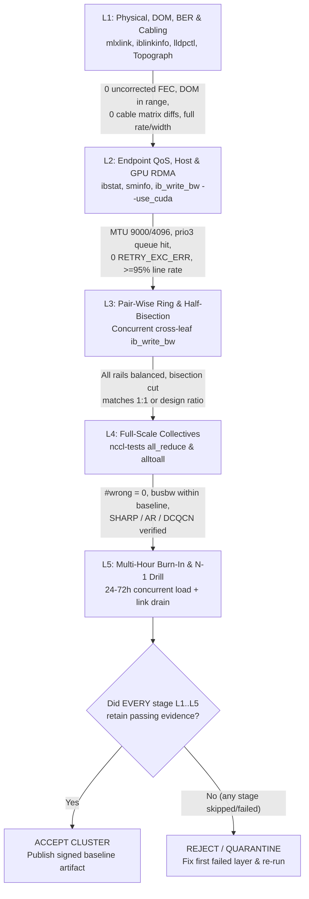
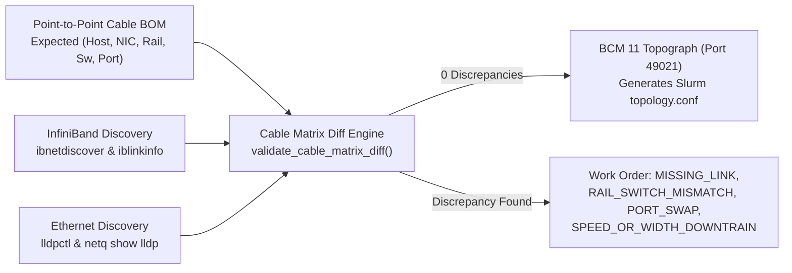

# 12.23 Fabric validation and capacity planning

| | |
|---|---|
| Level | Advanced |
| Priority tier | 2 |
| Lab venue | Nebius GPU |
| Part | Part 12: Complete AI networking |
| Sources | `nvidia-devops` (Volume 09 Ch. 10 & Labs 01–04; Volume 08 Ch. 11, Ch. 12, Index & Labs 01–04); `superpod-b200-dc`; `superpod-gb300-ra`; `bcm11-admin` (§7.5); `ai-data-center-network-design-and-technologies` (Ch. 3, Ch. 4) |
| Coverage file | `planning/coverage/chapters/12-23.md` |
| Claim ledger | `planning/ledgers/12-23.md` |

## Why this matters for AI infrastructure

The first deployment mistake in AI infrastructure is accepting a new GPU cluster because every switch port is `LinkUp` or `Active` and `ping` replies across the subnet. The second is planning fabric capacity from average link utilization or summing port speeds on a datasheet without identifying the specific bottleneck cut separating active senders from their destinations. On a `128`-node (`1,024`-GPU) InfiniBand cluster, initial commissioning passed: every host was reachable, every port reported `State: Active`, and isolated point-to-point RDMA tests succeeded. Yet once distributed training began, step time varied by more than `20%` (`20.0%`) due to three compounding defects: one group of links negotiated at `2x` lane width instead of `4x` after a cable replacement, adaptive routing was not balancing flows across spines under collective traffic, and several GPU ranks were paired with remote Host Channel Adapters (`HCAs`) across NUMA boundaries (`SYS` instead of `PIX`).

An identical trap occurs on RoCEv2 Ethernet fabrics. A newly commissioned `16`-node GPU rack passes optical power checks, ICMP `ping`, and a two-node `ib_write_bw` test at `392.11 Gb/s` on a `400 Gb/s` link, recording `0` tail drops (`show what-just-happened drop-reason all`) while tested in isolation. One week after joining shared production, `16`-rank `AllReduce` and `AllToAll` jobs stall: `ethtool -S swp9` reveals `rx_ecn_marked_prio3: 288400` and `rx_pfc_prio3: 61200`, while Spectrum What Just Happened (`WJH`) logs `38,210` tail drops (`10.20.6.40 -> 10.20.9.12`). Because each of the `16` nodes injects `2 x 400 Gb/s = 800 Gb/s` (`12,800 Gb/s` total rack downlink demand) into a leaf with only `8 x 400 Gb/s = 3,200 Gb/s` of spine uplinks (`4:1` normal oversubscription, degrading to `7 x 400 Gb/s = 2,800 Gb/s` or `4.57:1` when one uplink is drained for `N-1` maintenance), an isolated single-pair test never stressed the shared cut. Production acceptance requires an evidence-gated validation ladder (`L1` through `L5`) paired with a deterministic Bill of Materials (`BOM`) and bottleneck-cut capacity model.

## Prerequisites and outcomes

**Prerequisites:**
- Chapter 12.4 (`PFC, ECN and DCQCN in depth`), Chapter 12.7 (`InfiniBand Subnet Manager, routing, topologies and rails`), and Chapter 12.10 (`HDR, NDR, XDR, optics and cabling`).
- Chapter 12.13 (`Fabric design: topology, oversubscription and scale`) and Chapter 12.17 (`nccl-tests and fabric benchmarking`).

**Expected learning outcomes:**
1. Execute a five-stage acceptance gating pipeline (`L1` physical/DOM/BER/FEC/lanes $\rightarrow$ `L2` point-to-point RDMA & GPUDirect $\rightarrow$ `L3` pair-wise ring & half-bisection $\rightarrow$ `L4` full-scale `nccl-tests` $\rightarrow$ `L5` multi-hour burn-in and `N-1` drills) where a passing higher stage never excuses a failed lower stage.
2. Reconcile cabling against the Point-to-Point `BOM` using `ibnetdiscover`, `iblinkinfo`, `lldpctl`, `netq`, and NVIDIA Base Command Manager (`BCM 11`) `Topograph` (HTTPS port `49021`, `26` Prometheus measurables).
3. Calculate switch, transceiver, and cable BOMs—with `5%` (`3%–5%`) spares and `90%` cable-reach derating—for `2`-tier and `3`-tier Clos fabrics, `DGX B200` SuperPODs (`1–4` SUs, `248–1,016` GPUs), and `DGX GB300` SuperPODs (`2–16` SUs, `1,152–9,216` GPUs on `144 x 800G` `Q3400-RD` IB and `64 x 800G` `SN5600D` Ethernet switches).
4. Model bottleneck cuts under normal and `N-1` states (`1:1`, `2:1`, `4:1`, `4.57:1`), quantify `AllReduce` (`40 -> 80 -> 160 ms`) and shared training/inference `p99` latency (`1.8 -> 14.2 -> 3.1 ms`), and apply the seven-input decision framework across ten enterprise scenarios.

---

## 1. The multi-stage cluster acceptance gating ladder (`L1` through `L5`)

In traditional networking, `ping 192.168.1.10` or a green LED is treated as readiness proof. In an AI fabric, **`ping` is a liar**: it tests only whether the CPU can send a tiny ICMP packet over the default kernel route. It proves nothing about RDMA Verbs queue pairs (`QPs`), RoCEv2 UDP port `4791` encapsulation, DSCP `26` to Priority `3` lossless queues, GPUDirect RDMA BAR1 DMA (`PIX` locality), or `1,024`-GPU collective synchronization across spine cuts.

Commissioning is structured as a bottom-up **acceptance gating ladder**. Crucially, **a passing later stage cannot retroactively validate a skipped or failed earlier stage**: if `all_reduce_perf` (`L4`) passes while a transceiver has rising uncorrected FEC blocks (`L1`) or unverified QoS counters (`L2`), the cluster is **rejected** until every lower gate has retained raw evidence.



| Acceptance Gate | Layer & Scope | Primary Tools | Quantitative Pass Criteria | Failure Signature & Action |
|---|---|---|---|---|
| **Stage L1: Physical, Optics (`DOM`), `BER`/`FEC`, Cable Matrix** | Layer 1 optics, SerDes lanes, MPO/AOC/DAC cables, wiring topology | `mlxlink -d mlx5_0 -m -c -e`, `ibdiagnet`, `ibnetdiscover`, `iblinkinfo`, `ethtool -m/-S`, `lldpctl`, `Topograph` | `LinkUp`, full width (`4x`) & speed (`400G`/`800G`); Rx `>= -6.0 dBm`, Tx `>= -4.0 dBm`, temp `<= 70.0 °C`; pre-FEC `BER <= 1e-5`, post-FEC `<= 1e-15`; `0` `fec_uncorrected_blocks` & `SymbolErrorCounter` delta; `0` BOM diffs | `Rx < -8 dBm`, `2x` width downtrain, or rail port swap $\rightarrow$ replace optic/cable or re-patch before `L2` |
| **Stage L2: Subnet/IP, QoS Queue Mapping, Point-to-Point RDMA** | Layer 2/3 (`LID`/`GID`, `MTU`), `OpenSM`/`BGP`, `PFC`/`ECN` queues, single-pair `perftest` | `ibstat`, `sminfo`, `ibv_devinfo -v`, `show_gids`, `ip route get`, `mlnx_qos`, `numactl`, `ib_write_lat`, `ib_write_bw --use_cuda` | `Active`, `1` `SMINFO_MASTER`, `MTU` `4096`/`9000`, `PIX` locality; `ib_write_bw` `>= 380–392 Gb/s` on `400G` (`>= 95%`), latency `<= 2.0–2.5 µs`, `0` `RETRY_EXC_ERR`, `prio3` counter hits | `392 Gb/s` on `mlx5_0` (`2.1 s`) drops to `156 Gb/s` on `mlx5_1` (`8.2 s`) with `24` `RETRY_EXC_ERR` $\rightarrow$ fix `GID`/NIC/`NUMA` or `ACS` |
| **Stage L3: Pair-Wise Ring and Half-Bisection** | Multi-pair concurrent RDMA across every rail, leaf, and spine bisection cut | Clustered `ib_write_bw` ring ($i \to i+1 \pmod N$) and half-bisection ($N/2 \leftrightarrow N/2$) | Ring: all pairs/rails (`mlx5_0..mlx5_7`) `>= 385–392 Gb/s`; Half-bisection: `>= 370–390 Gb/s` on `1:1` (or $1/k$ on $k:1$) with `< 5%` spine port skew | `397.62 Gb/s` same-leaf drops to `201.18 Gb/s` cross-rack or `20:1` `PortXmitData` skew $\rightarrow$ fix uplinks or routing |
| **Stage L4: Full-Scale Collectives (`nccl-tests`)** | Multi-node synchronous `AllReduce`, `ReduceScatter`, `AllGather`, `AllToAll` | `mpirun` / `srun` `all_reduce_perf`, `alltoall_perf`, `reduce_scatter_perf`, `all_gather_perf` (`-b 8M -e 8G -f 2 -g 1 -c 1 -n 100`) | `#wrong = 0`; `1 GiB+` `all_reduce_perf` `busbw >= 340–361+ GB/s` (`85%–90%+` of `8 x 50 = 400 GB/s`); `alltoall_perf` clean without `PFC` storms or `WJH` drops | `2`-node passes but `64–128`-node stalls or logs `rx_pfc_prio3: 61,200` $\rightarrow$ check `AR`/`DCQCN`/`SHARP` and rails |
| **Stage L5: Multi-Hour Burn-In & `N-1` Drills** | `24–72` h stress (`HPL`/`NeMo` + storage I/O) and planned `N-1` link/spine drain | Canary harness, `UFM`/`NetQ`, `WJH`, `perfquery`/`ethtool -S` series, `fio`/`gdsio` checkpoints | `0` link flaps, `0` `WJH` drops, `0` `Xid`/`SXid`/`CQE` timeouts over `12–72 h`; `p99` step within `<= 5%`; `N-1` drain matches `4.00:1 -> 4.57:1` model | Idle had `0` drops, but shared burn-in logs `38,210` tail drops or `> 20%` step variance $\rightarrow$ adjust admission, QoS, or cut capacity |

### Stage L1: Physical layer, DOM optical budgets, FEC/BER, and inventory truth

Stage `L1` proves every physical link exists, matches the cable matrix, and has clean signal integrity:
- **InfiniBand HCA inventory (`ibv_devices`, `ibv_devinfo -v -d mlx5_0`, `ibstat`):** On a ConnectX-7 (`MT4129`, `vendor_id: 0x02c9`, `vendor_part_id: 4129`, `fw_ver: 28.39.2048`), verify `transport: InfiniBand (0)`, `node_guid: 08c0:eb03:00f1:a2c3`, `Port GUID: 0x08c0eb0300f1a2c3`, `Capability mask: 0x2651e848`, `max_qp: 262144`, `max_qp_wr: 32768`, and `max_sge: 30`. Confirm `ibstat` reports `Physical state: LinkUp`, `State: Active`, `Rate: 400` (`400 Gb/s` NDR), `Base lid: 12`, `LMC: 0`, and `SM lid: 1`. Because `Base lid` is mutable across OpenSM sweeps, durable inventory keys on the immutable `Port GUID` (`0x08c0eb0300f1a2c3`).
- **RoCEv2 Ethernet inventory (`ip -br link`, `rdma link show`, `ethtool ens1f0`, `nvidia-smi topo -m`):** Verify `link mlx5_0/1 state ACTIVE physical_state LINK_UP netdev ens1f0`, `mtu 9000`, `Speed: 400000Mb/s`, `Duplex: Full`, and `Link detected: yes`. In `nvidia-smi topo -m`, confirm `GPU0-NIC0` (`NUMA 0`, `CPU 0-31`) and `GPU1-NIC1` (`NUMA 1`, `CPU 32-63`) are `PIX`, cross-socket pairs (`GPU0-NIC1`) are `SYS`, and intra-node GPUs are `NV18`.
- **Optical `DOM` and `FEC` baselines:** Using `mlxlink -d mlx5_0 -m -c -e` or `ethtool -S ens1f0`, record the baseline (`rx_packets: 1024567`, `rx_bytes: 892481382400`, `tx_bytes: 481029120384`, `rx_errors: 0`, `rx_crc_errors: 0`, `fec_corrected_blocks: 412`, `fec_uncorrected_blocks: 0`). At `400G`/`800G` PAM4 with `RS-FEC (544, 514)`, a non-zero `fec_corrected_blocks` baseline (`412`) is normal, but pre-FEC `BER` must stay `<= 1e-5`, post-FEC `BER <= 1e-15` (`0` `fec_uncorrected_blocks` delta), optical `Rx >= -6.0 dBm` (`Tx >= -4.0 dBm`, `< 2.0 dB` lane skew), and module temperature `<= 70.0 °C`.

### Stage L2: Subnet/IP routing, QoS queue verification, and point-to-point RDMA

Stage `L2` verifies control-plane addressing, lossless QoS queues, and single-pair RDMA across DRAM and GPU HBM:
1. **Control plane and path MTU:** On InfiniBand, `sminfo` must show one `SMINFO_MASTER` with a climbing activity count, and `smpquery pkeys` must match partition policy. On RoCEv2, `ip route get 10.20.8.5` must resolve to the intended rail (`10.20.8.5 via 10.20.0.1 dev ens1f0 src 10.20.4.15 cache users 1 mtu 9000`).
2. **Host-memory RDMA smoke test:** Pin the benchmark to the NIC's local NUMA node (`numactl --cpunodebind=0 --membind=0`) and run `ib_write_lat -d mlx5_0 -i 1 -a` (`~1.5–2.0 µs`) and unidirectional/bidirectional `ib_write_bw -d mlx5_0 -i 1 --report_gbits` (`392.0` to `397.62 Gb/s` on `400G`).
3. **GPUDirect RDMA (`--use_cuda`) and process-scoped fault isolation:** Repeat `ib_write_bw` with `--use_cuda=0`. Running `ib_write_bw -d mlx5_0 -i 1 <peer-ip>` on the primary rail completes in `2.1 s` at `392 Gb/s` with `0` retries. Selecting the misaligned device (`ib_write_bw -d mlx5_1 -i 1 <peer-ip>`, exiting `ens1f1` `src 10.20.4.24`, `GID[3] fe80::0c42:a1ff:fec8:d79d/64` vs `...d79b/64`) drops throughput `2.51x` to `156 Gb/s`, stretches duration `3.90x` to `8.2 s`, logs `24` `IBV_WC_RETRY_EXC_ERR` completions, and records `rx_ecn_marked_prio3: 142`. Clean Layer 1/2 state isolates the fault to Layer 3 endpoint/GID selection without touching switch PFC/ECN.
4. **Controlled QoS feedback verification:** Verify RoCEv2 packets enter lossless Priority `3` (`DSCP 26`). At idle (`14:35:22Z`), `ethtool -S ens1f0` shows `rx_ecn_marked_prio3: 0`, `rx_pfc_prio3: 0`, `tx_pfc_prio3: 0`, `rx_prio3_packets: 102314`, and `tx_prio3_packets: 89621`. After `60 s` (`14:36:30Z`) of two-sender contention, `rx_prio3_packets` reaches `51,234,892` (delta `51,132,578`), `tx_prio3_packets` reaches `48,901,234` (delta `48,811,613`), `rx_ecn_marked_prio3` rises by `47,829`, `rx_pfc_prio3` by `412`, and `tx_pfc_prio3` by `14`, while Sender A (`89.2 Gb/s`) and Sender B (`87.1 Gb/s`, combined `176.3 Gb/s`) throttle cleanly via DCQCN with `0` drops.

### Stages L3, L4, and L5: From pairwise rings and bisection cuts to full-scale burn-in

A single-pair `ib_write_bw` test (`L2`, `392.11 Gb/s`) exercises one link and cannot detect spine oversubscription or routing skew:
- **Stage L3 (Pair-wise Ring & Half-Bisection):** Run an $N$-node ring sweep ($i \to i + 1 \pmod N$) per rail $r \in \{0..7\}$, then split the cluster into two halves ($N/2 \leftrightarrow N/2$) for simultaneous cross-spine `ib_write_bw`. On a `1:1` fabric, pairs sustain `~385–392 Gb/s`; on a `2:1` leaf, same-leaf pairs measure `397.62 Gb/s` (`2,097,152 B` = `2 MiB`) while cross-rack pairs drop to `201.18 Gb/s`. Check switch `PortXmitData` across uplinks: static routing polarization can concentrate `21,474,836,480` and `21,489,234,432` 4-octet words (`~21.48 GB`) on ports `5–6` vs `1,073,741,824` and `1,081,654,272` words (`~1.08 GB`) on ports `7–8`—a `19.9:1` (`~20:1`) imbalance.
- **Stage L4 (Full-Scale `nccl-tests` Collectives):** Run `all_reduce_perf`, `reduce_scatter_perf`, `all_gather_perf`, and `alltoall_perf` (`-b 8M -e 8G -f 2 -g 1 -c 1 -n 100`) across all nodes and rails, requiring `#wrong = 0` and `all_reduce_perf` `busbw >= 340–361.36 GB/s` on `8 x 400G` NDR.
- **Stage L5 (Multi-Hour Concurrent Burn-In & `N-1` Drills):** Run `24–72 h` combined training (`HPL`/`NeMo`) + storage (`fio`/`gdsio`) load and drain `1` uplink/spine (`N-1`) to verify degraded cut behavior (`4.00:1 -> 4.57:1`).

---

## 2. Automated cable matrix validation (`ibnetdiscover`, `lldpctl`, `NetQ`, and `BCM 11 Topograph`)

On a `1,024`-GPU (`128`-node) cluster with `2,048` active point-to-point cables (`4,096` optical transceivers), technicians can cross-patch a cable between rails (`GPU0/mlx5_0` into `Leaf-Rail1` instead of `Leaf-Rail0`), swap ports on the same leaf (`Port 1` and `Port 2` reversed), or leave a connector unlatched so it trains at `2x` width (`200G`) instead of `4x` (`400G`). In a Rail-Optimized Design (`ROD`), plugging a Rail `0` NIC into a Rail `1` leaf forces intra-rail traffic (`1` hop) across the spine (`2` hops) or blackholes it.



| Discovery / Validation Tool | Fabric Type | Primary CLI / API Interface | What It Verifies Against the Point-to-Point Cable BOM |
|---|---|---|---|
| `ibnetdiscover` & `iblinkinfo` | InfiniBand (`HDR`/`NDR`/`XDR`) | `ibnetdiscover -p`, `iblinkinfo -l` | Extracts `(CA GUID, Port) <-> (Switch GUID, Port, Rate, Width)` (`4x 400 Gbps Active/LinkUp`) |
| `ibdiagnet` | InfiniBand (`HDR`/`NDR`/`XDR`) | `ibdiagnet -r --pm_pause_time 30` | Audits duplicate GUIDs/LIDs, credit loops, LFT balance, BER/FEC, and cable EEPROMs |
| `lldpctl` / `show lldp` / `cmsh showport` | RoCEv2 & OOB Ethernet | `lldpctl -f json`, `cmsh -c "device; finddevicebyswitchport switch01:1"` | Maps host MAC and interface to peer switch port (`switch01:1`, or breakout `switch01:1s1`) |
| **NVIDIA NetQ** & **NVIDIA Air** | Spectrum-X / Cumulus Ethernet | `netq check clag`, `netq check bgp`, `netq check mtu`, `netq check lldp` | Fleet-wide validation of BGP/ECMP, MTU, QoS drift, and digital-twin simulation (`Air`) |
| **BCM 11 Topograph** | Slurm IB, Ethernet & Cloud (`AWS`/`OCI`/`GCP`) | `https://localhost:49021/metrics` (`cmsh -> wlm[slurm] -> topologysettings`) | Synthesizes live topology into `/cm/shared/apps/slurm/etc/<cluster>/topology.conf` (`topology/tree` or `topology/block`) |

### Reconciling discovered links against the Point-to-Point BOM

Physical commissioning diffs the Point-to-Point (`P2P`) BOM against live discovery output and classifies discrepancies into four categories:
1. **`MISSING_LINK`:** Expected `(src_host, src_port)` is absent (`NO-CARRIER` or `Down`). Inspect dust caps, MPO polarity, latch, or optic.
2. **`RAIL_SWITCH_MISMATCH`:** `dgx-01:mlx5_0` (Rail `0`) is on `leaf-r1-01:Port1` (Rail `1` switch) instead of `leaf-r0-01:Port1`. Re-patch to the right rail leaf.
3. **`PORT_SWAP`:** `dgx-01:mlx5_1` is on `leaf-r1-01:Port9` instead of `Port1`. Re-patch so static LFTs, UFM/NetQ port labels, and runbooks match `Host k -> Port k`.
4. **`SPEED_OR_WIDTH_DOWNTRAIN`:** `dgx-02:mlx5_0` is on `leaf-r0-01:Port2`, but `iblinkinfo` / `ethtool` reports `200G x2` instead of `400G x4`.

### NVIDIA Base Command Manager (`BCM 11`) switch discovery and `Topograph` integration

In BCM-managed clusters, `cmsh` provides switch-port discovery and automated Slurm topology generation:
- **MAC-to-switch-port mapping (`showport`, `finddevicebyswitchport`, `switchoverview`):** In `cmsh` `device` mode, `showport <mac>` maps a host MAC to its switch port (`00:26:6C:F2:AD:54 node001: switch01:1`, `00:30:49.00:73:92 basecm11: switch01:12`), while `finddevicebyswitchport switch01:1 switch01:2` (supporting breakout `<switch>:<port>s<breakout>`) returns `switch01:1 node001` and `switch01:2 node002`. `setmacviaswitchport --dry-run -t switch` previews discovered MACs, and `checkfactorydefaultpassword --update switch01..switch04` rotates factory switch passwords.
- **Automated Slurm `topology.conf` via `Topograph`:** BCM 11 runs `topograph` (3.x) or `topograph4` (`BCM 11.34+`, upgraded via `apt remove topograph && apt install topograph4` and `set -e version4 true`) on the head node(s). Under `cmsh -> wlm[slurm] -> topologysettings -> topographsettings`, `Topograph` listens on HTTPS port `49021` (`HttpSSL: true`, `Config path: /etc/topograph/topograph-config.yaml`, `Fetch timeout: 20` s, `Fetch attempts: 12`, `Fetch wait time: 15` s, `RequestAggregationDelay: 15s`, `PageSize: 100`) and exposes `26` Prometheus measurables at `https://localhost:49021/metrics`.
- **Tree and Block topology generation:** With `set topologyplugin tree` and `set topologysource topograph`, `topology update` and `topology print` (blocking `10–15` s) query fabric or cloud APIs (AWS `ec2:DescribeInstanceTopology` on `p5.48xlarge`, OCI `compute-hpc-islands` / `compute-network-blocks` / `compute-local-blocks`, or GCP compact placement) and write `/cm/shared/apps/slurm/etc/<slurmcluster>/topology.conf`:
  ```text
  SwitchName=switch03 Switches=switch03-switch[01,02]
  SwitchName=switch03-switch01 Nodes=node[001-003]
  SwitchName=switch03-switch02 Nodes=node[004-006]
  ```
  For `topology/block` (`blocksettings`), `Block entity` (`NodeGroup` or twin `rack`) and `Block sizes` (`2 4`) emit `BlockName=ng1 Nodes=node[001,002]` and `BlockName=ng2 Nodes=node[003,004]`. Changes to `topology.conf` or `cgroups.conf` trigger `scontrol reconfigure` (whereas `SelectType`, `GresTypes`, `gres.conf`, `oci.conf`, or node changes restart `slurmctld`/`slurmd`). Setting `set drainreasonpolicy APPEND` (or `drain --reason="+..."`) preserves historical healthcheck failure reasons during Stage `L5` burn-in.

---

## 3. Switch, transceiver, and cable BOM sizing (2-tier, 3-tier, and SuperPOD B200/GB300)

Capacity planning converts a target GPU count and oversubscription ratio into an exact Bill of Materials (`BOM`): switches, point-to-point cables, optical transceivers, rack power/cooling budgets, and field spares.

### General 2-tier (3-stage) and 3-tier (5-stage) Clos BOM equations

For $G$ total GPUs at $g$ GPUs/node ($N = G / g$ nodes, $g$ NICs/node) using switches of radix $R$ ($R = 64$ on `400G` `QM9700`/`SN5600` or $R = 144$ on `800G` `Q3400-RD`):

1. **2-Tier (3-Stage) Folded Clos (`Leaf` + `Spine`, up to $G_{\max} = R^2 / 2$):**
   At leaf oversubscription $k_{\text{leaf}} : 1$, each leaf allocates $d_{\text{leaf}} = \text{round}\!\left(\frac{R \cdot k_{\text{leaf}}}{k_{\text{leaf}} + 1}\right)$ downlinks and $u_{\text{leaf}} = R - d_{\text{leaf}}$ uplinks (`1:1` sets $d_{\text{leaf}} = u_{\text{leaf}} = R/2$):
   $$N_{\text{leaf}} = \left\lceil \frac{G}{d_{\text{leaf}}} \right\rceil, \qquad C_{\text{host}\to\text{leaf}} = G, \qquad C_{\text{leaf}\to\text{spine}} = N_{\text{leaf}} \cdot u_{\text{leaf}}, \qquad N_{\text{spine}} = \left\lceil \frac{C_{\text{leaf}\to\text{spine}}}{R} \right\rceil$$
   At `1:1` on $R = 64$ ($d_{\text{leaf}} = u_{\text{leaf}} = 32$), $C_{\text{total}} = 2G$ cables and $T_{\text{optics}} = 4G$ discrete transceivers (`0` standalone optics for bonded `AOC` or `DAC`).

2. **3-Tier (5-Stage) Folded Clos (`Leaf` + `Spine` + `Super-Spine`, beyond $R^2 / 2$):**
   For $G > R^2 / 2$ (`> 2,048` GPUs on $R = 64$), `1,024`-GPU pods (`32` leaves + `32` spines) connect via Super-Spines. With $d_{\text{spine}} = R/2$ and $u_{\text{spine}} = \text{round}(d_{\text{spine}} / k_{\text{spine}})$:
   $$N_{\text{spine}} = \left\lceil \frac{C_{\text{leaf}\to\text{spine}}}{R/2} \right\rceil, \qquad C_{\text{spine}\to\text{ss}} = N_{\text{spine}} \cdot u_{\text{spine}}, \qquad N_{\text{ss}} = \left\lceil \frac{C_{\text{spine}\to\text{ss}}}{R} \right\rceil$$
   At `1:1` ($k_{\text{leaf}} = k_{\text{spine}} = 1$), $C_{\text{total}} = 3G$ cables and $T_{\text{optics}} = 6G$ optics. A `2:1` spine-to-super-spine ratio ($k_{\text{spine}} = 2.0$) halves `Super-Spine` switches and `Spine-to-Super-Spine` cables ($C_{\text{total}} = 2.5G$, $T_{\text{optics}} = 5G$).

3. **Field Spares (`5%`) and Physical Cable Rules:**
   A `5%` (`s = 0.05`) spare factor orders $\lceil X \cdot 1.05 \rceil$ switches, cables, and optics, with spare cables pre-pulled in overhead trays. Each `DGX B200` has `6` PSUs (`5` of `6` required); InfiniBand Passive `DAC` reaches `5 m` (`100G`) and `3 m` (`400G`), `AOC` reaches `30 m`, and **all cable runs must stay under `90%` of maximum media distance** (`<= 27.0 m` for a `30 m` AOC) with copper and fiber runs separated and color-coded.

| Cluster Design ($R = 64$ ports, $g = 8$ GPUs/node, `5%` Spares) | Active Leaves | Active Spines | Active Super-Spines | Total Switches (Active / w/ `5%` Spares) | Host-Leaf + ISL Cables (Active / w/ `5%` Spares) | Standalone Optics (`2`/cable: Active / w/ `5%` Spares) |
|---|---|---|---|---|---|---|
| **2-Tier `1:1` (`1,024` GPUs, `128` nodes)** | `32` | `16` | `0` | `48` / **`51`** | `1,024 + 1,024 = 2,048` / **`2,151`** | `4,096` / **`4,301`** (`0` if bonded `AOC`) |
| **2-Tier `1:1` (`2,048` GPUs, `256` nodes, max 2-tier)** | `64` | `32` | `0` | `96` / **`101`** | `2,048 + 2,048 = 4,096` / **`4,301`** | `8,192` / **`8,602`** |
| **3-Tier `1:1` (`4,096` GPUs, `512` nodes)** | `128` | `128` | `64` | `320` / **`336`** | `4,096 + 4,096 + 4,096 = 12,288` / **`12,903`** | `24,576` / **`25,805`** |
| **3-Tier `2:1` Super-Spine (`4,096` GPUs, `512` nodes)** | `128` | `128` | `32` | `288` / **`303`** | `4,096 + 4,096 + 2,048 = 10,240` / **`10,752`** | `20,480` / **`21,504`** |
| **3-Tier `1:1` (`8,192` GPUs, `1,024` nodes)** | `256` | `256` | `128` | `640` / **`672`** | `8,192 + 8,192 + 8,192 = 24,576` / **`25,805`** | `49,152` / **`51,610`** |

### Reference BOMs: NVIDIA `DGX B200` and `DGX GB300` SuperPODs

1. **`DGX B200` SuperPOD Cabling BOM:**
   Each SU has `31` `DGX B200` nodes (`248` GPUs) plus `4` UFM links (`8N + 4` Compute+UFM cables) across `8` leaves per SU:
   - **`1` SU (`31` nodes, `248` GPUs):** `8` leaves, `4` spines, `252` Compute+UFM cables, `256` ISL cables (`508` total).
   - **`2` SUs (`63` nodes, `504` GPUs):** `16` leaves, `8` spines, `508` Compute+UFM cables, `512` ISL cables (`1,020` total).
   - **`3` SUs (`95` nodes, `760` GPUs):** `24` leaves, `16` spines, `764` Compute+UFM cables, `768` ISL cables (`1,532` total).
   - **`4` SUs (`127` nodes, `1,016` GPUs):** `32` leaves, `16` spines, `1,020` Compute+UFM cables, `1,024` ISL cables (`2,044` total).

2. **`DGX GB300` SuperPOD Multi-Fabric BOM:**
   Each `DGX GB300 NVL72` rack houses `72` `B300` GPUs across `18` compute trays (`2` `GB300` Superchips = `4` `B300` GPUs + `2` Grace CPUs/tray at `900 GB/s` `NVLink-C2C`, `4 x 3.84 TB` E1.S RAID0 NVMe + `1 x 1.92 TB` M.2 OS NVMe), `9` `NVLink` switch trays (`2` chips/tray = `18` chips, `18 x 100 GB/s = 1.8 TB/s` NVLink 5/GPU, managed by `NMX-M`), and `8` power shelves (`6 x 5.5 kW = 33 kW`/shelf). Eight racks form **`1` SU (`576` GPUs, `1.2 MW` TDP, Tier 3 / TIA942-B Rated 3 / EN50600 Class 3)**. Each tray has `4 x ConnectX-8` (`800 Gbps` `Quantum-X800` IB) NICs and `1 x BlueField-3` (`BF3240` `2 x 400 Gbps`: one `400 Gbps` RoCEv2 storage port + one `>= 200 Gbps` In-Band management port). Using **`144`-port `800 Gbps` `Q3400-RD`** switches (`8` IB leaves/SU across `4` rails), the IB fabric scales to **`16` SUs (`128` racks, `9,216` GPUs) in 2 tiers**. The Storage/In-Band Ethernet fabric uses `64`-port `800 Gbps` `SN5600D` switches (`4` compute leaves/SU with `24 x 400 Gbps` uplinks at a **`1:3` blocking ratio**, non-blocking `72 x 400 Gbps` storage leaves, and `24 x 400 Gbps` management leaves) plus `48 x 1 Gbps` `SN2201` OOB switches (`2+2` mgmt/OOB, `>= 2 x 100GbE DR1` eBGP edge uplinks, and `>= 100GbE DR1` NFS user storage):

| Scale (`# SUs`) | Total `# GPUs` (`Racks`) | IB Leaves (`Q3400-RD`: Per SU / Total) | IB Spines (`Q3400-RD` Total) | Ethernet Spines (`SN5600D`) | Ethernet Compute Leaves (`1:3`) | Ethernet Storage Leaves (`1:1`) | Max Storage BW (`400GbE` Links) | Mgmt Leaves + OOB Spines |
|---|---|---|---|---|---|---|---|---|
| **`2` SUs** | **`1,152`** (`16` racks) | `8` / **`16`** | **`8`** | **`4`** | **`8`** | **`2`** | **`64 x 400GbE`** | **`2 + 2`** |
| **`4` SUs** | **`2,304`** (`32` racks) | `8` / **`32`** | **`18`** | **`8`** | **`16`** | **`2`** | **`128 x 400GbE`** | **`2 + 2`** |
| **`8` SUs** | **`4,608`** (`64` racks) | `8` / **`64`** | **`36`** | **`12`** | **`32`** | **`4`** | **`256 x 400GbE`** | **`2 + 2`** |
| **`16` SUs** | **`9,216`** (`128` racks) | `8` / **`128`** | **`72`** | **`24`** | **`64`** | **`8`** | **`1,024 x 400GbE`** | **`2 + 2`** |

Storage acceptance targets span **Standard** (single-modality datasets fitting in local cache) and **Enhanced** (multi-modal, multi-billion-parameter datasets exceeding cache):
- **Single SU (`576` GPUs):** `90 GB/s` Read / `45 GB/s` Write (**Standard**) vs **`280 GB/s` Read / `140 GB/s` Write** (**Enhanced**).
- **`4` SUs (`2,304` GPUs):** `360 GB/s` Read / `180 GB/s` Write (**Standard**) vs **`1,120 GB/s` Read / `560 GB/s` Write** (**Enhanced**).

---

## 4. Capacity modeling at the bottleneck cut and `N-1` failure analysis

A capacity model identifies the **bottleneck traffic cut**—the links separating active sources from destinations—and computes the ratio of offered demand crossing that cut to usable capacity in both the **normal state** and the **`N-1` degraded state**.

### Worked cut-capacity and collective step-time calculations

1. **RoCEv2 Rack Leaf-to-Spine Cut:**
   A rack of $N_{\text{rack}} = 16$ GPU nodes with `2 x 400 Gb/s` RoCEv2 rails (`800 Gb/s`/node) connects to a leaf with `8 x 400 Gb/s` spine uplinks:
   $$\text{Downlink Demand} = 16 \times 800\text{ Gb/s} = 12,800\text{ Gb/s}$$
   $$\text{Normal Capacity (} 8 \text{ links)} = 8 \times 400\text{ Gb/s} = 3,200\text{ Gb/s} \implies \text{Oversubscription}_{\text{normal}} = \frac{12,800}{3,200} = \mathbf{4.00:1}$$
   $$\text{N-1 Capacity (} 7 \text{ links)} = 7 \times 400\text{ Gb/s} = 2,800\text{ Gb/s} \implies \text{Oversubscription}_{\text{N-1}} = \frac{12,800}{2,800} \approx \mathbf{4.57:1}$$
   With `50%` intra-rack locality ($f_{\text{cross}} = 0.50$), cross-cut demand is $6,400\text{ Gb/s}$, improving oversubscription to **`2.00:1` normal** (`400 Gb/s`/node) and **`2.29:1` under `N-1`**.

2. **InfiniBand `256`-GPU Leaf Radix and `2 GB` `AllReduce` Step Time:**
   Across `16` racks of `16` single-rail `400 Gb/s` endpoints (`256` GPU ports, $16 \times 400\text{ Gb/s} = 6,400\text{ Gb/s}$/rack):
   - **True `1:1` Non-Blocking (`32`-port leaf radix):** `16` downlinks (`6,400 Gb/s`) + `16` uplinks (`6,400 Gb/s`). Each node gets `400 Gb/s` (`50.0 GB/s`), transferring `2 GB` (`2,000 MB`) in $t_{1:1} = \frac{2.0\text{ GB}}{50.0\text{ GB/s}} = \mathbf{40.0\text{ ms}}$.
   - **Constrained `24`-Port Leaf (`2:1` Oversubscribed):** `16` downlinks + `8` uplinks ($3,200\text{ Gb/s}$, **`2.00:1`**). Per-node bandwidth halves to `200 Gb/s` (`25.0 GB/s`), doubling `AllReduce` time to $t_{2:1} = \frac{2.0\text{ GB}}{25.0\text{ GB/s}} = \mathbf{80.0\text{ ms}}$.
   - **`N-1` Spine Failure on a 2-Spine `2:1` Fabric (`4:1` Degraded):** Losing `1` of `2` spines leaves `4` uplinks ($1,600\text{ Gb/s}$, **`4.00:1`**, `100 Gb/s` = `12.5 GB/s`/node), quadrupling `AllReduce` time to **`160.0 ms`**. True `N-1` spine resilience requires sizing surviving `N-1` spines to carry `100%` of required bandwidth $X$.

---

## 5. Production architecture decision framework and 10 enterprise design scenarios

Every production fabric design is gated by **seven mandatory evidence inputs**:
1. **Business and Service Objectives:** Contracted SLA, time-to-market, and funded expansion horizon.
2. **Workload Communication Pattern:** Fraction of step time in `AllReduce`, `AllToAll`, or `P2P` stages, plus checkpoint burst frequency.
3. **Scale and Growth:** Current GPU count vs funded expansion increments (`8 -> 32` nodes, `128 -> 512` GPUs, or `1 -> 16` SUs).
4. **Performance Target:** Multi-node scaling efficiency (`>= 80%–90%` busbw parity) and inference tail latency (`p99`).
5. **Reliability and Failure Domains:** Tolerable blast radius for a cable, NIC, leaf, spine (`N-1`), or SM failure.
6. **Operations and Skills:** Dedicated InfiniBand (`OpenSM`/`UFM`) vs Ethernet (`BGP`/`EVPN`/`NetQ`) headcount and maintenance windows.
7. **Cost and Constraints:** Budget delta between `1:1` non-blocking and measured oversubscription, rack power (`kW`/`MW`), and cable tray fill.

If any input is an unverified guess, **stop** and run discovery or a proof-of-concept benchmark before selecting switch radix or cabling.

| Enterprise Design Scenario | Customer Constraint & Goal | Primary Architectural Risk | Recommended Design & Validation Control |
|---|---|---|---|
| **Scenario 1: `8` DGX Systems Growing to `32`** | Private LLM platform (`8` nodes / `64` GPUs $\to$ `32` nodes / `256` GPUs) | Flat starter network requires full recabling at `32` nodes | Build Phase 1 as a rail-aligned pod with spine ports pre-allocated for `32` nodes, dual SMs, OOB, and telemetry |
| **Scenario 2: `256`-GPU Training Cluster (`16` Racks)** | Synchronous `AllReduce`/`AllToAll` (`16 x 400G`/rack = `6,400G`) | `24`-port leaf forces `16:8` (`2:1`, `3,200G` up), doubling `2 GB` `AllReduce` (`40 -> 80 ms`) | Use `32`-port minimum leaf radix (`16` down + `16` up) for `1:1` (`64`-port `QM9700`/`SN5600`) and validate `L1`–`L5` |
| **Scenario 3: Shared Training and Inference Fabric** | Training bursts and inference share one physical fabric | Shared default `SL`/`VL` spikes inference `p99` **`7.89x`** (`1.8 -> 14.2 ms`) | Combine rail/scheduler separation and `SL`/`VL` isolation (recovers `p99` to **`3.1 ms`**; `1.3 ms` gap from shared wire) |
| **Scenario 4: Converged Compute & Storage IB** | One fabric carries GPU collectives and `GDS` checkpoints | `100 GB+` checkpoints collide with `AllReduce` | Model peak combined demand; enforce distinct `SL`/`VL` classes or dedicated `BlueField-3` storage ports (`GB300`) |
| **Scenario 5: Multi-Tenant Research Cluster** | Untrusted teams, mixed jobs, chargeback | `P_Key` (`0x8021` vs `0x8035`) isolates membership, **not bandwidth** | Layer `P_Key`s + topology-aware scheduling + host isolation + per-tenant `SL` QoS + negative-path denial tests |
| **Scenario 6: Expansion from `128` to `512` GPUs** | `4x` growth (`16 -> 64` nodes) without replacing switches | Initial build exhausted spine ports, rack power, or SM budget | Reserve spine ports, cable trays, management IPs, and `HDR`/`NDR`/`XDR` firmware compatibility upfront |
| **Scenario 7: Strict `N-1` Availability SLA** | Workloads continue at SLA after `1` link/switch/SM failure | Losing `1` spine cuts bandwidth `50%` (`2:1 -> 4:1`) | Size `N-1` spines for `100%` of workload bandwidth $X$; place standby SM in separate power/rack domain and test failover |
| **Scenario 8: Cloud or Hosted GPU Environment** | Customer rents `DGX Cloud` / CSP instances (`p5.48xlarge`, OCI, GCP) | No bare-metal switch access (`OpenSM`, switch `ethtool`) | Anchor on SLAs, cloud topology APIs (`ec2:DescribeInstanceTopology` via `Topograph`), placement groups, and `L2`–`L4` tests |
| **Scenario 9: Security-Sensitive Enterprise** | Audited firmware, least privilege, evidence retention | Disabling `IOMMU` (`iommu=pt`) blindly for benchmarks | Enforce signed firmware (`nvfw_..._prod-signed.fwpkg`), segmented OOB (`SN2201`), versioned `P_Key`/ACL policy, and audit logs |
| **Scenario 10: Budget-Constrained AI Factory** | Cannot fund `1:1` bisection across all nodes | Undocumented oversubscription causes tail jitter | Use explicit oversubscription (`2:1` or `4:1`), confine jobs to `1:1` blocks via `topology/tree`, and schedule large jobs in windows |

### Production release management and canary promotion gates

An acceptance baseline is a versioned release artifact. When introducing a new node batch, NIC firmware (`28.39.2048`), switch NOS (`Cumulus Linux`/`NVOS`), DPU image (`dpu-image-24.10-prod-3`), or QoS revision, run the **five-step canary workflow**: (1) diff inventory/cabling/config against design, (2) run `L1`–`L4`, (3) run `L5` concurrent jobs + one `N-1` link/uplink drain, (4) compare `p50`/`p99` step times, `ECN`/`PFC`, queues, and errors against baseline, and (5) promote after owner sign-off with staged rollback.

---

## Commands and configurations that matter

Hardware-facing CLI commands below are marked `(untested here)` because this workspace has no physical switches or HCAs attached; the Python lab (`code/part12/fabric_validation_capacity_lab.py`) is executed and verified locally.

### 1. Stage `L1` & `L2` InfiniBand inventory, routing, and counter baseline (untested here)

```bash
# (untested here) V8 Lab 01/03: Create timestamped acceptance evidence bundle
mkdir -p acceptance-ib/{host,fabric,routes,counters,versions,benchmarks}
date --iso-8601=seconds | tee acceptance-ib/timestamp.txt
uname -a | tee acceptance-ib/versions/kernel.txt

# 1. Enumerate local RDMA HCAs, firmware (28.39.2048), GUIDs, and QP limits (262,144)
ibv_devices | tee acceptance-ib/host/ibv-devices.txt
ibv_devinfo -v -d mlx5_0 | tee acceptance-ib/host/ibv-devinfo-mlx5_0.txt
ibstat | tee acceptance-ib/host/ibstat.txt
show_gids 2>/dev/null | tee acceptance-ib/host/gids.txt || true
lspci -nn | grep -i -E 'infiniband|network' | tee acceptance-ib/host/pci-devices.txt
numactl --hardware | tee acceptance-ib/host/numa.txt
nvidia-smi topo -m | tee acceptance-ib/host/gpu-topo.txt

# 2. Verify Subnet Manager master state (SMINFO_MASTER), link speed/width (4x 400G), and routes
sminfo | tee acceptance-ib/fabric/sminfo.txt
iblinkinfo | tee acceptance-ib/fabric/iblinkinfo.txt
ibnetdiscover -p | tee acceptance-ib/fabric/ibnetdiscover-ports.txt
ibroute 1 | tee acceptance-ib/routes/switch-lid1-route.txt

# 3. Capture pre-benchmark error counters (never clear shared counters in production)
ibqueryerrors | tee acceptance-ib/counters/before.txt

# 4. V8 Lab 02: NUMA-pinned host-memory & GPUDirect RDMA latency and bandwidth (Server -> Client)
# On Server (node001, NUMA 0 local to mlx5_0):
numactl --cpunodebind=0 --membind=0 ib_write_lat -d mlx5_0 -i 1 -a
numactl --cpunodebind=0 --membind=0 ib_write_bw -d mlx5_0 -i 1 --report_gbits --duration 30

# On Client (node002 -> node001):
numactl --cpunodebind=0 --membind=0 ib_write_lat -d mlx5_0 -i 1 -a <node001-ip> | tee acceptance-ib/benchmarks/lat-mlx5_0.txt
numactl --cpunodebind=0 --membind=0 ib_write_bw -d mlx5_0 -i 1 --report_gbits --duration 30 <node001-ip> | tee acceptance-ib/benchmarks/bw-host-mlx5_0.txt
numactl --cpunodebind=0 --membind=0 ib_write_bw -d mlx5_0 -i 1 --use_cuda=0 --report_gbits --duration 30 <node001-ip> | tee acceptance-ib/benchmarks/bw-gdr-mlx5_0.txt

# 5. Capture post-benchmark counter deltas and package evidence archive
ibqueryerrors | tee acceptance-ib/counters/after.txt
tar -czf acceptance-ib-evidence.tar.gz acceptance-ib
```

### 2. Stage `L1`–`L4` RoCEv2 Ethernet path inventory, QoS under load, and collectives (untested here)

```bash
# (untested here) V9 Labs 01-04: RoCEv2 endpoint identity, MTU 9000, DOM/FEC, and prio3 ECN/PFC deltas
ip -br link show dev ens1f0
ip -br addr show dev ens1f0
ip route get 10.20.8.5
rdma link show
ethtool ens1f0 | egrep "Speed|Duplex|Link"

# Capture UTC timestamp + pre-load byte, FEC, ECN, and PFC prio3 counters
date -u && ethtool -S ens1f0 | egrep "rx_bytes|tx_bytes|fec_corrected|fec_uncorrected|ecn_marked|pfc_prio|rx_prio3_packets|tx_prio3_packets"

# Switch-side validation on NVIDIA Spectrum / Cumulus Linux (untested here):
# Verify What Just Happened (WJH) tail drops and port prio3 ECN/PFC counters during 16-rank collective
ethtool -S swp9 | egrep "rx_ecn_marked_prio3|rx_pfc_prio3|tx_pfc_prio3"
nv show platform what-just-happened drop-reason all | grep -i tail
netq check mtu
netq check bgp
netq check clag

# Stage L4: Multi-node full-scale AllReduce and AllToAll acceptance gate (16 nodes x 8 GPUs = 128 ranks)
srun --nodes=16 --ntasks-per-node=8 --mpi=pmix \
  -x NCCL_DEBUG=WARN \
  -x NCCL_IB_TC=106 \
  -x NCCL_IB_GID_INDEX=3 \
  ./build/all_reduce_perf -b 8M -e 8G -f 2 -g 1 -c 1 -w 10 -n 100

srun --nodes=16 --ntasks-per-node=8 --mpi=pmix \
  -x NCCL_DEBUG=WARN \
  -x NCCL_IB_TC=106 \
  -x NCCL_IB_GID_INDEX=3 \
  ./build/alltoall_perf -b 8M -e 1G -f 2 -g 1 -c 1 -w 10 -n 100
```

### 3. NVIDIA Base Command Manager (`BCM 11`) switch port mapping and `Topograph` configuration (untested here)

```bash
# (untested here) 1. Map all node MACs to switch ports via cmsh showport & finddevicebyswitchport
for nodename in $(cmsh -c "device; foreach * (get hostname)"); do
  macad=$(cmsh -c "device use $nodename; get mac")
  printf "%s %s " "$macad" "$nodename"
  cmsh -c "device showport $macad"
done

cmsh -c "device; finddevicebyswitchport switch01:1 switch01:2"
cmsh -c "device; setmacviaswitchport --dry-run -t switch"
cmsh -c "device; checkfactorydefaultpassword switch01..switch04"

# (untested here) 2. Upgrade to Topograph 4 (BCM 11.34+), enable Prometheus scraping on port 49021, and generate topology.conf
apt remove -y topograph && apt install -y topograph4
systemctl daemon-reload

cmsh << 'EOF'
device use basecm11
services
add topograph
set autograph yes
set monitored yes
set managed yes
commit
wlm use slurm
set drainreasonpolicy APPEND
topologysettings
set topologyplugin tree
set topologysource topograph
topographsettings
set -e version4 true
show
commit
topology update
topology print
monitoring setup
add prometheus topograph
set urls https://localhost:49021/metrics
set -e NoPostAllowed yes
set https yes
set cacertificatepath /etc/topograph/ssl/ca-cert.pem
set privatekeypath /etc/topograph/ssl/server-key.pem
set certificatepath /etc/topograph/ssl/server-cert.pem
nodeexecutionfilters
active
commit
EOF
```

---

## How it fails

| Failure Mode | Observable Symptom | Root-Cause Diagnosis | Remediation & Verification Gate |
|---|---|---|---|
| **1. Pairwise `ib_write_bw` passes (`392.11 Gb/s`), `16`-rank collectives stall** | Two-node `ib_write_bw` hits line rate; collectives show tail skew & `rx_pfc_prio3: 61,200` | Single-pair tests never load a shared leaf-to-spine cut (`4:1` or `2:1`) or trigger ECMP/static-route collisions | Check `ethtool -S swp9` (`rx_ecn_marked_prio3: 288,400`, `rx_pfc_prio3: 61,200`) and `PortXmitData`; enable `AR`/dynamic load balancing and run `L3` half-bisection |
| **2. Idle rack passes (`0` drops), degrades shared production (`38,210` drops)** | `WJH` shows `0` tail drops when idle, then `38,210` drops (`10.20.6.40 -> 10.20.9.12`) in production | Isolated test missed multi-job contention on the `4:1` (`12,800G / 3,200G`) spine cut | Re-run `L5` burn-in with concurrent jobs; enforce Slurm `Topograph` block/tree placement or add uplinks |
| **3. Misaligned RoCE device/GID or remote NUMA drops BW `2.51x` (`392 -> 156 Gb/s`)** | `ib_write_bw` drops from `392 Gb/s` (`2.1 s`) to `156 Gb/s` (`8.2 s`), `24` `RETRY_EXC_ERR`, `142` ECN marks | Process bound to wrong HCA (`mlx5_1` `GID[3] ...d79d` vs `mlx5_0` `...d79b`) or remote NUMA (`SYS` vs `PIX`), with clean L1/L2 | Do **not** tune switch PFC/ECN; fix `numactl --cpunodebind` / `NCCL_IB_HCA` / `ip route` selection and verify `392 Gb/s` at Layer 3 |
| **4. Cross-wired rail cable or `2x` lane downtrain causes `> 20%` step variance on `128` nodes** | All `1,024` ports `Active`, but jobs spanning specific racks run `> 20%` slower | Replacement cable trained at `2x` width (`200G` vs `4x 400G`) or Rail `0` NIC plugged into Rail `1` leaf | Run `validate_cable_matrix_diff()` on `iblinkinfo`/`lldpctl`; fix `RAIL_SWITCH_MISMATCH` and `SPEED_OR_WIDTH_DOWNTRAIN` in `L1` |
| **5. Shared Training and Inference `SL`/`VL` head-of-line blocking** | Inference `p99` jumps **`7.89x`** (`1.8 -> 14.2 ms`) when training starts | Training elephant flows saturate shared switch buffer credits (`VL0`/`prio3`) | Map training and inference to dedicated `SL`s/`VL`s (recovering `p99` to `3.1 ms`) or isolate onto separate physical planes |
| **6. Unverified `N-1` spine resilience or `topograph4` package conflict** | Losing `1` of `2` spines halves BW (`2:1 -> 4:1`, `AllReduce` `80 -> 160 ms`); or `topograph` fails | Spines sized for $N$ instead of $N-1$; or `topograph4` installed without `version4 = true` / removing `topograph` | Size each spine for full load under `N-1` and test by draining a link in `L5`; remove `topograph` before `topograph4` and set `version4 = true` |

---

## Hands-on lab

The deterministic Python lab (`code/part12/fabric_validation_capacity.py` and `code/part12/fabric_validation_capacity_lab.py`) runs locally with stdlib only (venue: local workstation or **Nebius GPU** node; hardware CLI commands above are `(untested here)`). It executes `26` self-checks covering `L1`–`L5` acceptance gating, `2`-tier/`3`-tier Clos and `DGX B200`/`GB300` SuperPOD BOMs, normal and `N-1` bottleneck cut models, and `Topograph`/cable-matrix diff validation:

```bash
python3 -B code/part12/fabric_validation_capacity_lab.py
```

Expected output (verified locally):

```text
=== Chapter 12.23 Lab: Fabric Validation and Capacity Planning ===
  [PASS] L1-L5 acceptance ladder: healthy 1024-link 400G cluster passes all 5 gates
  [PASS] V9 Ch 10 Fig 9.10.1 acceptance trap: passing L4 collective rejected when L1 FEC/DOM fails
  ...
  [PASS] AOC vs MPO/LC fiber BOM: bonded AOC assembly requires 0 standalone transceivers vs 4,096 active (4,301 w/ spares) for patch fiber

Summary: 26 passed, 0 failed
```

---

## Common first mistakes

1. **Treating `ping`, `State: Active`, or a passing `all_reduce_perf` run as a substitute for `L1`–`L3` evidence:** An idle collective can pass even with a marginal transceiver (`-7.5 dBm`), a cross-patched rail cable, or unverified PFC/ECN counters. Always gate acceptance on all five stages (`L1`–`L5`).
2. **Summing port speeds instead of modeling the bottleneck traffic cut and its `N-1` state:** Aggregate switch bandwidth hides a `4.00:1` (`12,800G / 3,200G`) or `2.00:1` (`6,400G / 3,200G`) leaf-to-spine cut. Always compute both normal and `N-1` degraded cut ratios.
3. **Keying inventory on mutable InfiniBand `LID`s or assuming uniform numeric RoCE `GID` indices:** OpenSM can reassign `Base lid` (`12`) on any sweep, and `rdma-core` assigns `GID` indices dynamically. Anchor IB inventory on `Port GUID` (`0x08c0eb0300f1a2c3`) and verify RoCE `GID`s via `show_gids` and `ip route get`.
4. **Resetting shared hardware counters (`perfquery -R`) during live troubleshooting:** Clearing cumulative counters blinds `UFM`, `NetQ`, and Prometheus collectors. Capture snapshots and compute deltas (`after - before`).
5. **Forgetting optical transceiver fan-out (`2` optics/cable vs `0` for `AOC`/`DAC`), `5%` spares, and the `90%` cable reach rule:** Scaling from `2`-tier (`2,048` GPUs) to `3`-tier (`4,096` GPUs) `1:1` Clos increases cables/GPU from `2x` to `3x` (`12,288` cables = `24,576` optics, or `25,805` w/ `5%` spares), and `30 m` AOCs must stay `<= 27.0 m` (`90%`).

---

## Exercises

1. **Bottleneck cut and `N-1` oversubscription math:**
   (a) For `16` GPU nodes (`2 x 400 Gb/s = 800 Gb/s`/node) on a leaf with `8 x 400 Gb/s` uplinks, compute worst-case downlink demand, normal uplink capacity and oversubscription, `N-1` (`7`-uplink) capacity and oversubscription, and the ratios when scheduler placement keeps `50%` of traffic rack-local.
   (b) For a `16`-rack, `256`-GPU cluster (`16 x 400 Gb/s = 6,400 Gb/s`/rack), compare minimum leaf radix for `1:1` against a `24`-port leaf (`8` uplinks = `2:1`), and compute `2 GB` `AllReduce` transfer time under `1:1` (`50 GB/s`), `2:1` (`25 GB/s`), and `1`-of-`2` spine failure (`4:1`, `12.5 GB/s`).

2. **2-Tier vs. 3-Tier Clos Switch, Cable, and Transceiver BOM (`calculate_clos_bom`):**
   Using $R = 64$-port `400G` switches, `8` GPUs/node, `2` standalone transceivers/cable, and `5%` spares:
   (a) Compute active and spare-inclusive leaves, spines, super-spines, cables, and optics for `1,024`-GPU (`128`-node) and `2,048`-GPU (`256`-node) `2`-tier `1:1` Clos fabrics.
   (b) Compute the same BOM for a `4,096`-GPU (`512`-node) `3`-tier Clos at `1:1` vs `2:1` super-spine oversubscription, and for an `8,192`-GPU (`1,024`-node) `3`-tier `1:1` Clos.

3. **SuperPOD `DGX B200` and `DGX GB300` Reference Architecture Sizing:**
   (a) State the `DGX B200` SuperPOD node, GPU, leaf, spine, Compute+UFM cable (`8N + 4`), and ISL cable counts for `1`, `2`, `3`, and `4` SUs.
   (b) State the `DGX GB300` SuperPOD `Q3400-RD` (`144 x 800G`) IB leaf/spine counts and `SN5600D` (`64 x 800G`) Ethernet spine, compute leaf (`1:3`), storage leaf (`1:1`), and max `400GbE` storage links for `2, 4, 8, 16` SUs (`1,152–9,216` GPUs), plus Standard vs. Enhanced read/write storage targets (`GB/s`) for `1` SU and `4` SUs.

4. **Multi-Stage Acceptance Gate Diagnosis (`L1` through `L5`):**
   Identify the first failed stage (`L1`..`L5`) and fix when `L4` (`busbw = 361.36 GB/s`) passes on (a)–(c) and (e):
   (a) `uncorrected_fec_delta = 12`, `min_dom_rx_dbm = -8.4 dBm`;
   (b) `ib_write_bw -d mlx5_1` drops from `392 Gb/s` (`2.1 s`) to `156 Gb/s` (`8.2 s`) with `24` `RETRY_EXC_ERR` and `142` `rx_ecn_marked_prio3`;
   (c) pairwise `ib_write_bw` is `392.11 Gb/s` (`397.62 Gb/s` same-leaf), but half-bisection cross-rack pairs drop to `201.18 Gb/s`;
   (d) `all_reduce_perf` hits `361.36 GB/s` `busbw` with `#wrong = 3`;
   (e) idle test had `0` drops, but `24 h` shared burn-in logs `38,210` `WJH` tail drops and `n_minus_1_verified = False`.

5. **Cable Matrix Diff & BCM 11 `Topograph` Validation (`validate_cable_matrix_diff`):**
   Compare expected `400G x4` links (`dgx-01:mlx5_0 -> leaf-r0-01:Port1`, `dgx-01:mlx5_1 -> leaf-r1-01:Port1`, `dgx-02:mlx5_0 -> leaf-r0-01:Port2`, `dgx-02:mlx5_1 -> leaf-r1-01:Port2`) against discovered links (`dgx-01:mlx5_0` on `leaf-r1-01:Port1`, `dgx-01:mlx5_1` on `leaf-r1-01:Port9`, `dgx-02:mlx5_0` at `200G x2` on `leaf-r0-01:Port2`, `dgx-02:mlx5_1` absent). Classify all four discrepancies and write the `3`-line Slurm `topology.conf` from BCM 11 `Topograph` (`port 49021`) for `switch03` $\to$ `switch03-switch01` (`node001..003`) and `switch03-switch02` (`node004..006`).

6. **Shared Training, Inference, and Storage Contention:**
   (a) Compute `rx_prio3_packets` and `tx_prio3_packets` deltas and combined throughput (`Gb/s`) over the `60 s` two-sender RoCEv2 contention test (`102,314 -> 51,234,892` rx; `89,621 -> 48,901,234` tx; `89.2` + `87.1 Gb/s`) with `rx_ecn_marked_prio3: 47,829`, `rx_pfc_prio3: 412`, `tx_pfc_prio3: 14`, and `0` drops.
   (b) Quantify the `p99` inference latency spike when sharing a default `VL` with training (`1.8 -> 14.2 ms`) vs separated `VL`s (`3.1 ms`), and explain why `P_Key`s do not isolate bandwidth.

---

## Interview angles

1. **"Why does a port-speed inventory or a clean pairwise `ib_write_bw` test not constitute fabric acceptance or a capacity model?"**
   - *Model answer:* Pairwise `ib_write_bw` (`392.11 Gb/s` on `400G`) tests one source, destination, and path in isolation, ignoring concurrent demand on a shared leaf-to-spine cut or ECMP/static-route distribution. Sixteen nodes injecting `800 Gb/s` each generate `12,800 Gb/s` of downlink demand against `8 x 400 Gb/s = 3,200 Gb/s` of uplinks—a `4.00:1` ratio (`4.57:1` under `N-1`). Pairwise passes at `392.11 Gb/s`, whereas a `16`-rank collective drives `288,400` ECN marks, `61,200` PFC pauses, or `38,210` `WJH` tail drops under shared contention. Acceptance requires the full `L1`–`L5` ladder with retained raw evidence at every stage.

2. **"How do you design and verify a 512-GPU or 1,024-GPU fabric for one-switch (`N-1`) failure tolerance without endangering production?"**
   - *Model answer:* Size spine uplinks so required bisection bandwidth $X$ remains available across surviving $N-1$ spines, not $N$ spines; otherwise losing `1` of `2` spines halves bandwidth (`2:1 -> 4:1`, doubling a `2 GB` `AllReduce` from `80 ms` to `160 ms`). Place the standby Subnet Manager (`OpenSM`/`UFM`) in an independent power and OOB domain. Validate in a maintenance window by draining the actual uplink or spine (`4.00:1 -> 4.57:1`), re-running the multi-job collective matrix, and confirming tail latency and queue counters match the pre-calculated degraded baseline.

3. **"Walk through how you size the switch and optics BOM when scaling from 1,024 GPUs to 4,096 or 9,216 GPUs."**
   - *Model answer:* On $R = 64$-port `400G` switches (`QM9700`/`SN5600`), a `2`-tier `1:1` Clos (`32` down / `32` up) supports `1,024` GPUs (`32`L, `16`S = `48` switches / `51` w/ `5%` spares, `2,048`/`2,151` cables, `4,096`/`4,301` optics) and maxes out at $R^2/2 = 2,048$ GPUs (`64`L, `32`S, `4,096` cables, `8,192` optics). Reaching `4,096` GPUs requires either a `3`-tier Clos (`128`L + `128`S + `64`SS = `320` switches, `12,288` cables, `24,576` optics at `1:1`; or `32`SS and `10,240` cables at `2:1` pod oversubscription) or `144 x 800G` `Q3400-RD` switches (`DGX GB300` SuperPOD), which scale to `9,216` GPUs (`16` SUs) in `2` tiers using `128` IB leaves and `72` IB spines.

---

## Checkpoint questions (20)

<details>
<summary><strong>1. Why is <code>ping</code> insufficient for AI fabric acceptance, and what five properties of GPU communication does it fail to test?</strong></summary>

`ping` only verifies that the host CPU can send a small ICMP packet over the default kernel IP route. It fails to test: (1) RDMA Verbs hardware offload bypassing the CPU, (2) RoCEv2 UDP port `4791` encapsulation, (3) QoS classification (`DSCP 26` to lossless Priority `3` queues and ECN/PFC feedback), (4) GPUDirect RDMA BAR1 DMA (`PIX` locality between GPU and NIC), and (5) multi-node collective concurrency across shared leaf-to-spine cuts.
</details>

<details>
<summary><strong>2. In the five-stage acceptance ladder (<code>L1</code> through <code>L5</code>), why must a cluster be rejected if Stage <code>L4</code> (<code>nccl-tests</code>) passes but Stage <code>L1</code> or Stage <code>L2</code> was skipped or failed?</strong></summary>

A short collective run on an empty cluster can mask a marginal optical transceiver (`Rx < -6.0 dBm`, rising FEC errors), a cross-wired rail port, or misconfigured QoS queues that only collapse under sustained thermal drift or multi-job contention. Every stage `L1`–`L5` tests a distinct failure boundary and requires its own retained raw evidence.
</details>

<details>
<summary><strong>3. What quantitative optical <code>DOM</code>, <code>BER</code>, and <code>FEC</code> thresholds gate Stage <code>L1</code> physical link acceptance on <code>400G</code>/<code>800G</code> links?</strong></summary>

Every port must negotiate full design rate (`400G` or `800G`) and lane width (`4x` or `8x`), with optical `Rx >= -6.0 dBm`, `Tx >= -4.0 dBm`, lane skew `< 2.0 dB`, temperature `<= 70.0 °C`, pre-FEC `BER <= 1e-5`, post-FEC `BER <= 1e-15`, and `0` delta in `fec_uncorrected_blocks` and `SymbolErrorCounter`.
</details>

<details>
<summary><strong>4. What do <code>ibv_devinfo -v -d mlx5_0</code> and <code>ibstat</code> report for a healthy ConnectX-7 <code>NDR400</code> port, and why must inventory anchor on <code>GUID</code> rather than <code>LID</code>?</strong></summary>

`ibv_devinfo` reports `MT4129` (`vendor_id: 0x02c9`, `vendor_part_id: 4129`), `fw_ver: 28.39.2048`, `node_guid: 08c0:eb03:00f1:a2c3`, `max_qp: 262144`, `max_qp_wr: 32768`, and `max_sge: 30`. `ibstat` reports `State: Active`, `Physical state: LinkUp`, `Rate: 400`, `Base lid: 12`, `LMC: 0`, `SM lid: 1`, `Capability mask: 0x2651e848`, and `Port GUID: 0x08c0eb0300f1a2c3`. Inventory must key on `Port GUID` because `Base lid` (`12`) is mutable across OpenSM sweeps.
</details>

<details>
<summary><strong>5. What host commands verify RoCEv2 interface-to-RDMA mapping, path MTU, and GPU-NIC locality before running <code>ib_write_bw</code>?</strong></summary>

`ip -br link show`, `ip -br addr show`, `rdma link show` (`link mlx5_0/1 state ACTIVE physical_state LINK_UP netdev ens1f0`), `ip route get 10.20.8.5` (`dev ens1f0 src 10.20.4.15 mtu 9000`), `ethtool ens1f0` (`Speed: 400000Mb/s`, `Duplex: Full`, `Link detected: yes`), `nvidia-smi topo -m` (`GPU0-NIC0 = PIX` on `NUMA 0`, `GPU1-NIC1 = PIX` on `NUMA 1`, `GPU0-GPU1 = NV18`), and `ethtool -S ens1f0` (`rx_bytes: 892,481,382,400`, `tx_bytes: 481,029,120,384`, `fec_corrected_blocks: 412`, `fec_uncorrected_blocks: 0`).
</details>

<details>
<summary><strong>6. What counter deltas occur during a <code>60 s</code> bounded two-sender RoCEv2 contention test, and what do they prove?</strong></summary>

Over `60 s` (`14:35:22Z` to `14:36:30Z`), `rx_prio3_packets` rises from `102,314` to `51,234,892` (delta `51,132,578`), `tx_prio3_packets` from `89,621` to `48,901,234` (delta `48,811,613`), `rx_ecn_marked_prio3` by `47,829`, `rx_pfc_prio3` by `412`, and `tx_pfc_prio3` by `14`, while Sender A (`89.2 Gb/s`) and Sender B (`87.1 Gb/s`, total `176.3 Gb/s`) throttle smoothly with `0` drops—proving `DSCP 26 -> prio3` mapping and DCQCN + PFC control.
</details>

<details>
<summary><strong>7. Why does switching <code>ib_write_bw</code> from <code>mlx5_0</code> to a misaligned <code>mlx5_1</code> port drop bandwidth from <code>392 Gb/s</code> (<code>2.1 s</code>) to <code>156 Gb/s</code> (<code>8.2 s</code>) with <code>24</code> <code>RETRY_EXC_ERR</code> completions?</strong></summary>

Both `mlx5_0` (`ens1f0`) and `mlx5_1` (`ens1f1`) are clean at Layers 1 and 2 (`ACTIVE`/`LINK_UP`, `mtu 9000`). The divergence is at Layer 3: `-d mlx5_1` forces traffic out the secondary rail/NUMA path (`src 10.20.4.24`, `GID[3] fe80::0c42:a1ff:fec8:d79d/64` vs `...d79b/64`), causing `142` `rx_ecn_marked_prio3` marks and `24` retries. Restoring `-d mlx5_0` recovers `392 Gb/s` in `2.1 s`.
</details>

<details>
<summary><strong>8. How does Stage <code>L3</code> (pair-wise ring and half-bisection testing) catch fabric defects that Stage <code>L2</code> (single-pair <code>ib_write_bw</code>) misses?</strong></summary>

A single-pair `L2` test (`392.11 Gb/s`) loads one link. An $N$-node ring sweep tests every node's NIC and cable on each rail (`mlx5_0..mlx5_7`), while a simultaneous half-bisection test ($N/2 \leftrightarrow N/2$ across the spine) saturates the leaf-to-spine cut—exposing a `2:1` cross-rack bottleneck (`397.62 Gb/s` same-leaf dropping to `201.18 Gb/s` cross-rack) or a `20:1` spine `PortXmitData` skew (`~21.48 GB` vs `~1.08 GB`).
</details>

<details>
<summary><strong>9. What four categories of cabling discrepancies does <code>validate_cable_matrix_diff()</code> detect when comparing <code>ibnetdiscover</code>/<code>lldpctl</code> output against the Point-to-Point BOM?</strong></summary>

1. `MISSING_LINK`: expected `(host, port)` is absent (`Down`/unplugged).
2. `RAIL_SWITCH_MISMATCH`: a Rail $k$ NIC is plugged into a Rail $m \neq k$ leaf switch.
3. `PORT_SWAP`: cable is on the right leaf switch but the wrong port (`Port9` vs `Port1`).
4. `SPEED_OR_WIDTH_DOWNTRAIN`: link is on the right switch/port but trained below design (`200G x2` vs `400G x4`).
</details>

<details>
<summary><strong>10. How does NVIDIA Base Command Manager (<code>BCM 11</code>) <code>Topograph</code> discover cluster topology and update Slurm, and what are its exact service parameters?</strong></summary>

Under `cmsh -> wlm[slurm] -> topologysettings -> topographsettings`, `Topograph` listens on HTTPS port `49021` (`HttpSSL: true`, `Fetch timeout: 20 s`, `Fetch attempts: 12`, `Fetch wait time: 15 s`, `RequestAggregationDelay: 15 s`, `PageSize: 100`) and exports `26` Prometheus measurables at `https://localhost:49021/metrics`. It discovers IB/Ethernet switches or cloud topologies (`AWS p5.48xlarge`, `OCI`, `GCP`), writes `/cm/shared/apps/slurm/etc/<cluster>/topology.conf` (`topology/tree` or `topology/block`), and triggers `scontrol reconfigure`.
</details>

<details>
<summary><strong>11. What are the two mandatory steps to upgrade from Topograph 3.x to Topograph 4 in <code>BCM 11.34+</code>, and what happens if only one is performed?</strong></summary>

1. Remove `topograph` and install `topograph4` on all Topograph nodes (`apt remove topograph && apt install topograph4` or `yum install --allowerasing topograph4`, then `systemctl daemon-reload`).
2. Set `set -e version4 true` in `topographsettings` and `commit`.
Performing only one step causes the `topograph` service to fail.
</details>

<details>
<summary><strong>12. How many switches, cables, and standalone optical transceivers (active and with <code>5%</code> spares) are required for a <code>1,024</code>-GPU and a <code>2,048</code>-GPU 2-tier <code>1:1</code> Clos fabric using <code>64</code>-port switches?</strong></summary>

- **`1,024` GPUs (`128` nodes):** `32` leaves + `16` spines = `48` active switches (`51` w/ `5%` spares); `2,048` active cables (`2,151` w/ spares); `4,096` active optics (`4,301` w/ spares; `0` if bonded `AOC`).
- **`2,048` GPUs (`256` nodes, max 2-tier):** `64` leaves + `32` spines = `96` active switches (`101` w/ spares); `4,096` active cables (`4,301` w/ spares); `8,192` active optics (`8,602` w/ spares).
</details>

<details>
<summary><strong>13. How does the BOM change when scaling to <code>4,096</code> GPUs on <code>64</code>-port switches in a 3-tier (5-stage) Clos at <code>1:1</code> versus <code>2:1</code> spine-to-super-spine oversubscription?</strong></summary>

- **3-Tier `1:1` (`4,096` GPUs):** `128`L + `128`S + `64`SS = `320` active switches (`336` w/ `5%` spares), `12,288` active cables (`12,903` w/ spares), and `24,576` active optics (`25,805` w/ spares).
- **3-Tier `2:1` Super-Spine (`4,096` GPUs):** `32`SS (`288` active switches, `303` w/ spares), `10,240` active cables (`10,752` w/ spares), and `20,480` active optics (`21,504` w/ spares).
</details>

<details>
<summary><strong>14. For a <code>DGX B200</code> SuperPOD, what are the switch and cable counts for <code>1</code> to <code>4</code> SUs, and what are the distance limits for Passive <code>DAC</code> and <code>AOC</code> cables?</strong></summary>

- **`1` SU (`31` nodes, `248` GPUs):** `8` leaves, `4` spines, `252` Compute+UFM cables, `256` ISL cables.
- **`2` SUs (`63` nodes, `504` GPUs):** `16` leaves, `8` spines, `508` Compute+UFM cables, `512` ISL cables.
- **`3` SUs (`95` nodes, `760` GPUs):** `24` leaves, `16` spines, `764` Compute+UFM cables, `768` ISL cables.
- **`4` SUs (`127` nodes, `1,016` GPUs):** `32` leaves, `16` spines, `1,020` Compute+UFM cables, `1,024` ISL cables.
Passive `DAC` reaches `5 m` (`100G`) and `3 m` (`400G`), `AOC` reaches `30 m`, and all runs must stay under **`90%`** of max media distance (`<= 27.0 m` for a `30 m` AOC).
</details>

<details>
<summary><strong>15. How does the <code>DGX GB300</code> SuperPOD scale to <code>9,216</code> GPUs (<code>16</code> SUs) in a 2-layer compute fabric, and what are its InfiniBand and Ethernet switch counts across <code>2, 4, 8, 16</code> SUs?</strong></summary>

Each `DGX GB300` SU (`8` racks x `72` GPUs = `576` GPUs, `1.2 MW` TDP) uses `144`-port `800G` `Q3400-RD` switches (`8` IB leaves/SU):
- **`2` SUs (`1,152` GPUs):** `16` IB leaves, `8` IB spines; `4` Eth spines, `8` compute leaves (`1:3`), `2` storage leaves (`64x400GbE`), `2+2` mgmt/OOB.
- **`4` SUs (`2,304` GPUs):** `32` IB leaves, `18` IB spines; `8` Eth spines, `16` compute leaves, `2` storage leaves (`128x400GbE`), `2+2` mgmt/OOB.
- **`8` SUs (`4,608` GPUs):** `64` IB leaves, `36` IB spines; `12` Eth spines, `32` compute leaves, `4` storage leaves (`256x400GbE`), `2+2` mgmt/OOB.
- **`16` SUs (`9,216` GPUs):** `128` IB leaves, `72` IB spines; `24` Eth spines, `64` compute leaves, `8` storage leaves (`1,024x400GbE`), `2+2` mgmt/OOB.
</details>

<details>
<summary><strong>16. What are the Standard and Enhanced aggregate storage read/write throughput requirements (<code>GB/s</code>) for a <code>1</code>-SU and a <code>4</code>-SU <code>DGX GB300</code> SuperPOD?</strong></summary>

- **`1` SU (`576` GPUs):** Standard = **`90 GB/s` Read / `45 GB/s` Write**; Enhanced = **`280 GB/s` Read / `140 GB/s` Write**.
- **`4` SUs (`2,304` GPUs):** Standard = **`360 GB/s` Read / `180 GB/s` Write**; Enhanced = **`1,120 GB/s` Read / `560 GB/s` Write**.
</details>

<details>
<summary><strong>17. A <code>16</code>-node rack with <code>2 x 400G</code> rails per node connects to a leaf with <code>8 x 400G</code> uplinks. What are the normal and <code>N-1</code> oversubscription ratios?</strong></summary>

Downlink demand is $16 \times 800\text{ Gb/s} = 12,800\text{ Gb/s}$. Normal uplink capacity is $8 \times 400\text{ Gb/s} = 3,200\text{ Gb/s}$ (**`4.00:1`**). With `1` uplink drained (`N-1`), uplink capacity is $7 \times 400\text{ Gb/s} = 2,800\text{ Gb/s}$ (**`4.57:1`**).
</details>

<details>
<summary><strong>18. What happens to inference <code>p99</code> latency when training shares the same default Virtual Lane (<code>VL</code>), and how much does <code>SL</code>/<code>VL</code> separation recover?</strong></summary>

Isolated inference `p99` is **`1.8 ms`**. Sharing a default `SL`/`VL` with training spikes `p99` **`7.89x`** to **`14.2 ms`**. End-to-end `SL`/`VL` separation recovers `p99` to **`3.1 ms`**, with the residual `1.3 ms` gap reflecting shared physical wire contention.
</details>

<details>
<summary><strong>19. Why do InfiniBand <code>P_Key</code> partitions (e.g., <code>0x8021</code> vs <code>0x8035</code>) fail to provide tenant performance isolation on their own?</strong></summary>

`P_Key`s enforce logical **membership boundaries**, not bandwidth guarantees. Two tenants in separate `P_Key` partitions still contend for the same physical spine uplinks and switch buffer credits unless paired with topology-aware scheduling, `SL`/`VL` QoS, or physical separation.
</details>

<details>
<summary><strong>20. What five fields belong in a production cluster acceptance record, and what are the five steps of the canary release promotion process?</strong></summary>

An acceptance record captures: (1) **Design identity**, (2) **Release identity**, (3) **Workload**, (4) **Measurements**, and (5) **Decision** (accepted range, owner, rollback artifact). The 5-step canary diffs inventory/config against design, runs `L1`–`L4`, runs `L5` concurrent load + `N-1` drain, compares tail/QoS/error deltas against baseline, and promotes after owner sign-off.
</details>

---

## Sources and review notes

### Primary sources cited
1. **Mapped `nvidia-devops` Volume 09 & Volume 08 files (all 11 files read in full and cited by filename):**
   - `nvidia-zero-to-hero/volume-09/chapter-10-fabric-validation-and-capacity-planning.md` (`V9 Ch 10`: validation ladder, `16 x 800 Gb/s = 12,800 Gb/s` vs `8 x 400 Gb/s = 3,200 Gb/s` `4:1` & `7 x 400 Gb/s = 2,800 Gb/s` `4.57:1`, `392.11 Gb/s` vs `16`-rank `rx_ecn_marked_prio3: 288,400` & `rx_pfc_prio3: 61,200`, `WJH` `0` vs `38,210` drops, `NetQ`, `NVIDIA Air`, Acceptance Record).
   - `nvidia-zero-to-hero/volume-09/labs/lab-01-inventory-an-ai-ethernet-path.md` (`V9 Lab 01`: `10.20.8.5` via `10.20.0.1 dev ens1f0 src 10.20.4.15 mtu 9000`, `400000Mb/s`, `PIX`/`SYS`/`NV18`, `rx_packets: 1,024,567`, `rx_bytes: 892,481,382,400`, `fec_corrected_blocks: 412`).
   - `nvidia-zero-to-hero/volume-09/labs/lab-02-validate-roce-addressing-and-mtu.md` (`V9 Lab 02`: `rdma link show`, `tx_bytes: 481,029,120,384`, `fec_uncorrected_blocks: 0`).
   - `nvidia-zero-to-hero/volume-09/labs/lab-03-observe-pfc-and-ecn-under-load.md` (`V9 Lab 03`: `60 s` contention `102,314 -> 51,234,892` rx, `89,621 -> 48,901,234` tx, `rx_ecn_marked_prio3: 47,829`, `rx_pfc_prio3: 412`, `tx_pfc_prio3: 14`, `89.2` + `87.1` = `176.3 Gb/s`).
   - `nvidia-zero-to-hero/volume-09/labs/lab-04-troubleshoot-a-roce-path.md` (`V9 Lab 04`: `mlx5_0` `392 Gb/s` `2.1 s` vs `mlx5_1` `156 Gb/s` `8.2 s`, `24` `RETRY_EXC_ERR`, `rx_ecn_marked_prio3: 142`).
   - `nvidia-zero-to-hero/volume-08/chapter-11-production-design-scenarios.md` (`V8 Ch 11`: 7-input framework, Scenarios 1–10, `256`-GPU `32`-port vs `24`-port leaf, `1.8 -> 14.2 -> 3.1 ms` `VL` isolation; with `nvidia-zero-to-hero/volume-08/chapter-06-routing-topologies-and-oversubscription.md` for `40 -> 80 -> 160 ms` `AllReduce`, `PortXmitData` `20:1`, `397.62` vs `201.18 Gb/s`).
   - `nvidia-zero-to-hero/volume-08/chapter-12-volume-08-summary.md` (`V8 Ch 12`: 8-layer summary, 10 principles, 9-step troubleshooting).
   - `nvidia-zero-to-hero/volume-08/index.md` (`V8 Index`: `128`-node `> 20%` step-time variation).
   - `nvidia-zero-to-hero/volume-08/labs/lab-01-inventory-an-infiniband-fabric.md` (`V8 Lab 01`: `MT4129` `4129` `0x02c9` `fw_ver: 28.39.2048` `08c0:eb03:00f1:a2c3` `max_qp: 262144` `max_qp_wr: 32768` `max_sge: 30` `Base lid: 12` `SM lid: 1` `Rate: 400` `0x2651e848`).
   - `nvidia-zero-to-hero/volume-08/labs/lab-02-benchmark-infiniband-bandwidth-and-latency.md` (`V8 Lab 02`: `numactl` `ib_write_lat` & `ib_write_bw`).
   - `nvidia-zero-to-hero/volume-08/labs/lab-03-inspect-subnet-routing-and-counters.md` (`V8 Lab 03`: `sminfo`, `iblinkinfo`, `ibroute`, `ibqueryerrors`).
   - `nvidia-zero-to-hero/volume-08/labs/lab-04-troubleshoot-an-infiniband-path.md` (`V8 Lab 04`: 7-step diagnosis tree and fault injection).
2. **Book & Reference Architecture sources:**
   - `superpod-b200-dc` (pp. 15, 19–21: `5`-of-`6` PSUs, `1–4` SU BOM, `DAC` `<= 5 m`/`<= 3 m`, `AOC` `<= 30 m`, `90%` distance rule).
   - `superpod-gb300-ra` (pp. 5, 8–25, 31, Tables 1–5: `1.2 MW`/SU, `Q3400-RD` `144 x 800G` Table 3, `SN5600D` `64 x 800G` Table 4, `SN2201` OOB, Table 5 storage targets).
   - `bcm11-admin` (§3.9 & §7.5: `showport`, `finddevicebyswitchport`, `Topograph` / `Topograph 4` on port `49021`, `26` measurables, `topology.conf`).
   - `ai-data-center-network-design-and-technologies` (Chapters 3 & 4: Clos scaling and optics).

### Inferences and verification notes
- Hardware CLI commands (`ibstat`, `sminfo`, `iblinkinfo`, `ibnetdiscover`, `ibroute`, `ibqueryerrors`, `ib_write_lat`, `ib_write_bw`, `ethtool`, `nv`, `netq`, `srun`, `cmsh`) are marked `(untested here)` because no physical switches or GPUs are attached here.
- All `L1`–`L5` gates, 2-tier/3-tier BOMs, `DGX B200`/`GB300` tables, normal/`N-1` cut models, and `Topograph`/cable-matrix diffs are verified by `python3 -B code/part12/fabric_validation_capacity_lab.py` (`26 passed, 0 failed`).

