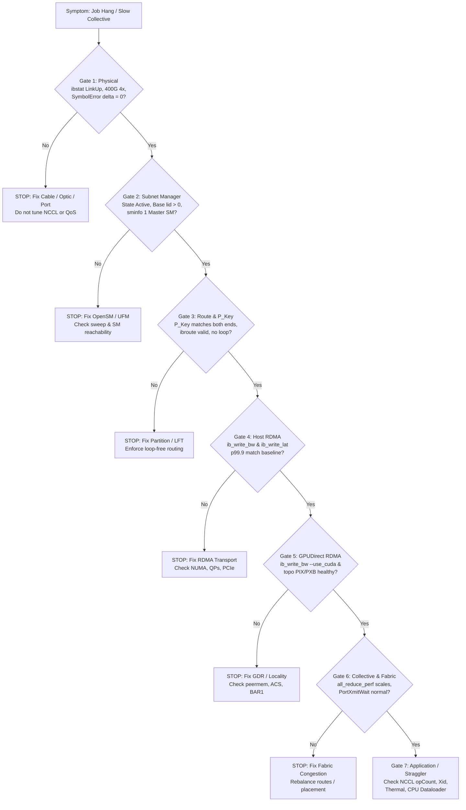
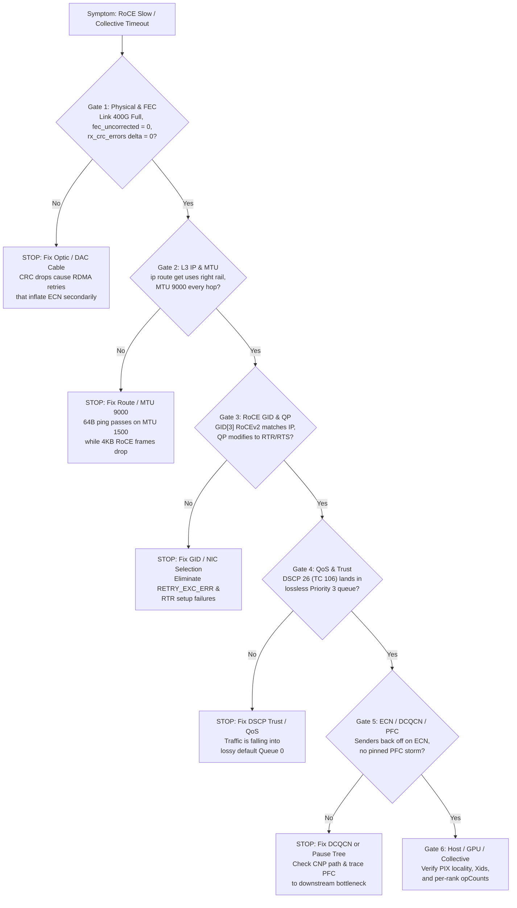
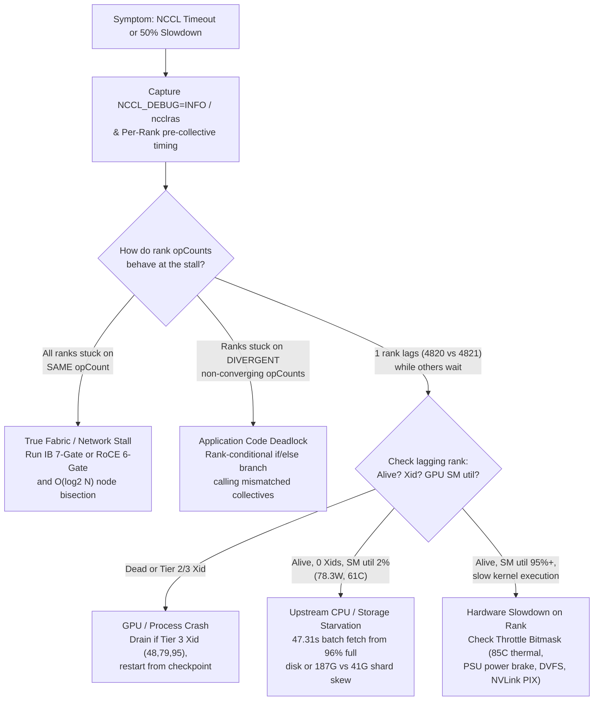

# 12.24 AI networking troubleshooting playbook

| Field | Value |
|---|---|
| Level | Advanced |
| Priority tier | 1 |
| Lab venue | Nebius GPU + Local Python Verification Lab (`code/part12/ai_networking_troubleshooting_lab.py`) |
| Part | Part 12: Complete AI networking |
| Primary sources | NVIDIA Zero-to-Hero Volume 08 (`chapter-10`, `chapter-12`, `index`, `labs/lab-01..04`); Volume 09 (`chapter-11`, `labs/lab-01..04`); Volume 20 (`index`, `chapter-01..12`, `labs/lab-01..04`); *AI Data Center Network Design and Technologies*; *AI Systems Performance Engineering* |
| Coverage file | `planning/coverage/chapters/12-24.md` |
| Claim & number ledger | `planning/ledgers/12-24.md` |

## Why this matters for AI infrastructure

When a `1,000`-GPU distributed training run stalls mid-step and terminates with an `NCCL operation timed out` exception, or when `AllReduce` bus bandwidth across an `8`-rail `400 Gbps` cluster suddenly drops by `35%` to `80%`, every team initially sees a different culprit. The application team sees a collective timeout and suspects a broken network switch; the network team sees `State: Active` or `Link detected: yes` on every port and blames PyTorch; the platform team sees `100%` GPU utilization in `nvidia-smi` and assumes the hardware is healthy.

In a synchronous collective (`AllReduce`, `ReduceScatter`, `AllGather`, `AllToAll`), every participating rank must reach the synchronization barrier before the collective completes. If `999` GPUs arrive on time and `1` GPU (`GPU #842` or `rank 3`) lags by `10` to `47.31` seconds—whether due to a degraded `DAC` cable, a missing Subnet Manager (`SM`) sweep, a `RoCEv2` `MTU` mismatch (`1500` vs `9000`), a Priority Flow Control (`PFC`) pause storm, a `PCIe` link down-trained from `Gen4 x16` (`16 GT/s`, `20–26 GB/s` payload) to `Gen3 x8` (`8 GT/s`, `2.3 GB/s`), an `NVLink` fallback to `PIX` (`Xid 74`), a GPU falling off the bus (`Xid 79`), thermal clock throttling (`1980 MHz -> 1200 MHz` at `85 °C`), or a `96%`-full storage shard—the other `999` GPUs sit idle until the process-group watchdog timer expires.

Randomly tuning `NCCL` environment variables, raising process-group timeouts to `1800` seconds, disabling `PFC` on live switches, or clearing port counters before capturing evidence destroys the forensic trail and prolongs outages. Productive incident response requires a deterministic, **bottom-up layered playbook** that:
1. Preserves time-windowed **counter deltas** (`before` vs `after`) and stable hardware identities (`GUID`, `PCIe BDF`, cable serial, rack, rail) before resetting any port or process.
2. Evaluates each infrastructure layer from the physical wire up to the distributed application, **stopping at the first gate that diverges from a known-good baseline**.
3. Cross-correlates hardware telemetry (`DCGM`, `ibstat`, `perfquery`, `ethtool -S`, `lspci -vvv`), OS kernel logs (`dmesg -T`), and collective progression (`NCCL_DEBUG=INFO`, `ncclras` in `NCCL 2.24+`, `nsys`) so that misleading single-layer metrics never send engineers down the wrong remediation path.

## Prerequisites and outcomes

### Prerequisites
- Working familiarity with InfiniBand (`LID`, `GUID`, `GID`, `P_Key`, `OpenSM`/`UFM`, `VL` credits) and `RoCEv2` (`DSCP`, `Priority 3`, `ECN`, `DCQCN`, `CNP`, `PFC`) from earlier chapters in Part 12.
- Understanding of `PCIe` and `NVLink` topologies (`nvidia-smi topo -m` codes `NV#`, `PIX`, `PXB`, `PHB`, `NODE`, `SYS`) and `GPUDirect RDMA` (`BAR1`, `nvidia-peermem`, `dma-buf`, `PCIe ACS`) from Chapter 12.19.
- Familiarity with standard Linux and RDMA diagnostic utilities (`ibstat`, `sminfo`, `perfquery`, `ib_write_bw`, `ib_write_lat`, `ethtool`, `rdma`, `lspci`, `nvidia-smi`, `dcgmi`).

### Outcomes
After completing this chapter, you will be able to:
1. Execute the **first-10-minute incident protocol** and collect a complete, non-destructive **support evidence bundle** across physical, subnet/IP, QoS/routing, transport, `GPUDirect`, and collective layers.
2. Run the **7-gate InfiniBand troubleshooting decision tree** to isolate `Port Down`, `State: Initializing` (`Base lid: 0`), down-trained `Rate`/`Width`, rising `SymbolErrorCounter` vs clean-link `PortXmitWait` congestion, `P_Key`/credit-loop faults, and `ib_write_lat` `99.9%` tail latency spikes (`5.77 us` vs `1.98 us` baseline).
3. Run the **6-gate `RoCEv2` Ethernet troubleshooting decision tree** to separate `fec_uncorrected_blocks` / `rx_crc_errors` (`3` unrecoverable blocks inflating secondary `ECN` marks via RDMA retries) from `ping`-works/`QP RTR`-fails (`MTU 1500` vs `9000`, wrong `GID` index), `DSCP 26` (`NCCL_IB_TC=106`) trust drops, broken `DCQCN`/`CNP` feedback, and persistent `PFC` pause trees.
4. Diagnose host hardware faults that masquerade as network failures: **3-tier `Xid` classification** (`Tier 1: 45, 63, 92`; `Tier 2: 13, 31, 32, 43, 94`; `Tier 3: 48, 61, 62, 64, 79, 95`) plus **`Xid 74` (`NVLink`)**, asymmetric `dcgmi nvlink -e` transceiver isolation (`184,213` CRC errors on `GPU2` vs `0` on `GPU3`), `MIG` P2P isolation, and `PCIe` link down-training (`Gen4 x16` -> `Gen3 x8`, `22.0 GB/s` -> `2.3 GB/s` with `127` replays).
5. Classify **`NCCL` collective timeouts** into starved/straggler ranks (`opCount 4820` vs `4821`), code-level deadlocks (`if rank == 0:` conditional collectives), and true fabric stalls; isolate degraded nodes in `O(log2 N)` steps (`4` tests for `16` nodes, `6` tests for `64` nodes); and defeat **cross-layer metric lies** and profiler **Heisenbugs**.

---

## 1. The Layered Troubleshooting Mindset and First-10-Minute Protocol

Troubleshooting a distributed AI fabric is fastest when it follows the packet and DMA path from the lowest unproven layer upward, rather than starting at the highest layer that printed an error message.

### 1.1 Core Axioms of AI Fabric Incident Response

1. **Locate the first broken layer, not the last layer that complained:** An `NCCL` timeout is almost always the *last* domino to fall. Tuning `NCCL` retry counts or raising the PyTorch `init_process_group` timeout (`timeout=datetime.timedelta(seconds=1800)`) while a physical lane is down-trained or a `DAC` cable is throwing `CRC` errors only forces `1,000` GPUs to burn hours of idle electricity before failing again.
2. **Reachability is not a performance or RDMA test:** On InfiniBand, `State: Active` only proves that physical link training succeeded and the Subnet Manager assigned a `LID`; it does not prove that negotiated `Rate` (`400` Gbps) and `Width` (`4x`) match design, nor that `PortXmitWait` or `SymbolErrorCounter` are clean. On `RoCEv2` Ethernet, `ping -c 3` sends `64`-byte `ICMP` packets through the Linux kernel TCP/IP stack; it never creates a Queue Pair (`QP`), never registers a Memory Region (`MR`), never transitions a `QP` to `RTR` (`Ready-to-Receive`), never exercises lossless `Priority 3` queues, and never tests `9000`-byte jumbo `MTU` frames.
3. **Host-memory RDMA and GPU-memory RDMA validate different hardware paths:** A clean `392 Gbps` `ib_write_bw` run between two hosts proves the NICs, cables, and switch fabric are healthy, but says nothing about `GPUDirect RDMA` (`nvidia-peermem` / `dma-buf`, `Large BAR1`, `PCIe ACS`, or `GPU`-to-`NIC` `PIX` vs `SYS` locality). Conversely, if host-memory `ib_write_bw` fails, the fault lies below `GPUDirect` and `NCCL`.
4. **Pairwise tests validate one path; collectives load the entire topology:** Two nodes can pass pairwise `ib_write_bw --use_cuda` at line rate while a `64`-node `AllReduce` degrades by `35%` to `50%` because synchronized all-to-all or ring traffic exposes spine oversubscription, hash polarization, adaptive-routing misconfiguration, or a single straggler rank.
5. **Preserve counter deltas before resetting anything:** Clearing switch counters (`perfquery -R`) or rebooting a node erases the accumulated error and pause history (`SymbolErrorCounter`, `fec_uncorrected_blocks`, `rx_pfc_prio3`, `dmesg` `Xid` precursor sequences) needed to prove root cause. Always capture `t0` and `t1` snapshots and compute `delta = count(t1) - count(t0)`.

### 1.2 The First-10-Minute Incident Protocol and Evidence Bundle

During the first `10` minutes of a production incident:
1. **Freeze destructive retries:** Stop automated job-restart loops or ad-hoc `PFC`/`ECN`/timeout edits that overwrite logs or clear counters.
2. **Define the symptom with precision:** Replace vague statements (*"InfiniBand is slow"*) with a scoped, falsifiable statement: *"Cross-rack AllReduce bandwidth on rail 1 fell by `35%` after switch maintenance at `14:32:15 UTC`, while same-rack traffic and rail 0 remain within baseline."*
3. **Anchor every observation to stable hardware identities:** A support ticket stating *"Port 17 has errors"* is unactionable until joined to the inventory graph: `Peer: rack14-node07, NIC mlx5_1, rail 1, cable: DAC-2m, serial ABC123, Job: training-run-4471, ranks 48-55`. Note that an InfiniBand `GUID` (`0x08c0eb0300f1a2c3`) is a stable hardware identity, whereas a `LID` (`Base lid: 12`) is a mutable runtime forwarding address that the Subnet Manager can reassign after a sweep.
4. **Capture the read-only evidence bundle** across both an affected path and an equivalent known-good peer path:

| Evidence Layer | InfiniBand Artifacts to Preserve | RoCEv2 / AI Ethernet Artifacts to Preserve | Host / GPU / Collective Artifacts to Preserve |
|---|---|---|---|
| **1. Physical & Link** | `ibstat`, `iblinkinfo`, `perfquery` (`SymbolErrorCounter`, `LinkDownedCounter`, `PortRcvErrors`) | `ethtool <netdev>`, `ethtool -S` (`fec_corrected_blocks`, `fec_uncorrected_blocks`, `rx_crc_errors`), optic temp/DOM | `lspci -vvv` (`LnkCap` vs `LnkSta` speed/width), `dcgmi dmon` (`PCIE_REPLAY_COUNTER`), `dcgmi nvlink -e` |
| **2. Control Plane & L3** | `sminfo` (master `SM` `LID`, priority, `activity count`), `OpenSM`/`UFM` sweep logs | `ip -br link`, `ip -br addr`, `ip route get <peer-ip>`, end-to-end `MTU` (`9000`) | `dmesg -T` (`Xid` codes, `DMAR`/`IOMMU` faults, `PCIe` link down-training) |
| **3. Routing, QoS & Isolation** | `ibroute` switch `LFT` tables, `P_Key` tables, `SL`-to-`VL` mapping, `PortXmitWait` deltas | `mlnx_qos`, `DSCP` trust (`26` / `ToS 106` -> `Prio 3`), `rx_ecn_marked_prio3`, `rx_pfc_prio3`, `tx_pfc_prio3` | `nvidia-smi topo -m` (`NV#`, `PIX`, `PXB`, `PHB`, `SYS`), `MIG Mode` status, `setpci` `ACS` state |
| **4. Transport & Endpoint** | `ibv_devices`, `ibv_devinfo -v` (`fw_ver`, `max_qp: 262144`, `max_qp_wr: 32768`), `ib_write_bw`, `ib_write_lat` | `rdma link show`, `show_gids` (`GID` index `3` `RoCEv2`), `ib_write_bw -d mlx5_X` completion status (`RTR`/`RTS`) | `lsmod` (`nvidia_peermem` / `dma-buf`), `nvidia-smi -q` (`BAR1` memory usage, clocks, power, throttle reasons) |
| **5. Collective & App** | `all_reduce_perf` per-rail and cross-rack scaling matrix | `all_reduce_perf` with `NCCL_IB_GID_INDEX`, `NCCL_IB_TC` | `NCCL_DEBUG=INFO` (`NCCL_DEBUG_SUBSYS=COLL,GRAPH`), `ncclras`, per-rank iteration & dataloader timings |

---

## 2. InfiniBand Production Troubleshooting Playbook (7-Gate Decision Tree)

When an InfiniBand workload hangs, slows down, or fails to initialize, step through the **seven verification gates** in exact bottom-up order. Do not advance to Gate `k + 1` until Gate `k` has passed with concrete counter evidence.



| Gate | Primary Diagnostic Tool | Pass Condition (Baseline) | Divergence Signature | Immediate Action |
|---|---|---|---|---|
| **Gate 1: Physical** | `ibstat`, `iblinkinfo`, `perfquery` | `Physical state: LinkUp`, `Rate: 400` (`4x`), `SymbolErrorCounter` & `LinkDownedCounter` delta `= 0` | `Polling`/`Disabled`, `Rate: 200`/`100` (`1x`/`2x`), or rising symbol/CRC errors | Replace/re-seat damaged cable or transceiver; never mask with higher timeouts |
| **Gate 2: Subnet Manager** | `ibstat`, `sminfo` | `State: Active`, `Base lid > 0` (e.g., `12`), `SM lid: 1`, `1` `SMINFO_MASTER` with climbing `activity count` | `Physical state: LinkUp` + `State: Initializing` + `Base lid: 0`; `sminfo` timeout or `2` masters | Restore single authoritative `OpenSM`/`UFM` master and verify sweep completion |
| **Gate 3: Route & P_Key** | `smpquery pkeys`, `ibroute`, `ibtracert` | Compatible `P_Key` (`0xffff`) on both ports, valid `LFT` egress port, acyclic credit graph | `QP` fails to transition or hangs; incompatible `P_Key` or cyclic credit loop | Align `P_Key` partition policy and switch routing engine (`updn`, `ftree`, `dfp`) |
| **Gate 4: Host RDMA** | `ib_write_bw`, `ib_write_lat` | Line-rate host bandwidth (`~392 Gbps` on `400G`), `2B` `p99.9` latency `~1.98 us` | Low host BW or `p99.9` tail spike (`5.77 us`, `~3x` baseline) despite normal `1.58 us` typical | Fix `numactl` CPU/memory binding, check `max_qp` (`262144`), inspect switch hop waits |
| **Gate 5: GPUDirect** | `ib_write_bw --use_cuda`, `nvidia-smi topo -m` | GPU RDMA matches host RDMA (`~390+ Gbps`); `GPU`-`NIC` pair is `PIX`/`PXB` | Host RDMA `392 Gbps` but GPU RDMA drops to `~50 Gbps` (`6.25 GB/s`); `SYS`/`PHB` path | Load `nvidia-peermem`/`dma-buf`, disable `PCIe ACS` (`ECAP_ACS+0x6.w=0000`), enable `Large BAR1` |
| **Gate 6: Collective** | `all_reduce_perf`, `perfquery` | Multi-node `busbw` matches baseline across all rails; balanced spine utilization | Pairwise tests pass, but `AllReduce` drops `35%+`; `PortXmitWait` high with `0` `SymbolErrorCounter` | Trace `PortXmitWait` gradient toward congested cut/receiver; enable adaptive routing / fix placement |
| **Gate 7: App / Rank** | `NCCL_DEBUG=INFO`, `ncclras`, `dmesg`, `dcgmi` | All ranks advance `opCount` in lockstep; `SM` utilization `>= 90%`; `0` `Xid` errors | Rank `3` stuck at `opCount 4820` while ranks `0–2` wait at `4821`; or divergent collective calls | Inspect lagging rank for `Xid`, thermal slowdown, or slow CPU dataloader (`47.31 s` batch fetch) |

### 2.1 Gate 1 vs Gate 2: `Port Down`, `State: Initializing`, and Reduced Width

In `ibstat`, **physical state** and **logical port state** are independent checkpoints:
- **Healthy NDR `400G` port:** `CA type: MT4129` (`ConnectX-7`), `State: Active`, `Physical state: LinkUp`, `Rate: 400`, `Base lid: 12`, `LMC: 0`, `SM lid: 1`, `Port GUID: 0x08c0eb0300f1a2c3`.
- **Gate 1 Failure — Reduced Rate or Width while `Active`:** A damaged lane inside an optical cable or `DAC` can cause the port to negotiate `State: Active` at `Rate: 200` or `Rate: 100` (`1x` or `2x` width instead of `4x`). Because `State` still reads `Active`, naive up/down monitoring stays green while every collective traversing that rail is throttled to a fraction of design bandwidth.
- **Gate 2 Failure — `Physical state: LinkUp` with `State: Initializing` and `Base lid: 0`:** When `Physical state` is `LinkUp`, Layer 1 signaling and lane negotiation have already succeeded; touching cables or optics is wasted effort. `State: Initializing` with `Base lid: 0` means the **Subnet Manager (`SM`)** has not admitted and programmed the port. Run `sminfo` (`untested here`) to verify that exactly one authoritative `SMINFO_MASTER` exists, its `activity count` is incrementing on each sweep, the port is reachable from the `SM` management node, and partition (`P_Key`) policy permits the port.

### 2.2 Gate 4: Reading `ib_write_lat` Tail Percentiles vs Averages

When testing Gate 4 (`ib_write_lat -d mlx5_0 -i 1 -F <server>`, `2`-byte RDMA Write over `1000` iterations), comparing only `t_typical` or `t_avg` against baseline can hide severe fabric jitter:

```text
# Baseline captured during qualification (2 bytes, 1000 iterations):
 #bytes #iterations    t_min[usec]    t_max[usec]  t_typical[usec]    t_avg[usec]    99% percentile[usec]   99.9% percentile[usec]
 2       1000           1.41           2.03         1.55              1.56            1.71                    1.98

# Degraded path during incident:
 2       1000           1.42           6.81         1.58              1.61            2.90                    5.77
```

Here `t_typical` (`1.58 us` vs `1.55 us`) and `t_avg` (`1.61 us` vs `1.56 us`) are nearly identical to baseline, which looks completely healthy at a glance. However, the `99%` percentile (`2.90 us` vs `1.71 us`) and the **`99.9%` percentile (`5.77 us` vs `1.98 us`, roughly `3x` higher)** reveal intermittent micro-stalls (`t_max = 6.81 us`). Because synchronous collectives across hundreds of ranks run at the speed of the slowest tail completion, a `3x` `p99.9` tail spike directly translates into collective barrier stalls.

### 2.3 Gate 1 vs Gate 6: Distinguishing a Bad Cable from Fabric Congestion

Both a marginal physical cable and fabric congestion produce the same application symptom (*"throughput drops under load"*), but they require opposite remedies:

| Counter Family (`perfquery` Delta) | Case A: Physical Link Fault (Gate 1) | Case B: Congestion Without Errors (Gate 6) | Case C: Credit Loop / Deadlock (Gate 3/6) |
|---|---|---|---|
| `SymbolErrorCounter` / `PortRcvErrors` | **Rising (`> 0`)** | **Flat (`0`)** | **Flat (`0`)** |
| `LinkDownedCounter` / `LinkRecovers` | **Rising (`> 0`)** or intermittent | **Flat (`0`)** | **Flat (`0`)** |
| `PortXmitWait` | Low or secondary to link recovery | **Elevated (`>> 0`)** along path to hot cut/receiver | **Pinned maximal** in a closed cycle of switch hops |
| `PortXmitDiscards` | May rise during link down events | `0` (unless head-of-line timeout expires) | Rises when switch stall-timeout discards stuck packets |
| **Root Cause & Correct Fix** | Defective optic, dirty fiber, or loose `DAC` -> **Clean or replace physical media** | Incast, route polarization, or oversubscribed cut -> **Rebalance routes, enable adaptive routing, or adjust placement** | Cyclic buffer dependency across `VL` buffers -> **Switch to loop-free routing engine (`updn`/`ftree`/`dfp`)** |

---

## 3. RoCEv2 and AI Ethernet Production Troubleshooting Playbook (6-Gate Decision Tree)

On an AI Ethernet fabric running `RoCEv2` (`UDP` port `4791`), RDMA transport executes inside the `ConnectX` NIC ASIC (`mlx5_core` / `ib_core`). Standard kernel packet inspection (`tcpdump`, `ping`, `traceroute`) only sees control traffic or host-stack packets and misses hardware RDMA queue-pair completions, `ECN` marking in switch ASICs, and Layer-2 `PFC` pause frames.



| RoCEv2 Gate | Key Commands (Read-Only) | Healthy Evidence | Failure Signature |
|---|---|---|---|
| **Gate 1: Physical & FEC** | `ethtool ens1f0`, `ethtool -S ens1f0` | `Speed: 400000Mb/s`, `fec_uncorrected_blocks: 0`, `rx_crc_errors: 0` (`fec_corrected_blocks: 412` or `41200` is normal noise correction) | `fec_uncorrected_blocks: 3` matching `rx_crc_errors: 3` exactly |
| **Gate 2: L3 IP & MTU** | `ip route get <peer>`, `ip link show`, `ping -M do -s 8972 <peer>` | Egress uses intended rail (`ens1f0`), `mtu 9000` on both hosts and all switch ports | `ping -c 3` (`64B`) passes with `0%` loss, but `9000B` jumbo frames silently drop at a `1500` `MTU` hop |
| **Gate 3: GID & QP State** | `rdma link show`, `show_gids`, `ibv_devinfo`, `ib_write_bw` | `state ACTIVE physical_state LINK_UP`, `GID[3]` (`RoCEv2`), `ib_write_bw` achieves `392 Gbps` in `2.1 s` with `0` retries | `Failed to modify QP to RTR`, or wrong device (`mlx5_1` vs `mlx5_0`) drops BW from `392 Gbps` to `156 Gbps` with `24` `RETRY_EXC_ERR` completions (`8.2 s`) |
| **Gate 4: QoS & Trust** | `mlnx_qos -i ens1f0`, `ethtool -S` (`rx_prio3_packets`, `tx_prio3_packets`) | `NCCL_IB_TC=106` (`DSCP 26`) maps to lossless `Priority 3`; `rx_prio3_packets` / `tx_prio3_packets` climb with load | `prio3_packets` delta `= 0` under load; switch ingress port rewrites `DSCP` to `0` (lossy queue `0`) |
| **Gate 5: ECN / DCQCN / PFC** | `ethtool -S` (`rx_ecn_marked_prio3`, `rx_pfc_prio3`, `tx_pfc_prio3`) | Bounded contention (`2` senders on `400G`): `rx_ecn_marked_prio3: 47829`, `rx_pfc_prio3: 412`, `tx_pfc_prio3: 14`, senders smoothly pace to `89.2 Gbps` and `87.1 Gbps` | `ECN` marks rise while senders stay at `100%` rate (`DCQCN`/`CNP` broken), or `PFC` pause duration pins queue at `100%` |
| **Gate 6: Host / GPU / App** | `nvidia-smi topo -m`, `ib_write_bw --use_cuda`, `all_reduce_perf` | `GPU0`-`NIC0` = `PIX`, `GPU1`-`NIC1` = `PIX`; per-rail `AllReduce` balanced | `GPU0`-`NIC1` = `SYS` cross-NUMA hop, or single straggler rank stalls collective |

### 3.1 Gate 1 Trap: How Physical `CRC` Errors Masquerade as an `ECN` Congestion Problem

Consider the counter snapshot from switch port `swp17` connected to `rack14-node07` (`NIC mlx5_1`, `rail 1`, cable `DAC-2m`, serial `ABC123`, carrying `ranks 48-55` of `training-run-4471`):

```text
$ ethtool -S swp17 | egrep "fec_corrected|fec_uncorrected|rx_crc_errors"
     fec_corrected_blocks:    41200        <- normal at 400G; RS-FEC correcting routine signal noise
     fec_uncorrected_blocks:  3            <- nonzero: 3 codewords exceeded FEC correction capability
     rx_crc_errors:           3            <- matches fec_uncorrected_blocks (3 corrupted frames dropped)
```

When those `3` corrupted frames are dropped by the receiver's `CRC` check, the `ConnectX` RDMA transport layer detects sequence gaps (or timeout) and **retransmits** the affected bursts across the same link. That burst of retransmitted RDMA traffic increases the instantaneous offered load on the egress queue, pushing queue occupancy above `Kmin` and causing `rx_ecn_marked_prio3` to climb on the port. An engineer who skips Gate 1 and looks only at `rx_ecn_marked_prio3` will misdiagnose a physical cable failure (`DAC-2m` `ABC123`) as a QoS congestion problem and waste hours tuning `ECN` thresholds while the cable continues to corrupt frames.

### 3.2 Gate 2 and Gate 3: Why `ping` Works while `RoCEv2` Fails (`RTR` and `RETRY_EXC_ERR`)

Two classic failure patterns occur when Layer 1 and Layer 3 `ping` appear completely healthy:

1. **`ping` (`0%` loss) followed by `Failed to modify QP to RTR`:**
   ```text
   $ ping -c3 10.20.8.5
   3 packets transmitted, 3 received, 0% packet loss
   $ ib_write_bw -d mlx5_0 10.20.8.5
   Local address:  ... GID: 0000:0000:0000:0000:0000:ffff:0a14:040f
   Remote address: ... GID: 0000:0000:0000:0000:0000:ffff:0a14:0805
   Failed to modify QP to RTR
   ```
   Here, `10.20.4.15` (`0a14:040f`) and `10.20.8.5` (`0a14:0805`) can exchange `64`-byte `ICMP` echoes, but the RDMA Connection Manager / Verbs layer cannot transition the Queue Pair to `RTR` (`Ready-to-Receive`) or complete the first burst because of an **`MTU` mismatch** (e.g., host `MTU 9000` vs a routed hop at `MTU 1500` that drops `4096`-byte RDMA PMTU packets), a **mismatched `GID` index** (`RoCEv1` MAC-based `GID[0]` vs `RoCEv2` IPv4-mapped `GID[3]`), or a firewall blocking `UDP 4791`.
2. **Process-scoped rail/device selection mismatch (`392 Gbps -> 156 Gbps` and `24` `RETRY_EXC_ERR`):**
   When a process on a multi-rail host binds to the wrong RDMA device (`ib_write_bw -d mlx5_1 -i 1 10.20.8.5` on `ens1f1` `10.20.4.24` instead of the intended rail `mlx5_0` on `ens1f0` `10.20.4.15`), traffic is forced across a non-preferred cross-subnet path (`GID[3]: fe80::0c42:a1ff:fec8:d79d/64` vs `fe80::0c42:a1ff:fec8:d79b/64`), causing `rx_ecn_marked_prio3` to jump by `142`, generating `24` `RETRY_EXC_ERR` completions, stretching test duration from `2.1 s` to `8.2 s`, and collapsing bandwidth from `392 Gbps` to `156 Gbps`.

### 3.3 Gate 5: `ECN`/`DCQCN` Feedback Validation vs Persistent `PFC` Pause Storms

In a properly tuned `RoCEv2` lossless queue (`Priority 3`), the **`ECN` marking threshold (`Kmin`, `Kmax`) is always configured lower than the `PFC` pause threshold (`Xoff`)**:
- **Healthy congestion control (`Lab 03` signature):** When two `400 Gbps` senders contend for a single constrained egress queue over `60` seconds, the switch marks packets with `ECN` (`rx_ecn_marked_prio3` delta `= 47,829`), the receiver generates Congestion Notification Packets (`CNPs`), and the senders' `DCQCN` rate limiters smoothly throttle each sender to `89.2 Gbps` and `87.1 Gbps` (`~176 Gbps` combined), with only brief transient `PFC` events (`rx_pfc_prio3: 412`, `tx_pfc_prio3: 14`) and `0` packet drops.
- **Failure Mode A — `ECN` marks rise, but senders do not slow down:** Either `DCQCN` is disabled on the NIC for `Priority 3`, `CNP` frames (`DSCP 48` / `Priority 6`) are being dropped or misrouted on the reverse path, or the traffic landed in a queue without `DCQCN` enabled.
- **Failure Mode B — Persistent `PFC` pause storm:** `PFC` pause counters and pause durations climb continuously, pinning upstream ports at `100%` paused without packet loss. **Never blindly disable `PFC` during an incident**—doing so immediately converts a lossless stall into massive packet loss and `RETRY_EXC_ERR` storms. Instead, **trace the pause tree downstream**: find every port pausing `Priority 3` (`rx_pfc_prio3` / `tx_pfc_prio3` climbing with queue occupancy `95%–98%`) and follow the chain in the direction of data flow until you reach the **most downstream congested egress port** (where `tx_pfc_prio3 > 0` is being transmitted upstream toward the fabric, while `rx_pfc_prio3 == 0` from its downstream peer, or where a slow/wedged NIC receiver is holding buffer credits).

---

## 4. Host, PCIe, DMA Engine, NVLink, and Xid Hardware Triage

When a training run crashes or stalls and the network fabric gates pass, the fault often resides on the host hardware plane: a GPU that has fallen off the `PCIe` bus (`Xid 79`), an `NVLink` lane that has degraded and silently fallen back to `PCIe` (`Xid 74`), an uncorrectable `HBM` memory error (`Xid 48`, `94`, `95`), or a down-trained `PCIe` slot (`Gen4 x16 -> Gen3 x8`).

### 4.1 The Master 3-Tier `Xid` Triage Matrix (Plus `Xid 74` NVLink)

Whenever a GPU encounters a hardware, driver, memory, or bus fault, the NVIDIA kernel driver logs `NVRM: Xid (PCI:<bus>): <code>, <message>` to `dmesg`. Because free-text messages vary across driver versions, always triage by the **numeric `Xid` code** and classify it into one of **three operational severity tiers** (plus the dedicated `NVLink` link path for `Xid 74`):

| Xid Code | Operational Tier | Official Meaning | Typical Root Cause | Immediate Operator Action |
|---|---|---|---|---|
| **`45`** | **Tier 1** (Informational / Self-Healing) | Preemptive cleanup, due to previous errors | Driver cleaned up a context after an earlier fault; **never a root cause by itself** | Inspect `dmesg -T` for the `Xid` code that fired **immediately before `Xid 45`** |
| **`63`** | **Tier 1** (Informational / Self-Healing) | ECC page retirement or row remapping recording event | GPU recorded an `HBM` address for retirement/remap after a correctable ECC event | Keep running; log and track trailing `7`-day frequency |
| **`92`** | **Tier 1** (Precursor Warning) | High single-bit ECC error rate | Elevated correctable (`SBE`) bit-flip rate in `HBM` (precursor to uncorrectable fault) | Keep running for now; chart `DCGM_FI_DEV_ECC_SBE_AGG_TOTAL` slope and schedule preventive RMA if accelerating |
| **`13`** | **Tier 2** (Process / App Recoverable) | Graphics Engine Exception | Illegal instruction or out-of-bounds address in a user CUDA kernel | Restart job/process; escalate to hardware only if the **same GPU** repeats `Xid 13` across **unrelated applications** |
| **`31`** | **Tier 2** (Process / App Recoverable) | GPU memory page fault | Invalid GPU virtual address access by app, or DMA engine/power glitch if paired with `PCIe` errors | Check app code first; if recurring alongside `DCGM` DMA/PCIe errors (`> 10/sec`), reset GPU (`--gpu-reset`) and rescan `PCIe` |
| **`32`** | **Tier 2** (Process / App Recoverable) | Invalid or corrupted push buffer stream | Command stream corruption between host and GPU over `PCIe` | Restart process; if paired with `PCIe` replay counter growth, audit `PCIe` slot/link |
| **`43`** | **Tier 2** (Process / App Recoverable) | GPU stopped processing | GPU command processor hung, often downstream of a prior `Xid` | Reset GPU and inspect `dmesg` for preceding `Xid` |
| **`94`** | **Tier 2** (Process / App Recoverable) | Contained ECC error | Uncorrectable `HBM` ECC error **contained to a single process**; GPU remains on `PCIe` bus | Restart the affected application, reset GPU at next maintenance window, and monitor ECC/row-remap counters |
| **`48`** | **Tier 3** (Unrecoverable GPU Fault) | Double Bit ECC Error (uncorrectable) | Uncorrectable double-bit `HBM` memory error | **Cordon and drain node immediately**; flag job output from window as suspect; retire/RMA GPU |
| **`61`** | **Tier 3** (Unrecoverable GPU Fault) | Internal micro-controller breakpoint/warning | GPU Falcon/GSP firmware-level breakpoint fault | **Cordon and drain node immediately**; escalate to hardware RMA |
| **`62`** | **Tier 3** (Unrecoverable GPU Fault) | Internal micro-controller halt | GPU embedded controller halted | **Cordon and drain node immediately**; escalate to hardware RMA |
| **`64`** | **Tier 3** (Unrecoverable GPU Fault) | ECC page retirement or row remapping failure | Hardware self-healing row-remapper exhausted or failed to commit remap | **Cordon and drain node immediately**; escalate to hardware RMA |
| **`79`** | **Tier 3** (Unrecoverable Bus Fault) | GPU has fallen off the bus | Electrical `PCIe` link loss or power brownout; GPU disappears from `lspci` | **Cordon and drain node**; attempt soft `PCIe` `remove`/`rescan` or power-cable reseat; RMA if persistent |
| **`95`** | **Tier 3** (Unrecoverable GPU Fault) | Uncontained ECC error | Uncorrectable ECC error that hardware **could not contain**; memory corruption risk | **Cordon and drain node immediately**; invalidate training checkpoints written during the fault window |
| **`74`** | **Link Triage (`NVLink`)** | NVLink Error (`fatal error detected on link N`) | Physical `NVLink` transceiver, baseboard trace, or `NVSwitch` lane failure | Run `nvidia-smi topo -m` and `dcgmi nvlink -e` on both peer GPUs; reset GPU or RMA faulty transceiver side |

#### Reading Chronological `Xid` Precursor Chains in `dmesg -T`
Never grep only the last `Xid` line. Consider this `11`-second sequence from `dmesg -T`:

```text
[Tue Aug  4 14:21:52 2026] NVRM: Xid (PCI:0000:0a:00): 92, pid=48213, name=python, High single-bit ECC error rate
[Tue Aug  4 14:21:58 2026] NVRM: Xid (PCI:0000:0a:00): 45, pid=48213, name=python, Preemptive cleanup, due to previous errors
[Tue Aug  4 14:22:03 2026] NVRM: Xid (PCI:0000:0a:00): 79, pid=48213, name=python, GPU has fallen off the bus.
```

Because `dmesg` logs oldest events first, `Xid 92` (`Tier 1` high single-bit ECC rate, where historical `DCGM_FI_DEV_ECC_SBE_AGG_TOTAL` accelerated from `12 -> 31 -> 58 -> 94` errors per `2`-hour window over `6` hours) fired first at `14:21:52`, triggering `Xid 45` (`Tier 1` context cleanup) `6` seconds later at `14:21:58`, and culminating `5` seconds later in `Xid 79` (`Tier 3` bus disconnect) at `14:22:03`. Tracking the `Tier 1` `Xid 92` acceleration rate (`> 10` to `100` errors/hour) allows proactive node draining *before* `Xid 79` crashes the training job.

### 4.2 Silent `NVLink` Degradation (`NV12 -> PIX`), `MIG` Verification, and Asymmetric Transceiver Isolation

When an `NVLink` connection between two GPUs fails, the NVIDIA driver can dynamically reroute peer-to-peer traffic over the `PCIe` bus (`PIX` or `PHB`), causing a silent `2x` to `10x` slowdown in `AllReduce` without crashing the job:
1. **Check the topology matrix (`nvidia-smi topo -m`):** On a `4`-GPU `A100` node where every intra-node pair should report `NV12` (`12` `NVLink 3` links at `~25 GB/s` per link = `~600 GB/s` bidirectional), finding `PIX` between `GPU2` and `GPU3` proves that pair has fallen back to `PCIe`.
2. **Rule out `MIG Mode` before opening a hardware RMA:** Multi-Instance GPU (`MIG`) mode intentionally disables `NVLink` Peer-to-Peer (`P2P`) between instances for hardware memory isolation. Check `nvidia-smi -i 2 -q | grep -A3 "MIG Mode"`. If `Current: Enabled`, `PIX` is working as designed. If `Current: Disabled`, it is a genuine link fault.
3. **Isolate which of the two GPUs owns the physical transceiver fault (`dcgmi nvlink -e`):** Because an `NVLink` lane connects two GPUs (`GPU2` and `GPU3`), replacing the wrong GPU wastes an RMA. Query per-link error counters on **both** GPUs independently:
   - `dcgmi nvlink -e -g 2` shows `Link 2` (`Status: Down`) with **`184,213` `CRC Errors`**, **`92,104` `Replay Errors`**, and **`12` `Recovery Errors`**, corroborated by `dmesg -T` (`NVRM: Xid (PCI:0000:65:00): 74 ... NVLink: fatal error detected on link 2`).
   - `dcgmi nvlink -e -g 3` shows `Link 2` (`Status: Down`) with **`0` `CRC Errors`**, **`0` `Replay Errors`**, and **`0` `Recovery Errors`**.
   This asymmetry proves `GPU3` is a healthy passive victim and isolates the physical hardware failure to **`GPU2`'s `NVLink` transceiver** (or the `GPU2`-side connector trace).

### 4.3 `PCIe` Link Down-Training (`Gen4 x16 -> Gen3 x8`), `DMA` Page Faults, and Non-Disruptive Bus Rescan

When electrical signal integrity degrades on a `PCIe` slot (due to dust, thermal expansion, riser wear, or auxiliary power ripple), the `PCIe` LTSSM (Link Training and Status State Machine) either **down-trains** to a slower generation and narrower width or drops the device off the bus (`Xid 79`):
- **Bandwidth & `LnkSta` signature:** A healthy `PCIe Gen4 x16` (`16 GT/s`, `31.5 GB/s` raw unidirectional) achieves **`20–26 GB/s`** (`22.0 GB/s` reference baseline, alert threshold `< 17.6 GB/s` = `80%`) in CUDA `bandwidthTest --device 0`, while `PCIe Gen3 x16` (`8 GT/s`) achieves `~10–12 GB/s`. When `lspci -s 08:00.0 -vvv` shows `LnkCap: Speed 16GT/s, Width x16` but **`LnkSta: Speed 8GT/s (Gen3), Width x8 (Down-trained)`** alongside `127` `PCIe` replays in `DCGM_FI_DEV_PCIE_REPLAY_COUNTER`, measured Host-to-Device (`H2D`) throughput collapses to **`2.3 GB/s`** (an `~80%` drop vs `Gen3 x16` and `~90%` drop vs `Gen4 x16`).
- **IOMMU / DMAR faults:** If `dmesg` logs `DMAR: DRHD: processing fault logged [DMA Read] Request-ID [0000:08:00.0] (PASID 0x0000) Address [0xdeadbeef] (Fault Reason: 02 Present bit in root entry is clear)`, check kernel `IOMMU` pass-through (`iommu=pt`) and `PCIe ACS` settings.
- **Soft `PCIe` bus rescan recovery:** Before power-cycling an `8`-GPU server, drain the node and trigger a non-disruptive Linux `PCIe` device removal and bus rescan (`echo 1 > /sys/bus/pci/devices/0000:08:00.0/remove && sleep 2 && echo 1 > /sys/bus/pci/rescan`, `untested here`), then re-verify `LnkSta: Speed 16GT/s, Width x16` and `bandwidthTest >= 20 GB/s`.

---

## 5. Collective Timeouts, Straggler Bisection, and Cross-Layer Diagnosis ("When Metrics Lie")

When all lower hardware and fabric gates appear clean, or when a `1,000`-GPU job fails with `NCCL operation timed out` without an obvious link-down alert, the investigation moves to **collective operation progression**, **multi-node straggler bisection**, and **cross-layer metric correlation**.



| NCCL Timeout / Slowdown Class | `NCCL_DEBUG=INFO` / `ncclras` Signature | Lagging Rank Telemetry (`nvidia-smi` / `dmesg`) | True Root Cause | Correct Remediation |
|---|---|---|---|---|
| **1. Upstream Starved Rank (Straggler)** | Ranks `0–2` reach `opCount 4821` (`count 268435456`); `rank 3` stuck at `opCount 4820` | Process alive, `0` `Xid`s, `SM` util `2%`, `61 °C`, `78.3 W`; batch fetch takes `47.31 s` | Storage volume `/data` at `96%` (`480G / 500G`) or uneven data sharding (`187G` on `shard-3` vs `41G` on `shard-0`, `4.5x` skew) | Rebalance dataset shards (`DistributedSampler`), clean `/data/tmp`, add `DataLoader` prefetching |
| **2. Hardware-Throttled Straggler Rank** | Lagging rank reaches collectives `5–10x` slower (`1250.5 ms` vs `125.3 ms` = `10.02x` ratio) | `SM` util `95%+`, temp `85 °C` (max `87 °C`), clock drops `1980 MHz -> 1200 MHz` (`HW Thermal Slowdown: Active`), or `HW Power Brake` | Seized fan (`0 RPM`), clogged liquid loop (`0.93 °C/s` temp rise vs `0.05–0.10 °C/s` normal), or PSU brownout (`300 W -> 200 W`) | Drain node, service cooling/PSU, or lock clocks (`nvidia-smi -lgc 1980`) if caused by `DVFS` oscillation (`1980 -> 500 -> 1980 MHz`) |
| **3. Crashed Rank or Fatal `Xid`** | Lagging rank stops logging `opCount`; peers time out waiting | `dmesg` shows `Xid 79` (fell off bus), `Xid 48`/`95` (uncorrectable ECC), or `Xid 74` (`NVLink`) | Physical GPU/bus/memory fault killed or hung the rank process | Cordon/drain faulty node, replace with healthy node, and resume job from last checkpoint |
| **4. Code-Level Collective Deadlock** | Ranks freeze permanently at **different, non-converging `opCount`s** or mismatched collective types | Processes alive, GPUs idle waiting in `NCCL` kernel | Conditional Python bug (e.g., `if rank == 0:` calls `all_reduce` twice while `rank != 0` calls it once) | Fix distributed application code so all ranks execute identical collective sequences unconditionally |
| **5. True Fabric / Link Stall** | All ranks reach the **exact same `opCount`** and hang inside the collective | GPUs healthy; `nccl-tests` shows low `busbw` on specific node subset | Switch port down, `PFC` pause storm, credit loop, or degraded `400G` optic | Isolate bad node(s) via `O(log2 N)` binary search and run the 7-gate IB / 6-gate RoCE playbook |

### 5.1 Binary-Search (`O(log2 N)`) Multi-Node Straggler Isolation

When a `16`-node or `64`-node training job experiences a fabric-wide `AllReduce` slowdown (for example, `all_reduce_perf -b 1G -e 1G -f 2 -g 8` drops from `180.0 GB/s` bus bandwidth to `45.0 GB/s`), testing every node individually requires `N` sequential runs (`16` or `64` runs). Instead, use **binary-search bisection**:
1. Split the active node list into two equal halves (`Left` and `Right`, e.g., `nodes 00..07` and `nodes 08..15`) and run `all_reduce_perf` on each half concurrently or sequentially.
2. Whichever half exhibits the degraded bandwidth (`45.0 GB/s` vs `180.0 GB/s`) contains the degraded node or link.
3. Recursively bisect the failing half (`8 -> 4 -> 2 -> 1`). Across `16` nodes, binary search isolates `node-11` in exactly **`4` tests** (saving `12` tests); across `64` nodes, it isolates `node-47` in **`6` tests** (saving `58` tests).
4. Within the isolated node, localize the offending GPU by running `all_reduce_perf` across GPU subsets (`CUDA_VISIBLE_DEVICES=0,1`, `0,2`, `0,3`) or by timing each rank **before** the `dist.all_reduce` call (calling `torch.cuda.synchronize()` before reading `time.perf_counter()`, because measuring *after* `all_reduce` includes the barrier wait time and makes fast ranks appear just as slow as the straggler).

### 5.2 Cross-Layer Diagnosis: When Metrics Lie and Profiler Heisenbugs

Single-layer dashboards frequently mislead operators during complex incidents:
1. **The Utilization Lie (`nvidia-smi` `100%` utilization at `20%` throughput):** `nvidia-smi`'s `utilization.gpu` counter measures the percentage of time intervals during which *at least one* kernel was active or queued on the GPU, not how many Streaming Multiprocessors (`SMs`) are doing math. If the host CPU launches tiny kernels at only `50` kernels/sec (instead of `1,000+` kernels/sec) or stalls in Python between launches, `nvidia-smi` can report `95%–100%` GPU utilization while throughput sits at `200` samples/sec instead of `1,000` samples/sec (`80%` idle in Nsight Systems). Measure synchronized **7-layer iteration timings** (`data_load_cpu: 450.00 ms` [`60.0%`], `allreduce_network: 150.00 ms` [`20.0%`], `backward_gpu: 60.00 ms` [`8.0%`], `forward_gpu: 30.00 ms` [`4.0%`], `data_transfer_pcie: 10.00 ms` [`1.3%`], `optimizer_gpu: 10.00 ms` [`1.3%`], `loss_gpu: 8.00 ms` [`1.1%`] out of `750.00 ms` total) and `DCGM_FI_PROF_SM_ACTIVE` to expose the CPU bottleneck.
2. **The Memory Lie (`35 GB / 40 GB` or `80 GB` used in `nvidia-smi`):** PyTorch's caching allocator retains freed blocks in a process-local pool for fast reuse without returning them to the CUDA driver. `nvidia-smi` reports the *reserved* cache (`35 GB`), whereas `torch.cuda.memory_allocated()` / `torch.cuda.memory_stats()` shows the true live tensor footprint (`10 GB`). Also note that if `nvidia-smi` reports `0 MiB` total memory on an `A100-SXM4-80GB`, check whether `MIG` mode is enabled without created `MIG` instances (`nvidia-smi mig -lgi`) or whether a container user-space / kernel-driver version mismatch exists.
3. **The Thermal vs Power vs DVFS Lie:** Seeing GPU clocks drop from `1980 MHz` to `1833 MHz` while power falls from `300 W` to `250 W` at `80 °C` cannot distinguish thermal throttling from power capping on its own, because lower clocks automatically reduce power draw. Always query the **throttle reason bitmask** (`nvidia-smi -i 0 -q -d PERFORMANCE`):
   - `HW Thermal Slowdown: Active` or `SW Thermal Slowdown: Active` proves a cooling fault (note: HGX/DGX `SXM` GPUs and passively cooled `H100 PCIe` / `L40S` cards have no on-GPU fan and report `Fan Speed: N/A`; inspect chassis fans via `ipmitool sdr type Fan` or Redfish).
   - `SW Power Cap: Active` with `power.limit < power.default_limit` (`200 W < 300 W`) proves an explicit software power cap.
   - `HW Power Brake Slowdown: Active` proves a server PSU or rack brownout.
4. **Profiler Heisenbugs (`10%` to `50%` measurement overhead):** Attaching a heavyweight profiler can alter the exact timing behavior under investigation. If an unprofiled job runs at `500` samples/sec, continuous `nvidia-smi` process-spawning polling drops it to `450` samples/sec (`10.0%` overhead), and full `nsys profile` tracing drops it to `250` samples/sec (`50.0%` overhead), always establish the uninstrumented baseline first and prefer low-overhead `time.perf_counter()` (`< 1%` overhead) or daemon-based `DCGM` sampling before capturing short (`60 s` / `100`-iteration) `nsys` traces.

---

## Commands and configurations that matter

### 1. Non-Destructive Incident Evidence Bundle Collector (`untested here`)

```bash
# Run on affected and reference nodes BEFORE resetting ports, clearing counters, or killing ranks (untested here)
INCIDENT_DIR="incident-$(date -u +%Y%m%dT%H%M%SZ)-$(hostname)"
mkdir -p "${INCIDENT_DIR}"/{host,ib,roce,gpu,logs}
date --iso-8601=seconds > "${INCIDENT_DIR}/timestamp_start.txt"

# 1. Host, PCIe, NUMA, and kernel logs (untested here)
uname -a > "${INCIDENT_DIR}/host/uname.txt"
numactl --hardware > "${INCIDENT_DIR}/host/numa.txt" 2>&1
lspci -vvv > "${INCIDENT_DIR}/host/lspci_vvv.txt" 2>&1
dmesg -T | tail -500 > "${INCIDENT_DIR}/logs/dmesg_tail.txt" 2>&1

# 2. InfiniBand inventory, SM state, and counter baseline t0 (untested here)
ibv_devices > "${INCIDENT_DIR}/ib/ibv_devices.txt" 2>&1
ibv_devinfo -v > "${INCIDENT_DIR}/ib/ibv_devinfo.txt" 2>&1
ibstat > "${INCIDENT_DIR}/ib/ibstat.txt" 2>&1
sminfo > "${INCIDENT_DIR}/ib/sminfo.txt" 2>&1
perfquery -x > "${INCIDENT_DIR}/ib/perfquery_t0.txt" 2>&1

# 3. RoCEv2 / Ethernet route, GID, QoS, and counter baseline t0 (untested here)
rdma link show > "${INCIDENT_DIR}/roce/rdma_link.txt" 2>&1
ip -br link show > "${INCIDENT_DIR}/roce/ip_link.txt" 2>&1
ip -br addr show > "${INCIDENT_DIR}/roce/ip_addr.txt" 2>&1
show_gids > "${INCIDENT_DIR}/roce/show_gids.txt" 2>&1
ethtool -S ens1f0 > "${INCIDENT_DIR}/roce/ethtool_ens1f0_t0.txt" 2>&1

# 4. GPU topology, NVLink errors, ECC, and throttle bitmask (untested here)
nvidia-smi topo -m > "${INCIDENT_DIR}/gpu/topo_m.txt" 2>&1
nvidia-smi -q > "${INCIDENT_DIR}/gpu/nvidia_smi_q.txt" 2>&1
dcgmi nvlink -e > "${INCIDENT_DIR}/gpu/dcgmi_nvlink_e.txt" 2>&1
```

### 2. InfiniBand and RoCEv2 Layer-by-Layer Verification Commands (`untested here`)

```bash
# Gate 1 & 2 (IB): Verify LinkUp, Active, Rate 400, Base lid > 0, and single Master SM (untested here)
ibstat
sminfo
ibqueryerrors

# Gate 1..5 (RoCEv2): Verify FEC/CRC, MTU 9000, GID[3], and ECN/PFC deltas (untested here)
ethtool -S ens1f0 | egrep "fec_corrected|fec_uncorrected|rx_crc_errors|ecn_marked|pfc_prio|prio3_packets"
ip route get 10.20.8.5
ping -M do -s 8972 -c 3 10.20.8.5

# Gate 4 (Host RDMA): Pin to local NUMA and measure latency percentiles + bandwidth (untested here)
numactl --cpunodebind=0 --membind=0 ib_write_lat -d mlx5_0 -i 1 -F 10.20.8.5
numactl --cpunodebind=0 --membind=0 ib_write_bw -d mlx5_0 -i 1 --report_gbits 10.20.8.5

# Gate 5 (GPUDirect RDMA) & Gate 6 (Multi-GPU / Multi-Node Collectives) (untested here)
ib_write_bw -d mlx5_0 -i 1 --use_cuda=0 --report_gbits 10.20.8.5
/opt/nccl-tests/build/all_reduce_perf -b 128M -e 1G -f 2 -g 8
```

### 3. Host PCIe Rescan, NVLink Isolation, and NCCL Stalled-Rank Triage (`untested here`)

```bash
# Check PCIe LnkCap vs LnkSta and perform non-disruptive PCIe remove/rescan on a down-trained slot (untested here)
lspci -s 08:00.0 -vvv | grep -A 5 "LnkCap\|LnkSta"
echo 1 > /sys/bus/pci/devices/0000:08:00.0/remove
sleep 2
echo 1 > /sys/bus/pci/rescan
sleep 2
/usr/local/cuda/extras/demo_suite/bandwidthTest --device 0

# Isolate asymmetric NVLink transceiver errors between GPU 2 and GPU 3 (untested here)
nvidia-smi -i 2 -q | grep -A3 "MIG Mode"
dcgmi nvlink -e -g 2
dcgmi nvlink -e -g 3
dmesg -T | grep -i "xid.*74\|nvlink"

# Capture NCCL per-rank opCount progression to find the stalled or deadlocked rank (untested here)
NCCL_DEBUG=INFO NCCL_DEBUG_SUBSYS=COLL,GRAPH python3 train.py 2>&1 | tee nccl_trace.log
grep "AllReduce" nccl_trace.log | tail -40
```

---

## How it fails

| Failure Mode | Observed Symptom | Discriminating Evidence | Root Cause | Remediation |
|---|---|---|---|---|
| **1. IB Port `LinkUp` but `State: Initializing`** | Collective fails to initialize on one rail; physical LEDs are green | `ibstat` shows `Physical state: LinkUp`, `State: Initializing`, `Base lid: 0`; `sminfo` times out or shows stale `activity count` | Physical link trained, but `OpenSM`/`UFM` has not completed a sweep or admitted the port | Restore single authoritative master `SM`, verify management reachability and `P_Key` policy; do not replace cables |
| **2. RoCEv2 Physical `CRC` Loss Masquerading as `ECN` Congestion** | Cross-rack throughput fluctuates; `rx_ecn_marked_prio3` rises on `swp17` | `ethtool -S swp17` shows `fec_uncorrected_blocks: 3` matching `rx_crc_errors: 3` (`DAC-2m` `ABC123`) | Uncorrectable physical bit errors drop frames; RDMA burst retransmissions add load and trigger secondary `ECN` marks | Replace the degraded `DAC` cable or clean optics first; re-baseline before touching `ECN`/`PFC` |
| **3. `ping` Succeeds (`0%` Loss) but `ib_write_bw` Fails at `QP RTR`** | `ping -c 3 10.20.8.5` passes; `RoCEv2` verbs fail with `Failed to modify QP to RTR` or `24` `RETRY_EXC_ERR` | `ip link` / switch hop has `MTU 1500` vs `9000`, or process selected wrong NIC/GID (`mlx5_1` `10.20.4.24` vs `mlx5_0` `10.20.4.15`, dropping BW `392 -> 156 Gbps`) | `64B` `ICMP` bypasses `QP` setup, `GID` tables, and `9000B` jumbo `MTU` validation | Enforce `MTU 9000` end-to-end and bind each rank to its rail-local `mlx5_X` device and `RoCEv2` `GID` index (`3`) |
| **4. Silent `NVLink` Fallback to `PCIe` (`NV12 -> PIX`, `Xid 74`)** | `4`-GPU or `8`-GPU training runs `2x–10x` slower without crashing | `nvidia-smi topo -m` shows `PIX` between `GPU2` and `GPU3` (`MIG` disabled); `dcgmi nvlink -e -g 2` shows `184,213` `CRC` & `92,104` `Replay` errors (`GPU3` has `0`); `dmesg` logs `Xid 74` | `GPU2`'s `NVLink` transceiver failed, forcing driver P2P fallback onto `PCIe` | Drain node, attempt `nvidia-smi -i 2 --gpu-reset`, and RMA `GPU2` (not `GPU3`) if `PIX` persists |
| **5. `PCIe` Link Down-Training (`Gen4 x16 -> Gen3 x8`) or `Xid 79` Bus Drop** | Host-to-device copy slows by `80%–90%` (`2.3 GB/s` vs `22.0 GB/s`), or GPU vanishes from `nvidia-smi` | `lspci -vvv` shows `LnkSta: Speed 8GT/s (Gen3), Width x8 (Down-trained)` with `127` `PCIe` replays; or `dmesg` logs `Xid 79` (`GPU has fallen off the bus`) | Loose riser/slot seating, auxiliary power sag, or `Xid 92 -> 45 -> 79` degradation | Cordon node, run soft `PCIe` `remove`/`rescan`, check power connectors, and RMA if link fails to hold `Gen4/Gen5 x16` |
| **6. `NCCL` Timeout from Upstream Starved Rank (`opCount` Lag)** | Job crashes with `NCCL operation timed out` after `10–30` minutes | `NCCL_DEBUG=INFO` shows `ranks 0–2` at `opCount 4821` and `rank 3` at `opCount 4820`; `rank 3` has `0` `Xid`s, `2%` `SM` util, `47.31 s` batch fetch (`187G` vs `41G` shard on `96%`-full disk) | Synchronous collective waited for `rank 3`, which was blocked in the CPU/storage data pipeline before calling `AllReduce` | Fix uneven dataset sharding and storage contention on `rank 3`; never mask by disabling the process-group timeout |

---

## Hands-on lab

### Venue and Scope
- **Venue:** Local Python Verification Lab (`code/part12/ai_networking_troubleshooting_lab.py`, stdlib-only, runs on any laptop or Nebius GPU instance). Hardware diagnostic commands (`ibstat`, `sminfo`, `perfquery`, `ethtool`, `lspci`, `dcgmi`, `nvidia-smi`) shown in the previous section are marked `(untested here)` because they require live multi-node `ConnectX` / `NVLink` hardware.
- **What the lab verifies:**
  1. **InfiniBand 7-gate decision tree (`checks 1–8`):** `Port Down` (`Polling`), down-trained `200 Gbps` (`2x`) `Active` link, rising `SymbolErrorCounter`/`LinkDownedCounter`, `Physical LinkUp` + `State: Initializing` (`Base lid: 0`), `P_Key` mismatch and credit-loop deadlock, `ib_write_lat` `p99.9` tail spike (`5.77 us` vs `1.98 us` = `2.9141x` while `t_typical` is `1.58 us` vs `1.55 us`), `GPUDirect RDMA` fallback (`50 Gbps` on `SYS` while host RDMA is `392 Gbps`), and clean-link `PortXmitWait` congestion (`984,500` delta with `0` `SymbolErrorCounter`).
  2. **RoCEv2 6-gate decision tree & pause-tree tracer (`checks 9–15`):** `fec_uncorrected_blocks: 3` matching `rx_crc_errors: 3` with secondary `ECN` inflation (`1,280`), `MTU 1500` vs `9000` silent drop (`ping` passes), `QP RTR` failure (`GID[0]` vs `GID[3]`) and `24` `RETRY_EXC_ERR` device mismatch (`392 -> 156 Gbps`), `DSCP` trust drop into `Queue 0`, `DCQCN` failure vs persistent `PFC` storm, `Lab 03` bounded contention (`47,829` `ECN` marks, `412` `rx_pfc`, `14` `tx_pfc`), and downstream `PFC` root-port isolation (`leafB-swp17` at hop `3`, `98%` occupancy).
  3. **Xid 3-tier + `Xid 74`, `NVLink`, and `PCIe` DMA audit (`checks 16–19`):** Precursor chain `[92, 45, 79]`, `Xid 63` (`Tier 1`) vs `Xid 94` (`Tier 2`) vs `Xid 48` (`Tier 3`), `MIG`-enabled `PIX` vs `Xid 74` asymmetric `GPU2_transceiver` isolation (`184,213` CRC / `92,104` replay errors), and `PCIe Gen4 x16 -> Gen3 x8` down-training (`2.3 GB/s` vs `22.0 GB/s`, `127` replays).
  4. **NCCL timeout classifier, `O(log2 N)` straggler bisection, and cross-layer analyzer (`checks 20–28`):** Starved `rank 3` (`opCount 4820` vs `4821`, `2%` SM util, `47.31 s` fetch), divergent collective code deadlock, all-rank fabric stall, `Xid 79` rank crash, `16`-node (`4` tests, `12` saved) and `64`-node (`6` tests, `58` saved) bisection, `7`-layer timing breakdown (`450.0 ms` CPU data load, `100%` utilization lie at `50` kernels/sec, `10%` `nvidia-smi` and `50%` `nsys` Heisenbug overhead), and thermal rise (`0.93 °C/s > 0.20 °C/s`) + `ECC` storm (`100/hr > 10/hr`) vs `SW Power Cap` (`200 W < 300 W`).

### Running the Lab

```bash
python3 -B code/part12/ai_networking_troubleshooting_lab.py
```

Expected output (verified here):

```text
=== Chapter 12.24 Lab: AI Networking Troubleshooting Playbook ===
  [PASS] 1. IB Gate 1 stops immediately when Physical state != LinkUp
  [PASS] 2. IB Gate 1 catches down-trained 200 Gbps (2x) port on a 400 Gbps (4x) NDR link even when State is Active
  ...
  [PASS] 27. Thermal rise (83C - 55C)/30s = 0.9333 C/s (> 0.20 C/s) and ECC rate 50/30min = 100.0/hr (> 10/hr) trigger immediate job stop and GPU drain
  [PASS] 28. Throttle bitmask separates SW Power Cap (200W < 300W default) with 1.0 ECC/hr (warning/monitor) from thermal slowdown

Summary: 28 passed, 0 failed
```

---

## Common first mistakes

1. **Resetting ports, clearing counters, or rebooting nodes before capturing `t0`/`t1` counter deltas:** A quick port reset erases `SymbolErrorCounter`, `fec_uncorrected_blocks`, `rx_pfc_prio3`, and `dmesg` `Xid` precursor sequences (`92 -> 45 -> 79`), turning a deterministic hardware RMA into an unprovable mystery that recurs the next week.
2. **Treating `State: Active`, `Link detected: yes`, or `ping -c 3` (`0%` loss) as proof that RDMA is healthy:** `Active` does not prove `400 Gbps` `4x` width or clean `p99.9` tail latency, and `64`-byte `ICMP` `ping` never tests `QP RTR` transitions, `GID` index `3`, `Priority 3` QoS queues, or `9000`-byte jumbo `MTU` hops.
3. **Blindly disabling `PFC` during a pause storm or raising the collective timeout to `1800+` seconds as a default workaround:** Disabling `PFC` on an active `RoCEv2` queue converts lossless pauses into catastrophic packet drops and `RETRY_EXC_ERR` failures; setting an huge process-group timeout just forces `1,000` GPUs to sit idle for hours when a rank dies or deadlocks.
4. **Measuring per-rank iteration time *after* `dist.all_reduce` when hunting a straggler:** Because `AllReduce` is a synchronous barrier, every fast rank blocks inside `all_reduce` waiting for the slowest rank. Measuring total step time after the collective makes all ranks look equally slow (`~1250 ms`); you must call `torch.cuda.synchronize()` and record the timestamp *before* entering the collective.
5. **Opening an `NVLink` hardware RMA when `nvidia-smi topo -m` shows `PIX` without checking `MIG Mode` or both peers' `dcgmi nvlink -e` counters:** `MIG` mode intentionally disables `NVLink` P2P by design, and when a real `Xid 74` fault occurs, only the GPU with escalating `CRC`/`Replay` errors (`GPU2` with `184,213` CRC errors, not `GPU3` with `0` errors) has the defective transceiver.

---

## Exercises

1. **InfiniBand 7-Gate Triage and Tail Latency Analysis:**
   A `2`-byte `1,000`-iteration `ib_write_lat` test between two `400G` NDR hosts reports `t_min = 1.42 us`, `t_max = 6.81 us`, `t_typical = 1.58 us`, `t_avg = 1.61 us`, `99% = 2.90 us`, and `99.9% = 5.77 us`, compared to a qualification baseline of `t_min = 1.41 us`, `t_max = 2.03 us`, `t_typical = 1.55 us`, `t_avg = 1.56 us`, `99% = 1.71 us`, and `99.9% = 1.98 us`.
   - (a) Compute the ratio of observed-to-baseline latency for `t_typical`, `t_avg`, `99%`, and `99.9%`. Why would an engineer looking only at `t_typical` and `t_avg` misclassify this link, and why does `99.9%` matter for `AllReduce`?
   - (b) On a second node pair, `ibstat` shows `Physical state: LinkUp`, `State: Initializing`, and `Base lid: 0`. Which gate failed, and what is your first diagnostic command?

2. **RoCEv2 `FEC`/`CRC` vs Secondary `ECN` and `PFC` Pause-Tree Backtracing:**
   On switch port `swp17` (`rack14-node07`, `mlx5_1`, `rail 1`, `DAC-2m` serial `ABC123`), `ethtool -S` shows deltas of `fec_corrected_blocks: 41200`, `fec_uncorrected_blocks: 3`, `rx_crc_errors: 3`, and `rx_ecn_marked_prio3: 1280`.
   - (a) Explain the exact causal mechanism by which `3` physical `fec_uncorrected_blocks` cause `rx_ecn_marked_prio3` to rise, and state the correct fix.
   - (b) During a separate incident, `Priority 3` is paused across three hops: `leafA-swp1` (hop `1` from sender, queue occupancy `95%`, `tx_pfc: 9000`, `rx_pfc: 9200`), `spine1-swp8` (hop `2`, occupancy `96%`, `tx_pfc: 9200`, `rx_pfc: 9500`), and `leafB-swp17` (hop `3` egress to receiver, occupancy `98%`, `tx_pfc: 9500`, `rx_pfc: 0`). Which port is the root of the pause tree, and why?

3. **Xid Precursor Chains and Asymmetric `NVLink` Transceiver Isolation:**
   - (a) A node logs `Xid 92` at `14:21:52`, `Xid 45` at `14:21:58`, and `Xid 79` at `14:22:03`, while `DCGM` shows `SBE` counts per `2`-hour window climbing `12 -> 31 -> 58 -> 94`. Classify each of the three `Xid` codes into `Tier 1`, `Tier 2`, or `Tier 3`, explain the role of `Xid 45`, and state how `Xid 92` should be used to prevent the `Xid 79` crash.
   - (b) On a `4`-GPU `A100` node (`MIG Mode: Disabled`), `nvidia-smi topo -m` shows `PIX` between `GPU2` and `GPU3` (`NV12` everywhere else). `dcgmi nvlink -e -g 2` shows `Link 2` Down with `184,213` CRC errors and `92,104` replay errors (`Xid 74` in `dmesg`), while `dcgmi nvlink -e -g 3` shows `Link 2` Down with `0` CRC and `0` replay errors. Which GPU should be RMA'd, and why?

4. **`PCIe` Down-Training Audit and Recovery Math:**
   A GPU on slot `0000:08:00.0` supports `PCIe Gen4 x16` (`16 GT/s`, `31.5 GB/s` raw unidirectional, `22.0 GB/s` `bandwidthTest` baseline with an `80%` alert threshold of `17.6 GB/s`), but `lspci -vvv` reports `LnkSta: Speed 8GT/s (Gen3), Width x8 (Down-trained)`, `DCGM` reports `127` `PCIe` replays, and `bandwidthTest` measures `2.3 GB/s`.
   - (a) Calculate the percentage bandwidth loss of `2.3 GB/s` relative to the `22.0 GB/s` `Gen4 x16` baseline and relative to a `12.0 GB/s` `Gen3 x16` baseline.
   - (b) Write the exact non-disruptive Linux sysfs sequence to retrain the `PCIe` link without rebooting the host, and state the verification criteria.

5. **`NCCL` Timeout Classification and `O(log2 N)` Straggler Bisection:**
   - (a) In a `4`-rank job that timed out, `NCCL_DEBUG=INFO` shows `ranks 0, 1, 2` at `AllReduce: opCount 4821` and `rank 3` at `opCount 4820`. On `rank 3`, `ps aux` shows `python train.py` alive, `dmesg` has `0` `Xid`s, `nvidia-smi` shows `2%` SM utilization (`61 °C`, `78.3 W`), batch fetch takes `47.31 s`, `/data` is at `96%` (`480G / 500G`), and `du -sh` shows `/data/shard-3` is `187G` vs `41G` on `/data/shard-0`. Diagnose the root cause and compute the shard size imbalance ratio.
   - (b) If a `64`-node training cluster has `1` degraded node (`node-47`) that pulls collective `all_reduce_perf` bus bandwidth down from `180.0 GB/s` to `42.0 GB/s`, how many subset tests are required using binary search (`O(log2 N)`) versus linear scanning (`N`), and how many tests are saved?

6. **Cross-Layer Iteration Breakdown, Profiler Heisenbugs, and Thermal/ECC Thresholds:**
   - (a) A synchronized iteration breakdown measures `data_load_cpu = 450.0 ms`, `allreduce_network = 150.0 ms`, `backward_gpu = 60.0 ms`, `forward_gpu = 30.0 ms`, `data_transfer_pcie = 10.0 ms`, `optimizer_gpu = 10.0 ms`, and `loss_gpu = 8.0 ms`. Compute the sum of the `7` stages, the percentage spent in `data_load_cpu` versus total GPU compute (`forward + backward + loss + optimizer`), and the profiler overhead percentages when throughput drops from `500` samples/sec (no profiler) to `450` samples/sec (`nvidia-smi` loop) and `250` samples/sec (`nsys`).
   - (b) During a `30`-second `gpu-burn` test, `GPU 2` temperature rises from `55 °C` to `83 °C` (`HW Thermal Slowdown: Active`), while a separate GPU accumulates `50` single-bit `ECC` errors in `30` minutes (`1` at `15:00`, `50` at `15:30`, `500` at `16:00`). Compute the temperature rise rate in `°C/sec` (compare against the `0.20 °C/sec` degradation threshold) and the `ECC` error rate per hour at `15:30` (compare against the `10` errors/hour stop threshold).

---

## Interview angles

1. **"An InfiniBand port shows `Physical state: LinkUp` and `State: Active`, or an Ethernet port passes `ping` with `0%` loss, yet the training job fails with an RDMA/NCCL error. Walk through how you isolate the fault."**
   - *What separates a senior answer:* Immediately state that `Active` and `ping` only prove basic physical negotiation and kernel L3 reachability. On InfiniBand, check `ibstat` for down-trained `Rate`/`Width` (`200G` `2x` vs `400G` `4x`), check `perfquery` deltas for `SymbolErrorCounter` vs `PortXmitWait`, run `numactl`-pinned `ib_write_lat` (`p99.9` tail `5.77 us` vs `1.98 us`) and `ib_write_bw` (Gate 4), and then `ib_write_bw --use_cuda` + `nvidia-smi topo -m` (Gate 5 `GPUDirect`). On `RoCEv2`, explain that `64B` `ICMP` never touches `QP RTR` setup, `GID[3]`, `MTU 9000` jumbo frames, or `Priority 3` `DSCP 26` queues.
2. **"How do you distinguish a bad cable/optic from fabric congestion on both InfiniBand and `RoCEv2`?"**
   - *What separates a senior answer:* Compare physical error deltas and queue wait/mark deltas *together*. On InfiniBand, `PortXmitWait` climbing while `SymbolErrorCounter` and `LinkDownedCounter` stay at `0` is pure congestion; rising `SymbolErrorCounter` is physical. On `RoCEv2`, `fec_uncorrected_blocks > 0` matching `rx_crc_errors > 0` (`3` blocks) is a physical fault—even if `rx_ecn_marked_prio3` rises secondarily because RDMA retransmissions add load to the queue.
3. **"A `1,000`-GPU training job crashes with `NCCL operation timed out`. Why is blaming the network usually wrong, and how do you find the exact culprit?"**
   - *What separates a senior answer:* Explain that synchronous collectives block all `999` healthy ranks whenever `1` straggler rank fails to reach the barrier. Inspect `NCCL_DEBUG=INFO` (or `ncclras` on `NCCL 2.24+`) for per-rank `opCount`s: if all ranks freeze on the *same* `opCount`, it is a fabric stall; if ranks freeze on *multiple divergent, non-converging* `opCount`s, it is a Python `if/else` collective deadlock; if `1` rank lags at `opCount 4820` while others wait at `4821`, inspect that single rank's process state, `dmesg` `Xid`s (`79`, `48`, `74`), `nvidia-smi` throttle bitmask (`85 °C` thermal slowdown, `HW Power Brake`), and CPU dataloader fetch time (`47.31 s`).

---

## Checkpoint questions (20)

<details>
<summary><strong>1. Why should an engineer never clear switch or NIC counters (`perfquery -R`) or reboot a node as the first step during an AI fabric incident?</strong></summary>

Clearing counters or rebooting destroys the accumulated forensic evidence—such as `SymbolErrorCounter`, `PortXmitWait`, `fec_uncorrected_blocks`, `rx_pfc_prio3`, and chronological `dmesg` `Xid` precursor sequences (`92 -> 45 -> 79`)—needed to prove which layer failed first. Always capture time-stamped `before` and `after` snapshots and compute counter deltas before changing state.
</details>

<details>
<summary><strong>2. What does `ibstat` showing `Physical state: LinkUp`, `State: Initializing`, and `Base lid: 0` prove about the InfiniBand stack?</strong></summary>

`Physical state: LinkUp` proves that Layer 1 physical signaling and lane negotiation between the HCA and switch port succeeded. `State: Initializing` with `Base lid: 0` proves that the **Subnet Manager (`SM` — Gate 2)** has not yet swept, assigned a `LID`, and transitioned the port to `Active` (due to a missing/hung master `SM`, split-brain `SM` conflict, isolated fabric segment, or partition rejection).
</details>

<details>
<summary><strong>3. Why is `State: Active` in `ibstat` insufficient proof that an InfiniBand link is healthy?</strong></summary>

`State: Active` only confirms that physical link training and Subnet Manager admission completed. A port with a damaged lane can still report `State: Active` while negotiated down to `Rate: 200` or `100` (`1x` or `2x` width instead of `400 Gbps` `4x`), or while accumulating `SymbolErrorCounter` recovery events and `PortXmitWait` stalls under load.
</details>

<details>
<summary><strong>4. In `ib_write_lat`, how can a path with `t_typical = 1.58 us` and `t_avg = 1.61 us` (vs `1.55 us` and `1.56 us` baseline) still cause severe collective slowdowns?</strong></summary>

Averages hide tail latency. When the `99%` percentile jumps from `1.71 us` to `2.90 us` and the `99.9%` percentile jumps from `1.98 us` to `5.77 us` (`~3x` baseline, `t_max = 6.81 us`), a small fraction of RDMA writes experience `~3x` stalls. Because synchronous collectives across hundreds of GPUs must wait for the slowest message in every step, tail latency directly governs collective step time.
</details>

<details>
<summary><strong>5. How do `perfquery` counter deltas distinguish an InfiniBand physical cable fault from fabric congestion?</strong></summary>

If `PortXmitWait` rises sharply while `SymbolErrorCounter`, `LinkDownedCounter`, and `PortRcvErrors` remain `0` (flat), the link is physically clean and experiencing **credit backpressure / congestion** (Gate 6). If `SymbolErrorCounter` or `LinkDownedCounter` increments, the physical medium (cable, transceiver, or port lane) is defective (Gate 1) and must be repaired before any routing or congestion tuning.
</details>

<details>
<summary><strong>6. On a `RoCEv2` fabric, why can `fec_uncorrected_blocks: 3` and `rx_crc_errors: 3` cause `rx_ecn_marked_prio3` to rise on the same port?</strong></summary>

When `3` blocks exceed Forward Error Correction (`FEC`) capability, those `3` corrupted Ethernet frames fail the `CRC` check and are dropped. The `ConnectX` RDMA transport layer responds by retransmitting the lost RDMA sequence bursts, which adds extra offered traffic onto the link and pushes switch queue occupancy above the `ECN` marking threshold (`Kmin`). Reading `rx_ecn_marked_prio3` in isolation misleads operators into tuning QoS for what is actually a bad cable.
</details>

<details>
<summary><strong>7. Why does `ping -c 3 10.20.8.5` succeed with `0%` packet loss while `ib_write_bw -d mlx5_0 10.20.8.5` fails with `Failed to modify QP to RTR`?</strong></summary>

`ping` sends `64`-byte `ICMP` packets through the Linux kernel TCP/IP stack. It never registers an RDMA Memory Region, never transitions a Queue Pair (`QP`) to `RTR` (`Ready-to-Receive`), never validates `RoCEv2` `GID` table entries (`GID[3]`), never exercises lossless `Priority 3` (`DSCP 26` / `UDP 4791`), and never tests whether `9000`-byte jumbo `MTU` frames can traverse every L3 switch hop without being dropped by a `1500`-`MTU` interface.
</details>

<details>
<summary><strong>8. What happens when a benchmark or training rank on a multi-rail `RoCEv2` node selects `mlx5_1` (`ens1f1`, `10.20.4.24`) instead of the rail-aligned `mlx5_0` (`ens1f0`, `10.20.4.15`)?</strong></summary>

As demonstrated in `Volume 09 Lab 04`, Physical (`Gate 1`) and `MTU 9000` (`Gate 2`) remain clean, but `Gate 3` diverges: traffic exits on a misaligned `GID`/subnet path (`fe80::0c42:a1ff:fec8:d79d/64`), causing `rx_ecn_marked_prio3` to rise (`+142`), generating `24` `RETRY_EXC_ERR` completions, increasing completion time from `2.1 s` to `8.2 s`, and cutting bandwidth from `392 Gbps` to `156 Gbps`.
</details>

<details>
<summary><strong>9. Why must `ECN` marking thresholds (`Kmin`, `Kmax`) be lower than the `PFC` pause threshold (`Xoff`), and what is the first action during a persistent `PFC` storm?</strong></summary>

`ECN` must mark packets early so receivers can return `CNP` packets and `DCQCN` can smoothly throttle sender rates (e.g., two `400G` senders settling at `89.2 Gbps` and `87.1 Gbps` with `47,829` `ECN` marks and only `412` brief `PFC` events) *before* switch ingress buffers fill to `Xoff`. During a persistent `PFC` storm, never blindly disable `PFC`; instead, observe which priority is paused and trace the pause tree **downstream** to the root congested egress port (`98%` queue occupancy).
</details>

<details>
<summary><strong>10. If host-memory `ib_write_bw` achieves `392 Gbps` on a `400 Gbps` link, but `ib_write_bw --use_cuda=0` drops to `~50 Gbps` (`6.25 GB/s`), which layer is broken?</strong></summary>

Host RDMA passing at `392 Gbps` proves that Gates 1 through 4 (cables, optics, SM/routing, QoS, and NIC RDMA transport) are completely healthy. The fault is isolated to **Gate 5 (`GPUDirect RDMA` and `PCIe`/NUMA locality)**: check whether `nvidia-peermem` or `dma-buf` is loaded, whether `PCIe ACS` is enabled (`SrcValid+`, fixed via `setpci -s <bdf> ECAP_ACS+0x6.w=0000`), whether `Large BAR1` is enabled, or whether the GPU and NIC sit on different `NUMA` sockets (`SYS` instead of `PIX`/`PXB`).
</details>

<details>
<summary><strong>11. How does the 3-tier `Xid` classification separate `Xid 45, 63, 92` from `Xid 13, 31, 94` and `Xid 48, 61, 62, 64, 79, 95`?</strong></summary>

- **Tier 1 (`45`, `63`, `92`):** Informational or self-healing events (`45` is preemptive context cleanup after a prior error; `63` is ECC row-remap recording; `92` is elevated single-bit ECC rate). Keep running, but track `7`-day rate trends.
- **Tier 2 (`13`, `31`, `32`, `43`, `94`):** Process-recoverable faults (`94` is a contained uncorrectable ECC error affecting one application). Restart the affected process and escalate to hardware only if the same GPU repeats the code across unrelated jobs.
- **Tier 3 (`48`, `61`, `62`, `64`, `79`, `95`):** Unrecoverable GPU or bus failures (`48` DBE, `64` remap failure, `79` fell off bus, `95` uncontained ECC). Cordon and drain the node immediately.
</details>

<details>
<summary><strong>12. In `dmesg -T`, you see `Xid 92` at `14:21:52`, `Xid 45` at `14:21:58`, and `Xid 79` at `14:22:03`. How do you interpret this sequence?</strong></summary>

`dmesg` prints oldest entries first: `Xid 92` (accelerating single-bit `ECC` rate, e.g., `12 -> 31 -> 58 -> 94` errors per `2` hours) was the early hardware degradation warning; `Xid 45` (`Preemptive cleanup, due to previous errors`) was the driver cleaning up after `Xid 92`; and `Xid 79` (`GPU has fallen off the bus`) was the terminal `Tier 3` failure where the GPU disappeared from `lspci`.
</details>

<details>
<summary><strong>13. `nvidia-smi topo -m` shows `PIX` instead of `NV12` between `GPU2` and `GPU3`. What configuration check must you run before suspecting broken hardware, and how do you isolate which GPU's transceiver failed?</strong></summary>

First check `nvidia-smi -i 2 -q | grep -A3 "MIG Mode"`, because `MIG` mode intentionally disables `NVLink` P2P between instances. Once `MIG` is confirmed `Disabled`, run `dcgmi nvlink -e -g 2` and `dcgmi nvlink -e -g 3`: if `GPU2` `Link 2` shows `184,213` CRC errors and `92,104` replay errors (`Xid 74`) while `GPU3` `Link 2` shows `0` errors before going `Down`, `GPU2`'s transceiver is the faulty component.
</details>

<details>
<summary><strong>14. What causes CUDA `bandwidthTest` Host-to-Device throughput on a `PCIe Gen4 x16` GPU to drop from `22.0 GB/s` (`20–26 GB/s` normal) down to `2.3 GB/s`, and how do you recover it without a host reboot?</strong></summary>

Electrical errors on the slot (`127` replays in `DCGM_FI_DEV_PCIE_REPLAY_COUNTER`) caused the `PCIe` link to **down-train** from `Gen4 x16` (`16 GT/s`, `x16`) to `Gen3 x8` (`8 GT/s`, `x8`), visible in `lspci -vvv` (`LnkCap` vs `LnkSta`). Drain workloads on the GPU and trigger a soft `PCIe` remove and bus rescan (`echo 1 > /sys/bus/pci/devices/0000:08:00.0/remove && sleep 2 && echo 1 > /sys/bus/pci/rescan`, `untested here`), then verify `LnkSta` returns to `16GT/s, Width x16`.
</details>

<details>
<summary><strong>15. How do you distinguish a starved/straggler rank, a Python code deadlock, and a true fabric stall using `NCCL_DEBUG=INFO` (or `ncclras`)?</strong></summary>

- **Starved/straggler rank:** Most ranks reach `opCount N` (e.g., `4821`) and wait, while one rank is stuck at `opCount N-1` (`4820`).
- **Code-level deadlock:** Ranks freeze permanently at *different, non-converging* `opCount`s or mismatched collective types because a conditional branch (`if rank == 0:`) caused ranks to call different collectives.
- **True fabric stall:** Every rank reaches the *exact same* `opCount` and stalls simultaneously inside the network transfer.
</details>

<details>
<summary><strong>16. Why does measuring per-rank iteration time *after* `dist.all_reduce` fail to identify a straggler GPU, and how should you instrument the loop instead?</strong></summary>

Because `dist.all_reduce` is a synchronous barrier, fast GPUs sit inside `all_reduce` waiting for the slow GPU to arrive, making post-barrier step times nearly identical across all ranks. To expose the straggler (`1250.5 ms` on `GPU 2` vs `125.3 ms` on `GPU 0`), call `torch.cuda.synchronize()` and measure each rank's elapsed time *before* calling `dist.all_reduce`.
</details>

<details>
<summary><strong>17. How many `nccl-tests` runs are needed to isolate `1` degraded node in a `64`-node cluster using binary-search bisection versus linear node-by-node testing?</strong></summary>

Binary search splits the candidate node pool in half at each step (`64 -> 32 -> 16 -> 8 -> 4 -> 2 -> 1`), isolating the degraded node in **`6` tests** (`log2(64) = 6`) compared to up to **`64` tests** with linear scanning—saving `58` multi-node benchmark runs.
</details>

<details>
<summary><strong>18. How can `nvidia-smi` report `100%` GPU utilization and `80 GB` memory used while the GPU is actually idle `90%` of the time and only `10 GB` of tensors exist?</strong></summary>

- **Utilization Lie:** `nvidia-smi` `utilization.gpu` measures whether *any* kernel was active during a sample window; if the CPU launches small kernels slowly (`50` kernels/sec vs `1,000+` expected), `nvidia-smi` reads `100%` while `nsys` and `DCGM_FI_PROF_SM_ACTIVE` show the GPU waiting on the CPU `90%` of the time.
- **Memory Lie:** PyTorch's caching allocator keeps freed memory blocks reserved in its cache (`35–80 GB` in `nvidia-smi`); query `torch.cuda.memory_allocated()` / `torch.cuda.memory_stats()` for true active tensor usage (`10 GB`).
</details>

<details>
<summary><strong>19. A GPU's clock drops from `1980 MHz` to `1833 MHz` and power drops from `300 W` to `250 W` while temperature is `80 °C`. Why can't those three numbers alone separate thermal throttling from power capping, and what command decides it?</strong></summary>

Lower clock frequency reduces power consumption regardless of *why* the clock dropped. The discriminating evidence is the **throttle reason bitmask** from `nvidia-smi -i 0 -q -d PERFORMANCE` (`DCGM_FI_DEV_CLOCK_THROTTLE_REASONS`), which explicitly flags `HW/SW Thermal Slowdown`, `SW Power Cap` (with `power.limit < power.default_limit`), or `HW Power Brake Slowdown` (PSU brownout).
</details>

<details>
<summary><strong>20. What is a profiler Heisenbug in AI troubleshooting, and what are the actionable operational thresholds for temperature rise rate (`gpu-burn`) and single-bit `ECC` error escalation?</strong></summary>

A profiler **Heisenbug** occurs when measurement overhead alters workload behavior (e.g., throughput dropping from `500` samples/sec unprofiled to `450` samples/sec [`10%` overhead] under `nvidia-smi` polling and `250` samples/sec [`50%` overhead] under `nsys`). Always measure uninstrumented baselines first and use `< 1%` overhead Python timers before short `nsys` captures. For preventive hardware health, a temperature rise rate **`> 0.20 °C/sec`** (such as `(83 - 55) / 30 = 0.93 °C/sec` vs `0.05–0.10 °C/sec` normal) indicates cooling degradation, and a single-bit `ECC` error rate **`> 10` errors/hour** (such as `50` errors in `30` min = `100/hr` or `50` in `10` min = `300/hr`) or any uncorrectable `ECC` (`Xid 48/95`) requires stopping the job and draining the GPU immediately.
</details>

---

## Sources and review notes

### Primary Sources (Read in Full and Migrated)
1. **NVIDIA Zero-to-Hero — Volume 08 (InfiniBand Operations & Production Troubleshooting):**
   - `nvidia-zero-to-hero/volume-08/index.md`
   - `nvidia-zero-to-hero/volume-08/chapter-10-production-troubleshooting.md` (7-step layered InfiniBand troubleshooting workflow, Figure 8.10.1 decision tree, `ib_write_lat` `2`-byte `1,000`-iteration baseline `1.41/1.55/1.56/1.71/1.98 us` vs degraded `1.42/1.58/1.61/2.90/5.77 us` tail latency, Common Incidents 1–10 including `Port Down`, `State: Initializing` with `Base lid: 0`, reduced width/speed, rising physical errors vs clean-link `PortXmitWait` congestion, and incident evidence bundle structure).
   - `nvidia-zero-to-hero/volume-08/chapter-12-volume-08-summary.md` (Architecture summary table across Physical, Link, Subnet, Routing, Transport, GPU direct, Collective, and Application layers; `Rate: 400` and `SMINFO_MASTER` proofs; `512`-GPU `16`-node `400Gb/s` leaf radix sizing and interview master questions).
   - `nvidia-zero-to-hero/volume-08/labs/lab-01-inventory-an-infiniband-fabric.md` (`ibv_devices`, `ibv_devinfo -v` on `mlx5_0` `MT4129` `fw_ver: 28.39.2048`, `node_guid: 08c0:eb03:00f1:a2c3`, `vendor_id: 0x02c9`, `max_qp: 262144`, `max_qp_wr: 32768`, `max_sge: 30`; `ibstat` `State: Active`, `Physical state: LinkUp`, `Rate: 400`, `Base lid: 12`, `SM lid: 1`, `Capability mask: 0x2651e848`, `Port GUID: 0x08c0eb0300f1a2c3`).
   - `nvidia-zero-to-hero/volume-08/labs/lab-02-benchmark-infiniband-bandwidth-and-latency.md` (`numactl --cpunodebind` / `--membind` host-memory RDMA benchmarking with `ib_write_lat` and `ib_write_bw --report_gbits`).
   - `nvidia-zero-to-hero/volume-08/labs/lab-03-inspect-subnet-routing-and-counters.md` (`iblinkinfo`, `ibroute`, and `ibqueryerrors` `before`/`after` counter delta correlation).
   - `nvidia-zero-to-hero/volume-08/labs/lab-04-troubleshoot-an-infiniband-path.md` (Controlled process-scoped NUMA/rail fault injection, bottom-up diagnosis, and `Healthy` / `Broken` / `Repaired` verification table).
2. **NVIDIA Zero-to-Hero — Volume 09 (AI Ethernet & RoCEv2 Production Troubleshooting):**
   - `nvidia-zero-to-hero/volume-09/chapter-11-production-troubleshooting.md` (Figure 9.11.1 6-gate RoCEv2 decision tree, first-10-minute protocol, `ethtool -S swp17` `fec_corrected_blocks: 41200`, `fec_uncorrected_blocks: 3`, `rx_crc_errors: 3` on `rack14-node07` `mlx5_1` `DAC-2m` `ABC123` `training-run-4471` `ranks 48-55` and secondary `rx_ecn_marked_prio3` inflation, `ping -c3 10.20.8.5` `0%` loss vs `ib_write_bw` `Failed to modify QP to RTR` on `0a14:040f` -> `0a14:0805`, persistent `PFC` downstream pause-tree backtracing, and `ECN`/`DCQCN` validation).
   - `nvidia-zero-to-hero/volume-09/labs/lab-01-inventory-an-ai-ethernet-path.md` (`ip route get 10.20.8.5` via `10.20.0.1` `dev ens1f0` `src 10.20.4.15` `mtu 9000`, `Speed: 400000Mb/s`, `nvidia-smi topo -m` `NV18`/`PIX`/`SYS`, `ethtool -S` `rx_packets: 1024567`, `rx_bytes: 892481382400`, `fec_corrected_blocks: 412`, `fec_uncorrected_blocks: 0`).
   - `nvidia-zero-to-hero/volume-09/labs/lab-02-validate-roce-addressing-and-mtu.md` (`tx_bytes: 481029120384`, `MTU 9000` and `GID` endpoint validation).
   - `nvidia-zero-to-hero/volume-09/labs/lab-03-observe-pfc-and-ecn-under-load.md` (Idle baseline `rx_prio3_packets: 102314`, `tx_prio3_packets: 89621` vs `60 s` two-sender bounded contention: `rx_ecn_marked_prio3: 47829`, `rx_pfc_prio3: 412`, `tx_pfc_prio3: 14`, `rx_prio3_packets: 51234892`, `tx_prio3_packets: 48901234`, `Sender A: 89.2 Gb/s`, `Sender B: 87.1 Gb/s` = `~176 Gb/s`).
   - `nvidia-zero-to-hero/volume-09/labs/lab-04-troubleshoot-a-roce-path.md` (`mlx5_0` baseline `392 Gb/s` in `2.1 s` vs injected `mlx5_1` `10.20.4.24` fault: `156 Gb/s`, `24` `RETRY_EXC_ERR` completions in `8.2 s`, `rx_ecn_marked_prio3: 142`).
3. **NVIDIA Zero-to-Hero — Volume 20 (GPU, Interconnect, Collective, and Cross-Layer Troubleshooting):**
   - `nvidia-zero-to-hero/volume-20/index.md`
   - `nvidia-zero-to-hero/volume-20/chapter-01-gpu-memory-not-detected.md` (`0 MiB` memory reporting from `MIG` mode without instances or driver/container mismatch, plus orphaned contexts).
   - `nvidia-zero-to-hero/volume-20/chapter-02-gpu-driver-crash-and-xid-errors.md` (Authoritative `Xid` table `13, 31, 32, 43, 45, 48, 61, 62, 63, 64, 74, 79, 92, 94, 95`, 3-tier classification, and `dmesg` precursor sequence `Xid 92` [`14:21:52`] -> `Xid 45` [`14:21:58`] -> `Xid 79` [`14:22:03`] with `SBE` history `12 -> 31 -> 58 -> 94`).
   - `nvidia-zero-to-hero/volume-20/chapter-03-nccl-timeout-and-collective-communication-failures.md` (`GPU #842` / `1,000`-GPU barrier wait, `NCCL_DEBUG=INFO` `opCount 4821` on `ranks 0–2` vs `opCount 4820` on `rank 3` with `count 268435456`, `2%` SM util, `61 °C`, `78.3 W`, `47.31 s` batch fetch, `/data` `480G / 500G` `96%`, `187G` vs `41G` `4.5x` shard skew, `ncclras` in `NCCL 2.24+`, PyTorch `timeout=datetime.timedelta(seconds=1800)`, and `if rank == 0:` collective deadlock).
   - `nvidia-zero-to-hero/volume-20/chapter-04-nvlink-errors-and-topology-issues.md` (`nvidia-smi topo -m` `NV12` vs `PIX` fallback between `GPU2` and `GPU3`, `MIG Mode: Disabled` check, `dcgmi nvlink -e` showing `184,213` CRC / `92,104` replay / `12` recovery errors on `GPU2` Link 2 vs `0` on `GPU3`, and `Xid 74` on `0000:65:00.0`).
   - `nvidia-zero-to-hero/volume-20/chapter-05-ecc-errors-and-memory-bit-flips.md` (`Xid 63, 92, 94, 48, 64, 95` ECC workflows and `DCGM` SBE/DBE rate trends).
   - `nvidia-zero-to-hero/volume-20/chapter-06-thermal-throttling-and-cooling-degradation.md` (`H100` `700 W`, `1980 MHz -> 1833 MHz` at `85 °C`, `15–30%` degradation, and `SXM` / passive PCIe `Fan Speed: N/A` BMC caveat).
   - `nvidia-zero-to-hero/volume-20/chapter-07-dma-engine-failures-and-pcie-issues.md` (`Xid 79` vs `Xid 31`/`94`/`63`, `DMAR` `PASID 0x0000` `0xdeadbeef`, `DCGM_FI_DEV_PCIE_REPLAY_COUNTER = 127`, `bandwidthTest` `33554432` bytes `2.3 GB/s` vs `20–26 GB/s` `Gen4 x16` [`22.0 GB/s` ref, `17.6 GB/s` `80%` threshold] and `10–12 GB/s` `Gen3 x16`, `lspci` `Gen3 x8` down-trained, and sysfs `remove`/`rescan`).
   - `nvidia-zero-to-hero/volume-20/chapter-08-fan-failure-and-cooling-system-degradation.md` (`0 RPM` fan failure, `2–3 °C/min` rise, `95 °C` critical limit, `ipmitool sdr type Fan` / Redfish).
   - `nvidia-zero-to-hero/volume-20/chapter-09-power-supply-issues-and-brownout-scenarios.md` (`8 x 700 W > 6,000 W` surges, `300 W -> 200 W` cap, `HW Power Brake Slowdown` vs `SW Power Cap`).
   - `nvidia-zero-to-hero/volume-20/chapter-10-clock-instability-and-frequency-scaling-problems.md` (`DVFS` oscillation `1980 MHz -> 500 MHz -> 1980 MHz`, `30–40%` swing, `1200 MHz` / `405 MHz` clocks, `nvidia-smi -lgc` / `-rgc`).
   - `nvidia-zero-to-hero/volume-20/chapter-11-multi-gpu-imbalance-and-straggler-detection.md` (Pre-`all_reduce` `torch.cuda.synchronize()` timing: `125.3 ms`, `126.1 ms`, `1250.5 ms` [`10.02x` on `GPU 2`], `124.8 ms`; `nvidia-smi dmon` `320 W` `98%` SM vs `40 W` `5%` SM on `GPU 2`; `A100` `NVLink 3` `25 GB/s` per link vs `5 GB/s` degraded / `0 Mbps` failed).
   - `nvidia-zero-to-hero/volume-20/chapter-12-cross-layer-diagnosis-when-metrics-lie.md` (Utilization lie `100%` at `50` vs `1,000+` kernels/sec and `200` vs `1,000` samples/sec; memory lie `35 GB / 40 GB` reserved vs `10 GB` allocated; `7`-layer breakdown `450/150/60/30/10/10/8 ms` out of `750 ms`; Heisenbug overhead `500 -> 450` [`10%`] -> `250` [`50%`] samples/sec).
   - `nvidia-zero-to-hero/volume-20/labs/lab-01-symptom-to-evidence-mapping.md`, `nvidia-zero-to-hero/volume-20/labs/lab-02-root-cause-analysis.md`, `nvidia-zero-to-hero/volume-20/labs/lab-03-production-incident-simulation.md`, and `nvidia-zero-to-hero/volume-20/labs/lab-04-postmortem-analysis.md` (`12 ms` vs `125 ms` `AllReduce` straggler, `80 °C` `1980 -> 1833 MHz` `300 -> 250 W` throttle bitmask proof, `(83 - 55) / 30 = 0.93 °C/s > 0.20 °C/s` fan degradation threshold, `50` ECC errors in `10` min [`300/hr`] / `30` min [`100/hr`] `> 10/hr` stop rule, and `10:00 -> 10:05 [30 ms] -> 10:10 [100 ms] -> 10:15 [300 s timeout]` postmortem timeline).
4. **Book Corpus Sources:**
   - *AI Data Center Network Design and Technologies* (`ai-data-center-network-design-and-technologies`, Chapter 7: *RoCEv2 Transport and Congestion Management* — why `ECN` marking thresholds must sit below `PFC` pause thresholds so single-flow `CNP`/`DCQCN` backoff prevents whole-queue `PFC` stalls).
   - *AI Systems Performance Engineering* (`ai-systems-performance-engineering`, Chapter 4: *Tuning Distributed Networking Communication* — `ibstat`, `ib_write_bw --use_cuda`, `nvidia-peermem` / `dma-buf`, `NCCL_DEBUG=INFO`, and multi-rail diagnostics).

### Inferences and Unverified Claims Note
- All hardware CLI snippets (`ibstat`, `sminfo`, `perfquery`, `ibqueryerrors`, `iblinkinfo`, `ibroute`, `ib_write_lat`, `ib_write_bw`, `ethtool`, `rdma`, `lspci`, `setpci`, `nvidia-smi`, `dcgmi`, `nccl-tests`) are illustrative operational patterns from the cited sources and have **not been executed on live multi-node switch hardware in this build environment** (`untested here`).
- The Python diagnostic models and `O(log2 N)` straggler bisection algorithm in `code/part12/ai_networking_troubleshooting.py` and `code/part12/ai_networking_troubleshooting_lab.py` are deterministic encodings of the source decision trees and were verified locally (`28 passed, 0 failed`).

