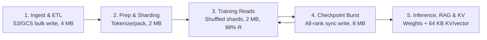
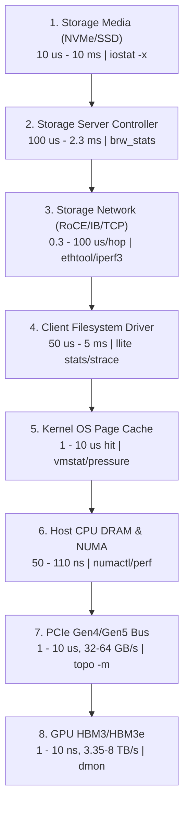
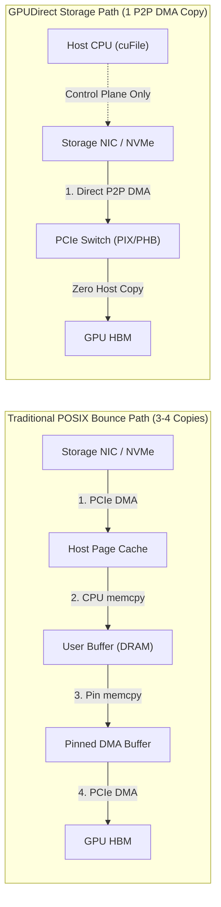

# 13.1 The AI data path: from storage to GPU

| Field | Value |
|---|---|
| Level | Basics to Intermediate |
| Priority tier | 2 |
| Lab venue | GCP / GKE (and local Python verification in `code/part13/ai_data_path_lab.py`) |
| Part | Part 13: AI storage |
| Sources used | `nvidia-devops` Volume 15 (`index.md`, `chapter-01-why-ai-storage-is-different.md`, `chapter-02-the-ai-data-path-from-storage-to-gpu.md`, `chapter-12-volume-15-summary.md`, `labs/lab-01-baseline-an-ai-storage-path.md`) and Legacy Volume 06 (`03-ai-storage-data-pipelines-masterclass.md`); *AI Systems Performance Engineering* (`ai-systems-performance-engineering`, `ASP`); *AI Data Center Network Design and Technologies* (`ai-data-center-network-design-and-technologies`, `ADCN`) |
| Coverage file | `planning/coverage/chapters/13-01.md` |
| Claim ledger | `planning/ledgers/13-01.md` |

## Why this matters for AI infrastructure

A GPU that sits idle waiting on a data loader or a stalled checkpoint costs the exact same hourly rate as a GPU waiting on a broken collective or a software bug. Yet storage is routinely sized by two marketing numbers on a vendor datasheet: total usable terabytes and peak sequential bandwidth. When `128` or `1,024` GPU workers start a distributed training run, a storage array that passed a synthetic sequential read benchmark can still collapse to `24%` GPU utilization. During an epoch shuffle across `18,000,000` small files, metadata lookup latency (`stat`, `openat`, `getattr`) starves the data loaders long before the network links saturate. An hour later, when all `1,000` GPUs pause simultaneously to flush a `140 GB` to `2 TB` checkpoint, the synchronized write burst (incast) overwhelms storage controller queues and blocks forward progress across the entire cluster.

Understanding AI storage requires replacing the single-number mental model ("we bought a `38 GB/s` array") with an end-to-end data path model. A training sample or model shard must traverse eight distinct hardware and software boundaries: storage media (`SSD`/`NVMe`/`HDD`), storage server controllers, the storage network fabric (`RoCEv2`, `InfiniBand`, or `NVMe-oF/TCP`), the client filesystem driver (`Lustre`, `BeeGFS`, `WEKA`, `VAST`, `3FS`, or `NFS`), the Linux kernel page cache, host CPU DRAM across `NUMA` domains, the `PCIe` root complex or switch fabric, and finally GPU `HBM`. Each boundary has both a per-operation latency (`1 ns` to `10 ms`) and an aggregate capacity ceiling. This chapter maps all five AI storage workload phases across the four-tier AI factory storage hierarchy, traces the traditional POSIX CPU bounce-buffer path (`3` to `4` memory copies) against the GPUDirect Storage (`GDS`) peer-to-peer `DMA` path (`1` copy), derives the per-GPU (`200 MB/s`), per-node (`1.6 GB/s`), and per-rack (`14` to `20 GB/s` for an `NVL72` rack) bandwidth scaling formulas, and gives you the exact Linux and NVIDIA diagnostic commands to isolate which layer is starving your accelerators.

## Prerequisites and outcomes

**Prerequisites:**
- Familiarity with Linux storage and memory inspection tools (`iostat`, `vmstat`, `lsblk`, `numactl`, `strace`) from Part 3.
- Understanding of `PCIe` generations (`Gen4 x16` at `32 GB/s`, `Gen5 x16` at `64 GB/s`), `NUMA` socket topology, and `nvidia-smi topo -m` distance codes (`PIX`, `PXB`, `PHB`, `NODE`, `SYS`) from Part 2 and Part 6.
- Basic knowledge of `RoCEv2` and `InfiniBand` lossless fabrics from Part 7.

**Outcomes:** After completing this chapter, you will be able to:
1. Classify the five AI storage lifecycle phases (ingest/ETL, preprocessing/staging, training dataloader reads, synchronous checkpoint writes, and inference RAG/KV-cache offload) by block size, read/write ratio, and metadata rate (`100` to `500,000` ops/s).
2. Calculate why a `7.2 PB` Lustre filesystem with `48` Object Storage Targets (`OSTs`) rated at `800 MB/s` each (`38.4 GB/s` aggregate) delivers only `4.3 GB/s` on `220 KB` files (`87,040` opens/s against a `50,000` ops/s Metadata Server ceiling) and how repackaging into `10 MB` shards restores `18.6 GB/s` and `91%` GPU utilization.
3. Map the four-tier AI factory storage hierarchy (`Tier 0` GPU `HBM`, `Tier 1` local `NVMe` scratch, `Tier 2` parallel filesystem, `Tier 3` object data lake) and the eight-layer storage-to-GPU data path.
4. Contrast the traditional POSIX CPU bounce-buffer read path (`3` to `4` copies, `2` `PCIe` traversals, heavy host `DRAM` traffic) against GPUDirect Storage (`1` direct `P2P DMA` transfer across `PCIe`, `0` host payload copies) and interpret `gdscheck -p` and `gdsio` (`-x 2` vs `-x 0`) benchmarks.
5. Size storage read bandwidth (`200 MB/s` per GPU, `1.6 GB/s` per `8`-GPU node, `14.4` to `20 GB/s` per `72`-GPU `NVL72` rack, `204.8 GB/s` per `1,024`-GPU cluster) and synchronous checkpoint write bandwidth (`2 TB` in `60 s` = `33.33 GB/s`, requiring `42` `OSTs` at `800 MB/s`).

---

## 1. Why AI storage is different: the five workload phases and the capacity illusion

Traditional enterprise storage arrays (`SAN` and `NAS`) are engineered either for transactional databases (small `4 KB` random I/O with predictable concurrency) or media streaming (a few clients reading large contiguous files sequentially). An AI factory violates both assumptions simultaneously. Within a single training and serving lifecycle, the storage subsystem is hit by five conflicting workload phases: massive unstructured ingestion, CPU/GPU-heavy tokenization and sharding, randomized parallel epoch reads across millions of samples, sudden all-rank synchronous checkpoint write bursts, and latency-critical inference model loading, RAG vector lookups, and KV-cache offloading.

### 1.1 The three failure modes of standard IT storage in AI

When an enterprise NAS or untuned storage array is attached to a GPU cluster, it fails in three characteristic ways:

1. **The Metadata Problem (Small Files):** Computer vision, audio, and multimodal datasets frequently start as `10,000,000` to `18,000,000` individual files averaging `20 KB` to `220 KB` each. Before a single byte of pixel or token payload flows across the network, the client filesystem must resolve the directory path, check permissions (`stat` / `getattr`), open the file descriptor (`openat`, a serialized RPC to the Metadata Server), read the tiny payload, and close the descriptor (`close`). The storage controller spends `85%` to `95%` of its wall-clock time answering metadata lookups rather than streaming bytes, starving the GPUs while storage network links sit `80%` idle.
2. **The Epoch Shuffle (Random Reads Destroy Read-Ahead):** To prevent a neural network from memorizing sample order across epochs, `DistributedSampler` and data loaders shuffle indices randomly every epoch. Hard disk drives (`HDDs`) physically cannot seek fast enough for random access, and even on `NVMe` arrays, random reads across unsharded files defeat OS kernel read-ahead buffers (`read_ahead_kb`, default `128 KB`) and thrash the Linux page cache when the dataset exceeds host `DRAM`.
3. **The Checkpoint Bomb (Synchronous Write Incast):** Every `N` steps (or every `1` to `2` hours), all `128` to `1,024` GPUs pause forward and backward computation and simultaneously flush model weights, gradients, and optimizer states (`140 GB` to `2 TB` or more) to persistent storage. This synchronized all-rank fan-in creates a massive network and storage controller traffic jam (incast). Every second spent waiting on checkpoint write acknowledgments (`ACKs`) directly reduces cluster goodput.

### 1.2 The five AI storage workload phases

Designing an AI storage pipeline requires separating the data lifecycle into five distinct operational phases, each with its own block size, read/write mix, metadata pressure, and failure impact.



| Phase | Dominant I/O Pattern | Typical Block Size | Read / Write Split | Metadata Rate at Scale | Primary Storage Tier | Impact When Bottlenecked |
|---|---|---|---|---|---|---|
| **1. Ingest & Raw Collection** | Bulk object writes, dataset scraping, manifest listing | `4,096 KB` (`4 MB`) | `20%` R / `80%` W | `1,000–50,000` ops/s | `Tier 3` Object Store (`S3`/`GCS`) | Delays offline ETL pipeline; does not stall active training GPUs |
| **2. Preprocessing & Sharding** | Read raw objects, deduplicate, tokenize (`NeMo Curator`), pack `.bin`/`.idx` or `WebDataset` `.tar` | `2,048 KB` (`2 MB`) | `55%` R / `45%` W | `5,000–100,000` ops/s | `Tier 2` Parallel FS + `Tier 1` NVMe | Saturates prep CPU/GPU nodes; leaves unsharded small files if skipped |
| **3. Training Dataloader Reads** | Parallel shuffled sequential reads across workers, epoch boundary rescans | `2,048 KB` (`2 MB`) | `98%` R / `2%` W | `50,000–500,000` ops/s (unsharded) or `< 10,000` ops/s (sharded) | `Tier 1` Local NVMe / `Tier 2` PFS | **Stalls GPU SMs on every step; SM utilization drops to `24%–30%`** |
| **4. Synchronous Checkpoint Writes** | Coordinated all-rank burst write of weights + optimizer state, periodic `fsync` | `8,192 KB` (`8 MB`) | `1%` R / `99%` W | `1,000–50,000` ops/s | `Tier 1` NVMe Stage -> `Tier 2` PFS -> `Tier 3` Object | **Freezes all training ranks simultaneously until write completes** |
| **5. Inference, RAG & KV Offload** | Serial/broadcast model startup read, `64 KB` random vector/KV-cache reads & writes | `64 KB` (KV/RAG) to `4,096 KB` (weights) | `85%` R / `15%` W | `100–1,000` ops/s (weights), `1,000–100,000` ops/s (RAG/KV) | `Tier 0` HBM + `Tier 1` Local NVMe + Object/Vector Store | Inflates cold-start time, Time-to-First-Token (`TTFT`), and `p99` latency |

### 1.3 Capacity is not throughput: worked metadata bottleneck calculation

To see why raw capacity and aggregate array bandwidth ratings fail to predict training performance, examine a production `7.2 PB` Lustre filesystem deployment:
- **Storage array hardware:** `48` Object Storage Targets (`OSTs`), each rated at `800 MB/s`, giving a datasheet aggregate read throughput of `48 * 800 MB/s = 38,400 MB/s` (`38.4 GB/s`, ~`38 GB/s`).
- **Metadata server (`MDS`) ceiling:** Tuned for `50,000` metadata operations per second (`ops/s`).
- **Training workload:** `128` GPU workers, each requiring `150 MB/s` of training data. Expected aggregate read bandwidth is `128 * 150 MB/s = 19,200 MB/s` (`19.2 GB/s`), which is exactly `50%` of the array's `38.4 GB/s` capacity.
- **Actual observed result:** Delivered throughput collapses to `4.3 GB/s`, and GPU utilization drops from `94%` to `24%`.

Is the storage array oversubscribed on bandwidth? No. The dataset consists of `18,000,000` individual files averaging `220 KB` each. For each file, a worker's data loader must:
1. Query the `MDS` for path resolution (`~10 us`).
2. Issue an `open()` serialized RPC (`~40 us`).
3. Read the `220 KB` payload (`~100 us` network + copy).
4. Issue `close()` and move to the next file.

At a target rate of `150 MB/s` (`150,000 KB/s`) with `220 KB` files, each worker must open:

```text
Files/sec per worker = (150,000 KB/s) / (220 KB/file) ~= 680 files/s
```

Across `128` workers, the aggregate `open()` rate hitting the `MDS` is:

```text
Total MDS open rate = 128 x 680 = 87,040 opens/s
```

Because the `MDS` is rated for `50,000` ops/s, the metadata tier is overloaded by `75%` (`87,040` vs `50,000` ops/s) even before counting `getattr` / `stat` calls, while the `48` `OSTs` sit nearly idle. When the engineering team repackages the exact same `18,000,000` files (`18` million) into `750,000` (`750K`) contiguous `10 MB` (`10,000 KB`) shards (`WebDataset` `.tar` or `TFRecord`), each worker opens only `150,000 / 10,000 = 15` files/s (`128 * 15 = 1,920` opens/s total). Metadata load drops to `3.8%` of `MDS` capacity, delivered read throughput jumps from `4.3 GB/s` to `18.6 GB/s`, and GPU utilization recovers from `24%` to `91%`.

A second production incident on a `10`-node (`80` `A100` GPUs) Lustre cluster illustrates the same trap at smaller scale: expected throughput was `10 * 150 MB/s = 1.5 GB/s`, but week-1 throughput reached only `280 MB/s` with GPUs idle `40%` of the time. While `iperf3` confirmed `8 Gbps` per client (`80 Gbps` aggregate) and `lfs df -h` showed all `OSTs` balanced at `62%` capacity, `lctl get_param llite.*.stats | grep open` revealed `95,000` opens/s caused by `15,000,000` small files in a `40 GB` dataset directory. Repackaging into `50` shards of `800 MB` each dropped metadata operations to `8,000` ops/s, raised throughput to `1.42 GB/s`, and brought GPU utilization to `88%`.

---

## 2. The AI storage hierarchy and the 8-layer data path

No single storage medium satisfies the cost, capacity, and latency requirements of all five AI workload phases. Production AI factories organize storage into four tiers (`Tier 0` through `Tier 3`), and every read or write traverses up to eight hardware and software layers between the physical storage media and the GPU's Streaming Multiprocessors (`SMs`).

### 2.1 The four-tier AI factory storage hierarchy

| Tier | Name & Location | Representative Hardware / Software | Typical Capacity | Bandwidth Scale | Typical Access Latency | Primary Role in AI Pipeline |
|---|---|---|---|---|---|---|
| **Tier 0** | **GPU HBM** (on-package with compute die) | `A100` (`40/80 GB`), `H100` (`80 GB`), `H200` (`141 GB`), `B200` (`192 GB`) | `40–192 GB` per GPU | `1.5–2.0 TB/s` (`A100`), `3.35 TB/s` (`H100`), `4.8 TB/s` (`H200`), `8.0 TB/s` (`B200`) | `1–10 ns` | Active weights, activations, gradients, and hot inference KV cache |
| **Tier 1** | **Host Local NVMe Scratch** (`PCIe` Gen4/Gen5 in compute node) | `DGX H100`: `8 x 3.84 TB` NVMe in `RAID 0` (`30.72 TB` raw) | `15–60 TB` per node | `25–60 GB/s` per node | `10–20 us` (`~100 ns` PCIe Gen5 bus hop) | Hot dataset shard cache (`AIStore`, `Alluxio`, `hostPath`), async checkpoint staging |
| **Tier 2** | **Parallel File System (`PFS`)** (dedicated `RoCEv2` or `IB` storage fabric) | `Lustre` (`DDN EXAScaler`, `FSx`), `WEKA`, `BeeGFS`, `VAST`, `IBM Storage Scale`, `DeepSeek 3FS` | `1–50+ PB` cluster-wide | `100 GB/s` to `7.3 TB/s` aggregate | `300 ns` (`IB` switch) / `800 ns` (`Eth` switch) to `0.5–5 ms` | Shared active datasets, distributed checkpoint bursts, multi-node scratch |
| **Tier 3** | **Object Store / Data Lake** (capacity tier on-prem or cloud) | `AWS S3`, `GCS`, `MinIO`, `Ceph`, `Pure FlashBlade`, `Scality` | `10–500+ PB` | `10–100+ GB/s` over HTTP/TLS (`s5cmd`) | `5–50 ms` | Durable raw data lake, cold checkpoint archive, model registry |

Modern AI filesystems increasingly blur the boundary between `Tier 1` and `Tier 2` by pooling node-local or rack-local `NVMe` drives over `RDMA`. For example, DeepSeek's open-source Fire-Flyer File System (`3FS`) combines four components—cluster manager, sharded metadata service, storage service, and kernel/RDMA client—to bypass the OS page cache entirely and serve random training and KV-cache reads directly from `NVMe` over `InfiniBand` or `RoCEv2`. On a `68`-node cluster equipped with `10 x 16 TB` `NVMe` SSDs and dual `100 Gb/s` NICs per node, `3FS` sustained `6.6 TB/s` of aggregate read throughput alongside `1.4 TB/s` of background traffic (compared to `~1.1 TB/s` on `Ceph` on similar hardware), and reached `7.3 TB/s` on larger production clusters.

### 2.2 The 8-layer data path from storage media to GPU HBM

When a training job reads a batch from shared storage without `GPUDirect Storage`, the payload must cross eight distinct layers. Each layer has both a per-operation latency and a finite queue/bandwidth capacity.



| Layer | Component | Typical Latency | Capacity / Bottleneck Limit | Primary Linux / GPU Measurement Tool | Healthy vs Saturated Signal |
|---|---|---|---|---|---|
| **1** | **Storage Media** (`NVMe`, `SSD`, `HDD`) | `10 us–10 ms` | Drive IOPS & media channels (`~5–7 GB/s` per Gen4 NVMe) | `iostat -x 1 /dev/nvme0n1`, `smartctl -a` | Healthy: `r_await < 2 ms`, `Media_Errors = 0`. Saturated: `%util = 100.0`, `r_await > 5 ms` |
| **2** | **Storage Server CPU & I/O Controller** | `100 us–2.3 ms` | Controller RPC slots (`256` max), server RAM cache | `lctl get_param obdfilter.*.brw_stats`, `iotop -P -o` | Healthy: `87.2%` server cache hit, `2.3 ms` service time. Saturated: `< 20%` cache hit, `8–10 ms` latency |
| **3** | **Storage Network Fabric** (`RoCEv2`, `IB`, `TCP`) | `300 ns` (`IB`) / `800 ns` (`Eth`) to `100 us` | Link speed (`100/200/400 Gbps`), switch buffers, `1:3` oversubscription | `ethtool -S eth0`, `iperf3 -c server -t 10 -R`, `ibstat` | Healthy: `> 80%` rated link (`106 Gbps` on `200G`), `0` drops. Saturated: `rx_dropped > 0`, `1,000+` TCP `Retr` |
| **4** | **Client Filesystem Driver** (`Lustre`, `WEKA`, `BeeGFS`, `NFS`) | `50–500 us` (local), `0.5–5 ms` (remote) | `max_rpcs_in_flight`, MDS open/stat RPC serialization | `lctl get_param llite.*.stats`, `strace -c -p <pid>` | Healthy: `open` avg `< 2,000 us` (`2 ms`). Saturated: `open` avg `7,234 us` (`7.2 ms`), `85%` time in `stat` |
| **5** | **Kernel OS Page Cache** | `1–10 us` (hit), `1–10 ms` (refill) | Free host RAM (`vmstat cache`), `kswapd` reclaim rate | `vmstat 1`, `cat /proc/pressure/memory` | Healthy: warm cache (`18,342M`), `wa < 5%`. Saturated: constant eviction thrash, `wa >= 15%` |
| **6** | **Host CPU DRAM & NUMA** (`DDR5` / `LPDDR5X`) | `50–55 ns` (local), `100–110 ns` (remote) | Per-socket memory controller BW & `CPU` `memcpy` cores | `numactl --hardware`, `ps -eLo pid,lwp,psr,comm`, `perf record` | Healthy: loader pinned to local NUMA node. Saturated: cross-socket `SYS` access (`20–30%` throughput loss) |
| **7** | **PCIe Bus / Switch Fabric** (`Gen4` / `Gen5 x16`) | `1–10 us` (`~100 ns` local switch) | `PCIe Gen4 x16` = `32 GB/s`; `Gen5 x16` (`32 GT/s`) = `64 GB/s` (`~63 GB/s` net) | `lspci -vvv`, `nvidia-smi topo -m`, `nvidia-smi dmon -s t` | Healthy: `PIX`/`PXB`/`PHB` affinity, pinned `DMA` at `90%` copy util. Saturated: unpinned `60%` copy util or `SYS` hop |
| **8** | **GPU HBM** (`HBM3` / `HBM3e`) | `1–10 ns` | `40–192 GB` capacity, `3.35–8.0 TB/s` bandwidth | `nvidia-smi dmon`, `nvidia-smi -q`, `Nsight Systems` | Healthy: `sm = 94–95%`, `mem = 40%`, `> 10%` free HBM. Starved: `sm` oscillating `24%–94%` on data wait |

---

## 3. Traditional bounce-buffer I/O vs GPUDirect Storage (`GDS`)

Even when the external storage array (`Layers 1–4`) delivers `10 GB/s` to the compute node's NIC or local `NVMe` drive, the internal node data path (`Layers 5–8`) frequently chokes on redundant memory copies and unpinned buffers.

### 3.1 Anatomy of the POSIX CPU bounce-buffer path (3 to 4 copies)

In standard POSIX file I/O (`read()` syscall followed by PyTorch tensor creation and `.to('cuda')`), data cannot move directly from the storage controller into GPU `HBM`. Instead, it bounces through host CPU memory multiple times:

1. **Copy 1 (Hardware DMA to Kernel Page Cache):** The storage `NIC` or `NVMe` controller transfers the file blocks over the `PCIe` bus (`PCIe Traversal 1`) into the Linux kernel's **OS Page Cache** in pageable host `DRAM`.
2. **Copy 2 (Kernel-to-User CPU `memcpy`):** The host CPU is interrupted, switches context, and executes a CPU-driven `memcpy` (`__memcpy_avx2`) from the kernel page cache into the application's user-space buffer (for example, a Python `bytes` object or pageable `torch.Tensor` in host `DRAM`).
3. **Copy 3 (Pageable-to-Pinned Host Staging Copy):** Because the GPU's `DMA` engine cannot safely read pageable virtual memory (which the OS kernel could swap or relocate mid-transfer), calling `.to('cuda')` on an unpinned tensor forces the CUDA driver to allocate a temporary **page-locked (pinned) host staging buffer** and perform a second CPU `memcpy` in host `DRAM`. *(If the DataLoader pre-allocates pinned memory via `pin_memory=True` or `O_DIRECT` into a pinned buffer, Copies 1–3 collapse into fewer steps, but the payload still lands in host `DRAM` first).*
4. **Copy 4 (Pinned Host DRAM to GPU HBM DMA):** Finally, the CUDA driver programs the GPU's copy engine to `DMA` the batch from pinned host `DRAM` back across the `PCIe` bus (`PCIe Traversal 2`) into **GPU `HBM`**.

Count the cost of this bounce-buffer brigade for every `10 GB` of training data:
- **Unpinned POSIX path:** `4` total memory copies (`2` `PCIe` DMA crossings + `2` CPU `memcpy` operations), generating `60 GB` of host `DRAM` read/write traffic (`1` DMA write + `2` CPU reads + `2` CPU writes + `1` DMA read).
- **Pinned `pin_memory=True` path:** `3` total memory copies (`2` `PCIe` DMA crossings + `1` CPU copy from page cache to pinned buffer), generating `40 GB` of host `DRAM` traffic.

In a production training run where throughput stalled at `45 GB/s` instead of the expected `60 GB/s` (with GPUs at `78%` utilization, waiting `22%` of the time), timing `next(iter(train_loader))` revealed `120 ms` per batch (`3.6 s` of pure overhead across `30` batches/epoch), while `nvidia-smi dmon -s t` showed the GPU memory copy engine running at only `60%` utilization. Inspecting `batch[0].is_pinned()` returned `False`: every `.to('cuda')` call was copying from pageable memory. Adding a custom `pin_collate` function with `.pin_memory()` eliminated the pageable-to-pinned bounce copy, cutting loader time from `120 ms` to `30 ms` (`4x` faster), raising GPU utilization to `94%`, and lifting throughput to `58 GB/s`.

### 3.2 GPUDirect Storage (`GDS`) architecture: 1 direct P2P DMA copy

**GPUDirect Storage (`GDS`)**, part of the NVIDIA Magnum IO stack, eliminates the host `DRAM` bounce buffer entirely. Using the `nvidia-fs.ko` kernel driver and the user-space `libcufile.so` library (`cuFileRead`, `cuFileWrite`, `cuFileReadAsync`, `cuFileWriteAsync`), the application registers GPU `HBM` buffers directly via `cuFileBufRegister`.



| Metric / Path Attribute | Traditional Unpinned POSIX (`read` + `.to('cuda')`) | Traditional Pinned (`pin_memory=True`) | GPUDirect Storage (`cuFileRead` + `nvidia-fs`) |
|---|---|---|---|
| **Total data copies** | `4` copies | `3` copies | **`1` direct P2P DMA copy** |
| **PCIe bus traversals per byte** | `2` (`Device -> RAM`, `RAM -> GPU`) | `2` (`Device -> RAM`, `RAM -> GPU`) | **`1` (`Device -> PCIe Switch -> GPU`)** |
| **CPU `memcpy` operations (`__memcpy_avx2`)** | `2` | `1` | **`0` (CPU is control-plane only)** |
| **Host DRAM traffic per `10 GB` read** | `60.0 GB` | `40.0 GB` | **`0.0 GB` payload (`BAR1` P2P DMA)** |
| **`gdsio` measured throughput (`4` workers, `1M` IO, `10G` file)** | `~5.2 GB/s` (pageable baseline) | `8.0 GB/s` (`gdsio -x 2`) | **`9.6 GB/s` (`gdsio -x 0`, `+20%` uplift)** |
| **`gdsio` average I/O latency** | `~1.90 ms` | `1.25 ms` (`gdsio -x 2`) | **`1.00 ms` (`gdsio -x 0`, `-20%` latency)** |
| **VAST / Hopper H100 RDMA read uplift** | Baseline | Baseline | **`+20%` on `A100`, `+30%+` on `H100`** |

Two architectural rules govern `GDS` in production:
1. **Kernel filesystem + `O_DIRECT` requirement:** `GDS` requires a kernel-level filesystem client integrated with `nvidia-fs` (`EXT4`/`XFS` over local `NVMe` or `NVMe-oF`, `Lustre`, `WEKA`, `BeeGFS`, `VAST` NFS-over-RDMA, `IBM Storage Scale`). User-space `FUSE` filesystems cannot use `GDS` because they bounce buffers through user space and lack kernel `O_DIRECT` DMA hooks.
2. **Compatibility mode trap (`allow_compat_mode`):** In `/etc/cufile.json`, `allow_compat_mode: true` instructs `libcufile` to silently fall back to standard POSIX host-memory reads if `nvidia-fs` or the mount does not support `GDS`. During qualification, set `"allow_compat_mode": false` and verify that `/proc/driver/nvidia-fs/stats` counters increment and `__memcpy_avx2` disappears from `perf record`. Note also that `cuda-checkpoint` (used with `CRIU` for process migration via `cuCheckpointProcessLock` / `cuCheckpointProcessCheckpoint`) is orthogonal to `GDS`: `cuda-checkpoint` copies device memory into host driver memory during suspend rather than using `GDS` direct storage DMA.

---

## 4. Bandwidth math, NUMA/PCIe locality, and page cache pollution

### 4.1 Per-GPU, per-node, and per-rack bandwidth scaling

How much sustained storage read bandwidth does a cluster actually need? A standard baseline for multimodal and LLM training is **`200 MB/s` (`0.2 GB/s`) per GPU** (calibrated from `bytes_per_sample * samples_per_second_per_gpu`; lighter text-only workloads may need `50–150 MB/s` per GPU, while heavy video or uncompressed multimodal workloads can require `400–1,000 MB/s` per GPU):

- **Single `8`-GPU node (`DGX H100` / `HGX B200`):**

```text
8 x 200 MB/s = 1,600 MB/s = 1.6 GB/s\quad (12.8 Gbps)
```

- **Single `72`-GPU Grace Blackwell `GB200`/`GB300 NVL72` rack:**

```text
72 x 200 MB/s = 14,400 MB/s = 14.4 GB/s\quad (typically sized for  14–20 GB/s per rack)
```

- **`1,024`-GPU training cluster (`128` nodes of `8` GPUs):**

```text
1,024 x 200 MB/s = 204,800 MB/s = 204.8 GB/s
```

Now compare steady-state read bandwidth against the **synchronous checkpoint write burst**:
- Suppose a `500B`-parameter model produces a **`2 TB` (`2,000 GB`) checkpoint** (weights + optimizer states) across `256` nodes every `2` hours, and our SLA requires the checkpoint pause to stay **under `60` seconds**:

```text
Required Checkpoint Write Bandwidth = (2,000 GB) / (60 s) ~= 33.33 GB/s
```

- If a smaller `500 GB` checkpoint is written on a `40 GB/s`-capable Lustre cluster (`48` `OSTs` at `800 MB/s` each), theoretical write time is `500 / 40 = 12.5` seconds. Yet in production, engineers frequently observe a `45`-second stall (`32` seconds of extra latency). Why? By default, a single checkpoint file or rank-0 directory may be striped across only **`4` `OSTs`**, capping write bandwidth at `4 * 800 MB/s = 3.2 GB/s` (`500 GB / 3.2 GB/s = 156 s` raw, or `45 s` with partial caching and host serialization). Increasing the Lustre stripe count (`lfs setstripe -c 32`) to `25–32` `OSTs` (`25 * 0.8 = 20.0 GB/s` to `32 * 0.8 = 25.6 GB/s`) and staging writes asynchronously to Tier 1 local `NVMe` before background-flushing to Tier 2 cuts the training pause down to `20–25` seconds (or under `2–5` seconds for the local `NVMe` stage).

### 4.2 NUMA and PCIe topology alignment (`PIX`/`PHB` vs `SYS`)

Inside a dual-socket GPU server, every `GPU`, `Storage NIC`, and `NVMe` drive attaches to a specific CPU socket (`NUMA node 0` or `NUMA node 1`) and `PCIe` root complex.

| `nvidia-smi topo -m` Code | Meaning | P2P / GDS Path Quality | Typical Bandwidth Impact |
|---|---|---|---|
| **`PIX`** | Connection traversing at most a single `PCIe` switch | **Optimal for GDS P2P DMA** | `100%` of rated `PCIe` / `NIC` speed |
| **`PXB`** | Connection traversing multiple `PCIe` switches without crossing the PCIe Host Bridge | **Very good for GDS** | `95–100%` of rated speed |
| **`PHB`** | Connection traversing a PCIe Host Bridge within the same CPU `NUMA` socket | **Supported for GDS** (root complex hair-pinning) | `85–95%` of rated speed |
| **`NODE`** | Connection traversing `PCIe` and interconnect between NUMA nodes within a socket | Suboptimal | `~88%` retention (`~12%` penalty) |
| **`SYS`** | Connection crossing the inter-socket interconnect (`Intel UPI` / `AMD Infinity Fabric`) | **Poor / GDS P2P often disabled or severely throttled** | `~55–72%` retention (`20–30%+` throughput loss; DRAM latency doubles from `50–55 ns` to `100–110 ns`) |

If `GPU0` and `NIC0` reside on `NUMA 0` (CPUs `0–7` or `0–31`), but the Linux scheduler places the PyTorch `DataLoader` worker processes on `NUMA 1` (CPUs `8–15` or `32–63`), every memory access crosses the socket interconnect (`50 ns -> 100+ ns`). Pinning the workload with `numactl -N 0 -m 0` (or per-rank `torchrun` affinity) eliminates cross-socket traffic and routinely recovers `20%` to `30%` of lost data-loading throughput. On NVIDIA Grace Blackwell (`GB200`/`GB300`), the `72`-core Grace CPU connects to the Blackwell GPU over `NVLink-C2C` at up to `900 GB/s` bidirectional bandwidth, and the GPU includes a hardware **Decompression Engine** supporting `LZ4`, `Snappy`, and `Deflate` (`nvJPEG` for images) so compressed batches can be transferred and unpacked directly on the GPU without saturating CPU cores.

### 4.3 Linux Page Cache pollution vs `O_DIRECT`

The Linux kernel automatically caches recently read file blocks in free `DRAM` (**Page Cache**, shown as `cache` in `vmstat` and `Cached` in `/proc/meminfo`). Whether the page cache helps or hurts depends on the ratio of **dataset working set ($W$)** to **available host RAM ($M$)**:

1. **Regime A: Working set fits in RAM (`W <= 0.85 x M`, e.g., `120 GB` dataset on `256 GB` free RAM):** Epoch 1 populates the page cache from storage; Epoch 2+ serves reads directly from host `DRAM` at `1–10 us` latency with a `~95%` cache hit rate and zero network I/O. Keep buffered I/O enabled and tune `/sys/block/nvme*/queue/read_ahead_kb` (from default `128 KB` up to `2,048–4,096 KB` via `blockdev --setra`) for sequential scans.
2. **Regime B: Working set exceeds RAM (`W \gg M`, e.g., `4 TB` shuffled dataset on `512 GB` RAM):** Because every epoch shuffles samples across `4 TB`, a cached `4 KB` page is evicted long before the next epoch needs it again. Cache hit rate collapses below `4%–15%`, yet the kernel spends massive CPU cycles allocating page frames, copying payloads, and running `kswapd` memory reclaim (`vmstat wa = 15%`, `/proc/pressure/memory` stalls). In this regime, bypass the OS page cache entirely using **`O_DIRECT`** (`direct=1` in `fio`, `O_DIRECT` file flags, `GDS` `cuFileRead`, or direct-I/O filesystems like `3FS`).

## 5. Storage network fabrics and Kubernetes CSI integration

### 5.1 NVMe-oF (`TCP` vs `RDMA` over `RoCEv2` vs `InfiniBand`) and Fabric A/B design

When storage moves off the local `PCIe` bus (`~100 ns` Gen5 latency, `32 GT/s` per lane = `~63 Gbps` unidirectional per lane or `64 GB/s` across `x16`, enough to drive a `400 Gbps` storage NIC at line rate), AI data centers deploy dedicated backend storage networks. Unlike the `1:1` non-blocking rail-optimized compute fabric used for `NCCL` collectives, the storage fabric commonly uses a **`1:3` oversubscribed** leaf-spine Clos topology (or a collapsed `2`-switch design for edge/inference pods) with **physical or logical Fabric A / Fabric B path diversity** (`NIC A -> Leaf 1 / Fabric A`, `NIC B -> Leaf 3 / Fabric B`). For inter-site replication over distances of `40 km` or more, lossless `RoCEv2` (`PFC` + `DCQCN`) becomes difficult to maintain, so operators use deep-buffer Ethernet switches with `NVMe-oF/TCP` or `S3` over `HTTPS`/`IPsec`.

Under the hood, **NVMe over Fabrics (`NVMe-oF`)** preserves the native `NVMe` queue model—host Submission Queue Entries (`SQEs`, `64 B` commands with opcode `0x02` for read and `0x01` for write, Namespace ID `NSID`, and `64`-bit Physical Region Page `PRP1`/`PRP2` pointers or Scatter-Gather Lists `SGLs`) and controller Completion Queue Entries (`CQEs`)—by wrapping them inside fabric **capsules**:

| Storage Network Option | Transport Encapsulation & Ports | Typical Switch / Fabric Latency | Lossless Fabric Required? | Parallel Shared File Access | Primary AI Factory Use Case |
|---|---|---|---|---|---|
| **`NVMe-oF/TCP`** | `TCP` (`port 8009` discovery; `IC Req PDU`, `CapsuleCmd` `0x01`, `C2HData` `0x04`, `H2CData` `0x03`, `H2CTermReq`) | `~800 ns` per Ethernet switch hop + host TCP stack | **No** (runs over standard lossy BGP/IP fabric with `MTU 9000` jumbo frames) | No (block-level `1:1` host-to-target session per CPU core) | Cost-effective scale-out block storage, cold/warm tier, `> 40 km` WAN replication |
| **`NVMe-oF/RDMA` (`RoCEv2`)** | `UDP` (`TCP 8009` discovery, `UDP 4420` `RDMA_CM` `RDMA_PRTYPE 04`, `UDP 4791` `BTH` + `RETH` + NVMe capsule; `1:1` SQ/CQ to `QPair`) | `700–900 ns` port-to-port Ethernet switch latency (`~66%` lower write latency vs TCP) | **Yes** (`PFC`, `ECN`, `DCQCN` tuned separately from training fabric) | No (unless layered under a parallel FS like `WEKA`, `VAST`, or `3FS`) | High-IOPS block targets, `GPUDirect Storage` over Ethernet (`100/200/400 Gbps` storage NICs) |
| **`InfiniBand` Storage (`NVMe-oF/IB` / `LNet`)** | Native `IB` (`LRH` with `16`-bit `S-LID`/`D-LID` up to `48,000` nodes, `GRH`, `BTH` `RDMA_PRTYPE 02`, `ICRC`/`VCRC`) | `~300 ns` port-to-port IB switch latency | **Yes** (hardware `CBFC` credit-based flow control across `16` Virtual Lanes `VLs`, `64 B`/credit) | Via `Lustre` (`LNet`), `BeeGFS`, `GPFS`, or `WEKA` | Ultra-low-latency HPC/AI training storage and direct `GDS` over `NDR`/`HDR` |
| **Parallel FS / `pNFS` over `RDMA`** | `POSIX` client (`open`, `read`, `write`, `stat`, `mmap`) over `RoCEv2` or `IB` (`WEKA`, `Lustre`, `BeeGFS`, `VAST`, `3FS`) | `300–900 ns` switch hop + `50–500 us` client driver | Recommended for `RDMA` transport | **Yes** (`ReadWriteMany` across `1,000+` GPU nodes with distributed metadata) | Primary `Tier 2` AI training datasets and synchronized checkpoint bursts |

### 5.2 Kubernetes CSI (`ReadWriteMany`), `hostPath` NVMe, and PyTorch `DataLoader` pipelining

In Kubernetes-orchestrated AI clusters, standard cloud block `CSI` drivers (`AWS EBS`, `GCP PD`) provide `ReadWriteOnce` (`RWO`) volumes designed for single-pod databases. Distributed training across `64` to `1,024` pods requires **`ReadWriteMany` (`RWX`)** parallel filesystem `CSI` provisioners (such as `csi.weka.io`, `Lustre CSI`, or `Google Cloud Managed Lustre / Filestore`) combined with three critical pod configurations:
1. **`/dev/shm` memory-backed `emptyDir` (`sizeLimit: 400Gi`):** PyTorch multi-worker `DataLoader` processes (`num_workers > 0`) pass collated tensor batches from worker processes to the main training process through POSIX shared memory (`/dev/shm`), and `NCCL` also uses `/dev/shm` for intra-node communication. Docker and Kubernetes default `/dev/shm` to `64 MiB`, which immediately crashes multi-worker data loaders with `Bus error (core dumped)`.
2. **`GPUDirect Storage` config injection (`CUFILE_ENV_PATH_JSON`):** Mount the validated `/etc/cufile.json` `ConfigMap` into the training container and run under `runtimeClassName: nvidia` so `/dev/nvidia-fs*` device nodes are exposed.
3. **`Tier 1` local `NVMe` scratch via `hostPath` (`/mnt/nvme_raid_0/ai_scratch`):** To avoid `CSI` abstraction overhead on node-local `RAID 0` `NVMe` arrays (`8 x 3.84 TB`), mount the host directory directly for dataset shard caching and asynchronous checkpoint staging.

On the software side, even with fast storage, the PyTorch `DataLoader` must overlap CPU batch preparation with GPU kernel execution (**Batch $N$ compute on `compute_stream` overlapped with Batch $N+1$ `H2D` `DMA` copy on `copy_stream` and Batch $N+2$ CPU worker prefetch**):
- Set `num_workers=8` (or scaled to CPU core count, e.g., `72`-core Grace CPU), `pin_memory=True` (with host `ulimit -l unlimited` so locked pages do not fail), `persistent_workers=True` (so workers are not torn down and respawned at every epoch boundary), and `prefetch_factor=4` (queuing `num_workers * prefetch_factor = 32` batches ahead).
- Use `batch.to(device, non_blocking=True)` on a dedicated `torch.cuda.Stream()` and synchronize streams with `compute_stream.wait_stream(copy_stream)`.
- Move heavy image/video decoding off Python threads onto GPU hardware decoders (`NVIDIA DALI` or `nvJPEG`) and pre-tokenize/pack raw text offline using `NVIDIA NeMo Curator` into memory-mappable `.bin` and `.idx` shards (or `Parquet` / `WebDataset`).

---

## Commands and configurations that matter

All commands below are marked `(untested here)` because they target live Linux GPU nodes with `Lustre`/`WEKA`/`NVMe` hardware and `NVIDIA GDS` drivers; see the Hands-on lab for the runnable Python verification suite executed in this repository.

### 1. Layer-by-layer data path inspection (`Layers 1–8`) `(untested here)`

```bash
# (untested here) Layer 1: Local NVMe media health and saturation (%util, r_await)
smartctl -a /dev/nvme0n1 | grep -E "Media_Errors|Unsafe_Shutdowns|Temperature"
iostat -x 1 /dev/nvme0n1 | head -10

# (untested here) Layer 1b: Verify NVMe multiqueue scheduler (none/mq-deadline) and tune read-ahead (128 KB -> 4096 KB)
cat /sys/block/nvme0n1/queue/scheduler
cat /sys/block/nvme0n1/queue/read_ahead_kb
blockdev --setra 8192 /dev/nvme0n1

# (untested here) Layer 2 & 4: Lustre OST balance, server RPC stats, and client metadata open/getattr latency
lfs df -h
lfs df -i
lctl get_param obdfilter.*.brw_stats
lctl get_param llite.*.stats 2>/dev/null | grep -E "close|open|getattr|readdir"
lctl get_param -n mdc.*.max_rpcs_in_flight

# (untested here) Layer 3: Storage NIC link speed, ring buffers, drops, and reverse iperf3 bandwidth
ethtool eth0
ethtool -g eth0
ethtool -S eth0 | grep -E "rx_packets|rx_bytes|rx_errors|rx_dropped|collisions"
iperf3 -c storage-server -t 10 -R

# (untested here) Layer 4b: Tuned NFS mount (when NFS is used on small clusters)
mount -t nfs -o rsize=1048576,wsize=1048576,noatime,async,actimeo=60,lookupcache=pos \
  nfs-server:/export/datasets /mnt/datasets

# (untested here) Layer 5: OS Page Cache activity, memory pressure, and I/O wait (wa)
vmstat 1 10
cat /proc/pressure/memory

# (untested here) Layer 6, 7 & 8: NUMA layout, PCIe link width, GPU-to-NIC topology, and H2D copy utilization
numactl --hardware
nvidia-smi topo -m
lspci -vvv | grep -A 5 "NVIDIA"
nvidia-smi dmon -s t -c 10
nvidia-smi -i 0 --query-gpu=memory.used,memory.total,memory.free --format=csv,nounits
```

### 2. GPUDirect Storage (`GDS`) verification and `gdsio` benchmarking `(untested here)`

```bash
# (untested here) 1. Verify nvidia-fs kernel module and platform GDS support
lsmod | grep nvidia_fs
/usr/local/cuda/gds/tools/gdscheck -p
cat /proc/driver/nvidia-fs/stats

# (untested here) 2. Benchmark CPU bounce-buffer path (-x 2) vs direct GDS DMA path (-x 0)
# Baseline CPU path: 8.0 GB/s, 1.25 ms average latency
/usr/local/cuda/gds/tools/gdsio -f /mnt/data/large_file -d 0 -w 4 -s 10G -i 1M -I 0 -x 2

# Direct GDS path: 9.6 GB/s (+20%), 1.00 ms average latency (-20%)
/usr/local/cuda/gds/tools/gdsio -f /mnt/data/large_file -d 0 -w 4 -s 10G -i 1M -I 0 -x 0
```

Configuration `/etc/cufile.json` (`allow_compat_mode: false` during qualification so silent POSIX fallback cannot mask a broken `GDS` mount) `(untested here)`:

```json
{
  "logging": {
    "level": "ERROR"
  },
  "properties": {
    "max_device_pinned_mem_size_kb": 33554432,
    "use_poll_mode": false,
    "poll_mode_max_size_kb": 4,
    "allow_compat_mode": false
  }
}
```

### 3. Benchmarking sequential reads (`fio`), checkpoint bursts (`fio`), and MDS (`mdtest`) `(untested here)`

```bash
# (untested here) 1. Simulate 32-worker sequential dataset reads (2 MB blocks, 500 GB > host RAM, O_DIRECT)
fio --name=ai_dataset_read_sim \
    --directory=/mnt/weka/ai_datasets/benchmarks \
    --rw=read --bs=2M --size=500G --numjobs=32 --iodepth=128 \
    --ioengine=libaio --direct=1 --group_reporting

# (untested here) 2. Simulate synchronous checkpoint write burst (8 MB blocks, periodic fsync=1000)
fio --name=checkpoint_write_burst \
    --directory=/mnt/lustre/checkpoints/benchmarks \
    --rw=write --bs=8M --size=100G --numjobs=8 --iodepth=64 \
    --ioengine=libaio --direct=1 --fsync=1000 --group_reporting

# (untested here) 3. Stress-test Metadata Server (MDS) across 128 MPI ranks
mpirun -np 128 mdtest -d /mnt/lustre/metadata_stress_test -i 5 -b 10 -z 3 -L -I 100000 -y -u -t
```

### 4. Kubernetes `RWX` CSI StorageClass and GDS-enabled training Pod `(untested here)`

```yaml
# (untested here) RWX parallel filesystem StorageClass + training Pod with 400Gi /dev/shm and cufile.json
apiVersion: storage.k8s.io/v1
kind: StorageClass
metadata:
  name: weka-rwx-ai-optimized
provisioner: csi.weka.io
parameters:
  volumeType: dir/v1
  filesystemName: "ai-factory-primary-fs"
reclaimPolicy: Retain
allowVolumeExpansion: true
---
apiVersion: v1
kind: Pod
metadata:
  name: llm-training-worker-rank-0
spec:
  runtimeClassName: nvidia
  containers:
  - name: pytorch-training-container
    image: nvcr.io/nvidia/pytorch:24.07-py3
    env:
    - name: CUFILE_ENV_PATH_JSON
      value: "/etc/cufile.json"
    volumeMounts:
    - name: dataset-vol
      mountPath: /workspace/datasets
    - name: local-nvme-cache
      mountPath: /mnt/nvme_scratch
    - name: dev-shm
      mountPath: /dev/shm
    - name: gds-config
      mountPath: /etc/cufile.json
      subPath: cufile.json
    resources:
      limits:
        nvidia.com/gpu: 8
  volumes:
  - name: dataset-vol
    persistentVolumeClaim:
      claimName: weka-dataset-pvc-1tb
  - name: local-nvme-cache
    hostPath:
      path: /mnt/nvme_raid_0/ai_scratch
      type: Directory
  - name: dev-shm
    emptyDir:
      medium: Memory
      sizeLimit: 400Gi
  - name: gds-config
    configMap:
      name: gds-configmap
```

---

## How it fails

| Failure Mode | Symptom | Root Cause | Diagnosis Commands | Architectural Fix |
|---|---|---|---|---|
| **1. Metadata Server (`MDS`) Saturation ("Small File Problem")** | GPU `SM` utilization drops from `94%` to `24%–30%`; storage array delivers `4.3 GB/s` out of `38.4 GB/s` capacity while storage network links sit idle. | DataLoader iterates over `10M–18M` small files (`20–220 KB`). Workers issue `87,040–95,000` `open`/`stat` RPCs/s against a `50,000` ops/s `MDS` limit (`85%` of syscall time spent in `stat`). | `strace -c -p <loader_pid>`, `lctl get_param llite.*.stats \| grep -E "open\|getattr"` (`avg > 7,234 us`). | Repackage small files into `10 MB–800 MB` shards (`WebDataset` `.tar`, `TFRecord`, `Parquet`, or `.bin`/`.idx`), reducing `MDS` ops by `50x–50,000x`, or stage dataset to `Tier 1` local `NVMe`. |
| **2. Cascading `D`-State Hang (Uninterruptible Sleep)** | `4`+ nodes drop out of a `64`-node `DDP` job; SSH takes `30 s`; `top` shows load average `500+` with `0%` CPU; `htop` shows hundreds of `python3` processes stuck in state `D` (`kill -9` has no effect). | Broken storage `AOC` cable (`symbol_error_counter > 1000`) or dead storage router causes hard-mounted network FS client (`NFS`/`Lustre`) to block indefinitely inside kernel `rpc_wait_bit_killable`. | `dmesg -T \| grep "blocked for more than 120 seconds"`, `ibstat`, `ibv_devinfo -d mlx5_0`. | Hard-reset wedged nodes via `ipmitool chassis power reset`, replace bad optics, and use bounded timeouts / soft mounts on read-only dataset volumes so I/O errors fail fast instead of locking the kernel. |
| **3. Unpinned Host Bounce-Buffer Stall** | Training achieves `45 GB/s` instead of `60 GB/s`; GPUs sit idle `22%` of each step (`120 ms` loader wait per batch); `nvidia-smi dmon -s t` shows `PCIe` memory copy utilization capped at `60%`. | `DataLoader` returns pageable CPU tensors (`is_pinned() == False`), forcing synchronous on-the-fly host pinning and an extra CPU `memcpy` on every `.to('cuda')` call. | Check `batch[0].is_pinned()`, run `nsys profile --trace=cuda,nvtx,osrt`, inspect `perf record` for `__memcpy_avx2`. | Enable `pin_memory=True` (with `ulimit -l unlimited`), use `non_blocking=True` on a dedicated copy `Stream`, or enable `GPUDirect Storage` (`cuFileRead`). |
| **4. Under-Striped Synchronous Checkpoint Incast** | A `500 GB` checkpoint stalls training for `45 s` (or `500 s` at `1 GB/s`) even though cluster storage is rated for `40 GB/s` (`12.5 s` theoretical). | Checkpoint directory defaults to `4` Lustre `OST` stripes (`4 * 800 MB/s = 3.2 GB/s` ceiling), or `1` `OST` sits at `98%` full while others sit at `49%`. | `lfs getstripe /mnt/lustre/checkpoints`, `lfs df -h`, `iotop -P -o` during checkpoint flush. | Set wide striping on checkpoint directories at creation time (`lfs setstripe -c 32 -S 8M`), shard checkpoints per rank (`PyTorch DCP`), and stage writes asynchronously to `Tier 1` local `NVMe` first. |
| **5. Cross-Socket `NUMA` / `PCIe` Misalignment (`SYS` Hop)** | One node or rank runs `20%–30%` slower than identical peers; `GDS` falls back to host bounce mode or runs at `5.76 GB/s` instead of `10 GB/s`. | DataLoader CPU threads run on `NUMA 1` (`CPUs 8–15`) while `GPU0` and `NIC0` sit on `NUMA 0` (`CPUs 0–7`), forcing every `DRAM` and `PCIe` transfer across the inter-socket `SYS` link (`110 ns` vs `55 ns`). | `nvidia-smi topo -m`, `numactl --hardware`, `ps -eLo pid,lwp,psr,comm \| grep loader`. | Bind each rank's process and memory to the `NUMA` node affine to its GPU and storage NIC (`numactl -N 0 -m 0` or `torchrun` CPU affinity). |
| **6. OS Page Cache Thrashing on Multi-TB Shuffled Datasets** | Throughput degrades sharply on Epoch 2+; `vmstat` shows `wa >= 15%` and high `bi`, `kswapd` burns CPU, and `/proc/pressure/memory` shows high stall percentages. | Shuffled `4 TB` dataset exceeds `512 GB` host RAM; buffered POSIX reads pollute the page cache with single-use pages (`~4%` hit rate) and trigger continuous page reclaim. | `vmstat 1`, `cat /proc/pressure/memory`, `free -h`. | Enable `O_DIRECT` (`direct=1` or `cuFileRead` via `GDS`) to bypass the OS page cache when dataset working set exceeds `85%` of free host RAM. |

---

## Hands-on lab

### Venue and scope

- **Primary runnable lab (verified in this repo):** `code/part13/ai_data_path.py` and `code/part13/ai_data_path_lab.py` (pure Python 3 standard library, `26` automated self-checks).
- **Cluster venue (for live hardware / GKE validation):** GCP / GKE node pool (`a3-highgpu-8g` or `g2-standard-48` with local `NVMe` SSDs and Managed Lustre / Filestore `RWX`), commands marked `(untested here)`.

### Part A: Run the self-checking AI data path lab locally

Run the verification script to validate all five workload phases, metadata saturation math (`128` workers on `220 KB` files vs `10 MB` shards), traditional bounce-buffer (`3–4` copies) vs `GDS` (`1` `DMA` copy), per-GPU/node/rack scaling (`200 MB/s` -> `1.6 GB/s` -> `14.4 GB/s` -> `204.8 GB/s`), `NUMA`/`PCIe` locality penalties, and page cache thrashing vs `O_DIRECT`:

```bash
python3 -B code/part13/ai_data_path_lab.py
```

Expected output (verified):

```text
[PASS] five_workload_phases_defined
[PASS] ingest_phase_write_dominant
[PASS] preprocessing_phase_balanced_io
[PASS] training_reads_phase_high_read_and_metadata
[PASS] checkpoint_writes_phase_burst_write
[PASS] inference_rag_kv_phase_low_latency_64kb
[PASS] four_storage_tiers_ordered
[PASS] eight_data_path_layers_complete
[PASS] lustre_raw_ost_bandwidth_38_4_gbs
[PASS] small_files_220kb_saturate_mds
[PASS] sharded_10mb_files_relieve_mds
[PASS] ten_node_sharded_bandwidth_restored
[PASS] traditional_pinned_path_has_3_copies_and_2_pcie_crossings
[PASS] gds_path_has_1_dma_copy_and_0_host_dram_payload
[PASS] gdsio_benchmark_8_0_vs_9_6_gbs_uplift_20_pct
[PASS] unpinned_pageable_path_has_4_copies_and_lower_bw
[PASS] node_8gpu_bandwidth_is_1_6_gbs
[PASS] nvl72_rack_bandwidth_is_14_4_gbs_within_14_to_20_gbs_band
[PASS] cluster_1024gpu_bandwidth_is_204_8_gbs
[PASS] checkpoint_2tb_in_60s_requires_33_33_gbs_and_42_osts
[PASS] checkpoint_500gb_in_25s_requires_20_gbs_and_25_osts
[PASS] aligned_numa0_pix_retains_100_pct_bandwidth_and_gds
[PASS] cross_socket_sys_and_wrong_numa_degrades_bw_and_disables_optimal_gds
[PASS] working_set_fitting_in_ram_warms_page_cache
[PASS] multi_tb_shuffled_dataset_thrashes_page_cache_without_odirect
[PASS] o_direct_eliminates_page_cache_thrashing_on_large_datasets
Summary: 26 passed, 0 failed (total 26)
```

### Part B: Baseline a GPU node storage path on Linux / GKE `(untested here)`

When onboarding a new GPU node pool, capture a reproducible 5-stage storage path baseline before launching distributed jobs:

```bash
#!/bin/bash
# (untested here) Capture 5-stage AI storage path baseline on a GPU node
OUT="baseline-$(hostname)-$(date +%Y%m%d).txt"
echo "=== 1. NETWORK & RING BUFFERS ===" | tee "$OUT"
ip -s link >> "$OUT"
ethtool eth0 >> "$OUT" 2>/dev/null || true
ethtool -g eth0 >> "$OUT" 2>/dev/null || true

echo "=== 2. CPU, NUMA & GPU-TO-NIC TOPOLOGY ===" | tee -a "$OUT"
lscpu >> "$OUT"
numactl --hardware >> "$OUT" 2>/dev/null || true
nvidia-smi topo -m >> "$OUT" 2>/dev/null || true

echo "=== 3. MOUNTS, LUSTRE/BEEGFS & LOCAL NVME ===" | tee -a "$OUT"
findmnt -D >> "$OUT"
lsblk -o NAME,MODEL,SIZE,ROTA,TYPE >> "$OUT"
lfs df -h >> "$OUT" 2>/dev/null || true

echo "=== 4. SEQUENTIAL READ BENCHMARK (FIO 1M DIRECT) ===" | tee -a "$OUT"
fio --name=seq-read --ioengine=libaio --rw=read --bs=1M --size=10G \
    --direct=1 --iodepth=32 --numjobs=4 --filename=/mnt/scratch/test.file \
    --group_reporting >> "$OUT" 2>/dev/null || true

echo "=== 5. MEMORY & PAGE CACHE STATE ===" | tee -a "$OUT"
free -h >> "$OUT"
cat /proc/meminfo | grep -E "Cached|Buffers|MemAvailable|MemFree" >> "$OUT"
```

---

## Common first mistakes

1. **Benchmarking AI storage with `4 KB` random OLTP `fio` profiles or cached files smaller than host RAM:** Running `fio` with a `10 GB` test file on a node with `256 GB` to `2,000 GB` of RAM without `--direct=1` measures `DDR5` page cache bandwidth (`> 50 GB/s`), not storage throughput. Always set `--size` larger than host RAM or pass `--direct=1` with `1 MB–8 MB` block sizes that match dataset reads (`2 MB`) and checkpoint writes (`8 MB`).
2. **Leaving `/dev/shm` at the `64 MiB` container default:** Multi-worker PyTorch `DataLoader` pipelines (`num_workers=8`, `prefetch_factor=4`) allocate tens of gigabytes of shared memory segments in `/dev/shm`. Always mount a memory-backed `emptyDir` (`sizeLimit: 400Gi` on `8`-GPU nodes) at `/dev/shm`.
3. **Assuming `GPUDirect Storage` is active without checking `/proc/driver/nvidia-fs/stats`:** Because `/etc/cufile.json` defaults to `"allow_compat_mode": true`, a misconfigured mount or unsupported `FUSE` filesystem silently falls back to CPU bounce-buffer copies while your job continues to run at degraded speed.
4. **Treating local `Tier 1` `NVMe` `RAID 0` scratch as durable storage:** Node-local `NVMe` (`8 x 3.84 TB`) has no cross-node replication; if a compute node fails, any checkpoint staged only on local `NVMe` is lost until flushed asynchronously to `Tier 2` (`PFS`) or `Tier 3` (`S3`).
5. **Using `num_workers=0` in production or forgetting `persistent_workers=True`:** While `num_workers=0` is useful as a temporary diagnostic to isolate pure Python transform time from background prefetching, leaving it in production serializes file reads with GPU execution. Forgetting `persistent_workers=True` causes worker processes to respawn and re-initialize file handles at the start of every epoch.

---

## Exercises

1. **Metadata Server (`MDS`) Saturation and Repackaging Math:** A `7.2 PB` Lustre cluster has `48` `OSTs` rated at `800 MB/s` each and a single `MDS` rated at `50,000` `open` ops/s. A training job with `128` workers needs `150 MB/s` per worker (`19.2 GB/s` total).
   - (a) Calculate the aggregate `open()` ops/s when reading `220 KB` files (`150,000 KB/s` per worker) and the percentage by which the `MDS` is overloaded.
   - (b) Calculate the aggregate `open()` ops/s after repackaging the dataset into `10 MB` (`10,000 KB`) `WebDataset` shards and verify whether the `48` `OSTs` can sustain the `19.2 GB/s` demand.
2. **Bounce-Buffer vs GPUDirect Storage (`GDS`) Copy & DRAM Accounting:** A node reads a `10 GB` shard from a storage NIC into `GPU0` `HBM`.
   - (a) List the memory copies, `PCIe` bus traversals, and total host `DRAM` traffic (`GB`) for (i) an unpinned POSIX read + `.to('cuda')`, (ii) a pinned `pin_memory=True` read, and (iii) a `GDS` `cuFileRead` transfer.
   - (b) Given `gdsio` baselines of `8.0 GB/s` (`1.25 ms` latency) for CPU mode (`-x 2`) and `9.6 GB/s` (`1.00 ms` latency) for `GDS` mode (`-x 0`), compute the percentage throughput uplift and latency reduction.
3. **Node, `NVL72` Rack, and `1,024`-GPU Cluster Bandwidth Sizing:** Assume each GPU requires `200 MB/s` of sustained training read throughput.
   - (a) Compute the required aggregate read bandwidth (`GB/s`) for an `8`-GPU node, a `72`-GPU `GB200 NVL72` rack, and a `1,024`-GPU cluster.
   - (b) If the `1,024`-GPU cluster saves a `2 TB` (`2,000 GB`) synchronous checkpoint every `2` hours and must finish the write pause in under `60` seconds, what minimum write bandwidth (`GB/s`) is required, and how many `800 MB/s` Lustre `OSTs` must the checkpoint be striped across?
4. **Diagnosing the `45`-Second Checkpoint Stall:** A `500 GB` checkpoint on a `40 GB/s` storage array (`48` `OSTs` at `800 MB/s`) should theoretically complete in `12.5` seconds, but takes `45` seconds in production. Calculate the effective bandwidth cap if the checkpoint directory defaults to `4` `OST` stripes, and compute the new theoretical write bandwidth when striped across `25` vs `32` `OSTs`.
5. **NUMA and PCIe Topology Penalty Calculation:** On a dual-socket server, `GPU0` and `NIC0` sit on `NUMA 0` (`CPUs 0–7`, `PIX` relation) with a `10.0 GB/s` baseline rate. Compare the `DRAM` access latency (`ns`), `GDS` P2P eligibility, and delivered throughput (`GB/s`) when the `DataLoader` runs on `NUMA 0` (`PIX`) versus when `NIC0` and the `DataLoader` sit on `NUMA 1` across the inter-socket `SYS` interconnect (`0.72` `SYS` factor `x` `0.80` remote `DRAM` factor).
6. **Page Cache vs `O_DIRECT` Regime Selection:** Using `evaluate_page_cache_vs_odirect` from `code/part13/ai_data_path.py`, determine whether buffered page cache or `O_DIRECT` should be used for (a) a `120 GB` dataset on a node with `256 GB` free RAM, and (b) a `4,000 GB` (`4 TB`) randomly shuffled dataset on a node with `512 GB` free RAM.

---

## Interview angles

1. **"Your GPUs are at `30%` utilization, but the storage network links are `80%` idle. How do you isolate whether the bottleneck is storage media, metadata, network, or CPU preprocessing?"**
   - *Strong answer:* Walk the data path layer by layer rather than guessing from aggregate bandwidth. First check metadata open/stat rates (`lctl get_param llite.*.stats | grep -E "open|getattr"` or `strace -c -p <loader_pid>`); if opens exceed `50,000` ops/s or `stat` consumes `85%` of syscall time, it is the small-file problem and the fix is sharding into `WebDataset`/`TFRecord`. Second, verify client-to-storage network throughput with `iperf3 -c storage-server -R` and check `lfs df -h` for `OST` fill imbalance (`±5%`). Third, isolate the Python `DataLoader` (`num_workers=0` vs `num_workers=8`), check CPU core saturation and `NUMA` affinity (`numactl --hardware`, `nvidia-smi topo -m`), and verify `batch.is_pinned()` so `.to('cuda', non_blocking=True)` uses `DMA` rather than pageable CPU copies.
2. **"When does GPUDirect Storage (`GDS`) materially improve performance, and how do you prove it is actually active?"**
   - *Strong answer:* `GDS` removes the host `DRAM` bounce buffer (`3–4` copies down to `1` direct `P2P DMA` transfer across `PCIe`), which pays off on bandwidth-heavy sequential reads and checkpoint writes when `PCIe` topology is `PIX`, `PXB`, or `PHB`. It will not fix a metadata-bound workload opening millions of `20 KB` files, and it cannot run over user-space `FUSE` mounts. Prove `GDS` is active by setting `"allow_compat_mode": false` in `/etc/cufile.json`, running `gdscheck -p`, benchmarking `gdsio -x 2` (CPU) vs `gdsio -x 0` (`GDS`), confirming `/proc/driver/nvidia-fs/stats` increments during training, and verifying that `__memcpy_avx2` disappears from `perf record` (or tracing with `nsys profile --trace=gds`).
3. **"A `64`-node training job hangs and `4` nodes have hundreds of `python3` processes stuck in Linux state `D` that ignore `kill -9`. What happened and how do you prevent it?"**
   - *Strong answer:* State `D` is uninterruptible kernel sleep waiting on hardware or network filesystem I/O (`rpc_wait_bit_killable` in `dmesg`). A failed optical transceiver (`symbol_error_counter > 1000` in `ibv_devinfo`) or dead storage router left a hard-mounted filesystem client waiting forever for an RPC reply. Immediate recovery requires an out-of-band `ipmitool chassis power reset` and cable replacement; architectural prevention uses redundant Fabric A/B storage paths and bounded timeouts on read-only dataset mounts so broken links raise an exception instead of wedging the kernel.

---

## Checkpoint questions (20)

<details>
<summary><strong>1. Why can a 38.4 GB/s Lustre array deliver only 4.3 GB/s and 24% GPU utilization to a 128-worker job requesting 19.2 GB/s?</strong></summary>

Because the dataset consists of `18,000,000` small (`220 KB`) files. At `150 MB/s` per worker, each worker opens `~680` files/s (`128 * 680 = 87,040` opens/s total), overloading the Metadata Server's `50,000` ops/s ceiling by `~75%` before the `48` `OSTs` (`800 MB/s` each) can stream data.
</details>

<details>
<summary><strong>2. What are the five AI storage lifecycle workload phases and their primary I/O profiles?</strong></summary>

(1) **Ingest & ETL** (`4 MB` bulk writes to `Tier 3` object store, `80%` write), (2) **Preprocessing & Sharding** (`2 MB` mixed read/write tokenizing and packing shards), (3) **Training Dataloader Reads** (`2 MB` parallel shuffled sequential reads, `98%` read, `50K–500K` metadata ops/s if unsharded), (4) **Synchronous Checkpoint Writes** (`8 MB` all-rank write burst, `99%` write), and (5) **Inference, RAG & KV Offload** (`64 KB` low-latency random KV/vector I/O plus `4 MB` model weight reads).
</details>

<details>
<summary><strong>3. What are the four storage tiers (Tier 0 to Tier 3) in an AI factory and their typical capacities on a DGX H100 cluster?</strong></summary>

`Tier 0` is GPU `HBM` (`80 GB` on `H100` at `3.35 TB/s`, `141 GB` on `H200`, `192 GB` on `B200`); `Tier 1` is host local `NVMe` scratch (`8 x 3.84 TB = 30.72 TB` raw `RAID 0` on `DGX H100`); `Tier 2` is the shared Parallel File System (`Lustre`, `WEKA`, `BeeGFS`, `VAST`, `3FS` at `100s` of `GB/s` to `7.3 TB/s`); `Tier 3` is the durable Object Store (`S3`, `GCS`, `MinIO`, `Ceph`).
</details>

<details>
<summary><strong>4. List the 8 layers of the AI storage-to-GPU data path in order from media to accelerator.</strong></summary>

(1) Storage Media (`NVMe`/`SSD`/`HDD`), (2) Storage Server CPU & Controller, (3) Storage Network Fabric (`RoCEv2`/`IB`/`TCP`), (4) Client Filesystem Driver, (5) Kernel OS Page Cache, (6) Host CPU DRAM & `NUMA`, (7) `PCIe` Bus/Switch Fabric, and (8) GPU `HBM`.
</details>

<details>
<summary><strong>5. How many memory copies and PCIe traversals occur in a traditional POSIX unpinned read versus a pinned read versus GPUDirect Storage (GDS)?</strong></summary>

Unpinned POSIX (`read` + `.to('cuda')`) performs **`4` copies** (`2` `PCIe` traversals + `2` CPU `memcpy` calls, `60 GB` host DRAM traffic per `10 GB` payload). Pinned (`pin_memory=True`) performs **`3` copies** (`2` `PCIe` traversals + `1` CPU copy, `40 GB` host DRAM traffic). `GDS` (`cuFileRead` via `nvidia-fs`) performs **`1` direct P2P DMA copy** across `PCIe` (`1` `PCIe` traversal, `0` CPU payload copies, `0 GB` host DRAM payload traffic).
</details>

<details>
<summary><strong>6. In NVIDIA's `gdsio` benchmark tool, what is the difference between `-x 2` and `-x 0`, and what typical uplift does GDS show?</strong></summary>

`-x 2` benchmarks the CPU-mediated bounce path through pinned host memory (`8.0 GB/s` throughput, `1.25 ms` average latency on a `4`-worker `10 GB` test), whereas `-x 0` benchmarks the direct `GPUDirect Storage` path (`9.6 GB/s` throughput, `1.00 ms` average latency—a `+20%` throughput gain and `-20%` latency reduction, with `30%+` gains observed on `H100` over `100 Gb/s+` links).
</details>

<details>
<summary><strong>7. Why can a FUSE-based user-space filesystem never use GPUDirect Storage?</strong></summary>

Because `GDS` (`nvidia-fs.ko` + `libcufile`) requires kernel-level filesystem integration with `O_DIRECT` DMA semantics to map GPU `BAR1`/`HBM` pages directly to the `NVMe` or `RDMA` NIC driver; `FUSE` bounces every I/O buffer through a user-space daemon in host `DRAM`.
</details>

<details>
<summary><strong>8. What does `"allow_compat_mode": true` do in `/etc/cufile.json`, and why is it dangerous during cluster qualification?</strong></summary>

It allows `libcufile` to silently fall back to standard POSIX host-memory reads (`pread`/`pwrite`) whenever `nvidia-fs`, the filesystem mount, or the `PCIe` topology does not support `GDS`. During qualification, set `"allow_compat_mode": false` so any misconfiguration fails immediately instead of hiding a CPU bounce bottleneck.
</details>

<details>
<summary><strong>9. At a baseline of 200 MB/s per GPU, how much aggregate read bandwidth is required for an 8-GPU node, a 72-GPU GB200 NVL72 rack, and a 1,024-GPU cluster?</strong></summary>

- `8`-GPU node: `8 * 200 MB/s = 1.6 GB/s`
- `72`-GPU `NVL72` rack: `72 * 200 MB/s = 14.4 GB/s` (`14–20 GB/s` planning band)
- `1,024`-GPU cluster: `1,024 * 200 MB/s = 204.8 GB/s`
</details>

<details>
<summary><strong>10. How much sustained write bandwidth and how many 800 MB/s Lustre OSTs are required to flush a 2 TB checkpoint in under 60 seconds?</strong></summary>

`2,000 GB / 60 s = 33.33 GB/s`. At `800 MB/s` (`0.8 GB/s`) per `OST`, the checkpoint must be striped across at least `ceil(33.33 / 0.8) = 42` `OSTs` (or written as per-rank distributed checkpoint shards across all `OSTs`).
</details>

<details>
<summary><strong>11. How does DeepSeek's Fire-Flyer File System (3FS) handle the OS page cache, and what throughput did it achieve on a 68-node cluster?</strong></summary>

Because random training and KV-cache reads make traditional read caching ineffective, `3FS` eliminates OS page caching entirely and uses `O_DIRECT` + `RDMA` over `InfiniBand`/`RoCEv2` straight to `NVMe` SSDs across four components (cluster manager, sharded metadata service, storage service, client). On a `68`-node cluster (`10 x 16 TB` `NVMe` + dual `100 Gb/s` NICs per node), `3FS` achieved `6.6 TB/s` read throughput plus `1.4 TB/s` background traffic (vs `~1.1 TB/s` on `Ceph`), scaling to `7.3 TB/s` on larger clusters.
</details>

<details>
<summary><strong>12. What do `PIX`, `PXB`, `PHB`, `NODE`, and `SYS` mean in `nvidia-smi topo -m`, and which are acceptable for GDS?</strong></summary>

`PIX` (single `PCIe` switch), `PXB` (multiple `PCIe` switches), and `PHB` (same CPU socket `PCIe` Host Bridge) keep traffic within the same `NUMA` domain and support fast `GDS` `P2P DMA`. `NODE` crosses host bridges within a socket (`~12%` penalty), and `SYS` crosses the inter-socket `UPI`/`Infinity Fabric` link (`110 ns` vs `55 ns` DRAM latency, `20–30%+` bandwidth loss, and `GDS` `P2P` disabled or severely throttled).
</details>

<details>
<summary><strong>13. When does the Linux OS Page Cache help AI training, and when does it cause thrashing?</strong></summary>

When the dataset working set fits comfortably in free host `DRAM` (`W <= 0.85 x M`, e.g., `120 GB` on `256 GB` RAM), Epoch 2+ achieves a `~95%` page cache hit rate at `1–10 us` latency. When the shuffled working set exceeds RAM (e.g., `4 TB` on `512 GB` RAM), pages are evicted before reuse (`~4%` hit rate), `kswapd` burns CPU, and `iowait` spikes to `15%+`; enabling `O_DIRECT` eliminates this thrashing.
</details>

<details>
<summary><strong>14. How do you distinguish Python DataLoader transform latency from Host-to-Device (`H2D`) PCIe copy stalls in PyTorch?</strong></summary>

Temporarily profile the `DataLoader` in isolation with `num_workers=0` (and downstream GPU compute disabled) to measure pure single-process Python read + decode time, then wrap `.to('cuda', non_blocking=True)` with `torch.cuda.Event` timers or inspect the `Copy` stream lanes in `Nsight Systems` (`nsys profile --trace=cuda,nvtx,gds`).
</details>

<details>
<summary><strong>15. What four parameters should be configured on a high-throughput PyTorch `DataLoader`, and what host OS limit must accompany `pin_memory=True`?</strong></summary>

`num_workers=8` (scaled to CPU cores), `pin_memory=True`, `persistent_workers=True` (avoids worker teardown/respawn across epochs), and `prefetch_factor=4` (queues `num_workers * prefetch_factor` batches ahead). The host/container must set `ulimit -l unlimited` (`memlock`) so page-locked memory allocations do not fail.
</details>

<details>
<summary><strong>16. Why do multi-worker PyTorch training pods in Kubernetes crash with `Bus error (core dumped)` unless `/dev/shm` is explicitly configured?</strong></summary>

Because Kubernetes containers default `/dev/shm` to `64 MiB`, whereas PyTorch `DataLoader` workers and `NCCL` allocate tens or hundreds of gigabytes of shared-memory tensors in `/dev/shm`. Pods must mount an `emptyDir` with `medium: Memory` and `sizeLimit: 400Gi` (on `8`-GPU nodes) at `/dev/shm`.
</details>

<details>
<summary><strong>17. How does `cuda-checkpoint` (used with `CRIU`) differ from GPUDirect Storage (`GDS`) and framework checkpoints (`torch.save`)?</strong></summary>

`cuda-checkpoint` (`cuCheckpointProcessLock` -> `cuCheckpointProcessCheckpoint` -> `cuCheckpointProcessRestore` -> `cuCheckpointProcessUnlock`) transparently snapshots and restores an entire running CUDA process for preemption or fault migration. Unlike `GDS`, it does **not** `DMA` directly from GPU `HBM` to disk; during suspend, the CUDA driver copies device memory into host `DRAM` first so `CRIU` can persist the process image.
</details>

<details>
<summary><strong>18. Compare `NVMe-oF/TCP`, `NVMe-oF/RDMA` (`RoCEv2`), and `InfiniBand` storage transports in terms of switch latency, port numbers, and lossless requirements.</strong></summary>

`NVMe-oF/TCP` uses `TCP port 8009` (`~800 ns` Ethernet switch hop, runs on lossy IP fabrics with `MTU 9000`, higher CPU load). `NVMe-oF/RDMA` (`RoCEv2`, `RDMA_PRTYPE 04`) uses `TCP 8009` discovery, `UDP 4420` `RDMA_CM`, and `UDP 4791` data (`700–900 ns` switch hop, `~66%` lower write latency vs TCP, requires lossless `PFC`/`ECN`/`DCQCN`). Native `InfiniBand` (`RDMA_PRTYPE 02`, `16`-bit `LID` up to `48,000` nodes) achieves `~300 ns` switch latency with hardware credit-based flow control (`CBFC`, `64 B`/credit across `16` `VLs`).
</details>

<details>
<summary><strong>19. What is the difference between `PRP` (`PRP1`/`PRP2`), `SGL`, and `NSID` inside an `NVMe` / `NVMe-oF` command capsule?</strong></summary>

`NSID` (Namespace ID) identifies the logical storage volume on the target `NVMe` controller, whereas `PRP1`/`PRP2` (Physical Region Page `64`-bit pointers) and `SGL` (Scatter-Gather List descriptors) specify the initiator's host (or `BAR1` GPU) memory buffer addresses for `DMA` placement inside the `64 B` `NVMe` command (`0x02` read, `0x01` write).
</details>

<details>
<summary><strong>20. How do NVIDIA DALI, `nvJPEG`, and the Blackwell Hardware Decompression Engine shift the storage-to-GPU bottleneck?</strong></summary>

By storing datasets compressed on disk (`JPEG`, `LZ4`, `Snappy`, `Deflate`) and transferring smaller compressed payloads across the network and `PCIe`/`NVLink-C2C` (`up to 900 GB/s` bidirectional on `GB200`), `DALI`, `nvJPEG`, and the on-die Blackwell Decompression Engine unpack and augment data directly on the GPU without burning `800%` (`8` cores) of host CPU time or bouncing decoded pixels back and forth between CPU and GPU memory.
</details>

---

## Sources and review notes

### 1. Primary `nvidia-devops` sources migrated into this chapter

Migrated from nvidia-devops:
- `nvidia-zero-to-hero/volume-15/index.md`
- `nvidia-zero-to-hero/volume-15/chapter-01-why-ai-storage-is-different.md`
- `nvidia-zero-to-hero/volume-15/chapter-02-the-ai-data-path-from-storage-to-gpu.md`
- `nvidia-zero-to-hero/volume-15/chapter-12-volume-15-summary.md`
- `nvidia-zero-to-hero/volume-15/labs/lab-01-baseline-an-ai-storage-path.md`
- `volume-06/03-ai-storage-data-pipelines-masterclass.md`

Specifically, this chapter consolidates the `7.2 PB` Lustre metadata bottleneck calculation (`48` `OSTs` at `800 MB/s` = `38.4 GB/s`, `128` workers at `150 MB/s` = `19.2 GB/s` expected vs `4.3 GB/s` observed on `18,000,000` `220 KB` files generating `87,040` opens/s vs `50,000` `MDS` capacity, fixed by `750,000` `10 MB` shards reaching `18.6 GB/s` and `91%` GPU utilization) and the `10`-node (`80` `A100`) `15,000,000`-file incident (`50 x 800 MB` shards restoring `1.42 GB/s` and `88%` GPU utilization) from `chapter-01-why-ai-storage-is-different.md`; the 8-layer data path (`iostat`, `brw_stats`, `ethtool`/`iperf3`, `vmstat`, `numactl`, `nvidia-smi topo -m`, `nvidia-smi dmon`) and the `120 ms` -> `30 ms` `pin_memory` fix (`45 GB/s` -> `58 GB/s`) from `chapter-02-the-ai-data-path-from-storage-to-gpu.md`; the baseline script from `lab-01-baseline-an-ai-storage-path.md`; the architectural synthesis from `chapter-12-volume-15-summary.md` and `index.md`; and the 4-tier storage hierarchy (`Tier 0` `HBM` through `Tier 3` `S3`), `fio`/`mdtest` commands, `WEKA` `CSI` + `/dev/shm` `400Gi` + `cufile.json` manifests, `D`-state hang diagnosis (`rpc_wait_bit_killable`), and `2 TB` in `60 s` (`33.33 GB/s`) checkpoint sizing from `03-ai-storage-data-pipelines-masterclass.md`.

### 2. Gem book sources cited

- **Chris Fregly, *AI Systems Performance Engineering* (`ai-systems-performance-engineering`, `ASP`), Chapter 5 (*GPU-Based Storage I/O Optimizations*):** Per-GPU (`200 MB/s`), `8`-GPU node (`1.6 GB/s`), and `72`-GPU `GB200`/`GB300 NVL72` rack (`14–20 GB/s`) storage bandwidth scaling; `blk-mq` (`none` / `mq-deadline`) and `read_ahead_kb` (`128 KB` default, `blockdev --setra`); `GPUDirect Storage` (`cuFileRead`, `cuFileReadAsync`, `O_DIRECT`, VAST `+20%` on `A100` and `+30%+` on `H100`); `gdsio` (`-x 2` CPU `8.0 GB/s` / `1.25 ms` vs `-x 0` `GDS` `9.6 GB/s` / `1.00 ms`, `+20%`); `cuda-checkpoint` + `CRIU`; DeepSeek Fire-Flyer File System (`3FS`, `6.6 TB/s` + `1.4 TB/s` on `68` nodes with `10 x 16 TB` `NVMe` and dual `100 Gb/s` vs `Ceph` `~1.1 TB/s`, up to `7.3 TB/s`); `NFS` client tuning (`rsize=1048576,wsize=1048576,noatime,async,actimeo=60,lookupcache=pos`); Blackwell Decompression Engine (`LZ4`, `Snappy`, `Deflate`, `nvJPEG`, `NVLink-C2C` `900 GB/s`); `PyTorch` `DataLoader` (`pin_memory=True`, `persistent_workers=True`, `prefetch_factor=4`), `NVIDIA DALI` (`800%` -> `200%` CPU), and `NeMo Curator` (`.bin`/`.idx`).
- **Wissamawad et al., *AI Data Center Network Design and Technologies* (`ai-data-center-network-design-and-technologies`, `ADCN`), Chapter 9 (*Storage Network Design and Technologies*):** AI storage lifecycle stages (ingest, curation, training, checkpointing, RAG/agentic RAG); `PCIe Gen5` (`32 GT/s`, `~100 ns` latency, `~63 Gbps` per lane / `64 GB/s` `x16`) vs `InfiniBand` (`~300 ns` switch hop, `16`-bit `LID` up to `48,000` nodes, `16` `VLs`, `CBFC` `64 B`/credit) vs Ethernet (`700–900 ns` switch hop, `MTU 9000`); physical and logical Fabric A/B separation (`1:3` oversubscription, `> 40 km` inter-site replication); `NVMe-oF/TCP` (`port 8009`, `IC Req PDU`, `CapsuleCmd` `0x01`, `C2HData` `0x04`, `H2CData` `0x03`, `opcode 0x02` read / `0x01` write, `NSID`, `PRP1`/`PRP2`, `SGL`) and `NVMe-oF/RDMA` over `RoCEv2` (`UDP 4420` `RDMA_CM`, `UDP 4791` `BTH`/`RETH`, `RDMA_PRTYPE 04` RoCEv2 / `02` IB / `05` iWARP, `~66%` lower write latency).

### 3. Lab verification and labelled inferences

- **Verified in this environment:** `python3 -B code/part13/ai_data_path_lab.py` passes `26/26` checks using Python standard library models in `code/part13/ai_data_path.py`.
- **Not run on live hardware here:** All `iostat`, `lctl`, `lfs`, `fio`, `mdtest`, `gdscheck`, `gdsio`, `ethtool`, `iperf3`, `ibstat`, `numactl`, and `kubectl` commands are marked `(untested here)` and derived from the cited `nvidia-devops`, `ASP`, and `ADCN` reference outputs.
- **Labelled inferences:** The exact `40.0 GB` vs `60.0 GB` host `DRAM` traffic accounting per `10 GB` read (`4x` for pinned `3`-copy path, `6x` for unpinned `4`-copy path) and the multiplicative `NUMA` + `SYS` penalty model (`0.72 * 0.80 = 0.576`, `5.76 GB/s` on a `10.0 GB/s` baseline) in `code/part13/ai_data_path.py` are deterministic engineering models constructed from the individual `20%–30%` penalty bands reported in `chapter-02-the-ai-data-path-from-storage-to-gpu.md`.

