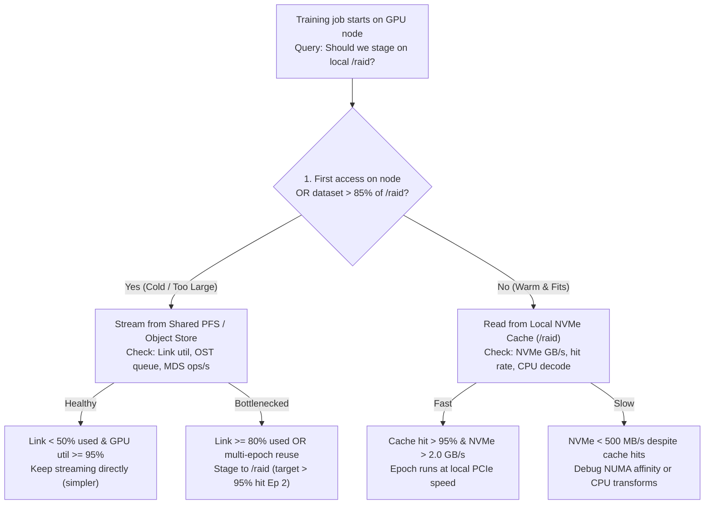
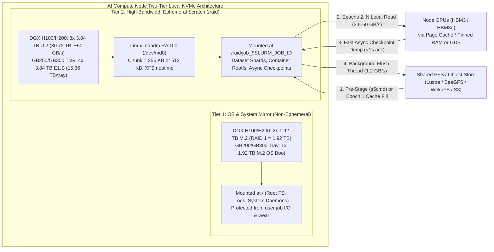

# 13.2 Local NVMe and data staging

| | |
|---|---|
| **Status** | Drafted (`local_nvme_staging_lab.py`: 28 checks pass; bare-metal `mdadm`, `mkfs.xfs`, `nvme`, and `fio` commands **untested** here) |
| **Level** | Intermediate |
| **Priority tier** | 2 |
| **Lab venue** | GCP / GKE + self-checking Python model (`code/part13/local_nvme_staging_lab.py`) |
| **Part** | Part 13: AI storage |
| **Sources used** | `nvidia-devops` V15 Ch. 3 (`chapter-03-local-nvme-and-data-staging.md`) and V15 Lab 02 (`lab-02-benchmark-local-nvme-and-shared-storage.md`); *AI Systems Performance Engineering* (`ai-systems-performance-engineering`); *AI Data Center Network Design and Technologies* (`ai-data-center-network-design-and-technologies`) |
| **Coverage file** | `planning/coverage/chapters/13-02.md` |

## Why this matters for AI infrastructure

In enterprise web infrastructure, stateless compute nodes are the golden rule: local disks are treated as a liability, and all application state lives on remote, highly available NAS, SAN, or cloud object storage. In large-scale AI training, applying that rule blindly turns your storage network into a choke point that leaves multi-million-dollar GPU clusters starving for batches.

An AI training job does not read a dataset once. A vision or multimodal foundation model may iterate over the same `10,000` to `2,000,000` files for `100` to `500` epochs, while an `8`-GPU node needs `1.6 GB/s` (`8 × 200 MB/s`) and a `72`-GPU `GB200`/`GB300 NVL72` rack needs `14–20 GB/s` (`72 × 200 MB/s = 14.4 GB/s`) of continuous ingestion bandwidth just to keep Tensor Cores fed. When `256` GPUs across an `8`-node cluster (`32` GPUs per logical deployment unit, or `1,000` GPUs across a pod) repeatedly pull the same `500 GB`, `2,000,000`-file dataset (`260 KB` average file size) over `25 Gbps` to `100 Gbps` storage links (`30.72 GB/s` / `~30.7 GB/s` aggregate demand at `120 MB/s` per GPU), metadata `open`/`stat` latency (`~30%` overhead) and link contention drop effective delivery from `156.25 MB/s` (`~156 MB/s` raw at `1.25 Gbps/GPU`, or `12.5 Gbps` across a `2`-GPU sub-slice) down to `~110 MB/s` per GPU—stalling the GPUs by `8%` on every step (`245 s` per cold epoch). Worse, when a job writes a `500 GB` checkpoint synchronously to a shared Lustre filesystem at `1.2 GB/s`, every GPU in the job freezes for `416.67 seconds` (`~417 s`) waiting for disk I/O to complete.

Every modern AI server—from the `8`-GPU **NVIDIA DGX H100/H200** with `30.72 TB` of U.2 NVMe scratch (`8 × 3.84 TB` in RAID 0) to the **DGX GB200/GB300 NVL72** compute tray with `15.36 TB` of E1.S NVMe scratch (`4 × 3.84 TB` per tray, `276.48 TB` per rack)—ships with a dedicated bank of PCIe Gen5 NVMe drives bolted directly to the node's internal PCIe switch hierarchy. Used properly for **multi-epoch dataset caching**, **shard pre-staging**, and **asynchronous checkpoint staging**, local NVMe shifts Epochs `2..N` off the shared network (`245 s -> 200 s`, an `18%` per-epoch speedup at `94%` GPU utilization) and compresses `417 seconds` of synchronous checkpoint stall into a **`1 second` asynchronous local handoff (`417×` critical-path speedup)**. Used improperly—on single-epoch streaming runs, datasets exceeding `85%` of scratch capacity, misaligned RAID 0 stripes, or nodes without Slurm `Prolog`/`Epilog` cleanup—local NVMe adds operational failure modes with zero training speedup.

## Prerequisites and outcomes

**Prerequisites:**
- Chapter `9.2` (`DGX H100/H200` 2-tier NVMe layout and 4-switch PCIe Gen5 `PIX` topology) and Chapter `9.5` (`GB200/GB300 NVL72` 1U compute tray E1.S NVMe layout).
- Chapter `13.1` (the AI storage data path from disk to GPU memory).
- Basic Linux block-storage familiarity (`lsblk`, `df`, `mdadm`, `mount`, and `fio`).

**Outcomes:** After completing this chapter, you will be able to:
1. Architect and separate the **two local NVMe tiers** on AI compute nodes (`RAID 1` M.2 OS boot mirror vs ephemeral `RAID 0` U.2/E1.S `/raid` scratch) and calculate `mdadm` chunk sizes (`256 KB`–`512 KB`) and `XFS` stripe alignment (`sunit`, `swidth`).
2. Calculate the exact **multi-epoch staging break-even point** (`N_be`) and **asynchronous checkpoint staging speedup** to decide when local NVMe staging pays back its initial copy cost and when to bypass it.
3. Tune the Linux NVMe block and filesystem stack (`/sys/block/nvme*/queue/scheduler` `none`/`mq-deadline`, `nr_requests`, `blockdev --setra` / `read_ahead_kb`, `XFS` `noatime`, and `numactl` NUMA binding) and validate throughput across four `fio` AI workload profiles.
4. Monitor NVMe endurance (`DWPD`, `TBW`, Write Amplification Factor), SMART health (`percentage_used`, `available_spare`, composite temperature `>= 70 °C`), and enforce per-job `/raid/job_$SLURM_JOB_ID` isolation via Slurm `Prolog` and `Epilog` hooks.

---

## Concepts: basics → intermediate → advanced

## 1. Why AI compute nodes still need local NVMe: the staging decision path

In a cloud-native microservice cluster, local NVMe is rarely used because requests are small, stateless, and non-repetitive. In an AI factory, two workload physics reverse that design rule:
1. **Multi-epoch read amplification:** During multi-epoch training or fine-tuning, every worker node reads its assigned dataset shards over and over across dozens or hundreds of epochs. Fetching the exact same bytes across the North-South storage fabric on Epoch `2`, Epoch `3`, and Epoch `500` wastes shared Parallel File System (`PFS`) Object Storage Target (`OST`) bandwidth and Metadata Server (`MDS`) IOPS.
2. **Bursty synchronous write barriers:** Distributed checkpoints dump hundreds of gigabytes to terabytes of model and optimizer state simultaneously across all ranks. Writing that burst directly over a shared `1.2 GB/s` network path stalls GPU compute for minutes at a time.

### 1.1 When to use local NVMe—and when to skip it

Local NVMe is an accelerator tier, not a universal default. Before adding staging logic to a training pipeline, evaluate the four enabling conditions against the four disqualifiers:

| Decision | Conditions | Engineering Rationale |
|---|---|---|
| **Use local NVMe (`/raid`) when:** | 1. Shared storage link or `MDS` is the bottleneck (e.g., `25 Gbps` link `> 80%` utilized, or `2M` small files adding `30%` `open`/`stat` latency).<br/>2. Working dataset (or per-node shard) fits within **`<= 85%`** of local NVMe capacity and is read across multiple epochs.<br/>3. Synchronous checkpoint writes pause training (`1–5 s` micro-stalls up to `417 s` on `500 GB` dumps) and can be staged asynchronously.<br/>4. Expensive preprocessing/decompression outputs are reused across epochs. | Moves Epochs `2..N` onto local PCIe Gen5 NVMe (`3.5 GB/s` per filesystem thread up to `25–50 GB/s` across the RAID 0 array) and takes slow shared-fabric writes off the GPU critical path. |
| **Do NOT use local NVMe when:** | 1. Shared storage has ample headroom (link `< 50%–60%` utilized, `OST`s balanced, GPU utilization already `>= 95%`).<br/>2. Dataset is a massive single-epoch LLM pre-training stream (`100 TB+`) that exceeds local `/raid` and is only read once.<br/>3. Checkpoints are small/infrequent or already overlapped in host RAM.<br/>4. Nodes fail frequently and lack automated Slurm/Kubernetes cache-rehydration and `Epilog` cleanup. | Staging a dataset that is only read once (`1` epoch) or that thrashes an `> 85%`-full NVMe cache adds copy latency, eviction churn, and SSD wear with zero net speedup. |



| Decision Node | Observed Metric Threshold | Action Taken |
|---|---|---|
| **Shared Storage Stream (`Remote`)** | Shared link `< 50%` utilized (`< 60%` ceiling), no I/O stalls | Bypass local staging; stream directly from Lustre / BeeGFS / WekaFS to keep job startup stateless. |
| **Shared Storage Bottleneck (`NeedStage`)** | Shared link `>= 80%` utilized, `MDS` `stat` storm, or `>= 2` epochs with `NVMe / Shared > 2.0x` | Stage dataset shards into `/raid/job_$SLURM_JOB_ID` during Epoch `1` (or via `s5cmd` pre-stage) and verify `> 95%` cache hit rate by Epoch `2`. |
| **Warm Local NVMe (`GoodLocal`)** | Cache hit rate `> 95%` (`97.8%–98.3%`), local throughput `> 1.0–3.5 GB/s` | Retain local NVMe cache; monitor `/raid` fill level (`<= 85%`) and `nvme smart-log` health. |
| **Local Path Bottleneck (`BadLocal`)** | `fio` shows `3.5 GB/s`, but training sees `< 500 MB/s` (`150 MB/s`) | Bottleneck is outside the SSD: bind `DataLoader` workers to the NVMe `NUMA` socket (`numactl`) or offload CPU JPEG/tokenization transforms (`DALI`). |

---

## 2. Two-tier node NVMe architecture and RAID 0 stripe geometry

Modern NVIDIA systems strictly separate **operating system durability** from **high-bandwidth ephemeral scratch**. As introduced in Chapter `9.2` (for the 8U `DGX H100`/`H200`) and Chapter `9.5` (for the 1U `DGX GB200`/`GB300 NVL72` compute tray), compute nodes never mix the root filesystem with training data caches on the same physical drives.

### 2.1 The two-tier physical layout: OS RAID 1 vs `/raid` RAID 0 scratch

Why split local NVMe into two distinct tiers with opposite RAID levels?
1. **Tier 1 — OS and Container Root (`M.2 NVMe`, `RAID 1` mirror, non-ephemeral):**
   - On a **DGX H100 / H200**, two `1.92 TB` M.2 NVMe drives (`3.84 TB` raw) are mirrored in hardware **RAID 1** to provide `1.92 TB` of usable storage mounted at `/` (and `/var/lib/docker` or `/var/lib/containerd` when not redirected). If one M.2 drive fails during a 30-day training run, the node stays online without dropping its GPUs from the collective job.
   - On a **DGX GB200 / GB300 NVL72 1U Compute Tray**, a dedicated `1.92 TB` M.2 NVMe drive holds the OS image independently of the four front-panel scratch drives.
2. **Tier 2 — Ephemeral Data-Staging Scratch (`U.2` or `E1.S NVMe`, `RAID 0` stripe, mounted at `/raid`):**
   - On a **DGX H100 / H200**, eight `3.84 TB` U.2 NVMe drives (`8 × 3.84 TB = 30.72 TB` raw and usable) are striped together in **software RAID 0** (`mdadm` `/dev/md0`) and mounted at `/raid`. As covered in Chapter `9.2`, two U.2 NVMe drives attach to each of the four PCIe Gen5 switches (`PIX` locality alongside two GPUs and two `400G` ConnectX-7 NICs), delivering **`~50.0 GB/s`** of aggregate sequential read bandwidth (`8 × 6.25 GB/s` per PCIe Gen5 x4 NVMe) and **`~28.0 GB/s`** of sequential write bandwidth.
   - On a **DGX GB200 / GB300 1U Compute Tray**, four `3.84 TB` E1.S (EDSFF) NVMe drives are striped in **RAID 0** for **`15.36 TB`** of local `/raid` scratch per tray (`~25.0 GB/s` read, `~14.0 GB/s` write)—scaling to **`18 × 15.36 TB = 276.48 TB`** of aggregate NVMe scratch across a 72-GPU NVL72 rack.
   - Why **RAID 0** (zero redundancy) instead of RAID 5 or RAID 6 on `/raid`? Because `/raid` only holds **ephemeral copies** of datasets whose golden source lives on the shared Parallel File System or object store, plus temporary checkpoints that are immediately flushed to durable shared storage. RAID 5/6 parity calculations would waste `12.5%–25%` of capacity, add parity-write read-modify-write latency penalties during checkpoint bursts, and prevent clean GPUDirect Storage (`GDS`) P2P DMA alignment.



| Platform & NVMe Tier | Physical Drives & Form Factor | RAID Configuration | Raw / Usable Capacity | Peak Sequential Read / Write | Primary Operational Role |
|---|---|---|---|---|---|
| **DGX H100 / H200 — Tier 1 (OS)** | `2 × 1.92 TB` M.2 NVMe | Hardware `RAID 1` | `3.84 TB` raw / `1.92 TB` usable | `~3.2 GB/s` R / `~2.6 GB/s` W | DGX OS boot, kernel, system logs; isolated from job wear |
| **DGX H100 / H200 — Tier 2 (`/raid`)** | `8 × 3.84 TB` U.2 NVMe (2 per PCIe Gen5 switch) | Software `RAID 0` (`/dev/md0`) | `30.72 TB` raw / `30.72 TB` usable | `~50.0 GB/s` R / `~28.0 GB/s` W | Ephemeral dataset cache, `WebDataset`/Parquet shards, async checkpoints |
| **GB200 / GB300 Tray — Tier 1 (OS)** | `1 × 1.92 TB` M.2 NVMe | Single boot drive | `1.92 TB` raw / `1.92 TB` usable | `~3.2 GB/s` R / `~2.6 GB/s` W | 1U compute tray Linux OS boot (`144` Grace Arm cores + `4` GPUs) |
| **GB200 / GB300 Tray — Tier 2 (`/raid`)** | `4 × 3.84 TB` E1.S (EDSFF) NVMe (`72` drives/rack) | Software `RAID 0` (`/dev/md0`) | `15.36 TB`/tray (`276.48 TB`/rack) | `~25.0 GB/s` R / `~14.0 GB/s` W | Rack-distributed shard caching (`14.4–20 GB/s` rack ingest) & checkpoint staging |

### 2.2 `mdadm` RAID 0 chunk size and `XFS` stripe alignment math

When you stripe $N$ NVMe drives into a Linux `mdadm` RAID 0 array, two geometric numbers govern whether your filesystem writes hit all $N$ drives in parallel or bottleneck on a single drive:
1. **Chunk size ($C$, in KB):** The contiguous block of data written to a single NVMe drive before moving to the next drive in the ring. For AI training workloads dominated by `1 MB`–`4 MB` sequential shard reads and checkpoint writes, standard chunk sizes are **`256 KB` or `512 KB`**.
2. **Full stripe width (`W_stripe`, in KB or MB):** The amount of data required to span all $N$ drives exactly once:

```text
W_stripe = N x C
```

On an `8`-drive DGX H100 `/raid` array with a `512 KB` chunk size:
- **Full stripe width:** `W_stripe = 8 x 512 KB = 4096 KB = 4.0 MB`.
- If a `DataLoader` or checkpoint writer issues an aligned **`4.0 MB` I/O**, `mdadm` splits that single request into eight parallel `512 KB` NVMe commands—one to each of the `8` U.2 drives (`100%` stripe utilization).
- Conversely, if an unbatched pipeline issues a single **`64 KB` read** (`0.125` of one chunk), that request touches only **`1` drive** (`1 / 8 = 12.5%` stripe utilization), leaving the other `7` drives idle unless multiple worker threads (`num_workers >= 8`, `iodepth >= 16`) keep concurrent requests in flight across all drives.

To prevent the filesystem allocator (`XFS` or `ext4`) from splitting inodes and extent allocations across chunk boundaries, you must pass the exact RAID geometry to `mkfs` in units of the **`4096`-byte (`4 KiB`) filesystem block size** (`B_fs = 4 KB`):

```text
sunit (or stride) = \frac(C)(B_fs), \qquad swidth (or stripe-width) = N x sunit = \frac(N x C)(B_fs)
```

| RAID 0 Array Profile | Drives ($N$) | Chunk Size ($C$) | Full Stripe (`W_stripe`) | `XFS` `sunit` / `ext4` `stride` (`4 KiB` blocks) | `XFS` `swidth` / `ext4` `stripe-width` (`4 KiB` blocks) | Exact `mkfs.xfs` Alignment Flag |
|---|---|---|---|---|---|---|
| **DGX H100 / H200 U.2 `/raid`** | `8` | `512 KB` | `4096 KB` (`4.0 MB`) | `512 / 4 = 128` blocks | `8 × 128 = 1024` blocks | `mkfs.xfs -f -d su=512k,sw=8 /dev/md0` |
| **DGX H100 / H200 U.2 `/raid` (alt)** | `8` | `256 KB` | `2048 KB` (`2.0 MB`) | `256 / 4 = 64` blocks | `8 × 64 = 512` blocks | `mkfs.xfs -f -d su=256k,sw=8 /dev/md0` |
| **GB200 / GB300 Tray E1.S `/raid`** | `4` | `256 KB` | `1024 KB` (`1.0 MB`) | `256 / 4 = 64` blocks | `4 × 64 = 256` blocks | `mkfs.xfs -f -d su=256k,sw=4 /dev/md0` |

---

## 3. Data staging economics: multi-epoch break-even and checkpoint staging math

Adding local NVMe staging is an engineering trade-off between **initial staging overhead** and **per-epoch (or per-checkpoint) acceleration**. We can quantify both with exact arithmetic.

### 3.1 Multi-epoch dataset staging: worked cluster calculation and break-even formula

Consider the `8`-node, `256`-GPU training benchmark on shared Lustre (`2 TB` local NVMe available per node, `500 GB` dataset consisting of `2,000,000` small files averaging `260 KB` each, where each GPU requires `120 MB/s` of ingestion bandwidth, or `256 × 120 MB/s = 30.72 GB/s` [`~30.7 GB/s`] aggregate across the job):
- **Without local NVMe staging (streaming every epoch from Lustre):**
  - Each client node has a `25 Gbps` Lustre link (`200 Gbps` aggregate across `8` nodes). Across a `2`-GPU sub-slice (`12.5 Gbps/GPU`), raw link capacity is `156.25 MB/s` (`~156 MB/s`, or at `1.25 Gbps/GPU` under full node sharing, `156.25 MB/s` raw before overhead).
  - Opening and `stat`-ing `2,000,000` small files adds **`30%` metadata latency overhead**, reducing real delivered throughput to **`~110 MB/s` per GPU** (`8%` below the `120 MB/s` GPU demand).
  - **Epoch 1 (cold):** takes **`245 seconds`**.
  - **Epochs 2..N (without local NVMe):** still take **`245 seconds`** when page cache is exceeded (or **`225 seconds`** if partial metadata remains warm while network links remain saturated on first-file reads).
- **With local NVMe staging (`500 GB` dataset cached on the `2 TB` local NVMe):**
  - **Pattern A — Inline Epoch-1 Cache Fill:** During Epoch `1`, the `DataLoader` fetches each file from Lustre and writes a copy to `/raid` (`245 seconds` cold). Starting in Epoch `2`, the `DataLoader` reads directly from local NVMe at **`3.5 GB/s` sustained** (`2,000+ MB/s` raw per GPU with `~30%` local filesystem overhead = `1.75 GB/s` [`1,750 MB/s`] delivered per GPU, well above the `120 MB/s` requirement). Epoch time drops from **`245 s` to `200 s`** (saving **`45 seconds` per epoch**, an **`18%` per-epoch speedup**, pushing GPU utilization to **`94%`**). Over a `10`-epoch run, total time drops from `2,450 s` (`10 × 245 s`) to `2,045 s` (`245 s + 9 × 200 s`), saving **`405 seconds` (`16.53%` net speedup)**.
  - **Pattern B — Explicit Pre-Stage Before Epoch 1 (`s5cmd` / parallel `rsync` / `mpifileutils`):** Suppose you bulk-copy the `500 GB` dataset from shared storage or S3 to `/raid` in a Slurm `Prolog` or init container *before* launching `torchrun`. If the pre-stage copy runs at `B_stage = 2.0 GB/s`, the upfront copy time is:

```text
T_copy = \frac(D_GB)(B_stage) = (500 GB) / (2.0 GB/s) = 250 seconds
```

Each subsequent epoch running from `/raid` saves `Delta T_epoch = T_remote - T_local = 245 s - 200 s = 45 s`. Therefore, the **break-even epoch count** (`N_be`) where pre-staging pays back its upfront copy time is:

```text
N_be = \frac(T_copy)(T_remote - T_local) = (250 s) / (245 s - 200 s) = (250) / (45) ~= 5.56 epochs \implies ceil(N_be) = 6 epochs
```

- If your job runs for **`3` epochs** (typical LLM SFT fine-tuning), explicit pre-staging takes `250 + 3 x 200 = 850 s` versus `3 x 245 = 735 s` without staging—**losing `115 seconds`**.
- If your job runs for **`6` epochs**, pre-staging takes `250 + 6 x 200 = 1,450 s` versus `6 x 245 = 1,470 s`—**saving `20 seconds`** (`1,000` epochs saves `44,750 seconds`, or `12.4 hours`).

### 3.2 Cache hit rate progression, the `85%` fill-level cliff, and SHA-256 manifest validation

When caching datasets on `/raid`, two production bugs silently ruin performance or model convergence:
1. **Eviction thrashing above `85%` NVMe fill level:** Suppose a training job logs its per-epoch local NVMe cache hit rate:
   - `Epoch 1: 0.2%` (cold; `99.8%` fetched from shared storage and written to `/raid`)
   - `Epoch 2: 98.3%` (warm local NVMe taking over)
   - `Epoch 3: 97.8%` (sustained high throughput)
   - `Epoch 4: 96.1%` (degradation begins because `/raid` exceeded **`85%` capacity**, triggering cache eviction and SSD internal garbage collection / write amplification).
   - **Rule:** Never size a cached working set above **`85%`** of usable `/raid` capacity (`26.11 TB` / `26,112 GB` on a `30.72 TB` `DGX H100` `/raid` array). If the dataset exceeds `85%` of node scratch, shard the dataset across nodes (`100 TB` dataset split across `10` nodes = **`10 TB` per node** via `DistributedSampler` so each node caches only its own `10 TB` partition) or switch eviction policy from LFU to deterministic shard pinning.
2. **Stale cache corruption without checksum manifests:** If an upstream preprocessing pipeline updates a shard on `/shared-storage/dataset/train-0042.tar` while a compute node still holds last week's `/raid/cache/train-0042.tar` under the same filename, training silently mixes old and new data across nodes. Every local staging cache must validate a `manifest.json` storing the source file's **`SHA-256` hash** and byte size before returning a cache hit.

### 3.3 Asynchronous two-phase checkpoint staging

Even when a training run only executes `1` epoch over a petabyte dataset (making dataset caching useless), `/raid` remains indispensable for **two-phase asynchronous checkpoint staging**:
- **Without NVMe staging (synchronous shared write):** Writing a `500 GB` checkpoint directly to shared Lustre at `1.2 GB/s` takes:

```text
T_sync = (500 GB) / (1.2 GB/s) ~= 416.67 seconds \quad (\sim 417 s)
```

All GPUs sit idle (`0%` compute utilization) for nearly `7 minutes` at every checkpoint step.
- **With two-phase local NVMe staging:**
  1. **Phase 1 (Host memory -> `/raid` NVMe):** A background thread or async checkpointer copies the state dict from pinned host memory to `/raid/ckpt-epoch-N.pt` at `3.5 GB/s` (`500 GB / 3.5 GB/s = 142.86 s`, `~143 s`). Because the tensor snapshot is handed off asynchronously, the visible pause to the GPU training loop is only **`~1.0 second`** (a **`416.67×` [`~417×`] critical-path speedup**).
  2. **Phase 2 (`/raid` NVMe -> Shared Lustre + unlink):** Once the local NVMe file closes, a non-daemon background flush thread copies `/raid/ckpt-epoch-N.pt` to `/shared-storage/checkpoints/ckpt-epoch-N.pt` at `1.2 GB/s` (`~417 s`) and immediately runs `os.remove()` on the local NVMe file so `/raid` never fills up across checkpoints.

---

## 4. Tuning the Linux NVMe and filesystem stack for GPU pipelines

Out-of-the-box Linux distributions tune block devices for general-purpose virtual machines and databases, not multi-gigabyte-per-second GPU tensor streams. To extract the full `25–50 GB/s` from a local NVMe `/raid` array, you must align four layers of the host OS stack.

### 4.1 `blk-mq` scheduler (`none` vs `mq-deadline`), queue depth (`nr_requests`), and `read_ahead_kb`

Modern Linux kernels route NVMe I/O through the **multi-queue block layer (`blk-mq`)**, which maps software submission queues per CPU core directly onto hardware NVMe Submission Queue (`SQ`) and Completion Queue (`CQ`) pairs (`up to 64K` queues with `64K` commands each in the NVMe specification, compared to a single lock-contended queue in legacy SATA/SAS):
1. **I/O Scheduler (`/sys/block/nvmeXn1/queue/scheduler`):**
   - Legacy single-queue schedulers (`cfq`) are obsolete, and heavyweight fairness schedulers (`bfq`, Budget Fair Queueing) serialize high-IOPS NVMe streams behind CPU spinlocks.
   - For PCIe Gen4/Gen5 NVMe SSDs, set the scheduler to **`none`** (which dispatches `blk-mq` requests directly to the NVMe hardware queues with minimal latency) or **`mq-deadline`** (when mixed read/write checkpoint bursts require write-starvation bounds).
2. **Queue depth (`/sys/block/nvmeXn1/queue/nr_requests`):**
   - Ensure `nr_requests` is at least **`512` to `1023`** so parallel `DataLoader` workers (`num_workers=8`) with `prefetch_factor=4` (`8 × 4 = 32` batches queued) can keep deep asynchronous queues saturated.
3. **Kernel read-ahead (`/sys/block/nvmeXn1/queue/read_ahead_kb` and `blockdev --setra`):**
   - By default, Linux sets `read_ahead_kb` to **`128 KB`** (`256` 512-byte sectors). When streaming large contiguous `WebDataset` `.tar`, `Parquet`, `Arrow`, `TFRecord`, or NeMo `.bin` files through buffered POSIX reads, `128 KB` triggers excessive small kernel I/O cycles.
   - Increasing read-ahead to **`4096 KB` (`4 MB`, matching an `8 × 512 KB` full RAID 0 stripe) or `8192 KB` (`8 MB`)** via `blockdev --setra 8192 /dev/md0` (note that `blockdev --setra` takes **`512`-byte sectors**, so `8192` sectors = `4096 KB`) pipelines sequential prefetch across all drives in the stripe.
   - **Important exception (`O_DIRECT` and random-read engines):** When using **GPUDirect Storage (`GDS`)** with `cuFileRead` (`O_DIRECT`) or random-access filesystems like **DeepSeek's Fire-Flyer File System (`3FS`)** (`6.6 TB/s` aggregate read across a `68`-node cluster with `10 × 16 TB` NVMe SSDs and dual `100 Gb/s` NICs per node, peaking at `7.3 TB/s` while serving `1.4 TB/s` background traffic vs `~1.1 TB/s` on Ceph), the OS page cache is bypassed entirely. For pure random `O_DIRECT` workloads, keep `read_ahead_kb` at **`128 KB` (or lower)** so the kernel does not fetch unused adjacent pages on accidental buffered reads.

### 4.2 Filesystem selection (`XFS` with `noatime`), `io_uring`, and `DataLoader` / `GDS` integration

Above the block layer, three host configurations determine whether `3.5+ GB/s` per thread actually reaches the GPU:
1. **`XFS` mounted with `noatime`:** `XFS` excels at parallel extent allocation and large concurrent direct I/O on NVMe RAID 0 volumes. Always mount `/raid` with **`noatime`** (e.g., `defaults,noatime,nodiratime,logbufs=8,logbsize=256k`). Without `noatime`, every single file read during training triggers a dirty metadata write back to the NVMe array to update the file's last-access timestamp (`atime`), creating unnecessary write amplification and read latency spikes.
2. **Batching small files and using `io_uring` for unavoidable random reads:** Reading `1 MB` contiguous chunks delivers an order of magnitude higher throughput than `4 KB` or `64 KB` random reads. Always pack millions of `100 KB`–`260 KB` raw files offline (using **NVIDIA NeMo Curator** for `.bin`/`.idx` or Parquet shards, or `WebDataset` `.tar` shards). When random reads are unavoidable, use multi-threaded `pread()` or Linux **`io_uring`** (with pre-registered buffers and kernel polling) to submit batches of asynchronous reads without per-syscall context-switch overhead.
3. **Coordinating `DataLoader` workers, `NUMA` locality, `DALI`, and `GDS`:**
   - **CPU Worker & Pinned-Memory Overlap:** Configure PyTorch `DataLoader` with `num_workers=8` (scaled to core count, up to higher counts on the `72`-core Grace CPU), `pin_memory=True` (with high `ulimit -l` / `memlock`), `persistent_workers=True` (eliminating worker respawn and file-reopen stalls at epoch boundaries), and `prefetch_factor=4` (`32` batches queued across `8` workers), paired with a dedicated `torch.cuda.Stream()` calling `.to(device, non_blocking=True)` so batch $N+1$ DMAs over PCIe while the GPU computes batch $N$.
   - **Isolating DataLoader vs H2D bottlenecks:** Profile with `num_workers=0` first to isolate pure Python/storage read latency; then inspect the `Copy` lane in Nsight Systems (`nsys profile --trace=cuda,nvtx,osrt,gds`) or wrap `torch.cuda.Event` timers around `.to("cuda")` to separate Python transforms from PCIe Host-to-Device transfer stalls. If GPUs spend `30%` of step time waiting on I/O and tuning cuts wait time to `5%`, end-to-end training steps per second improve proportionally (`6×` reduction in I/O wait).
   - **GPU Decode Offload (`DALI` and Blackwell Decompression Engine):** If `perf record -g` shows CPU cores pegged at `800%` (`8` cores at `100%`) decoding JPEGs while local NVMe sits underutilized, offload decoding and augmentations to the GPU via **NVIDIA DALI** (`nvidia.dali.pipeline.Pipeline`, dropping CPU usage from `800%` to `200%` [`2` cores]) or store compressed batches (`LZ4`, `Snappy`, `Deflate`) so **Blackwell's hardware Decompression Engine** unpacks tensors in-pipeline over the `900 GB/s` bidirectional `NVLink-C2C` interconnect without consuming GPU SMs. Never bounce DALI decoded tensors back to CPU RAM for collation.
   - **Direct NVMe-to-GPU DMA (`GPUDirect Storage`):** When CPU bounce buffers become the bottleneck (e.g., `1,000` batches/sec of `1 MB` = `1,000 MB/s`), `cuFileRead` (`O_DIRECT` via `nvidia-fs`) pulls data directly from `/raid` NVMe across the local PCIe Gen5 switch (`PIX`) into GPU HBM. As verified by `gdsio` (`/usr/local/cuda/gds/tools/gdsio -f /mnt/data/large_file -d 0 -w 4 -s 10G -i 1M -I 0`), switching from CPU-mediated `-x 2` (`8.0 GB/s`, `1.25 ms` average latency) to GDS `-x 0` (`9.6 GB/s`, `1.00 ms` average latency) delivers a **`20%` throughput boost and `20%` latency reduction** (with VAST benchmarks showing `20%` uplift on `A100` and `30%+` on `H100`).

---

## 5. Benchmarking local NVMe vs shared storage, SMART endurance, and Slurm lifecycle

Before trusting a `/raid` scratch volume with a multi-week training job, you must benchmark its four AI access profiles, verify that checkpoint staging will not burn through the SSDs' flash endurance rating, and automate per-job directory cleanup in the cluster scheduler.

### 5.1 The four AI storage benchmark profiles (`fio` and `dd` baseline vs shared PFS)

A single sequential read number on a datasheet never tells the whole story. In production (`Volume 15, Lab 02`), we benchmark both `/raid` (local NVMe) and `/lustre` or `/beegfs` (shared storage) across four distinct workload profiles that mirror real training phases:

| Workload Profile | Access Pattern | Representative File / I/O Size | Block Size (`bs`) | Concurrency (`numjobs` / `iodepth`) | Expected Local NVMe Baseline | Expected Shared PFS Baseline |
|---|---|---|---|---|---|---|
| **1. Model Load** | Large sequential read once per job/epoch | `10 GB`–`100 GB` (`100 MB` in fast sim) | `1 MB` (`1M`) | `1` job, `O_DIRECT` | **`3.5 GB/s`** (single thread) | **`1.5–3.0 GB/s`** (depends on `OST` stripe & link) |
| **2. Batch Stream** | Parallel medium-block streaming reads | `1 GB` (`1,000 × 1 MB` batches) | `64 KB` (`64k`) | `8` jobs, `iodepth=16` | **`2.8 GB/s`** | **`3.0–5.0 GB/s`** aggregate across `8` clients |
| **3. Random Read / Metadata Storm** | `4 MB` random reads OR `10,000`–`1,000,000` small `100 KB` `stat`/`open` ops | `10 GB` (`4M` rand) or `10K–1M` `100 KB` files | `4 MB` or `4 KB` | `1` job (`iodepth=32`) or `16` metadata workers | **`1.2 GB/s`** (`4 MB` randread); **`50K+` ops/s** local metadata | **`1K–5K` ops/sec** on shared `MDS` (`< 10K` ops/s requires shard repackaging) |
| **4. Checkpoint Burst** | Concurrent sequential write burst across ranks | `500 MB` per rank (`500 GB` cluster-wide) | `4 MB` (`4M`) | `1–8` ranks, `iodepth=16` | **`2.1–3.5 GB/s`** per writer (`28 GB/s` full 8-drive array) | **`1.2 GB/s`** shared write rate |

How to interpret the ratio between your measured local NVMe baseline and shared storage baseline:
1. **If `NVMe_Model_Load / Shared_Model_Load > 2.0x`** (for example, `3.5 GB/s` on NVMe vs `1.5 GB/s` on shared storage = **`2.33x`**): enable local NVMe model/dataset caching and asynchronous checkpoint staging. If NVMe is `10x` faster than shared storage, staging saves **`9/10` (`90%`)** of synchronous checkpoint and model-load wait time.
2. **If shared metadata rate is `< 10,000 ops/sec`** (`1K–5K ops/sec` observed when creating and `stat`-ing `10,000` to `1,000,000` small files): repackage the dataset from `1,000,000` small files into `10,000` contiguous `WebDataset` `.tar`, `Parquet`, or `.bin`/`.idx` shards before staging.
3. **If `fio` measures `3.5 GB/s` on `/raid` (`> 2.0 GB/s` healthy threshold), but training only achieves `< 500 MB/s` (`150 MB/s`):** the SSDs are healthy; your bottleneck is cross-socket `NUMA` thread placement or single-threaded Python CPU decoding.

### 5.2 NVMe endurance math (`DWPD`, `TBW`, `WAF`) and `SMART` health monitoring

Unlike read-mostly dataset caching, aggressive checkpoint staging writes tens of terabytes per day to `/raid`. NAND flash cells wear out after a finite number of Program/Erase (`P/E`) cycles. Enterprise U.2 and E1.S NVMe drives are rated in **Drive Writes Per Day (`DWPD`)** over a **5-year (`1,825`-day)** warranty period:
- **Read-intensive enterprise NVMe (`1.0 DWPD`):** Designed for dataset caching and moderate checkpointing.
- **Mixed-use enterprise NVMe (`3.0 DWPD`):** Designed for heavy shuffle, continuous checkpointing, and burst buffers.

The **Total Terabytes Written (`TBW`)** endurance budget of a drive of capacity `S_TB` rated at `DWPD_rated` over $Y$ years is:

```text
TBW = S_TB x DWPD_rated x 365 x Y
```

For a single **`3.84 TB`** U.2 NVMe drive rated at **`1.0 DWPD`** over **`5` years**:

```text
TBW = 3.84 TB x 1.0 x 365 x 5 = 7,008.0 TB \quad (\sim 7.0 PB of lifetime writes per drive)
```

Across an `8`-drive DGX H100 `/raid` array (`30.72 TB`), the aggregate array endurance is `8 x 7,008.0 TB = 56,064 TB` (`56.06 PB`). However, when a drive is nearly full (`> 85%`) or receives unaligned small random writes without periodic `fstrim`, the SSD controller must move valid pages during internal garbage collection. The ratio of actual NAND flash bytes written to host filesystem bytes written is the **Write Amplification Factor (`WAF`)**:

```text
W_NAND, daily = W_host, daily x WAF, \qquad Effective DWPD = \frac(W_NAND, daily)(S_TB), \qquad L_years = \frac(TBW)(W_NAND, daily x 365)
```

- **Worked example (healthy sequential staging):** If a host writes `2.5 TB/day` to a `3.84 TB` drive (`1.0 DWPD`, `7,008 TBW`) with aligned `4 MB` sequential checkpoint stripes (`WAF = 1.2`), actual NAND writes are `2.5 x 1.2 = 3.0 TB/day` (**`0.7812 DWPD`**), yielding an estimated lifespan of `7,008 / (3.0 x 365) = 6.40 years` (exceeding the `5`-year warranty).
- **Worked example (unaligned high-churn exhaustion):** If a job hammers that same `3.84 TB` drive with `12.0 TB/day` of unaligned small writes on a `92%`-full disk (`WAF = 1.5`), actual NAND writes jump to `12.0 x 1.5 = 18.0 TB/day` (**`4.6875 DWPD`**), burning through the `7,008 TBW` budget in just **`1.07 years`**.

Monitor four critical `nvme smart-log /dev/nvmeXn1` (or `smartctl -a`) telemetry counters in Prometheus / Node Exporter:
1. **`percentage_used` (`0%` to `255%`):** Percentage of rated `TBW` consumed. Alert at **`>= 90%`** to schedule proactive drive replacement.
2. **`available_spare` and `available_spare_threshold`:** Percentage of spare NAND blocks remaining (`100%` new; default threshold **`10%`**). If `available_spare <= available_spare_threshold`, drain the node immediately (`CRITICAL_REPLACE_DRIVE`).
3. **`temperature` (Composite Temperature):** Normal operating range is **`35 °C–55 °C`**. Enterprise NVMe controllers engage **thermal throttling** at **`>= 70 °C`** (`343 K`), dropping sequential throughput by **`30%` to `70%`** and creating a single-node training straggler.
4. **`media_errors` (`Media and Data Integrity Errors`):** Must be **`0`**. Because `/raid` is **RAID 0** with zero parity, a single unrecoverable media error corrupts the striped file across the entire `/dev/md0` volume.

### 5.3 Multi-tenant Slurm `Prolog` and `Epilog` lifecycle for `/raid`

In a multi-user Slurm or Kubernetes cluster, allowing users to write directly to hardcoded paths like `/raid/my_dataset` or `/raid/tmp` guarantees that **orphaned files from crashed, timed-out, or `SIGKILL`ed jobs will silently fill `/raid` to `100%`**, breaking every subsequent job scheduled on that node.

Production AI clusters enforce strict per-job scratch isolation using **Slurm `Prolog` and `Epilog` scripts** (run as `root` on each compute node before job start and after job termination):
1. **Slurm `Prolog` (`/etc/slurm/prolog.d/50-local-nvme.sh`):**
   - Sweeps `/raid/job_*` and removes any orphaned directories whose `SLURM_JOB_ID` is no longer active on the node.
   - Verifies that current `/raid` usage plus the job's requested scratch stays within the **`85%` safe capacity ceiling** (`26,112 GB` on a `30,720 GB` `/raid` array, preserving **`15%` reserved headroom**).
   - Creates `/raid/job_${SLURM_JOB_ID}` owned by `${SLURM_JOB_USER}` (`chmod 0700`) and exports `LOCAL_SCRATCH=/raid/job_${SLURM_JOB_ID}` (and binds container `TMPDIR`, `TORCH_HOME`, `HF_HOME`, and Enroot/Pyxis container rootfs layers inside that directory).
2. **Slurm `Epilog` (`/etc/slurm/epilog.d/50-local-nvme.sh`):**
   - Executes unconditionally even if the user job crashes with an `OOM`, `Xid` fault, or `scancel` `SIGKILL`.
   - Waits for any registered non-daemon checkpoint flush processes (with a bounded drain timeout), deletes `rm -rf /raid/job_${SLURM_JOB_ID}`, and runs `fstrim /raid` (or periodic weekly `fstrim.timer`, never during active training steps) so the NVMe controllers reclaim free blocks cleanly.

---

## Commands and configurations that matter

### 1. Provisioning an Aligned `mdadm` RAID 0 `/raid` Volume and Tuning `blk-mq` (`untested here`)

```bash
# 1. Inspect the two NVMe tiers (2x 1.92 TB M.2 OS RAID 1 vs 8x 3.84 TB U.2 scratch) (untested here)
lsblk -o NAME,MODEL,SIZE,TYPE,FSTYPE,MOUNTPOINT | grep -E "nvme|md"
nvme list

# 2. Create an 8-drive RAID 0 array with a 512 KB chunk size (4.0 MB full stripe) (untested here)
mdadm --create /dev/md0 --level=0 --raid-devices=8 --chunk=512 \
  /dev/nvme{0,1,2,3,4,5,6,7}n1

# 3. Format XFS aligned to chunk=512k and 8 drives (sunit=128, swidth=1024 4KiB blocks) (untested here)
mkfs.xfs -f -d su=512k,sw=8 -l su=256k,version=2 /dev/md0

# 4. Mount /raid with noatime,nodiratime to eliminate per-read inode atime writes (untested here)
mkdir -p /raid
mount -o defaults,noatime,nodiratime,logbufs=8,logbsize=256k /dev/md0 /raid
df -h /raid

# 5. Tune Linux blk-mq scheduler (none), queue depth (1023), and read-ahead (4096 KB = 8192 sectors) (untested here)
for dev in /sys/block/nvme*n1; do
  echo none > "${dev}/queue/scheduler"
  echo 1023 > "${dev}/queue/nr_requests"
  echo 4096 > "${dev}/queue/read_ahead_kb"
done
blockdev --setra 8192 /dev/md0
```

### 2. Benchmarking Local NVMe vs Shared Storage (`fio` and `gdsio`, `untested here`)

```bash
# Workload 1: Model Load (10 GB sequential read, 1 MB blocks, O_DIRECT) (untested here)
dd if=/dev/zero bs=1M count=10000 of=/raid/model-test.bin oflag=direct
time dd if=/raid/model-test.bin bs=1M count=10000 of=/dev/null iflag=direct

# Workload 2: Batch Streaming (64 KB blocks, 8 parallel jobs, iodepth=16) (untested here)
fio --name=batch-stream --ioengine=libaio --rw=read --bs=64k --size=1G \
    --direct=1 --iodepth=16 --numjobs=8 --filename=/raid/batch-test.bin

# Workload 3: Random Read (4 MB blocks, iodepth=32) (untested here)
fio --name=random-read --ioengine=libaio --rw=randread --bs=4M --size=10G \
    --direct=1 --iodepth=32 --numjobs=1 --filename=/raid/random-test.bin

# Workload 4: Checkpoint Burst Write (4 MB blocks, 500 MB per rank) (untested here)
fio --name=checkpoint-write --ioengine=libaio --rw=write --bs=4M --size=500M \
    --direct=1 --iodepth=16 --numjobs=1 --filename=/raid/checkpoint-test.bin

# Compare CPU-mediated (-x 2: 8.0 GB/s, 1.25 ms) vs GPUDirect Storage (-x 0: 9.6 GB/s, 1.00 ms) (untested here)
/usr/local/cuda/gds/tools/gdsio -f /raid/large_file -d 0 -w 4 -s 10G -i 1M -I 0 -x 2
/usr/local/cuda/gds/tools/gdsio -f /raid/large_file -d 0 -w 4 -s 10G -i 1M -I 0 -x 0
```

### 3. Checking NVMe SMART Health, Checksum Manifests, Async Checkpointing, and Slurm Hooks (`untested here`)

```bash
# Inspect SMART wear-leveling (percentage_used, available_spare), temperature, and media_errors (untested here)
for i in {0..7}; do
  echo "=== /dev/nvme${i}n1 ==="
  nvme smart-log "/dev/nvme${i}n1" | egrep "temperature|available_spare|percentage_used|media_errors"
  smartctl -a "/dev/nvme${i}n1" | egrep -i "Temperature|Spare|Percentage|Media|Firmware"
done
iostat -xz 1 5
```

```python
# Asynchronous two-phase checkpoint staging + SHA-256 cache validation (from V15 Ch 3)
import hashlib
import json
import os
import shutil
import threading


def compute_file_hash(path: str) -> str:
    h = hashlib.sha256()
    with open(path, "rb") as f:
        for chunk in iter(lambda: f.read(1048576), b""):
            h.update(chunk)
    return h.hexdigest()


def cache_fetch_with_validation(shared_path: str, cache_path: str, manifest_path: str) -> str:
    manifest = json.load(open(manifest_path)) if os.path.exists(manifest_path) else {}
    source_hash = compute_file_hash(shared_path)
    key = os.path.basename(shared_path)
    if key in manifest and manifest[key]["hash"] == source_hash and os.path.exists(cache_path):
        return cache_path  # Verified cache hit
    shutil.copy2(shared_path, cache_path)
    manifest[key] = {"hash": source_hash, "size": os.path.getsize(cache_path)}
    with open(manifest_path, "w") as f:
        json.dump(manifest, f)
    return cache_path


def stage_checkpoint_async(save_fn, state_dict, epoch: int, job_scratch: str, durable_dir: str):
    nvme_path = os.path.join(job_scratch, f"ckpt-{epoch}.pt")
    durable_path = os.path.join(durable_dir, f"ckpt-{epoch}.pt")
    save_fn(state_dict, nvme_path)  # Fast local NVMe write (3.5+ GB/s)

    def _flush():
        shutil.copy2(nvme_path, durable_path)
        os.remove(nvme_path)  # Reclaim /raid space immediately after durable flush

    t = threading.Thread(target=_flush, daemon=False)
    t.start()
    return t
```

```bash
# Slurm Prolog (/etc/slurm/prolog.d/50-local-nvme.sh) & Epilog (/etc/slurm/epilog.d/50-local-nvme.sh) (untested here)
# Prolog: create isolated per-job scratch directory on /raid
JOB_SCRATCH="/raid/job_${SLURM_JOB_ID}"
mkdir -p "${JOB_SCRATCH}"
chown "${SLURM_JOB_USER}:${SLURM_JOB_USER}" "${JOB_SCRATCH}"
chmod 0700 "${JOB_SCRATCH}"
echo "export LOCAL_SCRATCH=${JOB_SCRATCH}"

# Epilog: unconditionally remove per-job scratch directory on job exit/cancel/timeout
rm -rf "/raid/job_${SLURM_JOB_ID}"
```

---

## How it fails

| Failure Mode | Observed Symptom | Discriminating Evidence | Root Cause | Remediation |
|---|---|---|---|---|
| **1. Cache Eviction Thrashing / `/raid` Full (`> 85%` Fill)** | Epoch `2` starts fast (`98.3%` hit rate), but Epoch `4` slows down (`96.1%` or lower) or crashes with `ENOSPC` | `df -h /raid` shows **`> 85%–100%`** used; `ls /raid` reveals orphaned `job_*` folders or dataset `> 85%` of `/raid` | Dataset + uncleaned checkpoints exceed safe `85%` NVMe capacity, triggering eviction churn and high `WAF` | Enforce Slurm `Epilog` `rm -rf /raid/job_$SLURM_JOB_ID`, delete staged checkpoints after flush (`os.remove`), and shard datasets across nodes (`10 TB`/node) |
| **2. `fio` Shows `3.5 GB/s`, but Training Sees `150 MB/s`** | Raw NVMe benchmark is fast (`3.5 GB/s`), yet `DataLoader` starves GPUs at `150 MB/s` | `numactl --hardware` shows workers on `NUMA 1` while NVMe is on `NUMA 0`; `perf record -g` shows `800%` CPU in Python JPEG decode | Cross-socket `UPI`/`NUMA` traversal penalty or single-threaded Python CPU decoding bottleneck | Pin workers to the NVMe `NUMA` node (`numactl --cpunodebind=0 --membind=0`), set `pin_memory=True`, `persistent_workers=True`, and offload decode to `DALI` |
| **3. Identical Nodes, but Node B's NVMe Is `30%` Slower** | Node B lags every epoch (`30%` slower I/O) and becomes the `AllReduce` straggler | `smartctl -a /dev/nvme0n1` shows `Temperature >= 70 °C` (`74 °C`, thermal throttle active), mismatched firmware, or `iostat -x 1` busy during idle | Thermal throttling from a degraded front fan / blocked airflow, stale SSD firmware, or background `fstrim`/GC running mid-job | Restore front-bay cooling (`< 55 °C`), align NVMe firmware across all nodes, and restrict `fstrim` to Slurm `Epilog` or maintenance windows |
| **4. Silent Stale-Cache Data Corruption Across Runs** | Model loss diverges or differs between nodes after dataset curation updates | Local `/raid` files have old `mtime` and mismatched `SHA-256` hashes compared to `/shared-storage` | Local cache keyed only by filename without validating source file hash or size | Validate a `manifest.json` (`SHA-256` hash + file size) on job startup before accepting any cached file |
| **5. Misaligned RAID 0 Stripe or Missing `noatime`** | `/dev/md0` sequential write reaches `< 40%` of `8 × drive` rating; high metadata write IOPS during pure-read training | `xfs_info /raid` shows `sunit=0 swidth=0`; `/proc/mounts` shows `relatime` instead of `noatime`; `/sys/block/nvme0n1/queue/read_ahead_kb` is `128` | `mkfs.xfs` omitted `su=512k,sw=8`, kernel writes inode `atime` on every read, and `128 KB` read-ahead under-pipelines stripes | Format with `mkfs.xfs -d su=512k,sw=8`, mount with `noatime,nodiratime`, set `scheduler=none`, and set `read_ahead_kb=4096` (`blockdev --setra 8192`) |
| **6. Single-Drive Media Error Destroys `/raid` (`RAID 0`)** | Job fails with `Input/output error (EIO)` reading `/raid`; `/dev/md0` goes offline | `nvme smart-log` shows `media_errors > 0` (`3`) or `available_spare (8%) <= threshold (10%)` on one U.2/E1.S drive | `RAID 0` has zero redundancy; a single failed drive or exhausted spare pool invalidates the entire stripe | Alert on `percentage_used >= 90%`, `available_spare <= 15%`, and `media_errors > 0`; drain node, replace SSD, and rebuild `/dev/md0` |

---

## Hands-on lab

### Venue and Scope
- **Venue:** **GCP / GKE** (using Local SSD NVMe scratch disks attached via `--local-ssd-interface=NVME`) or any local workstation running the deterministic Python verification model (`code/part13/local_nvme_staging_lab.py`, stdlib-only). Bare-metal destructive commands (`mdadm --create`, `mkfs.xfs`, `blockdev`, `nvme`, `fio`, `gdsio`) shown above are marked `(untested here)`.
- **What the lab verifies (`28` self-checks in `code/part13/local_nvme_staging_lab.py`):**
  1. **Two-tier NVMe hardware profiles (`checks 1–3`):** `DGX H100/H200` (`2 × 1.92 TB` M.2 `RAID 1` OS mirror = `1.92 TB` usable vs `8 × 3.84 TB` U.2 `RAID 0` `/raid` = `30.72 TB` usable at `50.0 GB/s` read) and `DGX GB200/GB300` compute tray (`1 × 1.92 TB` M.2 OS drive + `4 × 3.84 TB` E1.S `RAID 0` = `15.36 TB`/tray, `276.48 TB`/rack).
  2. **`mdadm` RAID 0 chunk and `XFS` stripe alignment (`checks 4–6`):** `8 × 512 KB` = `4096 KB` (`4.0 MB`) full stripe (`sunit=128`, `swidth=1024`), `4 × 256 KB` = `1024 KB` (`1.0 MB`) full stripe (`sunit=64`, `swidth=256`), and single-request stripe utilization (`64 KB` = `1` drive [`12.5%`], `1 MB` = `2` drives [`25%`], `4 MB` = `8` drives [`100%`]).
  3. **Dataset staging break-even & async checkpoint staging (`checks 7–11`):** `V15 Ch 3` inline cache fill (`245 s -> 200 s`, `45 s`/epoch saved, `405 s` [`16.53%`] saved over `10` epochs), explicit pre-staging of `500 GB` at `2.0 GB/s` (`250 s` copy, break-even `5.5556` epochs -> `6` epochs minimum; `3`-epoch run loses `115 s`), `> 85%` capacity rejection (`1,800 GB` on `2,000 GB` = `90%`), and `500 GB` checkpoint staging (`416.67 s` sync Lustre vs `142.86 s` local NVMe vs `1.0 s` async handoff = `416.67×` critical-path speedup).
  4. **Linux `blk-mq`, `read_ahead_kb`, `noatime`, and `NUMA` audit (`checks 12–14`):** Healthy `scheduler=none` + `nr_requests=1023` + `read_ahead_kb=4096` + `noatime` + `NUMA 0==0` vs degraded `bfq` + `nr_requests=128` + `128 KB` read-ahead + `relatime` + `NUMA 0!=1`, plus `mq-deadline` with `128 KB` read-ahead for `pure_random_o_direct` (`3FS`/`GDS`).
  5. **NVMe `DWPD` / `TBW` endurance and `SMART` health (`checks 15–18`):** `3.84 TB` `1.0 DWPD` `5`-year drive = `7,008.0 TBW` (`2.5 TB/day` at `WAF 1.2` = `3.0 TB/day` NAND, `0.7812 DWPD`, `6.4` years lifespan), thermal throttle alert at `74 °C` (`>= 70 °C`), wear warning at `92%` (`18.0 TB/day` = `4.6875 DWPD`), and critical replacement on `available_spare 8% <= 10%` or `media_errors = 3`.
  6. **Slurm `Prolog` / `Epilog` lifecycle & cluster math (`checks 19–28`):** `30,720 GB` `/raid` with `15%` headroom (`26,112 GB` `85%` ceiling), `job_1001` (`12,000 GB`, `39.06%`), orphan leak when `Epilog` is missing blocking `job_1002` (`16,000 GB`, `91.15% > 85%`), `Prolog` orphan sweep reclaiming `12,000 GB` (`52.08%`), clean `Epilog` reset to `0.0%`, plus `256`-GPU Lustre sizing (`30.72 GB/s`), `Lab 02` ratio (`3.5 / 1.5 = 2.33x`), `NVL72` `72`-GPU ingest (`14.4 GB/s`), and `8`-drive checkpoint striping (`15 TB/day` -> `0.5859 DWPD`, `8.53` years).

### Running the Lab

```bash
python3 -B code/part13/local_nvme_staging_lab.py
```

Expected output (verified here):

```text
=== Chapter 13.2 Lab: Local NVMe and Data Staging ===
  [PASS] 1. DGX H100/H200 OS tier uses 2x 1.92 TB M.2 NVMe in RAID 1 (3.84 TB raw, 1.92 TB usable, non-ephemeral)
  [PASS] 2. DGX H100/H200 scratch tier uses 8x 3.84 TB U.2 NVMe in RAID 0 at /raid (30.72 TB usable, 50.0 GB/s seq read)
  [PASS] 3. GB200/GB300 1U compute tray uses 1x 1.92 TB M.2 OS drive + 4x 3.84 TB E1.S RAID 0 scratch (15.36 TB/tray, 276.48 TB/rack)
  ...
  [PASS] 27. ASP Ch 5 NVL72 rack ingestion: 72 GPUs * 200 MB/s = 14.4 GB/s (within the 14–20 GB/s rack streaming range)
  [PASS] 28. Striping 15 TB/day of checkpoints across 8x 3.84 TB drives (1.875 TB/drive/day, WAF 1.2) yields 2.25 TB/day NAND writes (0.5859 DWPD, 8.53 years lifespan)

Summary: 28 passed, 0 failed
```

---

## Common first mistakes

1. **Pre-staging a massive dataset onto local NVMe for a `1`- to `3`-epoch fine-tuning run:** Copying `500 GB` at `2.0 GB/s` costs `250 seconds` upfront. If local NVMe only saves `45 seconds` per epoch (`245 s -> 200 s`), any run shorter than `6` epochs (`5.56` break-even) finishes *slower* with pre-staging than streaming directly from shared storage.
2. **Writing user data, container rootfs layers, or checkpoints onto the `/` OS root partition instead of `/raid`:** Filling or wearing out the `1.92 TB` M.2 OS boot drives crashes system daemons (`kubelet`, `slurmd`, `containerd`) and takes down the node. Always bind `TMPDIR`, `TORCH_HOME`, `HF_HOME`, and container runtime graph roots onto `/raid`.
3. **Relying on a Python `try/finally` block inside the user's training script to clean up `/raid`:** When a job hits a GPU `Xid` fault, an OOM kill, or a Slurm wall-time limit, the kernel sends `SIGKILL`, bypassing Python cleanup handlers and leaking multi-terabyte orphan directories. Cleanup must live in the root-level Slurm `Epilog` (and `Prolog` orphan sweep).
4. **Staging `2,000,000` tiny `260 KB` files onto `/raid` without packing them into shards:** While local NVMe absorbs `stat`/`open` storms better than a shared Lustre `MDS`, opening millions of tiny files still burns CPU syscall overhead and prevents `4 MB` full-stripe RAID 0 reads. Pack small files into `WebDataset` `.tar`, `Parquet`, or `.bin`/`.idx` shards first.
5. **Forgetting to delete (`os.remove`) local staged checkpoints after the background flush to shared storage completes:** At `500 GB` per checkpoint, leaving local copies on a `2 TB` scratch volume fills `/raid` after just `4` checkpoints (`2,000 GB`), crashing the job mid-run.

---

## Exercises

1. **Two-Tier NVMe Topology and `mdadm` / `XFS` Stripe Geometry:**
   - (a) Contrast the `DGX H100/H200` local NVMe layout (`2 × 1.92 TB` M.2 + `8 × 3.84 TB` U.2) with a `DGX GB200/GB300 NVL72` compute tray (`1 × 1.92 TB` M.2 + `4 × 3.84 TB` E1.S). Compute the usable scratch capacity per node/tray and across an entire `18`-tray `NVL72` rack, and explain why `/raid` uses `RAID 0` while the OS tier on `DGX H100` uses `RAID 1`.
   - (b) For the `8`-drive `DGX H100` `/raid` array with a `512 KB` chunk size and `4096`-byte (`4 KiB`) `XFS` filesystem blocks, compute the full stripe width in `KB` and `MB`, `sunit`, `swidth`, and the percentage of drives activated by a single `64 KB` read versus a `4 MB` read. Repeat `sunit`, `swidth`, and full stripe width for a `4`-drive `GB200` E1.S array with a `256 KB` chunk size.

2. **Multi-Epoch Dataset Staging Break-Even Calculation:**
   A `500 GB` dataset (`2,000,000` files) is trained on a node with `2,000 GB` (`2 TB`) of local NVMe. Reading directly from shared Lustre takes `245 seconds` per epoch (`~110 MB/s` per GPU due to `30%` metadata overhead on a `156.25 MB/s` raw link slice, vs `120 MB/s` needed by each of the `256` GPUs = `30.72 GB/s` aggregate). Reading from warm local NVMe (`3.5 GB/s` sustained, `1.75 GB/s` per GPU) cuts epoch time to `200 seconds`.
   - (a) Under **Inline Epoch-1 Cache Fill** (Epoch `1` takes `245 s` while populating `/raid`; Epochs `2..10` take `200 s`), calculate the total wall-clock time for `10` epochs with and without local NVMe, the seconds saved, and the net percentage speedup.
   - (b) Under **Explicit Pre-Staging** (copying `500 GB` to `/raid` before Epoch `1` at `2.0 GB/s`), compute the copy time `T_copy`, the exact break-even epoch count `N_be`, the minimum integer number of epochs required to profit, and the net wall-clock gain or loss for a `3`-epoch run versus a `6`-epoch run.

3. **Asynchronous Two-Phase Checkpoint Staging Math:**
   A distributed training job writes a `500 GB` checkpoint. Shared Lustre sustains `1.2 GB/s` for checkpoint writes, whereas local NVMe sustains `3.5 GB/s` and an asynchronous host-to-NVMe handoff acknowledges in `1.0 second`.
   - (a) Compute the synchronous write stall time directly to Lustre, the local NVMe write duration, and the critical-path speedup factor achieved by asynchronous NVMe staging.
   - (b) What is the minimum safe time interval (in seconds) between consecutive checkpoints so that the background flush thread (`NVMe -> Lustre` followed by `os.remove()`) finishes before the next checkpoint is triggered without double-buffering?

4. **Linux `blk-mq`, Read-Ahead, Filesystem, and `NUMA` Diagnostic Triage:**
   You run `fio` on `/dev/md0` (`/raid`) and measure `3.5 GB/s` sequential read (`2.33x` faster than the `1.5 GB/s` shared storage baseline in `Lab 02`), yet your PyTorch training loop only achieves `150 MB/s` and GPUs sit at `65%` utilization. Inspection reveals `/sys/block/nvme0n1/queue/scheduler` is `[bfq]`, `nr_requests` is `128`, `read_ahead_kb` is `128`, `/raid` is mounted with `(rw,relatime)`, and `DataLoader` workers run on `NUMA 1` while the NVMe drives attach to `NUMA 0`.
   - (a) List all five host misconfigurations and write the exact Linux commands to remediate each one for a large-shard sequential streaming workload.
   - (b) How should `read_ahead_kb` differ if the workload switches to pure random `O_DIRECT` reads (`GDS` `cuFileRead` or `DeepSeek 3FS`), and what throughput/latency improvement does `gdsio` demonstrate when switching from `-x 2` (CPU) to `-x 0` (GDS)?

5. **NVMe Flash Endurance (`DWPD`, `TBW`, `WAF`) and `SMART` Thresholds:**
   Each of the `8` U.2 drives in a `DGX H100` `/raid` array has a capacity of `3.84 TB` and a rating of `1.0 DWPD` over a `5`-year (`1,825`-day) warranty.
   - (a) Compute the lifetime `TBW` rating for a single `3.84 TB` drive and for the `8`-drive array. If a single drive receives `2.5 TB/day` of host writes with a Write Amplification Factor (`WAF`) of `1.2`, what are the effective daily NAND writes, effective `DWPD`, and estimated drive lifespan in years?
   - (b) If a heavy checkpointing job writes `15.0 TB/day` striped evenly across all `8` drives (`WAF = 1.2`), compute the per-drive daily host writes, effective NAND writes, effective `DWPD`, and estimated lifespan. At what values of `percentage_used`, `available_spare` (with `10%` threshold), `temperature`, and `media_errors` must automation alert or drain the node?

6. **Slurm `Prolog` / `Epilog` Capacity Enforcement and Orphan Reclamation:**
   A `DGX H100` `/raid` array has `30,720 GB` (`30.72 TB`) of usable space and enforces a `15%` reserved headroom policy (`85%` maximum safe fill level).
   - (a) Compute the maximum safe allocatable scratch capacity in `GB`. Suppose `job_1001` allocates `12,000 GB` (`39.06%` fill) and is killed by `SIGKILL` on a node that lacks a Slurm `Epilog` cleanup script. When `job_1002` arrives requesting `16,000 GB`, what is the projected fill percentage, and why does admission fail?
   - (b) Show how adding an orphan-sweep step in Slurm `Prolog` plus `rm -rf /raid/job_$SLURM_JOB_ID` in Slurm `Epilog` resolves `job_1002`'s admission and calculate the resulting fill percentage during `job_1002` and after `job_1002` exits.

---

## Interview angles

1. **"We added `30 TB` of local NVMe to every GPU node, but Epoch `1` is still slow, and our 1-epoch LLM pre-training job saw zero speedup on data loading. Was the local NVMe a waste?"**
   - *What separates a senior answer:* Distinguish **multi-epoch dataset caching** from **asynchronous checkpoint staging**. Explain that Epoch `1` is always a cold cache miss (`0.2%` hit rate) unless pre-staged, and for a `1`-epoch petabyte pre-training stream that exceeds `/raid` capacity, local NVMe cannot cache the dataset. However, on that exact same `1`-epoch LLM run, `/raid` is still critical for **asynchronous checkpoint staging**—turning a `417 s` synchronous `500 GB` Lustre write stall into a `1 s` local NVMe handoff (`417×` critical-path speedup). Then state the quantitative break-even formula `N_be = T_copy / (T_remote - T_local)` (`6` epochs when `T_copy = 250 s` and `Delta T = 45 s`).
2. **"Why does an NVIDIA DGX H100 use RAID 1 for its two M.2 drives but RAID 0 for its eight U.2 `/raid` drives? Doesn't RAID 0 risk losing data if one SSD dies?"**
   - *What separates a senior answer:* Explain the two-tier durability contract: the `2 × 1.92 TB` M.2 drives hold the OS and system services (`RAID 1` keeps the node alive if one boot drive fails), whereas the `8 × 3.84 TB` U.2 `/raid` volume (`30.72 TB`) holds **strictly ephemeral data** (cached replicas of immutable shards from shared PFS/S3 and in-flight checkpoints that are immediately flushed to durable storage). Using `RAID 0` (`512 KB` chunk, `4 MB` full stripe) delivers `100%` of capacity (`30.72 TB`) and `100%` of aggregate bandwidth (`~50 GB/s` read, `~28 GB/s` write) with zero parity-write amplification or `GDS` DMA alignment penalties.
3. **"Your `fio` benchmark on `/raid` hits `3.5 GB/s` per job (`28+ GB/s` aggregate), but PyTorch `DataLoader` only feeds the GPUs at `150 MB/s`. How do you find the bottleneck?"**
   - *What separates a senior answer:* Walk up the host stack systematically: (1) check `numactl --hardware` and `nvidia-smi topo -m` to see if `DataLoader` workers are running on the wrong `NUMA` socket across the CPU interconnect (`SYS` instead of `NODE`/`PIX`), (2) run `perf record -g` or profile with `num_workers=0` to check if CPU cores are pegged at `800%` decoding JPEGs or tokenizing text in Python (fix with `DALI` or offline `NeMo Curator` `.bin`/`.idx` shards), (3) check whether the dataset consists of millions of `100 KB`–`260 KB` small files issuing `4 KB`/`64 KB` reads that only touch `1` of the `8` RAID 0 drives (`12.5%` stripe utilization), and (4) verify `pin_memory=True`, `persistent_workers=True`, `prefetch_factor=4`, `noatime`, and `read_ahead_kb=4096`.

---

## Checkpoint questions (20)

<details>
<summary><strong>1. Why does the enterprise "stateless compute node, no local disks" rule break down for multi-epoch AI training and large-model checkpointing?</strong></summary>

Multi-epoch training reads the exact same dataset shards dozens to hundreds of times, and distributed checkpointing writes hundreds of gigabytes simultaneously across all ranks. Streaming `500` epochs or synchronous `500 GB` checkpoints across shared North-South storage links saturates switch uplinks and Parallel File System `OST`/`MDS` nodes, whereas caching shards on local PCIe NVMe (`3.5–50 GB/s`) drops Epoch `2..N` network reads to near zero and reduces checkpoint stalls from `417 s` to `~1 s`.
</details>

<details>
<summary><strong>2. Under what four conditions should you bypass local NVMe dataset staging and stream directly from shared storage?</strong></summary>

Do not stage datasets on local NVMe when: (1) the shared storage link has ample headroom (`< 50%–60%` utilized, `OST`s balanced, GPU utilization already `>= 95%`), (2) the dataset is too large to fit within `<= 85%` of local NVMe (or node-sharded NVMe) capacity, (3) the job runs for fewer epochs than the staging break-even threshold `N_be` (e.g., `1`-epoch LLM pre-training), or (4) nodes fail frequently and lack automated cache rehydration and Slurm `Epilog` cleanup.
</details>

<details>
<summary><strong>3. How are local NVMe drives partitioned across the two storage tiers on an NVIDIA DGX H100/H200 versus a DGX GB200/GB300 NVL72 compute tray?</strong></summary>

- **DGX H100 / H200 (8U node):** Tier 1 has **`2 × 1.92 TB` M.2 NVMe** in hardware **`RAID 1`** (`1.92 TB` usable) for the OS; Tier 2 has **`8 × 3.84 TB` U.2 NVMe** in software **`RAID 0`** (`30.72 TB` usable, `~50 GB/s` read) mounted at `/raid`.
- **DGX GB200 / GB300 NVL72 (1U compute tray, 18 trays/rack):** Tier 1 has **`1 × 1.92 TB` M.2 NVMe** for the OS; Tier 2 has **`4 × 3.84 TB` E1.S NVMe** in **`RAID 0`** (`15.36 TB` usable per tray, **`276.48 TB`** across the `18`-tray rack).
</details>

<details>
<summary><strong>4. Why is `/raid` configured as `RAID 0` rather than `RAID 5` or `RAID 6` on AI compute nodes?</strong></summary>

`/raid` is strictly an **ephemeral scratch tier**: datasets cached there have a golden source on shared storage, and staged checkpoints are immediately flushed to durable shared storage. `RAID 0` provides `100%` usable capacity (`30.72 TB` on `DGX H100`) and full `N`-drive read/write bandwidth without `RAID 5/6` parity-capacity loss (`12.5%–25%`), read-modify-write parity latency on checkpoint bursts, or `GPUDirect Storage` DMA alignment complications.
</details>

<details>
<summary><strong>5. On an `8`-drive `mdadm` RAID 0 array with a `512 KB` chunk size and `4 KiB` (`4096 B`) filesystem blocks, what are the full stripe width, `XFS` `sunit`, and `XFS` `swidth`?</strong></summary>

- **Full stripe width:** `8 x 512 KB = 4096 KB = 4.0 MB`.
- **`XFS` `sunit` (`ext4` `stride`):** `512 KB / 4 KB = 128 blocks`.
- **`XFS` `swidth` (`ext4` `stripe-width`):** `8 x 128 = 1024 blocks` (formatted via `mkfs.xfs -f -d su=512k,sw=8 /dev/md0`).
</details>

<details>
<summary><strong>6. Why does a single `64 KB` read achieve only `12.5%` drive parallelism on an `8 × 512 KB` RAID 0 array, and how do you reach `100%` stripe utilization?</strong></summary>

Because each single drive chunk is `512 KB`, a `64 KB` request fits entirely inside **one drive's chunk** (`1 / 8 = 12.5%`), leaving the other `7` drives idle for that I/O. To utilize all `8` drives simultaneously (`100%` stripe utilization), either issue aligned **`>= 4.0 MB` reads** (`8 × 512 KB`), enable kernel read-ahead (`read_ahead_kb=4096`), or keep deep concurrent queues in flight across multiple `DataLoader` workers (`num_workers >= 8`, `iodepth >= 16`).
</details>

<details>
<summary><strong>7. How do you calculate the break-even epoch count (`N_be`) for explicit dataset pre-staging?</strong></summary>

Divide the upfront staging copy time `T_copy = D_GB / B_stage` by the per-epoch time saved `Delta T = T_remote - T_local`:

```text
N_be = \frac(T_copy)(T_remote - T_local)
```

For a `500 GB` dataset copied at `2.0 GB/s` (`T_copy = 250 s`) that reduces epoch duration from `245 s` to `200 s` (`Delta T = 45 s`), `N_be = 250 / 45 ~= 5.56`, so the job must run for at least **`6` epochs** to yield a net wall-clock speedup.
</details>

<details>
<summary><strong>8. What causes a local NVMe cache hit rate to progress `0.2%` (Epoch 1) -> `98.3%` (Epoch 2) -> `97.8%` (Epoch 3) -> `96.1%` (Epoch 4), and how do you fix the Epoch 4 degradation?</strong></summary>

Epoch `1` is a normal cold-cache warmup (`0.2%` hits), and Epochs `2–3` show healthy warm caching (`> 97%`). The drop to `96.1%` in Epoch `4` indicates **fill-level pressure (`> 85%` NVMe utilization)** where cache eviction and SSD garbage collection begin thrashing active shards. Fix it by keeping `/raid` usage **`<= 85%`**, sharding the dataset across nodes (`DistributedSampler`), or switching eviction policy from LFU to deterministic shard pinning / LRU.
</details>

<details>
<summary><strong>9. Why does synchronous writing of a `500 GB` checkpoint to shared Lustre stall training for `~417 seconds`, and how does two-phase local NVMe staging achieve a `417×` critical-path speedup?</strong></summary>

At a `1.2 GB/s` shared Lustre write rate, writing `500 GB` synchronously blocks all GPUs for `500 / 1.2 ~= 416.67 s` (`~417 s`). With two-phase staging, the training process hands the checkpoint off asynchronously (`~1.0 s` pause) to write to local NVMe at `3.5 GB/s` (`~143 s`), and a background thread flushes the file from `/raid` to Lustre (`~417 s`) and deletes the local copy (`os.remove`) while GPUs continue training steps uninterrupted.
</details>

<details>
<summary><strong>10. Why is filename-only cache lookup dangerous on `/raid`, and how does `manifest.json` prevent silent training corruption?</strong></summary>

If an upstream dataset file on shared storage is re-tokenized or updated in place under the same filename, a node with a warm `/raid` directory from an earlier job will silently train on stale cached bytes. Recording each file's **`SHA-256` cryptographic hash and byte size** in `/raid/.../manifest.json` and comparing against the source hash ensures stale files are invalidated and re-fetched automatically.
</details>

<details>
<summary><strong>11. Which Linux `blk-mq` scheduler should be configured in `/sys/block/nvmeXn1/queue/scheduler` for AI NVMe workloads, and why should `bfq` or `cfq` be avoided?</strong></summary>

Use **`none`** (or **`mq-deadline`** when bounding write latency under mixed read/write load). `none` submits multi-queue block requests directly to hardware NVMe submission queues with zero software scheduling lock contention, whereas `bfq` (Budget Fair Queueing) and legacy `cfq` introduce per-request CPU spinlocks and fairness heuristics designed for rotational HDDs.
</details>

<details>
<summary><strong>12. How does `blockdev --setra 8192 /dev/md0` affect `/sys/block/md0/queue/read_ahead_kb`, and when should you raise versus lower read-ahead?</strong></summary>

`blockdev --setra` specifies read-ahead in **`512`-byte sectors**, so `8192` sectors sets `read_ahead_kb = 4096 KB` (`4 MB`, matching an `8 × 512 KB` full RAID 0 stripe) instead of the `128 KB` Linux default. Raise `read_ahead_kb` to **`4096–8192 KB`** for large sequential shard streaming (`WebDataset`, `Parquet`, `.bin`), but keep it at **`128 KB` (or lower)** for pure random `O_DIRECT` workloads (`GDS` / `3FS`) that bypass the OS page cache.
</details>

<details>
<summary><strong>13. Why must `/raid` always be mounted with the `noatime` option on AI training nodes?</strong></summary>

Without `noatime` (or under default `relatime` during initial scans), POSIX rules require the filesystem to update each file's `atime` (last-access timestamp) in the inode metadata on disk when read. Across millions of training reads, that turns a `100%` read-only workload into a mixed read/write workload, wasting NVMe IOPS and increasing SSD wear.
</details>

<details>
<summary><strong>14. In `Volume 15 Lab 02`, what are the four benchmark workload profiles and their expected local NVMe baselines, and what `NVMe / Shared` ratio justifies local caching?</strong></summary>

1. **Model Load** (`10–100 GB` seq read, `bs=1M`, `direct=1`): **`~3.5 GB/s`** on NVMe (vs `1.5–3.0 GB/s` on shared PFS).
2. **Batch Stream** (`bs=64k`, `8` parallel jobs, `iodepth=16`): **`~2.8 GB/s`** on NVMe.
3. **Random Read / Metadata Storm** (`bs=4M` randread or `10K–1M` `100 KB` `stat`/`open` ops): **`~1.2 GB/s`** (`4M` randread) on NVMe vs **`1K–5K` ops/sec** on shared `MDS` (`< 10K` ops/s requires shard repackaging).
4. **Checkpoint Write** (`bs=4M`, `500 MB` burst): **`~2.1–3.5 GB/s`** per writer on NVMe.
When the **Model Load `NVMe / Shared` ratio exceeds `2.0x`** (e.g., `3.5 / 1.5 = 2.33x`), local NVMe caching and checkpoint staging provide substantial training speedup.
</details>

<details>
<summary><strong>15. What do `gdsio` transfer selectors `-x 2` and `-x 0` measure, and what throughput and latency improvement is typical when switching to GPUDirect Storage (`GDS`)?</strong></summary>

In NVIDIA's `/usr/local/cuda/gds/tools/gdsio` benchmark (`-I 0` read mode, `-s 10G -i 1M -w 4`), **`-x 2`** measures the traditional CPU-mediated path through pinned host memory (`8.0 GB/s`, `1.25 ms` average latency), while **`-x 0`** measures the direct **GPUDirect Storage (`GDS`)** DMA path (`cuFileRead` / `nvidia-fs` with `O_DIRECT`) straight from NVMe into GPU HBM (**`9.6 GB/s`, `1.00 ms` average latency**)—a **`20%` throughput increase and `20%` latency reduction** while freeing host CPU cores.
</details>

<details>
<summary><strong>16. Why did DeepSeek's Fire-Flyer File System (`3FS`) eliminate read page caching in favor of `O_DIRECT` RDMA reads across cluster NVMe drives?</strong></summary>

DeepSeek observed that large-scale LLM training and inference workloads perform massive numbers of random reads across terabytes of data, causing traditional OS page-cache management to thrash RAM and waste CPU cycles on host memory copies. By bypassing the OS page cache with `O_DIRECT` and RDMA reads directly from `10 × 16 TB` NVMe SSDs per node across a `68`-node dual-`100 Gb/s` cluster, `3FS` achieved **`6.6 TB/s`** of sustained aggregate read throughput (peaking at **`7.3 TB/s`** and serving `1.4 TB/s` of concurrent background traffic, compared to `~1.1 TB/s` on Ceph).
</details>

<details>
<summary><strong>17. How do you compute the Total Terabytes Written (`TBW`) rating and expected lifespan of a `3.84 TB`, `1.0 DWPD` NVMe drive under a `2.5 TB/day` host write workload with `WAF = 1.2`?</strong></summary>

- **Lifetime `TBW` rating (`5` years):** `3.84 TB x 1.0 DWPD x 365 x 5 = 7,008.0 TB`.
- **Effective daily NAND writes:** `2.5 TB/day x 1.2 = 3.0 TB/day` (effective `DWPD` = `3.0 / 3.84 = 0.7812 DWPD`).
- **Estimated lifespan:** `7,008.0 / (3.0 x 365) = 6.40 years`.
</details>

<details>
<summary><strong>18. Which four `nvme smart-log` metrics must be monitored on `/raid` drives, and what are their alert thresholds?</strong></summary>

1. **`percentage_used`:** Alert at **`>= 90%`** of rated `TBW` to schedule proactive SSD replacement.
2. **`available_spare` vs `available_spare_threshold` (`10%`):** Drain node immediately (`CRITICAL_REPLACE_DRIVE`) if `available_spare <= 10%` (warn at `<= 15%`).
3. **`temperature` (Composite Temperature):** Normal is `35–55 °C`; alert at **`>= 70 °C`**, where NVMe controllers thermally throttle throughput by `30%–70%`.
4. **`media_errors`:** Alert and drain immediately on **`> 0`**, because `RAID 0` has no parity to reconstruct unreadable sectors.
</details>

<details>
<summary><strong>19. Why must per-job `/raid/job_$SLURM_JOB_ID` creation and teardown be enforced in Slurm `Prolog` and `Epilog` scripts rather than inside the user's training script?</strong></summary>

When a training job crashes due to an `OOM` kill, GPU `Xid` hardware fault, node preemption, or Slurm wall-clock timeout, the process receives `SIGKILL` and cannot run user-space Python or bash cleanup traps. Root-owned Slurm **`Epilog`** hooks run unconditionally after every job exit to delete `/raid/job_$SLURM_JOB_ID`, and **`Prolog`** hooks sweep any stale orphans before admitting the next job and enforcing the **`85%` safe fill ceiling**.
</details>

<details>
<summary><strong>20. How do you isolate whether GPU data starvation (`30%` step idle time) comes from slow Python `DataLoader` transforms versus slow Host-to-Device (`H2D`) PCIe transfers?</strong></summary>

First benchmark the `DataLoader` in isolation with **`num_workers=0`** (and downstream GPU kernels disabled) to measure pure Python read/decode time per batch. Second, measure **Host-to-Device (`H2D`) transfer time** by inspecting the `Copy` stream lanes in **Nsight Systems (`nsys`)** or wrapping `torch.cuda.Event` timers around `.to(device, non_blocking=True)`. If Python transforms dominate, add `num_workers`, vectorize in Rust/C++, or offload to **NVIDIA DALI** / offline **NeMo Curator** `.bin`/`.idx` shards; if `H2D` dominates, enable `pin_memory=True`, verify `PIX`/`NUMA` locality, or switch to **GPUDirect Storage (`GDS`)**.
</details>

---

## Sources and review notes

### Primary Sources (Read in Full and Migrated)
1. **Migrated from `nvidia-devops` — Volume 15 (AI Storage, Checkpointing, and Data Pipelines):**
   - `nvidia-zero-to-hero/volume-15/chapter-03-local-nvme-and-data-staging.md` (When to use vs not use local NVMe, Figure 15.3.1 decision flowchart, `8`-node `256`-GPU Lustre scenario with `500 GB` / `2M` `260 KB` files, `120 MB/s` per GPU = `30.7 GB/s` [`30.72 GB/s`] aggregate demand, `25 Gbps` client links, `156 MB/s` [`156.25 MB/s`] raw vs `~110 MB/s` after `30%` metadata overhead, `8%` GPU stall, `245 s` cold Epoch `1` vs `225 s` warm network vs `200 s` warm `2 TB` local NVMe at `3.5 GB/s` sustained / `1.75 GB/s` per GPU, `18%` per-epoch speedup at `94%` GPU utilization, cache hit rate progression `0.2% -> 98.3% -> 97.8% -> 96.1%` above `85%` fill, `500 GB` checkpoint staging `417 s` [`416.67 s` at `1.2 GB/s`] vs `143 s` [`142.86 s` at `3.5 GB/s`] local NVMe and `1 s` async ack = `417×` speedup, `SHA-256` `manifest.json` cache validation, and troubleshooting table).
   - `nvidia-zero-to-hero/volume-15/labs/lab-02-benchmark-local-nvme-and-shared-storage.md` (Four AI storage benchmark profiles: Model Load `10–100 GB` `bs=1M` `3.5 GB/s` NVMe vs `1.5–3.0 GB/s` shared PFS, Batch Stream `bs=64k` `numjobs=8` `iodepth=16` `2.8 GB/s` NVMe vs `3–5 GB/s` concurrent shared, Random Read `bs=4M` `iodepth=32` `1.2 GB/s` NVMe & Metadata Storm `10,000`–`1,000,000` small files `1K–5K` ops/s on shared `MDS` with `< 10K` ops/s repackaging rule, Checkpoint Burst `500 MB` `bs=4M` `iodepth=16` `2.1 GB/s` NVMe, `NVMe / Shared > 2.0x` caching rule, and `1.1 GB` [`100 MB` model + `1,000 × 1 MB` batches] training simulation).
2. **Book Corpus Sources:**
   - *AI Systems Performance Engineering* (`ai-systems-performance-engineering`, Chapter 5: *GPU-Based Storage I/O Optimizations* — `8`-GPU `1.6 GB/s` and `72`-GPU `GB200/GB300 NVL72` `14–20 GB/s` [`14.4 GB/s`] @ `200 MB/s` per GPU ingestion sizing, `100 TB` dataset sharded across `10` nodes = `10 TB`/node, `XFS` with `noatime`, `blk-mq` `/sys/block/nvme*/queue/scheduler` `none`/`mq-deadline` vs `bfq`/`cfq`, `read_ahead_kb` `128 KB` default vs multi-MB via `blockdev --setra`, `RAID 0` striping across local NVMe drives, `io_uring`, `DataLoader` `num_workers=8`, `pin_memory=True`, `persistent_workers=True`, `prefetch_factor=4`, `num_workers=0` vs `nsys --trace=gds` `Copy` lane isolation, `30% -> 5%` GPU wait reduction = `6×` step improvement, `DALI` `800% -> 200%` CPU reduction, Blackwell Decompression Engine `LZ4`/`Snappy`/`Deflate` over `900 GB/s` `NVLink-C2C`, `NeMo Curator` `.bin`/`.idx`, `gdsio` `-x 2` `8.0 GB/s` `1.25 ms` vs `-x 0` `9.6 GB/s` `1.00 ms` [`+20%`], VAST `20%` `A100` / `30%+` `H100` uplift, and DeepSeek `3FS` `6.6 TB/s` [`7.3 TB/s` peak, `1.4 TB/s` background vs `1.1 TB/s` Ceph] on `68` nodes with `10 × 16 TB` NVMe SSDs and dual `100 Gb/s`).
   - *AI Data Center Network Design and Technologies* (`ai-data-center-network-design-and-technologies`, Chapter 9: *Storage Network Design and Technologies* — PCIe Gen5 `32 GT/s` local SSD latency `~100 ns` vs `~300 ns` InfiniBand / `~800 ns` Ethernet storage switches, NVMe Submission Queue Entry (`SQE`) and Completion Queue Entry (`CQE`) / `PRP` / `SGL` architecture, and Tier 1 local/hot NVMe vs Tier 2 shared/cloud storage lifecycle).
3. **Cross-Referenced Handbook Chapters:**
   - Chapter `9.2` (`DGX H100/H200` 2-tier NVMe: `2 × 1.92 TB` M.2 `RAID 1` OS vs `8 × 3.84 TB = 30.72 TB` U.2 `RAID 0` `/raid` scratch across 4 PCIe Gen5 switches) and Chapter `9.5` (`DGX GB200/GB300 NVL72` 1U compute tray: `1 × 1.92 TB` M.2 OS drive + `4 × 3.84 TB = 15.36 TB` E1.S `RAID 0` scratch per tray = `276.48 TB` per `18`-tray rack).

### Inferences and Verification Notes
- Bare-metal CLI commands (`mdadm`, `mkfs.xfs`, `mount`, `blockdev`, `nvme`, `smartctl`, `fio`, `gdsio`) are operational patterns from the cited sources and are marked `(untested here)`.
- All RAID 0 geometry calculations, multi-epoch staging break-even formulas, checkpoint staging speedups, `blk-mq` tuning audits, `DWPD`/`TBW` endurance models, and Slurm `Prolog`/`Epilog` simulations are verified in `code/part13/local_nvme_staging_lab.py` (`28 passed, 0 failed`).

