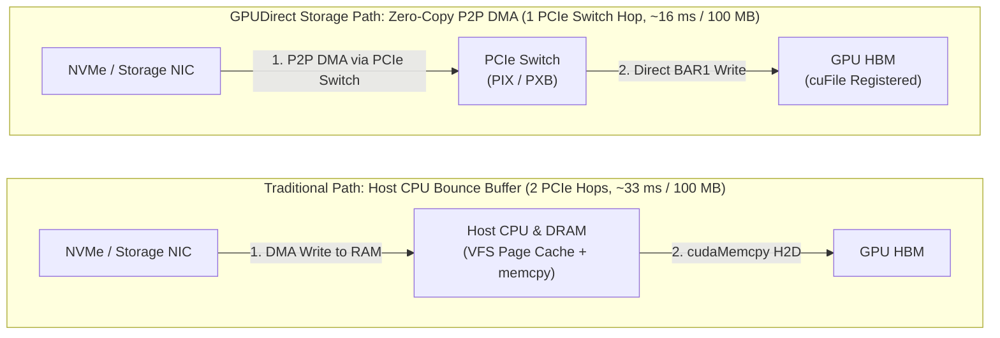
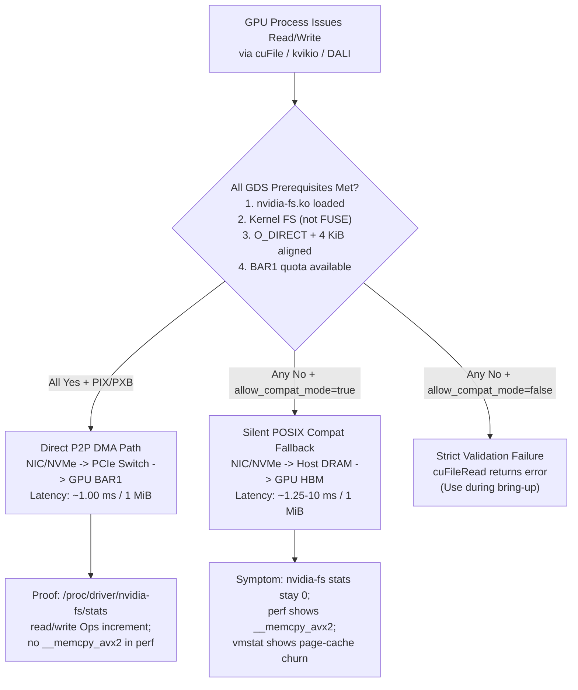

# 13.3 GPUDirect Storage architecture

| Field | Value |
|---|---|
| Level | Advanced |
| Priority tier | 2 |
| Lab venue | GCP / GKE + Local Python Verification Lab (`code/part13/gpudirect_storage_arch_lab.py`) |
| Part | Part 13: AI storage |
| Primary sources | NVIDIA Zero-to-Hero Volume 15 (Chapter 4, Lab 03); *AI Systems Performance Engineering* (Chapter 5); *AI Data Center Network Design and Technologies* (Chapter 9) |
| Coverage file | `planning/coverage/chapters/13-03.md` |
| Claim & number ledger | `planning/ledgers/13-03.md` |

## Why this matters for AI infrastructure

Feeding training samples, multimodal media shards, and model checkpoints between storage and GPU High-Bandwidth Memory (`HBM`) is just as critical to cluster goodput as collective communication. Consider an `8`-GPU compute node where each GPU requires `200 MB/s` of training data to stay saturated (`1.6 GB/s` aggregate node read bandwidth), or a `72`-GPU NVIDIA Grace Blackwell `GB200/GB300 NVL72` rack connected as a single `NVLink` domain that requires `14.4 GB/s` (`14–20 GB/s` sustained) of storage ingestion bandwidth. On multimodal video pipelines or `100,000`-GPU training clusters writing multi-terabyte checkpoints, per-node storage streams routinely reach `10.0 GB/s` to `100.0 GB/s`.

In a traditional Linux I/O stack without **GPUDirect Storage (`GDS`)**, the host CPU and system `DRAM` act as a mandatory middleman—known as the **host bounce buffer**:
1. The storage controller (local `NVMe` SSD or remote `ConnectX` `RDMA` `NIC`) DMAs blocks across the `PCIe` bus into the Linux Virtual File System (`VFS`) page cache or a host `DRAM` staging buffer.
2. The host CPU copies bytes from the kernel page cache into a user-space or pinned host buffer (`__memcpy_avx2` / `copy_page`), polluting the CPU `L3` cache and saturating `DRAM` channels.
3. The CUDA runtime (`cudaMemcpyAsync`) initiates a second `PCIe` DMA transfer from host `DRAM` across the `PCIe` bus into GPU `HBM`.

Streaming `100.0 GB/s` of training data or model weights through this CPU bucket brigade causes three severe bottlenecks: it **doubles traffic on the `PCIe` bus** (`2` `PCIe` traversals per byte), spikes host CPU utilization toward `85%–100%` per socket (starving Python `DataLoader` tokenization and kernel launches), and inflates per-fetch latency. **GPUDirect Storage (`GDS`)**—part of the NVIDIA **Magnum IO** stack alongside `GPUDirect RDMA`—eliminates the host `DRAM` bounce buffer. Using the **`cuFile`** user-space library (`libcufile.so`) and the **`nvidia-fs.ko`** Linux kernel driver, `GDS` programs the local `NVMe` drive or `RDMA` storage `NIC` to DMA blocks directly into and out of GPU `BAR1` (`HBM`) across a shared `PCIe` switch (`PIX` / `PXB`), cutting host `DRAM` copies to `0`, improving read throughput by **`+20.0%` (`8.0 GB/s` to `9.6 GB/s`)** to **`+30.0%+`**, reducing average I/O latency by **`-20.0%` (`1.25 ms` to `1.00 ms`)**, and dropping host CPU utilization from **`85.0%` down to `25.0%`**.

## Prerequisites and outcomes

### Prerequisites
- Working knowledge of the Linux storage stack (`VFS` page cache, `O_DIRECT`, `blk-mq`, `NVMe` submission/completion queues) from Chapters `13.1` and `13.2`.
- Familiarity with `PCIe` topologies (`PIX`, `PXB`, `PHB`, `NODE`, `SYS` in `nvidia-smi topo -m`), `BAR1` apertures, and `NVMe-oF` (`NVMe/TCP` vs `NVMe/RDMA` over `RoCEv2` / InfiniBand) from Chapter `12.19`.
- Basic familiarity with CUDA memory management (`cudaMalloc`, pinned host memory) and PyTorch `DataLoader` workers.

### Outcomes
After completing this chapter, you will be able to:
1. Quantify the exact latency, `PCIe` traffic amplification, and CPU `L3`/`DRAM` overhead of the **CPU bounce-buffer path** versus the **GPUDirect Storage direct `DMA` path** (including `100 MB` model-weight fetches and `1,000 MB/s` batch streaming).
2. Implement and audit the **7-step `cuFile` API lifecycle** (`cuFileDriverOpen`, `cuFileHandleRegister`, `cuFileBufRegister`, `cuFileRead`/`cuFileWrite`, `cuFileBufDeregister`, `cuFileHandleDeregister`, `cuFileDriverClose`) and explain how `nvidia-fs.ko` intercepts kernel `O_DIRECT` DMA mappings to target GPU `BAR1`.
3. Validate **`4 KiB` (`4,096 B`) `O_DIRECT` alignment** (and `8 KiB` Lustre alignment) across file offsets, transfer sizes, and GPU buffer addresses, and diagnose silent fallbacks to **POSIX compatibility mode** when `"allow_compat_mode": true` is set in `/etc/cufile.json` or when a filesystem is mounted via user-space `FUSE`.
4. Benchmark and interpret **`gdsio`** transfer modes (`-x 0` through `-x 6`), reproducing the `8.0 GB/s` (`1.25 ms`, `85%` CPU) `-x 2` baseline versus `9.6 GB/s` (`1.00 ms`, `25%` CPU) `-x 0` `GDS` gain and enterprise `VAST Data` (`+20%` on `A100`, `+30%+` on `H100`) and **DeepSeek `3FS`** (`6.6 TB/s` + `1.4 TB/s` on `68` nodes vs `Ceph` `1.1 TB/s`) results.
5. Prove whether `GDS` is active in production using `gdscheck.py -p`, `/proc/driver/nvidia-fs/stats`, `perf record` (`__memcpy_avx2` absence), and `nsys profile --trace=cuda,gds,nvtx,osrt`, and architect compressed storage pipelines using the **Blackwell Hardware Decompression Engine** (`LZ4`, `Snappy`, `Deflate` at up to `800 GB/s`).

---

## 1. The CPU Bounce-Buffer Bottleneck vs GPUDirect Storage

### 1.1 Anatomy of the Traditional CPU Bounce Path

When a training or inference process loads dataset shards or model weights using standard POSIX file I/O (`open()`, `read()`, `pread()`, or `torch.load("/storage/model.pt", map_location="cpu")` followed by `.cuda()`), the GPU cannot talk to the block layer or network filesystem directly. Every byte follows a CPU-mediated staging path:

```text
Traditional Path (with CPU Bounce Buffer):
Storage -> NIC / NVMe (DMA to CPU DRAM) -> OS Page Cache / User Buffer -> CPU-to-GPU PCIe Copy -> GPU HBM
```

- **Double `PCIe` traversal (`2x` bus traffic):** A `100.0 MB` payload crosses the `PCIe` root complex once moving from the `NVMe` drive or `Storage NIC` into host `DRAM` (`100.0 MB` `DRAM` write), and a second time moving from host `DRAM` into GPU `HBM` (`100.0 MB` `DRAM` read + `100.0 MB` `PCIe` write = `200.0 MB` total `PCIe` traffic).
- **CPU `memcpy` saturation and `L3` cache pollution:** Unless `O_DIRECT` is combined with pre-pinned buffers, the Linux kernel copies every `4 KiB` page out of the `VFS` page cache into user space using vectorized CPU instructions (`copy_page` / `__memcpy_avx2`). Even with `1,000` batches per second of `1.0 MB` each (`1,000 MB/s` = `1.0 GB/s`), CPU-mediated copies consume multiple CPU cores continuously; at `10.0 GB/s` to `100.0 GB/s`, CPU utilization spikes to `85%–100%`, starving the GPU of kernel launches.
- **Latency penalty on model-weight and batch fetches:** Suppose the underlying `NVMe-oF` or local `NVMe` storage read takes `100 us` (`0.10 ms`), but the CPU-mediated staging and copy overhead adds `500 us` per `1.0 MB` (or achieves `3,000 MB/s` effective CPU-to-GPU staged copy throughput vs `6,000 MB/s` direct `NIC`-to-`GPU` `DMA` per stream):
  - **Traditional CPU bounce (`100 MB` fetch):**
```text
Time_CPU-bounce = (100 MB) / (3,000 MB/s) + 0.10 ms = 33.33 ms + 0.10 ms = 33.43 ms\ (~= 33 ms)
```
  - **GPUDirect Storage direct `DMA` (`100 MB` fetch):**
```text
Time_GDS = (100 MB) / (6,000 MB/s) + 0.10 ms = 16.67 ms + 0.10 ms = 16.77 ms\ (~= 16 ms,\ 2.0x copy speedup)
```



| Architectural Dimension | Traditional Path (`CPU` Bounce Buffer) | GPUDirect Storage (`GDS` Direct `DMA`) |
|---|---|---|
| Primary APIs | `open()` / `read()` / `torch.load(..., map_location="cpu")` | `cuFile` (`cuFileRead`, `cuFileWrite`, `kvikio.CuFile`, `DALI`) |
| `PCIe` bus traversals per transfer | `2` (`Storage -> Host DRAM`, then `Host DRAM -> GPU HBM`) | `1` (`Storage / NIC -> PCIe Switch -> GPU BAR1 HBM`) |
| Host `DRAM` copies | `1–2` (`VFS` page cache -> user buffer -> pinned buffer) | `0` (host `DRAM` and `L3` cache bypassed on data plane) |
| CPU role during I/O | Data-plane middleman (`__memcpy_avx2` + page cache churn) | Control-plane orchestrator only (builds `NVMe`/`RDMA` descriptors) |
| `100 MB` fetch time (`3 GB/s` vs `6 GB/s` stream) | `33.33 ms` copy (`~33 ms`) + `100 us` storage latency (`33.43 ms`) | `16.67 ms` DMA (`~16 ms`) + `100 us` storage latency (`16.77 ms`, **`2.0x`**) |
| Kernel counter proof | `perf report` shows high `copy_page` / `__memcpy_avx2` | `/proc/driver/nvidia-fs/stats` `Ops` counters increment |

### 1.2 The Five Conditions Where GPUDirect Storage Pays Off

On paper, eliminating the CPU bounce buffer yields up to a `2.0x` reduction in copy latency and `+20%` to `+30%+` higher sustained throughput. In production, those gains materialize **only when all five architectural conditions hold**:
1. **The workload is I/O-bound (or CPU-bound on `memcpy`), not compute-bound:** If `nvidia-smi` shows GPU SM utilization is already `95%+` without `GDS` because data prefetching is completely hidden behind long forward/backward passes, `GDS` will lower host CPU utilization (freeing CPU cores for tokenization or augmentation) but will not shorten step time. If GPU utilization without `GDS` is below `70%–80%` (for example, GPUs spending `30.0%` of iteration time waiting on I/O), cutting I/O wait down to `5.0%` reduces I/O stall time by **`6.0x`** and boosts active training steps per second by **`+35.71%`**.
2. **The storage link is fast enough that the CPU bounce is the bottleneck:** On a slow `10 Gbps` (`1.25 GB/s`) NAS link, the network wire itself is the bottleneck; the host CPU can effortlessly `memcpy` `1.25 GB/s`, so enabling `GDS` adds operational complexity for `< 20%` gain. `GDS` pays off when storage bandwidth exceeds **`40 Gbps`** (`100 Gbps` to `400/800 Gbps` `RoCEv2` / InfiniBand or multi-drive local `NVMe` RAID 0) or when checkpoint writes stall the training loop.
3. **The storage client runs in kernel space with `nvidia-fs` support:** Supported stacks include local `NVMe` and `NVMe-oF` (`NVMe/RDMA`, `NVMe/TCP`) on `EXT4`/`XFS` with `O_DIRECT`, `NFS over RDMA`, `Lustre` (with GDS-enabled OSTs), `WekaFS`, `VAST Data`, `BeeGFS`, `IBM Storage Scale` (`GPFS`), and RDMA-native parallel filesystems like **DeepSeek Fire-Flyer File System (`3FS`)**. User-space **`FUSE`** mounts cannot deliver a native `GDS` path.
4. **The GPU and storage `NIC` / `NVMe` drive share a `PCIe` domain (`PIX` / `PXB`):** If `nvidia-smi topo -m` reports `PHB` (CPU Host Bridge) or `SYS` (cross-socket `UPI`/`xGMI`) between the GPU and the storage `NIC`/`NVMe`, `PCIe` peer-to-peer packets must still traverse the CPU root complex, erasing most of the latency advantage over a CPU bounce buffer.
5. **The application invokes `cuFile` with `4 KiB`-aligned `O_DIRECT` buffers:** Standard `open()`/`read()` calls never enter `libcufile.so`, and unaligned buffers or missing `O_DIRECT` flags force `libcufile` into internal bounce buffers or compatibility mode.

---

## 2. Under the Hood: `cuFile` API, `nvidia-fs.ko`, and `BAR1` Peer-to-Peer DMA

### 2.1 How `GDS` Complements `GPUDirect RDMA`

Inside the NVIDIA **Magnum IO** architecture, `GPUDirect RDMA` and `GPUDirect Storage` solve complementary halves of the zero-copy problem:
- **GPUDirect RDMA** accelerates **network-to-GPU `DMA`** (`NCCL`, `NVSHMEM`, `UCX`, `NIXL` over `InfiniBand` / `RoCEv2` Queue Pairs) using `nvidia-peermem.ko` or Linux `dma-buf` (`ibv_reg_dmabuf_mr`).
- **GPUDirect Storage (`GDS`)** accelerates **storage-to-GPU `DMA`** (POSIX file descriptors, block `NVMe` queues, and distributed parallel file systems) using user-space **`libcufile.so`** (`cuFile` API) and the **`nvidia-fs.ko`** kernel driver.

Neither technology eliminates the CPU from the **control plane**: the host CPU still opens files, resolves filesystem metadata extents, checks permissions, and submits `NVMe` Submission Queue Entries (`SQEs`) or `RDMA` work requests. What `GDS` removes is the **host memory bounce buffer on the data plane**. Note also that **host pinned memory (`cudaMallocHost`) is not used in the `GDS` storage-to-GPU data path**: instead, `cuFile` pins **GPU device memory (`HBM`)** directly in the GPU's `PCIe` `BAR1` aperture.

### 2.2 The 7-Step `cuFile` API Lifecycle (and 10-Stage OS/CUDA Flow)

To read or write a file directly between storage and GPU `HBM`, an application (or framework backend such as **RAPIDS `kvikio`**, **NVIDIA DALI**, or **PyTorch `v2.7.0+`**) executes **seven core `cuFile` API steps** embedded within a **10-stage OS/CUDA sequence**:

1. **Step 1 — `cuFileDriverOpen()`:** Initializes the `libcufile.so` runtime, parses `/etc/cufile.json` (or the path in `CUFILE_ENV_PATH_JSON`), and opens `/dev/nvidia-fs0` to establish an `ioctl` channel with the **`nvidia-fs.ko`** kernel module.
2. *(OS Stage 2 — `open(path, O_RDWR | O_DIRECT, 0644)`):* Opens the target file on a GDS-capable mount with the Linux **`O_DIRECT`** flag so the kernel `VFS` layer bypasses the host `DRAM` page cache.
3. **Step 2 — `cuFileHandleRegister(&cf_handle, &cf_descr)`:** Populates a `CUfileDescr_t` struct (`descr.type = CU_FILE_HANDLE_TYPE_OPAQUE_FD`, `descr.handle.fd = fd`) and registers it with `libcufile` to obtain a `CUfileHandle_t`. Internally, `libcufile` queries the mount type (`EXT4`, `XFS`, `Lustre`, `WekaFS`, `VAST`, `BeeGFS`, `GPFS`) and verifies DMA callback support.
4. *(CUDA Stage 4 — `cudaMalloc(&d_ptr, size)`):* Allocates the target tensor buffer in GPU `HBM` on the active CUDA device.
5. **Step 3 — `cuFileBufRegister(d_ptr, size, flags)`:** Instructs `nvidia-fs.ko` to pin the GPU `HBM` physical pages in the GPU's **`BAR1`** `PCIe` aperture (bounded by `max_device_pinned_mem_size_kb` in `/etc/cufile.json`, typically `33,554,432 KiB` = `32.0 GiB`) and pre-build the `PCIe` `DMA` scatter-gather table. *Production rule:* Register reusable GPU staging buffers once during initialization and reuse them across thousands of reads; never call `cuFileBufRegister` inside the per-batch training loop.
6. **Step 4 — `cuFileRead(cf_handle, d_ptr, size, file_offset, dev_offset)` / `cuFileWrite(...)` (or `cuFileReadAsync` / `cuFileWriteAsync` / `cuFileBatchIOSubmit`):** Executes the zero-copy transfer:
   - The CPU filesystem client resolves the file's logical `[file_offset, file_offset + size)` range into physical `NVMe` Logical Block Addresses (`LBAs`) or remote `NVMe-oF` / parallel-filesystem `RDMA` extents.
   - Instead of mapping host `DRAM` pages into the `NVMe` Physical Region Page (`PRP1`/`PRP2` `64`-bit pointers) or Scatter-Gather List (`SGL`) descriptors (or `RDMA` Memory Keys), **`nvidia-fs.ko` intercepts the kernel DMA mapping callback** and substitutes the pinned **GPU `BAR1` physical bus addresses** (`d_ptr + dev_offset`).
   - The local `NVMe` controller (`opcode 0x02` Read / `0x01` Write) or `ConnectX` `RDMA` `NIC` (`UDP 4791` `RoCEv2` or native InfiniBand) DMAs the payload across the `PCIe` switch directly into or out of GPU `HBM`.
   - For stream-ordered overlap with GPU compute kernels, `cuFileReadAsync` and `cuFileWriteAsync` bind the transfer directly to a **`cudaStream_t`**.
7. **Step 5 — `cuFileBufDeregister(d_ptr)`:** Unpins the GPU `BAR1` pages and frees the `nvidia-fs` scatter-gather mapping before `cudaFree(d_ptr)`.
8. **Step 6 — `cuFileHandleDeregister(cf_handle)`:** Releases the registered `CUfileHandle_t` wrapper before `close(fd)`.
9. *(OS/CUDA Stage 9 — `cudaFree(d_ptr)` and `close(fd)`):* Frees the GPU `HBM` allocation and closes the Linux file descriptor.
10. **Step 7 — `cuFileDriverClose()`:** Closes `/dev/nvidia-fs0` and tears down the `libcufile` driver context.

```c
// Complete 7-step cuFile API (10-stage OS/CUDA) GPUDirect Storage read & async stream example (untested here)
#include <fcntl.h>
#include <unistd.h>
#include <cuda_runtime.h>
#include <cufile.h>

int gds_read_sync_and_async(const char *path, size_t aligned_bytes, off_t aligned_file_off) {
    // Step 1: Open the cuFile driver (/dev/nvidia-fs0)
    CUfileError_t status = cuFileDriverOpen();
    if (status.err != CU_FILE_SUCCESS) return -1;

    // Stage 2 (OS): Open file with O_DIRECT (4 KiB aligned semantics)
    int fd = open(path, O_RDONLY | O_DIRECT);
    if (fd < 0) { cuFileDriverClose(); return -2; }

    // Step 2: Register the Linux file descriptor with cuFile
    CUfileDescr_t cf_descr = {};
    cf_descr.handle.fd = fd;
    cf_descr.type = CU_FILE_HANDLE_TYPE_OPAQUE_FD;
    CUfileHandle_t cf_handle;
    status = cuFileHandleRegister(&cf_handle, &cf_descr);
    if (status.err != CU_FILE_SUCCESS) { close(fd); cuFileDriverClose(); return -3; }

    // Stage 4 (CUDA) + Step 3: Allocate GPU HBM and pin in BAR1 once
    void *d_buf = nullptr;
    cudaMalloc(&d_buf, aligned_bytes);
    status = cuFileBufRegister(d_buf, aligned_bytes, 0);
    if (status.err != CU_FILE_SUCCESS) {
        cudaFree(d_buf); cuFileHandleDeregister(cf_handle); close(fd); cuFileDriverClose();
        return -4;
    }

    // Step 4a: Synchronous zero-copy read directly into GPU HBM
    ssize_t bytes_read = cuFileRead(cf_handle, d_buf, aligned_bytes, aligned_file_off, 0);

    // Step 4b: Or asynchronous stream-ordered GDS read overlapped with GPU compute
    cudaStream_t io_stream;
    cudaStreamCreateWithFlags(&io_stream, cudaStreamNonBlocking);
    size_t io_size = aligned_bytes;
    off_t f_off = aligned_file_off;
    off_t d_off = 0;
    ssize_t async_bytes_read = 0;
    cuFileReadAsync(cf_handle, d_buf, &io_size, &f_off, &d_off, &async_bytes_read, io_stream);
    cudaStreamSynchronize(io_stream);
    cudaStreamDestroy(io_stream);

    // Steps 5, 6, Stage 9, Step 7: Deregister buffer, deregister handle, close fd, close driver
    cuFileBufDeregister(d_buf);
    cudaFree(d_buf);
    cuFileHandleDeregister(cf_handle);
    close(fd);
    cuFileDriverClose();
    return (bytes_read == (ssize_t)aligned_bytes) ? 0 : -5;
}
```

### 2.3 Orthogonal Path: `cuda-checkpoint` and `CRIU` vs `GDS`

Do not confuse framework-level tensor checkpoints written via `cuFileWrite` with NVIDIA's process-level **`cuda-checkpoint`** utility (`cuCheckpointProcessLock`, `cuCheckpointProcessCheckpoint`, `cuCheckpointProcessRestore`, `cuCheckpointProcessUnlock` used alongside **CRIU**, Checkpoint/Restore in Userspace):
- **Framework checkpoints (`PyTorch` / `Megatron` + `GDS`):** Persist model weights and optimizer states (`state_dict` / sharded `.pt` or `.safetensors` files). When integrated with `cuFileWrite`, tensors DMA directly from GPU `HBM` to `NVMe` or RDMA storage.
- **`cuda-checkpoint` + `CRIU`:** Designed for transparent process preemption, fault tolerance, and live migration of running CUDA jobs. During suspend, the CUDA driver locks driver entry points, drains in-flight GPU work, and **copies the GPU device memory image into host `DRAM` allocations** before releasing the GPU so `CRIU` can snapshot the process; it **does not DMA directly from GPU `HBM` to storage via `GDS`**.

---

## 3. Compatibility Mode, `4 KiB` `O_DIRECT` Alignment, and Why `FUSE` Cannot Use `GDS`

### 3.1 Direct Path vs Silent Compatibility-Mode (`POSIX`) Fallback

One of the most common operational traps in `GPUDirect Storage` is believing `GDS` is active simply because a `cuFile` job completes without errors. By default, `/etc/cufile.json` ships with `"allow_compat_mode": true`. Whenever any hardware, kernel, filesystem, or alignment prerequisite is unmet, `libcufile.so` **silently falls back to POSIX compatibility mode**—allocating a host `DRAM` buffer, calling standard `pread()`/`pwrite()`, and copying the payload into GPU `HBM` via `cudaMemcpyAsync`.



| Verification Signal | Direct `GDS` Path (`gds-p2p-dma`) | Silent Fallback (`compat-posix-fallback`) | Strict Bring-Up (`allow_compat_mode: false`) |
|---|---|---|---|
| `cuFileRead()` return status | Success (`bytes_read == size`) | Success (`bytes_read == size`, **silent**) | Immediate error (`CU_FILE_IO_NOT_SUPPORTED` / alignment err) |
| `/proc/driver/nvidia-fs/stats` | `Read` / `Write` `Ops` and byte counters increment | Counters remain **`0`** (unchanged during load) | Counters remain `0` |
| `perf record -g` stack trace | `cuFileRead` -> `nvidia-fs` `ioctl` (no CPU `memcpy`) | `copy_page` -> `__memcpy_avx2` (`20%+` CPU time) | Process exits on error |
| GPU `PCIe` counters (`nvidia-smi dmon -s t`) | Non-zero `PCIe Rx/Tx` (**cannot distinguish paths alone**) | Non-zero `PCIe Rx/Tx` (both paths cross `PCIe` into GPU) | None |

:::tip Why `nvidia-smi dmon` PCIe counters cannot prove GDS is working
Because data enters the GPU over its `PCIe` interface in **both** the traditional CPU-bounce path (`Host DRAM -> PCIe -> GPU`) and the direct `GDS` path (`NIC/NVMe -> PCIe Switch -> GPU`), watching `nvidia-smi dmon -s t -d 1` will show high `PCIe` `Rx`/`Tx` throughput even when `GDS` is completely broken. Always check `/proc/driver/nvidia-fs/stats` and `perf report` (`__memcpy_avx2`) or `nsys profile --trace=gds` to prove which path carried the bytes.
:::

### 3.2 `4 KiB` (`4,096 B`) `O_DIRECT` Alignment Rules (and `8 KiB` Lustre Stripe Alignment)

Hardware `NVMe` controllers and `O_DIRECT` kernel filesystems address blocks in multiples of the `4 KiB` (`4,096`-byte) logical block / page size (`8 KiB` = `8,192` bytes on certain `Lustre` Object Storage Target configurations). For `nvidia-fs.ko` to program zero-copy `PRP` or `SGL` descriptors without staging through an intermediate bounce buffer, **all three coordinates of a `cuFileRead` or `cuFileWrite` call must be integer multiples of `4,096` bytes** (`8,192` bytes on `Lustre` when required):

1. **`file_offset`:** `file_offset % 4096 == 0`
2. **`size` (transfer length):** `size % 4096 == 0` (and practically `>= 1 MiB` to amortize per-I/O submission latency)
3. **`devPtr_base + devPtr_offset` (GPU `HBM` address):** `(uintptr_t)(d_ptr + dev_offset) % 4096 == 0` (`cudaMalloc` naturally aligns allocations to at least `256 B`–`4 KiB`, so slicing a buffer with an unaligned `dev_offset` such as `+0x100` breaks alignment)

If an application requests an unaligned slice—for example, `file_offset = 4,100` bytes and `size = 1,000,000` bytes—you must either:
- **Realign in user space:** Round `file_offset` down to the nearest `4,096`-byte boundary (`4,100 & ~4095 = 4,096`), round the end byte (`4,100 + 1,000,000 = 1,004,100`) up to the next `4,096`-byte multiple (`(1,004,100 + 4,095) & ~4,095 = 1,007,616`), read the aligned `1,003,520`-byte span into GPU `HBM`, and offset the tensor pointer by `+4` bytes on the GPU; or
- **Accept internal bounce buffering:** If `"posix_unaligned_kb"` is enabled in `/etc/cufile.json`, `libcufile` allocates an internal staging buffer for the unaligned head/tail blocks, sacrificing pure zero-copy performance.

### 3.3 Why User-Space `FUSE` Filesystems Cannot Deliver a Native `GDS` Path (and How DeepSeek `3FS` Solves It)

Many cloud object-storage connectors (`s3fs`, `gcsfuse`, `mountpoint-s3`) and user-space caching daemons mount filesystems via **Linux `FUSE` (`Filesystem in Userspace`)**. **A `FUSE`-mounted filesystem cannot provide a native `GPUDirect Storage` path:**
- `GDS` requires a **kernel-mode filesystem client** that supports `O_DIRECT` and registers block/RDMA DMA mapping callbacks with `nvidia-fs.ko` so physical GPU `BAR1` pages can be placed directly into the `NVMe` or `RDMA` hardware descriptors.
- In a `FUSE` mount, every file read or write traps into the Linux kernel `fuse.ko` driver, copies the request into a user-space daemon process in host `DRAM`, and returns data through kernel/user memory pipes. Even if you call `cuFileRead` on a `FUSE` file, `libcufile` is forced onto the compatibility bounce path.

A textbook example of codesigning a storage filesystem around direct RDMA and `O_DIRECT` semantics is **DeepSeek's open-source Fire-Flyer File System (`3FS`)**:
- DeepSeek observed that LLM training and inference workloads issue massive volumes of random reads across terabyte-to-petabyte datasets, rendering traditional OS read page caches ineffective and counterproductive.
- `3FS` eliminates page-cache staging entirely and interconnects four core components—**Cluster Manager**, **Metadata Service** (sharded and replicated across nodes), **Storage Service**, and **Client**—over an `RDMA` fabric (`InfiniBand` or `RoCEv2`) so every read goes straight to the `NVMe` SSDs via `O_DIRECT` and `RDMA` reads.
- On a **`68`-node AI-HPC storage cluster** equipped with **`10 x 16 TB` `NVMe` SSDs per node** (`680` drives = `10,880 TB` raw capacity) and **dual `100 Gb/s` NICs per node**, `3FS` achieved **`6.6 TB/s` of sustained aggregate foreground read throughput** while simultaneously serving **`1.4 TB/s` of background traffic** (**`8.0 TB/s` combined**, with peak cluster runs reaching **`7.3 TB/s`**)—outperforming **`Ceph` (`~1.1 TB/s` on comparable hardware) by `6.0x`**.
- Note the architectural distinction: `3FS` uses its own native `RDMA` client pipeline; when you require a strict `cuFile` + `nvidia-fs.ko` `GDS` path on standard enterprise infrastructure, pair `GDS` with a kernel-integrated client (`local NVMe`, `NVMe-oF`, `WekaFS`, `VAST Data`, `Lustre`, `BeeGFS`, or `IBM Storage Scale`).

---

## 4. Benchmarking with `gdsio`, Enterprise Uplifts, and the Blackwell Hardware Decompression Engine

### 4.1 `gdsio` Transfer Selector Modes (`-x 0` through `-x 6`)

NVIDIA ships the **`gdsio`** benchmark utility under `/usr/local/cuda/gds/tools/gdsio` to measure storage-to-GPU throughput, latency, and CPU utilization across identical file layouts, worker counts, and block sizes. The most important CLI flag in `gdsio` is the **transfer mode selector (`-x`)**:

| `gdsio` Flag | Transfer Mode Name | Data Path | Uses `GDS` (`nvidia-fs`)? |
|---|---|---|---|
| **`-x 0`** | `GDS` Direct (`Storage -> GPU`) | Storage `<->` GPU `HBM` directly via `cuFileRead` / `cuFileWrite` and `nvidia-fs.ko` | **Yes** |
| **`-x 1`** | `Storage -> CPU` Only | Storage `<->` Host `DRAM` only (measures raw storage baseline without GPU copy) | No |
| **`-x 2`** | `Storage -> CPU -> GPU` (Pinned Async) | Storage `->` Pinned Host `DRAM` (`cudaMallocHost`) `->` GPU `HBM` via `cudaMemcpyAsync` | No (**Primary CPU-bounce baseline**) |
| **`-x 3`** | `Storage -> CPU Pageable -> GPU` | Storage `->` Pageable Host `DRAM` `->` GPU `HBM` via synchronous `cudaMemcpy` | No |
| **`-x 4`** | `Storage -> mmap -> CPU -> GPU` | Memory-mapped file (`mmap`) `->` Host `DRAM` `->` GPU `HBM` | No |
| **`-x 5`** | `GDS` Batch API | Storage `<->` GPU `HBM` directly via batched `cuFileBatchIOSubmit` | **Yes** |
| **`-x 6`** | `GDS` Async Stream API | Storage `<->` GPU `HBM` directly via stream-ordered `cuFileReadAsync` / `cuFileWriteAsync` | **Yes** |

### 4.2 Quantitative `gdsio` Benchmark (`-x 2` vs `-x 0`) and `VAST Data` `A100`/`H100` Gains

To perform an apples-to-apples comparison between the best possible CPU-mediated path (pinned host memory + asynchronous `cudaMemcpyAsync`, `-x 2`) and direct `GPUDirect Storage` (`-x 0`), run `gdsio` on a `10 GiB` file (`-s 10G`) using GPU `0` (`-d 0`), `4` worker threads (`-w 4`), `1 MiB` I/O chunk size (`-i 1M`), and read mode (`-I 0`):

```bash
# 1. Baseline Before GDS: Storage -> Pinned CPU Memory -> GPU (-x 2) (untested here)
/usr/local/cuda/gds/tools/gdsio \
    -f /mnt/data/large_file \
    -d 0 -w 4 -s 10G -i 1M -I 0 -x 2
# Output:
# Total Throughput: 8.0 GB/s
# Average Latency: 1.25 ms   (Host CPU utilization: ~85%)

# 2. After Enabling GDS: Storage -> GPU HBM Direct (-x 0) (untested here)
/usr/local/cuda/gds/tools/gdsio \
    -f /mnt/data/large_file \
    -d 0 -w 4 -s 10G -i 1M -I 0 -x 0
# Output:
# Total Throughput: 9.6 GB/s
# Average Latency: 1.00 ms   (Host CPU utilization: ~25%)
```

| Metric | Without `GDS` (`gdsio -x 2`, `Storage -> CPU -> GPU`) | With `GDS` (`gdsio -x 0`, `Storage -> GPU`) | Measured Delta / Impact |
|---|---|---|---|
| Sustained read throughput | **`8.0 GB/s`** | **`9.6 GB/s`** | **`+20.0%`** higher throughput |
| Average I/O latency (`1 MiB` read) | **`1.25 ms`** | **`1.00 ms`** | **`-20.0%`** lower latency (`-0.25 ms`) |
| Time to read `10.0 GB` shard | `1.2500 s` | `1.0417 s` | `0.2083 s` saved per `10.0 GB` |
| Host CPU utilization during read | **`85.0%`** | **`25.0%`** | **`-60.0` percentage points** (`3.4x` lower CPU load) |
| CPU I/O efficiency (`GB/s` per `1%` CPU) | **`0.0941 GB/s`** per `%` CPU | **`0.3840 GB/s`** per `%` CPU | **`4.08x`** higher throughput per unit of CPU |
| Enterprise NAS (`VAST Data` over `RDMA`) | Staged `POSIX` baseline | **`+20.0%`** on `A100`; **`+30.0%+`** on `H100` | `H100` sees larger gain due to higher `NIC`/compute rate |

### 4.3 In-Pipeline Unpacking with the Blackwell Hardware Decompression Engine (`800 GB/s`)

A powerful way to multiply effective storage bandwidth when PCIe or network links are saturated is to store datasets and checkpoints **compressed on disk** (`Parquet`, `Arrow`, compressed binary shards, or `JPEG` images) and decompress them **inside GPU `HBM` after a `GDS` read**.
- For image and video workloads, **NVIDIA `nvJPEG`** and **NVIDIA DALI** offload decoding onto the GPU's hardware media engines, cutting host CPU utilization on an `8`-core vision loader from **`800%` (`8` cores at `100%`) down to `200%` (`2` cores)**.
- On **NVIDIA Blackwell (`B200` / `GB200`)** GPUs, NVIDIA added a dedicated on-die **Hardware Decompression Engine** supporting **`LZ4`**, **`Snappy`**, and **`Deflate`** formats at up to **`800.0 GB/s`** (paired with **`900.0 GB/s`** bidirectional **`NVLink-C2C`** coherent memory bandwidth between the `72`-core Grace CPU and Blackwell GPUs). Because decompression executes on dedicated fixed-function silicon rather than GPU Streaming Multiprocessors (`SMs`), `100%` of the GPU's `SMs` remain free to run `Transformer` attention and `GEMM` kernels.

Consider loading a **`4.0 GB` uncompressed training batch** over a **`50.0 GB/s`** (`400 Gbps`) `GDS` storage path when the batch is stored with **`LZ4` compression at a `2.5x` compression ratio** (`1.6 GB` on disk):
1. **Uncompressed `GDS` read time:**
```text
t_uncomp = (4.0 GB) / (50.0 GB/s) = 80.0 ms
```
2. **Compressed `GDS` read time (`1.6 GB` over `50.0 GB/s`):**
```text
t_comp-read = (1.6 GB) / (50.0 GB/s) = 32.0 ms
```
3. **Blackwell Hardware Decompression Engine unpack time (`4.0 GB` unpacked at `800.0 GB/s`):**
```text
t_decomp = (4.0 GB) / (800.0 GB/s) = 5.0 ms
```
4. **Total serial read + hardware unpack time (even before chunked pipelining):**
```text
t_total = 32.0 ms + 5.0 ms = 37.0 ms\quad\Longrightarrow\quad Effective Throughput = (4.0 GB) / (0.037 s) = 108.11 GB/s\ (2.16x speedup)
```

---

## 5. Production Verification, `/etc/cufile.json` Tuning, and Profiling with `nsys`

### 5.1 Four-Stage Production Verification Workflow

Before enabling `GPUDirect Storage` across a production training cluster, walk through four verification stages to prove that the hardware topology, kernel driver, and application APIs are actually delivering direct `DMA`:

#### Stage 1: Verify Kernel Driver, Platform, and Filesystem Prerequisites
Confirm that the NVIDIA GPU driver (`>= 470+`, modern `535+`/`550+` in production) and `nvidia-fs.ko` kernel module are loaded, and run `gdscheck.py -p` to inspect registered filesystem transports:

```bash
# Check GPU product and driver version (untested here)
nvidia-smi -i 0 -q | grep "Product Name"
nvidia-smi -q | grep "Driver Version"

# Verify nvidia_fs kernel module and GDS platform compatibility report (untested here)
lsmod | grep nvidia_fs
/usr/local/cuda/gds/tools/gdscheck.py -p

# Check NVMe-oF or Lustre GDS capability (untested here)
modprobe nvme_fabrics
lctl list_param mgc.* | grep -i gds
```

#### Stage 2: Audit Physical `PCIe` and `NUMA` Topology (`nvidia-smi topo -m`)
Even when `gdscheck.py -p` passes, `GDS` will not outperform a CPU bounce buffer if the GPU and the storage `NIC` (or `NVMe` SSD) sit on different `PCIe` root complexes (`PHB` or `SYS`). Inspect `nvidia-smi topo -m`:

```text
# Illustrative topology matrix showing PHB vs same-domain affinity (untested here)
        GPU0    GPU1    GPU2    GPU3    NIC0    NIC1    CPU Affinity    NUMA Affinity
GPU0     X      NV2     NV2     NV4     PHB     PHB     0-31            0
GPU1    NV2      X      NV4     NV2     PHB     PHB     32-63           1
GPU2    NV2     NV4      X      NV2     PHB     PHB     32-63           1
GPU3    NV4     NV2     NV2      X      PHB     PHB     0-31            0
NIC0    PHB     PHB     PHB     PHB      X      PHB     0-31            0
NIC1    PHB     PHB     PHB     PHB     PHB      X      32-63           1
```

- **Ideal placement (`PIX` / `PXB`):** Each GPU shares a dedicated `PCIe` switch with its paired `ConnectX` `NIC` and local `NVMe` drives. `P2P` DMA switches directly inside the `PCIe` switch (`1` hop) without touching the CPU root complex.
- **Same-socket host bridge (`PHB` on matching CPU affinity `0-31` for `GPU0` + `NIC0`, `32-63` for `GPU1` + `NIC1`):** `P2P` DMA must traverse the CPU root complex. Pair `NIC0` with `GPU0`/`GPU3` (`NUMA 0`) and `NIC1` with `GPU1`/`GPU2` (`NUMA 1`), and benchmark with `nvidia-p2pBandwidthLatencyTest` and `gdsio` to verify whether `GDS` beats `-x 2` by `> 20%`.
- **Cross-socket `SYS` (`GPU1` on `32-63` talking to `NIC0` on `0-31`):** `P2P` traffic crosses the inter-socket `UPI`/`xGMI` link—slower than staging in local host `DRAM`.

#### Stage 3: Prove the Active Path in Flight (`/proc/driver/nvidia-fs/stats` vs `perf`)
Compare `/proc/driver/nvidia-fs/stats` before and after a live load and profile the CPU stack trace with `perf`:

```bash
# Snapshot nvidia-fs kernel counters before and after a training/benchmark load (untested here)
cat /proc/driver/nvidia-fs/stats

# Record CPU stack traces during data loading to check for CPU memcpy (untested here)
perf record -g python3 data_loader.py
perf report | grep -E "memcpy|cuFileRead|copy_page"
```

When `GDS` has silently fallen back to the CPU bounce path, `perf report` shows heavy CPU time inside `copy_page` and `__memcpy_avx2`:

```text
# Illustrative perf report when fallback / CPU bounce is active (untested here)
-   25.34%     2.10%  python   [kernel.kallsyms]           [k] copy_page
   - 22.34% copy_page
      - 21.20% __memcpy_avx2  <-- CPU is copying every page through host RAM
        + 18.90% load_image_batch
```

When `GDS` is genuinely active, `__memcpy_avx2` disappears from the I/O path and `perf report` shows only lightweight user-space orchestration inside `cuFileRead`:

```text
# Illustrative perf report when GDS zero-copy DMA is active (untested here)
-   14.20%     0.50%  python   [nvidia/umd]                [.] cuFileRead
   - 13.70% cuFileRead
      + 11.50% ... (nvidia-fs ioctl submission; zero host-side page copies)
```

#### Stage 4: Timeline Profiling with Nsight Systems (`nsys profile --trace=gds`) and PyTorch Isolation
To visualize whether `cuFileRead` / `cuFileReadAsync` calls overlap cleanly with GPU compute kernels, profile the job with **Nsight Systems** (`--trace=cuda,gds,nvtx,osrt`) while enabling static tracepoints (`"nvtx": true`, `"cufile_stats": 3`) in `/etc/cufile.json`:

```bash
# Capture CUDA kernels, GDS cuFile API calls, NVTX ranges, and OS runtime waits (untested here)
nsys profile --trace=cuda,gds,nvtx,osrt -o gds_profile_report python3 train.py
```

*Important observability note:* `--trace=gds` captures user-space **`cuFile` API activity and static tracepoints** on the Nsight Systems timeline; low-level hardware/kernel counters for `NVMe` peer-to-peer DMA completions are not exposed directly in Nsight Systems and must be cross-checked with `/proc/driver/nvidia-fs/stats`, `iostat -xz 1`, `nvme-cli`, and **NVIDIA DCGM**.

When diagnosing PyTorch `DataLoader` stalls (`next(data_iterator)` measures total GPU idle wait including background prefetching and `H2D` copy), separate Python CPU bottlenecks from transfer bottlenecks in two steps:
1. **Isolate Python/transform cost (`num_workers=0`):** Temporarily set `num_workers=0` to disable background worker processes and time only the iterator pull (or time how long the `DataLoader` takes to produce `100` batches with GPU kernels disabled).
2. **Isolate `H2D` transfer cost:** Inspect the CUDA **Copy** lanes in Nsight Systems (or wrap `.to("cuda", non_blocking=True)` in `torch.cuda.Event` timers). Comparing these two numbers against total GPU idle time tells you whether to optimize Python transforms (vectorize, use Rust/C++ tokenizers, **NVIDIA DALI**, or offline **NeMo Curator** `.bin`/`.idx` packing) or switch the transfer path to `pin_memory=True` (`prefetch_factor=4`, `persistent_workers=True`, `ulimit -l` raised) and **`GPUDirect Storage`**.

---

## Commands and configurations that matter

### 1. Hardened `/etc/cufile.json` Configuration for Verification and Production

```json
{
    "logging": {
        "dir": "/var/log/gds",
        "level": "ERROR"
    },
    "profile": {
        "nvtx": true,
        "cufile_stats": 3
    },
    "properties": {
        "max_device_pinned_mem_size_kb": 33554432,
        "max_batch_io_size": 128,
        "max_batch_io_timeout_msecs": 5,
        "use_poll_mode": false,
        "poll_mode_max_size_kb": 4,
        "allow_compat_mode": false,
        "rdma_dev_addr_list": ["10.20.1.10", "10.20.2.10"]
    },
    "fs": {
        "generic": {
            "posix_unaligned_kb": false
        },
        "lustre": {
            "rdma_dev_addr_list": []
        },
        "wekafs": {
            "rdma_write_support": true
        }
    }
}
```

| `/etc/cufile.json` Key | Value | Operational Meaning |
|---|---|---|
| `profile.nvtx` & `profile.cufile_stats` | `true`, `3` | Enables `cuFile` static tracepoints for `nsys profile --trace=gds` and detailed `gds_stats` counters (`Level 1..3`). |
| `properties.max_device_pinned_mem_size_kb` | `33554432` | Caps total GPU `BAR1` memory pinned across `cuFileBufRegister` calls at **`32.0 GiB`** (`33,554,432 KiB`). |
| `properties.use_poll_mode` & `poll_mode_max_size_kb` | `false`, `4` | When `use_poll_mode` is `true`, CPU polling only applies to I/Os **`<= 4 KiB`**. Large `1 MiB+` training reads still use interrupts; enabling poll mode with a huge threshold burns `100%` of a CPU core. |
| `properties.allow_compat_mode` | `false` (test) / `true` (prod) | Set to **`false` during validation** so any unsupported mount, missing `nvidia-fs.ko`, or unaligned buffer fails immediately instead of silently bouncing through host `DRAM`. |
| `fs.generic.posix_unaligned_kb` | `false` | Rejects unaligned `O_DIRECT` I/Os during validation rather than allocating hidden staging buffers. |

### 2. Essential Linux NVMe, Lustre, NFS, and GDS Commands

```bash
# 1. Verify NVMe blk-mq scheduler ('none' or 'mq-deadline') and increase read-ahead from 128 KB to 4 MB (untested here)
cat /sys/block/nvme0n1/queue/scheduler
cat /sys/block/nvme0n1/queue/read_ahead_kb
sudo blockdev --setra 8192 /dev/nvme0n1   # 8192 x 512B sectors = 4096 KB (4 MiB)

# 2. Stripe large Arrow/Parquet/checkpoint files across 4 or 8 Lustre OSTs (4 x 500 MB/s = 2.0 GB/s) (untested here)
lfs setstripe -c 4 -S 4M /lustre/training_shards/
lfs getstripe /lustre/training_shards/model-test.bin

# 3. Tune NFS client mount options (1 MiB rsize/wsize, noatime, 60s attribute cache) when NFS is used (untested here)
sudo mount -t nfs -o rsize=1048576,wsize=1048576,noatime,async,actimeo=60,lookupcache=pos \
    10.20.0.10:/export/datasets /mnt/datasets

# 4. Run gdsio CPU-mediated baseline (-x 2) vs GDS zero-copy (-x 0) and async stream (-x 6) (untested here)
/usr/local/cuda/gds/tools/gdsio -f /mnt/data/large_file -d 0 -w 4 -s 10G -i 1M -I 0 -x 2
/usr/local/cuda/gds/tools/gdsio -f /mnt/data/large_file -d 0 -w 4 -s 10G -i 1M -I 0 -x 0
/usr/local/cuda/gds/tools/gdsio -f /mnt/data/large_file -d 0 -w 4 -s 10G -i 1M -I 0 -x 6
```

### 3. Refactoring Python I/O from CPU Bounce (`torch.load`) to `kvikio` / `cuFile`

```python
# Illustrative comparison: CPU bounce vs RAPIDS kvikio CuFile direct GPU read (untested here)
import torch

# --- OLD WAY: CPU Bounce Buffer (Storage -> Host DRAM -> PCIe Copy -> GPU HBM) ---
# Loads into host RAM first, polluting CPU L3 cache and doubling PCIe traffic:
state = torch.load("/lustre/model.pt", map_location="cpu")
for k, v in state.items():
    state[k] = v.cuda()

# --- GDS WAY: Direct Storage-to-GPU DMA via RAPIDS kvikio (cuFile wrapper) ---
import kvikio

buffer_bytes = 100 * 1024 * 1024  # 100 MiB (multiple of 4096 B)
gpu_tensor = torch.empty(buffer_bytes // 4, dtype=torch.float32, device="cuda:0")

with kvikio.CuFile("/lustre/model-test.bin", "r") as f:
    # Reads 100 MiB directly from NVMe/Lustre into GPU0 BAR1 HBM (zero host DRAM copy)
    bytes_read = f.read(gpu_tensor)
torch.cuda.synchronize()
```

---

## How it fails

| # | Failure Mode | Observable Symptom | Root-Cause Diagnosis | Remediation |
|---|---|---|---|---|
| **1** | **Application Uses Standard CPU I/O APIs (`torch.load` / `open()`) Instead of `cuFile`** | `GDS` packages are installed and `gdscheck.py -p` passes, but training throughput is unchanged and `perf report` shows `21.20%` CPU time in `__memcpy_avx2` (`copy_page`). | Application code still calls `open()`/`read()` or `torch.load("/storage/model.pt", map_location="cpu")` followed by `.cuda()`, never invoking `cuFileRead()`. | Refactor data loading to use `RAPIDS kvikio` (`kvikio.CuFile`), **NVIDIA DALI** (`fn.readers.file` / `fn.readers.numpy` with `device="gpu"`), **PyTorch `v2.7.0+`** native `GDS` tensors, or C++ `cuFileRead` / `cuFileReadAsync`. |
| **2** | **Silent Fallback to POSIX Compatibility Mode (`allow_compat_mode: true`)** | `cuFileRead()` returns success without errors, yet `/proc/driver/nvidia-fs/stats` read/write counters remain at `0` and host `DRAM` page-cache churn is high in `vmstat`. | `"allow_compat_mode": true` in `/etc/cufile.json` masked an underlying failure (such as missing `O_DIRECT`, an unsupported mount, or `nvidia-fs.ko` not loaded) and routed I/O through `pread()` + `cudaMemcpyAsync`. | Set `"allow_compat_mode": false` in `/etc/cufile.json` during bring-up, inspect `/var/log/gds/cufile.log` for the exact rejection reason, load `nvidia-fs.ko`, and open files with `O_DIRECT`. |
| **3** | **Cross-Root-Complex (`PHB` / `SYS`) Topology Bottleneck** | `/proc/driver/nvidia-fs/stats` increments and `cuFileRead()` appears in `perf`, but `GDS` throughput is no faster than CPU bounce (`-x 2`). | `nvidia-smi topo -m` shows `PHB` or `SYS` between the active GPU and the storage `NIC` or `NVMe` SSD, forcing every `PCIe` `P2P` transaction through the CPU root complex or inter-socket `UPI`/`xGMI` link. | Bind each GPU process to the `NIC` / `NVMe` drive sharing its local `PCIe` switch (`PIX` / `PXB`) or `NUMA` socket (`NIC0` with `GPU0` on `0-31`, `NIC1` with `GPU1` on `32-63`), and disable `PCIe ACS` if enabled. |
| **4** | **`cuFile invalid buffer alignment` / Unaligned `4 KiB` `O_DIRECT` I/O** | `cuFileRead()` or `cuFileWrite()` fails with `CU_FILE_INVALID_VALUE` / invalid buffer alignment (when `posix_unaligned_kb: false`) or suffers a sudden `50%+` throughput drop. | File offset, transfer size, or GPU buffer sub-slice (`d_ptr + dev_offset`) is not a multiple of `4,096` bytes (`4 KiB`) for `NVMe`/`NVMe-oF` or `8,192` bytes (`8 KiB`) for `Lustre`. | Align host/device buffers and file offsets to `4,096`-byte (`4 KiB`) boundaries (`memalign(4096, size)` / `4 KiB`-padded tensor shards) and verify Lustre stripe alignment with `lfs getstripe`. |
| **5** | **User-Space `FUSE` Mount Incompatibility** | Mounting object storage or a custom filesystem via `FUSE` (`gcsfuse`, `s3fs`) with `GDS` enabled results in `0` `nvidia-fs` ops or `CU_FILE_IO_NOT_SUPPORTED`. | `FUSE` runs in user space and bounces all I/O through `fuse.ko` and host `DRAM`; it lacks kernel-level `O_DIRECT` `DMA` registration with `nvidia-fs.ko`. | Replace the `FUSE` mount on the hot path with a kernel-native `GDS` filesystem (`local NVMe` `XFS`/`EXT4`, `NVMe-oF`, `Lustre`, `WekaFS`, `VAST`, `BeeGFS`, `IBM Storage Scale`) or stage objects onto local `NVMe` using `s5cmd`. |
| **6** | **`BAR1` Pinned Memory Quota Exhaustion (`max_device_pinned_mem_size_kb`)** | First few `cuFileBufRegister()` calls succeed at `9.6 GB/s`, but subsequent worker allocations fall back to `8.0 GB/s` or fail with `CU_FILE_MEMORY_MAPPING_ERROR`. | Application calls `cuFileBufRegister()` repeatedly on new tensors without `cuFileBufDeregister()`, or sets `max_device_pinned_mem_size_kb` too low in `/etc/cufile.json` (or `Above 4G Decoding` is off in `BIOS`). | Enable `Above 4G Decoding` (`Large BAR1`) in `BIOS`, set `max_device_pinned_mem_size_kb` to `33554432` (`32 GiB`), and register a fixed pool of reusable GPU ring buffers once at startup. |

---

## Hands-on lab

### Venue and Scope
- **Local runnable verification lab (verified here):** `code/part13/gpudirect_storage_arch.py` and `code/part13/gpudirect_storage_arch_lab.py` (pure Python 3 standard library, `26` automated self-checks covering the 7-step `cuFile` lifecycle, `100 MB` model-weight fetch and `5`-trial decision math, `BAR1`/`nvidia-fs` `P2P` eligibility vs `allow_compat_mode` fallback, `4 KiB`/`8 KiB` `O_DIRECT` alignment, `gdsio` `-x 0`..`-x 6` and Table 5-1 `8.0 GB/s -> 9.6 GB/s` + CPU efficiency math, `/etc/cufile.json` linting, Blackwell `800 GB/s` hardware decompression, and DeepSeek `3FS` cluster math).
- **Cluster hardware validation (`GCP / GKE` or bare-metal GPU node with `nvidia-fs` and `NVMe` / `Lustre`, marked `(untested here)`):** Steps 1–3 below migrate the 5-step operational validation workflow from Volume 15 Lab 03.

### Part A: Run the Local Self-Checking Verification Lab

```bash
python3 -B code/part13/gpudirect_storage_arch_lab.py
```

Expected output (verified):

```text
=== Chapter 13.3 Lab: GPUDirect Storage Architecture ===
  [PASS] 1. cuFile 7-step API lifecycle validates cuFileDriverOpen -> cuFileHandleRegister -> cuFileBufRegister -> cuFileRead/Write -> Deregister -> Close
  [PASS] 2. Swapping cuFileHandleRegister and cuFileBufRegister is flagged as an invalid lifecycle order
  [PASS] 3. Full 10-stage OS+CUDA cuFile flow includes open_O_DIRECT and cudaMalloc around the 7 cuFile calls
  [PASS] 4. 100 MB fetch via CPU bounce @ 3000 MB/s takes 33.33 ms (~33 ms) copy + 100 us storage latency with 2 PCIe traversals
  [PASS] 5. 100 MB fetch via GDS direct DMA @ 6000 MB/s takes 16.67 ms (~16 ms) + 100 us storage latency (2.0x copy speedup, 1 PCIe hop)
  [PASS] 6. Volume 15 Lab 03 5-trial CPU bounce baseline averages 0.251 s (398 MB/s) and recommends DEPLOY GDS when improvement > 20%
  [PASS] 7. PIX topology + nvidia-fs + O_DIRECT + aligned buffer executes gds-p2p-dma (nvidia-fs stats increment, no __memcpy_avx2)
  [PASS] 8. PHB root-complex topology degrades GDS to gds-root-complex-degraded even when nvidia-fs is active
  [PASS] 9. Application calling torch.load(map_location='cpu') without cuFile falls back to CPU (__memcpy_avx2 active, nvidia-fs stats 0)
  [PASS] 10. FUSE user-space mount cannot use GDS and silently falls back to POSIX when allow_compat_mode=true
  [PASS] 11. Missing nvidia-fs.ko with allow_compat_mode=false fails loudly (error-io-rejected) instead of silently bouncing
  [PASS] 12. Exhausting max_device_pinned_mem_size_kb BAR1 quota triggers POSIX compatibility fallback when allow_compat_mode=true
  [PASS] 13. 4 KiB (4096 B) aligned file offset (512 KiB), transfer size (1 MiB), and GPU buffer address pass O_DIRECT validation
  [PASS] 14. Unaligned offset (4100 B), size (1,000,000 B), and GPU buffer (+0x100) fail 4 KiB check and compute realigned bounds (4096 B, 1003520 B)
  [PASS] 15. 4 KiB offset fails strict 8 KiB (8192 B) Lustre alignment check and realigns offset down to 0
  [PASS] 16. gdsio defines all 7 transfer modes -x 0 through -x 6 (-x 0/5/6 use GDS; -x 1/2/3/4 use CPU bounce)
  [PASS] 17. gdsio Table 5-1 baseline (-x 2, Storage->CPU->GPU) measures 8.0 GB/s at 1.25 ms average latency and 85% CPU utilization
  [PASS] 18. gdsio Table 5-1 GDS path (-x 0, Storage->GPU) measures 9.6 GB/s (+20.0%) at 1.00 ms (-20.0%) and 25% CPU utilization
  [PASS] 19. GDS reduces CPU utilization by 60.0 percentage points (85% -> 25%) and boosts GB/s per CPU% by 4.08x (0.0941 -> 0.3840)
  [PASS] 20. VAST Data GDS benchmarks report +20.0% read throughput on Ampere A100 and +30.0%+ on Hopper H100
  [PASS] 21. /etc/cufile.json linter flags allow_compat_mode=true, poll_mode_max_size_kb=4 on 1 MiB I/O, and posix_unaligned_kb=true
  [PASS] 22. Hardened /etc/cufile.json (allow_compat_mode=false, nvtx=true, cufile_stats=3) passes strict verification with 0 issues
  [PASS] 23. Blackwell Hardware Decompression Engine supports LZ4, Snappy, and Deflate at up to 800.0 GB/s
  [PASS] 24. 4.0 GB batch compressed 2.5x (1.6 GB on disk) reads in 32.0 ms via 50 GB/s GDS + 5.0 ms @ 800 GB/s Decompression Engine = 37.0 ms (2.16x speedup vs 80.0 ms uncompressed)
  [PASS] 25. DeepSeek 3FS (68 nodes, 680 x 16 TB NVMe = 10,880 TB) delivers 6.6 TB/s + 1.4 TB/s bg (8.0 TB/s combined, up to 7.3 TB/s peak), 6.0x faster than Ceph (1.1 TB/s)
  [PASS] 26. Reducing GPU I/O wait from 30.0% to 5.0% cuts I/O stall time by 6.0x and increases active compute share by 35.71%

Summary: 26 passed, 0 failed
```

### Part B: Cluster Hardware Validation Script (`GCP / GKE` / Bare-Metal GPU Node, `(untested here)`)

When validating a live GPU node before production deployment, execute the three-step harness below (`(untested here)`):

```bash
#!/bin/bash
# Step 1: Verify GDS prerequisites (nvidia_fs module, /proc/driver/nvidia-fs/stats, topology, NVMe/Lustre, driver >= 470) (untested here)
echo "=== GDS PREREQUISITE CHECK ==="
lsmod | grep -q nvidia_fs && echo "[PASS] nvidia_fs loaded" || echo "[FAIL] nvidia-fs not installed"
[ -f /proc/driver/nvidia-fs/stats ] && cat /proc/driver/nvidia-fs/stats || echo "[FAIL] /proc/driver/nvidia-fs/stats missing"
nvidia-smi topo -m
/usr/local/cuda/gds/tools/gdscheck.py -p

# Step 2: Run 5-trial 100 MB CPU-bounce baseline vs kvikio CuFile GDS benchmark (untested here)
# Typical CPU-bounce baseline across 5 trials (100 MB):
# Trial 1: 0.265s (378 MB/s), Trial 2: 0.250s (400 MB/s), Trial 3: 0.248s (403 MB/s),
# Trial 4: 0.247s (404 MB/s), Trial 5: 0.246s (407 MB/s) -> Average: 0.251s (398 MB/s)

# Step 3: Decision gate — deploy GDS only if throughput improves by > 20% (or checkpoint/CPU stalls drop > 20%) (untested here)
/usr/local/cuda/gds/tools/gdsio -f /mnt/data/large_file -d 0 -w 4 -s 10G -i 1M -I 0 -x 2
/usr/local/cuda/gds/tools/gdsio -f /mnt/data/large_file -d 0 -w 4 -s 10G -i 1M -I 0 -x 0
```

---

## Common first mistakes

1. **Treating `nvidia-smi dmon -s t` PCIe counters as proof that `GDS` is active:** Both CPU-bounce I/O and direct `GDS` I/O traverse the GPU's `PCIe` interface on the final hop into `HBM`. Always verify that `/proc/driver/nvidia-fs/stats` increments and `__memcpy_avx2` is absent in `perf report`.
2. **Leaving `"allow_compat_mode": true` in `/etc/cufile.json` during validation:** Compatibility mode masks broken `O_DIRECT` flags, missing `nvidia-fs.ko` modules, and unsupported `FUSE` mounts by silently falling back to `pread()` + `cudaMemcpyAsync`. Always set `"allow_compat_mode": false` while qualifying a cluster.
3. **Enabling `GDS` on a `10 Gbps` NAS or on a workload already at `95%+` GPU SM utilization:** When storage bandwidth is slow (`10 Gbps` = `1.25 GB/s`) or GPU compute already hides `100%` of data loading, `GDS` yields `< 20%` improvement and adds unnecessary kernel-module and driver-version coupling.
4. **Calling `cuFileBufRegister()` per batch instead of once at startup:** Pinning `BAR1` pages and building `PCIe` scatter-gather lists in `nvidia-fs.ko` is an expensive control-plane operation. Pre-allocate and register a ring of `4 KiB`-aligned GPU buffers once per worker and pass `dev_offset` slices to `cuFileRead` / `cuFileReadAsync`.
5. **Using `DALI` only for GPU JPEG decoding and copying raw pixels back to the CPU for augmentations:** Bouncing decoded tensors `GPU -> CPU -> GPU` negates `GDS` and `DALI` speedups. Keep the entire preprocessing graph fused on the GPU (`DALI` / `TorchVision` GPU transforms / custom CUDA kernels).

---

## Exercises

1. **`100 MB` Model-Weight Fetch & Lab 03 Decision Math:** A node fetches a `100.0 MB` model shard where raw storage read latency is `100 us` (`0.10 ms`), the traditional CPU-bounce path copies at `3,000 MB/s`, and the `GDS` direct `DMA` path transfers at `6,000 MB/s`. Calculate (a) the copy/DMA time and total fetch time (`ms`) for both paths and the copy speedup factor, and (b) given five `100.0 MB` CPU-bounce trials of `0.265 s`, `0.250 s`, `0.248 s`, `0.247 s`, and `0.246 s` versus a `960.0 MB/s` `GDS` read rate, compute the average CPU-bounce time (`s`), average throughput (`MB/s`), percentage improvement, and whether it passes the `> 20.0%` deployment gate.
2. **`cuFile` 7-Step Lifecycle & `BAR1` / `nvidia-fs` Path Resolution:** Using `validate_cufile_lifecycle()` and `resolve_gds_execution_path()` in `code/part13/gpudirect_storage_arch.py`, determine the selected path (`gds-p2p-dma`, `gds-root-complex-degraded`, `compat-posix-fallback`, or `error-io-rejected`), whether `/proc/driver/nvidia-fs/stats` increments, and whether `__memcpy_avx2` runs for: (a) `WEKA` + `nvidia-fs` + `O_DIRECT` + `PIX` + aligned buffer; (b) `Lustre` + `nvidia-fs` + `O_DIRECT` + `PHB` + aligned buffer; (c) `torch.load(map_location="cpu")` without `cuFile`; (d) a `FUSE` mount with `allow_compat_mode=True`; and (e) `nvidia-fs` missing with `allow_compat_mode=False`.
3. **`4 KiB` `O_DIRECT` and `8 KiB` Lustre Alignment Math:** A worker calls `cuFileRead` with `file_offset = 4,100` bytes, `transfer_size = 1,000,000` bytes, and `gpu_buffer_addr = 0x7F0000100100`. Verify why all three parameters fail `4 KiB` (`4,096 B`) `O_DIRECT` alignment, calculate the rounded-down aligned file offset and rounded-up aligned read size (`bytes`) required to cover the requested byte range, and compute the realigned offset and size for a `4,096`-byte offset when a `Lustre` OST enforces `8 KiB` (`8,192 B`) alignment.
4. **`gdsio` Table 5-1 Throughput, Latency, and CPU Efficiency Analysis:** Given the `gdsio` benchmark (`-d 0 -w 4 -s 10G -i 1M -I 0`) where `-x 2` (`Storage -> CPU -> GPU`) achieves `8.0 GB/s` at `1.25 ms` average latency and `85.0%` CPU utilization, and `-x 0` (`Storage -> GPU` via `GDS`) achieves `9.6 GB/s` at `1.00 ms` average latency and `25.0%` CPU utilization, calculate (a) the percentage throughput improvement and latency reduction, (b) the CPU utilization reduction in percentage points, and (c) the CPU I/O efficiency (`GB/s` per `1%` CPU utilization) before and after `GDS` and the resulting efficiency multiplier.
5. **`/etc/cufile.json` Configuration Linter:** Audit a `/etc/cufile.json` file containing `"max_device_pinned_mem_size_kb": 33554432`, `"use_poll_mode": true`, `"poll_mode_max_size_kb": 4`, `"allow_compat_mode": true`, `"posix_unaligned_kb": true`, and `"nvtx": false` for a `1 MiB` (`1,024 KiB`) training workload. Convert `max_device_pinned_mem_size_kb` to `GiB`, identify all three configuration defects that compromise strict zero-copy verification or waste CPU polling, and write the corrected settings.
6. **Blackwell `800 GB/s` Hardware Decompression Engine & DeepSeek `3FS` Sizing:** (a) A Blackwell `B200` node reads a `4.0 GB` uncompressed batch stored with `LZ4` compression (`2.5x` compression ratio = `1.6 GB` on disk) over a `50.0 GB/s` `GDS` path and unpacks it using the on-die **Hardware Decompression Engine** (`800.0 GB/s`). Compute the uncompressed read time (`ms`), compressed read time (`ms`), hardware decompression time (`ms`), combined serial time (`ms`), effective uncompressed throughput (`GB/s`), and end-to-end speedup. (b) For DeepSeek's `68`-node `3FS` cluster (`10 x 16 TB` `NVMe` SSDs/node), compute total drives, raw capacity (`TB`), combined foreground (`6.6 TB/s`) + background (`1.4 TB/s`) throughput, and speedup factor over `Ceph` (`1.1 TB/s`).

---

## Interview angles

1. **"You are asked to deploy GPUDirect Storage to speed up training I/O by 5x. What do you measure first before touching any application code?"**
   - *What they are testing:* Measurement-driven performance engineering vs cargo-cult optimization.
   - *Senior answer:* First, I measure current GPU utilization and I/O stall time without `GDS`. If the GPU is already `> 90%–95%` utilized, compute or communication is the bottleneck, not storage I/O—enabling `GDS` will not speed up step time. If GPU utilization is `< 70%–80%` (e.g., spending `30%` of each step waiting on `next(data_iterator)`) and storage read latency is `> 5 ms`, I check the storage link speed (`> 40–100 Gbps` required) and run `nvidia-smi topo -m` to verify that GPUs and storage `NICs` / `NVMe` drives share a `PCIe` switch (`PIX`/`PXB`) rather than crossing `PHB`/`SYS`. Next, I run `gdsio -x 2` vs `gdsio -x 0` on the target mount to verify at least a `> 20%` throughput/latency gain, and check `perf record` (`__memcpy_avx2`) and `/proc/driver/nvidia-fs/stats` on one live load. Only after hardware and filesystem gains are proven do we refactor the loader to `cuFile` / `kvikio` / `DALI`.
2. **"We enabled GPUDirect Storage and `cuFileRead()` succeeds without errors, but training throughput did not improve. How do you prove whether GDS is actually working or silently falling back?"**
   - *What they are testing:* Knowledge of `/proc/driver/nvidia-fs/stats`, `/etc/cufile.json` `allow_compat_mode`, `perf`, and `PCIe` counter pitfalls.
   - *Senior answer:* Do **not** rely on `nvidia-smi dmon -s t`, because `PCIe` `Rx/Tx` counters increment on both the CPU bounce path and the `GDS` path. Instead: (1) check `/proc/driver/nvidia-fs/stats` before and after a `10 MB`–`10 GiB` read—if the `Read` `Ops` counter stays `0`, `nvidia-fs.ko` was bypassed; (2) run `perf record -g` and check `perf report` for `__memcpy_avx2` / `copy_page`, which proves the CPU is still copying pages; (3) set `"allow_compat_mode": false` in `/etc/cufile.json` and check `/var/log/gds/cufile.log` so `libcufile` fails loudly if `O_DIRECT`, `4 KiB` alignment, or kernel filesystem support (`FUSE` cannot do `GDS`) is missing; and (4) if `nvidia-fs` counters *do* increment but latency is still `> 5 ms` per `1 MiB`, check `nvidia-smi topo -m` for a `PHB`/`SYS` root-complex bottleneck or benchmark raw storage with `fio --direct=1`.
3. **"Why can't we use GPUDirect Storage directly over a FUSE-mounted object store or user-space filesystem, and how do modern AI storage architectures work around this?"**
   - *What they are testing:* Kernel `O_DIRECT` DMA mechanics (`nvidia-fs.ko`) and AI-native filesystems (`3FS`, `WekaFS`, `VAST`, `Lustre`).
   - *Senior answer:* `GPUDirect Storage` requires a **kernel-mode filesystem client** that supports `O_DIRECT` and registers DMA mapping callbacks with **`nvidia-fs.ko`** so GPU `BAR1` physical bus addresses can be inserted directly into `NVMe` `PRP`/`SGL` or `RDMA` descriptors. A `FUSE` filesystem traps every I/O into a user-space daemon in host `DRAM`, forcing a CPU bounce buffer. To eliminate host caching and page copies at scale, production AI clusters either use kernel/RDMA-integrated parallel filesystems (`WekaFS`, `VAST`, `Lustre`, `BeeGFS`, `IBM Storage Scale`), stage S3 objects onto local `NVMe` `XFS`/`EXT4` via `s5cmd`, or deploy RDMA-native direct-I/O filesystems like **DeepSeek's `3FS`** (`6.6 TB/s` + `1.4 TB/s` background on `68` nodes vs `Ceph` `~1.1 TB/s`).

---

## Checkpoint questions (20)

<details>
<summary><strong>1. What are the three main system penalties caused by the host CPU bounce buffer when streaming 10–100 GB/s of AI training data?</strong></summary>

1. **Doubled `PCIe` bus traffic:** Every byte crosses the `PCIe` bus twice (`Storage/NIC -> Host DRAM`, then `Host DRAM -> GPU HBM`).
2. **High CPU utilization and `L3` cache pollution:** The CPU executes `copy_page` / `__memcpy_avx2` across millions of `4 KiB` pages, spiking CPU usage to `85%–100%` and starving `DataLoader` preprocessing and kernel launches.
3. **Increased transfer latency:** Staging through host `DRAM` adds copy latency (`~33.33 ms` vs `~16.67 ms` on a `100 MB` model-weight fetch at `3,000 MB/s` vs `6,000 MB/s`).
</details>

<details>
<summary><strong>2. List the five architectural prerequisites that must hold for GPUDirect Storage to deliver a meaningful production speedup.</strong></summary>

1. The workload is **I/O-bound** (or CPU-bound on `memcpy`), not already `95%+` compute-bound.
2. The storage link is fast enough (`> 40 Gbps`, ideally `100–800 Gbps` or multi-drive `NVMe`) that CPU staging is a bottleneck.
3. The filesystem is a **GDS-supported kernel client** (`NVMe`, `NVMe-oF`, `Lustre`, `WekaFS`, `VAST`, `BeeGFS`, `GPFS`), not a user-space `FUSE` mount.
4. The GPU and storage `NIC`/`NVMe` share the same **`PCIe` domain (`PIX`/`PXB`)**, not `PHB`/`SYS`.
5. The application calls the **`cuFile` API** with **`4 KiB`-aligned `O_DIRECT`** buffers and reasonable request sizes (`>= 1 MiB`).
</details>

<details>
<summary><strong>3. How does GPUDirect Storage (`GDS`) complement GPUDirect RDMA inside the NVIDIA Magnum IO stack, and what is the CPU's role in both?</strong></summary>

`GPUDirect RDMA` removes the host `DRAM` bounce buffer for **network-to-GPU** transfers (`NCCL`, `NVSHMEM`, `UCX`, `NIXL` over `InfiniBand`/`RoCEv2`), while `GPUDirect Storage` removes the host `DRAM` bounce buffer for **storage-to-GPU** transfers (`NVMe`, `NVMe-oF`, parallel filesystems via `cuFile` and `nvidia-fs.ko`). In both technologies, the CPU remains on the **control plane** to orchestrate file descriptors, metadata, and queue submissions while stepping out of the data plane.
</details>

<details>
<summary><strong>4. Is host pinned memory (`cudaMallocHost`) used on the storage-to-GPU data path when GPUDirect Storage is active?</strong></summary>

**No.** Host pinned memory is used in the traditional CPU-staged path (`gdsio -x 2` or PyTorch `DataLoader(pin_memory=True)`). In native `GPUDirect Storage` (`gdsio -x 0`), `cuFileBufRegister()` pins **GPU device memory (`HBM`)** in the GPU's `PCIe` `BAR1` aperture, and `nvidia-fs.ko` DMAs directly between the storage controller/`NIC` and GPU `HBM`.
</details>

<details>
<summary><strong>5. Name the 7 core `cuFile` API functions in exact lifecycle order from driver initialization to teardown.</strong></summary>

1. `cuFileDriverOpen()`
2. `cuFileHandleRegister(&cf_handle, &cf_descr)` (wrapping an `O_DIRECT` file descriptor)
3. `cuFileBufRegister(d_ptr, size, flags)` (pinning the `cudaMalloc` GPU `HBM` buffer in `BAR1`)
4. `cuFileRead(...)` or `cuFileWrite(...)` (or `cuFileReadAsync` / `cuFileWriteAsync`)
5. `cuFileBufDeregister(d_ptr)`
6. `cuFileHandleDeregister(cf_handle)`
7. `cuFileDriverClose()`
</details>

<details>
<summary><strong>6. How do `cuFileReadAsync` and `cuFileWriteAsync` overlap storage I/O with GPU compute kernels?</strong></summary>

`cuFileReadAsync` and `cuFileWriteAsync` accept a **`cudaStream_t`** argument, allowing storage reads for batch $N+1$ or checkpoint writes from a non-blocking I/O stream to execute concurrently in hardware while the GPU's Streaming Multiprocessors (`SMs`) execute forward/backward compute kernels on batch $N$.
</details>

<details>
<summary><strong>7. How does NVIDIA's `cuda-checkpoint` (`CRIU`) utility differ from a GPUDirect Storage checkpoint write?</strong></summary>

`cuda-checkpoint` (`cuCheckpointProcessLock`, `cuCheckpointProcessCheckpoint`, `cuCheckpointProcessRestore`, `cuCheckpointProcessUnlock`) is a process-level fault-tolerance and preemption tool that suspends a running CUDA process, drains GPU work, and **copies device memory into host `DRAM` via the CUDA driver** so `CRIU` can snapshot the process; unlike `cuFileWrite`, it does **not** DMA directly from GPU `HBM` to storage via `GDS`.
</details>

<details>
<summary><strong>8. Why cannot `nvidia-smi dmon -s t -d 1` PCIe throughput counters distinguish between GPUDirect Storage and the CPU bounce path?</strong></summary>

Because data enters GPU `HBM` across the GPU's `PCIe` interface in **both** paths (`Host DRAM -> PCIe -> GPU` in the bounce path, and `NIC/NVMe -> PCIe Switch -> GPU` in the `GDS` path). To distinguish them, you must inspect `/proc/driver/nvidia-fs/stats` (increments only on the `GDS` path) and `perf report` (`__memcpy_avx2` appears only on the CPU bounce path).
</details>

<details>
<summary><strong>9. What happens when `"allow_compat_mode": true` is set in `/etc/cufile.json` and a file is opened without `O_DIRECT` or on an unsupported filesystem?</strong></summary>

`libcufile.so` **silently falls back to POSIX compatibility mode**, reading the file into a host `DRAM` bounce buffer via `pread()`/`pwrite()` and copying it to GPU `HBM` via `cudaMemcpyAsync`. The job succeeds without raising an error, but `/proc/driver/nvidia-fs/stats` stays at `0` and CPU utilization spikes.
</details>

<details>
<summary><strong>10. What are the exact alignment rules for `O_DIRECT` with `cuFile` on NVMe/NVMe-oF and Lustre?</strong></summary>

All three transfer parameters—**file offset** (`file_offset`), **transfer length** (`size`), and **GPU buffer address** (`d_ptr + dev_offset`)—must be integer multiples of **`4,096` bytes (`4 KiB`)** on `NVMe` / `NVMe-oF` (`EXT4`/`XFS`), or **`8,192` bytes (`8 KiB`)** on certain `Lustre` OST stripe configurations.
</details>

<details>
<summary><strong>11. Why is a user-space `FUSE` filesystem incapable of delivering a native GPUDirect Storage zero-copy path?</strong></summary>

`GDS` requires a kernel-mode filesystem client that supports `O_DIRECT` and registers block/RDMA DMA callbacks with `nvidia-fs.ko`. `FUSE` routes every file operation through `fuse.ko` into a user-space daemon in host `DRAM`, preventing direct peer-to-peer DMA between the storage device/`NIC` and GPU `BAR1`.
</details>

<details>
<summary><strong>12. What are the four architectural components of DeepSeek's Fire-Flyer File System (`3FS`), and what throughput did it achieve on a 68-node cluster compared to Ceph?</strong></summary>

The four components of `3FS` are the **Cluster Manager**, **Metadata Service**, **Storage Service**, and **Client**, interconnected over `RDMA` (`InfiniBand`/`RoCEv2`) with direct `O_DIRECT` `NVMe` access and zero page-cache staging. On a **`68`-node** cluster (`10 x 16 TB` `NVMe` SSDs and dual `100 Gb/s` NICs per node), `3FS` achieved **`6.6 TB/s`** of foreground read throughput plus **`1.4 TB/s`** of concurrent background traffic (**`8.0 TB/s`** combined, and up to **`7.3 TB/s`** peak in large clusters), outperforming **`Ceph` (`~1.1 TB/s`) by `6.0x`**.
</details>

<details>
<summary><strong>13. What is the difference between `gdsio -x 0`, `gdsio -x 1`, `gdsio -x 2`, `gdsio -x 5`, and `gdsio -x 6`?</strong></summary>

- **`-x 0`:** Direct `Storage <-> GPU HBM` via synchronous `cuFileRead` / `cuFileWrite` (`GDS`).
- **`-x 1`:** `Storage <-> Host CPU DRAM` only (no GPU transfer).
- **`-x 2`:** `Storage -> Pinned Host DRAM -> GPU HBM` via `cudaMemcpyAsync` (CPU-mediated baseline).
- **`-x 5`:** Direct `Storage <-> GPU HBM` via batched `cuFileBatchIOSubmit` (`GDS`).
- **`-x 6`:** Direct `Storage <-> GPU HBM` via stream-ordered `cuFileReadAsync` / `cuFileWriteAsync` (`GDS`).
</details>

<details>
<summary><strong>14. State the exact throughput, average latency, and CPU utilization numbers from the `gdsio` benchmark (`-d 0 -w 4 -s 10G -i 1M -I 0`) comparing `-x 2` against `-x 0`, plus VAST Data's measured A100/H100 gains.</strong></summary>

- **Without `GDS` (`-x 2`, `Storage -> CPU -> GPU`):** **`8.0 GB/s`** throughput, **`1.25 ms`** average latency, and **`~85%`** host CPU utilization (`0.0941 GB/s` per `%` CPU).
- **With `GDS` (`-x 0`, `Storage -> GPU`):** **`9.6 GB/s`** throughput (**`+20.0%`**), **`1.00 ms`** average latency (**`-20.0%`**), and **`~25%`** host CPU utilization (`0.3840 GB/s` per `%` CPU, **`4.08x`** higher CPU efficiency).
- **VAST Data over RDMA:** **`+20.0%`** read throughput on `NVIDIA A100` and **`+30.0%+`** on `NVIDIA H100`.
</details>

<details>
<summary><strong>15. Why does setting `"use_poll_mode": true` with `"poll_mode_max_size_kb": 4` in `/etc/cufile.json` have zero effect on a 1 MiB (`-i 1M`) `gdsio` or training read?</strong></summary>

`libcufile` only uses CPU completion polling for I/O requests whose size is **less than or equal to `poll_mode_max_size_kb`** (`4 KiB`). Any `1 MiB` (`1,024 KiB`) read exceeds `4 KiB` and automatically uses interrupt-driven completion.
</details>

<details>
<summary><strong>16. How do you trace `cuFile` activity in NVIDIA Nsight Systems, and what is the limitation regarding kernel-mode NVMe P2P counters?</strong></summary>

Run `nsys profile --trace=cuda,gds,nvtx,osrt` (and enable `"nvtx": true`, `"cufile_stats": 3` in `/etc/cufile.json`). This captures user-space **`cuFile` API calls and static tracepoints** on the timeline, but **kernel-mode counters for `NVMe` peer-to-peer DMA paths are not exposed in Nsight Systems** and must be checked via `/proc/driver/nvidia-fs/stats` and `DCGM`.
</details>

<details>
<summary><strong>17. Which compression formats and peak bandwidth are supported by the NVIDIA Blackwell on-die Hardware Decompression Engine, and why does it help GDS pipelines?</strong></summary>

The Blackwell Hardware Decompression Engine supports **`LZ4`**, **`Snappy`**, and **`Deflate`** at up to **`800.0 GB/s`** in hardware. Storing batches compressed on disk cuts storage/network read bytes by the compression ratio (`2.0x–3.0x`), while the fixed-function engine unpacks them inside GPU `HBM` in-pipeline (`5.0 ms` for `4.0 GB`) without consuming GPU `SM` compute cycles.
</details>

<details>
<summary><strong>18. How do you distinguish a Python data-transform bottleneck from a Host-to-Device (`H2D`) copy bottleneck in PyTorch `DataLoader`?</strong></summary>

1. Profile with **`num_workers=0`** (or time `100` batches with GPU compute kernels disabled) to isolate pure Python loop and transform latency without background thread scheduling.
2. Inspect the **Copy** lanes in Nsight Systems (or time `.to("cuda", non_blocking=True)` with `torch.cuda.Event`) to isolate `H2D` transfer time, then compare both against total `next(data_iterator)` GPU idle time.
</details>

<details>
<summary><strong>19. What are the recommended Linux NVMe block-queue (`blk-mq`), read-ahead, Lustre striping, and NFS client mount settings for high-throughput AI data loading?</strong></summary>

- **Linux NVMe:** Verify `/sys/block/nvme*/queue/scheduler` is **`none`** or **`mq-deadline`**, mount `XFS`/`EXT4` with **`noatime`**, and raise `/sys/block/<dev>/queue/read_ahead_kb` from `128 KB` to multi-MB via `blockdev --setra`.
- **Lustre:** Stripe large files across `4` or `8` OSTs with **`lfs setstripe`** (e.g., `4` OSTs at `500 MB/s` = `2.0 GB/s` per file).
- **NFS client:** Mount with **`rsize=1048576,wsize=1048576,noatime,async,actimeo=60,lookupcache=pos`**.
</details>

<details>
<summary><strong>20. How do NVIDIA DALI and NeMo Curator reduce CPU data-loading bottlenecks alongside GPUDirect Storage?</strong></summary>

**NVIDIA DALI** offloads heavy image/video decoding (`nvJPEG`) and augmentations onto the GPU in a fused static graph (`define_graph()`), cutting CPU utilization on an `8`-core vision pipeline from **`800%` (`8` cores) down to `200%` (`2` cores)**. **NVIDIA NeMo Curator** performs offline distributed deduplication, filtering, and tokenization across multi-GPU clusters, packing text into memory-mappable **`.bin` and `.idx`** files so online training only performs sequential binary reads.
</details>

---

## Sources and review notes

1. **Primary book sources read in full from the local corpus:**
   - *AI Systems Performance Engineering* (`ai-systems-performance-engineering`, `ASP`):
     - **Chapter 5 (*GPU-Based Storage I/O Optimizations*):** Read in full and incorporated (status in `planning/gem_books/DEFERRED.md` updated from `DEFERRED` to `DONE` for `13.3`). Covers data locality (`200 MB/s` per GPU = `1.6 GB/s` for `8` GPUs and `14.4 GB/s` / `14–20 GB/s` for a `72`-GPU `GB200/GB300 NVL72` rack), sequential vs random read patterns (`1 MB` vs `4 KB` chunks, `pread()`, `io_uring`, `XFS` `noatime`, Amazon `EFS` Max I/O and Provisioned throughput), NVMe tuning (`blk-mq` `none` / `mq-deadline` in `/sys/block/nvme*/queue/scheduler`, `read_ahead_kb` default `128 KB` raised via `blockdev --setra`, `72`-core Grace CPU worker scaling), **Using NVIDIA GDS** (`cuFile`, `cuFileRead`, `cuFileReadAsync`, `cuFileWriteAsync`, `nvidia-fs` kernel driver, `O_DIRECT` alignment, why host pinned memory is not used in the `GDS` storage-to-GPU path, `VAST Data` **`+20%`** on `A100` and **`+30%+`** on `H100`, `1,000` batches/s of `1 MB` = `1,000 MB/s`), **Checkpointing GPU State with `cuda-checkpoint`** (`cuCheckpointProcessLock`, `cuCheckpointProcessCheckpoint`, `cuCheckpointProcessRestore`, `cuCheckpointProcessUnlock` with `CRIU` copying device memory to host `DRAM` during suspend vs `GDS`), **Measuring GDS with `gdsio` (`Table 5-1`):** `/usr/local/cuda/gds/tools/gdsio -f /mnt/data/large_file -d 0 -w 4 -s 10G -i 1M -I 0` comparing **`-x 2`** (`Storage -> CPU`, **`8.0 GB/s`** at **`1.25 ms`**) vs **`-x 0`** (`Storage -> GPU` with `GDS`, **`9.6 GB/s`** **`+20%`** at **`1.00 ms`** **`-20%`**), **DeepSeek's Fire-Flyer File System (`3FS`)** (Cluster Manager, Metadata Service, Storage Service, Client over `RDMA`, why user-space **`FUSE`** cannot support a `GDS` path, **`6.6 TB/s`** foreground read + **`1.4 TB/s`** background = `8.0 TB/s` on a **`68`-node** cluster with `10 x 16 TB` `NVMe` SSDs and dual `100 Gb/s` NICs vs **`Ceph` `~1.1 TB/s`**, and peak runs up to **`7.3 TB/s`**), `NFS` tuning (`rsize=1048576,wsize=1048576,noatime,async,actimeo=60,lookupcache=pos`), `Lus... (line truncated to 2000 chars)
   - *AI Data Center Network Design and Technologies* (`ai-data-center-network-design-and-technologies`, `ADC`):
     - **Chapter 9 (*Storage Network Design and Technologies*):** Read in full and incorporated. Covers `NVMe-o-TCP` (TCP port `8009`, `CapsuleCmd` `0x01`, `opcode 0x02` Read / `0x01` Write, `NSID`, `PRP1`/`PRP2` `64`-bit pointers vs `SGL`, `MTU 9000`) vs `NVMe-o-RDMA` (`RoCEv2` `~66%` lower write latency, `TCP 8009` discovery `RDMA_PRTYPE = 04` `RoCEv2` / `02` IB / `05` `iWARP`, `UDP 4420` `RDMA CM`, `UDP 4791` `RoCEv2` `BTH`/`RETH`), `WekaFS` and `VAST` parallel filesystems (`400/800 Gbps` training NICs + `100/200 Gbps` storage NICs), and **GPUDirect Storage** (`Figure 9-19` & `Figure 9-20`: `CUDA API` orchestrator, `cudaMalloc` + `cuFileBufRegister` -> `PIN to direct IO` -> `Storage NIC` -> `RoCEv2` / InfiniBand -> `Storage Arrays`, `100,000`-GPU cluster host CPU/memory cost savings, and native `PyTorch v2.7.0+` `GDS` API support).

2. **Mapped `nvidia-devops` files read in full and migrated (`brief.py 13.3` & Volume 15):**
   - **Migrated from `nvidia-devops`:** `nvidia-zero-to-hero/volume-15/chapter-04-gpudirect-storage-architecture.md` (*Chapter 04 — GPUDirect Storage Architecture*: Beginner's Primer removing the host CPU middleman / bounce buffer, `100 MB` model-weight fetch math `3,000 MB/s` = `~33 ms` vs `6,000 MB/s` = `~16 ms` + `100 us` storage latency and `500 us/MB` copy overhead, the `5` conditions for `GDS` payoff, Direct vs Fallback Mermaid decision flow, 4-step verification workflow with `gdscheck.py -p`, `nvidia-smi topo -m` `GPU0..3` / `NIC0..1` `PHB` affinity `0-31` and `32-63`, `/proc/driver/nvidia-fs/stats` vs `nvidia-smi dmon -s t`, `perf record` showing `25.34%` `copy_page` / `21.20%` `__memcpy_avx2` vs `14.20%` `cuFileRead`, real silent-fallback scenario with `torch.load(..., map_location="cpu")`, troubleshooting table, and interview questions on `5x` latency measurement and `10 Gbps` storage).
   - **Migrated from `nvidia-devops`:** `nvidia-zero-to-hero/volume-15/labs/lab-03-validate-a-gpudirect-storage-design.md` (*Lab 03 — Validate a GPUDirect Storage Design*: 5-check prerequisite script, `100 MB` 5-trial CPU-bounce benchmark averaging `0.251 s` / `398 MB/s` across trials `0.265 s`, `0.250 s`, `0.248 s`, `0.247 s`, `0.246 s`, `RAPIDS kvikio` `CuFile` benchmark, `psutil` CPU overhead monitor, and the `> 20%` throughput improvement decision gate).

3. **Verification and honest-scope note:**
   - `code/part13/gpudirect_storage_arch.py` and `code/part13/gpudirect_storage_arch_lab.py` were executed and verified locally (`Summary: 26 passed, 0 failed`).
   - Commands requiring physical NVIDIA GPUs, `nvidia-fs.ko`, `Lustre`/`WEKA`/`NVMe-oF` storage, `gdsio`, `perf`, or `nsys profile --trace=gds` are marked `(untested here)`.

