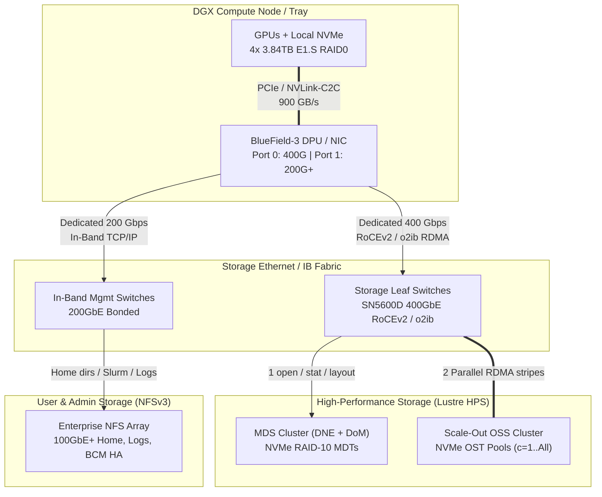
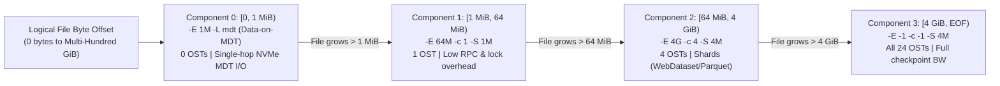
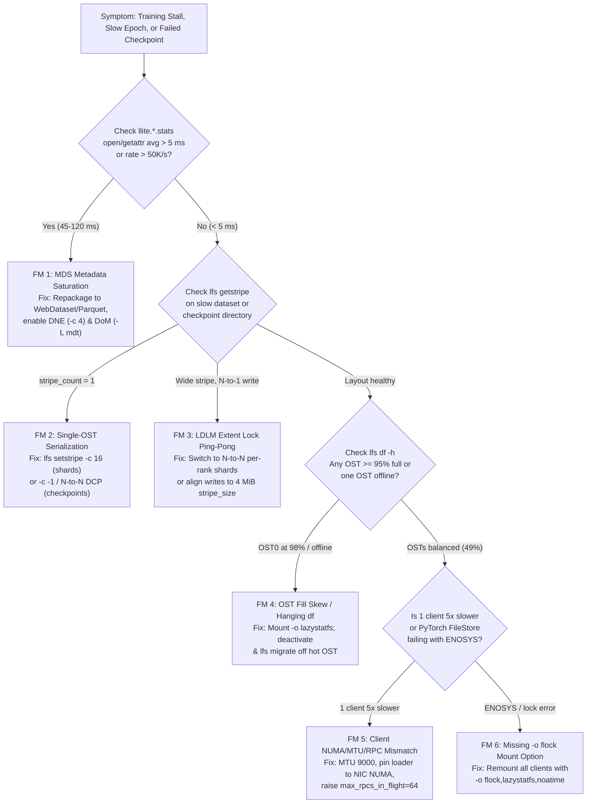

# 13.4 Lustre for AI

| Field | Value |
|---|---|
| Level | Advanced |
| Priority tier | 2 |
| Lab venue | GCP / GKE + Local Python Verification Lab (`code/part13/lustre_for_ai_lab.py`) |
| Part | Part 13: AI storage |
| Primary sources | NVIDIA Zero-to-Hero Volume 15 (`chapter-05-lustre-for-ai-and-hpc.md`); *AI Systems Performance Engineering* (`ai-systems-performance-engineering`); *Supercomputers for Linux SysAdmins* (`supercomputers-for-linux-sysadmins-managing-modern-hpc-clusters-and-supercomputers-from-software-to`); NVIDIA DGX SuperPOD Reference Architectures (`superpod-gb300-ra`, `superpod-b200-dc`) |
| Coverage file | `planning/coverage/chapters/13-04.md` |
| Claim & number ledger | `planning/ledgers/13-04.md` |

## Why this matters for AI infrastructure

When `1,000` to `9,216` GPUs execute synchronous distributed training, the parallel file system is no longer a passive background archive; it sits directly on the critical path of every epoch start and every recovery barrier. Whereas Chapter 6.19 established basic Lustre component anatomy (`MGS`, `MDS`/`MDT`, `OSS`/`OST`, `ldiskfs`/`ZFS`, quotas, and basic `mkfs.lustre` formatting), operating Lustre for **AI factories** introduces three failure regimes that classic single-job scientific HPC simulations rarely trigger simultaneously:

1. **Bimodal file-size distributions and epoch-start metadata storms:** An AI cluster simultaneously hosts multi-million-file raw multimodal datasets (`260 KB` images, audio clips, and JSON manifests), `512 MiB` to `26 GB` packed `WebDataset` / `TFRecord` / `Parquet` shards, and `140 GB` to `5.6 TB` distributed checkpoints. If `128` to `1,000` GPU clients issue `200,000` `open()` and `getattr()` calls per second against a single Metadata Server (`MDS`) rated for `50,000` to `100,000` operations per second, `open()` latency spikes from a healthy `2.1 ms` average (`5.4 ms` max) to `45.2 ms` average (`65.4 ms` max) or `120 ms` under epoch-start bursts. Every GPU sits idle waiting on metadata while `OST` data disks remain `90%` idle.
2. **Default single-OST striping on synchronized checkpoint bursts:** Lustre's file-system default stripe count is `1` (`stripe_count = 1`). If a `500 GB` model checkpoint is written to a directory with `stripe_count = 1`, all `500 GB` serialize onto a single `OST` (`800 MB/s` spinning/hybrid target or `5 GB/s` NVMe target), stalling training for `625 seconds` (`10+` minutes) instead of completing in `41.67 seconds` across `24` `OST`s at `12 GB/s` (`24 * 500 MB/s`) or `10.0 seconds` across `112` NVMe `OST`s at `560 GB/s`. Conversely, if `64` ranks write unaligned byte ranges concurrently into a single shared file (`N-to-1`), Lustre Distributed Lock Manager (`LDLM`) extent locks ping-pong between clients and collapse throughput by `4x` (`3.0 GB/s` instead of `12.0 GB/s`).
3. **Client RPC window starvation and PCIe/NUMA cross-socket hairpins:** Even when files are striped across `16` or `24` `OST`s and connected over `400 Gbps` InfiniBand (`o2ib`) or `RoCEv2` Ethernet, untuned Lustre Object Storage Client (`OSC`) settings (`max_rpcs_in_flight = 8`, `max_pages_per_rpc = 256` [`1 MiB`]) cap per-`OST` bandwidth by the network Bandwidth-Delay Product (`BDP`). Furthermore, if `LNet` binds to a storage NIC or BlueField-3 DPU on `NUMA 1` while the dataloader or `GPUDirect Storage` (`GDS`) consumer runs on `NUMA 0`, or if the mount omits `-o flock,lazystatfs`, single-client throughput drops by `5x` while PyTorch `FileStore` coordination fails with `ENOSYS`.

## Prerequisites and outcomes

### Prerequisites
- Foundational Lustre concepts from Chapter 6.19 (`MGS`, `MDS`/`MDT`, `OSS`/`OST`, `ldiskfs`/`ZFS` backing stores, `mkfs.lustre`, project quotas, and `lctl --device N deactivate` OST retirement).
- Familiarity with InfiniBand and `RoCEv2` storage fabrics, `MTU 9000` jumbo frames, and `NUMA`/`PCIe` locality (`nvidia-smi topo -m`) from Part 12.
- Understanding of the AI data path, `O_DIRECT` page-cache bypass, and `GPUDirect Storage` (`cuFile` / `gdsio`) from Chapters 13.1 through 13.3.

### Outcomes
After completing this chapter, you will be able to:
1. Map Lustre into the **NVIDIA DGX SuperPOD dual-tier storage architecture**, separating the `RoCEv2`/`o2ib` **High-Performance Storage (`HPS`)** tier (`90/45 GB/s` Standard and `280/140 GB/s` Enhanced read/write per Scalable Unit; `360/180 GB/s` and `1,120/560 GB/s` across `4` SUs) from the in-band `100GbE`/`200GbE` **User Storage (`NFS`)** tier.
2. Design **Progressive File Layout (`PFL`)** and **Data-on-MDT (`DoM`)** composite directory policies (`lfs setstripe -E 1M -L mdt -E 64M -c 1 -S 1M -E 4G -c 4 -S 4M -E -1 -c -1 -S 4M`) and calculate round-robin `RAID0` chunk placement (`slot = (offset // stripe_size) % stripe_count`).
3. Diagnose and eliminate metadata bottlenecks using `lctl get_param llite.*.stats`, **Distributed Namespace (`DNE` Phase 1 `lfs mkdir -i` and Phase 2 `lfs setdirstripe -c`)**, client `statahead_max`, and dataset shard repackaging (`10,000,000` files of `260 KB` -> `100` shards of `26 GB`, reducing `open()` calls `100,000x`).
4. Configure **`LNet` multi-rail RDMA** (`lnetctl`, `/etc/modprobe.d/lustre.conf`, TCP port `988`, `o2ib` / `RoCEv2` binding to `400 Gbps` BlueField-3 or ConnectX NICs on matching GPU `NUMA` nodes) and calculate **client RPC Bandwidth-Delay Product (`BDP`)** settings (`max_rpcs_in_flight`, `max_pages_per_rpc`, `max_read_ahead_mb`, `max_dirty_mb`).
5. Integrate Lustre with **GPUDirect Storage (`GDS`)**, production mount options (`-o flock,lazystatfs,noatime`), and **N-to-N sharded checkpoint architectures** (`PyTorch DCP`) vs stripe-aligned **N-to-1** checkpoints.

---

## 1. Lustre in the AI Factory and DGX SuperPOD Storage Architecture

In a modern AI factory such as an NVIDIA DGX SuperPOD (featuring `DGX B200` air-cooled systems up to `32` nodes / `458 kW` per Scalable Unit [`SU`] and `127` servers + `1` UFM appliance across `4` SUs, or `DGX GB300 NVL72` liquid-cooled systems with `8` racks / `18` compute trays per rack / `72` GPUs per rack = `576` GPUs and `1.2 MW` per SU, scaling up to `16` SUs / `128` racks / `9,216` GPUs), storage traffic is physically and logically isolated from the east-west GPU compute fabric.

### 1.1 High-Performance Storage (HPS) vs User Storage Tiering

Rather than forcing a single file system to serve both latency-sensitive home directories/logs and multi-terabyte-per-second training streams, reference AI architectures split storage into two distinct tiers over dedicated network segments:



| Architectural Tier | Network Fabric & Protocol | Target AI Workloads | SuperPOD Bandwidth Targets (`1 SU` / `4 SU`) | Lustre / Filesystem Design Choice |
|---|---|---|---|---|
| **High-Performance Storage (`HPS`)** | Dedicated `400 Gbps` per compute tray over `SN5600D` (`800GbE` radix) `RoCEv2` or `o2ib` InfiniBand (`72` non-blocking `400 Gbps` storage leaf links; `64x` to `1024x 400GbE` across `2` to `16` SUs) | Training dataset shards (`WebDataset`, `Parquet`, `TFRecord`), multi-modal streaming, distributed checkpoints (`140 GB`–`5.6 TB`), inference weight loading & KV-cache offload | **Standard:** `90 GB/s` read, `45 GB/s` write (`1 SU`); `360 GB/s` read, `180 GB/s` write (`4 SU`).<br/>**Enhanced:** `280 GB/s` read, `140 GB/s` write (`1 SU`); `1,120 GB/s` read, `560 GB/s` write (`4 SU`) | **Lustre** (or certified parallel FS) with NVMe `OST`s, `DNE` multi-`MDT`, `PFL`+`DoM`, `LNet` RDMA, `GDS` (`O_DIRECT`), and `flock,lazystatfs` |
| **User & Admin Storage** | In-band management network (`200 Gbps` bonded on compute trays; `>= 100GbE DR1` to storage; `24x 400 Gbps` mgmt leaf uplinks) | User `/home` directories, Slurm batch scripts, `conda`/source trees, Mission Control / Base Command Manager (`BCM`) HA state, cluster log collection | High IOPS and metadata consistency (not bulk parallel streaming) | **NFSv3** (`rsize=1048576,wsize=1048576,noatime`; often mounted `ro` on compute nodes to prevent `/home` log storms) |
| **Node-Local Scratch NVMe** | Internal PCIe Gen5 (`4x 3.84 TB` E1.S NVMe `RAID0` + `1x 1.92 TB` M.2 OS drive per GB300 tray) | Ephemeral container rootfs (`Enroot`/`Pyxis` squashfs), local dataset caching, and asynchronous two-stage checkpoint staging before draining to Lustre | Tens of `GB/s` per node with zero fabric traversal | Local `XFS`/`ext4` `RAID0` (`none` block scheduler) feeding background movers into `/lustre/checkpoints` |

Separating the `400 Gbps` storage RDMA port from the `200 Gbps` in-band management port on the `BlueField-3` (`BF3240`) card guarantees that bulk Lustre `RoCEv2` reads and checkpoint bursts never share a bonded interface with cluster management traffic, Slurm heartbeats, or Kubernetes control-plane packets.

### 1.2 Why Metadata and Data Decoupling Can Still Starve GPUs

As established in Chapter 6.19, a Lustre client (`lustre.ko`) splits every file operation across three client modules over `LNet`:
- **Management Client (`MGC`):** Reads cluster target maps from the Management Server (`MGS`) at mount time.
- **Metadata Client (`MDC`):** Sends namespace operations (`open`, `close`, `stat`/`getattr`, `mkdir`, `unlink`, `getxattr`) to one or more Metadata Servers (`MDS`), each backed by an NVMe `RAID-10` Metadata Target (`MDT`). The `MDS` returns a **layout Extended Attribute (`LOV EA`)** describing which `OST` objects store the file's data stripes.
- **Object Storage Client (`OSC`) / Logical Object Volume (`LOV`):** Aggregates all `OSC` instances so the client performs parallel `read()` and `write()` RDMA transfers directly against the Object Storage Servers (`OSS`) and their Object Storage Targets (`OST`, each typically `100–800 MB/s` on spinning/hybrid `RAID-6` arrays or `5,000+ MB/s` on NVMe `ZFS`/`ldiskfs` pools).

The critical architectural invariant for AI engineers is:

```text
Striping distributes data I/O across  C  OSTs, but every  \texttt(open()), \texttt(stat()),  and  \texttt(close())  still hits the MDS.
```

In fact, wide striping (`stripe_count = C`) *increases* metadata and lock overhead for small files because creating, statting (`getattr` to determine file size across stripes), or unlinking a file with $C$ stripes requires managing $C$ child `OST` objects alongside the parent `MDT` inode. Therefore, AI Lustre engineering requires co-designing **progressive stripe layouts (`PFL` + `DoM`)** and **distributed metadata (`DNE` + sharding)** simultaneously.

---

## 2. Progressive File Layouts (PFL), Data-on-MDT (DoM), and Striping Math

In a shared AI workspace (`/lustre/ai-workspace`), data scientists and training jobs write files spanning seven orders of magnitude—from `4 KiB` Hydra YAML configs and `260 KB` JPEG images to `26 GB` `WebDataset` tar shards and `500 GB` checkpoints. Applying a single static stripe count to that directory guarantees failure:
- If the directory uses `stripe_count = 1` (the Lustre default), a `500 GB` checkpoint or `26 GB` shared shard is pinned to a single `OST`, capping sequential throughput at `1` `OST`'s speed (`500–800 MB/s` on HDD/hybrid or `5 GB/s` on NVMe) while the other `23` `OST`s sit idle.
- If the directory uses `stripe_count = 16` or `-c -1` (`all OSTs`), a `260 KB` file with a `1 MiB` (`1,048,576`-byte) `stripe_size` still places all `260 KB` inside the very first chunk on `OST` slot `0`, gaining **zero** read parallelism while forcing the client and `MDS` to allocate, stat, and clean up `16` to `24` object references.

### 2.1 Round-Robin RAID0 Striping Math vs the "Contiguous Halves" Fallacy

Before designing composite layouts, verify the exact byte-to-`OST` mapping formula used by Lustre's `raid0` layout. When a file has `stripe_size` $S$ (default `4 MiB` in modern Lustre releases, `1 MiB` in older releases; must be a multiple of `64 KiB`) and `stripe_count` $C$, Lustre does **not** split a `1 GiB` (`1,024 MiB`) file with `C = 2` into two contiguous `512 MiB` halves. Instead, it slices the logical byte stream into fixed chunks of size $S$ and assigns chunk $k$ round-robin across the $C$ `OST` slots starting at `stripe_offset` `O_0`:

```text
chunk_index(b) = floor((b) / (S) ), \qquad ost_slot(b) = \bigl(chunk_index(b)\bigr) \bmod C, \qquad ost_id(b) = \bigl(O_0 + ost_slot(b)\bigr) \bmod N_OST
```

Consider the concrete output of `lfs getstripe /lustre/test-file.bin` (`(untested here)`) on a `1 GiB` (`1,024 MiB`) file with `stripe_size = 1048576` (`1 MiB`), `stripe_count = 2`, and `stripe_offset = 0`:
- Chunks `0, 2, 4, ..., 1022` (`512` chunks = `512 MiB` total) reside on `OST 0`.
- Chunks `1, 3, 5, ..., 1023` (`512` chunks = `512 MiB` total) reside on `OST 1`.
- **Sub-stripe read (`512 KiB` at offset `0`):** Touches only chunk `0` (`ost_slot = 0`). Even if `stripe_count = 8`, a `512 KiB` read when `stripe_size = 1 MiB` only ever touches **`1` `OST`**.
- **Multi-stripe sequential read (`16 MiB` batch read with `stripe_size = 2 MiB`, `stripe_count = 8`):** Spans `8` consecutive `2 MiB` chunks (`chunks 0..7`), hitting all `8` `OST`s in parallel (`2 MiB` per `OST`). At `800 MB/s` per `OST`, theoretical read bandwidth scales from `1.6 GB/s` (`2 * 800 MB/s` with `stripe_count = 2`) to **`6.4 GB/s`** (`8 * 800 MB/s` with `stripe_count = 8`).

### 2.2 Composite Layouts: Progressive File Layout (PFL) + Data-on-MDT (DoM)

**Progressive File Layout (`PFL`)** solves the bimodal file-size dilemma by dividing a file's logical offset space into sequential components (`-E <end_offset>`), each with its own layout type, `stripe_count` (`-c`), `stripe_size` (`-S`), and optional `OST` pool (`-p`). Components beyond the current end-of-file (`EOF`) remain uninstantiated until a write extends the file past the previous boundary.

**Data-on-MDT (`DoM`, `-L mdt`)** places the first PFL component (up to `lod.*.dom_stripesize`, typically `64 KiB` to `1 MiB`) directly on the NVMe `MDT` alongside the file's inode. When a training worker opens and reads a `260 KB` JSON manifest or tiny image whose size is `<= 1 MiB`, the client receives both the metadata layout and the file payload from the `MDT` in a single round-trip—allocating **`0` `OST` objects** and eliminating `OSC` lock and RPC traffic entirely.



| PFL Component Range | `lfs setstripe` Clause | Target AI Artifacts | Instantiated Objects (`24`-OST Cluster) | Primary Performance Benefit |
|---|---|---|---|---|
| **`[0, 1 MiB)`** | `-E 1M -L mdt` | Configs (`YAML`/`JSON`), tokenizer vocabs, small `< 1 MiB` images (`260 KB`) | `1` `MDT` inode + data block (`0` `OST` objects) | Eliminates `OST` object creation, `OSC` `getattr` RPCs, and spinning-disk seek latency |
| **`[1 MiB, 64 MiB)`** | `-E 64M -c 1 -S 1M` | Medium images, audio clips, per-step TensorBoard logs (`32 MiB`) | `1` `MDT` (`1 MiB`) + `1` `OST` (`31 MiB` for a `32 MiB` file) | Avoids over-striping medium files; MDS balances single-stripe files across `OST`s via `-i -1` |
| **`[64 MiB, 4 GiB)`** | `-E 4G -c 4 -S 4M` | `WebDataset` `.tar` shards, `Parquet` / `TFRecord` files (`512 MiB`–`2 GiB`) | `1` `MDT` (`1 MiB`) + `1` `OST` (`63 MiB`) + `4` `OST`s (`448 MiB` for a `512 MiB` shard) | `4x` parallel `OST` bandwidth per shard (`2–3.2 GB/s`) with `4 MiB` chunks aligned to large RDMA RPCs |
| **`[4 GiB, EOF)`** | `-E -1 -c -1 -S 4M` | Large dataset shards (`26 GB`) and monolithic/consolidated checkpoints (`10 GiB`–`500 GB`) | All `24` `OST`s active for bytes above `4 GiB` (`10 GiB` file puts `6 GiB` across `24` `OST`s) | Automatically unlocks full cluster write/read bandwidth (`12+ GB/s` to `560+ GB/s`) without manual per-file flags |

 You can also combine `PFL` with **self-extending layouts (`-z / --extension-size`)** so that Lustre dynamically skips `OST`s that approach capacity limits (`lfs df -h`), and **OST pools (`-p flash` vs `-p disk`)** so hot training datasets reside on NVMe `OST`s while cold archival checkpoints migrate to high-capacity pools.

---

## 3. Metadata Scaling at Scale: DNE Phase 1/2, `statahead`, and Dataset Sharding

AI training pipelines punish Lustre metadata subsystems at three distinct points in the job lifecycle:
1. **Job initialization and Python import storms:** `1,000` ranks simultaneously executing `import torch, transformers` over a shared filesystem generate millions of `stat()` and `open()` calls across `site-packages` search paths.
2. **Epoch start (`DataLoader` worker initialization):** Opening or `stat()`-ing `5,000,000` to `10,000,000` unsharded training samples (`open`, `getattr`, `close`).
3. **Checkpoint creation and retention cleanup:** Creating `1,000+` rank shard files every `30` minutes and running `rm -rf` on expired checkpoint directories.

### 3.1 Diagnosing Metadata Saturation with `lctl get_param llite.*.stats`

To prove whether a slow training loop is bottlenecked on metadata (`MDS`/`MDT`) rather than data bandwidth (`OSS`/`OST`), inspect the client-side `llite` statistics (`lctl get_param llite.*.stats | grep -E "^  open|^  close|^  getattr|^  readdir"`, `(untested here)`). Compare the two operational regimes from production AI clusters:

| Metric (`1`-Minute Window) | Healthy Metadata Headroom (`lustre-1a5c`) | Saturated Metadata Bottleneck (`lustre-1a5c`) | Operational Interpretation |
|---|---|---|---|
| **`open` samples & rate** | `150,000` samples (`2,500` opens/sec) | `950,000` samples (`15,833` opens/sec) | Aggregate rate across `open` + `close` + `getattr` (`3,800,000` total ops/min = `63,333` ops/sec) exceeds single-`MDS` `50K` threshold |
| **`open` latency (`min / avg / max`)** | `800 us` / **`2,100 us` (`2.1 ms`)** / `5,400 us` (`5.4 ms`) | `1,200 us` / **`45,200 us` (`45.2 ms`)** / `65,400 us` (`65.4 ms`) | Healthy `open()` is `< 5 ms`. At `45.2 ms` avg (or `120 ms` during `150K`-open epoch bursts), GPUs stall waiting for file descriptors |
| **`close` latency (`min / avg / max`)** | `600 us` / **`1,800 us` (`1.8 ms`)** / `4,200 us` (`4.2 ms`) | `800 us` / **`42,100 us`** / `58,900 us` | High `close()` latency confirms `MDS` worker threads (`mdt_thread`) and `MDT` journal commits are queued |
| **`getattr` samples & latency** | `300,000` samples (`400 / 2,200 / 8,900 us` = `2.2 ms` avg) | `1,900,000` samples (`400 / 78,900 / 102,000 us` = `102 ms` max) | `2x` as many `getattr` (`stat`) calls as `open` calls; `102 ms` max `getattr` stalls directory listings and dataset indexing |

### 3.2 Distributed Namespace (DNE Phase 1 vs Phase 2) Across Multiple MDTs

When a single `MDS` (`~50,000` to `100,000` metadata ops/sec depending on `MDT` NVMe media and RPC complexity) cannot absorb a `128`-client `200,000` ops/sec workload, Lustre's **Distributed Namespace (`DNE`)** scales metadata horizontally across multiple `MDT`s (`MDT0`, `MDT1`, `MDT2`, `MDT3`, yielding `4 * 50,000 = 200,000` ops/sec aggregate capacity) under a single mount point (`/lustre`). However, **DNE Phase 1** and **DNE Phase 2** behave very differently under AI directory layouts:

1. **DNE Phase 1 — Remote Directories (`lfs mkdir -i <mdt_index>`):**
   Pins an entire subdirectory tree to a specific `MDT` index:
   - `lfs mkdir -i 0 /lustre/dataset-mdt0` -> served by `MDT0`
   - `lfs mkdir -i 1 /lustre/dataset-mdt1` -> served by `MDT1`
   - `lfs mkdir -i 2 /lustre/dataset-mdt2` -> served by `MDT2`
   - *Sharp edge for AI:* If a training dataset stores `200,000` or `5,000,000` files inside a **single flat directory** (`/lustre/imagenet/train`), DNE Phase 1 routes `100%` of those lookups to whichever single `MDT` owns `/lustre/imagenet/train`. Having `4` `MDT`s provides `0%` speedup (`active_mdts = 1`, `50,000` ops/sec, `4.0 s` for `200K` files) unless the dataset is partitioned across subdirectories (`-i 0..3`) or uses DNE Phase 2.
2. **DNE Phase 2 — Striped Directories (`lfs setdirstripe -c <mdt_count>` / `lfs mkdir -c <mdt_count>`):**
   Splits a **single large directory** across $M$ `MDT`s by hashing each filename (`crush`/`fnv` hash) to one of the $M$ `MDT` shards (`lfs mkdir -c 4 /lustre/imagenet/train`).
   - Creating or opening `200,000` files inside `/lustre/imagenet/train` now fans out evenly across all `4` `MDT`s (`50,000` files per `MDT`), raising aggregate throughput from `50,000` ops/sec (`4.0 s`) to **`200,000` ops/sec (`1.0 s`)**.
   - To make directory striping automatic for newly created subdirectories, set a default directory stripe on the parent (`lfs setdirstripe -D -c -1 /lustre/checkpoints`).
   - *Trade-off:* Cross-`MDT` directory operations (`rename`, striped `mkdir`, and unindexed `ls -l` across hash buckets) require distributed `MDT`-to-`MDT` coordination, so combine DNE Phase 2 with client-side **`statahead`** (`llite.*.statahead_max = 64` or `128`, `statahead_agl = 1` Asynchronous Glimpse Locking) when workloads traverse directories sequentially.

### 3.3 The 1,000x Multiplier: Dataset Repackaging and Containerized Environments

Even with `4` `MDT`s running DNE Phase 2 (`200,000` ops/sec), opening `10,000,000` individual `260 KB` files (`2.6 TB` total dataset) per epoch requires `10,000,000` `open()` + `10,000,000` `close()` + `10,000,000` `getattr()` RPCs. Whenever changing `MDS` hardware is out of scope—or even when multiple `MDT`s exist—the highest-leverage engineering fix is **dataset repackaging**:
- **5 Million Files -> 50,000 Shards (`100` files/shard):** Reduces `open()` calls per epoch by **`100x`** (`5,000,000 -> 50,000`), cutting a `3`-minute (`180 s`) epoch-start stall down to under `2` seconds.
- **10 Million Files (`260 KB` avg = `2.6 TB`) -> 100 Shards (`26 GB` each, `100,000` files/shard) in `WebDataset` (`.tar`), `TFRecord`, or `Parquet` format:** Each dataloader worker opens `1` contiguous shard file striped across `8` to `16` `OST`s (`lfs setstripe -c 16 -S 2M`) and streams `100,000` samples sequentially. Metadata `open()` pressure drops from `150,000+` opens/min to just **`100` opens per epoch**—a **`1,500x` to `100,000x` reduction** in metadata operations—converting a metadata-bound random-I/O workload into a sequential bulk-streaming workload where Lustre excels.
- **Never run Python/Conda environments directly from Lustre at scale:** Package training environments into read-only `SquashFS` container images (`Enroot`/`Pyxis` or Singularity/Apptainer) staged onto node-local `NVMe` (`RAID0`), eliminating millions of `stat()` calls per `srun` launch.

---

## 4. LNet Multi-Rail Networking, Client RPC BDP Tuning, and GPUDirect Storage

Once metadata bottlenecks are eliminated and dataset shards or checkpoints are striped across `8` to `24+` `OST`s, data-plane throughput is governed by three client-to-`OSS` layers: **LNet multi-rail RDMA**, **OSC RPC in-flight queuing (`BDP`)**, and **GPUDirect Storage (`GDS`)**.

### 4.1 LNet Multi-Rail (`o2ib` / `RoCEv2`), Port `988`, and NUMA/PCIe Affinity

Lustre Networking (`LNet`) abstracts underlying fabrics through Lustre Network Drivers (`LND`s):
- **`ksocklnd` (`@tcp0`, `@tcp1`):** Kernel TCP/IP transport using **TCP port `988`** (which must be permitted by host and datacenter firewalls). Suitable for management nodes (`MGS` fallback), but CPU-bound at `400 Gbps` rates.
- **`ko2iblnd` (`@o2ib0`, `@o2ib1`):** Native RDMA Verbs transport over both **InfiniBand** (`ib0`, `ib1`) and **RDMA over Converged Ethernet (`RoCEv2`)** (`ens1f0`, `enp1s0f0np0`). Remember that `<protocol><index>` forms an isolated LNet network namespace: a client on `10.20.4.15@o2ib0` can only communicate directly with servers on `@o2ib0` (unless LNet routers bridge `@o2ib0` and `@o2ib1`).

On multi-NIC GPU nodes and DGX compute trays (`400 Gbps` `BlueField-3` storage port or dual `ConnectX-7`/`ConnectX-8` storage rails), **LNet Multi-Rail** aggregates multiple local NICs under one or more LNet networks and uses **User-Defined Selection Policies (`UDSP`)** plus **LNet Health (`lnet_health_sensitivity`, `lnet_recovery_limit`)** to steer RDMA traffic:
1. **NUMA and PCIe Switch (`PIX`/`PXB`) Locality:** If a node has two storage NICs (`ib0` on `NUMA 0` and `ib1` on `NUMA 1`), LNet Multi-Rail selects the local rail matching the CPU/GPU `NUMA` node initiating the I/O. If a dataloader thread or `GDS` buffer on `NUMA 0` is forced to traverse `UPI`/`QPI`/`NVLink-C2C` to reach a storage NIC on `NUMA 1`, or if the storage interface drops from `MTU 9000` jumbo frames to `MTU 1500`, that single client can run **`5x` slower** than identical peer nodes even when `lfs getstripe` shows identical `stripe_count`.
2. **Automatic Rail Failover:** When `lnetctl net show -v` (`(untested here)`) detects local send errors (`tx_queued` / timeout) or remote drops on one NID (`10.20.4.16@o2ib0`), LNet decrements that NID's health score (`1000 -> 0`) and steers subsequent RPCs over the surviving healthy rail (`10.20.4.15@o2ib0`) without evicting the client.

### 4.2 Client RPC Bandwidth-Delay Product (`BDP`) Math and OSC Tunables

Even over a healthy `400 Gbps` (`50 GB/s`) `o2ib` RDMA rail, a Lustre client cannot saturate an `OST` unless its Object Storage Client (`OSC`) keeps enough bytes in flight to cover the network + storage round-trip time (`RTT`). For each `OST` connection (`osc.<fsname>-OSTxxxx-osc-*`), the maximum single-`OST` throughput `B_OST` is bounded by Little's Law (the **RPC Bandwidth-Delay Product**):

```text
RPC_Size = \texttt(max_pages_per_rpc) x Page_Size \quad (where  Page_Size = 4\,KiB on x86_64)
```

```text
In_Flight_Bytes_OST = \texttt(max_rpcs_in_flight) x RPC_Size, \qquad B_OST, BDP = \frac(In_Flight_Bytes_OST)(RTT)
```

Examine how default vs AI-tuned `OSC` parameters behave when storage `RTT` under load is `500 us` (`0.5 ms`) vs `4,000 us` (`4.0 ms` under heavy NVMe queue depth):
- **Legacy / Conservative Client Defaults (`max_rpcs_in_flight = 8`, `max_pages_per_rpc = 256`):**
  - `RPC_Size = 256 x 4\,KiB = 1\,MiB` (`1,048,576` bytes).
  - `In_Flight_Bytes_OST = 8 x 1\,MiB = 8\,MiB` (`8,388,608` bytes).
  - At `RTT = 500\,us` (`0.0005 s`), `B_OST, BDP = 8,388,608 / 0.0005 = 16,777.22\,MB/s`, which is sufficient for a single `800 MB/s` or `5,000 MB/s` `OST`.
  - However, at `RTT = 4,000\,us` (`4.0 ms` under congested bulk I/O), `B_OST, BDP` drops to **`2,097.15 MB/s` (`~2.1 GB/s`)**, starving a `6,000 MB/s` (`6 GB/s`) all-NVMe `OST` by nearly `3x`.
- **AI-Tuned Client (`max_rpcs_in_flight = 64`, `max_pages_per_rpc = 1024` [`4 MiB`] or `4096` [`16 MiB`]):**
  - With `max_pages_per_rpc = 1024` (`4 MiB` RPCs, matching `stripe_size = 4M`) and `max_rpcs_in_flight = 64`, each `OSC` keeps `64 x 4\,MiB = 256\,MiB` in flight per `OST`.
  - Even at `RTT = 4,000\,us`, `B_OST, BDP = 67,108.86\,MB/s`, effortlessly saturating `8` NVMe `OST`s at `6,000 MB/s` each (`8 * 6,000 = 48,000 MB/s` = **`48.0 GB/s`**) to fill a `400 Gbps` (`50 GB/s`) client NIC.

| Client / Server Tunable (`lctl set_param`) | Typical Default | AI Training / Checkpoint Value | Why It Matters for GPU Workloads |
|---|---|---|---|
| `osc.*.max_pages_per_rpc` | `256` (`1 MiB`) or `1024` (`4 MiB`) | `1024` (`4 MiB`) or `4096` (`16 MiB`) | Amortizes RDMA memory registration and RPC framing overhead across `4 MiB`–`16 MiB` bulk transfers; match to `stripe_size` |
| `osc.*.max_rpcs_in_flight` | `8` | `32` to `64` | Multiplies per-`OST` in-flight window (`BDP`) by `4x–8x` so high-latency bursts do not stall NVMe `OST` pipelines |
| `osc.*.max_dirty_mb` | `32`–`2000` MiB | `512` to `2048` MiB | Controls buffered writeback cache per `OSC` before throttling dirty pages (Ensure total `N_OST * max_dirty_mb` fits safely in client RAM) |
| `mdc.*.max_rpcs_in_flight` | `8` | `32` to `64` | Allows parallel dataloader workers on a multi-GPU node to keep `32–64` concurrent `open`/`getattr` RPCs in flight to each `MDT` |
| `llite.*.max_read_ahead_mb` | `64`–`1024` MiB | `2048` to `4096` MiB | Critical for sequential buffered reads of `WebDataset` / `TFRecord` / `Parquet` shards |
| `llite.*.max_read_ahead_per_file_mb` | `64` MiB | `256` to `1024` MiB | Allows a single large shard reader to prefetch hundreds of MiB across all striped `OST`s |
| `llite.*.statahead_max` | `32` | `64` to `128` | Prefetches directory entry attributes asynchronously during `readdir` / `ls -l` or dataset directory scans |
| `ost.OSS.ost_io.threads_max` | `64`–`512` (auto) | `512` to `1024` | Prevents `OSS` service thread exhaustion when thousands of GPU ranks flush checkpoints simultaneously (each thread uses `~1.5 MB` RAM) |

### 4.3 GPUDirect Storage (`GDS`) with Lustre and Mount Options (`flock,lazystatfs`)

When reading training shards or loading `100+ GB` model weights into GPU High-Bandwidth Memory (`HBM`), standard POSIX buffered reads copy data twice on the host: `OSS -> LNet NIC -> Linux Page Cache (Host DRAM) -> Pinned User Buffer -> GPU HBM over PCIe/NVLink-C2C`. With **NVIDIA GPUDirect Storage (`GDS` / `cuFile`)** and a GDS-enabled Lustre kernel client (`nvidia-fs.ko` + `lustre.ko` over `ko2iblnd`):
- Files are opened with `O_DIRECT` (bypassing the Linux page cache, which is why FUSE-based userspace filesystems cannot support GDS).
- `cuFileRead` and `cuFileWrite` instruct the `LNet` RDMA NIC (`ConnectX-7`/`ConnectX-8` or `BlueField-3`) to DMA `OST` stripes directly into or out of **GPU `BAR1` / `C2C` memory**.
- In the standard `gdsio` verification benchmark (`/usr/local/cuda/gds/tools/gdsio -f /mnt/data/large_file -d 0 -w 4 -s 10G -i 1M -I 0`, `(untested here)`), switching from the CPU-mediated pinned-memory path (`-x 2`: **`8.0 GB/s`**, **`1.25 ms`** average latency) to the direct GDS path (`-x 0`: **`9.6 GB/s`**, **`1.00 ms`** average latency) increases throughput by **`+20%`** and reduces latency by **`-20%`** while freeing host CPU cores for tokenization and augmentation.

Finally, every production AI Lustre client mount (`/etc/fstab` or systemd mount unit) should include three mandatory mount options (`mount -t lustre -o flock,lazystatfs,noatime mgs1@o2ib0,mgs2@o2ib0:/ai_fs /lustre`, `(untested here)`):
1. **`flock`:** Enables coherent POSIX `flock()` file locking across all cluster nodes (`-o localflock` only locks within a single host and causes silent corruption if two nodes lock the same file; omitting `flock` altogether makes `flock()` return `ENOSYS` [`Function not implemented`], which immediately crashes PyTorch `FileStore` distributed rendezvous, Hugging Face `datasets`/`transformers` cache locks, and SQLite/LMDB metadata stores).
2. **`lazystatfs`:** Allows `df` and `statfs()` calls on `/lustre` to return immediately using cached `MDS` summary data without blocking if a single `OST` is slow, overloaded, or undergoing failover recovery. Without `lazystatfs`, a single degraded `OST` causes `df`, Kubernetes kubelet volume probes, and Slurm prolog health checks to hang across the entire cluster.
3. **`noatime`:** Suppresses redundant access-time metadata updates on the `MDT` when thousands of GPU ranks read training shards.

---

## 5. Checkpoint Architecture on Lustre: N-to-1 Lock Contention vs N-to-N Sharded Writes

During large-scale LLM or multimodal training, checkpointing is the most violent write burst a storage system experiences. Every `30` to `60` minutes, `64` to `2,304+` GPU ranks pause (or fork an asynchronous staging thread) to flush `140 GB` to `5.6 TB` of model weights and optimizer states (`FP32` master weights + `Adam` first and second moments = `12` to `16` bytes per parameter).

### 5.1 Why Unaligned N-to-1 Shared-File Checkpoints Collapse Under LDLM Locking

Lustre enforces strict POSIX byte-range cache coherency across clients using the **Lustre Distributed Lock Manager (`LDLM`)**. Each `OST` manages **extent locks** rounded to page and stripe boundaries:
1. **Pattern A — Single-OST Bottleneck (`N-to-1` or `Rank-0` write with `stripe_count = 1`):**
   If `/lustre/checkpoints` is left at the default `stripe_count = 1`, a `500 GB` checkpoint lands entirely on a single `OST`. At `800 MB/s` per `OST`, the write stalls the cluster for **`625 seconds` (`10.4 minutes`)**; at `1,000 MB/s`, a `12`-`OST` cluster still takes `500 seconds` (`8.3 minutes`, or `15–30 minutes` with application serialization overhead).
2. **Pattern B — Unaligned `N-to-1` Shared-File Write Across `12–24` OSTs (`LDLM` Lock Ping-Pong):**
   Suppose `64` ranks open a single shared file (`/lustre/checkpoints/model.pt`) striped across `12` `OST`s (`1,000 MB/s` per `OST` = `12 GB/s` peak) and write variable-length tensor slices concurrently without aligning write offsets to `stripe_size` (`4 MiB`). Whenever Rank `A` and Rank `B` write tensors that fall inside the same `4 MiB` stripe extent on `OST k`, `OST k` must revoke Rank `A`'s `PW` (Protected Write) extent lock, flush Rank `A`'s dirty pages, and grant the lock to Rank `B`. This lock ping-pong slashes effective `OST` efficiency to `~25%` (`3.0 GB/s` aggregate instead of `12.0 GB/s`), turning a `41.67`-second checkpoint into **`166.67 seconds`** (`4x` slower).
3. **Pattern C — Stripe-Aligned `N-to-1` Shared-File Write (`lfs setstripe -c -1 -S 4M`):**
   If the application uses collective I/O (such as `MPI-IO` collective buffering or aligned `cuFileWrite` offsets) where every rank writes exact multiples of `stripe_size` (`4 MiB` or `16 MiB`) across all `24` `OST`s (`lfs setstripe -c -1 /lustre/checkpoints`, allocating `500 GB / 24 ≈ 20.83 GB` per `OST`), lock contention is minimized and aggregate throughput reaches `90%+` of hardware peak.
4. **Pattern D — `N-to-N` Sharded Checkpoints (`PyTorch Distributed Checkpointing` / `DCP`, `Megatron-LM` / `DeepSpeed` per-rank shards):**
   In modern AI frameworks, each rank (or `1` saver rank per `8`-GPU node after intra-node `NVLink` gathering) writes its own independent shard file (`rank_0000.distcp`, `rank_0001.distcp`, ...) into a DNE-striped directory:
   - Because **only one client ever writes to a given file**, there is **zero cross-node `LDLM` extent lock contention**.
   - Each individual shard file (`e.g., 500 GB / 64 ranks = 7.81 GB per rank`) only needs a narrow stripe count (`lfs setstripe -c 1` to `-c 4 -i -1`), because `64` or `128` concurrent shard files naturally distribute across all `24` or `112` `OST`s via the `MDS` round-robin/QOS allocator (`-i -1`).
   - Across `24` `OST`s at `500 MB/s` per `OST`, the `500 GB` `N-to-N` checkpoint completes at the full **`12.0 GB/s`** (`24 * 500 MB/s`) hardware rate in **`41.67 seconds`** (a `15x` speedup over the `625 s` single-`OST` write). Across a `4`-SU SuperPOD Enhanced tier (`560 GB/s` write across `112` NVMe `OST`s at `5 GB/s` each), a `5.6 TB` (`5,600 GB`) distributed checkpoint completes in **`10.0 seconds`**.

| Checkpoint Pattern | Directory `lfs setstripe` Policy | `LDLM` Lock Contention | `500 GB` Write Time (`24` OSTs @ `500–800 MB/s`) | Recommended AI Use Case |
|---|---|---|---|---|
| **1. Single-OST `N-to-1` / Rank-0** | `-c 1` (untuned default) | None (serialized on `1` `OST`) | **`625.0 s`** (`@ 800 MB/s`) | **Anti-pattern** — never use for multi-GB checkpoints |
| **2. Unaligned Shared `N-to-1`** | `-c 12` or `-c -1`, unaligned offsets | **Severe** (`PW` lock ping-pong, `~25%` eff.) | **`166.67 s`** (`@ 3.0 GB/s` on `12`x`1 GB/s` OSTs) | **Anti-pattern** — avoid unaligned multi-rank writes to one file |
| **3. Aligned Shared `N-to-1`** | `-c -1 -S 4M` (all `OST`s, `4 MiB` aligned) | Low (one rank per `4 MiB` stripe extent) | **`~46.3 s`** (`@ 10.8 GB/s`) | Legacy monolithic `.pt` / `.safetensors` exports or `MPI-IO` |
| **4. Sharded `N-to-N` (`PyTorch DCP`)** | `-c 1` to `-c 4 -S 4M -i -1` + DNE dir stripe | **Zero** (1 writer per file; `O_LOV_DELAY_CREATE`) | **`41.67 s`** (`@ 12.0 GB/s` across `24` OSTs) | **Production standard** for LLM/multimodal FSDP/TP/PP training |

Combine `N-to-N` sharded Lustre layouts with **two-stage asynchronous checkpointing**: copy GPU tensors over `PCIe Gen5` / `NVLink-C2C` (`900 GB/s`) into pinned host DRAM or local `RAID0` NVMe (`4x 3.84 TB` E1.S drives) in `< 2 seconds`, immediately resume GPU training, and let background worker threads drain the shards to `/lustre/checkpoints`.

---

## Commands and configurations that matter

All commands below reflect standard Lustre administration and tuning workflows (`lfs`, `lctl`, `lnetctl`, `mkfs.lustre`, `mount.lustre`, `gdsio`, `fio`) from the cited sources and are marked `(untested here)` where live multi-node Lustre kernel modules and RDMA hardware are absent in this local verification environment.

### 6.1 LNet Multi-Rail Configuration (`/etc/modprobe.d/lustre.conf` and `lnetctl`)

```bash
# (untested here) — 1. Configure LNet multi-rail in /etc/modprobe.d/lustre.conf
# Binds o2ib0 to dual 400G RoCEv2/IB interfaces (ib0 on NUMA 0, ib1 on NUMA 1)
# plus tcp0 fallback on eth2 (uses TCP port 988; ensure firewall allows TCP 988)
cat <<'EOF' > /etc/modprobe.d/lustre.conf
options lnet networks="o2ib0(ib0,ib1),tcp0(eth2)"
options ko2iblnd peer_credits=128 peer_credits_hiw=64 credits=2048 concurrent_sends=128 ntx=2048 map_on_demand=32
EOF

# (untested here) — 2. Load LNet and inspect multi-rail NIDs, NUMA cpt, and health
modprobe lnet
lnetctl lnet configure
lnetctl net show -v
lctl list_nids
# Expected output on a dual-rail GPU node:
# 10.20.4.15@o2ib
# 10.20.4.16@o2ib
# 192.168.2.15@tcp

# (untested here) — 3. Verify LNet reachability and peer NID health statistics
lctl ping 10.20.1.10@o2ib
lnetctl peer show -v --nid 10.20.1.10@o2ib
lnetctl stats show
```

### 6.2 Client Mount with `flock,lazystatfs,noatime` and OSC/MDC/LLITE Tuning

```bash
# (untested here) — 1. Mount Lustre with HA MGS NIDs, global flock, lazystatfs, and noatime
mkdir -p /lustre
mount -t lustre -o flock,lazystatfs,noatime \
  10.20.1.10@o2ib0,10.20.1.11@o2ib0:/ai_fs /lustre

# (untested here) — 2. Apply AI client RPC BDP and read-ahead tunables
lctl set_param osc.*.max_pages_per_rpc=1024          # 4 MiB RPCs (or 4096 for 16 MiB)
lctl set_param osc.*.max_rpcs_in_flight=64           # 64 * 4 MiB = 256 MiB in flight per OST
lctl set_param osc.*.max_dirty_mb=1024               # 1 GiB writeback cache per OSC
lctl set_param mdc.*.max_rpcs_in_flight=64           # Parallel metadata RPCs for dataloader workers
lctl set_param llite.*.max_read_ahead_mb=4096        # 4 GiB aggregate client read-ahead
lctl set_param llite.*.max_read_ahead_per_file_mb=512
lctl set_param llite.*.statahead_max=128             # Async directory stat prefetching
```

### 6.3 Configuring DNE Directories, PFL + DoM Layouts, and Checkpoint Striping

```bash
# (untested here) — 1. DNE Phase 1 (pin directory to MDT index) vs Phase 2 (hash across 4 MDTs)
lfs mkdir -i 0 /lustre/datasets-mdt0
lfs mkdir -i 1 /lustre/datasets-mdt1
lfs mkdir -c 4 /lustre/imagenet-sharded              # DNE Phase 2: stripe single dir across 4 MDTs
lfs setdirstripe -D -c -1 /lustre/checkpoints        # Default: stripe new checkpoint subdirs across all MDTs
lfs getdirstripe /lustre/imagenet-sharded

# (untested here) — 2. Set a 4-tier PFL + Data-on-MDT (DoM) default layout on /lustre/ai-workspace
# [0, 1M): DoM on MDT | [1M, 64M): 1 OST, 1M stripe | [64M, 4G): 4 OSTs, 4M | [4G, EOF): all OSTs, 4M
lfs setstripe \
  -E 1M -L mdt \
  -E 64M -c 1 -S 1M \
  -E 4G -c 4 -S 4M \
  -E -1 -c -1 -S 4M \
  /lustre/ai-workspace
lfs getstripe -d /lustre/ai-workspace

# (untested here) — 3. Explicit striping for packed training shards vs N-to-1 / N-to-N checkpoints
lfs setstripe -c 16 -S 2M /lustre/training-data/     # 16 OSTs, 2 MiB stripe for WebDataset/Parquet shards
lfs setstripe -c -1 -S 4M /lustre/checkpoints-n1/    # All OSTs for aligned N-to-1 monolithic checkpoints
lfs setstripe -c 2  -S 4M -i -1 /lustre/checkpoints-dcp/ # 2 OSTs per rank shard for N-to-N PyTorch DCP
```

### 6.4 Live Metadata, OST Balance, Migration, and GPUDirect Storage (`gdsio`) Verification

```bash
# (untested here) — 1. Measure real-time client metadata pressure (open, close, getattr, readdir)
lctl get_param llite.*.stats | grep -E "^  open|^  close|^  getattr|^  readdir"
watch -n 1 'lctl get_param llite.*.stats | grep "^  open" | tail -3'

# (untested here) — 2. Inspect MDT/OST capacity and inode balance (healthy: all OSTs within +-5%)
lfs df -h
lfs df -i

# (untested here) — 3. Rebalance files off a 98%-full OST (e.g., OST0) onto balanced OSTs
lfs find /lustre/training-data --ost ai_fs-OST0000 -type f -print0 | lfs migrate -0 -c 16 -S 2M

# (untested here) — 4. Verify GPUDirect Storage (GDS) read bandwidth & latency vs CPU path
# CPU bounce-buffer baseline (-x 2): 8.0 GB/s, 1.25 ms avg latency
/usr/local/cuda/gds/tools/gdsio -f /lustre/training-data/shard-000.tar -d 0 -w 4 -s 10G -i 1M -I 0 -x 2
# Direct GDS path Storage -> GPU BAR1 (-x 0): 9.6 GB/s (+20%), 1.00 ms (-20%) avg latency
/usr/local/cuda/gds/tools/gdsio -f /lustre/training-data/shard-000.tar -d 0 -w 4 -s 10G -i 1M -I 0 -x 0
```

---

## How it fails



| Failure Mode | Production Symptom | Exact Diagnostic Evidence | Root Cause | Remediation |
|---|---|---|---|---|
| **1. Epoch-Start Metadata Storm (`MDS` Saturation)** | Epoch 0 takes `3+` minutes to start; GPU SM utilization sits at `0–5%` while `OST` bandwidth is near zero | `lctl get_param llite.*.stats \| grep open`: `950,000` samples/min (`15.8K` opens/s), avg open latency **`45.2 ms`** (`65.4 ms` max) or **`120 ms`** during `150K`-file bursts (healthy is `< 5 ms`, `< 50K` ops/s) | Dataloader opens `5M–10M` individual `260 KB` files per epoch on `1` `MDS`, or imports Python environments directly from `/lustre` | Repackage `5M` files into `50K` shards (`100` files/shard) or `10M` files (`2.6 TB`) into `100` `WebDataset` shards (`26 GB` each, cutting opens `1,500x–100,000x`); enable DNE Phase 2 (`lfs setdirstripe -c 4`) and `DoM` (`-E 1M -L mdt`); move Conda into `SquashFS` containers |
| **2. Single-OST Serialization (`stripe_count = 1`)** | Aggregate read throughput is `100–800 MB/s` (expected `5+ GB/s` across `6` clients), or a `500 GB` checkpoint takes `10–30 minutes` (`625 s` at `800 MB/s`) | `lfs getstripe /lustre/checkpoints/ckpt.pt` or `lfs getstripe -d /lustre/dataset` shows **`stripe_count: 1`** | Directory kept Lustre's default `stripe_count = 1`, funneling all I/O for a multi-GB file onto a single `OST` | Set `lfs setstripe -c 16 -S 2M /lustre/dataset` for large shards and `-c 24` (`-c -1`) or `PFL` (`-E -1 -c -1 -S 4M`) for `/lustre/checkpoints`; run `lfs migrate -c 16` on existing large files |
| **3. Shared-File `LDLM` Lock Contention (`N-to-1` Write Stall)** | `lfs getstripe` shows `stripe_count = 12` or `24`, yet `64` ranks writing one shared `500 GB` checkpoint achieve only `3.0 GB/s` (`166.7 s`) instead of `12.0 GB/s` (`41.7 s`) | High `ldlm_cancel` and extent lock wait times in `lctl get_param osc.*.stats` and `ldlm.services.ldlm_cbd.stats` | Multiple ranks write unaligned byte ranges inside the same `4 MiB` stripe chunks, forcing `OST`s to revoke and re-grant `PW` extent locks on every write | Switch checkpointing to **`N-to-N` per-rank sharded files** (`PyTorch DCP`) with `stripe_count = 1..4` and `-i -1`, or enforce `4 MiB` stripe-aligned collective writes |
| **4. `OST` Capacity Skew (`98%` vs `60%`) & Hanging `df`** | Writes fail with `ENOSPC` even though `lfs df -h` shows `35%` free cluster space, or `df -h` / kubelet hangs when `1` `OST` is degraded | `lfs df -h` shows `OST0` at **`98%`** full while `OST1–OST5` are at **`60%`** (healthy skew is `<= ±5%`); `mount` lacks `lazystatfs` | Large `-c 1` files or pinned `stripe_offset` (`-i 0`) filled `OST0` preferentially; synchronous `statfs()` blocks on any slow/offline `OST` | Never hardcode `-i 0` (use `-i -1`); rebalance with `lfs find --ost <OST0> -print0 \| lfs migrate -0 -c 6`; mount clients with `-o lazystatfs` |
| **5. Single-Client `5x` Slowdown (NUMA / MTU / RPC BDP)** | `1` GPU worker node reads at `1 GB/s` while `7` peer nodes reading the exact same striped dataset achieve `5 GB/s` | `lfs getstripe` is identical; `ip link` shows `mtu 1500` (instead of `9000`), `lnetctl net show -v` or `numactl` shows cross-socket NIC/CPU binding, or `max_rpcs_in_flight = 8` on high-RTT paths | Dataloader threads on `NUMA 0` pull through a storage NIC on `NUMA 1`, jumbo frames (`MTU 9000`) dropped to `1500`, or `OSC` RPC window is starved | Enforce `MTU 9000` end-to-end, pin dataloader workers to the storage NIC/GPU `NUMA` node, verify `lnetctl` multi-rail health, and set `osc.*.max_rpcs_in_flight=64` |
| **6. Missing `-o flock` Breaks Distributed Coordination** | PyTorch `FileStore`, Hugging Face `datasets` cache, or SQLite crashes at job startup with `OSError: [Errno 38] Function not implemented (ENOSYS)` or corrupts shared state | `grep lustre /proc/mounts` shows default `noflock` or `localflock` instead of `flock` | By default, Lustre disables distributed POSIX `flock()` to avoid lock overhead unless explicitly requested at mount time | Remount all AI compute clients with **`-o flock,lazystatfs,noatime`** |

---

## Hands-on lab

### Venue and Scope
- **Local Verification Lab (Executed here):** `code/part13/lustre_for_ai.py` and `code/part13/lustre_for_ai_lab.py` (stdlib Python 3, zero external dependencies). Models and verifies `25` production checks across `PFL` + `DoM` object instantiation, `RAID0` round-robin chunk placement, `lctl` metadata saturation thresholds, `DNE` Phase 1 vs Phase 2 + `WebDataset` shard repackaging, `OSC` RPC Bandwidth-Delay Product (`BDP`), `gdsio` `GDS` (`-x 0` vs `-x 2`), `N-to-1` vs `N-to-N` checkpoint timing, `LNet` multi-rail health, `OST` skew, and `OSS` RAM sizing.
- **Cluster Venue (`GCP / GKE` or Lustre VM testbed — `untested here`):** Commands in `## Commands and configurations that matter` can be executed on Google Cloud Managed Lustre / DDN EXAScaler or a 4-VM Lustre testbed (`1 MGS/MDS + 2 OSS + 1 GPU client`).

### Run the Local Verification Lab

Run the self-checking verification suite:

```bash
python3 -B code/part13/lustre_for_ai_lab.py
```

Expected output (verified in this workspace):

```text
=== Chapter 13.4 Lab: Lustre for AI Workloads ===
  [PASS] 1. 260 KiB file with DoM (-E 1M -L mdt) stays 100% on the MDT with 0 OST objects
  [PASS] 2. 32 MiB file puts first 1 MiB on DoM MDT and remaining 31 MiB on exactly 1 OST
  [PASS] 3. 512 MiB shard activates 3 PFL components (DoM 1 MiB, 1-OST 63 MiB, 4-OST 448 MiB)
  [PASS] 4. 10 GiB checkpoint file expands into the final PFL component (-E -1 -c -1) across all 24 OSTs
  [PASS] 5. RAID0 2-stripe 1 GiB file alternates 1 MiB chunks round-robin [0,1,0,1,0,1] (512 MiB per OST)
  [PASS] 6. Sub-stripe 512 KiB read on an 8-stripe file touches only 1 OST (no stripe parallelism)
  [PASS] 7. 16 MiB sequential batch read with 2 MiB stripe_size fans out evenly across all 8 OSTs
  [PASS] 8. Healthy lctl llite stats (2.1 ms avg open, 5.4 ms max, 7.5K ops/sec) reports HEALTHY_HEADROOM
  [PASS] 9. Saturated lctl llite stats (45.2 ms avg open, 65.4 ms max, 15.83K opens/s, 3800000 total samples = 63333.33/s) flags METADATA_SATURATED
  [PASS] 10. DNE Phase 1 with all 200K files in 1 directory only uses 1 active MDT (50K ops/s, 4.0 s)
  [PASS] 11. DNE Phase 2 (lfs setdirstripe -c 4) hashes 1 directory across all 4 MDTs (200K ops/s, 1.0 s)
  [PASS] 12. Repackaging 5M files into 50K shards (100 files/shard) cuts open calls 100x (100 s -> 1.0 s)
  [PASS] 13. Repackaging 10M files (2.6 TB at 260 KB) into 100 shards of 26 GB cuts opens to 100 (0.0005 s across 4 MDTs)
  [PASS] 14. Default OSC RPC (8 in-flight, 256 pages = 1 MiB) at 500 us RTT caps single-OST BDP at 16777.22 MB/s
  [PASS] 15. Tuning max_rpcs_in_flight=64 & max_pages_per_rpc=1024 (4 MiB) across 8 OSTs raises BDP from 2097.15 MB/s to 67108.86 MB/s and saturates 48 GB/s on 400G
  [PASS] 16. gdsio direct GDS path (-x 0: 9.6 GB/s, 1.00 ms) vs CPU path (-x 2: 8.0 GB/s, 1.25 ms) gives +20% BW & -20% latency
  [PASS] 17. 500 GB checkpoint to single OST at 800 MB/s takes 625.0 seconds
  [PASS] 18. 500 GB sharded checkpoint across 24 OSTs (20.83 GB/OST, 7.81 GB/rank) at 500 MB/s/OST reaches 12.0 GB/s (41.67 s / 41.7 s)
  [PASS] 19. Unaligned N-to-1 shared write suffers 4x LDLM extent lock slowdown (3.0 GB/s, 166.67 s / 166.7 s vs 12.0 GB/s, 41.67 s N-to-N)
  [PASS] 20. Dual 400G o2ib0 rails NUMA-aligned + 6 OSTs at 49% report BALANCED and 800.0 Gbps
  [PASS] 21. OSS RAM sizing formula (400+600+1.5*N_threads MB/OST; 2+1*N_OSTs GB/OSS) matches 1030 MB and 8.0 GB
  [PASS] 22. Down LNet rail + OST0 at 98% vs OST1-5 at 60% (38% skew) flags IMBALANCED_MIGRATE_REQUIRED on OST 0
  [PASS] 23. SuperPOD HPS 4-SU read/write targets scale linearly (4x single-SU: 360/180 GB/s Std, 1120/560 GB/s Enh)
  [PASS] 24. 4-SU Enhanced HPS (560 GB/s across 112 NVMe OSTs at 5 GB/s) writes a 5.6 TB checkpoint in 10.0 s
  [PASS] 25. Increasing dataset stripe_count from 2 to 8 at 800 MB/s per OST scales file read bandwidth from 1.6 to 6.4 GB/s

Summary: 25 passed, 0 failed
```

---

## Common first mistakes

1. **Setting `lfs setstripe -c -1` on a directory containing millions of small files:** Wide-striping small (`< 1 MiB`) files does not parallelize sub-stripe reads (`512 KiB < 1 MiB`), but multiplies `OST` object allocations, `OSC` lock traffic, and `getattr` size-calculation RPCs across every `OST` in the cluster. Always use **Progressive File Layout (`PFL`) + Data-on-MDT (`DoM`)** on mixed directories, or repackage small files into `WebDataset`/`.tar` shards.
2. **Expecting `lfs setstripe` on a directory to re-stripe existing files:** Changing a directory's default layout (`lfs setstripe -c 16 /lustre/dataset`) only affects **newly created** files. Existing `stripe_count = 1` files keep their single-`OST` layout until explicitly copied or migrated with **`lfs migrate -c 16 /lustre/dataset/*`**.
3. **Confusing DNE Phase 1 (`lfs mkdir -i`) with DNE Phase 2 (`lfs setdirstripe -c`):** Adding `4` `MDS`/`MDT` servers and enabling DNE Phase 1 does nothing if a job dumps `5,000,000` training images into a single flat directory, because Phase 1 assigns the entire directory to `1` `MDT`. Use DNE Phase 2 (`lfs mkdir -c 4`) for huge flat directories—and better yet, shard the dataset.
4. **Hardcoding `stripe_offset` (`-i 0`) in training or checkpoint scripts:** Passing `-i 0` forces every single-stripe file to start on `OST0`, driving `OST0` to `98%` full while `OST1–OST23` sit at `60%`, causing premature `ENOSPC` stalls. Always let the `MDS` select the starting `OST` (`-i -1`, the default).
5. **Mounting compute clients with `-o localflock` (or default `noflock`) instead of `-o flock,lazystatfs`:** `localflock` silently grants locks only within the local kernel, causing multi-node dataset cache corruption, whereas default `noflock` breaks PyTorch `FileStore` with `ENOSYS`.

---

## Exercises

1. **PFL + DoM Object & Byte Distribution (`evaluate_pfl_dom_file`):**
   A directory on a `24`-`OST` Lustre cluster is configured with `lfs setstripe -E 1M -L mdt -E 64M -c 1 -S 1M -E 4G -c 4 -S 4M -E -1 -c -1 -S 4M`. For three files—(a) a `260 KiB` JSON manifest, (b) a `512 MiB` `WebDataset` shard, and (c) a `10 GiB` checkpoint—calculate how many bytes reside on the `MDT` (`DoM`), how many bytes reside on `OST`s, and how many distinct `OST`s hold data for each file.
2. **Metadata Bottleneck Diagnosis and Dataset Sharding (`evaluate_lctl_metadata_stats` & `model_dne_metadata_scaling`):**
   During epoch start across `128` GPU nodes, `lctl get_param llite.lustre-1a5c.stats` over a `60`-second window records `950,000` `open` samples (`1,200 us` min, `65,400 us` max, `45,200 us` avg) and `1,900,000` `getattr` samples (`78,900 us` avg).
   (a) Compute the per-second `open` rate, `getattr` rate, and average `open` latency in milliseconds, and compare them against healthy thresholds (`< 50,000` ops/sec aggregate, `< 5.0 ms` average `open` latency).
   (b) If the dataset consists of `10,000,000` files at `260 KB` each (`2.6 TB` total) and is repackaged into `100` shards of `26 GB` each (`100,000` files/shard), by what factor do `open()` calls per epoch decrease, and how long does opening all shards take on `4` `MDT`s (`50,000` ops/sec per `MDT`)?
3. **DNE Phase 1 vs Phase 2 Single-Directory Trap (`model_dne_metadata_scaling`):**
   A Lustre cluster has `4` `MDT`s, each capable of `50,000` metadata ops/sec (`200,000` ops/sec aggregate). A vision job opens `200,000` files stored inside a single directory `/lustre/imagenet/train`. Calculate the active `MDT` count, aggregate metadata IOPS capacity, and total `open()` time under (a) DNE Phase 1 (`lfs mkdir -i 0`) vs (b) DNE Phase 2 (`lfs setdirstripe -c 4`).
4. **Client RPC Bandwidth-Delay Product (`calculate_client_rpc_bdp`):**
   A GPU client with a `400 Gbps` (`50,000 MB/s`) `o2ib` RDMA NIC reads a file striped across `8` NVMe `OST`s (each capable of `6,000 MB/s` = `6.0 GB/s`) over a congested fabric path where storage `RTT` is `4,000 us` (`4.0 ms`).
   (a) Calculate the per-`OST` RPC size (`MiB`), in-flight bytes (`MiB`), per-`OST` BDP limit (`MB/s`), and aggregate `8`-`OST` client bandwidth with untuned defaults (`max_rpcs_in_flight = 8`, `max_pages_per_rpc = 256` [`4 KiB` pages]).
   (b) Recalculate after tuning `max_rpcs_in_flight = 64` and `max_pages_per_rpc = 1024` (`4 MiB` RPCs).
5. **Checkpoint Striping & `LDLM` Lock Contention (`model_checkpoint_write_strategy`):**
   A `64`-rank training job writes a `500 GB` (`500,000 MB`) checkpoint. Compare the effective write bandwidth (`GB/s`) and total checkpoint stall time (`seconds`) across three configurations:
   (a) Single-`OST` write (`stripe_count = 1`) at `800 MB/s` per `OST`.
   (b) Unaligned `N-to-1` shared-file write across `12` NVMe `OST`s (`1,000 MB/s` per `OST`, `25%` `LDLM` lock efficiency).
   (c) Sharded `N-to-N` (`PyTorch DCP`) write across `24` `OST`s at `500 MB/s` per `OST` (`100%` lock efficiency), and across a `4`-SU SuperPOD Enhanced tier (`112` NVMe `OST`s at `5,000 MB/s` = `560 GB/s`) for a `5,600 GB` (`5.6 TB`) checkpoint.
6. **OST Skew Remediation, `OSS` RAM Sizing, and `gdsio` Verification (`audit_lnet_multirail_and_osts` & `compare_gdsio_paths`):**
   (a) An `OSS` serves `6` `OST`s connected to `120` Lustre clients (`N_threads ≈ 120 / 6 = 20` threads per `OST`). Using the book's sizing formulas (`400 MB + 600 MB + 1.5 MB * N_threads` per `OST`, and `2 GB + 1 GB * N_OSTs` per `OSS`), calculate the baseline per-`OST` RAM (`MB`) and recommended `OSS` total RAM (`GB`).
   (b) If `lfs df -h` shows `OST0` at `98%` and `OST1–OST5` at `60%`, calculate the fill skew (`%`) and write the exact `lfs find ... | lfs migrate` pipeline to rebalance files off `OST0`.
   (c) In `gdsio`, `-x 2` achieves `8.0 GB/s` at `1.25 ms` latency while `-x 0` achieves `9.6 GB/s` at `1.00 ms` latency. Compute the percentage throughput gain and latency reduction.

---

## Interview angles

1. **"You have a `24`-OST Lustre cluster. Your training job opens `10 million` files (`260 KB` each) per epoch, and metadata is saturated at `45.2 ms` average `open` latency. Changing `MDS` hardware is out of scope. How do you fix it?"**
   - *Target answer:* Do not try to micro-tune a saturated single `MDS` to handle `10 million` random opens. Instead, attack the operation count through **dataset repackaging**: `10,000,000` files at `260 KB` is `~2.6 TB`. Repackage them into **`100` contiguous shards of `26 GB` each** (`100,000` samples/shard) using `WebDataset` (`.tar`), `TFRecord`, or `Parquet`, placed in a directory with `lfs setstripe -c 16 -S 2M`. Dataloader workers now issue **`100` `open()` calls per epoch instead of `10,000,000`**—a `100,000x` reduction in per-epoch file opens (or `1,500x` vs `150K` opens/min)—converting random metadata IOPS into parallel sequential `OST` streaming. Also containerize the Python/Conda environment into a node-local `SquashFS` image (`Enroot`/`Pyxis`).
2. **"A `500 GB` checkpoint write takes `15 minutes` on a `12`-OST (`1 GB/s`/OST) or `24`-OST (`500 MB/s`/OST) Lustre cluster at `70%` capacity. Walk through your diagnosis and fix."**
   - *Target answer:* Check three layers in order:
     1. **Stripe count (`lfs getstripe /lustre/checkpoints/ckpt`):** If `stripe_count = 1`, all `500 GB` serialize onto a single `OST` (`500–625 s`). Raising `stripe_count` to `12` or `24` (`lfs setstripe -c -1 -S 4M /lustre/checkpoints`) parallelizes writes across all `OST`s (`10–12 GB/s`, `41.7–50 s`).
     2. **`OST` fill skew (`lfs df -h`):** Even if mean fill is `70%`, if `OST0` is at `95–98%` and `OST1–11` are at `60%`, writes hitting `OST0` stall or degrade; rebalance with `lfs migrate` and ensure `-i -1` is used.
     3. **Application serialization & `LDLM` lock contention:** If Rank `0` gathers and writes alone, or if `64` ranks write unaligned offsets into one shared file (`N-to-1`, losing `75%` bandwidth to `LDLM` extent lock ping-pong), switch to **`N-to-N` sharded checkpointing (`PyTorch DCP`)** so all ranks write independent shard files (`-c 1..4`) in parallel after staging to pinned host RAM / local `NVMe`.
3. **"Why is `lfs setstripe -c -1` dangerous as a global filesystem default, and how do `PFL` + `DoM` solve it?"**
   - *Target answer:* With `-c -1` on `24` `OST`s, every tiny config or `260 KB` file allocates `24` `OST` object references even though `< 1 MiB` of data only lands on the first `OST` slot (`slot 0`). That explodes `MDS`/`OST` inode consumption and `getattr`/`unlink` RPC fanout. A **Progressive File Layout (`PFL`) with Data-on-MDT (`DoM`)** (`lfs setstripe -E 1M -L mdt -E 64M -c 1 -S 1M -E 4G -c 4 -S 4M -E -1 -c -1 -S 4M`) keeps `< 1 MiB` files entirely on the NVMe `MDT` (`0` `OST` objects), gives medium files `1` `OST`, gives `512 MiB` shards `4` `OST`s, and automatically fans `10+ GiB` checkpoints across all `24` `OST`s.

---

## Checkpoint questions (20)

<details>
<summary><strong>1. In an NVIDIA DGX SuperPOD (such as GB300 or B200), how are High-Performance Storage (HPS) and User Storage separated, and what are the 1-SU and 4-SU HPS bandwidth targets?</strong></summary>

`HPS` (such as Lustre) runs over a dedicated `400 Gbps` `RoCEv2` (or `o2ib` InfiniBand) storage fabric port per compute tray, physically and logically separated from the `200 Gbps` bonded in-band management network that carries **User Storage (`NFSv3` over `>= 100GbE DR1`)** for `/home`, logs, and `BCM`/Mission Control HA state. Per the SuperPOD GB300 Reference Architecture, **Standard HPS** delivers **`90 GB/s` read / `45 GB/s` write** for `1 SU` and **`360 GB/s` read / `180 GB/s` write** for `4 SUs`; **Enhanced HPS** delivers **`280 GB/s` read / `140 GB/s` write** for `1 SU` and **`1,120 GB/s` read / `560 GB/s` write** for `4 SUs`.
</details>

<details>
<summary><strong>2. Why does increasing `stripe_count` from `1` to `24` fail to speed up metadata-bound workloads?</strong></summary>

Striping only distributes file data chunks across Object Storage Targets (`OST`s). Every namespace operation (`open`, `close`, `stat`/`getattr`, `readdir`, `unlink`) still traverses the Metadata Server (`MDS`/`MDT`). Worse, wide striping on small files forces the `MDS` and client to manage up to `24` child `OST` object references per file, increasing `getattr` and `unlink` overhead.
</details>

<details>
<summary><strong>3. How does Lustre's `raid0` layout map byte offset `b` to an `OST` slot, and why is "a 2-stripe 1 GiB file is split into two contiguous 500 MB halves" wrong?</strong></summary>

Lustre slices a file into fixed `stripe_size` ($S$) chunks and assigns chunk `floor(b / S)` round-robin to slot `(floor(b / S)) \bmod C`. For a `1 GiB` (`1,024 MiB`) file with `stripe_size = 1 MiB` and `stripe_count = 2`, even-numbered `1 MiB` chunks (`0, 2, 4, ...`) go to `OST` slot `0` and odd-numbered `1 MiB` chunks (`1, 3, 5, ...`) go to `OST` slot `1` (`512 MiB` total on each `OST`, interleaved every `1 MiB`).
</details>

<details>
<summary><strong>4. If a file is striped across `8` `OST`s with `stripe_size = 1 MiB`, how many `OST`s are used by a `512 KiB` read at offset `0` versus a `16 MiB` sequential read with `stripe_size = 2 MiB`?</strong></summary>

The `512 KiB` read at offset `0` lies entirely within chunk `0` (`[0, 1 MiB)`), so it touches only **`1` `OST`** (`slot 0`) and gains zero stripe parallelism. The `16 MiB` sequential read with `stripe_size = 2 MiB` spans `8` consecutive `2 MiB` chunks (`chunks 0..7`), hitting **all `8` `OST`s in parallel** (`2 MiB` per `OST`).
</details>

<details>
<summary><strong>5. What is a Progressive File Layout (`PFL`), and how does it handle files of different sizes in the same directory?</strong></summary>

`PFL` divides a file into sequential offset ranges (`-E <end_offset>`), each with its own `stripe_count` and `stripe_size`. Components beyond a file's current `EOF` are not instantiated until the file grows past the boundary, so small files allocate `1` stripe while multi-gigabyte shards or checkpoints automatically expand across `4`, `16`, or all (`-c -1`) `OST`s.
</details>

<details>
<summary><strong>6. What is Data-on-MDT (`DoM`), and what happens when a `260 KiB` file is written to a directory with `lfs setstripe -E 1M -L mdt -E 64M -c 1 -S 1M ...`?</strong></summary>

`DoM` (`-L mdt`) stores the first component of a file (up to `1 MiB` here) directly on the NVMe Metadata Target (`MDT`) alongside the inode. A `260 KiB` file fits completely inside `[0, 1 MiB)`, so `100%` of its `260 KiB` data stays on the `MDT` and **`0` `OST` objects** are allocated, allowing `open()` + `read()` to avoid `OST` RPCs entirely.
</details>

<details>
<summary><strong>7. How do you distinguish healthy vs saturated metadata in `lctl get_param llite.*.stats`?</strong></summary>

Inspect the `open`, `close`, and `getattr` sample counts and latencies (`min / max / sum` in microseconds):
- **Healthy:** `< 50,000` aggregate metadata ops/sec across the MDS and average `open` latency **`< 5 ms`** (e.g., `150,000` opens/min = `2,500/s`, `2,100 us` [`2.1 ms`] avg, `5,400 us` [`5.4 ms`] max).
- **Saturated:** High sample rates (`950,000` opens/min = `15,833/s` plus `1,900,000` `getattr`/min) and average `open` latency **`45.2 ms`** (`65.4 ms` max) or `120 ms` during epoch-start storms.
</details>

<details>
<summary><strong>8. What is the difference between DNE Phase 1 (`lfs mkdir -i`) and DNE Phase 2 (`lfs setdirstripe -c`) when a dataset has `200,000` files in a single directory across `4` `MDT`s?</strong></summary>

**DNE Phase 1** pins a whole directory subtree to a single `MDT` index (`-i N`); if all `200,000` files live in `1` directory, only **`1` `MDT`** (`50,000` ops/sec, `4.0 s`) serves them while the other `3` `MDT`s sit idle. **DNE Phase 2** (`lfs setdirstripe -c 4` or `lfs mkdir -c 4`) hashes filenames within that single directory across all **`4` `MDT`s** (`200,000` ops/sec aggregate, `1.0 s`).
</details>

<details>
<summary><strong>9. Why is repackaging `10 million` `260 KB` files (`2.6 TB`) into `100` `WebDataset` shards (`26 GB` each) superior to tuning `MDS` threads alone?</strong></summary>

Tuning `MDS` threads or adding `MDT`s improves metadata IOPS by `2x–4x`, whereas repackaging `10,000,000` files into `100` shards (`100,000` samples/shard) reduces `open()` calls per epoch from `10,000,000` to **`100`**—a **`100,000x` reduction** (`1,500x` vs `150K` opens/min)—eliminating the metadata bottleneck completely and turning small random reads into sequential `OST` streaming.
</details>

<details>
<summary><strong>10. Why should Python virtual environments (`conda` / `venv`) never be executed directly from `/lustre` on a `1,000`-GPU job launch?</strong></summary>

When `1,000` Python processes execute `import torch, transformers`, Python searches every directory on `sys.path`, issuing thousands of `stat()` (`getattr`) and `open()` calls per rank (`millions` of metadata RPCs simultaneously) against the `MDS`. Package environments inside read-only `SquashFS` container images (`Enroot`/`Pyxis` or Apptainer) staged on node-local `NVMe`.
</details>

<details>
<summary><strong>11. What LNet Lustre Network Drivers (`LND`s) and TCP port are used for IP vs RDMA fabrics, and why does `<protocol><index>` numbering matter?</strong></summary>

`ksocklnd` (`@tcp0`) runs over TCP/IP using **TCP port `988`**, while `ko2iblnd` (`@o2ib0`) runs native RDMA Verbs over InfiniBand or `RoCEv2`. Each `<protocol><index>` (`@o2ib0` vs `@o2ib1`, `@tcp0` vs `@tcp1`) is an isolated LNet subnet; nodes on `@o2ib0` cannot talk directly to `@o2ib1` without an LNet router.
</details>

<details>
<summary><strong>12. How does LNet Multi-Rail (`lnetctl`) prevent a single GPU training node from running `5x` slower than its peers?</strong></summary>

LNet Multi-Rail binds multiple local `400 Gbps` RDMA NICs (`ib0` on `NUMA 0`, `ib1` on `NUMA 1`) and steers I/O to the rail on the same `NUMA` node / PCIe switch (`PIX`/`PXB`) as the requesting CPU/GPU, avoiding cross-socket interconnect hairpins. It also tracks per-NID health scores (`1000 -> 0`) to fail over automatically if one rail drops packets.
</details>

<details>
<summary><strong>13. State the Lustre client OSC Bandwidth-Delay Product (`BDP`) formula and compute the single-OST BDP limit for `max_rpcs_in_flight = 8`, `max_pages_per_rpc = 256` (`4 KiB` pages) at `500 us` vs `4,000 us` RTT.</strong></summary>

```text
BDP_OST = \frac(\texttt(max_rpcs_in_flight) x \texttt(max_pages_per_rpc) x 4096\,bytes)(RTT)
```
With `8` RPCs in flight and `256` pages (`1 MiB` per RPC = `8 MiB` in flight), `B_OST = 8\,MiB / 500\,us = 16,777.22\,MB/s` at `500 us`, but drops to **`2,097.15 MB/s`** at `4,000 us` (`4 ms`), starving a `6,000 MB/s` NVMe `OST` until `max_rpcs_in_flight = 64` and `max_pages_per_rpc = 1024` (`4 MiB`, `256 MiB` in flight) are set.
</details>

<details>
<summary><strong>14. How does GPUDirect Storage (`GDS`) interact with Lustre, why can't FUSE filesystems use GDS, and what do `gdsio` flags `-x 2` vs `-x 0` measure?</strong></summary>

`GDS` (`cuFile` + `nvidia-fs.ko`) requires a kernel-level filesystem client (`lustre.ko`) with `O_DIRECT` page-cache bypass so the RDMA NIC can DMA `OST` data directly into GPU `BAR1` / `NVLink-C2C` memory. FUSE filesystems bounce buffers through userspace and lack kernel `O_DIRECT` DMA hooks. In `gdsio`, **`-x 2`** benchmarks the CPU-mediated pinned host memory path (`8.0 GB/s`, `1.25 ms` latency in the reference benchmark) and **`-x 0`** benchmarks the direct GDS path (`9.6 GB/s`, `1.00 ms` latency—a **`+20%` throughput gain** and **`-20%` latency reduction**).
</details>

<details>
<summary><strong>15. Why must production AI Lustre clients be mounted with `-o flock,lazystatfs,noatime`?</strong></summary>

- **`flock`:** Enables cluster-wide coherent POSIX `flock()` locking (without it, `flock()` returns `ENOSYS` and crashes PyTorch `FileStore` and Hugging Face dataset locks; `localflock` only locks locally on one node).
- **`lazystatfs`:** Prevents `df` / `statfs()` and Kubernetes kubelet probes from hanging when a single `OST` is slow or offline.
- **`noatime`:** Eliminates redundant `MDT` access-time writes on training reads.
</details>

<details>
<summary><strong>16. Why do unaligned `N-to-1` concurrent writes to a wide-striped Lustre checkpoint file perform poorly, and how does `N-to-N` sharded checkpointing (`PyTorch DCP`) solve it?</strong></summary>

When multiple ranks write unaligned byte ranges inside the same `4 MiB` stripe extent of a single shared file (`N-to-1`), the `OST`'s **Lustre Distributed Lock Manager (`LDLM`)** must repeatedly revoke and re-grant Protected Write (`PW`) extent locks between clients (`lock ping-pong`), cutting throughput by `~4x` (`3.0 GB/s` vs `12.0 GB/s`). With **`N-to-N` sharded checkpoints (`PyTorch DCP`)**, each rank writes its own separate shard file (`stripe_count = 1..4`, `-i -1`), guaranteeing zero cross-rank `LDLM` lock contention while spreading files across all `OST`s.
</details>

<details>
<summary><strong>17. What are the two OSS RAM sizing formulas from *Supercomputers for Linux SysAdmins*, and what do they yield for an OSS with `6` `OST`s serving `120` clients?</strong></summary>

1. **Per-`OST` baseline RAM:** `400 MB` (logging) + `600 MB` (metadata caching) + `1.5 MB * N_threads`, where `N_threads ~= N_clients / N_OSTs = 120 / 6 = 20`, giving `1000 + 1.5 x 20 = 1,030\,MB` per `OST`.
2. **Recommended total `OSS` RAM:** `2 GB + 1 GB per OST` = `2 + 6 = 8.0\,GB` minimum (plus additional host RAM for OS/network buffers).
</details>

<details>
<summary><strong>18. What does `lfs df -h` show when a cluster has `OST` fill skew, why is a single `98%`-full `OST` dangerous, and how do you fix it online?</strong></summary>

`lfs df -h` shows per-`MDT` and per-`OST` byte usage (healthy clusters keep all `OST`s within **`±5%`** of each other, e.g., `49%`). If `OST0` reaches **`98%`** while `OST1–OST5` sit at `60%`, any file striped across `OST0` blocks or fails with `ENOSPC`. Fix it online by finding files on `OST0` and migrating them across balanced `OST`s: `lfs find /lustre/dataset --ost <OST0_UUID> -type f -print0 | lfs migrate -0 -c 6`.
</details>

<details>
<summary><strong>19. What is the exact four-step sequence to deactivate and retire a failing `OST` without losing data?</strong></summary>

1. Run `lctl dl` on the client/MGS to identify the numeric device index `N` of the failing `OST`.
2. Run `lctl --device N deactivate` so the `MDS` stops allocating new objects on that `OST`.
3. Locate existing files on the retiring `OST` with `lfs find --ost ...` and evacuate their extents to healthy `OST`s using `lfs_migrate` / `lfs migrate`.
4. If offline repair is required, unmount clients first, then `OST`s, then `MDT`s/`MGS`, mount the target locally as `ldiskfs`, and run Lustre-patched `e2fsck`.
</details>

<details>
<summary><strong>20. You run `lfs setstripe -c 16 /lustre/checkpoints` after noticing slow `stripe_count = 1` checkpoints, but re-reading yesterday's `500 GB` checkpoint is still capped at `800 MB/s`. Why, and how do you fix it?</strong></summary>

`lfs setstripe` on a directory only sets the default layout template for **newly created** files; existing files retain the `LOV` layout (`stripe_count = 1`) assigned when they were created. To re-stripe yesterday's checkpoint across `16` `OST`s, run **`lfs migrate -c 16 -S 4M /lustre/checkpoints/ckpt-yesterday.pt`**.
</details>

---

## Sources and review notes

### Primary Sources (Read in Full and Migrated)
1. **Migrated from `nvidia-devops`:**
   - `nvidia-zero-to-hero/volume-15/chapter-05-lustre-for-ai-and-hpc.md` (`Lustre for AI and HPC`: metadata vs data path split, `~50K–100K` ops/sec per `MDS`, `100–800 MB/s` per `OST`, `140 GB` and `500 GB` checkpoint striping across `20` and `24` `OST`s [`625 s` at `800 MB/s` vs `12 GB/s` at `24 * 500 MB/s`], `lctl get_param llite.lustre-1a5c.stats` healthy [`150,000` opens, `2,100 us` avg, `5,400 us` max] vs saturated [`950,000` opens, `45,200 us` avg, `65,400 us` max; `1,900,000` `getattr`, `78,900 us` avg, `102,000 us` max], `lfs df -h` `49%` balanced vs `98%`/`60%` skewed, `lfs getstripe`/`setstripe` `-c 2`/`8`/`16`/`-1` and `-S 2M`, `DNE` `4`-`MDS` `200K` ops/sec scaling, `5M` files -> `50K` shards [`100x`] and `10M` files [`260 KB`, `2.6 TB`] -> `100` shards of `26 GB` [`1,500x–100,000x`], and the 5-row troubleshooting table).
2. **Book & Reference Architecture Corpus Sources:**
   - *AI Systems Performance Engineering* (`ai-systems-performance-engineering`, Chapter 5: *GPU-Based Storage I/O Optimizations* — `cuFile` / GPUDirect Storage with parallel filesystems, `O_DIRECT` requirement and why FUSE filesystems cannot use GDS, `gdsio` benchmark `-x 2` CPU path [`8.0 GB/s`, `1.25 ms` latency] vs `-x 0` direct GDS path [`9.6 GB/s`, `1.00 ms` latency, `+20%` throughput and `-20%` latency in Table 5-1], `lfs setstripe` across `4` or `8` `OST`s at `500 MB/s` = `2 GB/s`, `lmt` monitoring, and `nsys --trace=gds`).
   - *Supercomputers for Linux SysAdmins* (`supercomputers-for-linux-sysadmins-managing-modern-hpc-clusters-and-supercomputers-from-software-to`, Chapter 9: *Network File Systems* and Chapter 28: *One-Two-Three Instructions* — `MGS`/`MDS`/`MDT`/`OSS`/`OST`, client `MDC`/`OSC`/`LOV`/`MGC`, `LNet` `o2ib`/`tcp` NIDs and TCP port `988`, `/etc/modprobe.d/lustre.conf`, `lnetctl net show`, `OSS` RAM sizing formulas `400 MB + 600 MB + 1.5 MB * N_threads` and `2 GB + 1 GB per OST`, `RAID-10` for `MDT`s vs `RAID-6` for `OST`s, `PFL` composite layouts, `lctl dl` + `lctl --device N deactivate` + `lfs_migrate` `OST` retirement, and `NFSv3` `/home` vs Lustre scratch separation).
   - *NVIDIA DGX SuperPOD Reference Architectures* (`superpod-gb300-ra` and `superpod-b200-dc` — `DGX GB300 NVL72` `8` racks / `576` GPUs / `1.2 MW` per SU up to `16` SUs / `9,216` GPUs, `DGX B200` `32` nodes / `458 kW` per SU and `127` nodes per `4` SUs, dedicated `400 Gbps` `RoCEv2` High-Performance Storage [`HPS`] port vs `200 Gbps` in-band management network on `BlueField-3` `BF3240` + `SN5600D` switches, `4x 3.84 TB` E1.S local NVMe `RAID0`, `900 GB/s` `NVLink-C2C`, and Table 5 HPS throughput targets: Standard `90 / 45 GB/s` [`1 SU`] and `360 / 180 GB/s` [`4 SU`]; Enhanced `280 / 140 GB/s` [`1 SU`] and `1,120 / 560 GB/s` [`4 SU`]).
   - Cross-referenced with **Chapter 6.19 (`Lustre architecture and operation`)** and Lustre manual pages (`lfs-setstripe(1)`, `lfs-getstripe(1)`, `lfs-migrate(1)`, `lctl(8)`, `mount.lustre(8)` from `lustre-release` commit `6325870`) so foundational anatomy is not duplicated and corrections to `volume-15/chapter-05` (`RAID0` round-robin chunks vs contiguous halves, Metadata Targets vs "Metadata Disk Targets", and online `lfs migrate`) are preserved.

### Inferences and Unverified Claims Note
- All Lustre, `LNet`, and `GDS` CLI commands (`lfs`, `lctl`, `lnetctl`, `mkfs.lustre`, `mount -t lustre`, `gdsio`, `fio`) are illustrative production patterns from the cited sources and **have not been executed on a live multi-node Lustre kernel cluster in this build environment** (`untested here`).
- The Python models in `code/part13/lustre_for_ai.py` and `code/part13/lustre_for_ai_lab.py` deterministically encode the `PFL`+`DoM`, `RAID0`, `DNE`, `OSC` `BDP`, `gdsio`, `N-to-1` vs `N-to-N` checkpoint, and `LNet`/`OSS` sizing formulas and were verified locally (`25 passed, 0 failed`).

