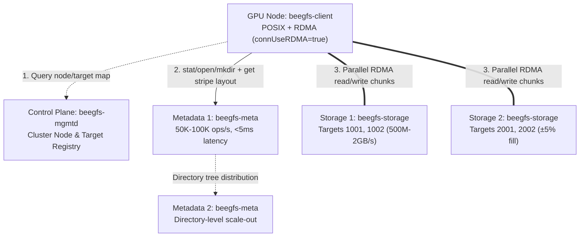
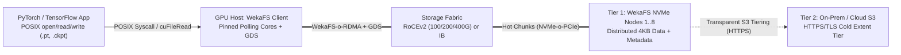
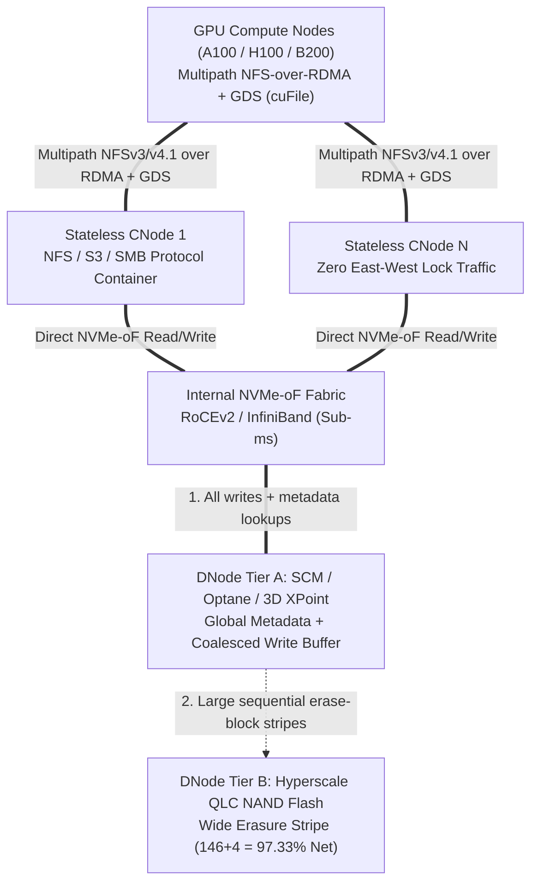
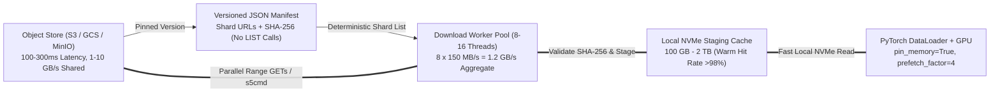

# 13.5 BeeGFS, Weka, VAST and object storage

| Field | Value |
|---|---|
| Level | Intermediate |
| Priority tier | 2 |
| Lab venue | GCP / GKE + Local Python Verification Lab (`code/part13/beegfs_weka_vast_object_lab.py`) |
| Part | Part 13: AI storage |
| Primary sources | NVIDIA Zero-to-Hero Volume 15 (`chapter-06-beegfs-for-gpu-clusters.md`, `chapter-07-object-storage-and-dataset-pipelines.md`); *AI Systems Performance Engineering*; *AI Data Center Network Design and Technologies* |
| Coverage file | `planning/coverage/chapters/13-05.md` |
| Claim & number ledger | `planning/ledgers/13-05.md` |

## Why this matters for AI infrastructure

An AI cluster's compute fabric is only as productive as the storage layer feeding it and absorbing its checkpoints. Consider an `8`-GPU training server where each GPU requires `200 MB/s` of preprocessed training data to keep its Tensor Cores busy: that single node demands `1.6 GB/s` of sustained ingestion bandwidth. Scale that up to an NVIDIA Grace Blackwell `GB200` or `GB300` `NVL72` rack with `72` GPUs connected across a single `NVLink` domain at `200 MB/s` per GPU, and a single rack requires `14.4 GB/s` (`14–20 GB/s` envelope) of continuous read throughput—before accounting for multimodal video/image streams or synchronized multi-terabyte model checkpoints that pause training until every rank flushes its shard. When storage I/O stalls consume `30%` of iteration wall-clock time, reducing that I/O wait down to `5%` lowers the stall fraction by `6.0x` and recovers `25` percentage points of active GPU compute time.

While Lustre dominates classic national-laboratory supercomputers, modern commercial and enterprise GPU clusters frequently deploy four complementary storage architectures that sit at different points on the simplicity, metadata-scalability, and cost-per-gigabyte spectrum:
1. **BeeGFS:** An open-ecosystem parallel filesystem that decouples management (`beegfs-mgmtd`), metadata (`beegfs-meta`, `50,000–100,000` ops/sec per server), storage targets (`beegfs-storage`, `500 MB/s–2 GB/s` per node), and kernel clients (`beegfs-client`) with substantially simpler day-2 operations than Lustre—provided platform engineers configure directory stripe patterns (`numtargets`, `chunksize`) and repackage small files so metadata servers do not saturate.
2. **WekaFS (`WEKA`):** A software-defined, NVMe-first parallel filesystem that distributes both data and virtual metadata in `4 KB` chunks across every storage node (eliminating dedicated metadata-server bottlenecks entirely), pins dedicated polling CPU cores (`ll_core`) on GPU hosts for low-latency POSIX over `RoCEv2` or InfiniBand with `GPUDirect Storage` (`GDS`), and transparently tiers cold extents to `S3` object storage under a single unified namespace.
3. **VAST Data (`DASE`) and AI-native RDMA filesystems (`DeepSeek 3FS`):** VAST's **Disaggregated Shared-Everything (`DASE`)** architecture decouples stateless protocol containers (`CNodes`) from high-availability `NVMe-oF` storage enclosures (`DNodes`) that combine Storage Class Memory (`SCM` / Optane / `3D XPoint`) write buffers with wide-striped (`146+4`, `97.33%` efficiency) `QLC` flash, delivering `+20%` `GDS` read throughput on `A100` (`9.6 GB/s` at `1.00 ms` vs `8.0 GB/s` at `1.25 ms` on the CPU path) and `+30%+` on `H100`. Taking direct-to-NVMe co-design to the extreme, **DeepSeek's Fire-Flyer File System (`3FS`)** eliminates OS page-cache thrashing via `O_DIRECT`, `io_uring`, and `RDMA` to sustain `6.6 TB/s` of aggregate random read throughput (plus `1.4 TB/s` background traffic, and up to `7.3 TB/s` peak) across `68` storage nodes (`680 x 16 TB` NVMe SSDs, dual `100 Gb/s` NICs), outperforming Ceph (`1.1 TB/s`) by `6.0x` to `6.64x`.
4. **Object Storage (`S3`, `GCS`, Azure Blob, MinIO) with Local NVMe Staging:** Object stores provide durable, exabyte-scale source-of-truth repositories over `HTTP/TLS`, but a `150 ms` per-request latency turns `2,000,000` small `260 KB` objects into `300,000` seconds (`83.33` hours) of serial API wait. Feeding GPUs from object storage requires deterministic manifest versioning, prefix sharding (`5,500` `GET`/s and `3,500` `PUT`/s per prefix), parallel multipart/worker pools (`8` workers x `150 MB/s = 1.2 GB/s`), and local NVMe staging caches that warm from a `0.1%` hit rate (`45.3` min wait) in Epoch 1 to a `98.2%` hit rate (`2.1` min wait) in Epoch 2.

## Prerequisites and outcomes

### Prerequisites
- Understanding of AI storage workload taxonomy (training ingestion, burst checkpoint writes, `mmap` model loading, and RAG vector lookups) and local NVMe / `blk-mq` basics from Chapters 13.1–13.3.
- Familiarity with parallel filesystem concepts (separation of metadata and data paths, striping across storage targets) from Chapter 13.4.
- Working knowledge of `NVMe-oF` (`NVMe-o-TCP` port `8009` vs `NVMe-o-RDMA` over `RoCEv2` UDP `4420`/`4791` and InfiniBand) and `GPUDirect Storage` (`GDS` / `cuFile` / `nvidia-fs`) from Part 12.

### Outcomes
After completing this chapter, you will be able to:
1. Architect and diagnose a **BeeGFS** cluster across its four services (`beegfs-mgmtd`, `beegfs-meta`, `beegfs-storage`, `beegfs-client`), calculate round-robin stripe chunk placement and sustained throughput (`beegfs-ctl --setpattern --chunksize=1M --numtargets=8`), detect target fill-level skew (`±5%` healthy band vs `> 10%` imbalance), and prevent `256`-GPU metadata saturation (`200,000+` ops/sec) through `MDS` scale-out and `100x` `WebDataset` sharding.
2. Contrast **BeeGFS** and **Lustre** against commercial AI parallel filesystems—**WekaFS** (distributed virtual metadata across all NVMe nodes, `N+K` erasure coding, pinned `ll_core` client polling threads, and transparent `Tier 1` `RDMA` + `Tier 2` `S3` namespace tiering) and **VAST Data `DASE`** (stateless `CNodes` over `NVMe-oF` to `DNodes` with `SCM` write buffers, `146+4` wide erasure stripes on `QLC` flash, and `GDS` `NFS-over-RDMA`).
3. Quantify **GPUDirect Storage (`GDS`)** performance using `gdsio` (`-x 2` CPU bounce-buffer baseline at `8.0 GB/s` and `1.25 ms` vs `-x 0` direct GPU DMA at `9.6 GB/s` and `1.00 ms`) and explain how **DeepSeek's `3FS`** uses `O_DIRECT`, `io_uring`, and `RDMA` (bypassing the Linux page cache and avoiding `FUSE` `GDS` limitations) to reach `6.6–7.3 TB/s` across `68` storage nodes.
4. Design and instrument a production **object storage (`S3` / `GCS`) dataset staging pipeline** that eliminates bucket listings via JSON manifests with `SHA-256` checksums, scales request rates via prefix sharding, saturates links with parallel worker pools (`s5cmd`, `boto3` `ThreadPoolExecutor`), and tracks per-epoch local NVMe cache hit rates (`0.1%` -> `98.2%` -> `97.5%` LRU eviction onset above `85%` fill).

---

## 1. The AI Storage Taxonomy: Block, File, Parallel File, and Object

Before diving into individual storage engines, platform engineers must match each phase of the AI lifecycle—raw data ingestion, offline curation (`NeMo Curator`), high-throughput distributed training, synchronous checkpointing, and post-training model distribution or RAG inference—to the right storage abstraction.

| Feature | Object Storage (`S3` / `GCS` / MinIO) | Block Storage (`NVMe-oF` / SAN) | Shared / Parallel File Storage (`BeeGFS` / `WekaFS` / `VAST` / `Lustre` / `GPFS`) |
|---|---|---|---|
| **Data organization** | Immutable objects (`key -> blob + metadata`) in flat buckets | Fixed-size logical blocks (`4 KB` LBAs) inside `NSID` volumes | Hierarchical POSIX files and directories with inode attributes |
| **Access method** | REST `HTTP/TLS` API (`GET`, `PUT`, byte-range `GET`) | Block-level NVMe queues (`SQE`/`CQE` capsules over PCIe or fabric) | POSIX syscalls (`open`, `read`, `write`, `stat`, `mmap`, `unlink`) |
| **Network transport** | `TCP/HTTPS` over standard Ethernet/IP | `NVMe-o-TCP` (port `8009`), `NVMe-o-RDMA` (`RoCEv2` UDP `4791` / `IB`), `FC` | `RDMA` (`RoCEv2` / InfiniBand) or `TCP` over Ethernet/IP |
| **OS page cache & `GDS`** | No kernel page cache; staged to local NVMe or memory | Raw block volumes have no shared multi-node page cache; `GDS` via local/remote `O_DIRECT` | Supports shared namespace; `GDS` (`cuFile` + `nvidia-fs`) bypasses host bounce buffers over `RDMA` |
| **Scalability & cost** | Highest capacity scalability (multi-exabyte); lowest `$/GB` | High per-volume IOPS/latency (`~100 ns` PCIe Gen5, `~300 ns` IB, `~800 ns` Eth); highest `$/GB` | Scales to hundreds of `GB/s` or multi-`TB/s` across thousands of GPU clients; moderate-to-high `$/GB` |
| **Primary AI domain** | Data lake source of truth, offline curation, cross-site/cloud checkpoint archival, RAG corpus | Local scratch volumes, database backing stores, hyperconverged or disaggregated `DNode` backing | Active multi-node training datasets, synchronous multi-rank checkpoint writes, shared home/code directories |

Why can't a cluster simply mount a single standard `NFS` server for `100+` GPUs? While a single `NFS` server tuned with `1 MiB` transfer sizes (`rsize=1048576,wsize=1048576,noatime,async,actimeo=60,lookupcache=pos`) works well for a few nodes, all metadata and data streams bottleneck on one server's NICs and CPU queues. Parallel filesystems (`BeeGFS`, `WekaFS`, `VAST`, `Lustre`, `IBM Storage Scale` / `GPFS`, `DeepSeek 3FS`) break that single-node ceiling by striping data—and in modern designs, metadata—across dozens or hundreds of independent storage servers simultaneously.

---

## 2. BeeGFS for GPU Clusters: Architecture, Striping, and Metadata Tuning

**BeeGFS** (originally developed at the Fraunhofer Center for High Performance Computing) was engineered to solve the same multi-node bandwidth aggregation problem as Lustre while drastically simplifying installation and day-2 operations. Unlike Lustre—which requires patched kernel modules tightly coupled to `ldiskfs` or `ZFS` object targets and complex Distributed Namespace (`DNE`) management—BeeGFS installs as standard Linux user-space daemons (`beegfs-mgmtd`, `beegfs-meta`, `beegfs-storage`) on top of any existing local filesystem (`XFS` or `EXT4`), plus a lightweight client kernel module (`beegfs-client`) that supports `RDMA` (`InfiniBand` and `RoCEv2`) and `GPUDirect Storage` (`GDS`).

### 2.1 The Four Decoupled BeeGFS Services



| Service | Daemon / Module | Core Responsibility | Healthy Operational Envelope | Primary CLI Check (`untested here`) |
|---|---|---|---|---|
| **Management Service** | `beegfs-mgmtd` | Maintains the authoritative registry of all metadata nodes, storage nodes, targets, and client sessions; never sits on the data path | `< 1%` CPU/network load; queried upon mount and topology changes | `beegfs-ctl --listnodes --nodetype=mgmt` |
| **Metadata Service (`MDS`)** | `beegfs-meta` | Stores POSIX inodes, directory hierarchies, permissions, and the per-file stripe pattern (`target IDs` + `chunksize`) | **`50,000–100,000` ops/sec** per MDS; average latency **`< 5 ms`** (e.g., `2.0–2.1 ms` at `5.2K–5.4K` ops/sec) | `beegfs-ctl --serverstats --nodetype=meta` |
| **Storage Service (`OSS`)** | `beegfs-storage` | Manages one or more underlying NVMe RAID/XFS storage targets (`TargetID`) and serves striped file chunks over `RDMA` or `TCP` | **`500 MB/s–2 GB/s`** per storage node; all targets balanced within **`±5%` fill** (`> 10%` spread triggers investigation) | `beegfs-ctl --listtargets --nodetype=storage --spaceinfo` |
| **Client Service** | `beegfs-client` | Kernel module mounted at `/beegfs`; fetches file stripe layout from `MDS` on `open()` and performs direct parallel `RDMA` I/O to storage targets | Sustained `4–5 GB/s` single-client read across `8–12` targets with `connUseRDMA = true` | `beegfs-ctl --clientinfo` and `mount \| grep beegfs` |

### 2.2 Round-Robin Striping Math (`chunksize` and `numtargets`)

When a training script creates or reads a file in BeeGFS, the file is sliced into fixed-size contiguous chunks (`chunksize`, default `512 KB` or tuned to `1 MB`–`4 MB` for AI workloads) and distributed in round-robin order across `N` storage targets (`numtargets`). For any logical byte offset $B$ in a file with chunk size $C$ and stripe width $N$ across ordered target list `T = [T_0, T_1, \dots, T_N-1]`:

```text
chunk_index = floor((B) / (C) ), \quad stripe_row = floor((chunk_index) / (N) ), \quad target_slot = chunk_index \bmod N
```

```text
intra_chunk_offset = B \bmod C, \quad TargetID = T[target_slot]
```

For example, with `chunksize = 1 MiB` (`1,048,576` bytes) and `numtargets = 8` (`TargetIDs`: `1001, 1002, 2001, 2002, 3001, 3002, 4001, 4002`), byte offset `10 MiB + 512 B` (`10,486,272`) maps to `chunk_index = 10`, `stripe_row = 1`, `target_slot = 2` (`TargetID 2001`), at `intra_chunk_offset = 512` bytes.

Why does directory-level stripe width (`beegfs-ctl --setpattern`) make or break training efficiency? Consider a `500 GB` synchronized model checkpoint written to an `8`-node BeeGFS cluster where each storage target sustains `800 MB/s`:
- **Misconfigured narrow stripe (`numtargets = 2`):** Aggregate theoretical write bandwidth is `2 x 800 MB/s = 1.6 GB/s`. Writing `500 GB` stalls the entire GPU cluster for:
```text
t_2-targets = (500 GB) / (1.6 GB/s) = 312.5 seconds ~= 5.2 minutes
```
- **Properly striped across 8 targets (`numtargets = 8`):** Aggregate theoretical bandwidth jumps to `8 x 800 MB/s = 6.4 GB/s` (with `70–80%` real-world network and coordination efficiency yielding **`~5.0 GB/s`** sustained for a single client). Theoretical checkpoint stall time drops `4.0x` to:
```text
t_8-targets = (500 GB) / (6.4 GB/s) = 78.125 seconds \quad (or  100.0 s at  5.0 GB/s sustained)
```
- **Maximum cluster striping (`numtargets = 12`):** Across `12` targets at `800 MB/s` each, aggregate theoretical bandwidth reaches `12 x 800 MB/s = 9.6 GB/s`, cutting the `500 GB` checkpoint write to **`52.08` seconds**.

Crucially, running `beegfs-ctl --setpattern` on a directory **only applies to newly created files** inside that directory; existing files retain the `NumTargets` and `ChunkSize` recorded in their metadata entry at creation time unless explicitly migrated (`beegfs-ctl --migrate`) or rewritten.

### 2.3 The AI Metadata Wall (`256` GPUs) and Target Fill Skew

While BeeGFS is much easier to operate than Lustre, its metadata scaling model is more manual than Lustre's DNE (`500,000+` ops/sec). Each BeeGFS Metadata Service (`beegfs-meta`) handles **`50,000–100,000` ops/sec** (with **`50,000` ops/sec** as the safe operational ceiling to keep average metadata latency **`< 5 ms`**).
- **The `256`-GPU Epoch-Start Storm:** Suppose `256` GPUs launch an epoch over a computer-vision dataset stored as `10,000,000` individual JPEG files. If each GPU worker pool issues `800` `stat()`/`open()`/`close()` calls per second at epoch start, aggregate metadata demand spikes to **`204,800` ops/sec** (`200K+` ops/sec). A single `MDS` (`50,000` ops/sec capacity) saturates at `1/4` of the load, driving metadata latency above `30 ms+` and stalling all `256` GPUs.
- **Mitigation 1 (Scale out `MDS` count):** Adding `4+` to `5` `beegfs-meta` services buys raw capacity headroom (`5 x 50,000 = 250,000` ops/sec), because BeeGFS assigns different directories to different metadata servers. However, if all `10,000,000` JPEGs live inside a single flat directory, even multiple `MDS` nodes will hot-spot on the single `MDS` owning that directory inode.
- **Mitigation 2 (Mandatory dataset repackaging):** Packing those millions of small files into a few hundred large sequential shards (`100 MB`–`10 GB` `WebDataset` `.tar` archives, `TFRecord`, `Parquet`, or NeMo `.bin`/`.idx` memory-mapped files) reduces metadata operations by **`100x`**, dropping the `256`-GPU peak from `204,800` ops/sec to **`2,048` ops/sec** (`< 5,000` ops/sec)—well within the `< 5 ms` sweet spot of even a single `MDS`.

A second operational hazard in BeeGFS is **storage target fill-level imbalance**. Inspecting `beegfs-ctl --listtargets --nodetype=storage --spaceinfo` (`untested here`) on a two-node cluster might reveal:
- `NodeID 101 (storage1)`: `TargetID 1001` at `4.5 TB / 10.0 TB` (`45%`) and `TargetID 1002` at `4.4 TB / 10.0 TB` (`44%`).
- `NodeID 102 (storage2)`: `TargetID 2001` at `7.2 TB / 10.0 TB` (`72%`) and `TargetID 2002` at `7.1 TB / 10.0 TB` (`71%`).

Here, targets within each node are balanced (`44–45%` and `71–72%`), but the inter-node spread is **`28.0%`** (`72% - 44%`), far exceeding the **`±5%` healthy band** around the `58.0%` cluster mean and the **`10%` investigation threshold**. If one node reaches `95–100%` full while others sit at `50%`, wide-striped checkpoint writes will fail or degrade to the surviving targets. Operators remediate this by verifying directory `numtargets` settings and running `beegfs-ctl --migrate` (`untested here`) to redistribute existing files off overloaded targets.

---

## 3. WekaFS: Distributed Virtual Metadata, Core Pinning, and S3 Tiering

When an organization cannot tolerate manual metadata directory placement or refuses to force every research team to repackage millions of small files before running experiments, **WekaFS (`WEKA`)** addresses the problem at the filesystem architecture level.

### 3.1 Fully Distributed Metadata and `N+K` Erasure Coding

Unlike both Lustre (`MDT` servers) and BeeGFS (`beegfs-meta` servers), **WekaFS has no dedicated metadata servers**. Instead, WekaFS virtualizes all NVMe drives across the storage cluster into a single software-defined pool and distributes **both file data and metadata in small (`4 KB`) chunks** across every storage node using deterministic cryptographic hashing.
1. **Zero single-MDS bottleneck:** Because every node in a WekaFS cluster participates in serving metadata operations in parallel, small-file `open()`/`stat()`/`unlink()` IOPS scale linearly with cluster node count. Whether a workload streams `100 GB` checkpoint shards or reads millions of `4 KB`–`260 KB` files, metadata lookups never queue behind a single inode server.
2. **Distributed `N + K` stripe protection:** Instead of relying on hardware RAID cards or `3x` replication (which wastes `66.67%` of raw NVMe capacity, leaving only `33.33%` usable), WekaFS stripes data across failure domains using cluster-wide erasure coding ($N$ data chunks plus $K$ parity chunks, where $N + K$ cannot exceed the number of storage nodes):
   - On an `8`-node cluster configured with a `6 + 2` stripe (`8` chunks total across `8` nodes, `8 x 8 x 15.36 TB = 983.04 TB` raw), usable Tier 1 NVMe capacity is `(6) / (6+2) = 75.0%` (`737.28 TB` usable vs `327.68 TB` under `3x` replication—a **`2.25x` usable capacity gain**) while surviving any `2` simultaneous node or drive failures.
   - On an `18`-node cluster configured with a `16 + 2` stripe, net NVMe efficiency reaches `(16) / (16+2) = 88.89%`.

### 3.2 POSIX Client Core Pinning (`RoCEv2` / InfiniBand) and Unified S3 Tiering



| Architectural Layer | WekaFS Mechanism | Operational Impact for GPU Clusters |
|---|---|---|
| **GPU Host Access (`WekaFS Client`)** | Dedicated user-space/kernel POSIX client running on the GPU server (`100/200/400/800 Gbps` NICs); pins `1` to `4` dedicated CPU cores (`ll_core`) in polling mode | Eliminates OS interrupt latency and sequential NFS state-machine overhead; on a `128`-core host, pinning `4` cores consumes **`3.125%`** CPU to drive line-rate `RDMA` and `GPUDirect Storage` (`GDS`) |
| **Protocol Fallback (`NFS`)** | Optional standard `NFSv3` / `NFSv4.1` gateway access for non-GPU hosts without the native client | Functional for management nodes, but delivers substantially lower IOPS and does not provide the full native `WekaFS-o-RDMA` client pipeline |
| **Unified Hybrid Namespace (`Tier 1 + Tier 2`)** | Hot working sets reside on Tier 1 NVMe flash (`737.28 TB`), while cold datasets and older `.pt`, `.ckpt`, `.npy`, `.h5`, and `.bin` files transparently tier to Tier 2 `S3` object storage (`2,000 TB`+) over `HTTPS/TLS` | Applications see a single `2,737.28 TB` POSIX directory tree; policy engines evict cold data extents from NVMe to `S3` while keeping metadata headers in flash for instant `ls`/`stat` lookups |

---

## 4. VAST Data (`DASE`), `GPUDirect Storage`, and DeepSeek `3FS`

While WekaFS scales by running intelligent storage software across shared-nothing NVMe servers, two other landmark architectures—**VAST Data's Disaggregated Shared-Everything (`DASE`)** and **DeepSeek's Fire-Flyer File System (`3FS`)**—rethink how compute, metadata, flash media, and `RDMA` interact at multi-terabyte-per-second scale.

### 4.1 VAST Data Disaggregated Shared-Everything (`DASE`)

Traditional distributed filesystems (including Ceph and shared-nothing SDS clusters) bind specific drives and metadata shards to stateful storage server CPUs. Whenever a client modifies a directory or stripes a file, those storage servers must exchange east-west lock and cache-coherency messages across the network. VAST Data eliminates east-west storage-node coordination through its **Disaggregated Shared-Everything (`DASE`)** architecture:



| DASE Component | Architectural Function | Quantitative Advantage |
|---|---|---|
| **Stateless `CNodes` (Compute Nodes)** | Containerized protocol servers exposing multipath `NFS-over-RDMA` (`nconnect` / multipath), `S3`, and `SMB`; hold **zero persistent state** | Any `CNode` can read or write any `DNode` drive directly over `NVMe-oF`; if a `CNode` fails, active `RDMA` connections fail over to peer `CNodes` without data rebuilds |
| **Internal `NVMe-oF` Fabric** | High-speed `RoCEv2` or InfiniBand switch fabric connecting every `CNode` to every high-availability `DNode` enclosure | Allows independent scaling of protocol CPU (`CNodes`) and flash capacity (`DNodes`) |
| **`DNode` `SCM` (`Optane` / `3D XPoint`) Tier** | Ultra-low-latency, high-endurance non-volatile memory that stores global metadata data structures and absorbs `100%` of incoming random writes | Protects lower-endurance `QLC` flash from random write amplification; `CNodes` coalesce data in `SCM` (`24 TB`+) and destage only full, sequential erase-block stripes |
| **`DNode` `QLC` Flash + Wide Stripes (`146+4`)** | Low-cost, high-density `QLC` NAND flash protected by locally decodable wide erasure codes (e.g., `146` data strips + `4` parity strips across enclosures) | Cuts erasure-coding parity overhead to **`2.67%`** (**`97.33%` net efficiency**; `1,460 TB` usable out of `1,500 TB` raw, or `2,920 TB` at `2.0x` similarity reduction) while surviving `4` concurrent failures |

### 4.2 Quantifying `GPUDirect Storage` (`GDS`) with `gdsio`

Whether your cluster mounts **BeeGFS**, **WekaFS**, **VAST Data (`NFS-over-RDMA`)**, or **IBM Storage Scale**, feeding high-bandwidth `RDMA` storage through the legacy Linux CPU path creates a severe host-memory bounce-buffer bottleneck: data travels from the storage NIC across `PCIe` into host `DRAM` (page cache or pinned host buffer) and must then be copied a second time across `PCIe` into GPU `HBM`.

**NVIDIA `GPUDirect Storage` (`GDS`)**—implemented via the CUDA `cuFile` API (`cuFileBufRegister`, `cuFileRead`, `cuFileWrite`, `cuFileReadAsync`, `cuFileWriteAsync`) and the `nvidia-fs` kernel driver—registers GPU `HBM` (`BAR1`) buffers directly with the storage or `RDMA` NIC driver so DMA engines move bytes straight between remote storage and GPU memory without touching host `DRAM`.

We can verify the exact `GDS` uplift on a live mount using `/usr/local/cuda/gds/tools/gdsio` (`untested here`) with `4` worker threads (`-w 4`), a `10 GiB` file (`-s 10G`), `1 MiB` I/O size (`-i 1M`), read mode (`-I 0`), comparing the **CPU bounce-buffer path (`-x 2`)** against the **direct `GDS` path (`-x 0`)**:

| `gdsio` Transfer Mode | CLI Flag | Measured Read Throughput | Average I/O Latency | Observed Hardware Impact |
|---|---|---|---|---|
| **Storage -> CPU Memory -> GPU (`Before GDS`)** | `-x 2` | **`8.0 GB/s`** | **`1.25 ms`** | Host CPU cores saturated executing `memcpy` through host pinned bounce buffers |
| **Storage -> GPU HBM Direct (`With GDS`)** | `-x 0` | **`9.6 GB/s` (`+20.0%`)** | **`1.00 ms` (`-20.0%`)** | Zero host `DRAM` bounce copy; VAST benchmarks show **`+20%`** read throughput on `A100` (`100 Gb/s` NIC) and **`+30%+`** on `H100` (`200/400 Gb/s` NICs) |

### 4.3 DeepSeek's Fire-Flyer File System (`3FS`) vs Ceph (`6.6–7.3 TB/s` on `68` Nodes)

Why did DeepSeek build an open-source parallel filesystem—**Fire-Flyer File System (`3FS`)**—from scratch rather than deploying a conventional general-purpose distributed storage system like **Ceph**?
1. **Why page caching backfires on AI random reads:** During large-scale LLM pretraining, multi-modal shuffling, and distributed KVCache/checkpoint access, thousands of workers issue massive numbers of **non-repeating random reads** across petabytes of data. Conventional OS page caches (`DRAM` read-ahead and LRU eviction) achieve near-zero hit rates on random accesses while burning CPU cycles on page-table locks, memory allocations, and cache thrashing. `3FS` eliminates read caching entirely and enforces strict **`O_DIRECT`** semantics so every request goes straight from the NVMe SSD over `RDMA` to the client buffer.
2. **Why `FUSE` blocks kernel `GDS`:** Many modern user-space filesystems use `FUSE` (Filesystem in Userspace). However, standard `FUSE` cannot deliver a native kernel `GDS` (`nvidia-fs`) path because `GDS` requires kernel-level `O_DIRECT` filesystem integration. To achieve zero-copy GPU transfers from user space, **DeepSeek `3FS`** combines Linux **`O_DIRECT`**, asynchronous **`io_uring`** (with preregistered buffers and polling to batch I/O submissions without per-syscall overhead), and native **`RDMA` (`InfiniBand` / `RoCEv2`)** reads across four decoupled components: **Cluster Manager**, **Metadata Service** (sharded and replicated across nodes), **Storage Service**, and **Client**.
3. **The `68`-Node `3FS` vs Ceph Benchmark:** On a `68`-node AI-HPC storage cluster where each storage node houses **`10 x 16 TB` NVMe SSDs** (`680` SSDs = **`10,880 TB`** raw capacity) and **dual `100 Gb/s` NICs** (`200 Gb/s` = `25.0 GB/s` raw network per node):
   - **DeepSeek `3FS`** achieved **`6.6 TB/s`** of sustained aggregate read throughput (`97.06 GB/s` per storage node across internal/fabric paths) while simultaneously serving **`1.4 TB/s`** of background workload traffic (**`8.0 TB/s`** combined I/O), and reached up to **`7.3 TB/s`** peak read throughput in larger cluster runs.
   - **Ceph** on comparable hardware achieved only **`~1.1 TB/s`**, giving `3FS` a **`6.0x` speedup** at `6.6 TB/s` (and **`6.64x`** at `7.3 TB/s`).

| Parallel Filesystem Comparison | BeeGFS | Lustre | WekaFS (`WEKA`) | VAST Data (`DASE`) | DeepSeek `3FS` |
|---|---|---|---|---|---|
| **Metadata Model** | Multiple `beegfs-meta` (`50–100K` ops/s each); manual directory distribution | Multiple `MDT`s with `DNE` (`500K+` ops/s); rich namespace tooling | Fully distributed `4 KB` virtual metadata across all NVMe nodes | Global metadata in `DNode` `SCM`/`Optane` accessed by stateless `CNodes` | Sharded, replicated transactional metadata over `RDMA` |
| **Small-File / Random Read Fit** | Moderate (requires `WebDataset` sharding above `~100` GPUs) | High with `DNE` + `DoM` (Data-on-MDT), complex to tune | Very high (no single `MDS` bottleneck) | Very high (`SCM` metadata + multipath `RDMA`) | Extreme for random reads (`O_DIRECT` + `io_uring`, zero page cache) |
| **Operational Complexity** | Low (standard Linux packages on `XFS`/`EXT4`) | High (patched kernel, `MDT`/`OST` failover, `DNE` balancing) | Low-to-moderate (commercial SDS, requires pinned client cores) | Low (turnkey disaggregated appliance, `NFS-over-RDMA` + `S3`) | High (custom `RDMA` + `io_uring` stack for ultra-scale AI factories) |
| **Primary Ideal Scale** | `100–500` GPUs, sequential shards & checkpoints | `1,000+` GPUs, classic HPC & large AI supercomputers | `100–10,000+` GPUs needing mixed small/large I/O + `S3` tiering | Multi-tenant enterprise AI data platforms needing unified `NFS` + `S3` | Ultra-scale LLM training & KVCache (`6.6–7.3 TB/s` across `68+` nodes) |

---

## 5. Object Storage (`S3` / `GCS` / MinIO) and Dataset Staging Pipelines

Object storage (`AWS S3`, `Google Cloud Storage`, `Azure Blob Storage`, or on-premises `MinIO` / `Ceph RGW` / `VAST S3`) is the universal source-of-truth data lake for modern AI organizations. It is virtually infinite, geo-durable, and costs a fraction of all-flash parallel filesystems. However, **object storage is not a POSIX filesystem**, and pointing a PyTorch `DataLoader` directly at millions of individual `S3` keys is one of the most expensive mistakes in AI infrastructure.

### 5.1 The `S3` Small-Object Latency Trap (`83.33` Hours of HTTP/TLS Wait)

Every `S3` `GET` request traverses an `HTTP/TLS` stack, authenticates IAM signatures, looks up the object key in a distributed index, and streams the payload over TCP. Consider a `500 GB` image dataset stored in `S3` as **`2,000,000` objects of `260 KB` each**, alongside a `100 MB` model weight file:
1. **Loading the `100 MB` model:** `50 ms` TCP/TLS handshake + `100 ms` `S3` API lookup + `100 ms` transfer (at `1 GB/s`) = **`250 ms`** total.
2. **Fetching `2,000,000` small `260 KB` objects directly:** Each `260 KB` request incurs **`150 ms`** of `HTTP/TLS` and API overhead—meaning the control-plane latency is vastly larger than the `260 KB` payload transfer time. Issued serially, `2,000,000` requests consume:
```text
T_serial = 2,000,000 x 0.150 s = 300,000 seconds = 83.33 hours
```
   Your GPUs sit `99%` idle for more than three days waiting for `HTTP` headers.

### 5.2 Prefix Sharding, Parallel Multipart Throughput, and Staging Cache Math

To turn object storage into a high-bandwidth training feeder, platform engineers combine **four architectural mechanisms**:



| Pipeline Stage | Operational Bottleneck Addressed | Target Metric / Sizing Rule |
|---|---|---|
| **1. Versioned JSON Manifest** | Eliminates repeated `ListObjectsV2` bucket listings (which are slow, paginated at `1,000` keys, and subject to eventual-consistency/data-drift bugs) | Pre-compute `imagenet-manifest.json` (`1,099,511,627,776` bytes = `1 TiB` across `1,073,741,824`-byte `1 GiB` `.tar` shards, `1,281,167` samples) with pinned `sha256` checksums |
| **2. S3 Prefix Sharding** | Standard S3 partitions enforce **`3,500` `PUT/COPY/POST/DELETE`** and **`5,500` `GET/HEAD` requests/sec per prefix**; dumping all shards under one prefix triggers `503 Slow Down` throttling at cluster scale | Shard object keys across $P = 16$ hex/hash prefixes (`s3://bucket/00/..` to `s3://bucket/0f/..`) to scale aggregate request ceilings to **`88,000` `GET`/s** and **`56,000` `PUT`/s** |
| **3. Parallel Worker Pool (`8–16` Workers / `s5cmd`)** | Single-stream TCP/TLS downloads cannot saturate `10–100 Gb/s` host NICs (`1 GB` single object takes `6.2 s` = **`161.29 MB/s`**: `50 ms` TLS + `80 ms` API + `6,000 ms` transfer) | Fetching `8 x 1 GB` objects in parallel completes in **`7.5 s`** instead of `8 x 6.2 = 49.6 s` (**`6.61x` speedup**), delivering **`1,066.67 MB/s`** (`~1,067 MB/s`) aggregate (**`133.33 MB/s`** per worker) |
| **4. Time-to-First-Batch Startup** | Prevents GPU starvation at job launch when staging a `500 GB` dataset (`50 x 10 GB` shards) | With `8` workers at `150 MB/s` (`1.2 GB/s` aggregate), prefetching the first `2` shards (`20 GB`) takes `20 / 1.2 = 16.67 s` (`~17 s`) + `2 x 5.0 s` API + `2 x 0.1 s` TLS = **`26.87 s` (`~27 s`)** (`18.53 s` with `16` workers) |
| **5. Local NVMe Cache & LRU Eviction** | Absorbs S3 latency jitter and serves Epochs `2..N` at local NVMe speed (`100 GB–2 TB` scratch) | **Epoch 1 (cold):** `0.1%` hit rate (`45.3 min` wait); **Epoch 2 (warm):** `98.2%` hit rate (`2.1 min` wait, **`21.57x` wait reduction**); **Epoch 3 (`> 85%` fill):** `97.5%` hit rate (`3.5 min` wait as LRU eviction begins) |

---

## Commands and configurations that matter

Every command below that queries or modifies cluster storage services (`beegfs-ctl`, `gdsio`, `aws`, `s5cmd`, `mount`, `blockdev`, `dd`, `nsys`) is marked `(untested here)` because multi-node parallel filesystem daemons and cloud S3 buckets are not attached to this build container.

### 1. BeeGFS Health, Metadata Rate, and Target Fill Inspection (`untested here`)

```bash
# 1. Inspect Metadata Service (MDS) nodes, active sessions, ops/sec, and latency (untested here)
beegfs-ctl --listnodes --nodetype=meta --details
beegfs-ctl --serverstats --nodetype=meta

# Illustrative healthy output (untested here):
# Metadata Service ID 1 (meta1.example.com):
#   Used capacity: 45 GB / 500 GB (9%)
#   Sessions: 24 active
#   Operations: 5,230 ops/sec (healthy, < 50,000 ops/sec ceiling)
#   Latency (avg): 2.1 ms (healthy, < 5.0 ms threshold)
# Metadata Service ID 2 (meta2.example.com):
#   Used capacity: 44 GB / 500 GB (8%)
#   Sessions: 25 active
#   Operations: 5,410 ops/sec (healthy)
#   Latency (avg): 2.0 ms

# 2. Inspect Storage Targets and detect fill-level skew across storage nodes (untested here)
beegfs-ctl --listtargets --nodetype=storage --spaceinfo
beegfs-ctl --serverstats --nodetype=storage

# Illustrative skewed output requiring rebalancing (untested here):
# NodeID: 101 (storage1) Paths:
#  TargetID: 1001 Capacity: 10.0 TB Used: 4.5 TB (45%) Path: /data/target1
#  TargetID: 1002 Capacity: 10.0 TB Used: 4.4 TB (44%) Path: /data/target2
# NodeID: 102 (storage2) Paths:
#  TargetID: 2001 Capacity: 10.0 TB Used: 7.2 TB (72%) Path: /data/target1
#  TargetID: 2002 Capacity: 10.0 TB Used: 7.1 TB (71%) Path: /data/target2
```

### 2. BeeGFS Client RDMA Config (`/etc/beegfs/beegfs-client.conf`) and Stripe Tuning (`untested here`)

```ini
# /etc/beegfs/beegfs-client.conf — AI training & checkpoint optimization (untested here)
sysMgmtdHost = mgmt.example.com
connUseRDMA = true               # Use InfiniBand / RoCEv2 RDMA instead of TCP
tuneUseGDTLSConnPool = true      # Connection pooling reduces per-I/O setup latency
tuneUseGDTLSDisableSSL = false
tunePrefetchType = buffered      # Client read-ahead caching for sequential dataset scans
connMaxInactiveTime = 900000     # Keep connections alive across long GPU compute steps
```

```bash
# Verify client mount, RDMA connectivity, and file stripe layout (untested here)
mount | grep beegfs
grep -E "sysMgmtdHost|connUseRDMA|tuneUseGDTLSConnPool|tunePrefetchType" /etc/beegfs/beegfs-client.conf
beegfs-ctl --clientinfo

# Set directory stripe pattern BEFORE writing training shards or checkpoints (untested here)
# Training data: 4 MiB chunks across 12 targets for large sequential batch reads
beegfs-ctl --setpattern --chunksize=4M --numtargets=12 /beegfs/training-data/

# Checkpoints: 2 MiB chunks across 12 targets for maximum parallel write fan-out
beegfs-ctl --setpattern --chunksize=2M --numtargets=12 /beegfs/checkpoints/

# Verify stripe pattern on a specific 500 GB shard (untested here)
beegfs-ctl --getentryinfo /beegfs/dataset/train.tar.gz

# Benchmark single-client direct read throughput (expect 4-5 GB/s across 8-12 targets) (untested here)
time dd if=/beegfs/training-data/large-file bs=4M count=25000 of=/dev/null iflag=direct
```

### 3. Benchmarking `GPUDirect Storage` (`GDS`) with `gdsio` and Linux NVMe/NFS Tuning (`untested here`)

```bash
# 1. Verify NVMe multiqueue scheduler ('none' or 'mq-deadline') and raise read-ahead to 4 MiB (untested here)
cat /sys/block/nvme0n1/queue/scheduler
cat /sys/block/nvme0n1/queue/read_ahead_kb
blockdev --setra 8192 /dev/nvme0n1   # 8192 x 512B sectors = 4 MiB read-ahead

# 2. High-throughput NFS client mount options (when using VAST NFS-over-RDMA or enterprise NAS) (untested here)
mount -t nfs -o rdma,port=20049,nconnect=16,rsize=1048576,wsize=1048576,noatime,async,actimeo=60,lookupcache=pos \
  10.30.0.10:/ai-datasets /mnt/data

# 3. Benchmark CPU bounce-buffer path (-x 2) vs GPUDirect Storage direct GPU DMA path (-x 0) (untested here)
# Before (Storage -> CPU Pinned Memory -> GPU, -x 2): 8.0 GB/s, 1.25 ms avg latency
/usr/local/cuda/gds/tools/gdsio -f /mnt/data/large_file -d 0 -w 4 -s 10G -i 1M -I 0 -x 2

# After (Storage -> GPU HBM directly via GDS cuFile/nvidia-fs, -x 0): 9.6 GB/s (+20%), 1.00 ms (-20%)
/usr/local/cuda/gds/tools/gdsio -f /mnt/data/large_file -d 0 -w 4 -s 10G -i 1M -I 0 -x 0

# 4. Trace cuFile GDS timeline alongside GPU compute kernels in Nsight Systems (untested here)
nsys profile --trace=cuda,nvtx,gds -o gds_training_profile python3 train.py
```

### 4. Production S3 Manifest Validation, Exponential Backoff Prefetch, and PyTorch Overlap (`untested here`)

```python
# Production S3 manifest verification + asynchronous 8-worker prefetch with exponential backoff (untested here)
from concurrent.futures import ThreadPoolExecutor
import hashlib
import json
import os
import time
import boto3
from botocore.exceptions import ClientError

def verify_and_stage_manifest(manifest_path: str, cache_dir: str = "/local-cache", max_workers: int = 8) -> None:
    with open(manifest_path, "r", encoding="utf-8") as f:
        manifest = json.load(f)
    s3 = boto3.client("s3")
    os.makedirs(cache_dir, exist_ok=True)

    def download_and_verify(shard: dict, max_retries: int = 3) -> str:
        local_path = os.path.join(cache_dir, shard["name"])
        if os.path.exists(local_path) and os.path.getsize(local_path) == shard["size"]:
            return local_path
        bucket, key = shard["s3_path"].replace("s3://", "").split("/", 1)
        for attempt in range(max_retries):
            try:
                s3.download_file(bucket, key, local_path)
                digest = hashlib.sha256()
                with open(local_path, "rb") as lf:
                    for chunk in iter(lambda: lf.read(16 * 1024 * 1024), b""):
                        digest.update(chunk)
                if digest.hexdigest() != shard["sha256"]:
                    raise ValueError(f"SHA-256 mismatch on {shard['name']}")
                return local_path
            except ClientError:
                if attempt == max_retries - 1:
                    raise
                time.sleep(2 ** attempt)  # 1s, 2s, 4s backoff
        return local_path

    with ThreadPoolExecutor(max_workers=max_workers) as pool:
        futures = [pool.submit(download_and_verify, s) for s in manifest["shards"]]
        for fut in futures:
            fut.result()
```

---

## How it fails

| Failure Mode | Observable Symptom | Root Cause Diagnosis | Verification Check (`untested here`) | Remediation |
|---|---|---|---|---|
| **1. BeeGFS `MDS` Saturation at Epoch Start** | Training hangs or crawls at the start of every epoch; metadata latency spikes to **`30 ms+`** (vs `< 5 ms` healthy) | `100–256+` GPUs concurrently `open()`/`stat()` millions of small individual files (`200K+` ops/sec), overwhelming `beegfs-meta` (`50K–100K` ops/sec per server) | `beegfs-ctl --serverstats --nodetype=meta` and `time ls -la /beegfs/dataset/ \| wc -l` | Repackage small files into `100 MB–10 GB` `WebDataset` `.tar` or `TFRecord` shards (`100x` fewer metadata ops, `< 5K` ops/s); scale out `beegfs-meta` servers |
| **2. Narrow Directory Stripe Width (`numtargets = 1` or `2`)** | A `500 GB` checkpoint stalls the cluster for `312.5 s` (`1.6 GB/s`), or a client reads at `800 MB/s` instead of `4–5 GB/s` | Directory was created with default `numtargets=1` or `2`; existing files keep their narrow stripe layout even after `--setpattern` is run later | `beegfs-ctl --getentryinfo /beegfs/checkpoints/ckpt.pt` (inspect `NumTargets` and `ChunkSize`) | Set `beegfs-ctl --setpattern --chunksize=2M --numtargets=12` on the directory *before* creating files; restripe/copy existing files |
| **3. BeeGFS Storage Target Fill Skew (`> 10%` Spread)** | `storage2` targets hit `71–72%` (or `95%`) full while `storage1` targets sit at `44–45%`; wide writes fail when one target fills | Large unstriped files (`numtargets=1`) or uneven client placement concentrated writes on `storage2` | `beegfs-ctl --listtargets --nodetype=storage --spaceinfo` | Enforce wide directory striping (`numtargets=8` or `12`) and run `beegfs-ctl --migrate` to rebalance overloaded target IDs |
| **4. BeeGFS / WekaFS / VAST Client Fallback from `RDMA` to `TCP` or `SYS` NUMA Path** | Single-client read throughput drops from `4–5 GB/s` to `800 MB/s`, or clients show `2x` throughput variance across nodes | `connUseRDMA = false`, storage subnet routed over a slow management NIC, or DataLoader workers scheduled on the wrong CPU/NUMA socket (`SYS` traversal) | `beegfs-ctl --clientinfo`, `lsof \| grep beegfs`, `iperf3`, and `numactl --hardware` | Enable `connUseRDMA = true`, verify lossless `RoCEv2`/`IB` path, and pin DataLoader workers (`numactl`) to the storage NIC's local NUMA node |
| **5. Attempting Kernel `GDS` (`cuFile`) over a User-Space `FUSE` Mount** | `cuFileRead` falls back to host compatibility mode (`-x 2` speed, high CPU `memcpy` load) or fails `O_DIRECT` registration | Standard `FUSE` filesystems route I/O through user-space daemons and lack kernel `nvidia-fs` `O_DIRECT` DMA integration | `/usr/local/cuda/gds/tools/gdscheck -p` and `gdsio -x 0` vs `-x 2` | Use a `GDS`-supported kernel client (`BeeGFS`, `WekaFS`, `VAST NFS-over-RDMA`, `Lustre`, `GPFS`, local `XFS` `NVMe`) or native user-space `RDMA` + `io_uring` (`3FS`) |
| **6. S3 Cold-Cache Stall, Early LRU Eviction, or `503 Slow Down`** | Epoch 1 is `10x` slower than Epoch 2 (`45.3 min` vs `2.1 min` wait), training stalls `30 s` every `5 min`, or S3 returns `503` / `403` | Cold NVMe cache in Epoch 1; download pool (`8` workers) slower than GPU consumption; cache fill `> 85%` triggering LRU eviction in Epoch 3 (`97.5%` hit); or unsharded S3 prefix exceeding `5,500` `GET`/s | Log per-epoch `cache_hits / (cache_hits + cache_misses)`, `df -h /local-cache`, and `aws sts get-caller-identity` | Pre-warm local NVMe cache before `1`-epoch jobs, scale download workers `8 -> 16`, enlarge NVMe cache above dataset working set, use STS credentials with sufficient TTL, and shard S3 keys across `16+` prefixes |

---

## Hands-on lab

### Venue and Scope
- **Venue:** Local Python 3 Standard-Library Verification Lab (`code/part13/beegfs_weka_vast_object_lab.py`, **tested and verified in this environment**) + GCP / GKE cluster commands (`untested here` where live BeeGFS/S3/GPU hardware is required).
- **What the lab verifies deterministically:** All `26` quantitative models in `code/part13/beegfs_weka_vast_object.py`, covering BeeGFS round-robin chunk-to-target mapping (`chunksize`, `numtargets`), `500 GB` checkpoint stall durations (`2` vs `8` vs `12` targets), `256`-GPU metadata saturation vs `100x` `WebDataset` sharding, storage target fill-level skew detection (`44–45%` vs `71–72%`), WekaFS `6+2` and `16+2` erasure coding + `Tier 1`/`Tier 2` S3 namespace unification, VAST `DASE` `146+4` wide stripes + `gdsio` `+20%` uplift (`8.0 -> 9.6 GB/s`, `1.25 -> 1.00 ms`), DeepSeek `3FS` (`6.6–7.3 TB/s` across `68` nodes vs Ceph `1.1 TB/s`), and S3 prefix sharding, parallel worker startup (`26.87 s`), and multi-epoch NVMe cache warming/eviction (`0.1% -> 98.2% -> 97.5%`).

### Step 1: Run the Self-Contained Verification Lab (Tested Here)

```bash
python3 -B code/part13/beegfs_weka_vast_object_lab.py
```

**Expected output (verified):**
```text
=== Chapter 13.5 Lab: BeeGFS, Weka, VAST and Object Storage ===
  [PASS] 1. BeeGFS defines four decoupled services: beegfs-mgmtd, beegfs-meta, beegfs-storage, and beegfs-client
  [PASS] 2. BeeGFS storage node capacity ranges from 500 MB/s to 2000 MB/s (2 GB/s) with a +/-5% healthy target fill band
  [PASS] 3. BeeGFS 1 MiB chunksize across 8 targets maps offset 0 to slot 0 (Target 1001) and offset 10 MiB to chunk 10, row 1, slot 2 (Target 2001)
  [PASS] 4. BeeGFS 500 GB checkpoint striped across 2 targets at 800 MB/s gets 1.6 GB/s (312.5 s) vs 8 targets getting 6.4 GB/s (78.125 s, 4.0x faster)
  [PASS] 5. BeeGFS 12-target training/checkpoint pattern at 800 MB/s/target yields 9.6 GB/s theoretical throughput (52.0833 s for 500 GB)
  [PASS] 6. 256 GPUs generating 204,800 metadata ops/sec saturate 1 MDS (50K ops/sec, needing >= 5 MDSs), while 100x WebDataset sharding drops load to 2,048 ops/sec
  [PASS] 7. BeeGFS target fill check flags storage1 (45%, 44%) vs storage2 (72%, 71%) as a 28% spread (> 10% investigation threshold, outside +/-5% band)
  [PASS] 8. WekaFS 8-node cluster with 6+2 erasure coding achieves 75.0% usable NVMe capacity (2.25x more usable capacity than 3x replication)
  [PASS] 9. WekaFS 18-node cluster with 16+2 erasure coding achieves 88.89% usable NVMe efficiency and pins dedicated client cores (4/128 = 3.125% core tax)
  [PASS] 10. WekaFS unifies Tier 1 hot NVMe-o-RDMA storage (737.28 TB usable on 8 nodes) with Tier 2 S3 object storage (2000 TB) into a 2737.28 TB POSIX namespace
  [PASS] 11. WekaFS rejects N+K stripe widths that exceed the number of failure-domain storage nodes
  [PASS] 12. VAST DASE decouples stateless CNodes from NVMe-oF DNodes (SCM/Optane write buffer + QLC flash) with zero east-west CNode lock traffic
  [PASS] 13. VAST DASE wide 146+4 erasure stripe achieves 97.33% net capacity efficiency (only 2.67% parity overhead across DNodes)
  [PASS] 14. NVIDIA gdsio benchmark shows GDS (-x 0) raises throughput from 8.0 GB/s (-x 2 CPU path) to 9.6 GB/s (+20.0%) and cuts latency from 1.25 ms to 1.00 ms (-20.0%)
  [PASS] 15. DeepSeek 3FS comprises 4 RDMA-connected components (Cluster Manager, Metadata Service, Storage Service, Client) and bypasses the OS page cache via O_DIRECT + io_uring
  [PASS] 16. DeepSeek 3FS 68-node cluster (680 x 16 TB NVMe = 10,880 TB, dual 100 Gb/s NICs) achieves 6.6 TB/s read (+ 1.4 TB/s background = 8.0 TB/s, up to 7.3 TB/s peak)
  [PASS] 17. DeepSeek 3FS delivers 97.06 GB/s per storage node and outperforms Ceph (1.1 TB/s) by 6.0x at 6.6 TB/s and 6.64x at 7.3 TB/s
  [PASS] 18. Fetching 2,000,000 small 260 KB objects serially from S3 at 150 ms/request wastes 300,000 seconds (83.33 hours) on HTTP/TLS API latency alone
  [PASS] 19. Prefetching 2 x 10 GB shards (20 GB) with 8 workers at 150 MB/s each (1.2 GB/s aggregate) takes 16.67 s transfer + 10.2 s API/TLS = 26.87 s (~27 s) to first batch
  [PASS] 20. Doubling S3 download workers from 8 to 16 (2.4 GB/s aggregate) cuts 20 GB transfer time to 8.33 s (18.53 s total with API/TLS)
  [PASS] 21. S3 prefix sharding across 16 prefixes scales request ceilings from 5,500 GET/s and 3,500 PUT/s to 88,000 GET/s and 56,000 PUT/s
  [PASS] 22. Parallel 8 x 1 GB S3 download finishes in 7.5 s (1066.67 MB/s aggregate, 133.33 MB/s per worker) vs 6.2 s single-object (161.29 MB/s) and 49.6 s serial (6.61x speedup)
  [PASS] 23. Local NVMe staging cache warms from 0.1% hit rate (45.3 min wait) in Epoch 1 to 98.2% (2.1 min wait, 21.57x wait reduction) in Epoch 2
  [PASS] 24. Local NVMe staging cache detects LRU eviction onset in Epoch 3 when cache fill (88.0%) exceeds the 85.0% threshold and hit rate dips to 97.5% (3.5 min wait)
  [PASS] 25. GB200/GB300 NVL72 rack (72 GPUs x 200 MB/s per GPU) requires 14.4 GB/s (14-20 GB/s envelope) of sustained storage ingestion bandwidth
  [PASS] 26. Reducing GPU I/O wait time from 30% to 5% lowers the I/O stall fraction by 6.0x and recovers 25 percentage points of active GPU compute time

Summary: 26 passed, 0 failed
```

---

## Common first mistakes

1. **Running `beegfs-ctl --setpattern` *after* uploading the dataset or writing checkpoints:** In both BeeGFS and Lustre, directory stripe patterns are inherited only when a new inode is created. Changing `--numtargets=12` on `/beegfs/checkpoints/` does nothing to a `500 GB` file that was already created with `numtargets=2`; you must copy/rewrite or migrate existing files.
2. **Co-locating `beegfs-meta` and `beegfs-storage` on the same physical disks in production:** While BeeGFS allows running Metadata and Storage services on the same server for lab testing, sharing spindles or NVMe queues between `50,000` random inode transactions/sec and `2 GB/s` bulk checkpoint writes causes severe metadata tail-latency spikes (`> 30 ms`). Always dedicate low-latency NVMe mirrors to `beegfs-meta`.
3. **Treating Epoch-1 cold-cache overhead the same for `100`-epoch pretraining and `1`-epoch fine-tuning:** If Epoch 1 takes `3` hours (`180` minutes) because the local NVMe cache is cold while Epochs `2..100` take `30` minutes (`2.5` hours extra out of `50+` hours total), the cold-cache penalty is `< 5%` (`~0.8–5%`) of the job and can be amortized. For a **`1`-epoch LLM fine-tuning or evaluation run**, that `2.5`-hour cold wait is **`100%` overhead**—you must pre-warm the local NVMe cache (`python3 warmup_manifest.py`) before allocating or starting the GPU job.
4. **Calling `s3.list_objects_v2()` inside every rank's `Dataset.__init__()`:** When `1,000` GPU workers start simultaneously and each worker paginates through a bucket containing `2,000,000` keys, they immediately consume the `5,500` `GET/HEAD/LIST` per-prefix rate limit, triggering `503 Slow Down` errors and risking silent training drift if new files are uploaded mid-run. Always read a static, version-pinned `manifest.json` file.
5. **Forgetting `ulimit -l` (`memlock`) when enabling `pin_memory=True` or `GDS`:** Both PyTorch's `DataLoader(pin_memory=True, prefetch_factor=4, num_workers=8)` and `cuFile` buffer registration lock pages in physical memory. Leaving container `memlock` limits at default `64 KB` causes mid-epoch allocation crashes or silent fallback to unpinned transfers.

---

## Exercises

1. **BeeGFS Stripe Layout and `500 GB` Checkpoint Stall Math:**
   - **(a)** A BeeGFS directory is configured with `--chunksize=1M` (`1,048,576` bytes) and `--numtargets=8` across targets `[1001, 1002, 2001, 2002, 3001, 3002, 4001, 4002]`. Calculate the exact `(chunk_index, stripe_row, target_slot, TargetID, intra_chunk_offset)` for byte offset `10,486,272` (`10 MiB + 512` bytes).
   - **(b)** A `500 GB` checkpoint is written to a cluster where each target sustains `800 MB/s`. Calculate the theoretical aggregate write bandwidth and checkpoint stall time for `numtargets = 2`, `numtargets = 8` (both theoretical and at `78.125%` efficiency = `5.0 GB/s`), and `numtargets = 12`. How many seconds of GPU cluster idle time are saved per checkpoint by moving from `2` targets to `8` targets?
2. **BeeGFS `256`-GPU Metadata Saturation and Target Fill Skew:**
   - **(a)** During epoch startup on a `256`-GPU cluster, each GPU's dataloader workers issue `800` metadata operations/sec (`stat`/`open`/`close`) against millions of raw JPEG files. Given a safe per-`MDS` threshold of `50,000` ops/sec (`< 5 ms` latency), calculate the peak metadata rate, the minimum number of `beegfs-meta` services needed to handle the raw load, and the new metadata rate after repackaging the dataset into `WebDataset` `.tar` shards with a `100x` file-count reduction.
   - **(b)** `beegfs-ctl --listtargets --nodetype=storage --spaceinfo` reports `storage1` targets `1001` (`4.5 / 10.0 TB`) and `1002` (`4.4 / 10.0 TB`), and `storage2` targets `2001` (`7.2 / 10.0 TB`) and `2002` (`7.1 / 10.0 TB`). Compute the cluster mean fill percentage, maximum inter-target spread, whether the cluster is within the `±5%` healthy band, and which target IDs require `beegfs-ctl --migrate`.
3. **WekaFS Distributed Erasure Coding, Core Pinning, and Hybrid Tiering:**
   - **(a)** An `8`-node WekaFS cluster has `8 x 15.36 TB` NVMe SSDs per node and uses a `6 + 2` protection scheme, plus a `2,000 TB` Tier 2 `S3` bucket. Compute the total raw NVMe capacity, net usable Tier 1 NVMe capacity (`TB` and `%`), usable capacity under `3x` replication, the usable-capacity multiplier of `6 + 2` over `3x` replication, and the total unified POSIX namespace capacity.
   - **(b)** If the cluster scales to `18` nodes using a `16 + 2` stripe and pins `4` polling client cores (`ll_core`) on each `128`-core GPU server, what are the new net erasure-coding efficiency (`%`) and host CPU core tax (`%`)?
4. **VAST Data `DASE` Wide Erasure Stripes and `gdsio` Uplift Verification:**
   - **(a)** A VAST Data `DASE` cluster uses a `146 + 4` wide erasure stripe across `1,500 TB` of raw `QLC` flash (fronted by a `24 TB` `SCM`/`Optane` write buffer) and achieves a `2.0x` similarity-based data reduction ratio. Calculate the parity overhead (`%`), net erasure efficiency (`%`), usable physical `QLC` capacity (`TB`), and effective logical capacity (`TB`).
   - **(b)** In `gdsio` (`-d 0 -w 4 -s 10G -i 1M -I 0`), the CPU path (`-x 2`) achieves `8.0 GB/s` at `1.25 ms` average latency, whereas the `GDS` path (`-x 0`) achieves `9.6 GB/s` at `1.00 ms`. Compute the percentage throughput uplift and percentage latency reduction, and state why `H100` nodes see `30%+` throughput uplift.
5. **DeepSeek Fire-Flyer File System (`3FS`) vs Ceph at `68`-Node Scale:**
   - **(a)** DeepSeek's `68`-node `3FS` benchmark cluster equips each storage node with `10 x 16 TB` NVMe SSDs and `2 x 100 Gb/s` RDMA NICs. Calculate total NVMe drive count, total raw flash capacity (`TB`), per-node achieved read throughput (`GB/s`) at `6.6 TB/s` aggregate read, combined I/O throughput when `1.4 TB/s` of background traffic runs concurrently, and the speedup factor over Ceph (`1.1 TB/s`) at both `6.6 TB/s` and `7.3 TB/s` peak.
   - **(b)** Explain why `3FS` disables OS read page caching in favor of `O_DIRECT` + `io_uring` + `RDMA`, and why a standard user-space `FUSE` mount cannot use kernel `GDS` (`nvidia-fs`).
6. **S3 Small-Object Trap, Prefix Sharding, and Local NVMe Staging Pipeline:**
   - **(a)** Compare the serial HTTP/TLS API overhead of fetching `2,000,000` objects (`260 KB` each) at `150 ms`/request (in seconds and hours) against staging a `500 GB` dataset (`50 x 10 GB` shards) where `8` workers (`150 MB/s` each) prefetch `2` shards (`20 GB`) before batch 1 (include `5.0 s`/shard API overhead and `0.1 s`/shard TLS handshake). How fast is time-to-first-batch if you double the pool to `16` workers?
   - **(b)** Calculate the aggregate `GET/HEAD` and `PUT` request/sec ceiling across `16` S3 prefixes (`5,500` `GET`/s and `3,500` `PUT`/s per prefix), the parallel speedup of downloading `8 x 1 GB` shards in `7.5 s` vs `6.2 s` per single shard, and the wait-time reduction factor from Epoch 1 (`0.1%` hit rate, `45.3 min` wait) to Epoch 2 (`98.2%` hit rate, `2.1 min` wait). Why does wait time rise to `3.5 min` (`97.5%` hit rate) in Epoch 3 when cache fill reaches `88.0%`?

---

## Interview angles

1. **"You are deploying BeeGFS for a `256`-GPU cluster. What is your single biggest architectural risk, and how do you mitigate it?"**
   - *Strong answer:* **Metadata saturation (`beegfs-meta`).** When `256` GPUs start an epoch over millions of small files, metadata operations spike above **`200,000` ops/sec** (`204,800` ops/sec at `800` ops/GPU/s). Each BeeGFS `MDS` safely handles **`~50,000` ops/sec** (`50K–100K` max) before latency climbs past `5 ms` to `30 ms+`. First, scale out to **`4+` to `5` `MDS` nodes** and distribute directories across them. Second—and non-negotiably above `100` GPUs—**repackage datasets into large sequential shards** (`WebDataset` `.tar`, `TFRecord`, or `.bin`/`.idx`), which cuts metadata operations by **`100x`** (`< 2,100–5,000` ops/sec) so even a single `MDS` stays under `2.1 ms` latency.
2. **"How do WekaFS and VAST Data solve the metadata and small-file problem differently than Lustre and BeeGFS?"**
   - *Strong answer:* Lustre (`MDT` + `DNE`) and BeeGFS (`beegfs-meta`) rely on dedicated metadata servers that partition the directory namespace. **WekaFS** eliminates dedicated `MDS` nodes altogether by distributing **both data and virtual metadata in `4 KB` chunks** across every NVMe node in the cluster and using pinned polling client CPU cores (`ll_core`) over `RDMA`. **VAST Data (`DASE`)** disaggregates stateless protocol containers (`CNodes`) from `NVMe-oF` storage enclosures (`DNodes`), storing all global metadata and coalescing random writes inside ultra-fast **Storage Class Memory (`SCM` / Optane)** before destaging sequential `146+4` wide erasure stripes (`97.33%` efficiency) to low-cost `QLC` flash—with zero east-west lock traffic between `CNodes`.
3. **"Why did DeepSeek build Fire-Flyer File System (`3FS`) instead of using Ceph, and why did they bypass the OS page cache?"**
   - *Strong answer:* LLM training and KVCache workloads generate massive **random reads** across petabytes of data. In a conventional OS page cache, random reads have near-zero cache hit rates and waste CPU and memory bandwidth thrashing page tables. By combining strict **`O_DIRECT`**, Linux **`io_uring`** (batched async syscall-free submission), and native **`RDMA`** across `68` storage nodes (`680 x 16 TB` NVMe SSDs, dual `100 Gb/s` NICs), DeepSeek `3FS` achieved **`6.6 TB/s`** sustained read throughput (plus `1.4 TB/s` background traffic, and `7.3 TB/s` peak)—outperforming **Ceph (`1.1 TB/s`) by `6.0x` to `6.64x`**.
4. **"Epoch 1 on an S3-backed dataset takes `3` hours, while Epoch 2 takes `30` minutes. Explain the exact mechanics and whether you should fix it."**
   - *Strong answer:* Epoch 1 is **cache-cold** (`~0.1%` hit rate, `45.3 min`+ download wait) as background workers pull shards over `HTTP/TLS` (`150 ms` latency per request) into the local NVMe staging cache; Epoch 2 is **cache-warm** (`98.2%` hit rate, `2.1 min` wait) reading straight from local NVMe. Over `100` epochs, `2.5` extra hours on Epoch 1 is `< 5%` (`~0.8%` to `5%`) overhead and acceptable. Over a **`1`-epoch LLM fine-tuning run**, it is **`100%` wasted GPU time** and must be eliminated by pre-warming the local NVMe cache from the version-pinned JSON manifest before launching GPU workers.

---

## Checkpoint questions (20)

<details>
<summary><strong>1. How much aggregate storage read bandwidth is required to keep an 8-GPU node and a 72-GPU Grace Blackwell NVL72 rack saturated at 200 MB/s per GPU?</strong></summary>

At `200 MB/s` per GPU, an `8`-GPU server requires **`1.6 GB/s`** (`8 x 200 MB/s`), and a `72`-GPU `GB200`/`GB300` `NVL72` rack requires **`14.4 GB/s`** (`14–20 GB/s` operational envelope) of sustained read throughput.
</details>

<details>
<summary><strong>2. What are the four core services in a BeeGFS cluster, and which ones sit on the active I/O data path?</strong></summary>

1. `beegfs-mgmtd` (Management Service — cluster registry, control plane only).
2. `beegfs-meta` (Metadata Service — inodes, permissions, stripe layout; queried on `open`/`stat`/`mkdir`).
3. `beegfs-storage` (Storage Service — manages NVMe/XFS targets and serves striped file chunks; **active data path**).
4. `beegfs-client` (Client kernel module on GPU nodes — issues parallel `RDMA` reads/writes directly to `beegfs-storage`; **active data path**).
</details>

<details>
<summary><strong>3. What are the healthy operational thresholds for a BeeGFS Metadata Service (`beegfs-meta`) and Storage Target (`beegfs-storage`)?</strong></summary>

- **Metadata Service (`beegfs-meta`):** **`< 50,000` ops/sec** per `MDS` (`50K–100K` max capacity) and **`< 5 ms`** average operation latency (e.g., `2.0–2.1 ms`).
- **Storage Service (`beegfs-storage`):** **`500 MB/s–2 GB/s`** per storage node, with all storage target fill levels balanced within **`±5%`** (investigate any spread **`> 10%`**).
</details>

<details>
<summary><strong>4. In BeeGFS, how is a logical file byte offset mapped to a storage target given `chunksize` $C$ and `numtargets` $N$?</strong></summary>

BeeGFS uses round-robin striping: `chunk_index = floor(B / C)`, `stripe_row = floor(chunk_index / N)`, `target_slot = chunk_index \bmod N`, and `intra_chunk_offset = B \bmod C`. With `C = 1 MiB` and $N = 8$, offset `10 MiB + 512 B` lands in `chunk_index = 10`, `stripe_row = 1`, `target_slot = 2` (the 3rd target in the file's stripe list), at byte `512`.
</details>

<details>
<summary><strong>5. A 500 GB checkpoint is written to a BeeGFS cluster with 800 MB/s per target. How long does the write stall training with `numtargets=2` vs `numtargets=8` vs `numtargets=12`?</strong></summary>

- `numtargets = 2`: `1.6 GB/s` -> **`312.5` seconds** (`~312 s`).
- `numtargets = 8`: `6.4 GB/s` theoretical (`~5.0 GB/s` sustained at `78%` efficiency) -> **`78.125` seconds** (`~78 s` theoretical, `100 s` sustained), a **`4.0x` speedup** over `2` targets.
- `numtargets = 12`: `9.6 GB/s` theoretical -> **`52.08` seconds**.
</details>

<details>
<summary><strong>6. Why doesn't running `beegfs-ctl --setpattern --numtargets=12 /beegfs/checkpoints/` speed up reads of checkpoints that were already written in that directory?</strong></summary>

Because BeeGFS binds a file's stripe layout (`NumTargets` and `ChunkSize`) into its metadata inode **at file creation time**. Changing `--setpattern` on a directory only affects *newly created* files; existing files must be rewritten or migrated (`beegfs-ctl --migrate`).
</details>

<details>
<summary><strong>7. Why does a 256-GPU cluster opening raw JPEG files saturate BeeGFS metadata, and why is scaling out `MDS` nodes alone insufficient?</strong></summary>

`256` GPUs opening small files at `800` ops/sec each generate **`204,800` ops/sec** (`200K+` ops/sec), which is `4x` above a single `MDS`'s `50,000` ops/sec safe ceiling. Even with `4–5` `MDS` nodes, a single flat directory of millions of files hashes to one `MDS`. Repackaging into `WebDataset` / `TFRecord` shards reduces metadata operations by **`100x`** (`~2,048` ops/sec), solving the root cause.
</details>

<details>
<summary><strong>8. Which `/etc/beegfs/beegfs-client.conf` parameters are most critical for AI GPU clusters?</strong></summary>

- `connUseRDMA = true` (enables InfiniBand / `RoCEv2` `RDMA` transport instead of TCP).
- `tunePrefetchType = buffered` (enables client-side read-ahead for sequential shard streaming).
- `tuneUseGDTLSConnPool = true` (enables connection pooling to cut setup overhead on random/checkpoint I/O).
- `connMaxInactiveTime = 900000` (prevents idle connection drops during long GPU compute steps).
</details>

<details>
<summary><strong>9. How does WekaFS eliminate the Metadata Server (`MDS`) bottleneck present in both Lustre and BeeGFS?</strong></summary>

WekaFS has **no dedicated metadata servers**. It partitions and distributes both file data and virtual metadata in **`4 KB` chunks** across every NVMe node in the cluster, so every storage node serves metadata lookups (`open`, `stat`, `unlink`) in parallel.
</details>

<details>
<summary><strong>10. Why does the native WekaFS client pin dedicated CPU cores (`ll_core`) on GPU servers, and how does it compare to mounting WekaFS via NFS?</strong></summary>

The native WekaFS client runs a lockless, polling-mode user-space/kernel `RDMA` engine on `1–4` pinned CPU cores (`3.125%` of a `128`-core host) to bypass OS interrupt latency and sequential NFS state machines, enabling full `GPUDirect Storage` (`GDS`) bandwidth and millions of small-file IOPS. Mounting via legacy `NFSv3/v4.1` works without pinned cores but sacrifices `GDS` and high IOPS.
</details>

<details>
<summary><strong>11. How does WekaFS unify local NVMe flash and cloud S3 object storage for PyTorch workloads?</strong></summary>

WekaFS presents a **single POSIX namespace** where hot working-set data lives on **Tier 1** local NVMe flash over `RDMA` (`RoCEv2`/`IB`) and cold extents are transparently tiered over `HTTPS/TLS` to **Tier 2** `S3` object storage. PyTorch scripts use standard POSIX calls (`open`, `read`, `write` on `.pt`, `.ckpt`, `.bin`) without code changes while metadata remains on Tier 1 flash.
</details>

<details>
<summary><strong>12. In VAST Data's Disaggregated Shared-Everything (`DASE`) architecture, what is the difference between `CNodes` and `DNodes`?</strong></summary>

- **`CNodes` (Compute Nodes):** Stateless protocol containers serving `NFS-over-RDMA`, `S3`, and `SMB` with zero persistent state and zero east-west inter-node lock traffic.
- **`DNodes` (Data/Drive Enclosures):** High-availability `NVMe-oF` enclosures containing **Storage Class Memory (`SCM` / Optane / `3D XPoint`)** for global metadata and random-write coalescing, plus high-density **`QLC` NAND flash** for capacity.
</details>

<details>
<summary><strong>13. How does VAST Data achieve `97.33%` net capacity efficiency on QLC flash without suffering random-write wear-out?</strong></summary>

All incoming random writes and metadata updates land first in high-endurance `SCM` (`Optane`), where `CNodes` coalesce them into large, sequential erase-block stripes written to `QLC` flash using wide locally decodable erasure codes such as **`146 + 4`** (`146 / 150 = 97.33%` efficiency, only **`2.67%` parity overhead**).
</details>

<details>
<summary><strong>14. In NVIDIA's `gdsio` benchmark tool, what do `-x 2` and `-x 0` measure, and what throughput and latency numbers demonstrate a healthy GDS uplift?</strong></summary>

- `-x 2` measures the **CPU bounce-buffer path** (Storage -> Host Pinned `DRAM` -> GPU `HBM`): **`8.0 GB/s`** throughput and **`1.25 ms`** average latency.
- `-x 0` measures the **direct `GPUDirect Storage` (`GDS`) DMA path** (Storage -> GPU `HBM` via `cuFile` and `nvidia-fs`): **`9.6 GB/s`** throughput (**`+20.0%`**) and **`1.00 ms`** average latency (**`-20.0%`**), with VAST reporting **`+20%`** on `A100` and **`+30%+`** on `H100`.
</details>

<details>
<summary><strong>15. What are the four components of DeepSeek's Fire-Flyer File System (`3FS`), and what throughput did it achieve across 68 storage nodes compared to Ceph?</strong></summary>

The four RDMA-connected components are **Cluster Manager**, **Metadata Service**, **Storage Service**, and **Client**. Across **`68` storage nodes** (`10 x 16 TB` NVMe SSDs = `680` SSDs and dual `100 Gb/s` NICs per node), `3FS` achieved **`6.6 TB/s`** of sustained aggregate read throughput (plus **`1.4 TB/s`** concurrent background traffic = `8.0 TB/s`, and up to **`7.3 TB/s`** peak), beating **Ceph (`1.1 TB/s`) by `6.0x` to `6.64x`**.
</details>

<details>
<summary><strong>16. Why cannot a standard user-space `FUSE` filesystem use kernel `GPUDirect Storage` (`GDS`), and how does DeepSeek `3FS` work around this?</strong></summary>

Kernel `GDS` (`nvidia-fs`) requires a kernel-level filesystem client supporting direct `O_DIRECT` DMA registration, which user-space `FUSE` lacks. DeepSeek `3FS` bypasses the OS page cache using `O_DIRECT` paired with Linux **`io_uring`** (preregistered buffers and polling) and native user-space **`RDMA`** reads to transfer data directly into GPU-accessible memory.
</details>

<details>
<summary><strong>17. Why does training directly on `2,000,000` small `260 KB` objects in S3 stall GPUs for `83.33` hours?</strong></summary>

Each `S3` `GET` incurs `~150 ms` of `TCP/TLS` handshake (`50 ms`) and `S3` API lookup (`100 ms`) overhead—far exceeding the transfer time of `260 KB`. Fetching `2,000,000` objects serially wastes `2,000,000 x 0.15 s = 300,000 seconds = 83.33 hours` purely waiting on HTTP requests.
</details>

<details>
<summary><strong>18. What are the per-prefix request limits in S3, and how does prefix sharding across 16 prefixes prevent `503 Slow Down` errors?</strong></summary>

A single S3 prefix supports **`5,500` `GET/HEAD`** and **`3,500` `PUT/COPY/POST/DELETE`** requests/sec. Distributing object keys evenly across `16` hash/hex prefixes (`00/` through `0f/`) multiplies aggregate partition throughput `16x` to **`88,000` `GET/HEAD` ops/sec** and **`56,000` `PUT` ops/sec**.
</details>

<details>
<summary><strong>19. With a 500 GB dataset split into 50 x 10 GB shards in S3 and 8 download workers (150 MB/s each), what is the expected startup time to the first training batch?</strong></summary>

Eight workers at `150 MB/s` provide **`1.2 GB/s`** (`1,200 MB/s`) aggregate throughput. Prefetching the first `2` shards (`20 GB`) takes `20 GB / 1.2 GB/s = 16.67 s` (`~17 s`) of data transfer, plus `2 x 5.0 s = 10.0 s` of S3 API overhead and `2 x 0.1 s = 0.2 s` of TLS handshakes, totaling **`26.87` seconds (`~27` seconds)** to first batch.
</details>

<details>
<summary><strong>20. In a multi-epoch S3-to-NVMe staging pipeline, what causes cache hit rate to rise from `0.1%` (Epoch 1) to `98.2%` (Epoch 2) and then dip to `97.5%` (Epoch 3)?</strong></summary>

- **Epoch 1 (`0.1%` hit rate, `45.3 min` wait):** The local NVMe cache starts cold and must be populated from S3 during training.
- **Epoch 2 (`98.2%` hit rate, `2.1 min` wait):** Shards are now warm on local NVMe (`21.57x` wait reduction).
- **Epoch 3 (`97.5%` hit rate, `3.5 min` wait):** Cache occupancy crosses **`85%`** (`88%` fill), triggering **LRU cache eviction** of earlier shards that must be re-fetched from S3; fix by enlarging the local NVMe cache or tuning eviction policy.
</details>

---

## Sources and review notes

### Primary Sources (Read in Full and Migrated)
1. **Migrated from `nvidia-devops` — Volume 15 (AI Storage, Checkpointing, and Data Pipelines):**
   - `nvidia-zero-to-hero/volume-15/chapter-06-beegfs-for-gpu-clusters.md` (BeeGFS decoupled architecture across `beegfs-mgmtd`, `beegfs-meta` [`50K–100K` ops/sec, `< 5 ms` latency, `meta1` `5,230` ops/s `2.1 ms` `45/500 GB` `9%`, `meta2` `5,410` ops/s `2.0 ms` `44/500 GB` `8%`], `beegfs-storage` [`500 MB/s–2 GB/s` per node, `±5%` target balance, `storage1` `1001/1002` at `45%/44%` vs `storage2` `2001/2002` at `72%/71%`], and `beegfs-client` [`connUseRDMA = true`, `tuneUseGDTLSConnPool = true`, `tunePrefetchType = buffered`, `connMaxInactiveTime = 900000`]; round-robin striping with `beegfs-ctl --setpattern --chunksize=1M --numtargets=8` [`6.4 GB/s` theoretical, `~5 GB/s` sustained at `70–80%` efficiency], `--chunksize=4M --numtargets=12` for training, `--chunksize=2M --numtargets=12` for checkpoints; `500 GB` checkpoint across `2` targets [`1.6 GB/s`, `312 s`] vs `8` targets [`6.4 GB/s`, `78 s`]; `256`-GPU `200K+` ops/sec metadata saturation vs `100x` `WebDataset` sharding; and comparison of BeeGFS, Lustre, IBM Storage Scale/GPFS, WEKA, and VAST Data).
   - `nvidia-zero-to-hero/volume-15/chapter-07-object-storage-and-dataset-pipelines.md` (Why direct S3 training stalls: `100 MB` model load in `250 ms` [`50 ms` TCP/TLS + `100 ms` API + `100 ms` transfer] vs `500 GB` dataset with `2,000,000` objects of `260 KB` at `150 ms`/req = `300,000 s` = `83` hours; single `1 GB` S3 download in `6.2 s` [`161 MB/s`, `50 ms` TLS + `80 ms` API + `6,000 ms` data] vs `8 x 1 GB` parallel download in `7.5 s` vs `49.6 s` serial [`1,067 MB/s` aggregate, `133 MB/s` per object]; local NVMe cache hit rates across Epoch 1 [`0.1%`, `45.3 min` wait], Epoch 2 [`98.2%`, `2.1 min` wait], and Epoch 3 [`97.5%`, `3.5 min` wait with `> 85%` fill eviction]; `imagenet-2024-v1` JSON manifest [`1,073,741,824` B shards, `1,099,511,627,776` B total, `1,281,167` samples]; exponential backoff `2 ** attempt`; and `500 GB` `50 x 10 GB` shard startup math [`8 x 150 MB/s = 1.2 GB/s`, `20 GB / 1.2 GB/s = 17 s` + `10 s` API + `0.2 s` TLS = `~27 s` to first batch]).
2. **Book Corpus Sources:**
   - *AI Systems Performance Engineering* (`ai-systems-performance-engineering`, Chapter 5: *GPU-Based Storage I/O Optimizations* — `8` GPUs x `200 MB/s` = `1.6 GB/s` and `GB200/GB300 NVL72` `72` GPUs x `200 MB/s` = `14–20 GB/s` [`14.4 GB/s`]; `blk-mq` `none`/`mq-deadline` and `read_ahead_kb` `128 KB` -> multi-MB via `blockdev --setra`; `GPUDirect Storage` [`GDS`] with `cuFile` and `nvidia-fs`; VAST Data `GDS` uplift of `+20%` on `A100` and `+30%+` on `H100`; `gdsio` benchmark `-x 2` CPU path [`8.0 GB/s`, `1.25 ms`] vs `-x 0` `GDS` path [`9.6 GB/s` `+20%`, `1.00 ms` `-20%`]; **DeepSeek's Fire-Flyer File System [`3FS`]** across `4` components [Cluster Manager, Metadata Service, Storage Service, Client] using `O_DIRECT`, `io_uring`, and `RDMA`, achieving `6.6 TB/s` read + `1.4 TB/s` background [`7.3 TB/s` peak] on a `68`-node cluster with `10 x 16 TB` NVMe SSDs and dual `100 Gb/s` NICs vs Ceph `~1.1 TB/s`, and why `FUSE` cannot deliver kernel `GDS`; NFS tuning `rsize=1048576,wsize=1048576,noatime,async,actimeo=60,lookupcache=pos`; `s5cmd` parallel S3 transfers; and reducing GPU I/O wait from `30%` to `5%` [`6x` stall reduction]).
   - *AI Data Center Network Design and Technologies* (`ai-data-center-network-design-and-technologies`, Chapter 9: *Storage Network Design and Technologies* — `Table 9-1` Comparison of Object, Block, and File Storage Systems; PCIe Gen5 `~100 ns` vs InfiniBand `~300 ns` vs Ethernet `~700–900 ns` [`800 ns`]; High-Performance File Systems section detailing **WekaFS** distributed data and metadata chunks across NVMe servers, POSIX over `RoCEv2`/`IB` `RDMA` on `100/200/400/800 Gbps` fabrics, Tier 1 local NVMe flash + Tier 2 cloud `S3` over `HTTPS/TLS` for `.pt`, `.npy`, `.ckpt`, `.h5`, `.bin` files, and **VAST Data** `NFS-over-RDMA` + `GDS`).

### Inferences and Unverified Claims Note
- All cluster CLI commands (`beegfs-ctl`, `gdsio`, `gdscheck`, `blockdev`, `mount`, `aws s3`, `s5cmd`, `dd`, `nsys`) are illustrative operational patterns from the cited sources and have **not been executed on live multi-node storage hardware in this build environment** (`untested here`).
- The Python stripe-mapping, metadata-scaling, erasure-coding (`6+2`, `16+2`, `146+4`), `gdsio`, DeepSeek `3FS`, and S3 staging cache models in `code/part13/beegfs_weka_vast_object.py` and `code/part13/beegfs_weka_vast_object_lab.py` are deterministic reference implementations verified locally (`26 passed, 0 failed`).

